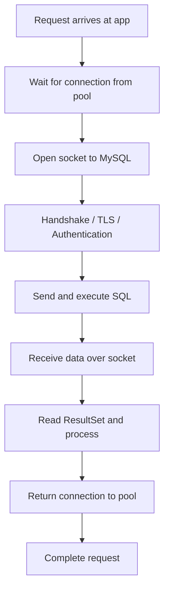
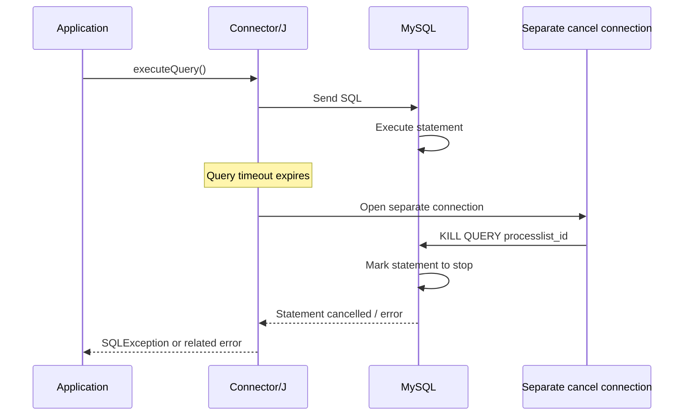

# connectTimeout, socketTimeout, Query Timeout, and Statement Cancellation

Java applications can encounter several kinds of waits when working with MySQL: waiting to borrow a connection from a pool, waiting to open a TCP connection, waiting for socket data, waiting for the server to execute SQL, or waiting to finish downloading results. Different timeouts in Connector/J govern different stages. Mistaking one stage's timeout for another can leave requests hanging, drop connections unexpectedly, or leave server queries running after the application already returned an error.

This lesson explains `connectTimeout`, `socketTimeout`, `Statement.setQueryTimeout()`, `Statement.cancel()`, and how they coordinate with MySQL server-side timeouts. Within the `DATABASE_MYSQL` module, this topic connects JDBC, connection pooling, transactions, and operational troubleshooting.

After this lesson, you will be able to:

- Distinguish wait times for pool acquisition, network connection, socket I/O, and SQL execution.
- Configure Connector/J timeouts with the right units and scopes.
- Use `Statement.setQueryTimeout()` and `Statement.cancel()` to stop statements.
- Understand how Connector/J sends `KILL QUERY` over a separate connection.
- Coordinate client-side timeouts with MySQL server-side SELECT execution limits.
- Handle transactions and connection pools after timeouts or cancellations.
- Budget request deadlines, test timeouts, and monitor them.

## 1. A Request Has Multiple Wait Stages

A database query request typically passes through these steps:

1. The application requests a connection from the connection pool.
2. If no idle connection is available, the application waits or the pool opens a new connection.
3. Connector/J resolves the address and opens a socket to MySQL.
4. Client and server perform handshake, TLS, and authentication.
5. The application sends the SQL statement and waits for server execution.
6. The driver receives metadata and result rows over the socket.
7. The application reads the `ResultSet`, processes results, and completes the request.



The corresponding timeouts do not substitute for one another:

| Timeout | Scope | Unit | What it controls |
|---|---|---|---|
| HikariCP `connectionTimeout` | Borrowing a connection from the pool | Milliseconds | Maximum time waiting for the pool to supply a connection |
| Connector/J `connectTimeout` | Opening socket to the server | Milliseconds | Wait time for the socket connect operation |
| Connector/J `socketTimeout` | Network operations on the socket | Milliseconds | Wait time for socket operations before timing out |
| JDBC `Statement.setQueryTimeout()` | Statement execution | Seconds | How long the driver waits for a statement before attempting to cancel it |
| MySQL `max_execution_time` | Execution of certain SELECTs | Milliseconds | Server-side limit for read-only SELECT statements |
| Application deadline | Entire request | Framework-specific | Total time the request is allowed to live |

Do not set every timeout to the exact same number. Each layer needs a limit suited to its work and must fit within the overall request deadline.

## 2. `connectTimeout`: Limiting Connection Establishment Time

`connectTimeout` is a Connector/J network property measured in milliseconds. It limits the time spent opening a socket connection to MySQL. The default is `0`, meaning no timeout is enforced by this property.

JDBC URL example:

```text
jdbc:mysql://mysql.example.internal:3306/shop?connectTimeout=3000
```

Example using `Properties`:

```java
Properties properties = new Properties();
properties.setProperty("user", dbUser);
properties.setProperty("password", dbPassword);
properties.setProperty("connectTimeout", "3000");

Connection connection = DriverManager.getConnection(
    "jdbc:mysql://mysql.example.internal:3306/shop",
    properties
);
```

With this configuration, Connector/J enforces a 3,000-millisecond limit for the socket connect operation. If a connection cannot be established within that window, the application receives a connection error instead of blocking indefinitely.

### 2.1. What `connectTimeout` Does Not Do

- Does not limit wait time to borrow a connection from HikariCP or another pool.
- Does not limit SQL execution duration after the connection is established.
- Does not limit application data processing time after receiving results.
- Does not act as a total deadline across multi-host failover retries.

In multi-host setups or configurations with retries/failover, total connection time can span multiple attempts. Verify failover policies and outer deadlines instead of assuming one `connectTimeout` value caps the entire process at that exact millisecond count.

## 3. `socketTimeout`: Limiting Network Operation Time

`socketTimeout` is also measured in milliseconds. It sets a timeout for operations on the network socket. The default is `0`, meaning no timeout is enforced by this property.

Example:

```text
jdbc:mysql://mysql.example.internal:3306/shop?connectTimeout=3000&socketTimeout=20000
```

Here, socket connection establishment has a 3-second limit, and socket network operations have a 20-second limit. When a socket operation exceeds this limit, Connector/J throws a communication error and the connection is typically no longer safe to reuse.

### 3.1. `socketTimeout` Is Not a Query Timeout

Suppose an aggregation query takes 25 seconds to run. If `socketTimeout=10000`, the client can time out waiting for server data after 10 seconds. That is not equivalent to the server receiving a statement cancellation via `Statement.cancel()`.

`socketTimeout` protects network I/O on the client side. It is not an SQL command telling MySQL to stop the query at a clean execution boundary. When a socket times out, the server may take time to detect the dropped connection and clean up work. Never rely on `socketTimeout` to guarantee a long-running query stopped immediately.

Treat any connection that hit a socket error as unreliable. Never return it to the pool for reuse unless the pool or driver verifies the connection is still valid.

### 3.2. Caution with Large Result Queries

For queries returning many rows or using streaming/cursor fetch, reading results can continue long after the server finished most of the query work. If the gap between incoming network reads exceeds `socketTimeout`, the client can error out even when the SQL statement is no longer consuming heavy server CPU.

Choose `socketTimeout` based on network characteristics, result sizes, and how the application consumes rows. If the application processes each row very slowly, speed up consumption or paginate results rather than raising timeouts indefinitely.

## 4. Pool Connection Acquisition Timeouts

When using HikariCP, HikariCP's `connectionTimeout` is the maximum time the application waits to obtain a connection from the pool. It is distinct from Connector/J's `connectTimeout`.

Example:

```java
HikariConfig config = new HikariConfig();
config.setJdbcUrl("jdbc:mysql://mysql.example.internal:3306/shop");
config.setUsername(dbUser);
config.setPassword(dbPassword);

// Wait time for HikariCP to borrow a connection from the pool.
config.setConnectionTimeout(5000);

// Connector/J network properties.
config.addDataSourceProperty("connectTimeout", "3000");
config.addDataSourceProperty("socketTimeout", "20000");

HikariDataSource dataSource = new HikariDataSource(config);
```

These values are illustrative. The pool can hand out an idle connection without opening a new socket. If the pool must open a new connection, socket connect and handshake times also consume part of the request's budget. Align pool timeouts and network timeouts with the overall deadline.

When the pool runs out of connections, raising `connectionTimeout` does not fix the root cause. Check for long-held connections, uncommitted transactions, slow queries, pool sizing, and MySQL's `max_connections` limit.

## 5. `Statement.setQueryTimeout()`: Limiting Statement Execution Time

JDBC defines `Statement.setQueryTimeout(int seconds)`. The value is in seconds:

- `0`: no query timeout set.
- Positive integer: seconds the driver waits for the statement before attempting cancellation.

This method applies to `Statement`, `PreparedStatement`, and `CallableStatement` since those interfaces extend `Statement`.

Example:

```java
String sql = "SELECT order_id, total_amount "
           + "FROM orders WHERE customer_id = ?";

try (Connection connection = dataSource.getConnection();
     PreparedStatement statement = connection.prepareStatement(sql)) {

    statement.setLong(1, customerId);
    statement.setQueryTimeout(3); // 3 seconds

    try (ResultSet resultSet = statement.executeQuery()) {
        while (resultSet.next()) {
            long orderId = resultSet.getLong("order_id");
            BigDecimal total = resultSet.getBigDecimal("total_amount");
            // Process results.
        }
    }
}
```

When the limit expires, JDBC asks the driver to cancel the running statement. If the driver determines a timeout occurred, the application typically receives `SQLTimeoutException`. Cancellation mechanics depend on the driver; Connector/J implements this by issuing `KILL QUERY` over a separate connection.

### 5.1. Timeout Is Measured in Seconds

`setQueryTimeout()` takes whole seconds. If millisecond-level limits are needed for certain SELECTs, consider server-side limits using `MAX_EXECUTION_TIME` or `max_execution_time` where appropriate. Never pass milliseconds into `setQueryTimeout()` because the driver interprets the argument as seconds.

### 5.2. Not a Full-Request Deadline

Query timeout does not cover the entire request duration. It does not include pool wait time, connection establishment, business logic before/after the query, or result processing time in the application. For large ResultSets, measure fetch and processing time separately.

## 6. How Does Connector/J Cancel Statements?

Connector/J supports both `Statement.cancel()` and `Statement.setQueryTimeout()`. Per the driver's implementation, both require a separate connection to send `KILL QUERY` to MySQL. For `setQueryTimeout()`, the driver uses a background timeout thread.

General flow:



The separate cancel connection must reach the exact same server and authenticate. If MySQL cannot accept another connection, the network fails, or cancellation fails, query timeout may fail to stop the statement as expected. Connector/J documentation also notes that errors during `setQueryTimeout()` cancellation can surface as a `RuntimeException` in certain cases rather than only a standard SQL error.

Therefore, test timeouts on your exact Connector/J version and deployment topology. Never assume every timeout returns the exact same exception or always halts the server-side query at the precise deadline instant.

## 7. `Statement.cancel()`: Application-Driven Cancellation

`Statement.cancel()` lets another thread request cancellation of a running statement. This is useful when a user clicks stop, an HTTP request aborts, or a coordinator detects work is no longer needed.

Conceptual example:

```java
Statement statement = connection.createStatement();

Future<?> runningQuery = executor.submit(() -> {
    try {
        statement.executeQuery("SELECT SLEEP(30)");
    } catch (SQLException exception) {
        // Record cancelled statement or query error.
    }
});

// Called from a thread handling the application's cancel signal.
statement.cancel();
```

This illustrates cross-thread invocation. In real applications, synchronize `Statement` lifecycles carefully: only cancel an active statement, do not reuse the statement for another query before cancellation completes, and close statements/connections cleanly.

`cancel()` is a cancellation request, not a guarantee that the server stopped immediately. A race condition can occur: the query may finish before `KILL QUERY` reaches the server. Applications must handle both completed and cancelled outcomes.

## 8. `KILL QUERY` vs. `KILL CONNECTION`

MySQL provides two administrative operations:

```sql
KILL QUERY processlist_id;
KILL CONNECTION processlist_id;
```

- `KILL QUERY` stops the currently executing statement while keeping the connection open.
- `KILL CONNECTION` terminates the connection and any statement running on it.

Connector/J uses `KILL QUERY` for normal `Statement.cancel()` and `setQueryTimeout()`. The `queryTimeoutKillsConnection` property changes behavior when a query timeout expires: when set to `true`, the driver aborts the connection instead of trying to cancel only the query. Its default is `false`.

Configuration example:

```text
jdbc:mysql://mysql.example.internal:3306/shop?queryTimeoutKillsConnection=false
```

When `queryTimeoutKillsConnection=true`, the aborted connection must be evicted from the pool. Never reuse that connection for a subsequent query. While useful when an entire session must be terminated, it destroys the connection and any open transaction state.

### 8.1. Privileges to Execute KILL

MySQL allows an account to kill threads/statements belonging to that same account. Killing threads owned by another account requires `CONNECTION_ADMIN` or the legacy `SUPER` privilege deprecated in newer versions. The `PROCESS` privilege governs visibility into other accounts' threads.

Connector/J normally uses the application's own credentials for the separate cancel connection. Never grant `CONNECTION_ADMIN` to application accounts just to cancel their own statements.

## 9. Server-Side Timeouts for SELECT

MySQL provides `max_execution_time` and the `MAX_EXECUTION_TIME(N)` optimizer hint. This is a server-side limit in milliseconds applying to supported read-only SELECT statements.

Example capping a single query at 1,500 milliseconds:

```sql
SELECT /*+ MAX_EXECUTION_TIME(1500) */
       order_id, total_amount
FROM orders
WHERE customer_id = 42;
```

You can also configure a session value:

```sql
SET SESSION max_execution_time = 1500;
```

`max_execution_time` defaults to `0`, meaning no limit is enabled. This mechanism applies only to read-only SELECTs; a SELECT invoking a stored function with write side effects is not considered read-only. The limit is also ignored for SELECTs inside stored programs.

Server-side limits help protect the database from runaway read queries. They do not replace client-side timeouts because they do not cover network connections, pool acquisition waits, or client-side result processing.

## 10. Do Not Confuse Query Timeout with Lock Wait Timeout

MySQL has other timeouts targeting specific wait conditions:

| Mechanism | Scope |
|---|---|
| `innodb_lock_wait_timeout` | InnoDB row lock wait duration |
| `lock_wait_timeout` | Metadata lock wait duration |
| `wait_timeout` | Idle time for non-interactive connections |
| `net_read_timeout` / `net_write_timeout` | Certain server-side network read/write operations |
| `max_execution_time` | Read-only SELECT execution |
| `Statement.setQueryTimeout()` | JDBC/driver statement timeout |
| `socketTimeout` | Client-side socket network operations |

For example, an UPDATE might wait 40 seconds on a row lock. `innodb_lock_wait_timeout` can fail the operation once lock wait exceeds its limit, even if JDBC's query timeout is longer. Conversely, an unlocked CPU-heavy query can exceed `setQueryTimeout()` without hitting lock wait timeout.

Diagnose the actual cause of waiting before changing timeouts. Raising `innodb_lock_wait_timeout` does not fix missing indexes; raising `socketTimeout` does not fix lock contention; raising `connectTimeout` does not solve pool exhaustion.

## 11. Budgeting Timeouts Against an Overall Deadline

Suppose an API has a 4-second deadline. An illustrative budget breakdown could look like:

| Stage | Example budget |
|---|---:|
| Wait for pool to supply connection | 500 ms |
| Open new connection if needed | 800 ms |
| SQL execution | 2 seconds |
| Fetch and process results | 500 ms |
| Safety buffer | 200 ms |

Tune values to actual p95/p99 latencies, load, and product requirements. Keep a safety buffer so the application can close resources and return a response before the outer deadline expires.

Key principles:

- Inner-layer timeouts should be shorter than outer-layer deadlines so the application has time to handle errors.
- `connectTimeout` must not be confused with pool wait time.
- `socketTimeout` must be long enough for legitimate network waits and fetch patterns.
- `setQueryTimeout()` should reflect the SQL execution budget, not the entire request.
- When using `max_execution_time`, align it with server policy and apply only to suitable SELECTs.
- Retries must be bounded, use backoff, and run only when operations are known to be safely repeatable.

Never set timeouts excessively low just to make error dashboards react faster. Overly aggressive timeouts can trigger retry storms, overloading the source and destabilizing the system.

## 12. Transactions and Connection Pools After Statement Cancellation

Cancelling a statement does not mean the entire transaction rolled back. `KILL QUERY` stops the statement while keeping the connection; an open transaction may still require application handling. After a timeout/cancellation inside a transaction, assess state and normally call `Connection.rollback()` before returning the connection to the pool.

Example:

```java
try (Connection connection = dataSource.getConnection()) {
    connection.setAutoCommit(false);

    try (PreparedStatement statement = connection.prepareStatement(
            "UPDATE inventory SET quantity = quantity - ? WHERE product_id = ?")) {

        statement.setInt(1, quantity);
        statement.setLong(2, productId);
        statement.setQueryTimeout(3);
        statement.executeUpdate();

        connection.commit();
    } catch (SQLException exception) {
        try {
            connection.rollback();
        } catch (SQLException rollbackException) {
            exception.addSuppressed(rollbackException);
        }
        throw exception;
    }
}
```

This illustrates a transaction pattern. If the connection was lost due to socket timeout or `queryTimeoutKillsConnection=true`, calling rollback on that connection may fail. Close the connection and let the pool evict the broken connection per pool configuration.

### 12.1. Write Outcomes Can Be Ambiguous

If a timeout or connection drop occurs while sending DML or waiting for a `COMMIT` response, the application may not know whether the server committed. The server may have completed the transaction while the acknowledgment never reached the client.

Never automatically retry a non-idempotent write operation simply because the client saw a timeout. For example, resending an inventory deduction or payment creation can apply the business action twice if the first attempt committed. Use a unique request ID/idempotency key, unique constraints, or state reconciliation before retrying.

### 12.2. Never Return a Connection with Uncertain State to the Pool

Before a connection is reused, ensure:

- No statement is still running.
- ResultSets and Statements are closed.
- The transaction has committed or rolled back.
- The connection did not suffer a socket error or abort.
- Session state is reset per the pool's mechanism.

If state cannot be verified, close the connection so the pool evicts it instead of reusing a session with an ambiguous transaction or state.

## 13. `enableQueryTimeouts` and `queryTimeoutKillsConnection`

Connector/J exposes two properties important when using JDBC query timeouts:

| Property | Default | Meaning |
|---|---|---|
| `enableQueryTimeouts` | `true` | Enables scheduling for timeouts set via `Statement.setQueryTimeout()` |
| `queryTimeoutKillsConnection` | `false` | On timeout expiry, aborts the connection instead of attempting to abort only the query |

`enableQueryTimeouts` uses a shared `java.util.Timer` for scheduling. Connector/J documentation notes that TimerTasks may remain in memory until the original timeout deadline even if the query completed earlier. On very high-throughput systems, measure memory impact and evaluate this property before changing it; disabling it means `setQueryTimeout()` should no longer be expected to trigger timeouts as before.

`queryTimeoutKillsConnection=true` changes timeout handling and aborts the connection. If enabled, ensure the pool evicts aborted connections. Do not enable it merely to silence timeout errors in logs; decide whether your goal is cancelling the statement or terminating the entire session.

These properties can change across Connector/J versions. Verify the documentation for your exact driver version.

## 14. Combined Configuration in Java Applications

Example with `DriverManager`:

```java
String url = "jdbc:mysql://mysql.example.internal:3306/shop"
           + "?connectTimeout=3000"
           + "&socketTimeout=20000"
           + "&enableQueryTimeouts=true"
           + "&queryTimeoutKillsConnection=false";

Properties properties = new Properties();
properties.setProperty("user", secretProvider.get("shop-db-user"));
properties.setProperty("password", secretProvider.get("shop-db-password"));

try (Connection connection = DriverManager.getConnection(url, properties);
     PreparedStatement statement = connection.prepareStatement(
         "SELECT order_id, total_amount FROM orders WHERE customer_id = ?")) {

    statement.setLong(1, customerId);
    statement.setQueryTimeout(2);

    try (ResultSet resultSet = statement.executeQuery()) {
        while (resultSet.next()) {
            // Process result row.
        }
    }
}
```

`secretProvider` is an illustrative component. Fetch credentials from a secret manager or your platform's secure provider; never hardcode passwords or log JDBC URLs containing secrets.

Example with HikariCP:

```java
HikariConfig config = new HikariConfig();
config.setJdbcUrl("jdbc:mysql://mysql.example.internal:3306/shop");
config.setUsername(secretProvider.get("shop-db-user"));
config.setPassword(secretProvider.get("shop-db-password"));

config.setConnectionTimeout(5000); // Wait for connection from pool, ms
config.addDataSourceProperty("connectTimeout", "3000"); // Socket connect, ms
config.addDataSourceProperty("socketTimeout", "20000"); // Socket operations, ms
config.addDataSourceProperty("enableQueryTimeouts", "true");

HikariDataSource dataSource = new HikariDataSource(config);
```

`Statement.setQueryTimeout()` is still set on each statement or via the application's data access layer. There is no universal JDBC URL property named `queryTimeout` that directly replaces this JDBC method.

## 15. Monitoring and Investigating Timeouts

When a timeout occurs, determine which layer triggered it. Record non-sensitive details:

- Request/trace ID and start timestamp.
- Pool connection acquisition wait time.
- New connection establishment time, if applicable.
- MySQL host and pool state.
- Query fingerprint or operation name, avoiding logging full sensitive parameter values.
- Which timeout fired: pool, connect, socket, query, or application deadline.
- SQLState, vendor error code, exception class, and cause.
- Whether a transaction was open and the commit/rollback outcome.
- Whether the query kept running on the server after the client reported an error.

Inspect running queries with:

```sql
SHOW FULL PROCESSLIST;
```

Or inspect threads via Performance Schema if the account has privileges:

```sql
SELECT
    PROCESSLIST_ID,
    PROCESSLIST_USER,
    PROCESSLIST_HOST,
    PROCESSLIST_DB,
    PROCESSLIST_COMMAND,
    PROCESSLIST_TIME,
    PROCESSLIST_STATE,
    PROCESSLIST_INFO
FROM performance_schema.threads
WHERE TYPE = 'FOREGROUND'
  AND PROCESSLIST_ID IS NOT NULL;
```

If manual cancellation is required, verify the exact `processlist_id` before running `KILL QUERY`. Never confuse `KILL QUERY` with `KILL CONNECTION`, and never kill threads based solely on elapsed time without confirming owner and impact.

### 15.1. Metrics to Monitor

- Timeout counts by category and by endpoint.
- p50, p95, p99 durations for pool acquisition, connect, execute, and fetch.
- `Statement.cancel()` success/failure rate.
- Aborted connection count and pool connection recreation rate.
- Active/idle/pending connections, pool acquisition timeouts, and connection leaks.
- Long-running query count, lock waits, and long-lived open transactions.
- Retry rate, duplicate idempotency key hits, and uncertain commit outcomes.

Tracking only total `SQLTimeoutException` counts can miss socket or pool timeouts. Categorize errors by stage to pinpoint root causes.

## 16. Common Errors and Troubleshooting

| Symptom | Possible cause | Resolution |
|---|---|---|
| Connection hangs when MySQL is unreachable | `connectTimeout=0` or too high | Set a socket connect limit and verify DNS/network separately |
| Pool reports failure to acquire connection | Pool exhausted, connections held too long, or pool acquisition timeout too short | Check active/pending connections, leaks, and slow queries |
| `CommunicationsException` or `SocketTimeoutException` | Socket operation exceeded `socketTimeout`, network disruption, or server failed to respond in time | Check network, server load, fetch size, and timeout values |
| Query timeout fires but server remains busy | Query cancellation failed, KILL failed to reach server, or query finished during race | Check processlist, driver logs, and ability to open separate cancel connection |
| Timeout renders connection unusable | `queryTimeoutKillsConnection=true` or socket error | Evict connection from pool and open a fresh one |
| Query cancelled yet transaction remains open | `KILL QUERY` stops only the statement, not necessarily the session/transaction | Roll back transaction before returning connection to pool |
| Application retries create duplicate data | Commit outcome was unknown yet write was re-sent | Use idempotency keys and check state before retrying |
| Query timeout does not trigger | `setQueryTimeout(0)`, `enableQueryTimeouts=false`, or framework omitted timeout | Check driver settings and actual statement setup |
| Timeouts behave differently across environments | Different Connector/J versions, pools, proxies, or networks | Compare versions, URL properties, pool configs, and topology |

Never raise all timeouts at once just to make errors vanish. Adjust one layer at a time, re-measure, and verify whether waiting occurs at that exact layer.

## 17. Testing Timeouts and Cancellation

Perform tests in a controlled lab environment:

1. **Test connect timeout:** point the application at a host/port with no listening MySQL instance and confirm the error fires near the configured `connectTimeout`.
2. **Test socket timeout:** create a network condition or query with a data pause exceeding `socketTimeout`; confirm the client receives a network error and the connection is evicted if invalid.
3. **Test query timeout:** run `SELECT SLEEP(10)` with `setQueryTimeout(2)` and observe the exception and server state.
4. **Test manual cancel:** run a long statement in a worker thread, call `Statement.cancel()` from a control thread, and verify the query stops.
5. **Test privileges:** confirm the account can cancel its own statements; never grant broad admin privileges just to kill other accounts' threads.
6. **Test transactions:** run DML inside a transaction, trigger a timeout, and verify rollback and connection state before returning to the pool.
7. **Test queryTimeoutKillsConnection:** test both `false` and `true` in the lab, confirming the pool handles the connection appropriately.
8. **Load test:** trigger multiple concurrent query timeouts and monitor threads/timers, separate cancel connections, and server resources.
9. **Test deadlines:** simulate request cancellation while waiting on the pool, opening a socket, executing SQL, and reading ResultSet.
10. **Test retries:** simulate a timeout right around commit time and confirm idempotency keys prevent duplicate writes.

After each test, confirm no background test queries remain running, transactions are resolved, and the connection pool retains no broken connections.

**Self-assessment questions:**

- At which stage do Connector/J `connectTimeout` and HikariCP `connectionTimeout` differ?
- Why does `socketTimeout` not replace `Statement.setQueryTimeout()`?
- What unit does `setQueryTimeout()` use, and what does `0` mean?
- Why does Connector/J need a separate connection to send `KILL QUERY`?
- How does `KILL QUERY` differ from `KILL CONNECTION`?
- When does `queryTimeoutKillsConnection=true` require evicting the connection from the pool?
- Which SELECT types does `max_execution_time` apply to, and when is it ignored?
- Why can a timeout during `COMMIT` leave the write outcome uncertain?
- After a statement is cancelled inside a transaction, what must the application do before reusing the connection?
- How do you distinguish pool timeout, connect timeout, socket timeout, and query timeout errors in logs?

## Conclusion

`connectTimeout`, `socketTimeout`, JDBC query timeout, and connection pool timeouts govern separate wait stages. Connector/J issues `KILL QUERY` over a separate connection to implement `Statement.cancel()` and `setQueryTimeout()`, whereas `socketTimeout` bounds only network socket I/O. Align all limits with overall deadlines, roll back transactions after cancellation, evict broken connections from pools, and use idempotency to handle uncertain write outcomes.

## References

- [MySQL Connector/J — Networking properties](https://dev.mysql.com/doc/connector-j/en/connector-j-connp-props-networking.html)
- [MySQL Connector/J — Statement properties](https://dev.mysql.com/doc/connector-j/en/connector-j-connp-props-statements.html)
- [MySQL Connector/J — JDBC API implementation notes](https://dev.mysql.com/doc/connector-j/en/connector-j-reference-implementation-notes.html)
- [MySQL 8.4 — KILL statement](https://dev.mysql.com/doc/refman/8.4/en/kill.html)
- [MySQL 8.4 — Statement execution time optimizer hint](https://dev.mysql.com/doc/refman/8.4/en/optimizer-hints.html)
