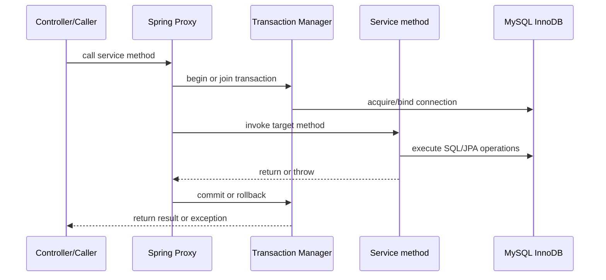

# @Transactional, Propagation, and Proxy-Based Transaction Boundaries

## Objectives

In a Spring Boot application backed by MySQL, `@Transactional` defines the transaction boundary managed by Spring through a transaction manager. This annotation does not automatically turn every Java method call into a transaction: in the default proxy mode, calls must pass through the Spring proxy for transaction advice to be applied. Meanwhile, propagation determines whether a method joins an existing transaction, starts a new transaction, or runs without a transaction.

Understanding proxies and propagation prevents subtle bugs such as self-invocation silently bypassing the annotation, transactions rolling back even after an exception was caught, `REQUIRES_NEW` exhausting the connection pool, or JDBC code failing to participate in the JPA transaction.

This lesson belongs to the **DATABASE_MYSQL** module, focusing on table design, data types, keys, SQL, indexes, transactions, concurrency control, query tuning, and relational database operations. After this lesson, you will be able to:

- Explain how Spring applies `@Transactional` via proxies and transaction managers.
- Distinguish all seven propagation modes and select the right one for each business case.
- Understand default rollback behavior, `rollbackFor`, `noRollbackFor`, and rollback-only state.
- Identify self-invocation, thread boundaries, and the difference between nested and independent transactions.
- Design transaction boundaries suited to InnoDB, JPA, JDBC, and connection pools.

## 1. Transactions in Spring and MySQL

A transaction groups a set of database operations into a single unit of commit or rollback. With MySQL, tables must use a transactional storage engine—typically InnoDB. An InnoDB transaction ensures that changes within the transaction commit atomically or roll back upon failure, while adhering to isolation levels and locking rules.

Spring provides the `PlatformTransactionManager` abstraction to manage transactions consistently. For Spring Data JPA applications, Spring Boot normally configures `JpaTransactionManager` when an `EntityManagerFactory` is present. For plain JDBC, it uses `DataSourceTransactionManager` or `JdbcTransactionManager` depending on the Spring version.

`@Transactional` is metadata telling Spring that a method or class requires transactional execution. The proxy intercepts calls, starts or joins a transaction via the transaction manager, invokes the target method, and commits or rolls back according to the outcome and rollback rules.



Place transaction boundaries at the service layer around a complete unit of business work. Repositories typically perform individual data operations; service-level transactions allow multiple repositories to share one transaction.

## 2. How Is `@Transactional` Applied via Proxy?

In default proxy mode, Spring creates a proxy around beans containing `@Transactional` methods. When another bean invokes the method through the proxy, Spring inspects metadata, selects the transaction manager, applies propagation, and starts a transaction if required.

Example:

```java
@Service
public class OrderService {
    private final OrderRepository orders;
    private final InventoryRepository inventory;

    public OrderService(OrderRepository orders, InventoryRepository inventory) {
        this.orders = orders;
        this.inventory = inventory;
    }

    @Transactional
    public void placeOrder(long productId, int quantity) {
        inventory.decreaseAvailable(productId, quantity);
        orders.save(new Order(productId, quantity));
    }
}
```

When a controller or another bean calls `orderService.placeOrder(...)` via the Spring bean reference, the proxy opens a transaction before executing the method. JPA operations under the same transaction manager join that transaction. If the method completes normally, the transaction commits; if an exception matching rollback rules escapes the method, the transaction rolls back.

### Self-Invocation Bypasses the Proxy

A common mistake is calling another `@Transactional` method on the same object via `this`:

```java
@Service
public class ImportService {
    public void importFile(List<Row> rows) {
        this.saveBatch(rows);
    }

    @Transactional
    public void saveBatch(List<Row> rows) {
        // Write data
    }
}
```

`this.saveBatch(...)` is an internal call directly on the target object, bypassing the proxy. In default proxy mode, the transaction annotation on `saveBatch` has no effect for this call. If the external caller has no active transaction, the method runs non-transactionally despite the annotation.

The cleanest fix is extracting the transactional unit into another Spring bean:

```java
@Service
public class ImportBatchWriter {
    @Transactional
    public void saveBatch(List<Row> rows) {
        // Write a batch inside a transaction
    }
}

@Service
public class ImportService {
    private final ImportBatchWriter writer;

    public ImportService(ImportBatchWriter writer) {
        this.writer = writer;
    }

    public void importFile(List<Row> rows) {
        writer.saveBatch(rows); // Goes through ImportBatchWriter proxy
    }
}
```

Never instantiate advised beans manually with `new ImportBatchWriter(...)`. Nor should you inject a bean into itself just to call through the proxy when a cleaner service separation is possible.

### Proxy-Type Limitations

Spring can use JDK dynamic proxies or class-based proxies. With JDK proxies, calls must go through an interface exposed by the proxy. With class-based proxies, `private` methods cannot be overridden for interception; `final` classes or methods cannot be overridden by a subclass proxy either. Public service methods invoked from another bean are the clearest and most reliable pattern. If self-invocation interception is strictly required, Spring offers AspectJ weaving, which requires dedicated build/runtime weaving configuration.

## 3. Placement of `@Transactional` and Precedence

You can place the annotation on a class or a method:

```java
@Service
@Transactional(readOnly = true)
public class CustomerQueryService {
    public Customer findById(long id) {
        // Read-only by default per class configuration
        return repository.findById(id).orElseThrow();
    }

    @Transactional
    public void updateEmail(long id, String email) {
        // Method annotation overrides class metadata
    }
}
```

Method-level annotations override corresponding class-level metadata. Placing `readOnly = true` at the class level suits read-mostly services while allowing write methods to override explicitly. Remember this is a hint to the transaction manager/provider, not a security authorization mechanism replacing MySQL account privileges.

When an application has multiple transaction managers, specify the bean explicitly:

```java
@Transactional(transactionManager = "ordersTransactionManager")
public void createOrder() {
    // Operations on the orders database
}
```

Never assume one transaction manager spans multiple databases atomically. A JPA/JDBC transaction manager typically manages a single resource; distributed transactions across multiple resources require a separate architecture with distinct trade-offs.

## 4. What Is Propagation?

Propagation specifies how a transactional method interacts with an existing transaction at the moment the proxy receives the call. The default for `@Transactional` is `Propagation.REQUIRED`.

| Propagation | Transaction Active During Call? | Behavior |
|---|---|---|
| `REQUIRED` | Yes if caller has one; otherwise creates new | Joins current transaction or opens a new one |
| `REQUIRES_NEW` | Always runs in its own transaction | Suspends current transaction and opens a new one |
| `NESTED` | Uses savepoint inside existing transaction if supported; otherwise creates new | Allows rolling back to a savepoint; not an independent transaction |
| `SUPPORTS` | Joins if present; runs non-transactionally if absent | Used for logic able to run with or without a transaction |
| `NOT_SUPPORTED` | No | Suspends current transaction and runs non-transactionally |
| `MANDATORY` | Required | Joins current transaction; throws exception if none exists |
| `NEVER` | Forbidden | Runs non-transactionally; throws exception if caller has a transaction |

Propagation itself does not govern isolation level or timeout. Those attributes apply when a new transaction is created; when joining an existing transaction, the outer transaction's attributes generally remain in force.

## 5. `REQUIRED`: The Default and Most Common

`REQUIRED` joins an active transaction if one exists; otherwise it starts a new transaction. This is usually appropriate for operations forming one atomic business action.

```java
@Service
public class CheckoutService {
    private final PaymentRepository payments;
    private final OrderWriter orderWriter;

    public CheckoutService(PaymentRepository payments, OrderWriter orderWriter) {
        this.payments = payments;
        this.orderWriter = orderWriter;
    }

    @Transactional
    public void checkout(Order order) {
        payments.recordAuthorization(order.payment());
        orderWriter.save(order);
    }
}

@Service
public class OrderWriter {
    private final OrderRepository repository;

    public OrderWriter(OrderRepository repository) {
        this.repository = repository;
    }

    @Transactional(propagation = Propagation.REQUIRED)
    public void save(Order order) {
        repository.save(order);
    }
}
```

If `checkout()` has already started a transaction, `save()` joins it. If saving the order fails and triggers rollback, both the payment authorization record inside that same database transaction and the order roll back together. This applies only to operations within the same resource/transaction manager; calls to external payment gateways do not automatically roll back with MySQL.

### `UnexpectedRollbackException`

If a method participating via `REQUIRED` marks the shared transaction as rollback-only, the outer caller cannot force a commit by catching the exception. For instance, an inner method throws a runtime exception, Spring marks the transaction rollback-only, and the outer method catches the exception. When the outer method finishes normally, Spring still rolls back and throws `UnexpectedRollbackException` to inform the caller that the expected commit did not occur.

```java
@Service
public class RowWriter {
    private final RowRepository repository;

    public RowWriter(RowRepository repository) {
        this.repository = repository;
    }

    @Transactional(propagation = Propagation.REQUIRED)
    public void write(List<Row> rows) {
        repository.saveAll(rows);
    }
}

@Service
public class ImportService {
    private final RowWriter writer;

    public ImportService(RowWriter writer) {
        this.writer = writer;
    }

    @Transactional
    public void importOneBatch(List<Row> rows) {
        try {
            writer.write(rows); // REQUIRED joins this transaction
        } catch (DataIntegrityViolationException ex) {
            // Catching the exception does not clear the rollback-only flag
            recordRejectedBatch(ex);
        }
    }
}
```

If failure details must be persisted independently of the business transaction, explicitly write the log/audit in a separate transaction or after the transaction finishes. Never swallow an exception assuming the transaction will still commit.

## 6. `REQUIRES_NEW`: Independent Transaction

`REQUIRES_NEW` always starts a new physical transaction. If the caller already has a transaction, Spring suspends the outer transaction, opens a new transaction, commits or rolls back the new transaction, and then resumes the outer transaction.

Example recording audit entries that must survive even if outer business logic rolls back:

```java
@Service
public class AuditWriter {
    private final AuditRepository repository;

    public AuditWriter(AuditRepository repository) {
        this.repository = repository;
    }

    @Transactional(propagation = Propagation.REQUIRES_NEW)
    public void recordFailure(String requestId, String reason) {
        repository.save(new AuditEntry(requestId, reason));
    }
}
```

This method must be invoked through the Spring proxy, such as from another bean. While the outer transaction holds a connection, the inner `REQUIRES_NEW` transaction normally requires a second connection. If many concurrent requests hold outer connections while waiting for `REQUIRES_NEW`, the pool can run dry or deadlock on pool acquisition. Size your pool for concurrency and nesting depth, and keep transactions brief.

`REQUIRES_NEW` suits audit logs or state updates that must commit independently under clear semantics. It is unsuitable when new records should roll back alongside the main business action—for example, committing an "order created" audit row in `REQUIRES_NEW` before the order transaction commits can leave misleading audit records.

## 7. `NESTED`: Savepoint, Not an Independent Transaction

`NESTED` represents a nested transaction via a savepoint inside the current physical transaction when supported by the transaction manager. If the nested section fails, the manager rolls back to the savepoint, allowing the outer transaction prior to the savepoint to continue.

```java
@Service
public class NestedRowWriter {
    private final RowRepository repository;

    public NestedRowWriter(RowRepository repository) {
        this.repository = repository;
    }

    @Transactional(propagation = Propagation.NESTED)
    public void saveOne(Row row) {
        repository.save(map(row));
    }
}

@Service
public class BatchImportService {
    private final NestedRowWriter rowWriter;

    public BatchImportService(NestedRowWriter rowWriter) {
        this.rowWriter = rowWriter;
    }

    @Transactional
    public void importBatch(List<Row> rows) {
        saveHeader();
        for (Row row : rows) {
            try {
                rowWriter.saveOne(row); // Call goes through proxy
            } catch (DataAccessException ex) {
                // Handle failed row according to business rules
            }
        }
    }
}
```

This snippet illustrates the concept; `NESTED` requires proxy invocation and savepoint support in the transaction manager. `DataSourceTransactionManager` supports nested transactions via JDBC savepoints. `JpaTransactionManager` does not enable nested transactions by default; even if JDBC savepoints are enabled, JPA's persistence context state is not automatically rolled back in sync with a savepoint. Therefore, never use `NESTED` with JPA expecting isolated persistence contexts per call. Check your exact transaction manager before selecting it.

Crucial distinction: `NESTED` does not commit independently. If the outer transaction rolls back, nested changes kept after a savepoint also roll back.

## 8. Remaining Propagation Modes

- **`SUPPORTS`:** joins a transaction if the caller has one; otherwise executes non-transactionally. Useful for queries or logic that do not require opening a transaction on their own. Resource synchronization still depends on the transaction manager.
- **`NOT_SUPPORTED`:** suspends the current transaction and runs the method body non-transactionally. Use cautiously for long-running tasks or reads that should not hold a transaction, since database operations inside may execute in individual auto-commit mode.
- **`MANDATORY`:** requires the caller to have an active transaction. Suited for business helpers that must never run standalone; if called without a transaction, Spring throws `IllegalTransactionStateException`.
- **`NEVER`:** requires no active transaction. If the caller has one, Spring throws `IllegalTransactionStateException`. Use when an operation must strictly run outside a transaction.

Do not pick propagation modes just for variety. Clearly specify whether business operations must commit together, commit independently, partially roll back, or run outside transactions before choosing a mode.

## 9. Rollback Rules: Which Exceptions Trigger Rollback?

By default, Spring rolls back transactions when an unchecked runtime exception (`RuntimeException`) or `Error` escapes a transactional method. Checked exceptions do not trigger automatic rollback under this default; a transaction can commit if a checked exception is thrown without an explicit rollback rule.

To roll back on checked exceptions as well, declare `rollbackFor`:

```java
@Transactional(rollbackFor = Exception.class)
public void processPayment() throws PaymentException {
    debitAccount();
    callRiskCheck();
    creditSettlement();
}
```

To prevent rollback for a specific exception type, use `noRollbackFor`:

```java
@Transactional(noRollbackFor = BusinessWarningException.class)
public void processRequest() {
    // Explicitly confirm this warning should not abort the transaction
}
```

Never configure `noRollbackFor` merely to hide visible errors. If the transaction was already marked rollback-only by an earlier operation, catching the exception or changing rules in the caller will not un-mark the transaction.

### Exceptions Caught Inside the Method

If a transactional method catches an exception without rethrowing it, the Spring interceptor sees a normal method return. Unless something marked the transaction rollback-only, the transaction may commit prior operations. Accordingly, when detecting a failure that requires rollback, throw an appropriate exception or call `TransactionAspectSupport.currentTransactionStatus().setRollbackOnly()` deliberately when you understand the consequences.

## 10. Transaction Boundaries with JPA and JDBC

With `JpaTransactionManager`, Spring manages the `EntityManager` and JPA transactions. Spring Data JPA repositories automatically join existing transactions. If JPA and JDBC share the same `DataSource`, `JdbcTemplate` can participate in the Spring-managed transaction.

Example using `JdbcTemplate` in the same service:

```java
@Service
public class AccountService {
    private final AccountRepository repository;
    private final JdbcTemplate jdbcTemplate;

    public AccountService(AccountRepository repository, JdbcTemplate jdbcTemplate) {
        this.repository = repository;
        this.jdbcTemplate = jdbcTemplate;
    }

    @Transactional
    public void updateAccount(long id, String status) {
        Account account = repository.findById(id).orElseThrow();
        account.setStatus(status);

        jdbcTemplate.update(
            "INSERT INTO account_events(account_id, event_type) VALUES (?, ?)",
            id, status
        );
    }
}
```

Because `JdbcTemplate` obtains connections via Spring's resource synchronization, JDBC operations share the JPA transaction when both use the same `DataSource` and a compatible transaction manager. Calling `dataSource.getConnection()` directly and managing it manually can acquire a separate connection outside the active transaction. Always use `JdbcTemplate` or `DataSourceUtils.getConnection(dataSource)` when performing JDBC work inside a Spring transaction.

With JPA, entity changes synchronize to the database at flush/commit; calling `save()` does not necessarily emit SQL at that exact line. To catch constraint violations early, call `saveAndFlush()` or `EntityManager.flush()`, remembering that flush is not commit.

## 11. Transactions in MySQL InnoDB

`@Transactional` coordinates transactions at the Spring layer; MySQL executes transactions at the storage engine layer. For table data rollbacks to work, participating tables must use a transactional engine like InnoDB.

Verify table engines:

```sql
SELECT TABLE_NAME, ENGINE
FROM information_schema.TABLES
WHERE TABLE_SCHEMA = DATABASE();
```

Key considerations with MySQL:

- InnoDB supports commit/rollback and row-level locking; long transactions retain row locks, undo history, and increase contention.
- DDL such as `CREATE TABLE`, `ALTER TABLE`, or `DROP TABLE` causes an implicit commit. Never assume DDL rolls back alongside DML inside a `@Transactional` method.
- `readOnly = true` is a hint to the transaction manager/provider that may enable optimizations; it does not replace MySQL `SELECT` privileges and is not a security barrier.
- Isolation levels such as `READ_COMMITTED` or `REPEATABLE_READ` affect snapshots and locking. When changing them, verify MySQL settings, transaction manager behavior, and actual runtime outcomes.
- Never make HTTP calls, send emails, or wait on users while holding a database transaction open. External side effects do not automatically roll back with a MySQL transaction.

Example setting isolation and timeout:

```java
@Transactional(
    isolation = Isolation.READ_COMMITTED,
    timeout = 10
)
public void updateInventory() {
    // New transaction created with these attributes
}
```

Isolation and timeout normally apply only when a new transaction is started. If the method joins an existing transaction via `REQUIRED`, the outer transaction governs the effective attributes.

## 12. Transactions Do Not Propagate Across Threads

In imperative JDBC/JPA applications, Spring transactions bind to the current thread via transaction synchronization and resource binding. When execution switches threads via `@Async`, `CompletableFuture`, an executor, or manual thread creation, the caller's transaction does not propagate to the new thread.

For example, do not expect the following two operations to share a transaction simply because they originate from one `@Transactional` method:

```java
@Transactional
public void process() {
    repository.save(first);
    CompletableFuture.runAsync(() -> repository.save(second));
}
```

The async callback executes on a different thread and either opens its own transaction or runs non-transactionally depending on configuration. If an independent unit of work is needed, place `@Transactional` on a bean invoked inside that async thread. To guarantee events fire only after commit, use `@TransactionalEventListener(phase = AFTER_COMMIT)` or the transactional outbox pattern rather than emitting external events before the transaction commits.

Reactive transactions use Reactor context and a reactive transaction manager; do not mechanically apply thread-bound imperative JDBC/JPA assumptions to reactive stacks.

## 13. Testing Transactions and Propagation

Tests must verify persisted data after commit/rollback, not merely verify method invocations. Guidelines:

- Use real MySQL or Testcontainers when verifying InnoDB behavior, constraints, isolation, and locking.
- Trigger errors before commit and assert that data rolled back.
- Test checked exceptions both with and without `rollbackFor`.
- Test self-invocation by observing actual transaction execution rather than reading annotations alone.
- Test `REQUIRES_NEW`: verify audit transactions commit even when the outer transaction rolls back.
- Test `NESTED` on your actual transaction manager and confirm savepoint support.
- In tests annotated with `@Transactional`, remember Spring Test normally rolls back the test transaction at completion; to verify real commits, use `TestTransaction.flagForCommit()`/`end()` or design tests without a wrapping test transaction.

To inspect active transaction status at runtime, use `TransactionSynchronizationManager.isActualTransactionActive()` in diagnostic code or log correlation IDs alongside transaction boundaries. Never treat logs as a substitute for data assertions.

## 14. Common Errors and Troubleshooting

- **Self-invocation:** an internal call invokes `this.someTransactionalMethod()`. Extract the method into a separate bean so calls pass through the proxy.
- **Checked exception thrown yet data commits:** checked exceptions do not trigger rollback by default. Add an appropriate `rollbackFor`.
- **Caught exception expecting rollback:** Spring sees normal completion or the transaction was marked rollback-only. Rethrow the exception or explicitly set rollback-only.
- **`UnexpectedRollbackException`:** an inner participant marked the shared transaction rollback-only. Locate the root exception and avoid swallowing errors in inner layers.
- **`REQUIRES_NEW` exhausts the pool:** outer transactions hold connections while nested ones request extra connections. Limit nesting/concurrency, shorten transactions, and re-size the pool.
- **`NESTED` fails to work with JPA as expected:** transaction manager lacks savepoint support or persistence context does not roll back in sync. Check the manager and consider separate transactions.
- **JDBC fails to roll back with JPA:** code acquired a connection outside Spring or used a different `DataSource`/transaction manager. Share the same `DataSource` and resource-aware utilities.
- **DDL does not roll back:** MySQL issues an implicit commit for certain DDL. Keep schema migrations separate from business transactions.
- **Long-running transactions:** network calls or heavy work occur while holding connections/locks. Narrow transaction boundaries.
- **Async work does not join caller transaction:** new threads have separate transaction contexts. Define explicit boundaries inside async-invoked beans or emit events after commit.

## 15. Hands-On Exercise

In a Spring Boot application using Spring Data JPA and MySQL InnoDB:

1. Create an `OrderService` with `@Transactional` calling two repositories; force a failure in the second operation and verify the first rolls back.
2. Extract a writer into a separate bean, invoke it through the proxy, and contrast with self-invocation inside the same bean.
3. Introduce a checked exception; test without `rollbackFor`, then add `rollbackFor = Exception.class` and compare persisted rows.
4. Create an inner `REQUIRED` method that throws a runtime exception, catch it in the outer method, and observe `UnexpectedRollbackException` when the outer method completes.
5. Create a `REQUIRES_NEW` audit writer; roll back the outer transaction and verify the audit entry still commits.
6. If supported by your transaction manager, test `NESTED` with savepoints and contrast with `REQUIRES_NEW`.
7. Test `@Async` to confirm transactions do not propagate automatically across threads.
8. Combine `JdbcTemplate` and a JPA repository on the same `DataSource` in one transaction; verify both roll back together.

**Completion criteria:** you can explain when proxies apply annotations, distinguish all propagation modes, predict rollback behavior by exception type, and demonstrate with MySQL data that transactions join or isolate exactly as designed.

## Conclusion

`@Transactional` operates via proxies and transaction managers; propagation governs how methods join or initiate transactions. `REQUIRED` fits most business operations that must commit together, `REQUIRES_NEW` starts independent transactions, and `NESTED` relies on savepoints where supported. Place boundaries at the service layer, invoke through proxies, define explicit rollback rules, use InnoDB with a unified resource manager for JPA/JDBC, and verify self-invocation, async behavior, and rollback-only scenarios against real MySQL.
