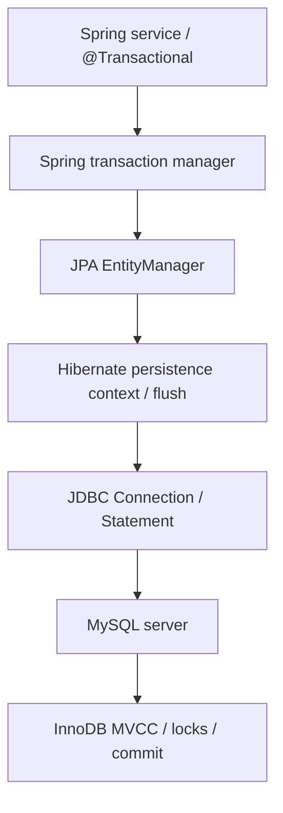

# Read-Only, Isolation, Flush, and Actual InnoDB Behavior

In Spring Boot applications using Spring Data JPA and Hibernate, annotations like `@Transactional(readOnly = true)`, `@Transactional(isolation = ...)`, or calling `flush()` influence how the application interacts with transactions and the persistence context. However, these options do not mean MySQL automatically enforces every behavior the annotation name suggests. To predict outcomes accurately, you must understand all three layers: Spring transaction management, JPA/Hibernate, and the InnoDB storage engine.

This lesson explains how Spring opens transactions, how Hibernate synchronizes the persistence context down to JDBC, and how InnoDB uses MVCC and locking to execute queries. Within the `DATABASE_MYSQL` module, this ties together table design, transactions, concurrency control, and query execution inside Java applications.

After this lesson, you will be able to:

- Understand `@Transactional(readOnly = true)` as an optimization hint and know its protection boundaries.
- Distinguish Spring's transaction isolation setting from actual MySQL isolation behavior.
- Explain `AUTO`, `COMMIT`, and `MANUAL` flush modes.
- Distinguish `flush()` from `commit()` and understand when SQL is actually dispatched.
- Predict consistent reads, locking reads, snapshots, and gap locks in InnoDB.
- Choose between optimistic and pessimistic locking in JPA.
- Test concurrent behavior with multiple transactions and verify via SQL/logs.

## 1. Three Layers Jointly Determine Behavior

When a service calls a repository, Java calls do not go straight to InnoDB. Spring manages the transaction, Hibernate manages the persistence context and generates SQL, JDBC transmits SQL to MySQL, and InnoDB executes queries and enforces concurrency control.



Each layer has its own responsibility:

| Layer | Responsibility | Example Configuration / Behavior |
|---|---|---|
| Spring | Defines transaction boundaries and propagates attributes | `@Transactional`, propagation, isolation, `readOnly`, timeout |
| JPA/Hibernate | Tracks entities and decides when to synchronize changes | Persistence context, dirty checking, flush mode, `EntityManager.flush()` |
| JDBC/Connector/J | Manages connections and transmits statements | `setAutoCommit`, `setTransactionIsolation`, `Connection.setReadOnly` |
| MySQL/InnoDB | Executes transactions, snapshots, and locks | MVCC, consistent read, locking read, row/gap locks, commit/rollback |

An attribute may flow from Spring down to JDBC or Hibernate, yet the final effect depends on the transaction manager, provider, driver, and server configuration. When investigating, inspect state at each layer rather than merely reading source-code annotations.

## 2. What Does `@Transactional(readOnly = true)` Actually Mean?

In Spring, `readOnly = true` marks a transaction as read-only and lets the transaction manager/provider optimize handling. It is an important hint to infrastructure, not a database authorization mechanism replacing `GRANT` or a server-enforced read-only transaction.

Example:

```java
@Service
public class OrderQueryService {
    private final OrderRepository orderRepository;

    public OrderQueryService(OrderRepository orderRepository) {
        this.orderRepository = orderRepository;
    }

    @Transactional(readOnly = true)
    public OrderSummary findOrder(long orderId) {
        Order order = orderRepository.findById(orderId)
            .orElseThrow(() -> new OrderNotFoundException(orderId));

        return OrderSummary.from(order);
    }
}
```

In typical Spring and Hibernate setups, a read-only transaction can prompt Hibernate to switch its flush mode to `MANUAL`, avoiding automatic flushes and dirty-checking work for entities loaded in that transaction. Spring may also pass read-only state to the JDBC connection via `Connection.setReadOnly(true)` depending on the transaction manager and configuration.

Key points to remember:

- `readOnly = true` does not turn a MySQL account into a `SELECT`-only account.
- It does not guarantee that every `INSERT`, `UPDATE`, or `DELETE` will be rejected by the server.
- Depending on the provider, entity mutations inside a read-only transaction may simply not be auto-flushed as expected.
- Native SQL or direct JDBC calls can behave differently from Hibernate dirty checking.
- If writes must be strictly forbidden, use proper SQL privileges or database-level read-only transactions.

Therefore, use `readOnly = true` on read flows to express intent and enable optimizations. To protect data, grant read accounts strictly read-only MySQL privileges or enforce server-side read-only transactions per deployment requirements.

### 2.1. Read-Only in JDBC and MySQL

JDBC defines `Connection.setReadOnly(true)`. Under JDBC, this is a driver hint to optimize access. Connector/J may forward read-only status to the server depending on driver properties and version, but applications must not assume every configuration emits `START TRANSACTION READ ONLY` or blocks writes on the server.

MySQL/InnoDB supports server-level read-only transactions explicitly, for example:

```sql
START TRANSACTION READ ONLY;

SELECT order_id, order_status
FROM shop.orders
WHERE order_id = 501;

COMMIT;
```

Server-side read-only transactions carry specific restrictions and optimizations. Whether Spring/JPA generates this exact syntax depends on integration and configuration. When guarantees are required, inspect actual SQL and server behavior on your exact deployment version.

### 2.2. MySQL Privileges Remain the Primary Guardrail

A read-only account should be granted least-privilege permissions, for example:

```sql
CREATE USER 'shop_reader'@'10.20.%'
    IDENTIFIED BY '<secret-from-secure-provisioning>';

GRANT SELECT
ON shop.* TO 'shop_reader'@'10.20.%';
```

The password value is a placeholder; never use it literally. Write-capable applications should use a separate account granted the required `INSERT`, `UPDATE`, or `DELETE` privileges. Separating accounts ensures the database rejects writes even if code mistakenly calls a mutating repository inside a read-only flow.

## 3. `@Transactional` and Transaction Boundaries

Spring normally opens a transaction when calls pass through the proxy of a bean with `@Transactional` methods. When the method returns normally, the transaction commits; when an exception matching rollback rules escapes, the transaction rolls back.

Example:

```java
@Service
public class PaymentService {
    private final OrderRepository orders;
    private final PaymentRepository payments;

    @Transactional
    public void markPaid(long orderId, String paymentReference) {
        Order order = orders.findById(orderId)
            .orElseThrow(() -> new OrderNotFoundException(orderId));

        payments.save(Payment.settled(orderId, paymentReference));
        order.markPaid();
    }
}
```

Both changes belong to the same transaction if the repositories share the same transaction manager and transaction context. When the transaction commits, Hibernate synchronizes pending changes and MySQL commits the transaction. If an operation fails and triggers rollback, both InnoDB changes in that transaction roll back.

### 3.1. Rollback Rules

By Spring default, `RuntimeException` and `Error` trigger rollback; checked exceptions do not trigger rollback automatically unless `rollbackFor` or matching rules are configured. Example:

```java
@Transactional(rollbackFor = PaymentRejectedException.class)
public void processPayment(long orderId) throws PaymentRejectedException {
    // JPA operations participating in the same transaction.
}
```

Declare rollback rules explicitly if business logic uses checked exceptions to signal failure. Never catch and ignore an exception when the transaction needs to roll back; if the exception is swallowed, Spring sees a normal return unless the transaction was already marked rollback-only.

### 3.2. Proxies and Self-Invocation

In standard proxy mode, a call from one method to another inside the same object (`this.someTransactionalMethod()`) bypasses the proxy. Thus, annotations on the internally called method may not take effect as expected.

```java
@Service
public class ReportService {
    public void generate() {
        loadReportRows(); // self-invocation: bypasses Spring proxy
    }

    @Transactional(readOnly = true)
    public void loadReportRows() {
        // Do not assume a transaction was opened by the internal call above.
    }
}
```

Place transaction boundaries on methods invoked through a Spring bean/proxy or structure services cleanly. Transactions bind to Spring's execution context and thread; they do not propagate automatically to new threads, `@Async` methods, or background tasks.

## 4. Spring and MySQL Isolation Levels

Spring provides the `Isolation` enum to select transaction isolation. `Isolation.DEFAULT` uses the datasource/database default. With InnoDB, MySQL's common default is `REPEATABLE READ`.

Example:

```java
@Transactional(isolation = Isolation.READ_COMMITTED)
public OrderSummary readCurrentOrder(long orderId) {
    // Query inside a READ COMMITTED transaction.
}
```

Spring's transaction manager applies isolation via the JDBC connection when starting a new transaction, if supported by the manager and driver. If a method joins an existing transaction under `REQUIRED`, the isolation declared on the inner method normally does not alter the outer transaction's isolation. To detect incompatible configurations, configure the transaction manager to validate existing transactions as supported by Spring.

### 4.1. Isolation Levels

| Isolation | Dirty Reads | Non-Repeatable Reads | Phantom Reads | General Characteristics |
|---|---|---|---|---|
| `READ_UNCOMMITTED` | Possible | Possible | Possible | Weakest level; dirty reads allowed |
| `READ_COMMITTED` | No | Possible | Possible | Each consistent read gets a fresh snapshot |
| `REPEATABLE_READ` | No | No for consistent reads in the same transaction | InnoDB uses next-key/gap locking for many locking/range operations | Consistent-read snapshot retained across the transaction |
| `SERIALIZABLE` | No | No | No under isolation model | Increases locking and lowers concurrency; behavior depends on access pattern |

This table describes phenomena conceptually. Because InnoDB combines MVCC with locking, exact behavior can differ from abstract SQL models, especially when mixing consistent reads and locking reads.

### 4.2. InnoDB `REPEATABLE READ`

Under `REPEATABLE READ`, the first consistent read in a transaction normally establishes the read view. Subsequent consistent reads in the same transaction reuse that snapshot. Consequently, a transaction can continue seeing older data even after other transactions commit newer changes.

Two-session example:

```sql
-- Session A
SET SESSION TRANSACTION ISOLATION LEVEL REPEATABLE READ;
START TRANSACTION;
SELECT balance FROM accounts WHERE account_id = 7;
-- Assume result is 100.
```

```sql
-- Session B
UPDATE accounts
SET balance = 150
WHERE account_id = 7;
COMMIT;
```

```sql
-- Session A is still inside the transaction
SELECT balance FROM accounts WHERE account_id = 7;
-- Consistent read can still return 100 from the initial snapshot.
COMMIT;
```

Once Session A commits and starts a new transaction, queries observe the updated value assuming no further changes occurred.

### 4.3. InnoDB `READ COMMITTED`

Under `READ COMMITTED`, each consistent read creates a fresh snapshot at the start of the `SELECT` statement. If Session B commits a change between two `SELECT` statements in Session A, A's second read observes the new value.

This reduces certain lock waits and gap locking compared to `REPEATABLE READ`, yet a single transaction can read two different states. Choose isolation based on business invariants, not merely to reduce locks.

## 5. Consistent Reads and Locking Reads in InnoDB

InnoDB distinguishes two read categories:

- **Consistent nonlocking read:** ordinary `SELECT`, reading the version matching the read view via MVCC without locking rows to block concurrent writers.
- **Locking read:** `SELECT ... FOR UPDATE` or `SELECT ... FOR SHARE`, reading the latest committed version and acquiring locks to protect rows from conflicting modifications.

Consistent read example:

```sql
SELECT balance
FROM accounts
WHERE account_id = 7;
```

Locking read example:

```sql
START TRANSACTION;

SELECT balance
FROM accounts
WHERE account_id = 7
FOR UPDATE;

UPDATE accounts
SET balance = balance - 10
WHERE account_id = 7;

COMMIT;
```

`FOR UPDATE` fits when the application reads the current value and then decides how to update it within the same transaction. Locks are held until commit or rollback. On InnoDB, locking reads must execute inside a transaction; with autocommit enabled and no explicit transaction, lock protection ends as soon as the statement finishes.

`FOR SHARE` acquires a shared lock, allowing compatible reads by other transactions while blocking conflicting writes until the transaction finishes. `LOCK IN SHARE MODE` is older syntax; prefer the syntax suited to your MySQL version.

### 5.1. Record Locks, Gap Locks, and Next-Key Locks

InnoDB locks index records rather than abstract "physical rows". During range scans under `REPEATABLE READ`, InnoDB can apply next-key locks—combining a record lock with a gap lock—to prevent other transactions from inserting into the scanned index interval.

This prevents certain phantoms during locking reads, though it can block inserts even when the target key does not yet exist. Lock scope depends on the chosen index, query predicates, and execution plan. A query lacking a suitable index may scan and lock a far broader range than intended.

Under `READ COMMITTED`, InnoDB generally disables gap locking for searches and locking reads except for special checks such as foreign-key and duplicate-key validation. Thus, changing isolation alters insert concurrency and deadlock patterns.

## 6. Flushing in JPA/Hibernate

The JPA persistence context tracks managed entities. When the application modifies an entity, Hibernate typically records the state change in memory first. SQL may not be sent to MySQL immediately.

Example:

```java
@Transactional
public void renameCustomer(long customerId, String newName) {
    Customer customer = entityManager.find(Customer.class, customerId);
    customer.setName(newName);

    // At this point the entity is modified in the persistence context.
    // The SQL UPDATE may not have been sent to MySQL yet.
}
```

During a flush, Hibernate compares managed entity state against snapshots, performs dirty checking, and emits required SQL statements. Flushing synchronizes persistence context changes to the database within the active transaction.

### 6.1. Flush Is Not Commit

`EntityManager.flush()` sends SQL to the database without ending the transaction. Flushed changes can still roll back before commit.

```java
@Transactional
public void updateCustomer(long customerId) {
    Customer customer = entityManager.find(Customer.class, customerId);
    customer.setName("Lan Nguyen");

    entityManager.flush(); // SQL UPDATE is sent to MySQL

    // Transaction remains open. A subsequent error can still trigger rollback.
}
```

Distinguish these operations:

| Operation | Meaning |
|---|---|
| Mutate entity | Changes state in the persistence context |
| `flush()` | Dispatches pending changes to the database within the active transaction |
| `commit()` | Instructs the database to commit the transaction; unflushed changes flush per flush mode/provider |
| `rollback()` | Reverts uncommitted changes in the database transaction |
| `clear()` | Detaches all entities from the persistence context; does not undo already-flushed SQL |

Early flushing surfaces constraint violations or deadlocks sooner in the Java flow. It does not make data durable before transaction commit.

### 6.2. When Does Hibernate Flush?

Flush timing depends on the flush mode:

| Flush Mode | General Behavior |
|---|---|
| JPA `AUTO` | Provider ensures pending changes are visible to affected queries; Hibernate may flush before relevant queries and before commit |
| JPA `COMMIT` | Flushes before commit; visibility of unflushed changes to pre-commit queries is not guaranteed as in `AUTO` |
| Hibernate `MANUAL` | Flushes only when explicitly invoked by the application; commonly used for read-only optimizations in Spring/Hibernate |

`AUTO` flush mode does not mean every `save()` call emits SQL immediately. Hibernate can defer SQL until synchronization is required, such as before an overlapping query or prior to commit.

Spring Data JPA can switch read-only transactions to Hibernate `MANUAL` mode via Hibernate integration. Consequently, never mutate entities inside a `@Transactional(readOnly = true)` method expecting changes to auto-persist on method exit.

### 6.3. Calling `flush()` Explicitly

Call `flush()` when you need to surface database errors before proceeding—for example, checking a unique constraint before invoking an external service, or ensuring SQL has been sent prior to a native query.

```java
@Transactional
public void createCustomer(String email) {
    Customer customer = new Customer(email);
    entityManager.persist(customer);

    entityManager.flush();

    // After flush, unique/constraint errors may already be detected.
    // The transaction has not committed yet.
}
```

Avoid calling `flush()` after every entity inside large loops unless needed. Frequent flushing increases round-trips and defeats Hibernate batching.

## 7. `save()`, `saveAndFlush()`, and Bulk Updates

Spring Data JPA's `save()` does not promise immediate SQL execution on that line. For new entities, repositories normally invoke `persist`; for existing ones, `merge`. SQL is emitted at flush per flush mode or at transaction commit.

`saveAndFlush()` saves the entity through the repository and then flushes. It still does not commit the enclosing transaction.

```java
@Transactional
public void register(Customer customer) {
    customerRepository.save(customer);
    // SQL may still remain in the persistence context.

    customerRepository.flush();
    // SQL synchronized, yet the transaction remains open.
}
```

Bulk JPQL updates/deletes behave differently from dirty checking:

```java
@Modifying(flushAutomatically = true, clearAutomatically = true)
@Query("update Customer c set c.active = false where c.lastSeenAt < :cutoff")
int deactivateInactiveCustomers(Instant cutoff);
```

Bulk DML runs directly in the database and does not update individual managed entities in the persistence context. Previously loaded entities become stale. `flushAutomatically` triggers a flush before the bulk query; `clearAutomatically` clears the persistence context afterward to prevent reading stale cached state. Weigh the impact of clearing, as unflushed entities could be detached.

## 8. How Does Spring-Configured Isolation Take Effect?

Spring allows setting isolation at the service boundary:

```java
@Transactional(isolation = Isolation.READ_COMMITTED)
public void processOrder(long orderId) {
    // Queries inside the transaction run under the applied isolation.
}
```

When the transaction manager opens a new transaction, it can invoke `Connection.setTransactionIsolation(...)` before running SQL. MySQL applies that isolation for the transaction. Verify with:

```sql
SELECT @@transaction_isolation;
```

On some older MySQL versions, the variable name is `tx_isolation`. To inspect the active session specifically:

```sql
SELECT @@SESSION.transaction_isolation;
```

Isolation only matters inside a transaction. If autocommit is enabled and every SQL statement runs as its own transaction, configuring isolation on code without an active transaction will not deliver the consistency boundary you expect.

### 8.1. The Outermost Transaction's Isolation Wins

Suppose Service A opens a `REPEATABLE_READ` transaction and calls Service B annotated with `@Transactional(isolation = READ_COMMITTED)` using default `REQUIRED` propagation. Service B joins the existing transaction; it does not start a new transaction and normally does not change Service A's isolation.

If an independent transaction is needed, `REQUIRES_NEW` creates a new transaction, though that alters atomicity and typically consumes a second connection. Never use `REQUIRES_NEW` merely to "force" an isolation level without assessing data consistency and pool impact.

### 8.2. Transaction Timeout Is Not Query Timeout

`@Transactional`'s `timeout` attribute is a transaction timeout enforced by the transaction manager. It is not necessarily equivalent to per-statement `Statement.setQueryTimeout()`. When individual SQL queries must be bounded, configure JDBC/provider query timeouts or appropriate MySQL server limits.

## 9. Pessimistic Locking from JPA

JPA supports pessimistic locks to guard data read and updated within the same transaction. Spring Data JPA declares locks on repository methods:

```java
public interface AccountRepository extends JpaRepository<Account, Long> {
    @Lock(LockModeType.PESSIMISTIC_WRITE)
    @Query("select a from Account a where a.id = :id")
    Optional<Account> findForUpdate(@Param("id") long id);
}
```

Service usage inside a transaction:

```java
@Transactional
public void debit(long accountId, BigDecimal amount) {
    Account account = accountRepository.findForUpdate(accountId)
        .orElseThrow(() -> new AccountNotFoundException(accountId));

    if (account.getBalance().compareTo(amount) < 0) {
        throw new InsufficientFundsException();
    }

    account.debit(amount);
}
```

With Hibernate and MySQL, `PESSIMISTIC_WRITE` typically translates to a locking read such as `SELECT ... FOR UPDATE`. Exact SQL depends on dialect and version. Locks remain held until transaction commit or rollback.

### 9.1. Watch Lock Scope

InnoDB locks index records and may lock index gaps. If a query lacks a suitable index, scan and lock scope can expand far wider than intended. Inspect execution plans and indexes supporting the locking predicates.

Never hold pessimistic locks while making HTTP calls or running slow tasks. Long-held transactions escalate contention, deadlocks, and wait times for concurrent transactions.

## 10. Optimistic Locking with `@Version`

When write conflicts are rare, optimistic locking is often preferable to holding database locks while users edit data.

```java
@Entity
public class Product {
    @Id
    private Long id;

    private String name;

    private BigDecimal price;

    @Version
    private long version;
}
```

Hibernate uses the version column in the UPDATE statement, conceptually:

```sql
UPDATE product
SET price = ?, version = version + 1
WHERE id = ? AND version = ?;
```

If another transaction already updated the row and incremented the version, zero rows are updated. Hibernate detects the optimistic lock conflict and throws `OptimisticLockException` or the corresponding Spring-translated exception.

`@Version` does not alter InnoDB's isolation level. It is an entity-level conflict detection mechanism. The application must decide whether to retry, notify the user, or merge changes on conflict.

## 11. Selecting Isolation, Flush, and Locking by Business Need

| Requirement | Suggested Approach | What to Verify |
|---|---|---|
| Read page or report | `@Transactional(readOnly = true)` | Zero writes, flush behavior, and read-only DB account |
| Multiple reads sharing one snapshot | InnoDB `REPEATABLE READ` | Transaction keeps the same read view for consistent reads |
| Reads seeing latest commits between SELECTs | `READ COMMITTED` | Each consistent read obtains a new snapshot |
| Read-then-update balance in one transaction | `PESSIMISTIC_WRITE` or atomic conditional update | Lock scope, indexes, deadlocks, and short transaction |
| Multiple users editing the same entity | `@Version` optimistic locking | Conflict handling in service/UI |
| Detect constraint errors before commit | Explicit `flush()` | Flush does not commit; errors can still roll back |
| Large bulk update/delete | Batched bulk DML + clear persistence context | Stale entities, locks, undo/redo, and replica lag |

No single isolation level is optimal for all services. Choose the weakest level that satisfies business invariants and test potential race conditions.

## 12. Testing Read-Only, Flush, and Isolation

Test against real MySQL/InnoDB or an equivalent environment, because H2 and mocked databases differ from MySQL in transaction, locking, and SQL semantics.

### 12.1. Testing Whether Read-Only Actually Blocks Writes

Create a test method:

```java
@Transactional(readOnly = true)
public void tryChangeOrder(long orderId) {
    Order order = orderRepository.findById(orderId).orElseThrow();
    order.setStatus("CANCELLED");
    entityManager.flush();
}
```

Run in a lab first with a write-privileged account and then with a `SELECT`-only account. Compare actual behavior. Results vary by Hibernate flush mode, JDBC driver, and server privileges. The goal is proving that the read-only hint does not replace database permissions.

### 12.2. Observing Flush Before and After a Query

In an `AUTO` transaction, modifying an entity and running a query affected by that change prompts Hibernate to flush before the query so results remain consistent.

```java
@Transactional
public List<Customer> updateThenQuery(long id) {
    Customer customer = entityManager.find(Customer.class, id);
    customer.setActive(false);

    // The query may trigger a flush before executing.
    return entityManager.createQuery(
        "select c from Customer c where c.active = false", Customer.class
    ).getResultList();
}
```

Enable SQL logging in test environments to observe `UPDATE` and `SELECT` order. Never enable bind-parameter logging containing sensitive data in production.

### 12.3. Testing InnoDB Snapshots

Open two MySQL sessions and reproduce the `REPEATABLE READ` scenario above. Then repeat with `READ COMMITTED` to observe Session A's second `SELECT`. Record each session's actual isolation using `@@SESSION.transaction_isolation`.

### 12.4. Testing Locking Reads

Session A:

```sql
START TRANSACTION;
SELECT balance
FROM accounts
WHERE account_id = 7
FOR UPDATE;
```

Session B:

```sql
UPDATE accounts
SET balance = balance + 5
WHERE account_id = 7;
```

Observe Session B blocking until Session A commits or rolls back. Repeat with a plain consistent read to see the contrast. After testing, always end transactions to release locks.

## 13. Common Errors and Investigation

| Symptom | Possible Cause | Where to Check |
|---|---|---|
| Entity changes are not saved | Read-only transaction set Hibernate `MANUAL`, entity detached, or proxy skipped | Check annotations, proxy, persistence context, and SQL logs |
| `save()` emits no SQL immediately | Hibernate defers SQL until flush | Call flush intentionally or observe before commit |
| `flush()` ran yet data is not durable | Transaction has not committed | Check transaction boundaries and rollbacks |
| Second query reads stale value | `REPEATABLE READ` retains initial read view | Check session isolation and snapshot timing |
| `@Transactional(isolation=...)` has no effect | Method joined an outer transaction or self-invocation occurred | Check propagation, proxy, and actual session isolation |
| Update blocks even though prior SELECT didn't | Normal SELECT is consistent read; locking reads/DML acquire locks | Check `FOR UPDATE`, transactions, and InnoDB lock waits |
| Insert blocks even though key doesn't exist | Gap/next-key lock on index range | Check execution plan, isolation, and index scan |
| Optimistic lock exception | Entity updated concurrently by another transaction | Check `@Version` and retry/conflict policy |
| Bulk update leaves session entities stale | Bulk DML bypasses persistence context | Flush/clear appropriately or reload entities |

When investigating, combine Spring transaction logs, Hibernate SQL logs, connection states, and InnoDB lock diagnostics. Never draw conclusions from a single annotation alone.

## 14. Design and Implementation Workflow

1. **Classify read/write flows:** identify read-only services versus mutating services.
2. **Enforce DB privileges:** separate read-only accounts from write accounts; never treat `readOnly` as a security boundary.
3. **Define transaction boundaries:** place `@Transactional` on service methods invoked through the Spring proxy.
4. **Select isolation:** start from InnoDB's default; change only when business logic requires it and verify with tests.
5. **Select locking:** use optimistic locking for low contention; pessimistic locking for read-modify-write sequences needing serialization.
6. **Understand flush modes:** know when Hibernate emits SQL and avoid unnecessary flushes.
7. **Keep transactions short:** never call network services or wait on users while holding locks.
8. **Observe SQL and locks:** inspect query plans, metadata, lock waits, deadlocks, and long-running transactions.
9. **Test concurrency:** run real concurrent transactions and test business race conditions.
10. **Verify on InnoDB:** never rely solely on H2 or mocked repositories to infer MySQL semantics.

## 15. Practice Scenario

An e-commerce application uses Spring Boot, Spring Data JPA, and MySQL InnoDB. `OrderQueryService` reads orders; `InventoryService` deducts stock; multiple requests can race to buy the last item in stock.

Perform in a lab environment:

1. Create two MySQL accounts: `shop_reader` with `SELECT` only, and `shop_app` with required read/write privileges.
2. Configure separate datasources or profiles to verify the read account cannot write.
3. Annotate the query service with `@Transactional(readOnly = true)` and observe Hibernate flush mode and SQL logs.
4. Attempt to mutate an entity inside a read-only transaction; compare behavior between the write-privileged account and read-only account.
5. Open two transactions reading the same account balance; test `REPEATABLE READ` and `READ COMMITTED`.
6. Use `SELECT ... FOR UPDATE` or `PESSIMISTIC_WRITE` to serialize stock deduction.
7. Test `@Version` and observe optimistic lock conflicts when two transactions update the same entity.
8. Modify an entity, call `flush()`, then throw an error before commit; verify transaction rollback leaves data unchanged.
9. Run a bulk JPQL update and inspect managed entities; use `clearAutomatically` or reload to prevent stale reads.
10. Record SQL, isolation, lock waits, deadlocks, and business outcomes for each scenario.

**Self-Evaluation Questions:**

- Why does `@Transactional(readOnly = true)` not replace read-only permissions in MySQL?
- When can Spring/Hibernate switch flush mode to `MANUAL`?
- How does `flush()` differ from `commit()`?
- When does InnoDB `REPEATABLE READ` create its read view and how is it used?
- How does a consistent read differ from a locking read?
- Why can `SELECT ... FOR UPDATE` lock an entire index range?
- Does isolation declared on a method joining a `REQUIRED` transaction override the outer transaction's isolation?
- What kind of conflict does `@Version` solve, and does it change database isolation?
- Why can a bulk JPQL update leave entities in the persistence context stale?

## Conclusion

Spring `readOnly`, transaction isolation, and JPA flush operate at distinct layers. Hibernate can optimize read-only flows by suppressing automatic flushes; JDBC and the transaction manager can propagate isolation to the connection; and InnoDB governs snapshots, locking reads, and physical locks. Keep security privileges separate from read-only hints, distinguish flush from commit, and verify concurrent behavior against real MySQL/InnoDB before relying on it in production.
