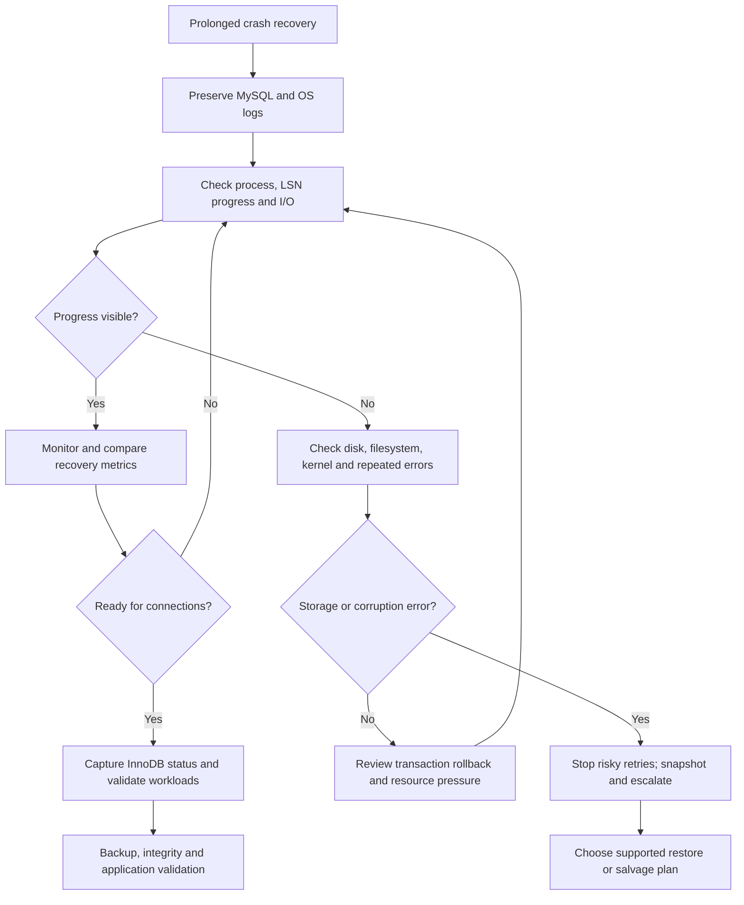

# Prolonged Crash Recovery and Collecting Logs Before Intervening

## Objectives

When MySQL restarts after a power loss, kernel crash, or abnormal process termination, InnoDB must perform crash recovery to bring data back to a consistent state. This process can take a long time if the redo log backlog to replay is large, large transactions must roll back, storage is slow, or the filesystem has errors. A log window with few changes does not prove the server is hung; repeatedly restarting or deleting redo files before understanding the state can worsen the incident.

This lesson belongs to the **DATABASE_MYSQL** module, covering table design, data types, keys, SQL, indexes, transactions, concurrency control, reading execution plans, query tuning, and relational database operations. It guides you through understanding InnoDB crash recovery phases, distinguishing slow progress from a true stall, collecting logs and system evidence before intervening, and choosing next actions by risk level.

After this lesson, you will be able to:

- Explain the roles of redo logs, checkpoints, and undo logs in crash recovery.
- Recognize signs of redo apply, transaction rollback, startup completion, and storage errors.
- Collect error logs, system logs, filesystem status, and relevant configs on a unified timeline.
- Monitor InnoDB once the server accepts connections and use OS tools while the server is still starting.
- Avoid actions that destroy evidence or corrupt the data directory.
- Prepare the data needed for escalation to DBAs, the storage team, or cloud/service providers.

## 1. What Does Crash Recovery Do?

InnoDB uses write-ahead logging: data page modifications are recorded in the redo log before the corresponding data pages are durably flushed to data files. Consequently, after an abrupt process stop, data files may not yet contain all committed changes. On restart, InnoDB uses the redo log to replay necessary changes starting from the checkpoint.

At a high level, crash recovery performs these steps:

1. Reads metadata and identifies the checkpoint and redo log range to process.
2. Scans and replays the redo log to bring data pages to the state at crash time.
3. Identifies incomplete transactions and uses undo logs to roll back uncommitted changes.
4. Completes InnoDB initialization and brings the instance online; some cleanup or rollback work may continue in the background depending on state and version.

Redo and undo play different roles:

| Component | Role in Recovery |
|---|---|
| Redo log | Replays logged changes to restore data pages after a crash |
| Checkpoint | Marks the point up to which prior changes have been flushed per InnoDB rules; bounds redo replay range |
| Undo log | Supports rolling back uncommitted transactions and provides old row versions for MVCC |
| Data files | Hold table and index pages; may lag behind redo at crash time |

Crash recovery is normal InnoDB behavior and does not automatically imply data file corruption. Recovery duration depends on redo volume to replay, number and size of incomplete transactions, read/write speed, and storage health.

## 2. Why Can Recovery Take a Long Time?

Common causes include:

- **Large redo backlog:** the checkpoint lags far behind the redo log tail, forcing InnoDB to scan and replay many log records.
- **Large uncommitted transaction:** a transaction modifying millions of rows can take considerable time to roll back.
- **Slow or saturated storage:** high read/write latency, deep queues, IOPS caps, or throttled cloud volumes.
- **Nearly full filesystem:** insufficient disk space or inodes prevents MySQL from creating or writing needed files.
- **Device or filesystem faults:** kernel reports I/O errors, device resets, read-only remounts, or filesystem corruption.
- **Insufficient RAM or system pressure:** swapping, OOM kills, or CPU contention slows startup and I/O.
- **Data/redo/undo corruption:** InnoDB hits page checksum mismatches, invalid log sequences, or structural corruption.
- **Recent configuration or environment changes:** changes to redo capacity, data/log paths, file permissions, plugins, or packages can hinder startup.

Never judge solely by elapsed clock time. One instance may take long yet steadily progress; another may loop on the same error at a specific LSN or hit I/O errors. Compare timestamped logs and progress indicators across multiple observations.

## 3. Distinguishing Progressing Recovery from a Stall

### Signs of Healthy Progress

- Error log shows advancing timestamps and steadily increasing scanned/applied LSNs.
- Disk read/write activity aligns with recovery work.
- CPU or I/O shows activity without abnormal permanent saturation.
- Messages about transaction rollbacks or recovery phases continue advancing.
- No repeating errors involving checksums, I/O, permissions, or filesystems.

### Signs Requiring Deep Investigation

- The exact same error repeats across restarts at the exact same file/page/LSN.
- LSN or progress messages remain unchanged for a long period while I/O drops near zero.
- Kernel logs show I/O errors, device resets, filesystem errors, or read-only volume remounts.
- `mysqld` gets OOM-killed, crashes repeatedly, or exits with signals.
- Error log reports inability to open files, permission denied, out of space, or redo/undo corruption.

Never apply a single fixed time threshold across all systems. Recovery taking minutes may be normal on a small instance; recovery taking hours may be reasonable with massive redo backlogs or huge rollbacks. Compare against your system's baseline, data size, redo capacity, and storage speed.

## 4. Collecting Information Before Changing State

Before restarting, editing configs, or running repair tools, establish a clear timeline and gather evidence. Use a consistent time zone or record explicit offsets when correlating the MySQL error log, system journal, and monitoring.

Information to record:

| Category | Data to Save |
|---|---|
| Incident | Start time, restart/crash time, operator, most recent changes |
| Versions | MySQL version/build, OS/kernel, package or container image |
| Topology | Primary/replica, Group Replication/InnoDB Cluster, proxy, backups, and pre-incident replication status |
| Configuration | `datadir`, `log_error`, redo capacity, buffer pool, storage engines, plugins, and active option files |
| Resources | Filesystem free space, inodes, IOPS/latency, RAM, swap, CPU, and OOM events |
| Logs | MySQL error log, system journal, kernel log, container/orchestrator events |
| Data State | LSN/checkpoint if available, large transactions, latest backup, and binlog/GTID checkpoint |

Preserve original log files intact and work on copies. Record file paths, sizes, modification times, and collected time ranges. Never edit or truncate original logs.

## 5. Collecting the MySQL Error Log

The error log is the single best source to see which phase InnoDB is in. Locate the log from config or while the server is still reachable:

```sql
SHOW GLOBAL VARIABLES LIKE 'log_error';
SHOW GLOBAL VARIABLES LIKE 'datadir';
SHOW GLOBAL VARIABLES LIKE 'innodb_redo_log_capacity';
SHOW GLOBAL VARIABLES LIKE 'innodb_buffer_pool_size';
```

If the server has not started yet, inspect deployed option files, systemd units, container configs, or deployment manifests. Never assume the log always sits at `/var/log/mysql/error.log`; paths depend on packaging and configuration.

Look for relevant messages:

- Start of InnoDB initialization or crash recovery.
- LSN, checkpoint, redo scan, or redo apply progress.
- Transaction rollbacks and rollback duration.
- `ready for connections` or startup completion notices.
- `InnoDB: corruption`, checksum mismatches, page corruption, or log sequence mismatches.
- `Operating system error`, `No space left on device`, permission denied, or I/O failures.

Example reading the log file on Linux:

```bash
sudo tail -n 500 /path/to/mysql-error.log
sudo grep -Ei 'crash recovery|redo|rollback|checkpoint|LSN|corrupt|checksum|I/O error|no space|ready for connections' /path/to/mysql-error.log
```

Keep lines both before and after the first error message. The final line is not always the root cause; the earliest error in a chain often provides the clearest clue.

## 6. Collecting System Journal and Kernel Logs

MySQL can be the victim of OS or storage-layer faults. On Linux using systemd, fetch service logs:

```bash
sudo journalctl -u mysql --since '2026-11-19 08:00:00' --until '2026-11-19 10:00:00' --no-pager -o short-iso
```

The service unit may be `mysqld` rather than `mysql`; verify the actual unit name before querying. Collect kernel logs over the same window:

```bash
sudo dmesg -T | tail -n 400
```

Look for messages like:

- `Out of memory` or `Killed process ... mysqld`.
- I/O errors, buffer I/O errors, device resets, or timeouts.
- Filesystem journal errors, read-only remounts, or metadata corruption.
- NVMe/SCSI controller resets, path failovers, or multipath errors.

If an OOM kill occurred, record the killed process, memory pressure, and co-located processes at that timestamp. If device errors appear, preserve logs and coordinate with the storage team before continuing writes to a suspect volume.

## 7. Checking Disk Space and Filesystem Health

Recovery can stall or fail if the filesystem holding the data directory, redo logs, temporary directory, or error log runs out of space. Check both bytes and inodes:

```bash
df -hT
df -ih
lsblk -f
```

Inspect the exact mount points for `datadir`, redo logs, temporary directory, and log directory. A filesystem can have free bytes while out of inodes; conversely, the root filesystem can fill up even when `datadir` sits on a separate volume.

Never delete files inside the data directory to reclaim space. In particular, never delete `ibdata*`, undo tablespaces, redo logs, `#innodb_redo` files, legacy `ib_logfile*`, doublewrite files, or table files to free disk. Deleting logs can destroy recoverability.

If a volume is nearly full, prioritize expanding the volume or cleaning unrelated non-MySQL data per approved operational procedures. Before removing application logs or old backups, verify retention, PITR, and backup policies.

## 8. If MySQL Has Started and Accepts Connections

Once the error log reports the server is ready, collect InnoDB status via SQL. Start with:

```sql
SELECT VERSION(), @@hostname, @@datadir, @@log_error;
SHOW ENGINE INNODB STATUS\G
```

In the `LOG` section, inspect log sequence number, log flushed up to, pages flushed up to, last checkpoint at, and pending log writes. Capture snapshots at spaced intervals to compare progress; a single snapshot cannot reveal recovery speed.

Check active transactions:

```sql
SELECT trx_id, trx_state, trx_started,
       trx_wait_started, trx_mysql_thread_id,
       trx_query
FROM information_schema.innodb_trx
ORDER BY trx_started;
```

Check the process list:

```sql
SHOW FULL PROCESSLIST;
```

These queries work only after the server accepts connections and with appropriate account privileges. Avoid running heavy queries on an instance undergoing recovery or heavy I/O. Never run `KILL` on a transaction merely because it exists; verify its impact, owner, and rollback state first.

## 9. If MySQL Has Not Started Yet

While the server is not accepting connections, SQL monitoring is unavailable. Never try to launch a second `mysqld` against the same `datadir` to check status. Use logs and OS tools:

```bash
ps -eo pid,ppid,stat,etime,%cpu,%mem,cmd | grep '[m]ysqld'
sudo journalctl -u mysql -n 500 --no-pager -o short-iso
df -hT
df -ih
```

Observe PID, elapsed time, CPU, memory, and process state over time. State `D` indicates uninterruptible I/O wait; combine with kernel logs and storage metrics to identify why. Low CPU alone does not prove a deadlock; the process may be waiting on disk or network storage.

If the process remains alive and logs/LSNs show progress, coordinate with DBAs to continue monitoring. If the process crashes repeatedly or repeats I/O or checksum errors, disable automatic restarts per runbook and preserve evidence before attempting next steps.

## 10. Collecting Logs in Containers and Kubernetes

For Docker, capture timestamped logs for the exact container:

```bash
docker logs --timestamps --since 2h mysql-container
docker inspect mysql-container
```

Inspect container exit code, restart count, volume mounts, and CPU/RAM limits. Never remove containers or volumes before identifying where the data directory lives and collecting logs.

For Kubernetes, capture pod status, events, and current/previous container logs:

```bash
kubectl describe pod mysql-0 -n database
kubectl logs mysql-0 -n database --timestamps --since=2h
kubectl logs mysql-0 -n database --previous --timestamps
kubectl get events -n database --sort-by=.lastTimestamp
```

Substitute the actual namespace, pod, and container names from your deployment. Inspect PVC/PV events, node pressure, `OOMKilled`, liveness probe failures, and restart timestamps. Never delete a `StatefulSet`/PVC or spin up a new pod pointing to the same volume before verifying fencing and mount state.

For managed MySQL services, collect database error logs, event timelines, maintenance/failover events, storage metrics, and support bundles from the control plane. Host-level filesystem or system journal access may be unavailable; do not assume host-level privileges.

## 11. Actions to Avoid Before Understanding State

During prolonged crash recovery, avoid performing these actions just to see if the server will boot:

- Repeatedly restarting `mysqld` or running `kill -9` on a recovering process.
- Deleting, renaming, or recreating redo logs, undo tablespaces, system tablespaces, doublewrite files, or data files.
- Running high `innodb_force_recovery` levels without a backup/snapshot and a data dump plan.
- Running `REPAIR TABLE` on InnoDB tables as a generic corruption fix.
- Copying partial data directory files from a backup or another instance into an active directory.
- Starting two MySQL instances concurrently against the same data directory.
- Bulk-changing file ownership/permissions without verifying proper user/group and mount options.
- Deleting binary logs or relay logs without assessing PITR, GTIDs, and downstream replicas.

These actions can destroy required redo records, corrupt metadata, or make data state far harder to evaluate.

## 12. `innodb_force_recovery` Is an Emergency Data-Salvage Mode

`innodb_force_recovery` is not a crash-recovery turbo button and does not repair data files. It is an emergency mode to coax InnoDB into starting when damaged, primarily to read and dump data for rebuilding a clean instance.

Levels escalate from 1 to 6:

| Level | General Effect |
|---:|---|
| 1 | Skips certain pages marked corrupt so the server can continue |
| 2 | Prevents master thread and purge thread from running |
| 3 | Skips post-crash transaction rollbacks |
| 4 | Prevents insert buffer merges; risks long-term data corruption |
| 5 | Skips scanning undo logs; incomplete transactions may appear committed |
| 6 | Skips redo log roll-forward; risks losing changes and severe corruption |

Higher levels can permanently corrupt data files or return inconsistent data. When usage is unavoidable, you must:

1. Preserve error logs and system logs first.
2. Take a storage snapshot or consistent physical copy per supported procedures; never copy a live/open data directory and treat it as a valid backup.
3. Consult version-specific docs and DBA/vendor escalation procedures.
4. Start at the lowest necessary level and increment one step at a time only if the previous level fails to start.
5. Once the server starts, prioritize dumping readable data elsewhere.
6. Build a fresh instance from backup or dumped data, verify integrity, and only then serve traffic.

Never run an instance under `innodb_force_recovery` as a production writer. Specifically, never treat booting at levels 4–6 as proof that data has been repaired.

## 13. Assessing Backups and Recovery Options

Before attempting risky steps, verify the latest backup and recoverability:

- Which full backup completed, snapshot timestamp, and tool used.
- Whether backups undergo regular restore tests or only report job success.
- Whether binary logs form an unbroken chain from the backup checkpoint to the recovery target time.
- Executed/purged GTIDs and which replicas still retain needed transactions.
- Availability of keyrings, encryption keys, certificates, and configuration files needed to open backups.
- Approved RPO/RTO and acceptable data loss if restoring.

Never overwrite a good backup with a copy taken from an instance suspected of corruption. Keep an immutable original and work on copies. If storage snapshots exist, record snapshot ID, timestamp, consistency guarantees, and volume mappings.

## 14. Decision Flow Before Intervening



The priority order is preserving evidence, checking progress, finding storage/OS errors, and verifying backups. Only then choose an intervention. If signs point to corruption or hardware failure, early escalation usually carries far less risk than trying unplanned edits.

## 15. Incident Recording Template

Record the following in the incident ticket or runbook:

```text
Incident ID:
MySQL version/build:
OS/kernel or container image:
Instance role and topology:
Crash/restart time (with timezone):
Last known healthy time:
Recent deployment/config/storage changes:
MySQL error-log path and preserved time range:
System/kernel log time range:
Data directory and filesystem mount:
Free space and inode status:
Process PID/state/elapsed time:
Latest recovery/LSN messages and timestamps:
Latest InnoDB status (if SQL is available):
Backup timestamp and restore-test result:
Binlog/GTID checkpoint:
Observed errors and first occurrence:
Actions already taken:
Current risk and next approved action:
```

Never put passwords, private keys, tokens, or customer data into tickets. Redact credentials from option files, JDBC URLs, command lines, and environment dumps before sharing logs.

## 16. After the Server Restarts

`ready for connections` indicates the server started accepting connections; it does not automatically prove every workload is healthy or replicas have caught up. Before opening full traffic:

1. Read the error log from recovery start through startup completion and confirm no severe repeating errors remain.
2. Run `SHOW ENGINE INNODB STATUS\G` and check transaction rollbacks, pending I/O, buffer pool, and lock waits.
3. Check `information_schema.innodb_trx`, the process list, and long-running transactions.
4. Smoke-test critical tables, indexes, constraints, and read/write queries.
5. Verify replication receivers/appliers, GTIDs, and lag if part of a topology.
6. Take or verify a fresh backup once the system stabilizes.
7. Monitor latency, I/O, disk usage, deadlocks, error rates, and transaction durations.

If corruption is suspected, validate data via backup restore tests, checksums, or business reconciliation commensurate with incident severity. Never rely solely on `mysqld` starting up.

## 17. Practice Exercises

In a lab environment with backups and snapshots available for recovery:

1. Generate an InnoDB write workload containing a long transaction, then simulate a crash stop as permitted by your lab environment.
2. Restart and collect the error log; identify the recovery start message, redo/LSN progress, and when the server becomes ready.
3. Compare LSNs or log milestones across multiple observations to distinguish progress from a stalled state.
4. Collect system journal, kernel logs, disk usage, and inodes; look for OOM or I/O events.
5. Once ready, run `SHOW ENGINE INNODB STATUS\G` and inspect active transactions.
6. Rehearse a nearly full volume scenario on a test filesystem and identify how to expand storage without deleting InnoDB files.
7. Review `innodb_force_recovery` docs and draft a dump/rebuild plan on a copy; never test high levels on an instance holding unique data.
8. Write an incident report containing timestamps, log paths, LSNs, backup checkpoints, RPO/RTO, and intervention decisions.

**Completion criteria:** you can explain what recovery is doing, gather MySQL and OS logs on a unified timeline, prove whether recovery is progressing or failing, identify needed backups, and present next steps without destroying evidence.

## Conclusion

Prolonged crash recovery does not automatically mean the database is corrupted. Track redo/LSN progress, rollbacks, and I/O over time; collect the MySQL error log, system journal, kernel logs, filesystem state, and backup checkpoints before changing configurations or restarting. Avoid deleting redo/undo/data files, and treat `innodb_force_recovery` strictly as a controlled data-salvage measure. When evidence indicates storage or data corruption, preserve snapshots and escalate per runbook before deep intervention.
