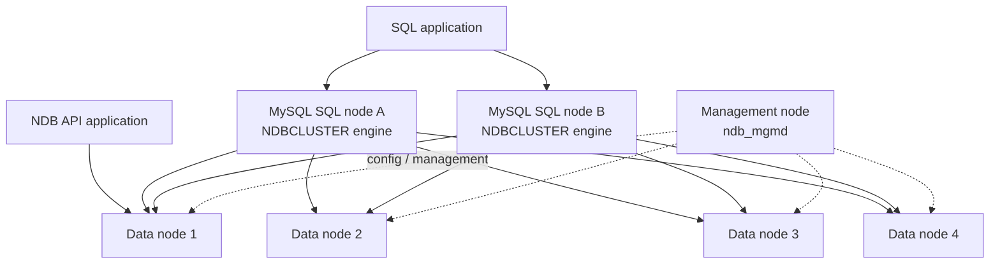
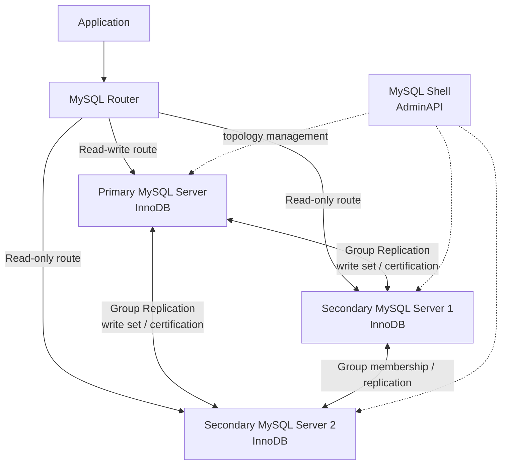

# NDB Cluster and its boundary with InnoDB Cluster

NDB Cluster and InnoDB Cluster both target high availability, yet they solve the problem at two different architectural layers. NDB Cluster is a distributed database system using the NDB storage engine: data is sharded (fragmented) and replicated across data nodes, while MySQL Server can act as an SQL node for applications to submit SQL statements. InnoDB Cluster is an HA solution for MySQL Servers using InnoDB, combining Group Replication, MySQL Router, and MySQL Shell AdminAPI to manage membership, elect a primary, and route connections.

Therefore, the name InnoDB Cluster does not denote a new storage engine, and NDB Cluster is not a replication mode of InnoDB. Understanding this boundary helps you choose the right architecture when designing tables, indexes, transactions, concurrency control, read/write scaling, backups, and MySQL operations.

## Objectives

After this lesson, you will be able to:

- Describe the components and query path of NDB Cluster.
- Explain how NDB shards, replicates, and maintains availability when a node fails.
- Describe the roles of InnoDB, Group Replication, MySQL Router, and MySQL Shell in InnoDB Cluster.
- Distinguish a cluster built on a distributed storage engine from an HA cluster replicating MySQL instances.
- Select an architecture by workload and identify constraints to verify before migrating applications.

## 1. Distinguishing at the architectural layer

| Criterion | NDB Cluster | InnoDB Cluster |
|---|---|---|
| Nature | Distributed database system using the NDB storage engine | HA/topology solution for MySQL based on Group Replication and InnoDB |
| Table storage engine in cluster | `NDBCLUSTER` (also called NDB) | `InnoDB` |
| Data distribution | Data is split into fragments/partitions and replicas are placed across multiple data nodes | Each member holds a full copy of the replicated data in the group |
| Data nodes / components | NDB data nodes | MySQL Server instances running InnoDB |
| SQL component | One or more MySQL Server SQL nodes with the NDB engine; clients can also use the NDB API | MySQL Server members accepting connections; MySQL Router typically sits in front of applications |
| Primary HA mechanism | Sharding and synchronous replica management across data nodes; node groups and `NoOfReplicas` govern redundancy | Group Replication, transaction certification, quorum, and primary election |
| Administration | NDB Management Server/client and NDB tools | MySQL Shell AdminAPI and MySQL Router, plus standard MySQL tools |
| Prominent target | Distributed workloads requiring HA, high throughput, and predictable latency when data is distributed across nodes | HA for existing MySQL/InnoDB applications, failover primary switching, and read/write routing |

The most important difference: NDB Cluster distributes table data itself at the storage engine layer; InnoDB Cluster replicates transactions across MySQL Servers, where each member maintains the cluster's InnoDB dataset. Adding a member to InnoDB Cluster does not automatically split a table into independent shards.

## 2. What is NDB Cluster?

NDB Cluster is a distributed database system using the NDB storage engine (often displayed as `NDBCLUSTER`). Its shared-nothing architecture distributes data and processing across multiple data nodes. Nodes communicate over the cluster network; the system does not require a shared storage device across all data nodes.

NDB is designed for workloads needing high availability, data distribution, and parallel processing capacity. NDB is often used in real-time transactional systems or high-load services such as telecommunications, payments, and online services. It carries its own operational requirements and data model, and is not the default choice for every MySQL application.

### 2.1. Core components

| Component | Role |
|---|---|
| Data node (`ndbmtd` or `ndbd`) | Stores and processes NDB data; manages fragments, replicas, transactions, and node recovery |
| Management node (`ndb_mgmd`) | Distributes cluster configuration, monitors and manages node lifecycles; does not store business tables |
| SQL node (`mysqld` with NDB engine) | Provides the MySQL SQL interface, executes SQL statements, and forwards requests to NDB data nodes |
| NDB API client | Applications can access NDB directly via API without going through an SQL node in suitable cases |
| NDB management client (`ndb_mgm`) | Sends administrative commands and inspects cluster status |

`ndbmtd` is the multi-threaded data node daemon; `ndbd` is the data node daemon. Binary selection and deployment depend on version, configuration, and platform. A cluster can have multiple SQL nodes to accept connections; an SQL node is not an independent data copy like a MySQL member in InnoDB Cluster.

### 2.2. NDB Cluster architecture diagram



The diagram shows only the main roles, not every communication path across all nodes. Data nodes coordinate to store and process data; the management node provides configuration and control tools. Redundant management nodes can be deployed to improve cluster manageability.

### 2.3. Data fragmentation and replication

NDB divides tables into fragments/partitions and distributes them across node groups. Each fragment has a number of copies determined by `NoOfReplicas`. For example, with two replicas, each piece of data has a replica on two different data nodes within a node group. Replicas are kept synchronized by NDB mechanisms so that if one data node fails, the remaining replica can continue serving as long as the node group retains sufficient data.

This differs from copying the entire database onto every server. One data node typically holds a subset of the cluster's data along with the replicas it is responsible for; the complete dataset is composed of fragments distributed across the cluster.

Fragmentation matters for performance: a transaction touching only a few partitions can incur less inter-node communication than a transaction spanning many partitions. Consequently, primary key design, data distribution, and query patterns heavily influence locality. Verify key distribution and benchmark with realistic workloads.

### 2.4. Does NDB store data only in RAM?

NDB is well known for a design optimized around in-memory data access, and data node RAM capacity is a critical planning factor. However, NDB Cluster should not be described as incapable of storing data on disk. NDB supports Disk Data tablespaces to store portions of data on disk; structures like indexes and fast-access data still carry their own memory requirements.

When sizing resources, account for memory for table data/indexes per table attributes, transactions, metadata, redo/undo, and NDB buffers; also account for disk space, checkpoints, logs, backups, and data growth. Exact numbers must be grounded in the specific NDB Cluster version and deployment configuration.

## 3. Transactions and availability in NDB

An NDB transaction can read or write records residing on one or more data nodes. The engine coordinates the involved nodes to preserve consistency and commit distributed transactions. Replication between data nodes is part of the storage engine itself, rather than requiring applications to replicate individual records across MySQL servers.

NDB supports transactions and record-level locking. However, when a transaction touches many fragments, multiple nodes, or issues many operations, network communication and coordination overhead increases. Large transactions, excessive round trips, and poor key distribution can raise latency significantly. Design concise transactions, leverage locality-aligned access, and benchmark with node counts and configurations close to production.

### 3.1. Node groups and replica counts

`NoOfReplicas` in the cluster configuration specifies the number of replicas per fragment. This setting must align with the data node count and node group layout. If a node group loses all replicas of a fragment, the cluster no longer has the data needed to serve that slice. Fault tolerance therefore depends not only on total node count but also on how nodes are grouped and where replicas are placed.

Conceptual example with two replicas:

```text
Node group 0
  Data node A: fragment X (replica 1), fragment Y (replica 2)
  Data node B: fragment X (replica 2), fragment Y (replica 1)

If A fails:
  The remaining replicas on B can hold this node group's data.
  The cluster must complete NDB failure detection and recovery procedures.
```

This is a simplified illustration, not a full node group configuration. Never place two replicas of the same fragment on the same physical host or failure domain if the goal is surviving host, rack, or zone failures. Design node placement across failure domains and test node/process/network failure scenarios.

### 3.2. Recovery and continued availability

When a data node disconnects or stops abruptly, the remaining nodes detect the failure and run recovery procedures. If valid replicas remain in the node group, the cluster can continue serving data in that scope after reaching an operational state. When the node returns, NDB synchronizes necessary data through its recovery protocol.

This does not mean every failure is non-disruptive. Losing multiple nodes in the same node group, network partitions splitting the cluster, running out of memory, misconfigured replicas, or storage failures can degrade availability or halt the cluster. HA must be proven through regular failover, recovery, backup, and restore testing.

## 4. Identifying and working with NDB from a MySQL SQL node

A MySQL Server can create NDB tables only when the binary/distribution is built and configured with NDB Cluster support, the NDB plugin is enabled, and the server is connected to the cluster. Simply installing standard MySQL Server does not mean an NDB Cluster exists.

### 4.1. Checking the storage engine

On an SQL node, check supported engines:

```sql
SHOW ENGINES;
```

Or query directly:

```sql
SELECT ENGINE, SUPPORT, TRANSACTIONS, XA, SAVEPOINTS
FROM information_schema.ENGINES
WHERE ENGINE IN ('InnoDB', 'NDBCLUSTER');
```

If `NDBCLUSTER` is absent or `SUPPORT` is not available, verify the installation package, plugins, and SQL node configuration before creating tables. Across versions and installations, plugin details and variable names can differ; you can inspect:

```sql
SHOW PLUGINS;
SHOW VARIABLES LIKE 'ndb%';
SHOW STATUS LIKE 'Ndb%';
```

### 4.2. Creating a table using NDB

Simple table example:

```sql
CREATE TABLE device_state (
    device_id BIGINT NOT NULL,
    state_code VARCHAR(24) NOT NULL,
    updated_at TIMESTAMP NOT NULL DEFAULT CURRENT_TIMESTAMP
        ON UPDATE CURRENT_TIMESTAMP,
    PRIMARY KEY (device_id)
) ENGINE=NDBCLUSTER;
```

`ENGINE=NDBCLUSTER` instructs the table to use NDB instead of the default engine. In NDB Cluster, DDL and data types must conform to NDB's rules and limits; do not assume every InnoDB table can switch engines without schema adjustments. Verify the table after creation:

```sql
SHOW CREATE TABLE device_state\G

SELECT TABLE_NAME, ENGINE
FROM information_schema.TABLES
WHERE TABLE_SCHEMA = DATABASE()
  AND TABLE_NAME = 'device_state';
```

### 4.3. Checking cluster status

The NDB Management Client can display node status. Example status commands:

```bash
ndb_mgm -e "SHOW"
ndb_mgm -e "ALL STATUS"
```

These commands must be run on a host with the NDB management client and appropriate management server/connection string. In environments with multiple clusters, explicitly specify the managed connect string. Never run `START`, `STOP`, `RESTART`, or modify node configurations on a live serving system without an approved operational plan.

## 5. What is InnoDB Cluster?

InnoDB Cluster is an HA solution for MySQL Servers using InnoDB. It combines three main components:

| Component | Role |
|---|---|
| MySQL Server + InnoDB | Each member stores data in InnoDB and participates in group replication |
| Group Replication | Exchanges write sets, certifies transactions, maintains membership/quorum, and synchronizes changes across members |
| MySQL Shell AdminAPI | Creates, configures, adds/removes members, inspects status, and manages topology |
| MySQL Router | Proxy accepting application connections and routing to primary or secondaries per routing mode |

AdminAPI is an administration tool, not a storage engine. Router is a connection-routing layer, not a data store, and does not replace Group Replication.

### 5.1. InnoDB Cluster diagram



In a single-primary layout, the application sends writes to the primary. Secondaries receive replicated transactions and can serve reads through the configured routing endpoint. Group Replication manages group membership and state; Router uses metadata/topology to direct connections to appropriate members.

### 5.2. How does Group Replication work?

Group Replication uses write-set exchange and certification to detect conflicts before transactions are applied on members. Transactions are ordered within the group via a group communication protocol. This mechanism is often described as virtually synchronous replication: changes are coordinated across the group under commit/certification rules, rather than merely sending an asynchronous copy to an independent replica.

Group Replication has two main modes:

- **Single-primary:** one member serves as the primary accepting writes; remaining members are secondaries. When the primary fails or leaves the group, remaining members can elect a new primary if the group retains quorum.
- **Multi-primary:** multiple members can accept writes. Transactions still undergo certification; conflicting writes can be rejected. This mode demands careful application, locking, and workload design—it does not mean writes on any node are automatically conflict-free.

Group Replication requires a majority of voting members to maintain quorum. If quorum is lost, the group cannot process transactions normally until membership is restored or handled via an appropriate recovery procedure. Consequently, three members distributed across independent failure domains is a common HA pattern; actual member counts should follow operational requirements and design.

### 5.3. How does each member store data?

In InnoDB Cluster, each member is a MySQL Server with InnoDB maintaining a full copy of the replicated group data. When a transaction commits and replicates, members apply it to their local copy. Data is not split into fragments stored exclusively on individual members like in NDB Cluster.

Because every member stores the entire dataset, adding members typically improves fault tolerance and can increase read capacity if applications/Router distribute read traffic appropriately. It does not automatically increase total storable dataset size proportionally to node count, nor does it provide linear write scale-out. Every member must still have sufficient resources to store and process the replicated dataset.

## 6. Creating and managing InnoDB Cluster with MySQL Shell

The steps below illustrate AdminAPI on a lab environment with three MySQL Servers. Before creating the cluster, each instance must satisfy Group Replication configuration requirements for the exact MySQL version: networking, resolvable hostnames, group communication ports, GTID/binlog, admin accounts, and compatible options. Use a MySQL Shell version compatible with the server.

Open MySQL Shell in JavaScript mode and connect to the first instance:

```bash
mysqlsh --js admin@mysql-1.example.internal:3306
```

Check instance configuration before adding to the cluster:

```javascript
dba.checkInstanceConfiguration('admin@mysql-1.example.internal:3306');
```

If the instance is not yet configured, use AdminAPI to apply required settings after reviewing the changes:

```javascript
dba.configureInstance('admin@mysql-1.example.internal:3306');
```

Once all instances meet preconditions, create the cluster and add members:

```javascript
var cluster = dba.createCluster('ordersCluster');

cluster.addInstance('admin@mysql-2.example.internal:3306');
cluster.addInstance('admin@mysql-3.example.internal:3306');

cluster.status();
```

This sequence is illustrative; AdminAPI may prompt for recovery method choices, confirm changes, or require additional instance conditions. Never copy commands blindly into production while ignoring check outputs and warnings. After creating the cluster, deploy MySQL Router so applications use read-write/read-only endpoints per configuration:

```bash
mysqlrouter --bootstrap admin@mysql-1.example.internal:3306
```

The bootstrap command is an example Router initialization; flags, OS users, config directories, and service management depend on the platform. Applications should connect to the provisioned Router endpoint instead of hard-coding the current primary address, allowing them to follow topology changes after failover.

Check topology from MySQL Shell:

```javascript
cluster.status({extended: 1});
```

Status helps verify which members are ONLINE, primary/secondary roles, replication state, and issues requiring attention. Monitor alerts and logs on each individual member, not just Router status.

## 7. Comparing fault tolerance and scaling

| Scenario | NDB Cluster | InnoDB Cluster |
|---|---|---|
| One data/server node fails | NDB can continue if the node group retains valid replicas; recovers via NDB mechanisms | Group Replication requires quorum; single-primary can elect a new primary |
| One member loses network connectivity | Impact depends on node group, replicas, and fragment status | Member may be expelled from the group; group needs quorum to continue committing |
| Dataset distribution | Fragments and replicas are placed across data nodes | Each member holds a full copy of the replicated dataset |
| Increasing storage capacity | Can scale by adding data nodes and redistributing data via NDB procedures | Adding members does not shard the dataset; each member needs full space for the copy |
| Increasing read capacity | Add SQL/API nodes and optimize data/query distribution; still account for data node load | Can route reads to secondaries, depending on consistency needs and replication lag |
| Increasing write throughput | Can distribute workload across partitions and process in parallel, depending on locality | Single-primary concentrates writes on primary; multi-primary incurs certification/conflict overhead |
| Network dependency | Networking between SQL/API nodes and data nodes is core to the distributed storage engine | Networking between Group Replication members must be stable, low-latency, and high-bandwidth |

No cluster is immune to misconfiguration, network failures, quorum loss, disk exhaustion, application bugs, or operator error. HA is conditional recoverability; failure scenarios must be tested and recovery times measured.

## 8. Technical boundaries: names cannot be swapped

### 8.1. `ENGINE=NDBCLUSTER` does not mean InnoDB Cluster

In NDB Cluster, `ENGINE=NDBCLUSTER` selects the NDB storage engine for the table. In InnoDB Cluster, tables still use `ENGINE=InnoDB`; high availability comes from Group Replication across MySQL Servers. Creating an InnoDB table on a standalone MySQL Server does not automatically make it an InnoDB Cluster, and installing MySQL Router does not turn a server into an NDB Cluster.

### 8.2. InnoDB Cluster is not automatic sharding

InnoDB Cluster replicates transactions to members and maintains a full copy on each member. It provides HA and can assist read scaling via secondaries, but does not automatically partition a large table into independent data slices across members. If a workload requires sharding or distributed storage-layer partitioning, evaluate another architecture and corresponding distribution mechanism.

### 8.3. NDB Cluster is not MySQL Group Replication

NDB implements distributed transaction coordination and replica synchronization at the storage engine/data node layer. Group Replication is a MySQL Server-level replication plugin exchanging write sets between members. NDB SQL nodes expose an SQL interface, yet that does not turn NDB into Group Replication. The two mechanisms have different components, administration, limits, and failure models.

### 8.4. SQL and application compatibility

NDB supports the MySQL SQL interface via SQL nodes, but not every InnoDB feature or behavior is available or shares the same limits on NDB. Before migrating tables, consult compatibility documentation for the exact NDB Cluster version and review:

- Data types, column lengths, indexes, and primary keys.
- Foreign keys, constraints, triggers, stored routines, and required DDL features.
- Partitioning, unique keys, auto-increment, and table/index size limits.
- Transactions, isolation, locking, and multi-table query patterns.
- Backup/restore methods, online schema changes, monitoring, and operational tooling.

Do not treat `ALTER TABLE ... ENGINE=NDBCLUSTER` as a harmless conversion on a live system. Test on a data copy, measure storage and performance, verify compatibility, validate post-migration data, and prepare a rollback plan.

## 9. Backup, restore, and operations

NDB Cluster and InnoDB Cluster have distinct backup/restore procedures because they store data and manage clusters differently.

With NDB Cluster, cluster backups are typically initiated through the NDB management client (e.g., `START BACKUP`) and restored using `ndb_restore` matching the version and configuration. Backups include required data and log components per NDB procedures; save cluster configuration metadata and test restoring individual databases/tables.

With InnoDB Cluster, data resides in MySQL Server/InnoDB instances. Suitable MySQL backup tools such as MySQL Enterprise Backup, Clone Plugin, or logical dumps can be used as required. However, snapshots/backups must be coordinated with replication state and topology to guarantee consistency. Never assume simply copying files from the data directory of a running member is valid.

In both models, you must:

- Monitor node status, replication, network, disk, memory, and transaction latency.
- Track node failures, quorum loss, replica lag/apply queues, transaction conflicts, and capacity alerts.
- Test restores in an isolated environment; a backup is only valuable once proven restorable.
- Plan upgrades against the compatibility matrix across server, engine, cluster components, connectors, and admin tools.
- Document procedures for failover, rejoin, rolling restarts, node replacement, and network partition handling.

## 10. Which architecture should you choose?

| Requirement | Evaluation direction |
|---|---|
| Existing MySQL app using InnoDB needing HA and primary failover | InnoDB Cluster is usually a fitting starting point; evaluate Group Replication, quorum, Router, and workload limits |
| Full copies across multiple MySQL servers for fault tolerance and read distribution | InnoDB Cluster fits the full-replica model; verify read consistency and replication load |
| Distributing a dataset into fragments across data nodes while replicating fragments for HA | Evaluate NDB Cluster along with partitioning, memory, network, and SQL compatibility requirements |
| Distributed workloads, short transactions, partition-local access, and high throughput/availability | NDB may fit if schema and access patterns are compatible |
| Application deeply relies on InnoDB features or standard SQL behavior | Prefer InnoDB; if HA is needed, evaluate InnoDB Cluster before considering an engine switch |
| Wanting to increase data storage capacity merely by adding members to InnoDB Cluster | InnoDB Cluster does not auto-shard; design sharding at another layer or evaluate NDB |

The final choice must rest on measured workloads, consistency requirements, SLAs, RPO/RTO, operational skills, infrastructure budget, and version support matrices. Do not choose NDB merely because multiple nodes are needed, and do not choose InnoDB Cluster simply because its name contains Cluster.

## 11. Practice exercises

Perform these in a dedicated lab environment; never test stopping nodes or altering cluster configuration on production systems.

1. On a standalone MySQL Server, run `SHOW ENGINES` and confirm InnoDB is available. If NDB Cluster is not installed, explicitly note that `NDBCLUSTER` is unavailable in the current environment.
2. Read the NDB Cluster diagram in section 2.2 and describe the roles of the SQL node, data node, management node, and NDB API client.
3. On a configured NDB Cluster lab, check node status with `ndb_mgm -e "SHOW"`; inspect an NDB table using `SHOW CREATE TABLE` and `information_schema.TABLES`.
4. Record `NoOfReplicas` and the lab's node group layout. Explain how a single data node failure affects fragments and replicas.
5. On an InnoDB Cluster lab, open MySQL Shell, run `cluster.status()`, and identify the primary, secondaries, member statuses, and Router endpoints.
6. Create an `ENGINE=InnoDB` table on InnoDB Cluster and verify its engine via `information_schema.TABLES`. Explain why this table does not require the NDB engine.
7. Build a comparison table of both architectures covering storage layout, replication, quorum/failure model, application connectivity, scale-out, and backup/restore workflows.
8. Pick a hypothetical workload, state why you would choose NDB or InnoDB Cluster, list limits to verify, and outline a failover/restore test plan.

You have completed this lesson when you can clearly explain that NDB Cluster is a distributed storage platform using the NDB engine, whereas InnoDB Cluster is an HA topology for MySQL Servers using InnoDB, and can identify how this difference impacts data design, queries, and operations.

## 12. Principles to remember

- NDB Cluster shards and replicates data across data nodes; InnoDB Cluster replicates the group's entire dataset to every member.
- `NDBCLUSTER` is a storage engine; InnoDB Cluster is an HA solution combining InnoDB, Group Replication, MySQL Shell, and MySQL Router.
- NDB requires designing node groups, replicas, partition locality, RAM, networking, and SQL compatibility.
- InnoDB Cluster requires quorum, transaction certification, primary election, and proper routing via Router.
- Adding members to InnoDB Cluster does not automatically shard data or linearly scale write throughput.
- Never migrate engines or change production topology without testing compatibility, backup/restore, failover, and rollback.
