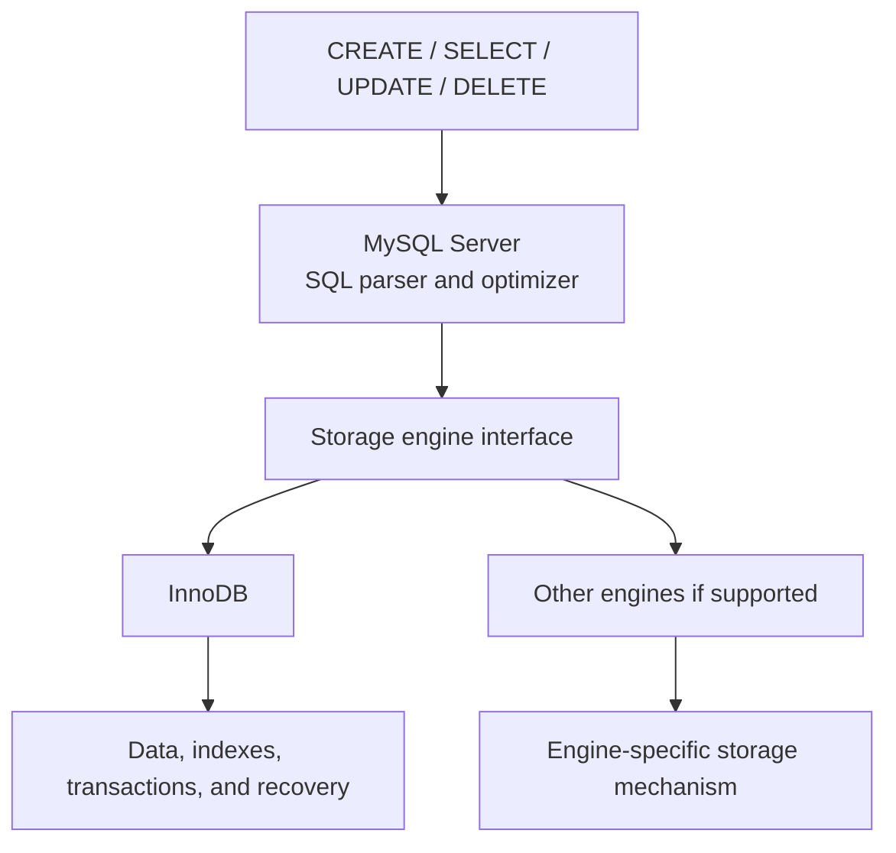

# SHOW ENGINES, default_storage_engine, and declaring table engines

MySQL can use multiple storage engines to manage how table data is stored and accessed. Each engine has distinct traits regarding transactions, locking, foreign keys, recovery, and performance. When creating a table, MySQL uses the connection session's default storage engine unless the statement specifies an engine; developers can also declare an engine explicitly in DDL statements.

This lesson explains how to inspect server-supported engines with `SHOW ENGINES`, view and change `default_storage_engine`, configure persistent default settings, and specify an engine per table. Illustrative commands target MySQL 8.x; cross-check documentation for your exact running version and environment before changing production configuration.

## 1. What does a storage engine determine?

MySQL Server handles SQL parsing, query analysis, execution plan optimization, and coordinating data operations. The storage engine handles storing and retrieving table data through the interface provided by the server.

The engine affects many important behaviors:

- Whether transactions and rollback are supported.
- Locking mechanisms and how concurrent connections read and write.
- The ability to declare and enforce foreign keys.
- How data is written, recovered after crashes, and how indexes are managed.
- Specialized features such as full-text indexes or physical data organization.

In modern transactional applications, InnoDB is typically the right choice because it supports ACID transactions, row-level locking, foreign keys, and crash recovery. Still, select an engine based on actual requirements and the capabilities of your MySQL version.



A single database can contain tables using different engines. The engine is chosen at the table level, while `default_storage_engine` supplies the default for new tables when no explicit option is given.

## 2. Listing storage engines with SHOW ENGINES

Run the statement:

```sql
SHOW ENGINES;
```

MySQL returns the list of engines recognized by the server along with support status and related capabilities. You can also use the synonymous statement:

```sql
SHOW STORAGE ENGINES;
```

Common columns in the output:

| Column | Meaning |
| --- | --- |
| `Engine` | Name of the storage engine |
| `Support` | Support status of the engine on the current server |
| `Comment` | Brief description of the engine |
| `Transactions` | Whether the engine supports transactions |
| `XA` | Whether the engine supports XA transactions |
| `Savepoints` | Whether the engine supports savepoints |

`Support` commonly takes the following values:

- `DEFAULT`: the engine currently serving as the server's default storage engine.
- `YES`: the engine is available and ready to use.
- `NO`: the engine is not supported in this server build.
- `DISABLED`: the engine is present in the build but currently disabled.

For example, output typically shows `InnoDB` with `DEFAULT` status and `Transactions`, `XA`, and `Savepoints` supported. Actual output depends on version, packaging, and server configuration; do not assume the engine list is identical across all machines.

### 2.1. Querying engine metadata

Similar information can be read from `INFORMATION_SCHEMA.ENGINES`:

```sql
SELECT
    ENGINE,
    SUPPORT,
    COMMENT,
    TRANSACTIONS,
    XA,
    SAVEPOINTS
FROM INFORMATION_SCHEMA.ENGINES
ORDER BY ENGINE;
```

This query is convenient when filtering or combining metadata with other inventory queries. For example, listing only usable engines:

```sql
SELECT ENGINE, SUPPORT, TRANSACTIONS, XA, SAVEPOINTS
FROM INFORMATION_SCHEMA.ENGINES
WHERE SUPPORT IN ('YES', 'DEFAULT')
ORDER BY ENGINE;
```

`SHOW ENGINES` reports the capabilities and status advertised by the server. It does not measure real speed, prove an engine fits your workload, or replace testing transactions, locking, or recovery.

## 3. Viewing the default storage engine

The `default_storage_engine` system variable determines which engine is chosen when a table is created without specifying `ENGINE`.

Check the current value:

```sql
SHOW VARIABLES LIKE 'default_storage_engine';
```

Or inspect global and session scopes explicitly:

```sql
SELECT
    @@GLOBAL.default_storage_engine AS global_engine,
    @@SESSION.default_storage_engine AS session_engine;
```

The two values can differ. `GLOBAL` is the default applied to new connections; `SESSION` is the value active in the current connection. When creating a table, a connection uses its session value if the statement does not declare a specific engine.

You can inspect each scope individually with:

```sql
SHOW GLOBAL VARIABLES LIKE 'default_storage_engine';
SHOW SESSION VARIABLES LIKE 'default_storage_engine';
```

## 4. Changing default_storage_engine at session scope

If you only want a change to apply to statements in the current connection, use `SET SESSION`:

```sql
SET SESSION default_storage_engine = InnoDB;

SELECT @@SESSION.default_storage_engine;
```

Afterward, any new table created without `ENGINE` will use InnoDB in this session. Session changes do not affect other connections. When the connection closes, that session value expires.

This is a suitable way to experiment or adjust an individual session without altering server-wide default configuration.

## 5. Changing default_storage_engine at global scope

To change the default value for connections established afterward, an administrator can run:

```sql
SET GLOBAL default_storage_engine = InnoDB;

SELECT @@GLOBAL.default_storage_engine;
```

Changing `GLOBAL` does not automatically overwrite the session value of existing connections. Older sessions keep their current session value; new connections receive the global value as their initial session default.

Modifying global variables requires appropriate system administration privileges. In modern MySQL versions, `SYSTEM_VARIABLES_ADMIN` is used to manage many system variables; exact privileges depend on version and access policies. Do not grant this privilege to runtime application accounts.

**Persistence note:** `SET GLOBAL` changes the running value in memory but generally does not persist configuration across a server restart. If the setting must survive restarts, configure it in an option file or use the persist mechanism supported by your MySQL version.

## 6. Configuring a persistent default value

### 6.1. Configuring in an option file

In the MySQL configuration file, such as `my.cnf` or `my.ini`, add the option under `[mysqld]`:

```ini
[mysqld]
default-storage-engine=InnoDB
```

After editing, restart MySQL Server following your operating system or managed service procedures. Option file names and locations depend on installation method. On cloud-managed MySQL services, configuration may be managed via parameter groups or provider consoles rather than editing files directly.

Once the server restarts, verify again:

```sql
SELECT @@GLOBAL.default_storage_engine;
SHOW ENGINES;
```

### 6.2. Using SET PERSIST on supported versions

MySQL 8.0 supports `SET PERSIST` for many dynamic system variables. Where supported by version and variable, you can run:

```sql
SET PERSIST default_storage_engine = InnoDB;
```

This command updates the running global value and saves it to the MySQL-managed persisted configuration file (`mysqld-auto.cnf`) so it applies across future restarts. Ensure you hold appropriate administrative privileges and verify your environment's configuration policy before using it.

Do not edit `mysqld-auto.cnf` manually to alter persisted variables. If you need to remove a persisted setting, use the corresponding persisted-variable management statement for your MySQL version, such as `RESET PERSIST default_storage_engine;`, after understanding the effect of reverting to the option file or compiled default.

## 7. Declaring a storage engine when creating a table

You can specify the engine directly in `CREATE TABLE` using the `ENGINE` table option:

```sql
CREATE TABLE customers (
    id BIGINT UNSIGNED NOT NULL AUTO_INCREMENT,
    email VARCHAR(254) NOT NULL,
    full_name VARCHAR(150) NOT NULL,
    created_at DATETIME NOT NULL DEFAULT CURRENT_TIMESTAMP,
    PRIMARY KEY (id),
    UNIQUE KEY uq_customers_email (email)
) ENGINE=InnoDB;
```

In this example, `ENGINE=InnoDB` instructs MySQL to create the table using InnoDB regardless of the current `default_storage_engine` value. Explicit declaration makes it clear to schema readers which engine a table relies on.

If the `ENGINE` table option is omitted, MySQL uses `@@SESSION.default_storage_engine` of the executing connection. You can verify the resulting DDL as expected:

```sql
SHOW CREATE TABLE customers\G
```

The output includes `ENGINE=InnoDB` in the table definition. You can also check the engines of tables in the current schema:

```sql
SELECT
    TABLE_SCHEMA,
    TABLE_NAME,
    ENGINE
FROM INFORMATION_SCHEMA.TABLES
WHERE TABLE_SCHEMA = DATABASE()
  AND TABLE_TYPE = 'BASE TABLE'
ORDER BY TABLE_NAME;
```

### 7.1. Comparing tables using the default engine vs. an explicit engine

Try creating two tables in a lab schema:

```sql
SET SESSION default_storage_engine = InnoDB;

CREATE TABLE engine_from_default (
    id BIGINT UNSIGNED NOT NULL AUTO_INCREMENT,
    note VARCHAR(100) NOT NULL,
    PRIMARY KEY (id)
);

CREATE TABLE engine_explicit (
    id BIGINT UNSIGNED NOT NULL AUTO_INCREMENT,
    note VARCHAR(100) NOT NULL,
    PRIMARY KEY (id)
) ENGINE=InnoDB;

SELECT TABLE_NAME, ENGINE
FROM INFORMATION_SCHEMA.TABLES
WHERE TABLE_SCHEMA = DATABASE()
  AND TABLE_NAME IN ('engine_from_default', 'engine_explicit')
ORDER BY TABLE_NAME;
```

Both tables use InnoDB in this example. The first table inherits the engine from the session default; the second gets its engine from the explicit table option.

## 8. Changing the engine of an existing table

To convert an existing table to another engine, you can use `ALTER TABLE`:

```sql
ALTER TABLE legacy_orders ENGINE=InnoDB;
```

The statement above is an illustrative example. Before running it, verify that the target engine is available and supports all features currently used by the schema. Changing engines may require MySQL to rebuild storage structures and copy data. For large tables, this operation can consume substantial CPU, I/O, temporary disk space, and time; locking impact and online execution capability depend on the engine, version, specific statement, and workload.

Checklist before changing an engine:

1. Check available disk space, table size, and current server load.
2. Inspect indexes, foreign keys, triggers, and engine-dependent features.
3. Consult documentation on DDL algorithms and locking behavior for your running version.
4. Back up the data and verify it can be restored.
5. Test on staging with production-like data, measuring duration and query impact.
6. Schedule a deployment window and prepare a rollback plan.
7. After conversion, verify `SHOW CREATE TABLE`, engine metadata, and critical queries.

Do not use `ALTER TABLE ... ENGINE=...` as an ad-hoc fix in production. It is a physical structural change that can heavily impact the system.

## 9. What happens if the requested engine is unavailable?

When creating a table with an engine that the server does not support or has disabled, behavior depends on the `NO_ENGINE_SUBSTITUTION` SQL mode.

Check the active mode:

```sql
SELECT @@SESSION.sql_mode;
```

When `NO_ENGINE_SUBSTITUTION` is enabled, MySQL raises an error if the requested engine is unavailable. When disabled, the server may emit a warning and substitute the default engine. In both development and production environments, keep behavior explicit so you do not assume a table uses the requested engine when it actually uses another.

After creating a table, always verify the result using `SHOW CREATE TABLE` or `INFORMATION_SCHEMA.TABLES`; do not rely solely on the DDL statement completing.

## 10. Selecting an engine and verifying before deployment

When deciding an engine for a table, evaluate:

- **Transactions:** does the business workflow require committing/rolling back multiple statements as one unit?
- **Locking and concurrency:** do multiple connections frequently update the same data?
- **Constraints:** does the schema need foreign keys or database-level integrity rules?
- **Recovery:** what are the crash recovery and data protection requirements?
- **Features:** does the workload need full-text indexes or capabilities unique to a specific engine?
- **Operations:** does the team have experience, backup tools, monitoring, and incident runbooks for that engine?

For most transactional business tables, InnoDB is the sensible default in modern MySQL. Use another engine only when there is a clear requirement, its limits are understood, and it has been tested.

`SHOW ENGINES` shows which engines are usable and which capabilities they advertise. It does not tell you which engine is fastest for your data. Benchmark on realistic workloads and verify transaction, locking, and backup/restore behavior before deciding.

## 11. Quick verification workflow for a schema

When onboarding a database or preparing a deployment, you can run these in sequence:

```sql
-- 1. List server-supported engines
SHOW ENGINES;

-- 2. View global and session default values
SELECT
    @@GLOBAL.default_storage_engine,
    @@SESSION.default_storage_engine;

-- 3. View SQL mode related to engine substitution
SELECT @@SESSION.sql_mode;

-- 4. Check engines of tables in the current schema
SELECT TABLE_NAME, ENGINE
FROM INFORMATION_SCHEMA.TABLES
WHERE TABLE_SCHEMA = DATABASE()
  AND TABLE_TYPE = 'BASE TABLE'
ORDER BY TABLE_NAME;

-- 5. Inspect DDL of a specific table
SHOW CREATE TABLE customers;
```

Record the inspection output alongside the MySQL version, timestamp, and environment. If a schema contains tables using different engines, determine why and verify whether those differences remain appropriate for application requirements.

## 12. Practice exercises

1. Run `SHOW ENGINES` and note which engines have `Support` set to `DEFAULT`, `YES`, `NO`, or `DISABLED`.
2. Query `INFORMATION_SCHEMA.ENGINES` and compare the `TRANSACTIONS`, `XA`, and `SAVEPOINTS` columns.
3. Inspect `@@GLOBAL.default_storage_engine` and `@@SESSION.default_storage_engine`; record both values.
4. Use `SET SESSION default_storage_engine = InnoDB`, create a table without specifying an engine, and inspect it with `SHOW CREATE TABLE`.
5. Create another table with `ENGINE=InnoDB` and verify it via `INFORMATION_SCHEMA.TABLES`.
6. Change the session default in one separate connection and verify that another connection remains unaffected.
7. In a lab environment, practice configuring `default-storage-engine` in an option file or via `SET PERSIST` if supported by your version; verify after a safe restart procedure.
8. Explain why changing the default engine does not automatically convert existing tables.

## 13. Takeaways

`SHOW ENGINES` lists storage engines and their support status on MySQL Server. `default_storage_engine` is a system variable with both global and session scope: session determines the default engine for new tables in the current connection; global provides the default for new connections. `SET GLOBAL` updates the running value, while an option file or `SET PERSIST` on supported versions persists configuration across restarts.

When creating a table, `ENGINE=...` specifies the engine explicitly and takes precedence over the session default. When omitted, MySQL uses the creating session's `default_storage_engine`. Changing an existing table's engine requires `ALTER TABLE` and can consume resources, time, or cause locking. Always verify the actual engine with `SHOW CREATE TABLE` or `INFORMATION_SCHEMA.TABLES`, confirm engine support, and test before making production changes.
