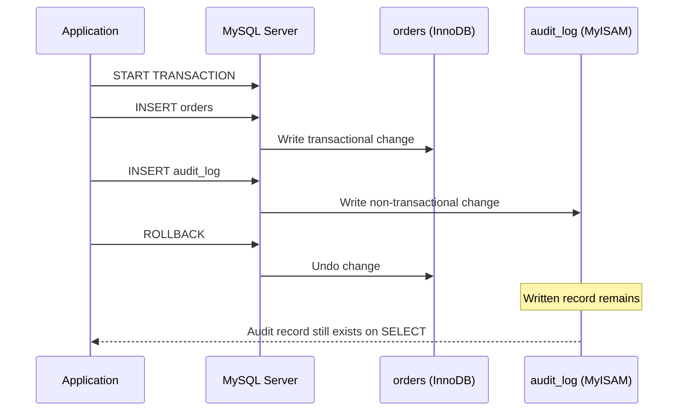

# Risks of transactions spanning tables with different engines

In MySQL, a transaction does not automatically make every table touched by SQL statements rollbackable. Commit, rollback, locking, and consistent read capabilities depend on each table's storage engine. If a workflow updates an InnoDB table and then writes to a MyISAM table within the same `START TRANSACTION`, `ROLLBACK` can undo the InnoDB change but cannot undo the MyISAM change. As a result, business data and auxiliary data can diverge even when the application believes the entire transaction was canceled.

This is a critical design risk when mastering MySQL: you must know the engine of every table a workflow touches, including tables written indirectly via triggers or stored routines. The scope of the `DATABASE_MYSQL` module includes table design, data types, keys, SQL, transactions, concurrency control, and operations; storage engine choices must therefore align with business consistency requirements, not merely defaults or read performance.

## 1. Transactions are executed by the storage engine

MySQL Server receives and parses SQL, checks privileges, optimizes statements, and coordinates with the storage engine to read or modify data. The storage engine manages how pages, indexes, locks, and transactional traits of a table are handled. Consequently, when a transaction touches multiple tables, each table's engine determines to what extent changes can be rolled back and isolated.

InnoDB is MySQL's standard transactional storage engine. It supports ACID, `COMMIT`, `ROLLBACK`, MVCC, row-level locking, and foreign keys. MyISAM is a non-transactional engine: data modifications are applied directly and cannot be undone by `ROLLBACK`; its primary locking mechanism is table-level locking.

| Characteristic | InnoDB | MyISAM |
|---|---|---|
| Transactions | Yes | No |
| `COMMIT` / `ROLLBACK` | Effective for transactional changes | Does not undo written changes |
| MVCC / consistent reads | Yes | No equivalent MVCC snapshot |
| Typical write locking | Row-level locking, plus query- and index-dependent locks | Table-level locking |
| Foreign keys | Supported and enforced | Foreign keys not enforced |
| Transactional crash recovery | Redo/undo and crash recovery mechanisms | No InnoDB-equivalent transaction rollback guarantee |

Do not assume every engine other than InnoDB behaves identically to MyISAM; each engine has its own feature set. However, the key design rule remains: rely only on the transaction guarantees that the actual engine supports and version documentation confirms.

## 2. Why can multi-engine transactions produce inconsistent data?

Suppose an order-creation feature performs two operations:

1. Inserts an order into the `orders` table using InnoDB.
2. Logs an event into the `audit_log` table using MyISAM.

The application starts a transaction, executes both statements, encounters an error, and calls `ROLLBACK`. InnoDB can restore the state of `orders`, while MyISAM has no transaction undo to revert to the previous state. The audit record remains, even though the order has vanished.



The crucial point is that `ROLLBACK` can only undo changes made in engines that support transactions. It is not a global undo button for every table in a statement or business workflow.

## 3. Reproducing the risk with SQL

Run the example in a test schema. The `CREATE TABLE` statements must execute before the transaction because DDL in MySQL typically triggers an implicit commit.

```sql
CREATE TABLE orders_tx_demo (
    id BIGINT NOT NULL PRIMARY KEY,
    customer_name VARCHAR(100) NOT NULL,
    amount DECIMAL(12,2) NOT NULL
) ENGINE=InnoDB;

CREATE TABLE audit_non_tx_demo (
    id BIGINT NOT NULL AUTO_INCREMENT PRIMARY KEY,
    order_id BIGINT NOT NULL,
    event_name VARCHAR(100) NOT NULL,
    created_at DATETIME NOT NULL DEFAULT CURRENT_TIMESTAMP
) ENGINE=MyISAM;
```

Start a transaction and write to both tables:

```sql
START TRANSACTION;

INSERT INTO orders_tx_demo (id, customer_name, amount)
VALUES (1001, 'Nguyen An', 250000.00);

INSERT INTO audit_non_tx_demo (order_id, event_name)
VALUES (1001, 'ORDER_CREATED');

ROLLBACK;
```

Check the result after rollback:

```sql
SELECT * FROM orders_tx_demo WHERE id = 1001;

SELECT * FROM audit_non_tx_demo WHERE order_id = 1001;

SHOW WARNINGS;
```

Expected outcome in this example: `orders_tx_demo` no longer has row `1001`, whereas `audit_non_tx_demo` still contains the `ORDER_CREATED` event. Depending on the case, MySQL may emit a warning that some non-transactional changed tables could not be rolled back. Do not rely on warnings always appearing to catch design flaws; know your engines and test actual behavior.

This example also shows why merely seeing `ROLLBACK` in application code is insufficient to conclude data reverted to its original state. You must verify the engine of every table participating in the workflow.

## 4. Failure modes and inconsistent states

### 4.1. Application rolls back after writing to multiple tables

This is the scenario shown above: InnoDB data is undone while written MyISAM data persists. A report may show an audit event for an order that does not exist. If the application uses the audit table to reconstruct history, the system can misinterpret what events actually occurred.

### 4.2. Statement or workflow fails mid-execution

Suppose the application writes to a MyISAM table first, then updates an InnoDB table and hits an error. The MyISAM write is not automatically reverted just because a later statement or transaction fails. Similarly, if a trigger writes to a MyISAM table and the transactional operation subsequently fails, the MyISAM side effect can remain.

Hidden side effects are especially dangerous. Application code might only execute `INSERT INTO orders`, while a trigger on `orders` writes to a statistics or audit table using a non-transactional engine. A reviewer checking only the main table can miss the secondary table.

### 4.3. Process or server crash

If the server stops abruptly while a workflow is running, InnoDB uses redo/undo to recover transactional state per its recovery rules. Non-transactional tables lack the same transactional recovery guarantees. Auxiliary data may reflect partial work performed before the crash, whereas the InnoDB portion is rolled back during recovery.

Consequently, a multi-engine operation can leave states that are hard to reconcile after a crash: an audit row exists with no order; summary counters incremented while source records rolled back; or an auxiliary table holds partial batch results.

### 4.4. Reading data across multiple engines

An InnoDB transaction can provide consistent reads via a read view, yet that does not create an MVCC snapshot for a MyISAM table. A query joining InnoDB and MyISAM tables should not be treated as a uniform consistent snapshot across both engines at the same point in time. The MyISAM table may reflect newer changes under its locking rules while the InnoDB table is read from a snapshot.

If a workflow requires inspecting a unified consistent dataset, related tables should use a transactional engine with matching consistency guarantees and be accessed within the same transaction boundary.

### 4.5. Differing locks and concurrency contention

InnoDB primarily uses row-level locks alongside index and range locks matching the isolation level. MyISAM uses table-level locks for read/write operations. A transaction holding an InnoDB lock and then waiting on a MyISAM lock can create wait chains that are difficult to analyze; InnoDB's deadlock detector does not manage all lock types across other engines.

When accessing multiple engines, lock hold times and access ordering become harder to predict. This can reduce concurrency and cause certain deadlocks or lock waits not to surface like pure InnoDB deadlocks.

## 5. Triggers, stored routines, and indirect write paths

When auditing a transaction, do not list only tables appearing directly in the SQL. Identify every table that may be modified by:

- `BEFORE` or `AFTER` triggers on source tables.
- Stored procedures or functions invoked in the business flow.
- Multi-table statements such as multi-table `UPDATE` or `DELETE` targets.
- Logging, audit, statistics, or cache logic executing synchronously within the same request.
- Background jobs or consumers updating secondary tables based on events.

Example of an audit-logging trigger:

```sql
CREATE TRIGGER orders_after_insert_demo
AFTER INSERT ON orders_tx_demo
FOR EACH ROW
INSERT INTO audit_non_tx_demo (order_id, event_name)
VALUES (NEW.id, 'ORDER_CREATED_BY_TRIGGER');
```

If `orders_tx_demo` is InnoDB and `audit_non_tx_demo` is MyISAM, the trigger does not make the MyISAM table transactional. When the outer transaction rolls back, the MyISAM change produced by the trigger still cannot be rolled back by InnoDB's mechanism. In real designs, avoid placing side effects requiring strict consistency into non-transactional tables written via triggers from transactional tables.

Inspect schema triggers:

```sql
SHOW TRIGGERS FROM learning_shop;
```

For each critical trigger, inspect its definition to identify target tables and generated operations. Also review stored routines and application code, because querying triggers cannot reveal external database write paths.

## 6. Checking the engines of all involved tables

Do not assume an engine from table names, project history, or default configuration. Query actual metadata:

```sql
SELECT
    table_schema,
    table_name,
    engine,
    table_type
FROM information_schema.tables
WHERE table_schema = 'learning_shop'
  AND table_type = 'BASE TABLE'
ORDER BY table_name;
```

Check the default engine for new tables with:

```sql
SHOW VARIABLES LIKE 'default_storage_engine';
```

The default variable only explains why a newly created table received a given engine; it does not prove the engine of pre-existing tables. Always check each table through `information_schema.tables`.

To check a specific group of tables:

```sql
SELECT table_name, engine
FROM information_schema.tables
WHERE table_schema = 'learning_shop'
  AND table_name IN ('orders', 'order_items', 'inventory', 'audit_log');
```

Inspect each table's definition with:

```sql
SHOW CREATE TABLE learning_shop.orders;
SHOW CREATE TABLE learning_shop.audit_log;
```

`SHOW CREATE TABLE` displays the engine, keys, indexes, charset, and declared constraints. When reviewing a business flow, list every table read or written directly and indirectly, and cross-check their engines.

A review checklist can include:

1. List all tables updated within the same use case.
2. Identify the actual engine of each table.
3. Check whether triggers and stored routines emit write operations.
4. Confirm which tables must roll back together on error.
5. Confirm whether read queries require a consistent snapshot across those tables.
6. Check foreign key rules and locking behavior of each engine.
7. Test controlled failures in a test environment and verify data after rollback.

## 7. Designing for consistency

### 7.1. Use InnoDB for tables in the same business workflow

For business data requiring correctness, the safe and standard choice is using InnoDB for all tables that must commit or roll back together. For instance, orders, order items, internal payments, inventory, and outbox records should reside in InnoDB if they must change atomically together.

```sql
CREATE TABLE orders (
    id BIGINT UNSIGNED NOT NULL AUTO_INCREMENT,
    customer_id BIGINT UNSIGNED NOT NULL,
    status VARCHAR(20) NOT NULL,
    total_amount DECIMAL(12,2) NOT NULL,
    created_at DATETIME NOT NULL DEFAULT CURRENT_TIMESTAMP,
    PRIMARY KEY (id)
) ENGINE=InnoDB;

CREATE TABLE order_items (
    id BIGINT UNSIGNED NOT NULL AUTO_INCREMENT,
    order_id BIGINT UNSIGNED NOT NULL,
    product_id BIGINT UNSIGNED NOT NULL,
    quantity INT UNSIGNED NOT NULL,
    unit_price DECIMAL(12,2) NOT NULL,
    PRIMARY KEY (id),
    KEY idx_order_items_order (order_id),
    CONSTRAINT fk_order_items_order
        FOREIGN KEY (order_id) REFERENCES orders(id)
) ENGINE=InnoDB;

CREATE TABLE audit_events (
    id BIGINT UNSIGNED NOT NULL AUTO_INCREMENT,
    aggregate_id BIGINT UNSIGNED NOT NULL,
    event_type VARCHAR(60) NOT NULL,
    created_at DATETIME NOT NULL DEFAULT CURRENT_TIMESTAMP,
    PRIMARY KEY (id)
) ENGINE=InnoDB;
```

When all three tables are InnoDB, the application can write the order, order items, and audit event in the same transaction and commit or roll back as a single InnoDB transactional unit.

### 7.2. Use a transactional outbox for asynchronous side effects

If an event must be sent to an external system or a legacy non-transactional table, avoid writing that side effect directly inside the order-creation transaction. Instead, write an outbox record using InnoDB in the same transaction as the business data:

```sql
CREATE TABLE outbox_events (
    event_id CHAR(36) NOT NULL,
    aggregate_id BIGINT UNSIGNED NOT NULL,
    event_type VARCHAR(60) NOT NULL,
    payload JSON NOT NULL,
    created_at DATETIME NOT NULL DEFAULT CURRENT_TIMESTAMP,
    published_at DATETIME NULL,
    PRIMARY KEY (event_id),
    KEY idx_outbox_pending (published_at, created_at)
) ENGINE=InnoDB;
```

```sql
START TRANSACTION;

INSERT INTO orders (customer_id, status, total_amount)
VALUES (42, 'PENDING', 250000.00);

SET @order_id = LAST_INSERT_ID();

INSERT INTO outbox_events (event_id, aggregate_id, event_type, payload)
VALUES (
    'f2a1b4c0-7c19-4b72-aea1-9d2b2e9a1001',
    @order_id,
    'ORDER_CREATED',
    JSON_OBJECT('orderId', @order_id)
);

COMMIT;
```

A separate worker reads the outbox, dispatches the event to the target system or legacy table, and marks it processed. The worker must support retries and idempotent processing because an event can be re-sent if the worker stops between dispatching and updating status. `event_id` can serve as a unique key on the receiving side to prevent applying the same event multiple times.

The outbox guarantees that business data and the intent to emit an event are written atomically in InnoDB. It does not magically make the target system transactional; correctness of the delivery step still requires retries, idempotency, monitoring, and reconciliation.

### 7.3. When legacy engines cannot yet be removed

If a legacy table must remain on a non-transactional engine, treat writes to that table as non-rollbackable side effects. Risk-mitigation measures include:

- Decouple the side effect from the main transaction using a queue or outbox.
- Attach unique business identifiers to detect duplicate records and support idempotency.
- Design reconciliation jobs to detect orphan or missing records.
- Implement compensation workflows when one part of a business flow completed while another failed.
- Record incomplete states explicitly rather than assuming every component committed together.
- Never use triggers writing synchronously to non-transactional tables for side effects requiring consistency.

Compensation is a new business action aimed at bringing the system to an acceptable state; it is not a physical rollback. For example, if a legacy event was already written but the order was canceled, the system can emit an additional `ORDER_CANCELLED` event so partners update state. Ordering, retries, and out-of-order event handling must be designed clearly.

## 8. Can XA solve multi-engine transactions?

XA is a distributed transaction protocol based on two-phase commit, allowing a transaction coordinator to coordinate multiple XA-capable resource managers. MySQL supports XA for compatible resource managers, with InnoDB being an XA-capable engine. However, XA does not turn a non-transactional engine like MyISAM into a resource manager capable of rollback.

Therefore, `XA START`, `XA END`, `XA PREPARE`, and `XA COMMIT` cannot make MyISAM changes roll back alongside InnoDB. Before using XA, confirm all participants genuinely support XA, understand prepared transaction states, and establish coordinator recovery procedures. For a standard application updating multiple tables within the same MySQL instance, using InnoDB consistently is simpler and safer.

## 9. Notes on DDL and changing engines

### DDL differs from DML in transactions

Certain MySQL DDL statements such as `CREATE TABLE`, `ALTER TABLE`, and `DROP TABLE` cause an implicit commit. This means you cannot wrap an arbitrary schema migration inside a DML transaction and expect `ROLLBACK` to undo everything. Modern MySQL versions support atomic DDL for certain operations, yet atomic DDL does not mean DDL participates in application transactions like an InnoDB `INSERT`.

Therefore, separate structural migrations from business transactions. Run migrations through controlled schema deployment tools, verify results, and maintain appropriate recovery plans.

### Converting a table from MyISAM to InnoDB

You can convert the engine using `ALTER TABLE`:

```sql
ALTER TABLE learning_shop.audit_log ENGINE=InnoDB;
```

This statement is an administrative example and should not be run directly in production without evaluation. Converting an engine can rebuild the table, require temporary disk space, generate heavy I/O, and affect locks and availability. Before converting:

1. Check table size, indexes, full-text indexes, data types, and engine-dependent features.
2. Confirm the MySQL version, online DDL support, and locking levels throughout the operation.
3. Measure free disk space and I/O capacity; schedule a maintenance window if necessary.
4. Test conversion on a production-sized data copy.
5. Check row counts, checksums, or reconciliation queries afterward.
6. Re-verify foreign keys, triggers, indexes, and query execution plans.
7. Have a tested backup and rollback plan ready.

After conversion, confirm the engine via `information_schema.tables` and test transaction rollback. Do not rely solely on `ALTER TABLE` returning success.

## 10. Practice exercises and completion criteria

### Exercise A — Demonstrate non-uniform rollback

1. Create one InnoDB table and one MyISAM table in a test schema.
2. Start a transaction, insert into both tables, and then call `ROLLBACK`.
3. Query both tables to compare results.
4. Run `SHOW WARNINGS` and record any warning emitted by the server.
5. Explain why the states of the two tables differ after the same rollback statement.

### Exercise B — Find side effects through triggers

1. Create a trigger on an InnoDB table to log an event into a MyISAM table.
2. Start a transaction and insert into the InnoDB table.
3. Call `ROLLBACK`.
4. Check the main row and the audit event.
5. Propose an alternative design using an InnoDB outbox table.

### Exercise C — Inventory engines for a business workflow

Choose a multi-step use case, such as order creation and inventory updates. List directly read/written tables, triggers, stored routines, and auxiliary jobs. Use `information_schema.tables` to inspect engines. Mark which changes must roll back together and propose appropriate engines or an outbox design.

### Exercise D — Test design after conversion

In a test environment, convert a legacy table to InnoDB, then re-run the rollback test and data reconciliation. Record conversion duration, required disk space, query impact, and verification steps.

You have completed this lesson when you can:

- Explain why a transaction touching multiple engines does not necessarily provide global atomicity.
- Accurately predict which changes persist after `ROLLBACK`.
- Identify auxiliary tables written by triggers or stored routines.
- Inventory the engines of all tables involved in a business workflow.
- Design consistent transactions with InnoDB or isolate side effects using an outbox.
- Describe the limits of XA and the risks of engine conversion.

## 11. Principles to remember

The storage engine determines transactional capability at the table level. When a workflow needs to commit or roll back multiple changes together, all directly and indirectly involved tables should use a transactional engine with compatible guarantees, usually InnoDB. A MyISAM table written within the same flow cannot be undone merely by `ROLLBACK` of an InnoDB transaction.

Verify actual engines, audit triggers and stored routines, test rollbacks in staging/testing, and design an outbox for asynchronous side effects. XA is useful only when every participating resource supports XA; it does not add transactions to an inherently non-transactional engine. Following these principles prevents orphan records, skewed audits, inconsistent metrics, and hard-to-recover post-crash states.
