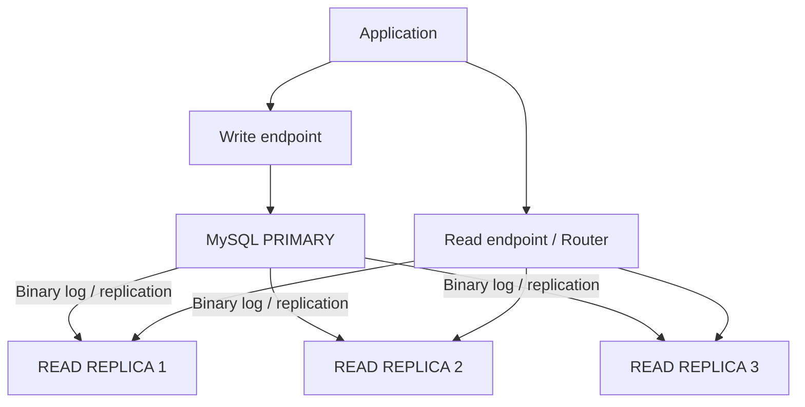
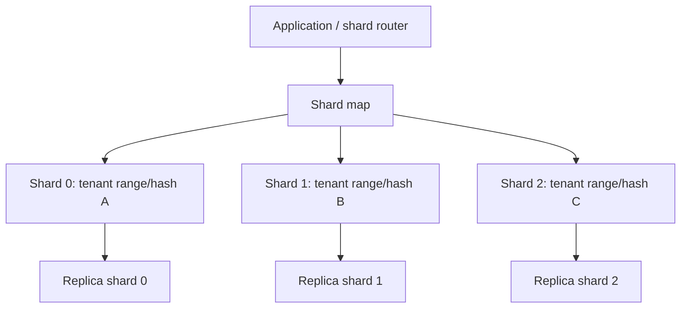

# Vertical Scaling, Horizontal Scaling, and Identifying Practical Limits

MySQL can serve anything from a small application on a single server to a system with multiple replicas, multiple shards, and multiple cache layers. As load increases, the question is not just "add more CPU or add more servers?" but **which resource or component is limiting throughput and latency**, which portion of the load can be distributed, and how much the cost of data consistency will increase.

Vertical scaling increases the capacity of a single MySQL machine using faster CPU, RAM, storage, or I/O. Horizontal scaling distributes a portion of the load across multiple machines, typically starting with read replicas and potentially progressing to sharding to distribute both data and writes. The two approaches can be combined. The right decision must be based on measured metrics, actual workload, p95/p99 targets, RPO/RTO, and operational capability.

## 1. Distinguishing Scale-Up, Scale-Out, and Related Techniques

| Technique | How capacity increases | Solves well | Main limitations |
|---|---|---|---|
| Vertical scaling (scale-up) | Increases CPU, RAM, IOPS, throughput, or storage capacity of a single MySQL server. | Resource shortage on the current node; need to keep architecture simple. | Eventually limited by a single node, a single writer, and hardware scalability. |
| Read replica | Adds MySQL servers that receive transactions from the source and serve read queries. | Increases read capacity, isolates reporting workloads, reduces read queries on the primary. | Replicas are typically asynchronous; writes remain concentrated on the source and replicas can lag. |
| Sharding | Splits data into independent parts across multiple MySQL servers. | Distributes storage capacity and write load when a single primary can no longer keep up. | Application must route to shards; joins, transactions, uniqueness, and rebalancing become more complex. |
| Partitioning | Splits a table into partitions managed by a single MySQL instance. | Managing large tables, pruning, and data lifecycle. | Does not automatically distribute the table across multiple servers or increase the write capacity of a single node. |
| Caching | Serves frequently read data from cache. | Reduces repeated queries and read latency. | Invalidation, stale data, cache stampede, and data synchronization. |
| CQRS/read model | Maintains a separate read model from the data change stream. | Complex read queries or multiple projection shapes. | Increases synchronization latency and the operational cost of multiple data models. |

Read replica, sharding, and partitioning are not interchangeable terms. A replica is a copy of the data; a shard is a subset of data partitioned by a key; a partition is an internal structure within a table on a single server. Choosing the wrong concept can lead to an architecture that fails to resolve the bottleneck.

## 2. Identifying Limits Before Scaling

Do not scale simply because CPU spiked once or the record count is large. Measure during peak hours and over a long enough period to distinguish short spikes from sustained saturation. Define service targets first: required throughput, p95/p99 latency, error rate, recovery time, and acceptable read lag.

Some common symptoms:

| Symptom | Potential limit | Evidence to collect |
|---|---|---|
| Sustained high CPU, rising runnable threads, rising query latency | CPU or compute-intensive query plans | CPU utilization, top SQL digests, rows examined, execution plans. |
| High disk latency/queue depth, rising I/O wait | Storage IOPS/throughput or heavy read/write queries | Per-device latency, IOPS, throughput, buffer pool reads, and file I/O. |
| Dropping buffer pool hit ratio, rising physical reads | Working set larger than RAM or queries scanning large amounts of data | `Innodb_buffer_pool_read_requests`, `Innodb_buffer_pool_reads`, page reads, and workload. |
| High `Threads_running`, many lock waits/deadlocks | Lock contention or excessive concurrency | InnoDB status, Performance Schema lock tables, transaction age, and hot rows. |
| `Threads_connected` near limit, pool waiting for connections | Connection budget or connection leaks | Pool metrics, `max_connections`, connection hold time, number of app instances. |
| Steadily increasing read replica lag | Applier falling behind or source generating writes too fast | GTID backlog, relay log space, worker state, CPU/I/O on the replica. |
| Rising p95 despite low CPU | Locking, network, connection pool, storage latency, or a slow query | Per-request tracing, wait events, query digests, and per-layer latency. |
| Rapidly growing storage usage | Data/index growth, binlog retention, temp/backup, or logs | Filesystem, tablespace, binary logs, backup target, and growth rate. |

A system can have multiple simultaneous bottlenecks. For example, increasing the connection pool size when the database is experiencing lock contention can cause more transactions to contend and worsen latency. Find the root cause before adding resources.

## 3. Collecting a Baseline from MySQL

Record the version and several key configuration variables:

```sql
SELECT
    VERSION() AS mysql_version,
    @@version_comment AS distribution,
    @@GLOBAL.max_connections AS max_connections,
    @@GLOBAL.innodb_buffer_pool_size AS buffer_pool_bytes,
    @@GLOBAL.default_storage_engine AS default_engine;

SHOW GLOBAL STATUS WHERE Variable_name IN (
    'Threads_connected',
    'Threads_running',
    'Max_used_connections',
    'Questions',
    'Queries',
    'Slow_queries',
    'Connections',
    'Aborted_connects',
    'Created_tmp_tables',
    'Created_tmp_disk_tables',
    'Innodb_buffer_pool_read_requests',
    'Innodb_buffer_pool_reads',
    'Innodb_row_lock_waits',
    'Innodb_row_lock_time'
);
```

Most status counters are cumulative values since server startup or counter reset. Take two snapshots separated by an interval and compute the delta to determine the generation rate; do not compare a single cumulative number against a QPS threshold. Some counters have different scopes or reset behaviors depending on the version.

Find SQL digests consuming the most total time:

```sql
SELECT
    SCHEMA_NAME,
    DIGEST_TEXT,
    COUNT_STAR,
    ROUND(SUM_TIMER_WAIT / 1000000000000, 2) AS total_seconds,
    ROUND(AVG_TIMER_WAIT / 1000000000000, 6) AS avg_seconds,
    SUM_ROWS_EXAMINED,
    SUM_ROWS_SENT
FROM performance_schema.events_statements_summary_by_digest
WHERE SCHEMA_NAME = 'appdb'
ORDER BY SUM_TIMER_WAIT DESC
LIMIT 15;
```

This query helps identify groups of SQL statements consuming the most cumulative time. Check average latency, execution count, rows examined, and frequency; a slow query that runs rarely may matter less than a moderately fast query running thousands of times. Performance Schema must be enabled with the appropriate instrumentation/consumers.

Inspect the execution plan of critical queries:

```sql
EXPLAIN FORMAT=TREE
SELECT order_id, created_at, total_amount
FROM orders
WHERE customer_id = 9001
  AND status = 'PAID'
ORDER BY created_at DESC
LIMIT 50;
```

`EXPLAIN FORMAT=TREE` is available on MySQL 8.0 versions that support this format; if an older version does not recognize the syntax, use the default `EXPLAIN`. On supported versions, `EXPLAIN ANALYZE` executes the query to measure actual timing and row counts. Run it only on read queries whose load has been evaluated, preferring a staging environment or a replica with representative data. Before increasing server size, fix queries that scan too many rows, lack indexes, cause N+1 queries, or return unnecessary data.

Combine MySQL metrics with operating system metrics: CPU utilization, memory pressure/swap, disk latency, IOPS, throughput, queue depth, network throughput, and container/VM limits. MySQL status does not replace infrastructure telemetry.

## 4. Vertical Scaling

Vertical scaling increases the capacity of the current node. It can be done by:

- Moving to a machine with more CPU cores or higher per-core performance.
- Increasing RAM to keep the working set and hot indexes in the InnoDB buffer pool.
- Using storage with low latency and appropriate IOPS/throughput for data, redo logs, and binary logs.
- Increasing storage capacity to provide headroom for data growth, backup staging, and DDL.
- Tuning MySQL configuration after measuring, rather than mechanically scaling every buffer proportionally to RAM.

### When Is Scale-Up Effective?

- CPU or storage is saturated and the workload can utilize additional resources.
- The working set is larger than the buffer pool, and frequent physical reads cause latency.
- A single-primary architecture still meets consistency and write throughput requirements.
- The team wants to keep the topology simple and has an acceptable hardware upgrade window.

### Practical Limits

Adding RAM does not fix queries with poor execution plans or lock contention. Adding CPU helps little if most time is spent waiting on disk or locks. Increasing IOPS can reduce storage wait time but cannot make a sequential transaction run in parallel. Larger machines also carry higher costs, may require provisioning/resizing time, and remain a centralized failure domain.

A MySQL primary usually remains the handler for the main write stream. When write load is limited by hot rows, long transactions, index maintenance, or commit serialization, adding CPU may only partially improve performance. Determine saturation throughput on the actual workload instead of assuming doubling resources will double QPS.

### Scale-Up Checklist

1. Save a baseline of CPU, RAM, buffer pool, disk latency, IOPS, query latency, and throughput.
2. Identify which resource is saturated and the required headroom.
3. Test the new configuration/hardware on staging with similar data and concurrency.
4. Re-measure p95/p99, throughput, error rate, lock waits, and recovery time.
5. Plan backups, maintenance windows, and infrastructure rollback procedures.
6. After the change, verify that MySQL uses the new resources and no new bottlenecks have emerged.

## 5. Scaling Reads with Read Replicas

In standard replication, the primary writes transactions to the binary log; replicas receive the events and apply them to local data. Multiple replicas can be added to serve read queries, reports, or analytical tasks while the application continues sending writes to the primary.



Each replica has its own CPU, RAM, and storage resources to execute read queries. This is a relatively accessible scale-out approach when most of the load is reads. However, replication does not split a write transaction across multiple writers; every replica still has to receive and apply the same stream of changes.

### Classifying Queries by Consistency Requirements

| Query | Suggested Endpoint | Reason |
|---|---|---|
| `INSERT`, `UPDATE`, `DELETE`, DDL | Primary/write | Data modifications must execute on the writer. |
| Reading immediately after writing within the same business flow | Primary or verified read-after-write mechanism | The replica may not have applied the new transaction yet. |
| Reading payment status, inventory, or permissions requiring the latest data | Primary or a replica confirmed to have reached the required watermark | Stale data can lead to incorrect decisions. |
| Lists, catalogs, or content tolerant of brief staleness | Read replica | Allows distributing read load. |
| Long-running reports or exports | Dedicated replica if the workload fits | Isolates heavy queries from the primary. |

Do not blindly route every `SELECT` to a replica. A read query may depend on a just-written transaction, temporary tables, session state, or data requiring strong consistency. Classify by business requirements and keep transactions on the same connection.

### Replication Lag and Freshness

Asynchronous replication can lag when the network is slow, transactions are large, or the applier cannot keep up. Monitor with:

```sql
SHOW REPLICA STATUS\G
```

Check `Replica_IO_Running`, `Replica_SQL_Running`, `Seconds_Behind_Source`, I/O/SQL errors, `Retrieved_Gtid_Set`, `Executed_Gtid_Set`, and relay log space. `Seconds_Behind_Source` is not an absolute measure of freshness in all situations; combine it with heartbeats and GTID/worker status.

With GTIDs, an application can wait for a replica to execute at least a specific GTID using `WAIT_FOR_EXECUTED_GTID_SET()` with an appropriate timeout, if the topology and transaction flow support this approach. If the timeout expires, decide whether to read from the primary or return an error/retry per policy. Never wait indefinitely, as that turns replica lag into hung requests.

### Routing and Connection Distribution

You can use MySQL Router, a proxy, or application-layer logic to separate write and read endpoints. Router with InnoDB Cluster can route by role; standard replication topologies may require separate endpoint/proxy configuration. Connection pools must cap total connections and evict broken connections when a replica fails over or is removed from the pool.

Read replicas increase overall read capacity but do not guarantee every query will be faster. A replica receiving heavy reporting workloads can become saturated; group replicas by workload, cap concurrency, and monitor each node.

## 6. Scaling Writes with Sharding

When a single primary has been optimized and scaled up yet still lacks write throughput or storage capacity, sharding can distribute data across multiple MySQL instances. Each shard owns a distinct subset of data and usually has its own writer.

Example of sharding by tenant:



The application or a routing layer determines the shard from the shard key, then sends the query to the appropriate MySQL instance. Each shard can continue using read replicas to scale reads and improve resilience.

### Choosing a Shard Key

The shard key affects data distribution, routing, and query capability. A good shard key typically has:

- **Sufficiently even distribution**: avoids concentrating most data or traffic onto one shard.
- **Stability**: rarely changes after the record is created.
- **Presence in primary queries**: allows the application to identify the shard without broadcasting to every node.
- **Locality**: data frequently accessed together resides on the same shard when appropriate.
- **Scalability**: includes a strategy for handling large tenants, hot keys, and increasing the number of shards.

For example, `tenant_id` works well if most queries stay within a single tenant and tenants are relatively balanced in size. If a few tenants are much larger, large tenants must be isolated or an additional routing tier used to avoid hot shards.

### Range Sharding vs. Hash Sharding

| Strategy | How it distributes | Advantages | Risks |
|---|---|---|---|
| Range | Splits by key ranges, such as tenant ID or time. | Easy to locate data ranges and move a range. | The newest range or a hot tenant can concentrate load onto one shard. |
| Hash | Hashes the shard key and maps it to a shard. | Relatively even distribution if the hash and key are suitable. | Range queries are hard to route; adding shards can require redistributing large amounts of data. |
| Directory-based | Looks up the shard map from a metadata table/service. | Flexible for moving tenants or groups of data. | Requires managing metadata, caching, updates, and router availability. |

There is no perfect shard key for every query. List critical queries and determine which have the shard key, which require scatter-gather, and which should use a separate read model or analytical store.

### Consequences of Sharding

- **Cross-shard joins**: MySQL cannot perform direct joins across instances the way it joins two tables in the same database. The application must aggregate results or redesign the data layout.
- **Cross-shard transactions**: standard InnoDB ACID transactions cover only a single server. Multi-shard operations require sagas, outbox patterns, workflows, or dedicated distributed mechanisms; there is no default cluster-wide atomic commit.
- **Unique constraints**: unique indexes only enforce uniqueness within a shard. To enforce globally unique emails or business codes, you need routing by that key, an allocation/registry service, or a global verification strategy.
- **Global IDs**: `AUTO_INCREMENT` per shard can produce duplicate IDs. Globally scoped IDs such as UUID/ULID/Snowflake, pre-allocated ID ranges, or composite keys with shard identity are required.
- **Schema migrations**: changes must be deployed consistently across all shards and replicas, potentially in batches.
- **Backup/restore**: requires knowing the snapshot and watermark of each shard to restore business-consistent state.
- **Rebalancing**: adding a shard does not automatically redistribute data. Ranges/tenants must be migrated, the shard map updated, and writes handled during migration.

Sharding significantly increases development and operational costs. Choose it only when metrics show a single primary can no longer keep up after optimizing queries, indexes, transactions, scale-up, and read replicas.

## 7. Partitioning Does Not Replace Sharding

MySQL partitioning splits a table into partitions managed by the same MySQL instance. Time-based range partitioning can be used to manage historical data, prune by partition key, or delete old data using appropriate partition operations.

Illustrative example of monthly partitioning:

```sql
CREATE TABLE event_log (
    event_id BIGINT UNSIGNED NOT NULL,
    created_at DATETIME NOT NULL,
    tenant_id BIGINT UNSIGNED NOT NULL,
    payload JSON NOT NULL,
    PRIMARY KEY (event_id, created_at),
    KEY ix_event_log_tenant_created (tenant_id, created_at)
)
PARTITION BY RANGE COLUMNS (created_at) (
    PARTITION p2026_01 VALUES LESS THAN ('2026-02-01'),
    PARTITION p2026_02 VALUES LESS THAN ('2026-03-01'),
    PARTITION p2026_03 VALUES LESS THAN ('2026-04-01'),
    PARTITION p_future VALUES LESS THAN (MAXVALUE)
);
```

This is an illustrative example; future partitions, partition creation schedules, and retention must be designed before production use. With MySQL partitioning, every unique key (including the primary key) must include all columns used in the partition expression. This can force key design changes and affect business uniqueness.

Partition pruning is beneficial only when query conditions allow the optimizer to eliminate irrelevant partitions. If a query does not filter on the partition key, MySQL may have to read many or all partitions. Partitioning does not automatically add CPU/RAM/network nodes and does not increase single-server write capacity the way sharding does.

## 8. Reducing Load Before Adding Machines

Before scaling out, address causes of unnecessary resource consumption:

1. **Optimize SQL and indexes**: reduce rows examined, order composite index columns properly, and avoid functions that prevent index usage unnecessarily.
2. **Eliminate N+1 queries**: consolidate queries, batch fetch, or design appropriate projections.
3. **Shorten long transactions**: process in batches and avoid holding locks while calling external APIs or waiting on users.
4. **Reduce round-trips**: batch inserts/updates and select only needed columns.
5. **Use bounded connection pools**: total connections across all instances must stay within the database budget.
6. **Cache frequently read data**: set TTL/invalidation based on consistency requirements and protect against cache stampedes.
7. **Isolate workloads**: long reports, exports, and ETL can run on dedicated replicas or analytical systems.
8. **Batch writes and queue**: smooth spikes, coalesce operations, and rate-limit producers.

Queues can absorb traffic spikes but do not increase MySQL's sustained throughput. If producers continuously generate work faster than consumers can write to the database, backlog will grow. Set queue limits, measure message age, and implement backpressure.

## 9. Estimating Capacity and Headroom

Capacity should be measured using a representative workload, not just an aggregate QPS number. A primary key lookup differs greatly from multi-table joins, aggregate reports, or transactions updating multiple indexes.

A straightforward planning approach:

1. Measure the sustained throughput of a single node at target p95/p99 and error rates.
2. Separate read/write load and classify by query/transaction group.
3. Define target utilization to preserve headroom for spikes and failover.
4. For read replicas, estimate the required replica count based on read workload and per-replica capacity.
5. Verify that losing one replica still allows the remaining nodes to meet targets.
6. Re-measure under conditions that include replication apply, backups, monitoring, and background workloads.

Example preliminary planning formula for a homogeneous read workload:

\[
N_{replicas} \geq \left\lceil \frac{R_{peak}}{C_{replica} \times U_{target}} \right\rceil
\]

Where:

- `R_peak`: expected peak read throughput.
- `C_replica`: measured sustained throughput of one replica for the corresponding workload.
- `U_target`: target utilization below 1 to reserve headroom.
- `N_replicas`: number of replicas needed before adding redundancy for node failure scenarios.

For example, if peak read load is 12,000 queries/sec, one replica sustains 5,000 queries/sec at target latency, and planned utilization is 0.6, the preliminary calculation yields 4 replicas. You must then check single-replica failure scenarios, query uniformity, replication overhead, and connection distribution capability. This number is not the final sizing if the query mix differs across replicas.

The connection budget must also be calculated system-wide:

\[
C_{total} = \sum_{i=1}^{n} (instances_i \times poolMax_i) + C_{jobs} + C_{admin} + C_{replication}
\]

Keep `C_total` below the chosen operational limit, leaving room for reconnects and administrative tasks. Do not set pool max equal to `max_connections` on each application instance.

For storage, forecast capacity including current data and indexes, growth rate over the retention period, binary logs, backup staging, peak temporary space during DDL, and recovery headroom. With sharding, account for the largest and hottest shard, not just total capacity divided evenly.

## 10. Benchmarking Before and After Scaling

A useful benchmark must reproduce the workload:

- Query set matching the actual read/write ratio.
- Concurrent clients, think time, and run duration.
- Data size, cardinality, skew, and hot keys.
- Transaction boundaries, batch sizes, and connection pools.
- Replication, backups, cache warm-up, and background jobs.
- CPU/RAM/storage/network close to the target environment.

Measure at least:

| Metric | Purpose |
|---|---|
| Throughput (transactions/sec or queries/sec) | Know how much workload the system can handle. |
| p50/p95/p99 latency | Detect tail latency and slow requests. |
| Error/timeout/deadlock rate | Confirm throughput is not achieved at the cost of increased errors. |
| CPU and runnable threads | Identify compute limits. |
| Disk latency/IOPS/queue depth | Identify storage pressure. |
| Buffer pool physical reads | Know whether the working set fits in memory. |
| Lock waits and transaction age | Detect contention and long transactions. |
| Replication lag/backlog | Measure synchronization cost and data freshness. |
| Connection pool wait/active/idle | Detect pool starvation or excessive connections. |

Compare the exact same workload before and after changes. If adding replicas does not improve read p95, check whether routing actually distributes traffic, whether the pool pins connections to one node, or whether the bottleneck is in the network or application. If scaling up leaves throughput nearly unchanged, the limit may be locks, serial writes, query plans, or connection concurrency.

## 11. Phased Scaling Roadmap

An evidence-driven roadmap that increases complexity incrementally is usually easier to operate:

1. **Measure and optimize a single primary**: query digests, execution plans, indexes, transactions, pools, buffer pool, and storage.
2. **Scale up when resources are the bottleneck**: increase CPU/RAM/storage based on metrics and testing.
3. **Add read replicas when read load dominates**: route reads, handle stale reads, monitor lag, and isolate reporting.
4. **Add cache/read models for repeated queries or specialized projections**: define TTLs, invalidation, and source of truth.
5. **Shard once writer/capacity limits are proven**: choose a shard key, design routing, IDs, global uniqueness, transactions, and rebalancing.
6. **Automate operations**: provisioning, schema migrations, backup/restore, failover, shard maps, observability, and capacity forecasting.

You do not need to go through every phase. A system can run long-term on a single primary and a few replicas if the workload and service targets align.

## 12. Common Design Mistakes

| Mistake | Consequence | Prevention |
|---|---|---|
| Adding replicas when the bottleneck is writes | The primary remains overloaded; replicas only accumulate backlog. | Separate read/write metrics and identify the offloadable portion of traffic. |
| Routing every SELECT to a replica | Broken read-after-write or stale data. | Classify queries by consistency needs with clear fallbacks. |
| Increasing connection pools without bounds | More sessions competing for CPU/locks, memory, and connection slots. | Calculate system-wide connection budgets; measure pool wait and DB concurrency. |
| Treating partitioning like sharding | Does not distribute CPU/writes to other nodes. | Use partitioning for table management; use sharding to distribute data across servers. |
| Choosing a shard key on rarely queried columns | Many requests must broadcast to every shard. | Design from actual access patterns and workloads. |
| Choosing a shard key that creates hot tenants/keys | One shard saturates while other shards sit idle. | Measure skew, support large tenants, and have a hot-isolation strategy. |
| Allowing arbitrary cross-shard transactions | Increases latency, complicates rollbacks, and threatens consistency. | Co-locate related business data on the same shard or use designed sagas/outboxes. |
| Lacking a resharding plan | Adding shards leaves existing data piled on current shards. | Design the shard map and migration/rebalance process upfront. |
| Benchmarking only with small datasets | Fails to reveal skew, I/O, lock contention, or differing query plans. | Use representative data shapes and concurrency. |
| Confusing HA with scaling | Provides redundancy but does not increase expected read/write throughput. | Define availability and capacity goals separately. |

## 13. Scaling Decision Checklist

- [ ] Throughput, p95/p99, error rate, RPO, and RTO targets are defined.
- [ ] Peak-hour baseline collected and primary bottleneck identified.
- [ ] Query digests, execution plans, indexes, lock waits, and transaction age reviewed.
- [ ] Read load, write load, reporting, and background tasks separated.
- [ ] Scale-up evaluated across CPU, RAM, buffer pool, IOPS, and disk latency.
- [ ] If adding replicas, read/write routing and read-after-write policies are designed.
- [ ] Replication lag, GTID backlog, and applier capacity are monitored.
- [ ] Connection pools are sized across total instances, jobs, and replicas.
- [ ] If sharding, the shard key fits access patterns and has a hot-key/rebalance strategy.
- [ ] Cross-shard joins/transactions, global IDs, and uniqueness have been evaluated.
- [ ] Partitioning is used only for appropriate management/pruning goals, not as server scale-out.
- [ ] Benchmarks use representative data, concurrency, query mix, and infrastructure.
- [ ] Replica loss, failover, backup/restore, and schema deployment processes are tested.
- [ ] Dashboards, alerts, capacity forecasts, and operational runbooks are in place.

Effective MySQL scaling starts by identifying real limits. Scale-up increases the capacity of a single node and usually keeps the architecture simple; read replicas distribute read load without splitting write load; sharding distributes data and writes across multiple nodes at high coordination cost; partitioning helps manage large tables on a single instance. Measure the workload, optimize first, and then choose the smallest level of scaling that meets service goals and can be operated, recovered, and verified over the long term.
