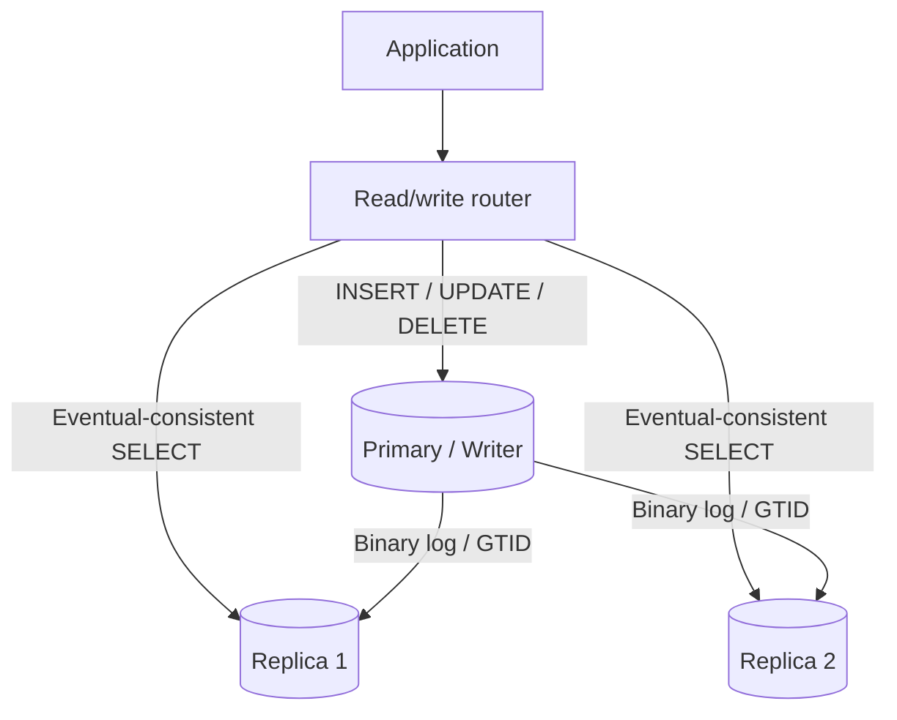
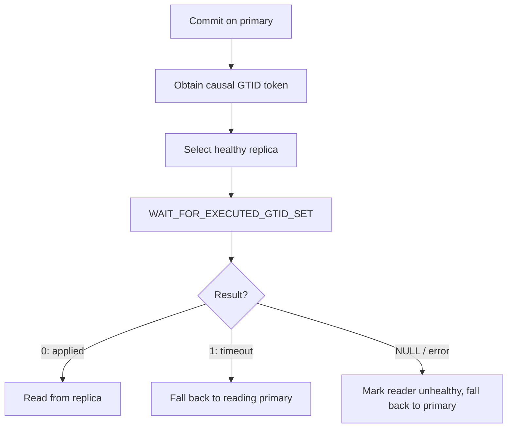

# Read/Write Splitting via Replicas and Per-Business Consistency Requirements

Read/write splitting sends data-modifying operations to the MySQL primary and distributes a portion of read queries to replicas. This can increase read serving capacity, but asynchronous replication means a replica may not yet have received or applied a transaction just committed on the primary. Therefore, a read query routed to a replica may return stale data.

Designing read/write splitting must start from business consistency requirements. A reporting page that tolerates a few seconds of staleness can read from a replica; a screen that just saved an order, checks a balance, or confirms a payment usually needs to read from the primary or wait for a replica to apply that exact transaction. Within the `DATABASE_MYSQL` module, this lesson connects replication, GTIDs, transactions, connection routing, and read capacity scaling.

After this lesson, you will be able to:

- Distinguish primary/writer and replica/reader roles in a MySQL topology.
- Choose business flows suited for eventual consistency or read-after-write consistency.
- Design routing rules by transaction, connection, and query type.
- Understand replication lag and the limitations of `Seconds_Behind_Source`.
- Use GTID barriers to wait for a replica to apply the transaction required for reading.
- Build sticky routing and fallback to the primary when a replica has not caught up.
- Protect replicas from accidental writes and monitor read load.
- Test correctness under lag, replica failures, and failover.

## 1. Primary and Replica Architecture

In a standard replication topology, the application sends write transactions to the primary. MySQL writes changes to the binary log; replicas read the events, store them in the relay log, and apply them to the replica's data.



The primary is responsible for accepting writes and serves as the authoritative data source in this model. Replicas maintain copies via replication and can serve read queries once data has been applied up to the required point.

Asynchronous replication does not guarantee that a replica is updated immediately after the primary commits. A transaction may already be committed on the primary while still sitting in the receive or apply queue on a replica. Thus, read/write splitting creates a trade-off between read scalability and the latency of observing fresh data.

### 1.1. Read/Write Splitting Does Not Increase Write Capacity

Adding replicas generally distributes read queries, reduces read load on the primary, and provides additional copies for redundancy. It does not automatically distribute write operations; the primary must still process write transactions, binary logging, and replication maintenance overhead.

When the primary is already write-saturated, adding readers may not improve write throughput. At that point, you must look into optimizing transactions, indexes, batching, schema, partitioning, or a more suitable write architecture.

### 1.2. Replicas Can Serve Stale Data

For example:

1. The application creates order `order_id = 9001` on the primary.
2. The primary commits successfully.
3. The application routes to a replica to read the order.
4. The replica has not yet applied the order creation transaction.
5. The query returns `0 rows` even though the write transaction succeeded.

This is replication lag, not necessarily a data loss error. The application must decide whether it can tolerate stale results or needs to read from the primary or wait for the replica.

## 2. Classifying Consistency Requirements by Business Flow

Do not route solely based on whether an SQL statement starts with `SELECT`. You need to determine the data freshness required by the business flow.

| Requirement | Meaning | Example | Suitable Read Target |
|---|---|---|---|
| Eventual consistency | Data may lag but eventually converges | Dashboards, statistics, aggregate reports | Healthy replica with lag within threshold |
| Read-your-writes | Users see changes just written by their own request/session | Order details page immediately after creation | Primary or replica that has applied the transaction's GTID |
| Monotonic reads | A client does not revert to an older state than it has already observed | Tracking order status across multiple requests | Sticky reader or causal/GTID barrier |
| Causal consistency | Later reads must see causally preceding transactions | Service B reads data just written by service A before emitting an event | Primary or reader waiting on a causal token |
| Strong/current read | Must read the current state ordered by committed transactions on the writer | Balances, inventory, access permissions, payment confirmation | Primary/writer |

These names describe application contracts. MySQL asynchronous replication does not automatically provide full causal consistency for all clients; the application or routing layer must carry causality metadata and choose the appropriate server.

### 2.1. Classifying by Business Flow

Example for an e-commerce system:

- Catalog pages, search, and reports can tolerate brief staleness: prefer replicas.
- After placing an order, the order confirmation page must see the newly created order: read from the primary or wait for a replica up to the corresponding GTID.
- Before deducting inventory or confirming payment: use the primary and an appropriate transaction.
- Permission checks or account status queries affecting security decisions: use a source meeting the business-required consistency level, usually the primary.
- Historical reports can use a replica with a watermark displaying when data was last synchronized.

Document the consistency contract for each endpoint/use case. Do not apply a blanket rule such as "all SELECTs go to replicas" across the entire application.

## 3. Queries That Must Be Routed to the Writer

The following operations must generally go to the primary:

- `INSERT`, `UPDATE`, `DELETE`, `REPLACE`, and DDL.
- `SELECT ... FOR UPDATE` or `SELECT ... FOR SHARE` because these are locking reads requiring locks on the server handling the operation.
- Queries needing to read results immediately after a change not yet confirmed as applied on a replica.
- Operations depending on session state such as `LAST_INSERT_ID()`, temporary tables, user variables, session variables, or connection-local state.
- Operations needing reads/writes within the same transaction.
- Stored procedures or statements that may write data, invoke routines with side effects, or mutate session state.
- Administrative statements and operations requiring primary privileges/metadata.

A `SELECT` statement does not imply read-only. For example, `SELECT ... FOR UPDATE` acquires locks. A stored function called within a SELECT can also have side effects if defined to allow them. Routers relying on simple syntax parsing can misclassify these cases.

### 3.1. Do Not Split Statements in the Same Transaction Across Servers

A transaction must stay bound to a single physical connection and a single MySQL server throughout its lifecycle. Do not send `BEGIN` to the primary and then send the next `SELECT` to a replica. The replica does not have the transaction context or locks held by the primary.

Practical rule: once a transaction starts on the writer, pin the entire transaction to the same writer connection until `COMMIT` or `ROLLBACK`. If a read-only transaction is permitted to run on a replica, the entire transaction must stay on the same replica and the same connection.

## 4. Read/Write Routing Strategies

There are multiple implementation approaches, ranging from application-level logic to dedicated proxies.

### 4.1. Separating DataSources in the Application

The application can configure a writer DataSource and a reader DataSource. Services select a datasource according to the business contract:

```java
public interface OrderReadRepository {
    Optional<OrderView> findView(long orderId);
}

public interface OrderWriteService {
    long createOrder(CreateOrderCommand command);
}
```

Eventual-consistent read flows call the reader; write flows call the writer. With Spring, you can use a routing datasource or multiple repositories/entity managers, but you must configure transaction managers clearly and prevent a single transaction from accidentally acquiring connections from two datasources.

The advantage is that the consistency contract is explicit in code and testable per use case. The downside is requiring architectural discipline; a new query can be misrouted if a developer picks the wrong repository.

### 4.2. Routing DataSource by Read-Only Transaction

An application can use `@Transactional(readOnly = true)` to select the reader and write transactions to select the writer. However, understand the limitations:

- `readOnly = true` is a transaction attribute and optimization hint; it does not automatically guarantee every SELECT is safe on a replica.
- Routing must occur before the connection is acquired and the transaction is opened.
- Once a connection has been acquired, changing the routing context does not move the active connection to another server.
- Self-invocation, propagation, or an outer transaction can prevent an inner annotation from determining the datasource as intended.
- A read-only method may require read-your-writes or locking reads and therefore still need the writer.

Therefore, do not use `readOnly` as the sole signal for consistency. You can combine the annotation with an explicit routing policy, such as `READ_EVENTUAL`, `READ_AFTER_WRITE`, and `READ_CURRENT` at the use-case level.

### 4.3. Proxy or Database Router

A proxy can accept connections from the application and distribute queries to writers/readers. Some proxies can parse SQL statements, transaction state, or sessions to route; accuracy depends on the product and configuration.

Do not assume a proxy understands every stored procedure, user variable, prepared statement, transaction, or session state. Test actual SQL statements and inspect fallback rules when the proxy cannot classify a query.

### 4.4. Multiple Endpoints/Connection Pools

With multiple readers, the application or proxy can select a replica based on load, health, and lag. Do not simply round-robin by connection count; an overloaded or lagging replica can drive up p99 latency and stale reads.

Select a reader based on:

- Replication I/O and SQL/applier thread state.
- Executed GTID set or appropriate lag metrics.
- Connection count, CPU, I/O, and query latency.
- Geographic region and network cost.
- Request consistency requirements.

## 5. Reading Replication Status and Measuring Lag

On the replica, check:

```sql
SHOW REPLICA STATUS\G
```

Important fields may include:

| Field | Meaning |
|---|---|
| `Replica_IO_Running` | Whether the receiver thread is fetching binary logs from the source |
| `Replica_SQL_Running` | Whether the applier thread is applying the relay log |
| `Seconds_Behind_Source` | Estimated lag based on event timestamps in replication |
| `Retrieved_Gtid_Set` | GTIDs received from the source |
| `Executed_Gtid_Set` | GTIDs executed on the replica |
| `Last_IO_Error` | Most recent error of the receiver thread |
| `Last_SQL_Error` | Most recent error of the applier thread |

Field names depend on version; older MySQL versions use command/field names with `Slave`/`Master` terminology. Consult documentation matching the running version.

### 5.1. Limitations of `Seconds_Behind_Source`

`Seconds_Behind_Source` is useful for monitoring trends, but it is not absolute proof that the replica reflects every latest commit:

- It can be `NULL` when the receiver/applier stops or timing state is undetermined.
- A value of `0` does not guarantee the replica has applied a just-committed transaction at the exact moment the application reads.
- Event timestamps, network delay, and worker/applier scheduling can prevent the metric from accurately reflecting per-transaction observed lag.
- With parallel replication, some transactions may wait on dependencies or commit in a different order than received.

Therefore, use `Seconds_Behind_Source` as a general health indicator, combined with GTID positions, thread state, transaction-level lag, and data checks.

### 5.2. Received and Executed GTIDs

When GTID is enabled, `Retrieved_Gtid_Set` shows the transactions the replica has received, while `Executed_Gtid_Set` shows the transactions already applied. If a GTID has been received but not yet executed, the replica may still not serve the new data.

Check further:

```sql
SELECT
    @@GLOBAL.gtid_executed AS executed_gtids,
    @@GLOBAL.gtid_purged AS purged_gtids;
```

On a replica, `gtid_executed` indicates the GTID set executed on the instance. Comparing it with the GTID of the transaction that needs to be read forms the basis for causal waits.

## 6. Read-After-Write via Primary Pinning

The simplest and most reliable strategy for read-your-writes is keeping the request/session on the writer after a write operation.

For example:

1. Request creates an order on the primary.
2. Application records that the request performed a write.
3. Subsequent queries in the same request/session read from the primary.
4. After a defined duration or condition, the application can return to readers.

This is sticky routing (writer pinning). Pinning can be scoped per transaction, request, user session, or causal token. Transaction-level pinning is mandatory when statements belong to the same transaction; request/session pinning is one way to achieve read-your-writes across multiple requests.

### 6.1. Limitations of Time-Based Sticky Routing

Some systems keep a client on the writer for a few seconds after a write. This is practical, but a fixed duration does not guarantee the replica has caught up. If replication lag exceeds the pin window, data can still be stale.

It is better to use a GTID token or a verified replication signal. If an exact token cannot be obtained, keep reading from the writer throughout the flow requiring consistency or use a controlled lag-based wait/fallback policy.

### 6.2. Do Not Rely on Session Affinity for All Cases

Sticky routing by cookie or user ID only ensures the same client can return to the same node; it does not guarantee that node has applied the just-written transaction if the chosen node is a replica. Session affinity to the same reader also does not solve read-after-write when that replica is lagging.

Pin to the writer or use a causal barrier capable of verifying transaction state.

## 7. GTID Barriers with `WAIT_FOR_EXECUTED_GTID_SET()`

When the primary and replicas use GTID replication, the application can wait for a replica to apply a GTID set before issuing a read query. MySQL provides the function:

```sql
WAIT_FOR_EXECUTED_GTID_SET(gtid_set, timeout)
```

The function waits until all GTIDs in `gtid_set` have been executed on the current server or the timeout expires. Return values:

- `0`: all GTIDs in the set have been executed.
- `1`: timeout expired before the GTID set was fully executed.
- `NULL`: an error occurred while waiting.

### 7.1. Obtaining a Causal Token After Commit

The application needs to know the GTID of the just-committed transaction. Session state tracking with `session_track_gtids=OWN_GTID` can be used if the client/driver supports reading the GTID returned by the server in session state. The specific API depends on Connector/J and the protocol version.

A simpler approach—though one that may wait more broadly—is reading `@@GLOBAL.gtid_executed` on the primary right after commit:

```sql
COMMIT;
SELECT @@GLOBAL.gtid_executed;
```

This set contains the just-committed transaction along with other GTIDs already executed on the primary at read time. Consequently, it may require the replica to apply additional concurrent transactions unrelated to the request. Under heavy workloads, the global GTID set can be long and cause more waiting than necessary; prefer own GTID if your stack supports it reliably.

Do not fetch the GTID before commit and treat it as proof that the transaction committed successfully. Issue the causal token only after commit is confirmed.

### 7.2. Waiting on the Replica Before Reading

After selecting a replica, the application sends the GTID token to the replica:

```sql
SELECT WAIT_FOR_EXECUTED_GTID_SET(?, 2) AS wait_result;
```

The first parameter is the GTID set obtained from the primary; the second parameter is the timeout in seconds. If the result is `0`, the subsequent read query can run on the replica. If the result is `1`, the replica has not caught up within the wait budget; the application should fall back to the primary or return a result per the business contract. If `NULL`, treat it as a replication/connection error and do not consider the replica synchronized.

Example flow:



### 7.3. Caveats When Using GTID Wait

- GTID replication must be properly configured and operating on primary and replicas.
- The GTID token must belong to the correct topology and source server.
- If a replica filters out a database/table, GTID completion does not mean the filtered data exists on the replica.
- The wait function only confirms the GTID has been executed on that instance; the application must still verify its own query and transaction logic.
- The timeout should be shorter than the remaining request deadline; do not let many requests wait indefinitely on a lagging replica.
- If choosing a different replica after a timeout, execute the barrier on that new replica.
- If the GTID token is unavailable or commit is unconfirmed, use the writer for read-after-write.

## 8. Ensuring Monotonic Reads and Causal Reads

### 8.1. Monotonic Reads

Monotonic reads mean a client never observes an older state than it has previously seen. If the first request reads replica A which has applied GTIDs up to G2, the second request should not read replica B which has only applied up to G1.

This can be achieved by:

- Keeping the client on the same replica as long as that replica continues advancing forward.
- Recording the observed GTID watermark and requiring any new reader to wait until that watermark.
- Falling back to the primary when no reader can satisfy the watermark.

Sticky sessions to a single replica alone do not strictly guarantee monotonic reads if that replica is reset, fails over, or is replaced by an instance with an older state. Verify the watermark after topology changes.

### 8.2. Causal Reads Across Services

Suppose service A creates an order and emits an event to service B. Service B receives the event and queries the order from a replica. If the event is emitted right after commit before the replica applies the transaction, service B may fail to find the order.

The solution is to include a causal token (such as a GTID) in the event metadata after commit is confirmed. Service B uses the token to wait for the replica to apply before reading. If a token cannot be passed, service B reads from the primary or uses another synchronization mechanism with a clear consistency contract.

Do not emit events before the transaction commits if consumers assume the data already exists. Transactional outbox helps ensure events are published after commit alongside business data; causal waiting is still needed if consumers read from asynchronous replicas.

## 9. Protecting Replicas from Accidental Writes

On replicas, enable `read_only` and `super_read_only` according to your topology design:

```sql
SET GLOBAL read_only = ON;
SET GLOBAL super_read_only = ON;
```

These variables can be placed in server configuration so they persist across restarts. `super_read_only` blocks client writes even for accounts with special administrative privileges in many cases; the replication applier can still apply changes from the source. Verify behavior and privilege requirements for your exact MySQL version.

Check with:

```sql
SHOW VARIABLES LIKE 'read_only';
SHOW VARIABLES LIKE 'super_read_only';
```

Do not treat these two variables as a routing mechanism. They protect replicas from direct writes; the router still must send write operations to the primary. In topologies managed by InnoDB Cluster or an HA orchestration system, changing variables manually may conflict with the management layer; follow the topology's procedures.

## 10. Transactions, Connection Pools, and Session State

Read/write splitting easily introduces bugs if the router switches servers between statements in the same transaction or the same session.

States that can be tied to a connection:

- An open transaction and its isolation level.
- Locks held by a transaction.
- Temporary tables.
- User variables and session variables.
- Server-side prepared statements.
- `LAST_INSERT_ID()`.
- Session SQL mode, time zone, and character set.
- Temporary tables or state created by stored procedures.

For example, given:

```sql
INSERT INTO orders (customer_id, order_status)
VALUES (42, 'CREATED');

SELECT LAST_INSERT_ID();
```

Both statements must execute on the same connection to the primary to retrieve the newly generated ID accurately. If the router sends the SELECT to a replica or another connection, the result may be wrong or unrelated.

With JDBC/Spring, keep transactions and connections within the same transaction manager. Do not open another datasource mid-transaction to execute a subsequent SELECT unless it is intentionally an independent transaction.

## 11. Selecting Replicas by Health and Lag

A reader should receive traffic only when eligible. A health policy can include:

- Replica I/O thread and SQL/applier thread are active.
- No unhandled `Last_IO_Error` or `Last_SQL_Error`.
- Lag is below a threshold appropriate for the workload.
- Executed GTID watermark satisfies the request's causal token, if present.
- CPU, I/O, connection count, and query latency are within thresholds.
- The replica is not running backups, heavy DDL, or maintenance impacting latency.

Do not select a replica based solely on TCP ping or `Seconds_Behind_Source = 0`. Reachability does not mean replication is healthy or the latest data has been applied.

### 11.1. Lag Threshold

A system might set a lag threshold such as 1 second for read pages needing relatively fresh data or 30 seconds for dashboards tolerant of stale data. This is a product policy, not a universal MySQL threshold.

When a replica exceeds the threshold:

1. Stop sending new read requests to that replica.
2. Redirect freshness-sensitive queries to the primary or another replica meeting the watermark.
3. Allow eventual-consistent reports to wait or display the latest synchronized watermark.
4. Monitor the replication queue and root cause of lag.
5. Return the replica to the pool only once the health policy confirms stability.

If all readers lag, throttle fallback to the primary to prevent turning a replica issue into writer overload. You can use admission control, rate limiting, or return a notice that report data is not yet updated.

## 12. Replication Modes and Consistency Limits

MySQL asynchronous replication can allow replicas to trail behind the primary. Semi-synchronous replication requires at least one replica to acknowledge receiving and logging the event as configured, but acknowledgement does not mean the replica has applied the transaction so a SELECT sees the data immediately.

Thus, enabling semi-sync does not eliminate the need for read-after-write routing or GTID barriers. If the business requires reading current state, use the primary or an explicit wait-for-apply mechanism.

With Group Replication or InnoDB Cluster, dedicated consistency settings control when transactions are applied across members. Those settings have their own semantics and trade-offs and should not be conflated with rules for asynchronous source-replica replication. Follow documentation matching the exact topology and consistency mode in use.

## 13. Risks of SQL-Parsing Routers

A router may classify `SELECT` as a read and `INSERT/UPDATE/DELETE` as a write. This simple classification is insufficient for all cases:

- `SELECT ... FOR UPDATE` is a locking read.
- Stored procedures can write data even though the call looks like `CALL`.
- Stored functions can have side effects.
- CTEs, comments, multi-statements, and prepared statements can confuse simple parsers.
- Session state or an already started transaction may require connection pinning.
- DDL and administrative statements should not be treated as read-only just because they do not begin with DML.

Prefer routing based on transaction context and application metadata whenever possible. If using a proxy, verify parser behavior, transaction pinning, prepared statements, stored routines, and fallback behavior against product documentation.

## 14. Read Target Selection Matrix

| Scenario | Read Target | Reason |
|---|---|---|
| Reading immediately after creating/updating data in the same transaction | Primary | Transaction is uncommitted or not yet applied by replicas |
| Reading immediately after commit in the same request | Primary or replica after GTID wait | Ensures read-your-writes |
| Aggregate dashboard with watermark | Replica | Can tolerate eventual consistency |
| Long-running historical report | Dedicated reporting replica | Offloads primary; tolerates published lag |
| Checking inventory before deducting | Primary, locking/atomic DML | Requires consistent read and update |
| Checking permissions/revocations affecting access | Primary or source with current-read contract | Avoids decisions based on stale permission data |
| Consumer receiving post-commit event and needing to read corresponding row | Replica after causal GTID wait or primary | Ensures event data exists on the read target |
| Replica lag exceeds threshold | Primary for critical reads; defer report reads if needed | Avoids stale reads and avoids overloading the writer |

## 15. Read/Write Splitting Implementation Workflow

1. **Classify business flows:** list endpoints/queries by eventual, read-your-writes, monotonic, causal, or current read.
2. **Inventory topology:** identify primary, replicas, GTID, replication mode, failover manager, and versions.
3. **Protect replicas:** enable `read_only`/`super_read_only` per topology mechanics and verify the applier keeps working.
4. **Design datasource/router:** separate writer/reader, pin transactions, and preserve connection-local state.
5. **Design causal tokens:** decide how to obtain GTID after commit, propagate tokens across requests/services, and handle timeouts.
6. **Establish health policies:** check replication threads, GTID progress, lag, resources, and errors.
7. **Route selectively:** shift eventual-consistent queries first; keep critical flows on the writer.
8. **Test stale reads:** perform a write and immediately read from a replica while intentionally introducing lag.
9. **Test fallback:** verify GTID wait timeouts or reader failures fall back to the writer or defer per contract.
10. **Test failover:** verify causal tokens and sticky routing after primary/replica role changes.
11. **Monitor:** measure read distribution, primary load, replica lag, stale-read rate, and fallback rate.
12. **Expand gradually:** increase replica read share as metrics and business outcomes remain satisfactory.

## 16. Practical Scenario

An e-commerce system has one primary and two replicas. The order creation API writes to the primary. Dashboards can read data up to 10 seconds stale, but the order confirmation page must see the newly created order immediately after commit. Another consumer receives an `OrderCreated` event and reads the order by ID from the database.

Perform in a lab environment:

1. Enable GTID replication and verify both replicas are synchronized.
2. Configure replicas with `read_only=ON` and `super_read_only=ON` per the topology.
3. Create an order on the primary and capture the GTID token after commit.
4. Intentionally slow down a replica using a lab workload or controlled applier pause; never do this in production.
5. Read the order immediately from the replica and observe a stale read.
6. Read again from the primary to confirm the order exists.
7. Use `WAIT_FOR_EXECUTED_GTID_SET(?, 2)` on the replica; test `0`, `1`, and error outcomes.
8. Implement fallback: if the wait times out, read from the primary; if it succeeds, read from the replica.
9. Test monotonic reads by reading sequentially from replicas with different GTID watermarks.
10. Test that the router does not send `SELECT ... FOR UPDATE`, `LAST_INSERT_ID()`, or in-transaction statements to a reader.
11. Simulate a replica stopping its applier and confirm the health policy removes it from the reader pool.
12. Measure primary load, replica lag, p95 latency, and fallback rate as read traffic increases.

**Self-assessment questions:**

- Why can read/write splitting return stale data even after a write on the primary has committed?
- Does `Seconds_Behind_Source = 0` guarantee read-after-write?
- How does `Retrieved_Gtid_Set` differ from `Executed_Gtid_Set`?
- Why must `SELECT ... FOR UPDATE` be routed to the writer?
- What are the limitations of time-based sticky routing compared to a causal GTID token?
- What values does `WAIT_FOR_EXECUTED_GTID_SET()` return, and how should the application handle timeouts?
- Why does semi-synchronous replication still not automatically guarantee a replica has applied the data?
- How do you guarantee monotonic reads when a request switches to a different replica?
- Why must `LAST_INSERT_ID()` run on the same connection as the INSERT statement?
- When all replicas lag, how do you prevent fallback from overloading the primary?

## Conclusion

Read/write splitting is safe only when each business flow has a clear consistency contract. Send writes and locking reads to the primary, route only eventual-consistent queries to healthy replicas, and use writer pinning or GTID barriers for read-after-write/causal reads. Monitor both replication state and executed GTIDs, keep transactions on a single connection, and always maintain a fallback when replicas fall behind.
