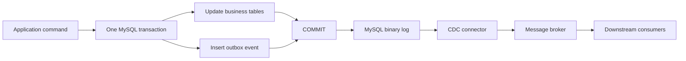

# Outbox, CDC, and Event Synchronization from the Binary Log

In the `DATABASE_MYSQL` module, learners master MySQL from table design, data types, keys, and SQL queries to indexes, transactions, concurrency control, reading execution plans, query tuning, privilege management, backups, and relational database operational troubleshooting. This lesson connects the Transactional Outbox, Change Data Capture (CDC), and the binary log to synchronize events from MySQL to message brokers or downstream systems.

An application often needs to both update business data in MySQL and emit an event to Kafka or another system. If the application commits to the database first and then sends the message, the process can crash between the two operations and lose the event. If it sends the message first and the database rolls back, consumers may receive an event describing a change that was never committed. The Transactional Outbox closes this gap by writing business data and the event record in the same MySQL transaction. CDC reads the outbox from the binary log and forwards the events to the broker.

## 1. The Dual-Write Problem

Suppose a payment confirmation service needs to:

1. Update the order in MySQL to status `PAID`.
2. Emit an `OrderPaid` event for inventory, email, and analytics systems to process.

Two independent storage systems do not share a standard ACID transaction. Two common orderings occur:

```text
Database COMMIT -> publish message
```

If the database commit succeeds but the process crashes before publishing, the order state has changed while downstream never receives the event.

```text
Publish message -> Database COMMIT
```

If the broker accepts the message but the database transaction fails, downstream processes an event that does not reflect committed state.

This is the dual-write problem: two writes to two different systems not protected by a single transaction. Simply adding retries to both operations does not fully solve it because the process can crash at any point and the outcome of a send call can be indeterminate on timeout.

## 2. How Does the Transactional Outbox Work?

The outbox is a table in the same database as the business data. Within one transaction, the application updates the business table and inserts a row describing the event into the outbox. If the transaction commits, both changes persist together; if it rolls back, both are discarded together.



Steps:

1. The service receives a business command and begins a transaction.
2. The service updates data, such as marking an order as paid.
3. The service writes an outbox event with a unique ID, event type, aggregate, and payload.
4. MySQL commits both the business data and the outbox row in the same transaction.
5. The CDC connector reads committed transactions from the binary log.
6. The connector transforms the outbox row into a message and sends it to the broker.
7. Consumers process the message idempotently.

The outbox guarantees that the business change and the intent to emit an event are persisted atomically in MySQL. It does not by itself create exactly-once delivery between MySQL and the broker; the connector or consumer may still replay messages after a failure. Therefore, event IDs, durable offsets, and idempotency are mandatory parts of the design.

## 3. Outbox Table Design

An outbox table should store enough information for consumers to understand the event without querying back to the source database. Example:

```sql
CREATE TABLE outbox_event (
    id CHAR(36) NOT NULL,
    aggregatetype VARCHAR(100) NOT NULL,
    aggregateid VARCHAR(128) NOT NULL,
    type VARCHAR(100) NOT NULL,
    payload JSON NOT NULL,
    created_at TIMESTAMP(6) NOT NULL DEFAULT CURRENT_TIMESTAMP(6),
    PRIMARY KEY (id),
    KEY idx_outbox_aggregate_created
        (aggregatetype, aggregateid, created_at)
) ENGINE=InnoDB;
```

Column roles:

| Column | Role |
|---|---|
| `id` | Unique ID of the event; used to deduplicate when a consumer receives a redelivered message. |
| `aggregatetype` | Business entity type, such as `Order` or `Payment`. |
| `aggregateid` | ID of the specific entity; commonly used as the message key to preserve ordering per aggregate. |
| `type` | Event name, such as `OrderPaid` or `OrderCancelled`. |
| `payload` | Event contents captured at transaction commit time. |
| `created_at` | Timestamp when the application created the event; does not replace the binlog commit position/offset. |

The column names `id`, `aggregatetype`, `aggregateid`, `type`, and `payload` align with the defaults commonly used by the Debezium Outbox Event Router. SMT configuration can rename fields; verify against the exact Debezium version deployed.

You do not need to store the entire entity in the payload. Include only data needed by consumers, avoiding exposing PII or unnecessary secrets. Include a `schemaVersion` in the payload or envelope so consumers can handle structural evolution over time.

### Choosing IDs and Message Keys

- `id` must be unique and immutable across retries. A UUID or unique ID generated by the application prior to writing is a common choice.
- `aggregateid` represents the entity the event belongs to, such as an order ID.
- The message key should generally be the aggregate ID when events for the same order must preserve order within the same Kafka partition.
- If the event ID is used as the key, events for the same aggregate may land in different partitions and lose relative ordering at the consumer layer.

Ordering is guaranteed within a single broker partition, not automatically globally across all partitions or all consumers. If an aggregate has strict ordering requirements, design partition keys and parallel processing accordingly.

## 4. Writing to the Outbox in the Business Transaction

Spring service example:

```java
@Service
public class OrderApplicationService {
    private final OrderRepository orderRepository;
    private final OutboxRepository outboxRepository;
    private final ObjectMapper objectMapper;

    public OrderApplicationService(
            OrderRepository orderRepository,
            OutboxRepository outboxRepository,
            ObjectMapper objectMapper) {
        this.orderRepository = orderRepository;
        this.outboxRepository = outboxRepository;
        this.objectMapper = objectMapper;
    }

    @Transactional
    public void markPaid(long orderId, String paymentId) {
        Order order = orderRepository.findById(orderId)
            .orElseThrow();

        order.markPaid(paymentId);

        OrderPaidPayload payload = new OrderPaidPayload(
            order.getId(),
            paymentId,
            order.getTotalAmount(),
            order.getCurrency(),
            1
        );

        outboxRepository.save(OutboxEvent.create(
            UUID.randomUUID().toString(),
            "Order",
            Long.toString(order.getId()),
            "OrderPaid",
            objectMapper.valueToTree(payload)
        ));
    }
}
```

This snippet is an architectural example; the entity, repository, and `OutboxEvent` constructor must be implemented per your project. The critical condition is that both repositories share the same MySQL datasource, the same transaction manager, and participate in the same transaction. If the outbox is written to another database or uses an independent transaction manager, atomicity is no longer guaranteed.

Do not publish messages directly inside a `@Transactional` method and treat that as an outbox. The message could be published before the transaction commits or published even if the transaction subsequently rolls back. CDC reads only rows written to the binary log upon transaction commit.

### The Payload Is an Event Snapshot

The payload should describe the event at the time it occurred. For instance, `OrderPaid` can include order ID, payment ID, total amount, currency, confirmation timestamp, and schema version. If a consumer receives only an order ID and queries the source database later, the data may have changed or the source may be unreachable.

Do not treat events as commands instructing consumers to read full source tables. Explicit payloads keep downstream services more independent of internal schemas and reduce inter-service coupling.

## 5. CDC Reading Changes from the Binary Log

The MySQL binary log records changes needed for replication and downstream tools. With row-based CDC, the connector reads row change events from the binlog rather than parsing the original SQL statements.

General flow:

```text
MySQL transaction
    |
    v
InnoDB commit + binary log
    |
    v
Binlog reader / CDC connector
    |
    +--> initial snapshot (when needed)
    |
    v
Decode committed row changes
    |
    v
Transform/filter/map
    |
    v
Broker topic
    |
    v
Consumer
```

CDC typically has two phases:

1. **Snapshot:** the connector reads the current state of selected tables so downstream has a complete starting baseline.
2. **Streaming:** the connector continues from the corresponding binlog position or GTID to emit changes occurring after the snapshot.

Snapshot details, locking strategies, offsets, and schema history depend on the connector. With Debezium MySQL, the connector manages binlog read offsets and schema metadata to resume across restarts. Persist offsets and schema history durably; losing them may force re-snapshotting or prevent decoding older logs as expected.

## 6. Configuring MySQL for CDC

Foundational requirements typically include:

```ini
[mysqld]
server_id=101
log_bin=mysql-bin
binlog_format=ROW
binlog_row_image=FULL
gtid_mode=ON
enforce_gtid_consistency=ON
binlog_expire_logs_seconds=604800
```

Meaning:

- `server_id` must be unique within the replication topology.
- `log_bin` enables binary logging.
- `binlog_format=ROW` logs changes at row level, suitable for CDC needing before/after row images.
- `binlog_row_image=FULL` records the full row image for changes. This is convenient for CDC needing complete values but increases binlog size; choose according to connector requirements and exported data needs.
- `gtid_mode=ON` and `enforce_gtid_consistency=ON` support transaction identification and resuming read positions across GTID-enabled topologies.
- `binlog_expire_logs_seconds` sets binlog retention; 7 days is illustrative only and must be sized for outage duration, recovery time, and log generation rate.

Do not enable or change production configuration simply by copying examples. Check your MySQL version, current settings, disk space, and connector requirements. `binlog_row_image=FULL` increases log volume; for write-heavy workloads, forecast storage and network capacity.

### Least-Privilege CDC Account

Create a dedicated account for the connector instead of using application or root accounts. The connector typically needs metadata read privileges and replication privileges to read the binlog; snapshots may also require table read privileges and privileges required by the chosen snapshot mode. Illustrative privilege template:

```sql
CREATE USER 'cdc_reader'@'10.20.5.%'
    IDENTIFIED BY 'PASSWORD_FROM_SECRET_MANAGER';

GRANT SELECT, RELOAD, SHOW DATABASES,
      REPLICATION SLAVE, REPLICATION CLIENT
ON *.* TO 'cdc_reader'@'10.20.5.%';
```

This is a common privilege example for Debezium MySQL, not the strict minimum set for every connector/version and snapshot mode. Some environments may require or omit specific privileges; consult documentation for your exact version, restrict host/IP ranges, test both snapshot and streaming, and then narrow privileges per security policy. Never store real passwords in connector files or repositories.

If CDC reads from a replica instead of the source, verify that the replica logs transactions received from upstream into its own binary log when downstream needs to read them; `log_replica_updates` plays a role in this topology. Ensure the replica has appropriate binlog retention and GTID state.

## 7. Debezium and the Outbox Event Router

Debezium is a widely used CDC platform. Its MySQL connector reads the binlog, stores offsets, and emits change records to Kafka Connect. For outboxes, Debezium provides the Outbox Event Router SMT to convert outbox table changes into business messages with appropriate topic, key, type, and payload.

Components:

| Component | Responsibility |
|---|---|
| Debezium MySQL connector | Reads snapshots and binlogs; manages offsets and schema history. |
| Kafka Connect | Runs connectors, persists state, and coordinates tasks. |
| Outbox Event Router SMT | Converts outbox rows into event messages and routes topic/key/payload. |
| Kafka topic | Stores and distributes messages to consumers. |
| Consumer | Executes downstream business logic and prevents duplicate processing. |

A modern connector configuration typically includes hostname/port, CDC credentials, `topic.prefix`, `database.include.list`, `table.include.list`, a distinct server ID, bootstrap servers, schema history storage, and offset storage topic. Property names have changed across Debezium generations; build configurations against the exact connector, Kafka Connect, and MySQL versions.

When using the Outbox Event Router, configuration must specify the outbox table, event ID column, aggregate type, aggregate ID, event type, and payload. Topics can be routed by aggregate type or system routing rules. Do not enable another payload-transforming SMT concurrently without explicitly defining application order.

Do not reuse sample configurations from Debezium 1.x for 2.x/3.x connectors without checking matching documentation. Before deploying, test:

- Initial snapshot and post-snapshot streaming.
- Inserts into the outbox route to the intended topic.
- Event ID and aggregate ID are preserved.
- JSON payload transforms into the exact format expected by consumers.
- Offsets and schema history survive connector restarts.
- Connector recovers properly after temporary MySQL or broker interruptions.

## 8. Delivery Guarantees: At-Least-Once and Duplicates

In CDC systems, a connector may send a message to the broker before durably saving its offset when the process stops. Upon restart, the connector can re-read the transaction and send the message again. This is standard at-least-once behavior.

Consequently:

- Never assume each event is delivered strictly once.
- Keep the event ID stable across all redeliveries.
- Consumers must deduplicate or perform idempotent operations.
- If an event triggers multiple side effects, each side effect also needs appropriate idempotency.

A consumer-side inbox table can use the event ID as its primary key:

```sql
CREATE TABLE processed_event (
    event_id CHAR(36) NOT NULL,
    processed_at TIMESTAMP(6) NOT NULL DEFAULT CURRENT_TIMESTAMP(6),
    PRIMARY KEY (event_id)
) ENGINE=InnoDB;
```

The consumer records the event ID and applies downstream data changes in the same local transaction:

```java
@Transactional
public void handle(OrderPaidEvent event) {
    if (processedEventRepository.existsById(event.id())) {
        return;
    }

    accountProjection.applyPayment(event);
    processedEventRepository.save(
        new ProcessedEvent(event.id())
    );
}
```

This snippet illustrates the idea. To guard against races between two consumers processing the same event, the unique primary key is the final safety net; handle duplicate-key exceptions appropriately and roll back the current transaction. The inbox table and projection update must reside in the same downstream database transaction.

If a consumer calls external systems such as a payment gateway or email service, the consumer's MySQL transaction cannot roll back external side effects. Use idempotency keys on the target system, a consumer-side transactional outbox, or compensating workflows.

## 9. Event Ordering and Transaction Boundaries

The MySQL binlog reflects transaction commit order on the source. However, arrival order at consumers also depends on the connector, partitioning, consumer count, and processing times.

To preserve ordering within the same aggregate:

1. Write all events for an aggregate in a deterministic transaction flow.
2. Use `aggregateid` as the message key so events for the same aggregate land in the same partition.
3. Have consumers process sequentially within a partition or enforce version/sequence checks.
4. Include `aggregateVersion` or `eventSequence` in the payload when out-of-order or late events must be detected.

Payload example:

```json
{
  "schemaVersion": 1,
  "eventId": "9d3f2e7c-7b20-4d1d-a6f0-6c9e7e8f2b11",
  "eventType": "OrderPaid",
  "aggregateType": "Order",
  "aggregateId": "ORD-10025",
  "aggregateVersion": 7,
  "occurredAt": "2026-11-19T10:30:00Z",
  "data": {
    "paymentId": "PAY-9081",
    "amount": "125000.00",
    "currency": "VND"
  }
}
```

The example uses a string for `amount` to prevent consumers from interpreting monetary values as floating-point numbers. `occurredAt` is the application-generated business timestamp; it does not replace binlog commit order. If consumers must detect skipped versions, check `aggregateVersion` before applying.

Do not claim global ordering simply because the source writes the binlog sequentially. Across multiple topics, partitions, or connectors, define the exact scope of ordering the system actually guarantees.

## 10. Snapshots, Offsets, and Connector Recovery

CDC must remember its read position to resume after restarts. Depending on the connector, this position may be represented by binlog file/position or a GTID set alongside transaction metadata.

Operations must protect:

- Connector offset storage.
- Schema history storage.
- Kafka topics receiving events.
- Connector configuration and secrets.
- MySQL binary log retention long enough for the connector to resume after outages.

If the connector stays down longer than binlog retention, MySQL may purge files the connector has not read yet. The connector then cannot resume from the old position if needed transactions were deleted. Recovery may require a fresh snapshot, downstream reconciliation, and event compensation workflows. Do not simply delete offsets to "make the connector run again," as that can introduce gaps or unexpectedly replay everything.

Base retention on the time required to detect failures, recover Kafka Connect, fix networking, recover MySQL, and restart the connector, plus a safety margin. Alert when connector lag approaches the age of the oldest retained binlog.

### Monitoring CDC Progress

Metrics to observe:

- Connector state and restart/failure count.
- Latency from MySQL commit to message appearance on the broker.
- Current binlog/GTID position and distance from the source.
- Age of the oldest retained binlog.
- Snapshot progress and snapshot completion duration.
- Kafka Connect task errors, retries, and queue sizes.
- Events emitted, failed, or dropped.
- Consumer lag, duplicate rate, and dead-letter counts.

MySQL replica `Seconds_Behind_Source` is not a substitute metric for CDC lag. A connector can lag even when a replica is caught up, or read from the source while downstream consumers fall behind.

## 11. How Direct CDC from Business Tables Differs from Outbox

CDC can capture changes from any configured table. However, streaming every business table mutation downstream often couples consumers directly to database structure.

| Criterion | Direct CDC from business tables | Outbox combined with CDC |
|---|---|---|
| Emitted content | Database-level row changes. | Application-defined business events. |
| Coupling | Consumers typically depend on schemas and column semantics. | Consumers depend on published event contracts. |
| Semantics | May show only a single row change, making business intent unclear. | Events clearly express `OrderPaid`, `CustomerAddressChanged`, etc. |
| Schema changes | Can directly break all consumers. | Event contracts can stay stable even when internal schemas change. |
| Best suited for | Data replication, search indexes, caches, warehouses, technical audits. | Publishing domain events across services and business integrations. |

Direct CDC remains useful for table replication or building read models. Outbox is preferable when publishing stable business events and avoiding forcing consumers to infer events from multi-table row mutations.

Do not treat raw row changes as domain events without a translation layer. A single business operation may update multiple tables; a consumer seeing individual row changes may observe intermediate states or misinterpret intent.

## 12. Outbox Polling vs. Outbox CDC

An outbox can be converted into messages via two common approaches:

| Method | How it works | Characteristics |
|---|---|---|
| Polling relay | A worker queries unprocessed rows, locks in batches, publishes, and updates status. | Easy to start; requires managing status, polling load, leases, and retries. |
| CDC relay | A connector reads outbox inserts from the binlog and routes them as messages. | No continuous table polling; requires operating binlog, connector, offsets, and schema history. |

Do not run both a polling relay and CDC on the same outbox without an explicit distribution design; the same event could be published twice via two paths. With polling, handle crashes after publishing but before marking sent, since messages can be re-sent. With CDC, consumers still need idempotency because connectors can replay.

With polling, `SELECT ... FOR UPDATE SKIP LOCKED` helps multiple workers claim non-overlapping batches on MySQL versions supporting this syntax. However, keep transactions short and avoid holding row locks during slow broker calls. A lease/claim state or well-sized batching can reduce lock duration.

## 13. Schema Evolution and Event Contracts

An outbox decouples internal schemas from event contracts, yet payloads still need version management. Key principles:

1. Adding optional fields is usually more compatible than renaming or deleting fields.
2. Older consumers should ignore unknown fields when the contract permits.
3. Changing a field's type or meaning requires a new version or event type.
4. Never reuse an event name for a different business meaning.
5. Maintain example payloads and automatically testable schema contracts.
6. When backfilling or replaying old events, consumers must understand older payload versions.

If using a Schema Registry with Avro, Protobuf, or JSON Schema, set appropriate compatibility policies and validate schemas before publishing. If payloads are unregistered JSON, maintain producer-side validation and producer/consumer contract tests.

Outbox table DDL changes must also be coordinated with the connector. Never drop or rename columns read by the SMT before updating the connector. For major DDL changes, verify schema history and the connector's ability to process the new schema events.

## 14. Security and Access Control

CDC can read sensitive data from the binlog. Connector accounts require least privilege, TLS connections, passwords stored in a secret manager, and network source restrictions. Kafka topics also need ACLs, encryption in transit, and encryption at rest per policy.

Principles:

- Capture only required schemas/tables via include lists.
- Never put passwords, tokens, secret keys, or unnecessary PII in payloads.
- Control who can read topics and view connector configurations.
- Never log connector passwords or commit them to repositories.
- Rotate accounts and certificates on schedule.
- Define retention periods for outbox rows, binlogs, topics, and dead-letter queues per security/data policies.
- Audit changes to privileges, connectors, and topic ACLs.

## 15. Operations, Cleanup, and Troubleshooting

An outbox table grows continuously without a cleanup policy. With CDC, deleting outbox rows after publishing does not necessarily lose already-sent messages, but ensure the connector has read the inserts and deletions are not misinterpreted by the SMT as unintended business events.

A common strategy retains outbox rows long enough for investigation and replay, then archives or deletes in small batches. When event replay is needed, know the replay source: retained outbox, backups, Kafka topics, or a dedicated event store. Do not treat the binary log as a long-term event archive.

Common scenarios:

| Symptom | Possible Cause | Resolution |
|---|---|---|
| Connector fails to start | Wrong privileges, duplicate/invalid server ID, binlog disabled, or version-incompatible config. | Check connector logs, MySQL error logs, privileges, and runtime variables. |
| Connector reports binlog file missing | Connector outage exceeded retention and MySQL purged required logs. | Evaluate snapshot/downstream rebuild; increase retention and alert on lag. |
| Duplicate events emitted | Connector replayed after crash or uncommitted offsets. | Deduplicate via event ID and consumer inbox transaction. |
| Event lost despite business row change | App dual-wrote directly or outbox was outside the transaction. | Put business update and outbox insert in the same MySQL transaction; reconcile data. |
| Payload missing fields or wrong schema | Producer/consumer incompatibility or misconfigured SMT mapping. | Check event schema version, SMT field mappings, and contract tests. |
| Events out of order | Message key/partition not keyed by aggregate or uncontrolled parallel consumers. | Use aggregate keys, sequence/version numbers, and sequential per-partition processing. |
| Binlog grows rapidly, disk fills up | Large row images, high write load, or excessive retention for disk size. | Forecast capacity, restrict capture scope, review row image, and expand storage. |
| Outbox table bloats | Missing retention/cleanup policy or cleanup job stalled. | Archive/delete in batches after verifying capture and replay requirements. |
| Consumer executes duplicate side effects | Deduplicated message only, but external side effect is not idempotent. | Use idempotency keys on target systems or downstream outbox/workflows. |

## 16. Comprehensive Practice Exercise

Build a MySQL order service with an `OrderPaid` event and a consumer updating a read model:

1. Create `orders` and `outbox_event` tables via migrations.
2. Implement `markPaid()` with a single `@Transactional`, updating the order and inserting the outbox row in the same transaction.
3. Test rolling back the transaction after inserting the outbox row; verify neither the order update nor the outbox row exists.
4. Commit the transaction; verify both the order state and the outbox row exist.
5. Enable the MySQL binary log in row format, create a dedicated CDC account, and configure retention for expected connector offline windows.
6. Deploy the Debezium MySQL connector in a test environment; run snapshot and binlog streaming.
7. Configure the Outbox Event Router matching your Debezium version; verify topic, message key, event ID, type, and payload.
8. Build a consumer with an inbox table having a unique event ID; deliver the same event twice and verify the business effect occurs only once.
9. Stop the connector, generate additional events, then restart it; verify offsets and binlog retention allow the connector to catch up.
10. Test a payload change with a new version; verify old/new consumers and compatibility policies.
11. Measure CDC lag, consumer lag, duplicate rate, binlog growth, and outbox size.
12. Write a runbook for connector restarts, purged binlogs, re-snapshotting, replay, and outbox cleanup.

After this exercise, learners should be able to explain why the outbox solves dual-write on the MySQL side, why binlog-based CDC needs retention and durable offsets, why delivery can be at-least-once, and how consumers use event IDs to prevent duplicate processing. This forms the foundation for synchronizing events from MySQL to other systems while preserving business consistency and recoverability.

## Official References

- [MySQL 8.4 Reference Manual: The Binary Log](https://dev.mysql.com/doc/refman/8.4/en/binary-log.html)
- [MySQL 8.4 Reference Manual: Replication and Binary Logging Options and Variables](https://dev.mysql.com/doc/refman/8.4/en/replication-options-binary-log.html)
- [Debezium Documentation: MySQL Connector](https://debezium.io/documentation/reference/stable/connectors/mysql.html)
- [Debezium Documentation: Outbox Event Router](https://debezium.io/documentation/reference/stable/transformations/outbox-event-router.html)
- [Debezium Documentation: Kafka Connect](https://debezium.io/documentation/reference/stable/architecture.html)
