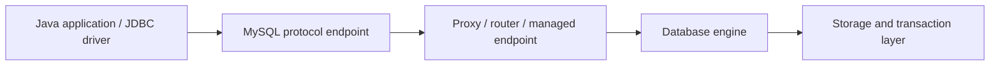

# Protocol Compatibility vs. Semantic Compatibility When Using Other Services or Engines

## Objectives

A service advertised as "MySQL-compatible" can usually accept connections from a MySQL client or run many familiar SQL statements. That alone does not guarantee an application will behave identically when migrating from MySQL to another engine, introducing an intermediate proxy, or moving to a managed service. Two distinct concepts must be tested separately: **protocol compatibility** and **semantic compatibility**.

Protocol compatibility indicates whether client and server can perform handshakes, authenticate, exchange packets, and carry out the communication operations the driver expects. Semantic compatibility indicates whether SQL statements, data types, transactions, locks, DDL, and operational behaviors produce the exact outcomes the application relies on.

This lesson belongs to the **DATABASE_MYSQL** module, where you master table design, data types, keys, SQL queries, indexes, transactions, concurrency control, reading execution plans, query tuning, and relational database operations. After this lesson, you will be able to:

- Distinguish MySQL wire protocol connectivity from behavioral SQL equivalence.
- Identify the compatibility layers provided by drivers, proxies, managed services, and storage engines.
- Test authentication, TLS, prepared statements, session state, and protocol capabilities.
- Compare data types, collations, transactions, locking, DDL, and optimizers across engines.
- Build a version-specific compatibility matrix and test against real endpoints before migrating workloads.

## 1. Two Distinct Compatibility Layers

**Protocol compatibility** focuses on how the client talks to the database endpoint. For MySQL, this layer involves the MySQL client/server protocol: handshakes, capability flags, authentication exchanges, packet formats, commands, result sets, and error responses.

**Semantic compatibility** focuses on the meaning of database operations. Two servers can accept the same `COM_QUERY` packet and return valid result sets while differing in implicit type casting, string comparisons, `NULL` handling, isolation levels, locking, commit ordering, or DDL execution.

| Question | Protocol compatibility | Semantic compatibility |
|---|---|---|
| Can the driver connect? | Yes | Insufficient to conclude |
| Do authentication plugins and TLS work? | Yes | Does not determine SQL semantics |
| Can `PreparedStatement` prepare/execute? | Yes | Must verify bind types, errors, and results |
| Does the same SQL return the same result? | Not guaranteed | Yes |
| Do transactions share the same commit/rollback and isolation? | Not guaranteed | Yes |
| Does failover preserve sessions and read-after-write? | Not purely protocol | Involves operational semantics |

Never use a "JDBC connect succeeded" test to conclude a service can drop-in replace MySQL. A successful connection verifies only a small slice of the contract.

## 2. Layers in a Query's Path

An application can communicate with MySQL directly or traverse one or more intermediate layers:



Each layer can provide or constrain part of compatibility:

- **JDBC driver:** performs handshakes, selects authentication, enables TLS, encodes parameters, uses text or binary protocol, and maps errors.
- **Proxy/router:** speaks protocol to clients, selects backends, forwards statements, routes reads/writes, and manages session affinity.
- **Managed service:** provides endpoints, backups, failover, replication, or scaling features; compatible versions may rest on a specific engine fork.
- **Database engine:** determines SQL dialect, data types, transactions, locking, optimizer, DDL, and consistency.

Test through the exact endpoint production applications will use. If the application goes through a proxy, testing directly against a backend misses routing, multiplexing, or session-state bugs introduced by the proxy.

## 3. MySQL Wire Protocol: What to Verify

During handshake, the server sends version info, connection ID, capability flags, and authentication challenge data. Client and server negotiate features supported by both sides. Modern drivers may also use TLS, compression, connection attributes, and diverse authentication mechanisms.

Capabilities to verify:

| Protocol capability | Test question |
|---|---|
| Handshake and capability flags | Does the driver handshake cleanly with the exact version and endpoint? |
| Authentication | Is the active plugin supported? Are custom round-trips or credential exchanges needed? |
| TLS | Are CA, hostname/SAN verification, and required TLS modes enforced? |
| Compression | Do client and server negotiate a shared compression capability? |
| Prepared statement protocol | Do `COM_STMT_PREPARE`, parameter binding, execute, and close behave properly? |
| Multi-result / stored procedures | Does the driver drain all result sets and update counts? |
| Multi-statements | Does the endpoint allow multiple statements per request, and does the driver enable that capability? |
| Cursor/fetch | Do server and driver support the fetch mode the application uses? |
| `LOAD DATA LOCAL INFILE` | Do client and server enable the matching capability and security policy? |
| Session tracking | Does the driver receive session state or GTIDs if the application depends on them? |

Never enable multi-statements or `LOCAL INFILE` merely to bypass a connection error. These capabilities carry security implications and must be enabled intentionally on both client and server.

### Authentication and TLS

The MySQL client/server protocol supports multiple authentication plugins. An older driver may connect to a server yet lack support for the authentication plugin the server requires. Conversely, a MySQL-compatible service may implement its own subset of plugins or credential mechanisms.

Verify user accounts, authentication plugins, TLS requirements, CAs, and hostnames against the target endpoint. Never weaken TLS verification just to make tests pass. If the service requires ephemeral tokens or IAM authentication, verify token renewal workflows and how connection pools open connections after tokens expire.

### Prepared Statements and Parameter Binding

JDBC `PreparedStatement` can be client-emulated by the driver or use server-side prepares. A compatible proxy or engine may handle text queries fine yet have limitations with prepared statements, cursors, or specific parameter types.

Test `setString`, `setBigDecimal`, `setTimestamp`, `setBytes`, `setNull`, batch updates, and server-side prepares if the application enables `useServerPrepStmts`. Inspect returned values, return types, warnings, errors, and statement reuse across connection pools.

## 4. Syntax Compatibility Does Not Equal Semantic Compatibility

An engine can accept MySQL syntax while interpreting certain expressions differently. Verify at least these areas:

- Implicit type conversion rules, overflow, rounding, and strict SQL mode.
- `NULL`, empty strings, string concatenation, comparisons, and sort order.
- Charsets, collations, case sensitivity, and accent sensitivity.
- `DATE`, `DATETIME`, `TIMESTAMP`, timezones, and fractional-second precision.
- `DECIMAL`, `UNSIGNED`, `BOOLEAN`, `JSON`, UUIDs, and generated columns.
- Built-in functions, regular expressions, JSON paths, window functions, and stored routines.
- `AUTO_INCREMENT`, sequences, `LAST_INSERT_ID()` values, and retry behavior.

For example, two engines may both accept `VARCHAR` and a unique index while applying different collations. Two strings MySQL treats as equal may be treated as distinct by another engine, or vice versa. This alters query results and can cause unique index creation to reject existing data.

Do not compare data type names alone. Compare value domains, conversion rules, boundary values, and how the driver maps Java types to SQL types.

## 5. Collations, Charsets, and Comparison Rules

Charsets determine character encoding; collations determine comparison and sorting rules. Engines may both support UTF-8 without sharing the exact same collation set or comparison rules.

Check on the target endpoint:

```sql
SELECT VERSION() AS server_version,
       @@version_comment AS distribution,
       @@character_set_server AS server_charset,
       @@collation_server AS server_collation,
       @@sql_mode AS sql_mode;
```

Check collations at the schema/table/column level and test:

- Comparing `ABC` with `abc`.
- Comparing strings with and without diacritics.
- Comparing Unicode characters outside the BMP.
- Unique keys with two byte-distinct strings that may compare equal under a collation.
- `ORDER BY`, `LIKE`, prefix searches, and range scans.

When migrating from MySQL to MariaDB or another engine, never assume identical collation names guarantee identical comparison rules. Run tests with realistic data and check for duplicates before creating unique constraints.

## 6. Transaction and Isolation Semantics

The protocol merely transports `START TRANSACTION`, `COMMIT`, or `ROLLBACK`. The engine decides what those commands mean for snapshots, locks, durability, and commit ordering.

Verify these properties:

| Topic | What to verify |
|---|---|
| Autocommit | Session default and impact when connections return to the pool |
| Isolation levels | When snapshots are taken, phantom/read skew behavior, and locking reads |
| Consistent reads | Whether `SELECT` statements read from the same snapshot |
| `SELECT ... FOR UPDATE` | Which rows/ranges are locked, and whether it is supported for that query shape |
| Deadlocks | Detection mechanism, which transaction rolls back, and error codes |
| Savepoints | `SAVEPOINT`, `ROLLBACK TO SAVEPOINT`, and nesting limits |
| DDL | Whether implicit commits occur, atomic DDL, and online DDL support |
| Durability | Commit flush level, replication/quorum policies, and failover behavior |

Session check example:

```sql
SELECT @@autocommit,
       @@transaction_isolation,
       @@session.time_zone;
```

On each engine, run two-session tests for lost updates, locking reads, deadlocks, and read-after-write. A service may speak the MySQL protocol and similar transaction syntax while using a distributed architecture, optimistic concurrency, or different commit semantics.

### DDL and Migrations

MySQL enforces implicit commits on many DDL statements. Another engine may support transactional DDL or different locking/commit mechanics. Never assume a migration script tested on MySQL rolls back the same way on another engine.

Test `ALTER TABLE`, index creation, type changes, column renames, foreign keys, and online schema changes on the target version. Record execution times, lock durations, replication lag, and rollback capability. Run migrations on a production-sized clone.

## 7. Locks, Constraints, and Data Integrity

Differences in locking and constraints often surface bugs only under concurrent load:

- InnoDB uses record locks, gap locks, and next-key locks depending on indexes, isolation level, and queries.
- A distributed engine may use optimistic transactions, timestamp ordering, or distributed lock coordination.
- Support for foreign keys, `CHECK` constraints, cascades, and deferred constraints varies by engine and version.
- `AUTO_INCREMENT` or sequences may produce different gaps, ID ordering, or uniqueness guarantees.
- Triggers and stored routines may run with different definer/invoker privileges and transaction behaviors.

Test business invariants rather than merely checking that statements return no errors. For instance, two concurrent inventory deductions must never produce negative stock; funds transfers must preserve total balances; each idempotent request must apply at most once.

## 8. Optimizer and Performance Are Also Part of Compatibility

The same SQL statement can return identical rows yet produce a different execution plan. Optimizers depend on statistics, cardinality, indexes, join algorithms, cost models, partitioning, and supported hints.

For critical queries:

1. Run `EXPLAIN` or the target engine's equivalent explain tool.
2. Compare chosen indexes, join order, estimated rows, and access types.
3. Use production-like data distributions; tiny test tables do not represent real workloads.
4. Measure p50/p95/p99 latency, throughput, CPU, I/O, and lock waits.
5. Check whether query hints or optimizer switches are supported with matching semantics.

Do not require identical execution plans if results and SLOs still pass. Conversely, an accurate query running far slower can exhaust connection pools and trigger application-wide outages.

## 9. Differences Across Common Services and Engines

The following products commonly appear in the MySQL-compatible ecosystem, yet compatibility must be verified for the exact version, configuration, and features:

| Service/engine | Typical compatibility layer targeted | Points to verify |
|---|---|---|
| MariaDB | MySQL client protocol and much familiar SQL syntax | Version-specific differences in data types, JSON, collations, authentication, optimizer, replication, and system tables |
| TiDB | MySQL protocol and many MySQL apps/SQL queries | Distributed transactions, locking/isolation, DDL, auto IDs, foreign keys, and partially unsupported MySQL features |
| Amazon Aurora MySQL-Compatible | Compatibility with a specific MySQL version at client/SQL layers | Version mapping, extensions, replication/failover, parameter groups, and operational storage/service differences |
| Vitess | MySQL protocol and a supported SQL subset via a sharding/routing layer | Unsupported SQL, cross-shard transactions, VSchema/Vindex, session state, and query routability requirements |
| ProxySQL | Proxy speaking MySQL protocol to clients and routing to backends | Actual backend engine, query rules, multiplexing, transaction pinning, session variables, and prepared statement behavior |

ProxySQL is a proxy, not a storage engine. A connection through ProxySQL can route to multiple backends depending on rules; therefore session state and transaction affinity must be tested. Managed services may also add dedicated read/write endpoints, failover behaviors, and custom limits.

Never treat the "MySQL-compatible" label as an absolute guarantee. List the features your application relies on and cross-check them against the target version's compatibility matrix documentation.

## 10. Session State and Connection Pooling Through Proxies

Many applications depend on state attached to a MySQL session:

- `SET SESSION sql_mode`, `time_zone`, `transaction_isolation`.
- User variables such as `@request_id`.
- Temporary tables.
- Server-side prepared statements.
- Open transactions and savepoints.
- `LAST_INSERT_ID()` or `GET_LOCK()`.
- Session-level advisory locks and connection state.

When a proxy multiplexes many client sessions onto fewer backend connections, it must know when to pin a client to a single backend to preserve semantics. Certain commands or states restrict or disable multiplexing. If a proxy fails to preserve needed state, the application may observe session settings changing between two statements on what looks like the same connection.

Test by borrowing a connection from the pool, setting a session variable, executing multiple statements, returning the connection to the pool, and borrowing it again. Verify that the pool resets sessions or the proxy preserves backend affinity per contract. Never rely on session variables to pass business state across requests when connections can be reused.

## 11. Replication, Failover, and Consistency Semantics

A service may speak the MySQL protocol while using a different replication topology and failover mechanism than self-managed MySQL. Verify:

- Whether replication is synchronous or asynchronous; whether committed transactions can be lost during failover.
- Whether read replicas offer eventual consistency or provide wait-for-transaction/GTID mechanisms.
- Whether write endpoints automatically redirect to a new primary; whether active connections are reset.
- Whether fencing prevents an old primary from continuing to accept writes after failover.
- Whether GTIDs, binlog retention, CDC, and backups/PITR work with your existing tooling.
- Whether read/write splitting preserves read-after-write within the same request.

Never infer RPO = 0 merely because a service has multiple replicas. Study the provider's durability/replication model and test failover with identifiable transactions.

## 12. Building a Compatibility Matrix

Before switching engines or introducing a proxy, build a matrix of features used by your application:

| Feature group | Used? | Mandatory tests |
|---|---|---|
| Driver/protocol | JDBC version, authentication, TLS, compression | Handshake, reconnect, certificate validation |
| Query API | Prepared statements, batching, multi-result, cursors | Data type binding, reading result sets and update counts |
| SQL | Functions, JSON, window functions, CTEs, upserts, hints | Compare results and errors/warnings |
| Data types | Decimal, unsigned, datetime, UUID, JSON, binary | Boundary values, round-trips, and Java mappings |
| Constraints | PK, unique, FK, `CHECK`, triggers | Invalid inserts/updates and cascades |
| Transactions | Isolation, savepoints, rollbacks, DDL | Multi-session tests and crash/failover tests |
| Session | Variables, temp tables, locks, `LAST_INSERT_ID()` | Connection reuse and proxy multiplexing |
| Operations | Backups, restores, replication, failover | Restore drills, RPO/RTO, CDC, and cutover |
| Performance | Indexes, optimizer, partitioning, query hints | `EXPLAIN` and realistic workload benchmarks |

Mark each feature as `SUPPORTED`, `SUPPORTED WITH LIMITATIONS`, `NOT SUPPORTED`, or `NOT USED`. Record version, configuration, documentation sources, and test evidence. Never mark a feature supported merely because the SQL statement parses without error.

## 13. Minimum Protocol Test Suite

Against the exact endpoint and driver the application will use:

1. Open a connection with the runtime account; verify the authentication plugin and TLS certificate/hostname.
2. Read server version/comment and required capabilities/configuration.
3. Execute prepared statements with `NULL`, `DECIMAL`, timestamps, binary data, and Unicode.
4. Execute batch inserts/updates and verify update counts and generated keys.
5. Call stored procedures or queries returning multiple result sets if used by the application.
6. Test reconnection after connection resets or failovers; verify the pool evicts broken connections.
7. If using a proxy, test session state, transaction pinning, and read/write routing through the proxy.

JDBC smoke test example:

```java
String sql = "SELECT ?, ?, ?, CONNECTION_ID()";

try (Connection connection = dataSource.getConnection();
     PreparedStatement statement = connection.prepareStatement(sql)) {
    statement.setBigDecimal(1, new BigDecimal("123.45"));
    statement.setTimestamp(2, Timestamp.from(Instant.parse("2026-01-15T10:20:30Z")));
    statement.setString(3, "Tiếng Việt 😀");

    try (ResultSet resultSet = statement.executeQuery()) {
        if (!resultSet.next()) {
            throw new IllegalStateException("No result row");
        }
        // Verify type, round-trip value, and connection ID.
    }
}
```

This is a basic protocol/driver smoke test. It does not replace transaction, collation, DDL, or failover semantics tests.

## 14. Minimum Semantic Test Suite

Execute against a representative copy of data:

- **Data types:** test boundary values for signed/unsigned integers, `DECIMAL`, Unicode strings, dates/times, JSON, and binary; verify round-trips.
- **String comparisons:** test case sensitivity, diacritics, collations, `LIKE`, `ORDER BY`, and unique constraints.
- **NULLs:** test `NULL`, `''`, `NOT IN`, `CONCAT`, and defaults.
- **Transactions:** test commits, rollbacks, savepoints, application-level checked errors, and DDL.
- **Concurrency:** run two-session lost updates, `SELECT ... FOR UPDATE`, lock waits, and deadlocks.
- **Generated values:** test `AUTO_INCREMENT`, generated keys, sequences, `LAST_INSERT_ID()`, and retries.
- **Read-after-write:** write via writer, read via reader/proxy, and verify consistency policies.
- **Migrations:** run real DDL; measure lock duration, downtime, replication lag, and rollback.
- **Performance:** benchmark critical queries with production-like data volume and distribution.

Write assertions at the business level. For example, total balances, inventory counts, order statuses, and uniqueness must remain valid after concurrent runs; comparing the result set of a single isolated query is insufficient.

## 15. Two-Session Semantic Test Example

To compare locking behavior, create an InnoDB table and open two independent connections. On Session A:

```sql
START TRANSACTION;
SELECT balance
FROM account_probe
WHERE account_id = 1
FOR UPDATE;
```

Keep the transaction open. On Session B, attempt to update the same row:

```sql
START TRANSACTION;
UPDATE account_probe
SET balance = balance - 10
WHERE account_id = 1;
```

Record whether the statement waits, the lock type if the engine exposes it, timeout errors, and when execution resumes after Session A commits. Repeat with other isolation levels if supported by the engine, changing session settings only inside the test environment.

This is a semantics probe. Two endpoints may both accept `START TRANSACTION` and `SELECT ... FOR UPDATE` at the protocol level yet exhibit different locking behavior and visibility of current values.

## 16. Rolling Out an Engine or Service Change Safely

A migration plan should follow these steps:

1. **Inventory:** catalog drivers, SQL, schemas, stored routines, session state, topology, and application workloads in use.
2. **Compatibility review:** compare each feature against the target version and document limitations.
3. **Test environment:** provision the target service alongside production-like proxy, TLS, authentication, pool, and parameter settings.
4. **Data migration:** load snapshots, synchronize deltas/CDC, and verify row counts, checksums, constraints, and business invariants.
5. **Regression:** run protocol tests, semantic tests, concurrency tests, and workload benchmarks.
6. **Canary:** shift a small workload or application group; monitor driver errors, SQL errors, latency, pools, and data integrity.
7. **Cutover:** freeze old writer, sync final delta, verify checkpoints, and switch endpoints per runbook.
8. **Rollback plan:** define how to preserve writes made on the new system; flipping DNS/endpoints back does not automatically sync data backward.
9. **Post-cutover:** verify backups, restores, replication/failover, monitoring, and access permissions.

Never run ad-hoc dual-writes across two engines without idempotency, conflict resolution, and ordering mechanisms. Once the application has written to the new system, returning to the old system requires reverse synchronization or reconciling new data.

## 17. Common Incompatibility Symptoms

- **Driver connects but queries fail:** SQL dialect or feature unsupported by the engine; list failing statements and check version-specific support.
- **Authentication fails:** differing plugins, tokens, TLS rules, or account host rules; inspect handshake and endpoint policies.
- **Prepared statements behave differently:** differing bind types, server-side prepares, or proxy capabilities; test every JDBC setter and result type.
- **Unique constraints reject data:** differing collations or normalization; scan for duplicates under the target collation before migration.
- **Transactions return different results:** differing isolation, locking, distributed commits, or autocommit; run multi-session tests.
- **DDL locks too long or fails:** differing online DDL/algorithms/metadata locks; rehearse at production scale.
- **Read-after-write returns stale data:** reader replica lag or router misrouting; verify consistency policies and session routing.
- **Performance degrades:** differing optimizers, indexes, or data distributions; inspect `EXPLAIN` and benchmark.
- **Errors appear only behind a proxy:** session state reset, multiplexing, or query rules altering routes; test through the proxy with connection reuse.

## 18. Practice Exercise

Pick a service or engine advertised as MySQL-compatible and compare it against MySQL in a test environment:

1. Record the source MySQL version, target engine/edition version, JDBC driver, proxy, and TLS/authentication configuration.
2. Create a feature matrix covering data types, collations, SQL, transactions, locking, DDL, generated keys, session state, and failover.
3. Run a JDBC smoke test through the exact endpoint, including prepared statements, batches, Unicode, timestamps, decimals, and generated keys.
4. Run semantic tests for `NULL`, collations, strict mode, JSON, `AUTO_INCREMENT`, transaction rollbacks, and savepoints.
5. Use two sessions to reproduce lock waits, deadlocks, and lost updates; record outcomes and error codes.
6. Run schema migrations and benchmark critical queries with representative data; capture `EXPLAIN` outputs and latency.
7. If a proxy is present, test connection pooling, session variables, temporary tables, prepared statements, and read/write routing.
8. Write a report classifying each feature as supported, limited, unsupported, or unused; propose necessary code/schema/config changes.

**Completion criteria:** you can demonstrate protocol compatibility and semantic compatibility separately, identify version-specific limits of the target service, and present sufficient test evidence to decide whether to stay on MySQL, add a proxy, or migrate to another engine.

## Conclusion

MySQL protocol compatibility only tells you a client can talk to an endpoint at the wire protocol level; it does not guarantee the same SQL will share identical data types, transactions, locking, DDL, optimizer plans, or failover behavior. Test every layer—driver, proxy, managed service, and engine; build a versioned compatibility matrix; and run both protocol smoke tests and semantic/concurrency tests against the real endpoint. Migrate workloads only once limitations are documented and business outcomes, performance, and recovery plans all meet requirements.
