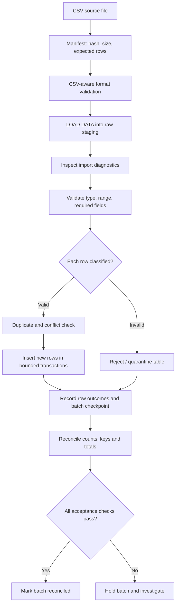

# Loading Large CSV Files, Handling Error Rows, and Reconciling Results

## Objectives

Loading a large CSV file into MySQL is more than running `LOAD DATA` until the statement finishes. Input data can contain malformed formats, out-of-range values, duplicate keys, missing relationships, or silent type coercions during import. A load reporting success does not prove every record was imported accurately. You need a batch ID, file manifest, staging area, validation rules, error row storage, and a reconciliation step before publishing data.

This lab belongs to the **DATABASE_MYSQL** module: mastering table design, data types, keys, SQL, indexes, transactions, concurrency control, execution plans, query tuning, and relational database operations. In this lesson, you build a pipeline to ingest sales data from a large CSV into MySQL InnoDB while preserving raw data, isolating error rows, loading valid records in batches, and proving accuracy via count and business-total reconciliation.

After this lesson, you will be able to:

- Prepare CSV files, manifests, and batch IDs for traceability, re-runs, and resuming after failures.
- Choose `LOAD DATA LOCAL INFILE` or server-side import matching security and infrastructure constraints.
- Load data into staging without premature type casting, then validate formats and value ranges.
- Route error rows into a quarantine/reject table with reason codes and source data.
- Insert valid records in bounded transactions with duplicate prevention and resume support.
- Reconcile row counts, status breakdowns, monetary totals per currency, and business keys.

## 1. Scenario and Completion Criteria

Suppose the system receives `sales-2026-11.csv` from an external sales system. Each record contains a source record ID, order ID, amount, currency, and event timestamp. The file may contain millions of rows; some rows may lack IDs, have malformed amounts or dates, contain duplicates, or have already been imported in an earlier batch.

The pipeline must ensure:

1. The original file remains unmodified and has a checksum for identification.
2. Every row is either loaded into staging or captured as an explicit import error.
3. Invalid data is quarantined rather than silently truncated or coerced to default values.
4. Valid data is written to the target table only after passing validation.
5. Re-running the same file does not duplicate business records.
6. Processing can resume from the last completed chunk without guessing state.
7. Total row counts and monetary totals are reconciled per currency.

## 2. Overall Pipeline Design



Separating stages lets you pinpoint whether failures came from CSV parsing, file transfer, type conversion, or target table writes. Never use a single `LOAD DATA` statement to simultaneously parse, cast, drop error rows, and update business tables when auditing or reconciliation is required.

## 3. Standardizing the CSV File Contract

Before importing, agree on format rules with the upstream producer:

| Attribute | Example Contract |
|---|---|
| Encoding | UTF-8; specify whether a BOM is present |
| Header | Single header row with fixed column names and order |
| Delimiter | Comma `,` |
| Quote | Double quote `"`; embedded quotes escaped per agreed rules |
| Newline | LF or CRLF; explicitly document file line endings |
| NULL | Dedicated token such as `__NULL__`, distinct from empty strings; never use as real data |
| Decimal | Period `.`; no thousands separators |
| Date/time | Agreed ISO-like format, with timezone if representing an absolute instant |
| Identity | Unique, stable `source_record_id` for each source record |

CSV fields can contain commas, newlines, or escaped quotes inside quoted strings. Therefore, never split files by physical line counts or use non-CSV-aware text tools. A single CSV record can span multiple physical lines.

If a file is huge and must be chunked, use a CSV parser that fully understands quoting and escaping to split on record boundaries while preserving the header, encoding, and ordering. Record `chunk_id`, start/end record bounds, and expected record count in the manifest.

Keep the original file in immutable storage. Compute its SHA-256 checksum and record byte size, receipt timestamp, source system, batch ID, and expected record count. Checksums detect file modifications between inspection and import.

## 4. Choosing `LOAD DATA LOCAL INFILE` vs. Server-Side `LOAD DATA INFILE`

`LOAD DATA LOCAL INFILE` reads the file from the client/application host and streams its contents to MySQL. The path in the statement must exist on the client host opening the connection. Both server and client/driver configurations must permit `LOCAL`.

`LOAD DATA INFILE` without `LOCAL` reads a file from the MySQL server's local filesystem. This approach depends on the `FILE` privilege, `secure_file_priv`, and OS filesystem permissions for the `mysqld` process.

| Criterion | `LOCAL` | Server-side |
|---|---|---|
| Where is the file? | Client/driver host | MySQL server host |
| Does data cross the network? | Yes, from client to server | No client-to-server file transfer needed |
| Security configuration | Both client/driver and server must enable LOCAL | `FILE` privilege, `secure_file_priv`, and filesystem permissions |
| Best suited when | File resides on a worker/import service | File is already staged safely on the DB host |

`LOCAL` carries specific risks: a client permitting local file loading must trust the endpoint it connects to, because a malicious server could attempt to request arbitrary local files. Enable it only for trusted endpoints, verify the server with TLS, restrict privileges, and disable it again when policy requires. Never enable `LOCAL` globally just for a one-off import.

Check server configuration:

```sql
SHOW GLOBAL VARIABLES LIKE 'local_infile';
SHOW GLOBAL VARIABLES LIKE 'secure_file_priv';
SHOW GLOBAL VARIABLES LIKE 'max_allowed_packet';
```

JDBC drivers may also have dedicated properties to permit `LOCAL`; check documentation for your exact Connector/J version and do not enable broader options than required.

## 5. Creating the Batch Manifest and Staging Tables

On receiving a file, generate a stable batch ID. The manifest table tracks batch state and reconciliation metrics:

```sql
CREATE TABLE import_batch (
  batch_id CHAR(36) NOT NULL PRIMARY KEY,
  source_system VARCHAR(32) NOT NULL,
  file_name VARCHAR(255) NOT NULL,
  file_sha256 CHAR(64) NOT NULL,
  file_size_bytes BIGINT UNSIGNED NOT NULL,
  expected_records BIGINT UNSIGNED NOT NULL,
  loaded_records BIGINT UNSIGNED NOT NULL DEFAULT 0,
  inserted_records BIGINT UNSIGNED NOT NULL DEFAULT 0,
  duplicate_records BIGINT UNSIGNED NOT NULL DEFAULT 0,
  rejected_records BIGINT UNSIGNED NOT NULL DEFAULT 0,
  conflict_records BIGINT UNSIGNED NOT NULL DEFAULT 0,
  batch_status VARCHAR(24) NOT NULL DEFAULT 'RECEIVED',
  received_at TIMESTAMP NOT NULL DEFAULT CURRENT_TIMESTAMP,
  completed_at TIMESTAMP NULL,
  KEY idx_batch_status (batch_status, received_at),
  KEY idx_batch_hash (file_sha256)
) ENGINE = InnoDB;
```

Staging stores source values as text to avoid casting prior to validation. Raw columns should be wide enough per the file contract; if staging columns are too narrow, data may be truncated during initial load:

```sql
CREATE TABLE stg_sales_raw (
  ingest_id BIGINT UNSIGNED NOT NULL AUTO_INCREMENT PRIMARY KEY,
  batch_id CHAR(36) NOT NULL,
  chunk_no INT UNSIGNED NOT NULL DEFAULT 0,
  source_record_id_raw LONGTEXT NULL,
  source_record_id VARCHAR(128) NULL,
  order_id_raw LONGTEXT NULL,
  amount_raw LONGTEXT NULL,
  currency_raw LONGTEXT NULL,
  occurred_at_raw LONGTEXT NULL,
  validation_status ENUM('PENDING', 'VALID', 'REJECTED') NOT NULL DEFAULT 'PENDING',
  validation_reason_code VARCHAR(64) NULL,
  KEY idx_stg_batch_record (batch_id, source_record_id)
) ENGINE = InnoDB;
```

Do not put a unique key on `source_record_id` in staging if you want to retain and investigate duplicate rows within the file. Business uniqueness is enforced in the target table after classification.

Track each chunk so processing can resume cleanly after a worker stop:

```sql
CREATE TABLE import_chunk (
  batch_id CHAR(36) NOT NULL,
  chunk_no INT UNSIGNED NOT NULL,
  expected_records BIGINT UNSIGNED NOT NULL,
  loaded_records BIGINT UNSIGNED NOT NULL DEFAULT 0,
  chunk_status ENUM('PENDING', 'LOADED', 'VALIDATED', 'APPLIED') NOT NULL DEFAULT 'PENDING',
  started_at TIMESTAMP NULL,
  completed_at TIMESTAMP NULL,
  PRIMARY KEY (batch_id, chunk_no)
) ENGINE = InnoDB;
```

## 6. Target Table and Quarantine Table

The target table enforces validated data types and duplicate-prevention keys:

```sql
CREATE TABLE sales_events (
  id BIGINT UNSIGNED NOT NULL AUTO_INCREMENT PRIMARY KEY,
  source_system VARCHAR(32) NOT NULL,
  source_record_id VARCHAR(128) NOT NULL,
  order_id BIGINT UNSIGNED NOT NULL,
  amount DECIMAL(12,2) NOT NULL,
  currency CHAR(3) NOT NULL,
  occurred_at DATETIME(6) NOT NULL,
  imported_batch_id CHAR(36) NOT NULL,
  UNIQUE KEY uq_sales_source_record (source_system, source_record_id),
  KEY idx_sales_order_time (order_id, occurred_at)
) ENGINE = InnoDB;
```

By convention in this example, `occurred_at` is normalized to UTC prior to loading. If the upstream sends local times or offsets, convert using the source timezone during ETL; never assume UTC for timestamps with unknown timezones.

The reject table records provenance, staging row ID, and rejection reason:

```sql
CREATE TABLE sales_import_reject (
  reject_id BIGINT UNSIGNED NOT NULL AUTO_INCREMENT PRIMARY KEY,
  batch_id CHAR(36) NOT NULL,
  ingest_id BIGINT UNSIGNED NOT NULL,
  source_record_id VARCHAR(128) NULL,
  source_record_id_raw LONGTEXT NULL,
  reason_code VARCHAR(64) NOT NULL,
  reason_detail VARCHAR(500) NULL,
  raw_order_id LONGTEXT NULL,
  raw_amount LONGTEXT NULL,
  raw_currency LONGTEXT NULL,
  raw_occurred_at LONGTEXT NULL,
  rejected_at TIMESTAMP NOT NULL DEFAULT CURRENT_TIMESTAMP,
  UNIQUE KEY uq_reject_batch_ingest_reason (batch_id, ingest_id, reason_code)
) ENGINE = InnoDB;
```

To support per-record resume and reconciliation, store individual outcomes. Every staging row must have exactly one primary outcome; the reject table may hold multiple error details for the same record:

```sql
CREATE TABLE sales_import_row_outcome (
  batch_id CHAR(36) NOT NULL,
  ingest_id BIGINT UNSIGNED NOT NULL,
  source_record_id VARCHAR(128) NULL,
  outcome ENUM('INSERTED', 'DUPLICATE', 'REJECTED', 'CONFLICT') NOT NULL,
  reason_code VARCHAR(64) NULL,
  processed_at TIMESTAMP NOT NULL DEFAULT CURRENT_TIMESTAMP,
  PRIMARY KEY (batch_id, ingest_id),
  KEY idx_outcome_batch_status (batch_id, outcome)
) ENGINE = InnoDB;
```

If multiple errors per row need recording, store one row per `(ingest_id, reason_code)` pair; if only one primary reason is needed, use a clear priority order. Retain raw values so rows can be corrected and reprocessed without re-requesting the source file.

## 7. Loading the File into Raw Staging

Suppose the file has a header and uses LF line endings, comma delimiters, double quotes, and doubled quotes for escaping embedded quotes. Replace the path and batch ID with values for your import run:

```sql
SET @batch_id = '2026-11-19-sales-0001';
SET @chunk_no = 1;

LOAD DATA LOCAL INFILE '/import/inbox/sales-2026-11.csv'
INTO TABLE stg_sales_raw
CHARACTER SET utf8mb4
FIELDS TERMINATED BY ','
OPTIONALLY ENCLOSED BY '"'
ESCAPED BY '"'
LINES TERMINATED BY '\n'
IGNORE 1 LINES
(@source_record_id, @order_id_raw, @amount_raw, @currency_raw, @occurred_at_raw)
SET batch_id = @batch_id,
    chunk_no = @chunk_no,
    source_record_id_raw = NULLIF(@source_record_id, '__NULL__'),
    source_record_id = CASE
      WHEN CHAR_LENGTH(TRIM(NULLIF(@source_record_id, '__NULL__'))) BETWEEN 1 AND 128
        THEN TRIM(NULLIF(@source_record_id, '__NULL__'))
      ELSE NULL
    END,
    order_id_raw = NULLIF(@order_id_raw, '__NULL__'),
    amount_raw = NULLIF(@amount_raw, '__NULL__'),
    currency_raw = NULLIF(@currency_raw, '__NULL__'),
    occurred_at_raw = NULLIF(@occurred_at_raw, '__NULL__');
```

If the file uses CRLF, adjust `LINES TERMINATED BY` accordingly. Do not copy this statement verbatim if your file has different escape rules, NULL tokens, or column ordering. Test on a small sample containing commas, quotes, Unicode, empty strings, and embedded newlines inside quoted fields.

With `LOCAL`, the path refers to the client/import worker filesystem. With server-side `INFILE`, it refers to the server filesystem and must comply with `secure_file_priv`. After loading, log the statement metrics returned by the client (Records, Skipped, Warnings if surfaced by the driver) alongside the batch ID.

## 8. Reading Diagnostics Immediately After Loading

Run diagnostics in the same session right after `LOAD DATA`, before executing any other statement:

```sql
SHOW COUNT(*) WARNINGS;
SHOW WARNINGS LIMIT 100;
```

`SHOW WARNINGS` reports level, code, and message. The number of retained warnings is bounded by `max_error_count`; if the file has many errors, this list is not a complete record-by-record report. Record both the total warning count and the readable warnings.

Distinguish error categories:

- CSV structural errors: wrong field count, unclosed quotes, invalid escapes, or encoding mismatches.
- Conversion errors: truncated data, coerced values, or invalid date/time values.
- Constraint errors: duplicate keys or missing values when loading directly into constrained tables.
- Infrastructure errors: unreadable file, `LOCAL` blocked, out of disk space, or dropped connection.

Because raw staging uses wide text columns, most business errors should be caught in the post-import validation step. If even staging emits warnings, halt the pipeline and investigate; never equate loaded row count with valid row count.

Do not rely on warning line numbers as stable record identifiers. CSVs can contain newlines inside quoted fields, so physical lines do not always map one-to-one to records. Use `source_record_id` from the file; if the source lacks one, assign record ordinals via a CSV-aware parser prior to loading.

## 9. Counting Rows and Detecting Missing Records

Count actual records loaded into staging:

```sql
SELECT COUNT(*) AS loaded_records
FROM stg_sales_raw
WHERE batch_id = '2026-11-19-sales-0001';
```

Compare against `expected_records` in the manifest. If counts mismatch, do not promote data to the target table. Inspect the header, missing trailing newline, quotes, delimiters, encoding, `IGNORE 1 LINES`, and diagnostics.

Count missing or blank source IDs:

```sql
SELECT COUNT(*) AS missing_source_id
FROM stg_sales_raw
WHERE batch_id = '2026-11-19-sales-0001'
  AND (source_record_id IS NULL OR TRIM(source_record_id) = '');
```

Detect duplicates within the same file:

```sql
SELECT source_record_id, COUNT(*) AS occurrences
FROM stg_sales_raw
WHERE batch_id = '2026-11-19-sales-0001'
  AND source_record_id IS NOT NULL
GROUP BY source_record_id
HAVING COUNT(*) > 1;
```

Do not arbitrarily pick one duplicate row to keep without an explicit business rule. Two rows sharing an ID might be an exact retransmission, or two distinct payloads accidentally reusing the same ID. Compare payloads and confirm upstream rules.

## 10. Validation Before Type Casting

Validation must mirror target column types and business rules. For the sample target table:

- `order_id` is a non-negative integer within the range allowed by the application.
- `amount` is `DECIMAL(12,2)`, at most 10 integer digits and 2 fractional digits.
- `currency` is an exact 3-uppercase-letter code supported by the system.
- `occurred_at_raw` follows the agreed format, e.g., `YYYY-MM-DD HH:MM:SS.ffffff` in UTC.

Example finding rows with empty required fields or invalid numeric formats:

```sql
SELECT ingest_id, source_record_id, order_id_raw, amount_raw, currency_raw
FROM stg_sales_raw
WHERE batch_id = '2026-11-19-sales-0001'
  AND (
       source_record_id IS NULL
       OR TRIM(source_record_id) = ''
       OR order_id_raw IS NULL
       OR order_id_raw NOT REGEXP '^[0-9]{1,19}$'
       OR amount_raw IS NULL
       OR amount_raw NOT REGEXP '^-?[0-9]{1,10}([.][0-9]{1,2})?$'
       OR currency_raw IS NULL
       OR currency_raw NOT REGEXP '^[A-Z]{3}$'
  );
```

Regex only checks string shape. It does not replace domain checks such as non-negative amounts, whether the currency belongs to the allowed catalog, or whether a calendar date actually exists. Validate dates with a format- and timezone-aware parser or a controlled conversion step, inspecting any parse warnings.

After all rules run, the validation worker updates `validation_status` to `VALID` only when every check passes; remaining rows become `REJECTED` and are written to quarantine. For timestamps, validate both calendar validity and timezone rather than relying solely on regex. `LOAD DATA` leaves every row in `PENDING` by default.

Example checking non-negative amounts and allowed currencies:

```sql
SELECT s.ingest_id, s.source_record_id, s.amount_raw, s.currency_raw
FROM stg_sales_raw AS s
WHERE s.batch_id = '2026-11-19-sales-0001'
  AND (
       CASE
         WHEN s.amount_raw REGEXP '^-?[0-9]{1,10}([.][0-9]{1,2})?$'
           THEN CAST(s.amount_raw AS DECIMAL(12,2)) < 0
         ELSE 0
       END = 1
       OR s.currency_raw NOT IN ('VND', 'USD', 'EUR')
  );
```

Run `CAST` only after filtering out malformed strings. In production pipelines, separate validation into clear conditional steps or parse inside the application/ETL layer to avoid uncontrolled implicit conversions and warnings.

## 11. Writing Error Rows to Quarantine

Example persisting rows with missing source IDs, malformed IDs, invalid amounts, or invalid currency codes:

```sql
INSERT INTO sales_import_reject (
  batch_id, ingest_id, source_record_id, source_record_id_raw,
  reason_code, reason_detail,
  raw_order_id, raw_amount, raw_currency, raw_occurred_at
)
SELECT
  batch_id,
  ingest_id,
  source_record_id,
  source_record_id_raw,
  COALESCE(validation_reason_code, CASE
    WHEN source_record_id_raw IS NULL OR TRIM(source_record_id_raw) = ''
      THEN 'MISSING_SOURCE_ID'
    WHEN CHAR_LENGTH(TRIM(source_record_id_raw)) > 128
      THEN 'SOURCE_ID_TOO_LONG'
    WHEN source_record_id IS NULL
      THEN 'INVALID_SOURCE_ID'
    WHEN order_id_raw IS NULL OR order_id_raw NOT REGEXP '^[0-9]{1,19}$'
      THEN 'INVALID_ORDER_ID'
    WHEN amount_raw IS NULL OR amount_raw NOT REGEXP '^-?[0-9]{1,10}([.][0-9]{1,2})?$'
      THEN 'INVALID_AMOUNT_FORMAT'
    WHEN currency_raw IS NULL OR currency_raw NOT REGEXP '^[A-Z]{3}$'
      THEN 'INVALID_CURRENCY_FORMAT'
    ELSE 'REVIEW_REQUIRED'
  END),
  'Validation failed before target conversion',
  order_id_raw, amount_raw, currency_raw, occurred_at_raw
FROM stg_sales_raw
WHERE batch_id = '2026-11-19-sales-0001'
  AND validation_status = 'REJECTED';
```

This example stores one prioritized reason per row. To capture all errors simultaneously, create a `sales_import_reject_issue` table with one row per `(ingest_id, reason_code)` and evaluate each validation rule independently.

Do not delete raw staging after quarantining rows. Keep the `batch_id` and `ingest_id` links so you can investigate, fix rules, or replay approved rows.

## 12. Converting Valid Data

Convert rows only after they pass format, range, timestamp, currency catalog, and duplicate checks. For `DECIMAL`, apply `CAST(... AS DECIMAL(12,2))` after confirming scale to avoid unintended rounding.

Example inserting unseen rows into the target table:

```sql
INSERT INTO sales_events (
  source_system, source_record_id, order_id, amount,
  currency, occurred_at, imported_batch_id
)
SELECT
  'external-sales',
  s.source_record_id,
  CAST(s.order_id_raw AS UNSIGNED),
  CAST(s.amount_raw AS DECIMAL(12,2)),
  s.currency_raw,
  STR_TO_DATE(s.occurred_at_raw, '%Y-%m-%d %H:%i:%s.%f'),
  s.batch_id
FROM stg_sales_raw AS s
WHERE s.batch_id = '2026-11-19-sales-0001'
  AND s.validation_status = 'VALID'
  AND s.source_record_id IS NOT NULL
  AND TRIM(s.source_record_id) <> ''
  AND s.order_id_raw REGEXP '^[0-9]{1,19}$'
  AND s.amount_raw REGEXP '^-?[0-9]{1,10}([.][0-9]{1,2})?$'
  AND s.currency_raw IN ('VND', 'USD', 'EUR')
  AND s.occurred_at_raw REGEXP '^[0-9]{4}-[0-9]{2}-[0-9]{2} [0-9]{2}:[0-9]{2}:[0-9]{2}[.][0-9]{6}$'
  AND NOT EXISTS (
    SELECT 1
    FROM sales_events AS existing
    WHERE existing.source_system = 'external-sales'
      AND existing.source_record_id = s.source_record_id
  );
```

This is an illustrative pattern; add calendar-date validity checks and all domain rules before running. The unique key on `(source_system, source_record_id)` acts as the final guard against duplicates. If two workers load the same source ID concurrently, `NOT EXISTS` alone does not eliminate the race condition; the unique constraint will still raise a duplicate error. In that case, roll back the chunk and reclassify duplicate rows instead of using `INSERT IGNORE` to mask conflicts.

Among valid records, keep only one canonical row per `source_record_id` within the batch after comparing internal payloads. Repeated rows with identical payloads are classified as `DUPLICATE`; rows with the same ID and differing payloads are classified as `CONFLICT`. Never pick the first row arbitrarily unless upstream defines that rule.

When a source ID already exists in the target table, compare normalized payloads before classifying. For example, join staging with `sales_events` on `(source_system, source_record_id)` and compare `order_id`, `amount`, `currency`, and `occurred_at`. If all match, record outcome `DUPLICATE`; if at least one field differs, record `CONFLICT` and send to quarantine. Perform comparisons after validation so malformed values are never cast.

After a successful insert, record outcome `INSERTED` inside the same transaction as the insert. Only mark staging rows whose source key was actually created by the current batch (join with `sales_events.imported_batch_id`), ensuring internal duplicates were classified beforehand. Likewise, write `REJECTED` outcomes in the same transaction as saving reject records. The primary key `(batch_id, ingest_id)` ensures each staging row gets exactly one primary outcome; on resume, process only rows lacking an outcome.

## 13. Idempotency and Handling Pre-Existing Records

Re-running the same batch can happen after timeouts, worker restarts, or deployments. The design must distinguish:

- **New record:** source ID does not exist yet; safe to insert.
- **Exact duplicate:** source ID already exists and normalized payload matches target data; mark `DUPLICATE`, do not insert again.
- **Conflict:** source ID already exists but order ID, amount, currency, or timestamp differs; route to quarantine for investigation.

Do not default to `REPLACE`, `INSERT IGNORE`, or blind upserts to swallow all duplicates. Those can hide cases where the same source ID arrives with altered payloads. Compare normalized payloads and preserve evidence.

For a batch to be resumable:

1. Batch ID and file hash must remain stable across retries.
2. Every source record has a stable identity.
3. Persist chunk ID/checkpoints and row outcome state.
4. Target table enforces a unique key on source identity.
5. Record insert/duplicate/reject/conflict outcomes per record or chunk.
6. On retry, process only records without a completed outcome; verify already-inserted records by source key.

## 14. Chunked Writes and Transaction Boundaries

Never load millions of rows into the target table inside a single giant transaction. Oversized transactions bloat undo/redo logs, hold locks too long, increase replication lag, make rollbacks painfully slow, and put pressure on the buffer pool.

Split the file using a CSV-aware parser into chunks by record count or byte size. Base chunk size on benchmarks and system limits; there is no universal magic number. For each chunk:

1. Load raw staging and verify row counts.
2. Validate and write quarantine rows.
3. Check duplicates and conflicts.
4. Insert new rows inside a bounded InnoDB transaction.
5. Write row outcomes and update the checkpoint in the same transaction if they must remain consistent with the insert.
6. Commit before marking the chunk completed.

If the transaction fails, roll back that chunk and retry using the stable batch ID and source IDs. Never mark a checkpoint complete before committing target rows and their corresponding outcomes.

## 15. Reconciling Row Counts

For each batch, record these figures:

- `expected_records`: record count per manifest from the CSV parser.
- `loaded_records`: raw staging rows ingested.
- `inserted_records`: new rows written to the target table.
- `duplicate_records`: pre-existing rows with matching payloads.
- `rejected_records`: rows failing format or business validation.
- `conflict_records`: rows whose source ID exists with a differing payload.

Core reconciliation invariants:

```text
expected_records = loaded_records
loaded_records = inserted_records
               + duplicate_records
               + rejected_records
               + conflict_records
```

Aggregate outcomes from the outcome tracking table rather than relying only on in-memory application counters:

```sql
SELECT outcome, COUNT(*) AS record_count
FROM sales_import_row_outcome
WHERE batch_id = '2026-11-19-sales-0001'
GROUP BY outcome;
```

The sum of `record_count` must equal `loaded_records`. Update the counters in `import_batch` from this query after all chunks commit; never increment counters prior to commit, as retries could double-count them.

If a row has multiple errors, it still counts as one primary outcome in the total record tally; the reject-detail table can hold multiple issues. If the parser cannot even extract a valid record from a malformed file segment, track `parse_error_records` separately and adjust the reconciliation equation to include unparseable records.

Never mark a batch `RECONCILED` if any record lacks an outcome, counts mismatch, or the file hash disagrees with the manifest.

## 16. Reconciling Monetary Totals and Business Data

Reconcile totals per currency; never sum VND, USD, and EUR into one combined number:

```sql
SELECT currency,
       COUNT(*) AS row_count,
       SUM(amount) AS total_amount
FROM sales_events
WHERE imported_batch_id = '2026-11-19-sales-0001'
GROUP BY currency
ORDER BY currency;
```

Cross-check against an independent aggregation from the source file or validated staging. If the batch contained duplicates previously imported by an earlier batch, they will not carry this batch's `imported_batch_id`; when reconciling the current batch, account for verified duplicate payloads or aggregate using the outcome table.

Check for duplicate source keys:

```sql
SELECT source_system, source_record_id, COUNT(*) AS occurrences
FROM sales_events
GROUP BY source_system, source_record_id
HAVING COUNT(*) > 1;
```

Check for out-of-domain target values:

```sql
SELECT COUNT(*) AS invalid_amounts
FROM sales_events
WHERE amount < 0;
```

Checking `amount < 0` only applies if business rules disallow refunds or negative adjustments. Reconciliation checks must reflect actual domain rules rather than enforcing false invariants.

## 17. Monitoring Performance and Operational Impact

During large imports, monitor:

- Throughput in records/sec and bytes/sec across transfer, load, validation, and insert stages.
- CPU, memory, buffer pool hit ratio, disk throughput, IOPS, and storage latency.
- Data, temporary space, redo, undo, binlog, and free filesystem capacity.
- Active connections, long-running transactions, lock waits, deadlocks, and pool errors.
- Replication lag, relay log growth, and impact on read workloads.
- Commit durations, rollbacks, and warning counts per chunk.

Indexes accelerate queries and enforce uniqueness, yet add write overhead since every insert updates affected indexes. Staging typically needs only a primary key and an index supporting batch/source ID filtering. Never drop unique or foreign keys on target tables solely for import speed if doing so sacrifices data protection; any index change requires planning and separate testing.

If an import degrades production workloads, throttle ingest rate, schedule off-peak, or use a dedicated instance/replica per your architecture. Never reflexively raise `max_connections` or pool sizes when imports slow down.

## 18. Recovering from Mid-Run Failures

Suppose a worker stops after loading three out of five chunks. Using the manifest and checkpoints:

1. Inspect the batch ID, file hash, and status of the last chunk.
2. Verify whether the last transaction committed or rolled back; never guess solely from application logs.
3. Reconcile counts across raw staging, outcomes, and target rows by source identity.
4. Reprocess only incomplete chunks or records lacking an outcome.
5. If a batch is resubmitted with a different hash under the same batch ID, halt and investigate.
6. If a source ID exists with a differing payload, classify as conflict; never overwrite automatically.
7. Re-run full reconciliation before marking the batch complete.

Retain raw staging and the original file until the batch is verified and retention policies expire. Once complete, archive staging per retention policy rather than deleting immediately.

## 19. Pre-Large-Import Checklist

- Source file stored immutably with SHA-256 checksum and manifest.
- CSV contract specifies encoding, header, delimiter, quote, escape, newline, NULL token, and timezone.
- File chunked with a CSV-aware parser if needed.
- Import account follows least privilege; `LOCAL` enabled only for trusted endpoints and scoped narrowly.
- Staging columns are wide enough for raw values and tagged with batch ID.
- Target table defines proper data types, constraints, and unique source identity.
- Validation enforces explicit rules for required fields, numbers, dates, currencies, and duplicates.
- Reject/quarantine table preserves raw values alongside reason codes.
- Each chunk has a bounded transaction boundary and post-commit checkpoint.
- Capacity limits checked for storage, redo/binlog, disk, and replication lag.
- Counts, totals, duplicates, conflicts, and rejects reconciled before publishing.

## 20. Hands-On Practice Lab

On a test MySQL instance with InnoDB:

1. Create `import_batch`, `import_chunk`, `stg_sales_raw`, `sales_events`, `sales_import_reject`, and `sales_import_row_outcome` following the examples in this lesson.
2. Prepare a small CSV containing a header, Unicode text, quoted commas, escaped quotes, empty strings, `__NULL__` tokens, malformed numbers, and a duplicate source ID.
3. Compute SHA-256, insert the manifest, and load the file into staging via `LOAD DATA LOCAL INFILE` or server-side `INFILE` per policy.
4. Read diagnostics right after loading; reconcile loaded record count against the manifest.
5. Run validation on source ID, order ID, amount, currency, and timestamp; move invalid rows to quarantine.
6. Classify exact duplicates vs. payload conflicts.
7. Insert valid data into the target table in transactional chunks; simulate a worker stopping between two chunks and then resuming.
8. Reconcile `expected = loaded` and `loaded = inserted + duplicate + rejected + conflict`.
9. Reconcile row counts and `SUM(amount)` by currency against an independent calculation from the source file.
10. Re-run the same file to prove idempotency; test reusing a source ID with an altered payload to confirm conflict isolation.

**Completion criteria:** every record has an outcome, invalid rows are preserved intact in quarantine, target rows are never duplicated, batches resume cleanly after failures, and count/total reconciliations pass.

## Conclusion

Safe large-CSV ingestion requires a manifest, raw staging, validation, quarantine, chunked transactions, and independent reconciliation. `LOAD DATA` moves files quickly, yet it does not replace checking warnings, data types, duplicates, or business relationships. Preserve the source file and source identities, promote only validated records into InnoDB, persist checkpoints after commit, and publish a batch only after every row is classified and all reconciliation totals match.
