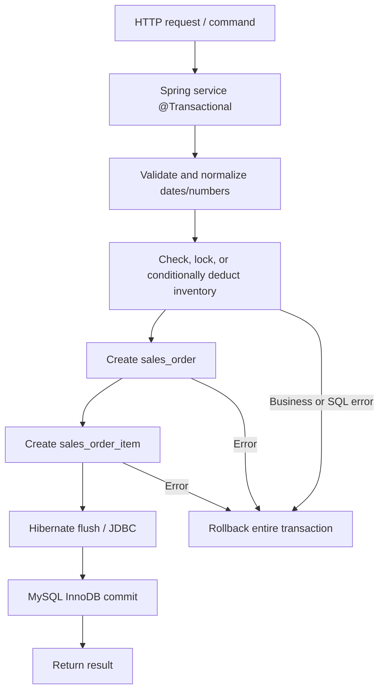

# Integrating Java/Spring Boot with Transactions and Date/Number Mapping

A Spring Boot application connected to MySQL must uphold two kinds of contracts: business transaction contracts and data representation contracts. Transactions ensure related changes commit or roll back together; temporal types must preserve timezone semantics and precision; numeric types must prevent rounding errors when calculating money, taxes, exchange rates, or inventory. Relying purely on Java types or annotations without checking the schema, JDBC driver, and MySQL session can result in shifted timestamps, lost microseconds, misrounding, or partial business commits.

This lesson integrates Spring Boot, Spring Data JPA/Hibernate, Connector/J, and InnoDB through an order-placement flow. Within the `DATABASE_MYSQL` module, it brings together table design, data types, keys, transactions, concurrency control, and Java application operations.

After this lesson, you will be able to:

- Design a MySQL schema for orders, order items, inventory, and monetary amounts.
- Map `DATE`, `TIME`, `DATETIME(6)`, and `TIMESTAMP(6)` to the Java Time API.
- Establish a UTC convention and control MySQL session/JDBC time zones.
- Use `BigDecimal` with `DECIMAL(p,s)` for exact numeric values.
- Understand microsecond precision in MySQL versus nanosecond precision in Java.
- Place transaction boundaries at the service layer to write multiple tables atomically.
- Use locking or conditional updates to prevent overselling inventory.
- Test commits, rollbacks, date/number mappings, and concurrency against real MySQL.

## 1. Architecture of the Business Flow

Suppose a customer places an order containing multiple products. The application must:

1. Check and deduct inventory.
2. Create the order record.
3. Create the order line items.
4. Store total amounts and currency.
5. Record creation or payment timestamps.
6. Commit all changes together.

These operations must belong to the same InnoDB transaction. If one product is out of stock or a data constraint fails, the transaction must roll back so no half-created order or partially deducted inventory remains.



Spring manages the transaction context, Hibernate tracks entities and generates SQL, Connector/J transfers data over JDBC, and InnoDB handles locking, commits, and rollbacks. All four layers must be verified.

## 2. Designing the Schema for Dates and Monetary Values

The schema should clearly express the semantics of each field. Never pick `DATETIME` or `DECIMAL` just because they look generic.

Example DDL:

```sql
CREATE DATABASE shop
    CHARACTER SET utf8mb4
    COLLATE utf8mb4_0900_ai_ci;

USE shop;

CREATE TABLE inventory (
    product_id BIGINT NOT NULL,
    available_quantity INT NOT NULL,
    PRIMARY KEY (product_id),
    CONSTRAINT chk_inventory_available
        CHECK (available_quantity >= 0)
) ENGINE=InnoDB;

CREATE TABLE sales_order (
    order_id BIGINT NOT NULL AUTO_INCREMENT,
    order_number VARCHAR(40) NOT NULL,
    order_date DATE NOT NULL,
    created_at_utc DATETIME(6) NOT NULL,
    paid_at TIMESTAMP(6) NULL,
    total_amount DECIMAL(19, 2) NOT NULL,
    currency CHAR(3) NOT NULL,
    status VARCHAR(20) NOT NULL,
    version BIGINT NOT NULL DEFAULT 0,
    PRIMARY KEY (order_id),
    UNIQUE KEY uq_sales_order_number (order_number),
    KEY idx_sales_order_created (created_at_utc),
    CONSTRAINT chk_sales_order_amount CHECK (total_amount >= 0)
) ENGINE=InnoDB;

CREATE TABLE sales_order_item (
    order_item_id BIGINT NOT NULL AUTO_INCREMENT,
    order_id BIGINT NOT NULL,
    product_id BIGINT NOT NULL,
    quantity INT NOT NULL,
    unit_price DECIMAL(19, 4) NOT NULL,
    line_total DECIMAL(19, 2) NOT NULL,
    PRIMARY KEY (order_item_id),
    KEY idx_order_item_order (order_id),
    CONSTRAINT fk_order_item_order
        FOREIGN KEY (order_id) REFERENCES sales_order(order_id),
    CONSTRAINT chk_order_item_quantity CHECK (quantity > 0),
    CONSTRAINT chk_order_item_price CHECK (unit_price >= 0),
    CONSTRAINT chk_order_item_total CHECK (line_total >= 0)
) ENGINE=InnoDB;
```

This is an illustrative schema. Choose precision/scale, status names, foreign keys, indexes, and currency rules according to actual business requirements. `CHECK` constraints are enforced in MySQL versions supporting constraint enforcement; verify the target version before relying on constraints to guard data.

Each chosen column carries distinct semantics:

| Column | MySQL Type | Meaning |
|---|---|---|
| `order_date` | `DATE` | Business calendar date without time or timezone |
| `created_at_utc` | `DATETIME(6)` | Instant written by the application under UTC convention |
| `paid_at` | `TIMESTAMP(6)` | Instant converted by MySQL using the session time zone |
| `total_amount` | `DECIMAL(19,2)` | Order total using the chosen business scale |
| `unit_price` | `DECIMAL(19,4)` | Unit price possibly requiring finer precision than total amount |
| `quantity` | `INT` | Positive integer quantity |
| `version` | `BIGINT` | Entity version used for optimistic locking |

## 3. Mapping MySQL Temporal Types to Java

MySQL provides several temporal types, not all of which store time zones.

| MySQL | Meaning | Typical Java Type |
|---|---|---|
| `DATE` | Calendar date without time of day | `LocalDate` |
| `TIME` | Time-of-day or duration value within MySQL's `TIME` range | `LocalTime` for time of day; `Duration` requires explicit storage convention if exceeding 24 hours |
| `DATETIME(fsp)` | Wall-clock date and time without automatic timezone conversion | `LocalDateTime` |
| `TIMESTAMP(fsp)` | Instant converted between session time zone and UTC on write/read | `Instant` or compatible type per Hibernate/driver |

### 3.1. `DATE` and `LocalDate`

Birth dates, calendar order dates, due dates, or holidays usually do not represent an instant on a timeline. Use `DATE` and `LocalDate`:

```java
private LocalDate orderDate;
```

Do not convert a `LocalDate` into an `Instant` by attaching an arbitrary time zone if the business only cares about a calendar date. Converting to an instant can shift the date depending on time zone.

### 3.2. `TIME` and `LocalTime`

Store opening hours, daily appointment times, or shift start times can use `TIME` and `LocalTime`:

```java
private LocalTime storeOpensAt;
```

MySQL `TIME` can also represent negative durations or durations exceeding 24 hours (within `TIME`'s supported range), so it does not always map one-to-one to `LocalTime`. If you need to store a duration such as 36 hours of processing time, use an explicit representation—like microseconds in `BIGINT` or seconds in `DECIMAL`—and map to Java `Duration`.

### 3.3. `DATETIME(6)` and `LocalDateTime`

`DATETIME` stores date and time as calendar values; MySQL does not convert it automatically based on session time zone. It fits:

- Local times that must remain exactly as entered by the user.
- Local appointment schedules when paired with a separate timezone column.
- UTC timestamps by application convention, provided every component agrees the value is always UTC.

Java typically maps `DATETIME` to `LocalDateTime`:

```java
private LocalDateTime createdAtUtc;
```

The field name `createdAtUtc` serves as a reminder that the application stores UTC by convention. `LocalDateTime` itself carries no offset or zone, so every code path must convert consistently.

### 3.4. `TIMESTAMP(6)` and `Instant`

`TIMESTAMP` represents a point in time. MySQL converts the value from the session time zone to UTC on write, and from UTC back to the session time zone on read. The sender's original time zone is not preserved.

Java `Instant` fits representing an absolute point in time:

```java
private Instant paidAt;
```

If business logic needs to preserve the user's original zone or region (such as `Asia/Ho_Chi_Minh` or `Europe/Paris`) to reconstruct local schedules, store a separate `ZoneId` or offset column. `TIMESTAMP` does not retain the original zone name or offset.

MySQL `TIMESTAMP` has a bounded range, typically from 1970 through early 2038 UTC in current MySQL versions. `DATETIME` spans a much wider range, from year 1000 to 9999. For distant future dates or historical records outside the `TIMESTAMP` range, consider `DATETIME` with an explicit timezone convention.

## 4. Time Precision: Microseconds vs. Nanoseconds

The Java Time API can represent nanoseconds (9 fractional digits). MySQL supports fractional seconds precision (`fsp`) from 0 to 6, up to microseconds.

Example:

```sql
created_at DATETIME(6) NOT NULL,
paid_at TIMESTAMP(6) NULL
```

If a column is declared as `DATETIME` or `TIMESTAMP` without `(fsp)`, default precision is 0 fractional digits. Writing a Java value with nanoseconds into an `fsp=6` column cannot preserve sub-microsecond digits.

Normalize before writing for consistent comparisons:

```java
Instant now = clock.instant().truncatedTo(ChronoUnit.MICROS);
LocalDateTime createdAtUtc = LocalDateTime.ofInstant(
    now,
    ZoneOffset.UTC
);
```

Choose a clear truncation or rounding policy. `truncatedTo(MICROS)` drops extra nanoseconds; if business rules require rounding, round at the application layer using a defined and tested rule.

Never compare two Java timestamps before and after a round-trip using `equals()` if one carries nanoseconds while the database stores only microseconds. Normalize precision prior to persisting and comparing.

## 5. UTC Conventions Across the Application

A common design pattern is:

- Store event instants in UTC.
- Use `Instant` in domain/service layers for absolute instants.
- Use `LocalDate` for calendar dates.
- Use `LocalDateTime` only for true wall-clock values or under an explicit UTC convention.
- Convert to the user's time zone at the presentation layer without altering the underlying instant.

### 5.1. MySQL session time zone

Check:

```sql
SELECT
    @@GLOBAL.time_zone AS global_time_zone,
    @@SESSION.time_zone AS session_time_zone,
    @@system_time_zone AS system_time_zone;
```

`TIMESTAMP` is converted according to the session time zone, so two connections with different `time_zone` settings can display the same instant as different wall-clock times. For applications storing UTC instants, configure a uniform session time zone, typically `+00:00`.

Session verification example:

```sql
SET SESSION time_zone = '+00:00';
SELECT @@SESSION.time_zone;
```

Avoid running `SET time_zone` arbitrarily per request on pooled connections unless the connection pool resets session state before reusing connections.

### 5.2. Connector/J

With modern Connector/J, you can configure connection time zones and instruct the driver to force the session time zone to UTC:

```text
jdbc:mysql://mysql.example.internal:3306/shop?connectionTimeZone=UTC&forceConnectionTimeZoneToSession=true
```

These properties have version-dependent semantics and support in Connector/J. Check documentation for your exact driver version before deploying. Older applications may use `serverTimezone`; never mix timezone properties across driver generations without verifying behavior.

After connecting, verify `@@SESSION.time_zone` on a live connection. Do not rely solely on reading the URL in a config file.

### 5.3. Hibernate/JPA

You can set Hibernate's JDBC time zone to UTC:

```properties
spring.jpa.properties.hibernate.jdbc.time_zone=UTC
```

This property tells Hibernate to use the specified time zone when binding and extracting temporal values via JDBC according to provider mechanics. It does not replace defining MySQL column semantics or configuring the session time zone. Maintain one consistent convention across the server, Connector/J, Hibernate, and application code.

### 5.4. Converting between UTC and Vietnam time

```java
Instant paidAt = clock.instant();

ZonedDateTime displayTime = paidAt.atZone(
    ZoneId.of("Asia/Ho_Chi_Minh")
);
```

`paidAt` represents the exact same instant everywhere. `displayTime` is simply a view in Vietnam's time zone. Never call `LocalDateTime.now()` on a server and assume it is UTC; OS or container time zones can differ.

## 6. JPA Entity Mapping

Illustrative entity reflecting the schema types:

```java
@Entity
@Table(name = "sales_order")
public class SalesOrder {
    @Id
    @GeneratedValue(strategy = GenerationType.IDENTITY)
    @Column(name = "order_id")
    private Long id;

    @Column(name = "order_number", nullable = false, length = 40)
    private String orderNumber;

    @Column(name = "order_date", nullable = false)
    private LocalDate orderDate;

    @Column(name = "created_at_utc", nullable = false,
            columnDefinition = "DATETIME(6)")
    private LocalDateTime createdAtUtc;

    @Column(name = "paid_at", columnDefinition = "TIMESTAMP(6)")
    private Instant paidAt;

    @Column(name = "total_amount", nullable = false,
            precision = 19, scale = 2)
    private BigDecimal totalAmount;

    @Column(name = "currency", nullable = false, length = 3)
    private String currency;

    @Enumerated(EnumType.STRING)
    @Column(name = "status", nullable = false, length = 20)
    private OrderStatus status;

    @Version
    @Column(name = "version", nullable = false)
    private long version;
}
```

This is an illustrative entity snippet; real projects require constructors, accessors, enums, and relationship mappings. `columnDefinition` ties the entity to MySQL-specific column types; for better portability, manage schemas via Flyway/Liquibase and set Hibernate `ddl-auto=validate` instead of letting Hibernate auto-generate production DDL.

For `Instant`, test the actual mapping behavior of your Hibernate and Connector/J versions. JDBC 4.2 supports several Java Time types, though exact behavior depends on the driver and provider. When absolute certainty is needed, write a round-trip integration test against your exact MySQL version.

## 7. `DECIMAL` and `BigDecimal` for Exact Numbers

Money, taxes, exchange rates, unit prices, and financial figures must never use `FLOAT` or `DOUBLE` as primary storage types because they are approximate binary floating-point types. For example, binary floating-point arithmetic represents `0.1` only approximately rather than exactly.

MySQL `DECIMAL(p,s)` is an exact fixed-point type:

- `p` is the maximum total number of digits (precision).
- `s` is the number of digits after the decimal point (scale).
- Maximum integer digits is `p - s`.
- MySQL supports a maximum precision of 65 and a maximum scale of 30 within `DECIMAL` limits.

For instance, `DECIMAL(19,2)` holds up to 17 integer digits and 2 fractional digits. `DECIMAL(19,4)` holds up to 15 integer digits and 4 fractional digits.

Java should use `BigDecimal`:

```java
BigDecimal unitPrice = new BigDecimal("125000.5000");
BigDecimal quantity = new BigDecimal("2");
BigDecimal lineTotal = unitPrice.multiply(quantity);
```

Never construct monetary values via `new BigDecimal(0.1)` because that constructor receives an already-imprecise binary floating-point value. Use decimal strings or `BigDecimal.valueOf(...)` when input genuinely comes from a controlled double.

### 7.1. Scale and rounding rules

Never let MySQL decide rounding implicitly via default behavior when business rules define an explicit policy. Normalize at the application layer:

```java
BigDecimal amount = new BigDecimal("125000.567");

BigDecimal payable = amount.setScale(
    2,
    RoundingMode.HALF_UP
);
```

`HALF_UP` is only an example. Some domains require `HALF_EVEN`, `DOWN`, or currency-specific rules. Select and document the policy for every step: unit price, discount, tax, currency conversion, and invoice total.

When supported currencies use different decimal scales (e.g., VND commonly displays 0 decimals, USD uses 2, KWD uses 3), store the currency code and apply scale per currency policy. You may store intermediate figures at a shared wider scale and round at business steps, or size scale per quantity. Never assume every currency has 2 decimal places.

### 7.2. Comparing `BigDecimal`

`BigDecimal.equals()` compares both numeric value and scale. Thus `new BigDecimal("10.0").equals(new BigDecimal("10.00"))` returns `false`, even though the numeric values are equal.

To compare numeric values:

```java
if (actual.compareTo(expected) == 0) {
    // Both numeric values are equal.
}
```

When asserting values read back from MySQL, account for the scale returned by the `DECIMAL` column and the application's normalization policy.

### 7.3. Controlling overflow and SQL mode

If a value exceeds the precision of `DECIMAL(p,s)`, MySQL may raise an error or issue a warning/truncation depending on SQL mode and context. Production systems should enforce strict SQL mode, validate bounds before writing, and test min/max boundary inputs.

Example:

```sql
SELECT @@SESSION.sql_mode;
```

Never rely on the database silently truncating digits. Explicitly define behavior when numbers are too large or carry too many decimal places.

## 8. Mapping Integers and Unsigned Types

MySQL integer types typically map as follows:

| MySQL | Typical Java Type | Notes |
|---|---|---|
| `TINYINT` | `Byte` or `Short` depending on range | `TINYINT(1)` is not automatically boolean in SQL semantics |
| `SMALLINT` | `Short` or `Integer` | Check signed/unsigned range |
| `INT` | `Integer` or `Long` | `INT UNSIGNED` exceeds signed `Integer` range |
| `BIGINT` | `Long` | `BIGINT UNSIGNED` can exceed `Long.MAX_VALUE` |

When Java uses `Long`, prefer signed `BIGINT` unless the full unsigned range is needed. If you must store `BIGINT UNSIGNED` values beyond signed 64-bit bounds, plan an explicit type strategy like `BigInteger` with compatible JDBC/provider mapping; never cast blindly into `long` and overflow.

Do not use integer types for fractional money unless the smallest unit and limits are formally specified. Storing money in minor units (such as cents) using `BIGINT` is valid if currency scale is fixed and all arithmetic is designed around that unit.

## 9. Transaction Boundaries in Spring Boot

Place transaction boundaries on the service method encompassing the entire atomic operation. Repositories typically participate in the active transaction rather than creating independent transactions.

Example:

```java
@Service
public class OrderService {
    private final InventoryRepository inventoryRepository;
    private final SalesOrderRepository orderRepository;
    private final SalesOrderItemRepository itemRepository;
    private final Clock clock;

    public OrderService(
            InventoryRepository inventoryRepository,
            SalesOrderRepository orderRepository,
            SalesOrderItemRepository itemRepository,
            Clock clock) {
        this.inventoryRepository = inventoryRepository;
        this.orderRepository = orderRepository;
        this.itemRepository = itemRepository;
        this.clock = clock;
    }

    @Transactional
    public Long placeOrder(CreateOrderCommand command) {
        List<OrderLineCommand> lines = command.lines().stream()
            .sorted(Comparator.comparing(OrderLineCommand::productId))
            .toList();

        BigDecimal total = BigDecimal.ZERO.setScale(2);
        for (OrderLineCommand line : lines) {
            Inventory stock = inventoryRepository
                .findForUpdate(line.productId())
                .orElseThrow(() -> new ProductNotFoundException(line.productId()));

            if (stock.getAvailableQuantity() < line.quantity()) {
                throw new InsufficientStockException(line.productId());
            }
            stock.decrease(line.quantity());

            BigDecimal lineTotal = line.unitPrice()
                .multiply(BigDecimal.valueOf(line.quantity()))
                .setScale(2, RoundingMode.HALF_UP);
            total = total.add(lineTotal);
        }

        Instant now = clock.instant().truncatedTo(ChronoUnit.MICROS);
        SalesOrder order = SalesOrder.create(
            command.orderNumber(),
            LocalDate.ofInstant(now, ZoneId.of("Asia/Ho_Chi_Minh")),
            LocalDateTime.ofInstant(now, ZoneOffset.UTC),
            total,
            command.currency()
        );
        orderRepository.save(order);

        for (OrderLineCommand line : lines) {
            BigDecimal lineTotal = line.unitPrice()
                .multiply(BigDecimal.valueOf(line.quantity()))
                .setScale(2, RoundingMode.HALF_UP);
            itemRepository.save(SalesOrderItem.create(
                order,
                line.productId(),
                line.quantity(),
                line.unitPrice(),
                lineTotal
            ));
        }

        return order.getId();
    }
}
```

This is a structural outline; add the corresponding entities, DTOs, constructors, and repositories. Key points:

- `@Transactional` wraps inventory deduction, order creation, and item persistence at the service layer.
- Locking inventory sorted by `productId` reduces deadlock risk when concurrent orders contain overlapping products in different input orders.
- `InsufficientStockException` should extend `RuntimeException` or be listed in `rollbackFor` to guarantee rollback.
- Inject `Clock` for deterministic time testing instead of scattering `LocalDateTime.now()` calls.
- `orderDate` uses the business zone `Asia/Ho_Chi_Minh`; swap for the store's configured `ZoneId` if operating in another region. `createdAtUtc` stays UTC wall-clock per storage convention.
- Truncate timestamps to microseconds before writing to `fsp=6` columns.
- Perform monetary math with `BigDecimal` using explicit scale and rounding policies.

### 9.1. Repository locking read

```java
public interface InventoryRepository
        extends JpaRepository<Inventory, Long> {

    @Lock(LockModeType.PESSIMISTIC_WRITE)
    @Query("select i from Inventory i where i.productId = :productId")
    Optional<Inventory> findForUpdate(@Param("productId") long productId);
}
```

With Hibernate/MySQL, `PESSIMISTIC_WRITE` typically translates to a locking read similar to `SELECT ... FOR UPDATE`. The transaction holds the lock until commit or rollback. Ensure the predicate uses an index or primary key to lock only the target row and keep transactions short.

### 9.2. Conditional inventory updates

An alternative is an atomic conditional update:

```sql
UPDATE inventory
SET available_quantity = available_quantity - ?
WHERE product_id = ?
  AND available_quantity >= ?;
```

This uses JDBC positional placeholders; bind quantity, product ID, and required quantity via `PreparedStatement`. If affected rows equals `1`, the deduction succeeded; if `0`, either the product does not exist or stock is insufficient. Distinguish those two cases if error messaging requires it. The `UPDATE` checks and deducts stock in one statement, eliminating the race between a checking `SELECT` and `UPDATE`.

Bulk updates via JPQL/JDBC bypass entities managed in the persistence context. If using this approach, synchronize or clear managed entities appropriately so you do not read stale stock values later in the same transaction.

## 10. Rollback and Spring Exception Rules

By default, Spring rolls back a transaction when a `@Transactional` method exits via a `RuntimeException` or `Error`. Checked exceptions do not trigger automatic rollback under default settings.

Example:

```java
@Transactional(rollbackFor = PaymentRejectedException.class)
public void capturePayment(long orderId) throws PaymentRejectedException {
    // Record payment and update order.
}
```

If a business exception is checked, declare `rollbackFor` or configure matching rules. Catching an exception without rethrowing makes Spring treat the method as completing normally and commit. Never swallow exceptions when the transaction needs to roll back.

### 10.1. Proxies and self-invocation

In default proxy mode, an internal call from one method to another inside the same bean bypasses the Spring proxy. An `@Transactional` annotation on the internally invoked method may fail to start a new transaction as expected.

Place transaction boundaries on service methods called through an external bean/proxy. Do not assume transactions propagate across new threads, `@Async`, or background tasks.

### 10.2. Never hold transactions across external service calls

Never hold row locks while calling payment gateways, HTTP APIs, or awaiting user input. Long transactions increase lock contention, deadlocks, and connection pool exhaustion. External payment flows typically call for state machines, idempotency keys, and outbox/saga patterns instead of holding one MySQL transaction open across network calls.

If a connection drops during `COMMIT`, the client may not know whether the server committed. Never blindly retry non-idempotent writes. Use a unique order number or idempotency key to check state before re-submitting.

## 11. Configuring Spring Boot and Connector/J

Baseline configuration example:

```properties
spring.datasource.url=jdbc:mysql://mysql.example.internal:3306/shop?connectionTimeZone=UTC&forceConnectionTimeZoneToSession=true
spring.datasource.username=${SHOP_DB_USER}
spring.datasource.password=${SHOP_DB_PASSWORD}

spring.jpa.hibernate.ddl-auto=validate
spring.jpa.open-in-view=false
spring.jpa.properties.hibernate.jdbc.time_zone=UTC
```

Connector/J timezone properties require compatible driver versions; verify `@@SESSION.time_zone` once the application opens a connection. `ddl-auto=validate` instructs Hibernate to verify mappings against migration-managed schemas rather than mutating production DDL. `open-in-view=false` clarifies persistence context boundaries and prevents holding sessions open across view rendering.

Manage schemas with Flyway or Liquibase. Never let application instances execute ad-hoc DDL on production startup. Inject passwords from a secret manager or secured environment—never commit credentials to source control.

### 11.1. Verifying runtime configuration

From a live application connection, execute:

```sql
SELECT
    VERSION() AS mysql_version,
    @@SESSION.time_zone AS session_time_zone,
    @@SESSION.autocommit AS autocommit,
    @@SESSION.transaction_isolation AS transaction_isolation,
    @@SESSION.sql_mode AS sql_mode;
```

This verifies actual server session state rather than just properties files. On older MySQL versions, the isolation variable name may differ; use the variable matching your version.

## 12. Testing Date and Number Mapping Against MySQL

Do not test only entity getters and setters. Run round-trip tests through MySQL to catch driver, Hibernate, precision, and timezone discrepancies.

### 12.1. Testing `DATE`, `DATETIME(6)`, and `TIMESTAMP(6)`

Create test values:

```java
LocalDate orderDate = LocalDate.of(2026, 11, 19);

Instant expectedInstant = Instant.parse("2026-11-19T08:15:30.123456Z");
expectedInstant = expectedInstant.truncatedTo(ChronoUnit.MICROS);

LocalDateTime expectedUtcDateTime = LocalDateTime.ofInstant(
    expectedInstant,
    ZoneOffset.UTC
);
```

Save the entity, flush, and commit; then read it back in a fresh transaction/connection. Assert:

- `LocalDate` preserves the exact date.
- `DATETIME(6)` preserves the exact wall-clock UTC value per convention.
- `TIMESTAMP(6)` resolves to the identical `Instant` when session time zone is UTC.
- Microseconds are preserved up to 6 fractional digits.

Repeat with the session time zone changed to a non-UTC offset in the lab to observe `TIMESTAMP` shifting display according to session time zone while `DATETIME` retains the stored calendar fields untouched.

### 12.2. Testing DST and local schedules

When storing local appointment times, storing only `LocalDateTime` may be insufficient because local clock times can repeat or not exist during daylight saving time transitions. Also store a `ZoneId`, such as `Europe/Paris`, and define a policy for ambiguous or nonexistent local times.

For an appointment in Vietnam, `Asia/Ho_Chi_Minh` is the specific zone. If your application serves multiple countries, never hardcode one fixed offset globally.

### 12.3. Testing `DECIMAL`/`BigDecimal`

Test boundary values:

- Numbers matching exact column scale.
- Numbers with more decimal places than column scale.
- Large numbers near maximum precision.
- Negative values if permitted by business rules.
- Zero values.
- Multi-line additions and unit price × quantity multiplications.

Persist using `PreparedStatement.setBigDecimal()` or Hibernate, read back, and compare via `compareTo()`. Check overflow errors and rounding behavior under production SQL mode.

## 13. Testing Transactions with Spring Boot

Integration tests should run against real MySQL or a MySQL container matching production version. H2 differs from MySQL in temporal, decimal, locking, DDL, and transaction semantics; tests passing only on H2 do not prove MySQL behavior.

Example test skeleton with Testcontainers:

```java
@SpringBootTest
@Testcontainers
class OrderServiceIT {
    @Container
    static final MySQLContainer<?> mysql =
        new MySQLContainer<>("mysql:8.4")
            .withDatabaseName("shop_test")
            .withUsername("test_user")
            .withPassword("test_password");

    @DynamicPropertySource
    static void databaseProperties(DynamicPropertyRegistry registry) {
        registry.add("spring.datasource.url", mysql::getJdbcUrl);
        registry.add("spring.datasource.username", mysql::getUsername);
        registry.add("spring.datasource.password", mysql::getPassword);
    }
}
```

This is a structural skeleton; projects need the appropriate Testcontainers MySQL/JUnit dependencies, test migrations, and driver configuration. Pin the MySQL image to match production when testing version-sensitive behavior.

### 13.1. Testing successful commits

Invoke `orderService.placeOrder(command)` from a test method not wrapped in a test-managed transaction if the goal is to verify real service commits. Once the service returns, use a repository or `JdbcTemplate` in a fresh read transaction to assert:

- The order exists.
- Line items match expected quantities.
- Inventory decreased properly.
- Totals and currency are accurate.
- Timestamps are persisted with expected precision and time zone.

### 13.2. Testing rollback on insufficient stock

Seed stock lower than requested quantity. Invoke the service and expect `InsufficientStockException`. After the method throws, query using a fresh connection and assert:

- No order was persisted.
- No line items exist.
- Inventory remains at baseline.

This confirms the exception genuinely rolled back the entire transaction rather than merely satisfying the exception assertion.

### 13.3. Testing dates and numbers post-commit

Save an order with microsecond instants and `BigDecimal` amounts of known scale. After commit, read back in a new connection and assert `Instant`, `LocalDate`, `LocalDateTime`, currency, amounts, and rounding. Avoid comparing objects still attached to the persistence context, as in-memory values may not yet reflect what MySQL stored.

### 13.4. Testing concurrency for the last remaining unit

Trigger two concurrent requests attempting to buy the final remaining stock. Use two genuinely independent transactions/connections and synchronize their start times. Expected outcome:

- Only one transaction succeeds when stock covers only one order.
- The other receives an insufficient-stock error or 0 updated rows.
- Stock never becomes negative.
- Only one valid order is committed.

Never annotate the test method with `@Transactional` if doing so causes threads to share a transaction or connection unintentionally. Each worker must run its own transaction.

## 14. Troubleshooting Matrix

| Symptom | Possible Cause | How to Check |
|---|---|---|
| Timestamps shifted by several hours | Mismatched MySQL session timezone, JVM timezone, Connector/J, or Hibernate settings | Check `@@SESSION.time_zone`, JVM zone, and JDBC properties |
| Timestamps shift after round-trip | `TIMESTAMP` converts per session or inconsistent `Instant` mapping | Test the same instant with UTC session and actual mapping |
| Fractional seconds lost | Column lacks `(fsp)` or supports at most microseconds | Inspect DDL and truncate Java values to microseconds |
| Schedules land on the wrong day | Using an instant instead of a calendar date or wrong zone conversion | Use `LocalDate` for dates; store `ZoneId` for local schedules |
| Amounts off by minor units | Using `double`/`float`, inconsistent rounding, or wrong scale | Use `BigDecimal`, `DECIMAL`, and explicit rounding rules |
| `BigDecimal.equals()` returns false | Scales differ despite equal numeric value | Use `compareTo()` or normalize scale |
| Values rounded on insert | Insufficient column scale or wrong driver binding | Inspect DDL, bind `setBigDecimal`, check SQL mode |
| Numbers overflow Java types | MySQL unsigned values exceed Java signed ranges | Check bounds and map to appropriate types |
| Order created yet stock not deducted (or vice versa) | Wrong transaction boundary, multiple datasources/managers, or non-rollback exception | Inspect proxies, transaction managers, and rollback rules |
| Overselling stock | Non-atomic check-then-update or missing locks | Use conditional `UPDATE` or `PESSIMISTIC_WRITE` |
| Deadlocks on multi-item orders | Transactions lock products in differing orders | Sort product IDs before locking; bounded retries |
| Duplicate orders on retry | Commit succeeded yet response dropped, request retried | Use idempotency keys / unique constraints and reconcile |

## 15. Repeatable Implementation Workflow

1. **Lock down semantics:** classify which fields are calendar dates, local wall-clock times, instants, durations, monetary amounts, exchange rates, and quantities.
2. **Design the schema:** pick `DATE`, `TIME`, `DATETIME(6)`, `TIMESTAMP(6)`, `DECIMAL(p,s)`, and appropriate integer types.
3. **Standardize on UTC:** define instant storage conventions, session time zone, and display conversion rules.
4. **Choose precision:** align on MySQL microseconds and rounding/truncation policies from Java nanoseconds.
5. **Design transactions:** wrap all related business mutations inside a service-layer transaction.
6. **Design concurrency:** pick conditional DML, optimistic locking, or pessimistic locking; enforce deterministic lock ordering.
7. **Manage migrations:** use Flyway/Liquibase and inspect schemas and indexes prior to deployment.
8. **Run round-trip tests:** test on target MySQL, Connector/J, and Hibernate versions verifying temporals and `BigDecimal`.
9. **Test rollbacks:** inject failures mid-workflow and verify database state on a fresh connection.
10. **Test concurrency:** run competing transactions contending for stock or shared resources.
11. **Observe production:** monitor deadlocks, lock waits, transaction durations, connection pools, and data errors.
12. **Prepare for retries:** add idempotency keys to operations that may be retried when commit outcomes are uncertain.

## 16. Integrated Practice Scenario

An online store runs on Spring Boot and MySQL 8.4. Its API accepts multi-line orders priced in a given currency, with Vietnam calendar order dates and exact creation instants. A product may have only one unit left while multiple requests arrive concurrently.

Execute in the lab environment:

1. Create the InnoDB schema with `inventory`, `sales_order`, and `sales_order_item` as shown.
2. Map `order_date` to `LocalDate`, `created_at_utc` to `LocalDateTime`, `paid_at` to `Instant`, and amounts to `BigDecimal`.
3. Configure Connector/J and Hibernate for UTC; verify `@@SESSION.time_zone` from an active application connection.
4. Inject a `Clock` and truncate instants to microseconds before persisting.
5. Construct `BigDecimal` from strings and define scale/rounding rules for unit prices, taxes, and totals.
6. Build a `@Transactional` service updating stock, creating the order, and saving items in one transaction.
7. Trigger an out-of-stock failure after processing an earlier line; verify all changes roll back.
8. Fire two concurrent requests for the final remaining unit; verify only one succeeds and stock stays non-negative.
9. Use Testcontainers with the matching MySQL version; verify commits, rollbacks, and round-trips read in a fresh transaction.
10. Test nanosecond timestamps and verify microsecond truncation behavior.
11. Test excess decimal digits, overflows, and currency-specific rounding.
12. Simulate a timeout right around commit; verify the idempotency key prevents duplicate orders.
13. Document DDL, mappings, transaction boundaries, test results, and timezone/rounding assumptions in a runbook.

**Self-assessment questions:**

- Why is `LocalDate` a better fit for `DATE` than `Instant`?
- How do `DATETIME` and `TIMESTAMP` behave differently when the session time zone changes?
- Why does `TIMESTAMP` not retain the client's original time zone?
- How does MySQL `fsp=6` affect a Java `Instant` containing nanoseconds?
- When should a separate `ZoneId` be stored for appointment schedules?
- Why do monetary calculations require `BigDecimal` and `DECIMAL` instead of `double`/`DOUBLE`?
- How does `BigDecimal.equals()` differ from `compareTo()`?
- Why isn't currency scale always 2?
- What ensures inventory updates and order creation commit together?
- Why must lock ordering be sorted when one transaction updates multiple products?
- How do you test real transaction commits instead of auto-rolled-back test-managed transactions?
- Why are idempotency keys required when a client isn't sure whether `COMMIT` succeeded?

## Conclusion

Accurate Java/Spring Boot integration with MySQL requires defining every field's semantics before picking types. Use `LocalDate` for calendar dates, `LocalDateTime` for wall-clock values under clear conventions, `Instant` for absolute points in time, and align `TIMESTAMP`/`DATETIME` with UTC and consistent session time zones. Use `BigDecimal` with `DECIMAL(p,s)` and explicit rounding policies. Place service-layer transaction boundaries over all related business mutations, guard concurrency with locks or atomic DML, and verify commits, rollbacks, and round-trips against real MySQL.
