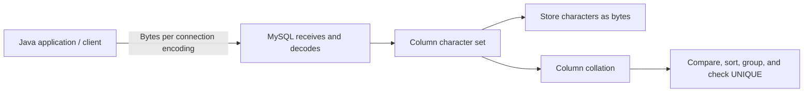
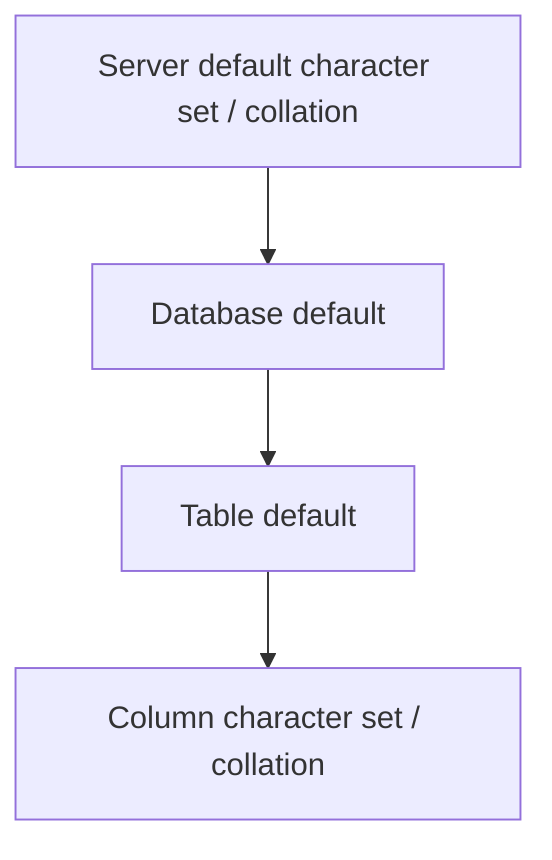

# What Problems Do Character Sets, Encoding, and Collations Solve?

A Java application might send a Vietnamese customer name to MySQL, only to read back corrupted characters such as `?`, `Ã`, or mangled diacritics. Another common issue is when two strings `Nguyen` and `NGUYEN` are treated as equal during a search, or a unique index rejects inserting `cafe` because `café` already exists. These two groups of issues relate to **character sets** and **collations**.

A character set defines the set of characters and how characters are represented as bytes. A collation defines how strings belonging to that character set are compared and sorted. In the **DATABASE_MYSQL** module, understanding these two concepts helps store Vietnamese and Unicode accurately, design search behavior, enforce uniqueness rules, and prevent errors when connecting from Java or migrating data.

## 1. Character sets and collations solve two different problems

A **character set** specifies which characters are supported and how they are encoded into bytes. For example, `utf8mb4` is MySQL's Unicode character set, which can encode a character using 1 to 4 bytes. As a result, a column using `utf8mb4` can store Vietnamese with diacritics, many other languages, and non-BMP characters such as emojis.

A **collation** specifies how strings belonging to a character set are compared and sorted. A collation can determine whether uppercase and lowercase letters are considered equal, whether accents affect comparisons, character ordering in `ORDER BY`, and how duplicate values are determined in `DISTINCT`, `GROUP BY`, or a unique index.

| Concept | Question answered | Example |
|---|---|---|
| Character set | How are characters represented as bytes? | `utf8mb4` encodes Unicode using up to 4 bytes per character |
| Collation | How are two strings compared and sorted? | `utf8mb4_0900_ai_ci` is accent-insensitive and case-insensitive |

The data flow can be visualized as follows:



A character set does not decide which strings are equal to one another; a collation cannot fix bytes that were encoded incorrectly. To handle data properly, both must be configured according to their intended purpose.

## 2. Why should you use `utf8mb4`?

In MySQL, `utf8mb4` is the appropriate choice for most new applications that require Unicode support. The name `utf8` in MySQL has a special history: it is an alias for `utf8mb3`, a Unicode encoding using up to 3 bytes that cannot represent all of Unicode. `utf8mb3` and its alias `utf8` are deprecated; they should not be chosen for new schemas.

| Character set | Maximum bytes per character | Capabilities |
|---|---:|---|
| `ascii` | 1 | Basic ASCII character set |
| `latin1` | 1 | Western European character set as implemented by MySQL |
| `utf8mb3` (old alias `utf8`) | 3 | Subset of Unicode; does not fully support characters requiring 4 bytes |
| `utf8mb4` | 4 | Full Unicode support, including emojis and non-BMP characters |

For example, some Vietnamese characters can be represented using multiple bytes in UTF-8; emojis such as `😀` require 4 bytes. A column using `utf8mb3` cannot store all such characters, whereas `utf8mb4` can.

Check the character sets supported by the server:

```sql
SHOW CHARACTER SET LIKE 'utf8mb4';
SHOW CHARACTER SET LIKE 'utf8mb3';
```

`utf8mb4` can use more bytes than ASCII or latin1 for the same content. This affects storage size and index length limits, so when upgrading legacy tables you should inspect indexes and actual structures. Switching to `utf8mb4` is the right choice for Unicode, but still requires migration planning rather than changing a single configuration line.

## 3. Reading collation names

A collation name typically contains information about its comparison rule set. For example:

```text
utf8mb4_0900_ai_ci
```

- `utf8mb4`: the character set to which the collation applies.
- `0900`: the Unicode Collation Algorithm (UCA) version 9.0.0 rule set used by MySQL.
- `ai`: accent-insensitive, does not distinguish accents/diacritics.
- `ci`: case-insensitive, does not distinguish uppercase/lowercase.

Common suffixes:

| Suffix | Meaning | Example effect |
|---|---|---|
| `_ai` | Accent-insensitive | `cafe` can be treated as equal to `café` |
| `_as` | Accent-sensitive | `cafe` differs from `café` |
| `_ci` | Case-insensitive | `Alice` equals `alice` |
| `_cs` | Case-sensitive | `Alice` differs from `alice` |
| `_bin` | Compares by the character code values of the character set | Often used when strict comparison by character code is needed |

Examples of `utf8mb4` collations:

- `utf8mb4_0900_ai_ci`: accent-insensitive and case-insensitive; the default collation for `utf8mb4` in MySQL 8.0.
- `utf8mb4_0900_as_cs`: accent-sensitive and case-sensitive.
- `utf8mb4_0900_as_ci`: accent-sensitive but case-insensitive.

Not every collation is available on every MySQL version. You can check with:

```sql
SHOW COLLATION LIKE 'utf8mb4_0900%';
SHOW COLLATION LIKE 'utf8mb4%';
```

Another difference across collation generations is how trailing spaces are handled. MySQL 8.0 `0900` collations use the `NO PAD` attribute; many older collations use `PAD SPACE`. Therefore, comparing strings with trailing spaces may behave differently when migrating from an older collation to a `0900` collation. During upgrades, inspect affected comparisons and unique indexes.

## 4. How do collations affect searching and uniqueness?

Suppose a system has a username column and wants case-insensitive and accent-insensitive searches. You can use the `utf8mb4_0900_ai_ci` collation:

```sql
SELECT
    _utf8mb4'cafe' COLLATE utf8mb4_0900_ai_ci =
    _utf8mb4'café' COLLATE utf8mb4_0900_ai_ci AS same_without_accent,
    _utf8mb4'Alice' COLLATE utf8mb4_0900_ai_ci =
    _utf8mb4'alice' COLLATE utf8mb4_0900_ai_ci AS same_without_case;
```

With this collation, both comparisons evaluate to true. If you need to distinguish both accents and case, use an appropriate collation such as `utf8mb4_0900_as_cs`:

```sql
SELECT
    _utf8mb4'cafe' COLLATE utf8mb4_0900_as_cs =
    _utf8mb4'café' COLLATE utf8mb4_0900_as_cs AS same_with_accent,
    _utf8mb4'Alice' COLLATE utf8mb4_0900_as_cs =
    _utf8mb4'alice' COLLATE utf8mb4_0900_as_cs AS same_with_case;
```

These two comparisons evaluate to false because both accents and letter case are distinguished.

### How collation affects UNIQUE

The column's collation is used when comparing values in an index on that column. For example:

```sql
CREATE TABLE username_registry (
    username VARCHAR(100)
        CHARACTER SET utf8mb4
        COLLATE utf8mb4_0900_ai_ci
        NOT NULL,
    UNIQUE KEY uq_username (username)
);
```

With this collation, after storing `Alice`, inserting `alice` may be rejected because the two values are considered equal. Similarly, `cafe` and `café` can conflict in the unique index. This is collation behavior, not a random index bug.

If business requirements call for distinguishing case and accents, choose the appropriate collation right at design time:

```sql
CREATE TABLE api_tokens (
    token_label VARCHAR(100)
        CHARACTER SET utf8mb4
        COLLATE utf8mb4_0900_as_cs
        NOT NULL,
    UNIQUE KEY uq_token_label (token_label)
);
```

Do not choose a collation merely to make searching "easier." Clearly define which two values are considered the same identity, code, or business key. Collation affects `=`, `ORDER BY`, `GROUP BY`, `DISTINCT`, `LIKE`, and unique indexes; changing it can alter query results and data validity.

## 5. `_bin` collations and binary data types

Collations with the `_bin` suffix compare characters based on their code point values rather than linguistic rules. However, the column is still a string type with a character set; `_bin` does not turn `VARCHAR` into binary data.

The `BINARY`, `VARBINARY`, and `BLOB` types store bytes and do not apply text character sets and collations the way `CHAR`, `VARCHAR`, or `TEXT` do:

| Type | Nature | When to use |
|---|---|---|
| `VARCHAR` with a `_bin` collation | Character string, compared by character code | Content is still text, but strict code-based comparison is required |
| `VARBINARY` | Variable-length byte sequence | Tokens, hashes, or binary data requiring byte-level comparison |
| `BLOB` | Potentially large binary data | Files or binary payloads |

For example, tokens generated from random bytes can be stored using `VARBINARY`; usernames are text, so they usually fit `VARCHAR` with a collation chosen according to business rules. Do not use `_bin` as an arbitrary substitute for all binary types.

## 6. At which levels are character sets and collations applied?

MySQL allows setting defaults at multiple levels. When not explicitly specified, a new object inherits the configuration from the level above it:



| Level | Default declaration | Meaning |
|---|---|---|
| Server | `character_set_server`, `collation_server` | Default values for new databases if unspecified |
| Database | `DEFAULT CHARACTER SET`, `DEFAULT COLLATE` | Default values for new tables in the database |
| Table | `DEFAULT CHARACTER SET`, `DEFAULT COLLATE` | Default values for new text columns in the table |
| Column | `CHARACTER SET`, `COLLATE` | Determines the encoding and comparison rules of a specific column |

Example of creating a database with Unicode defaults:

```sql
CREATE DATABASE customer_app
    CHARACTER SET utf8mb4
    COLLATE utf8mb4_0900_ai_ci;
```

Creating a table using the database defaults:

```sql
CREATE TABLE customers (
    id BIGINT UNSIGNED NOT NULL AUTO_INCREMENT,
    display_name VARCHAR(150) NOT NULL,
    PRIMARY KEY (id)
) DEFAULT CHARACTER SET utf8mb4
  COLLATE utf8mb4_0900_ai_ci;
```

If a column needs different rules, you can override them at the column level:

```sql
CREATE TABLE account_names (
    id BIGINT UNSIGNED NOT NULL AUTO_INCREMENT,
    display_name VARCHAR(100)
        CHARACTER SET utf8mb4
        COLLATE utf8mb4_0900_ai_ci NOT NULL,
    external_code VARCHAR(100)
        CHARACTER SET utf8mb4
        COLLATE utf8mb4_0900_as_cs NOT NULL,
    PRIMARY KEY (id)
) DEFAULT CHARACTER SET utf8mb4
  COLLATE utf8mb4_0900_ai_ci;
```

`display_name` is accent-insensitive and case-insensitive during comparisons; `external_code` distinguishes both. Only use a separate collation when business requirements genuinely differ.

Changing the database default with `ALTER DATABASE` only affects defaults for objects created afterward; it does not automatically convert existing columns. Likewise, changing a table's default does not automatically change the character set/collation of existing columns.

## 7. Client/server connection character sets

A schema configured with `utf8mb4` can still store incorrect data if the client sends bytes in an encoding different from what MySQL expects to receive. Upon connection, MySQL uses session variables to handle data:

| Variable | Role |
|---|---|
| `character_set_client` | Character set MySQL uses to decode bytes of statements sent by the client |
| `character_set_connection` | Character set used for literals and expressions after conversion from `character_set_client` |
| `character_set_results` | Character set used to convert results returned to the client |
| `collation_connection` | Default collation for comparisons involving connection literals/expressions |

Check the configuration in the current session:

```sql
SHOW SESSION VARIABLES WHERE Variable_name IN (
    'character_set_client',
    'character_set_connection',
    'character_set_results',
    'collation_connection'
);
```

You can set the character set for a session using:

```sql
SET NAMES utf8mb4 COLLATE utf8mb4_0900_ai_ci;
```

The `SET NAMES` statement sets the client, connection, and results character set variables, as well as the connection collation. It takes effect for the current session; when opening a new connection, the application needs to renegotiate/reconfigure via the driver.

For Java applications, use an appropriate MySQL Connector/J version and let the driver manage the connection encoding. If you configure `characterEncoding`, verify how that driver version maps UTF-8 to `utf8mb4`; modern Connector/J supports this mapping. Avoid manually prepending `SET NAMES` to every query when the driver already manages the character set, as driver and session settings can drift out of sync. Inspect the session variables on the exact connection used by the application.

Example check after opening a JDBC connection:

```java
try (Connection connection = dataSource.getConnection();
     Statement statement = connection.createStatement();
     ResultSet resultSet = statement.executeQuery(
         "SELECT @@character_set_client, " +
         "@@character_set_connection, " +
         "@@character_set_results, @@collation_connection")) {

    if (resultSet.next()) {
        System.out.println("client charset: " + resultSet.getString(1));
        System.out.println("connection charset: " + resultSet.getString(2));
        System.out.println("results charset: " + resultSet.getString(3));
        System.out.println("connection collation: " + resultSet.getString(4));
    }
}
```

The example assumes `dataSource` is already configured with the JDBC URL, MySQL Connector/J, and credentials. When debugging, run the check on the same connection used by the write operation; a separate SQL session may have different settings.

## 8. Diagnosing Vietnamese text errors and mojibake

Mojibake occurs when bytes are decoded with the wrong character set, causing text to render as meaningless character sequences. For example, UTF-8 data read as latin1 can produce `Tiếng Việt` instead of `Tiếng Việt`.

When encountering an error, do not rush to run `ALTER TABLE ... CONVERT TO CHARACTER SET`. First, check:

1. The character set of the column storing the data.
2. `character_set_client`, `character_set_connection`, and `character_set_results` on the application session.
3. The actual encoding of the data sent from the application or import file.
4. The bytes stored in the column, which can be inspected for a value using `HEX(column_name)`.
5. How the client renders the result; an error in a terminal or log might lie in the result decoding step rather than the data in the database.

Example of inspecting column metadata:

```sql
SHOW CREATE TABLE customers;

SELECT
    display_name,
    HEX(display_name),
    CHAR_LENGTH(display_name),
    LENGTH(display_name)
FROM customers
LIMIT 5;
```

`CHAR_LENGTH()` counts characters; `LENGTH()` counts bytes. For `utf8mb4` Unicode strings, the two results can differ. `HEX()` helps inspect the stored bytes to compare against the source encoding.

If the bytes were written correctly but the client decoded them incorrectly, fix the connection or client configuration. If the data was written with corrupted bytes due to mismatched character set declarations, determine how the data was encoded and plan a repair from backups. Character set conversion cannot guess the original text intended by the user; blind conversion can further corrupt the data.

## 9. Converting character sets for databases, tables, and columns

There are three operations that are often confused:

| Statement | Effect |
|---|---|
| `ALTER DATABASE ... CHARACTER SET ...` | Changes the default for tables created afterward; does not automatically convert existing columns |
| `ALTER TABLE ... DEFAULT CHARACTER SET ...` | Changes the table's default for new columns; does not automatically convert all existing columns |
| `ALTER TABLE ... CONVERT TO CHARACTER SET ...` | Converts the table's character columns to the target character set/collation |

Example of changing the database default:

```sql
ALTER DATABASE customer_app
    CHARACTER SET utf8mb4
    COLLATE utf8mb4_0900_ai_ci;
```

Example of converting text columns in a table:

```sql
ALTER TABLE customers
    CONVERT TO CHARACTER SET utf8mb4
    COLLATE utf8mb4_0900_ai_ci;
```

The `CONVERT TO CHARACTER SET` command can cause MySQL to rebuild the table, changing storage size, indexes, or metadata, and causing locks or performance impact depending on the version, engine, table size, and chosen DDL algorithm. Before running it in production, you must:

- Back up and test restoring to ensure recovery is possible.
- Verify whether existing data is actually encoded accurately according to its declared character set.
- Check indexes, unique constraints, and column lengths; when the new collation treats two values as equal, a unique index might fail to build or data might conflict.
- Measure execution time, temporary disk usage, locking, and replication impact.
- Test on a data copy close to production size and prepare a rollback plan.

Changing only the collation without changing the character set can be done per column using `ALTER TABLE ... MODIFY COLUMN` with the full column definition. When using this approach, you must preserve existing attributes such as `NOT NULL`, `DEFAULT`, comments, and other properties; omitting attributes can cause unintended schema changes.

## 10. Choosing character sets and collations for an application

A practical configuration for a new application usually starts with `utf8mb4` at the server/database/table level and uses an appropriate default collation. With MySQL 8.0, `utf8mb4_0900_ai_ci` is a common default when accent-insensitive and case-insensitive searching is desired.

However, do not apply a single collation to every column without reviewing business requirements:

| Data | Selection guideline |
|---|---|
| Display names, Vietnamese content needing user-friendly search | `utf8mb4` with an accent-insensitive/case-insensitive collation if desired by business rules |
| Identifiers requiring exact case sensitivity | A `_as_cs` collation or a tested stricter comparison rule |
| Tokens/hashes or binary payloads | `VARBINARY`/`BLOB`, as these are bytes rather than text |
| Email, username, or login ID | Choose uniqueness rules according to business specifications and normalization rules; do not assume every system wants case sensitivity |
| Structured codes with leading zeros | Typically use `CHAR`/`VARCHAR` with an appropriate character set if it is a text identifier |

Collation is part of the data contract. If you change the collation of a username, email, or business code, search results and uniqueness rules can change. Check for duplicate data under the target collation before creating a unique index or converting a schema.

## 11. Practice exercises

Perform on a test database:

1. Run `SHOW CHARACTER SET LIKE 'utf8mb4'` and `SHOW COLLATION LIKE 'utf8mb4_0900%'` to view supported charsets/collations.
2. Create a database with `utf8mb4` and `utf8mb4_0900_ai_ci`; create a table with one column using the default collation and one column using `utf8mb4_0900_as_cs`.
3. Insert the values `Alice`, `alice`, `cafe`, and `café`; compare results using `=` under both collations.
4. Create a unique index on the `ai_ci` column, try inserting two values that differ only by case or accent, and explain the result.
5. Connect from a Java application, inspect the four connection session variables, and store/read a Vietnamese string with diacritics along with an emoji.
6. Use `HEX()`, `CHAR_LENGTH()`, and `LENGTH()` to compare bytes against character count.
7. On a database copy, test `ALTER TABLE ... CONVERT TO CHARACTER SET` and record the impact on data, indexes, and execution time.

You complete this lesson when you can explain that character set determines encoding and collation determines comparison, know why `utf8mb4` is suitable for Unicode, and can inspect the entire path from the Java client to the MySQL column. Choose collations according to business rules, as they directly affect searching, sorting, and data uniqueness.
