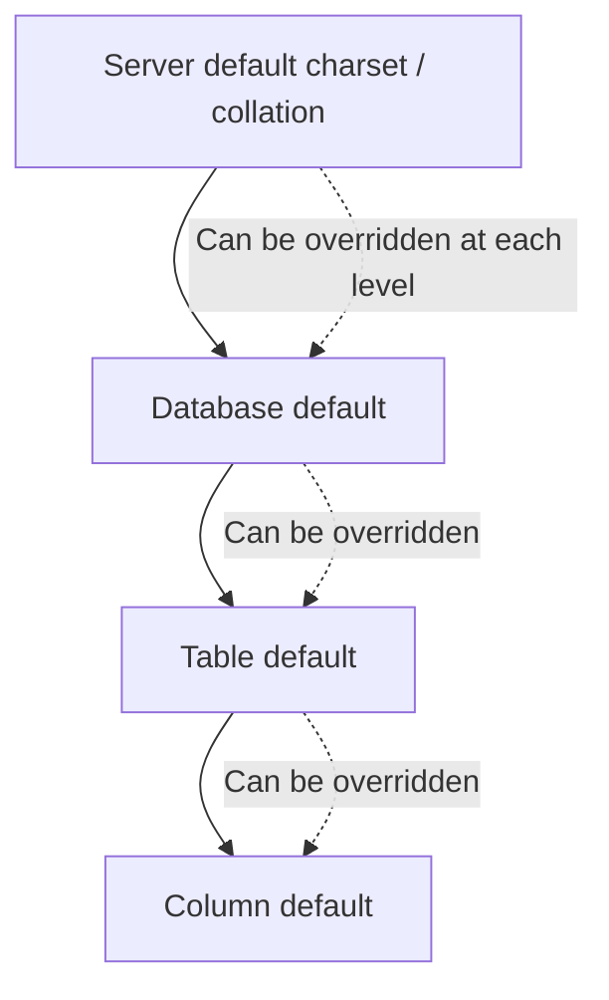

# Configuring Character Sets and Collations at Server, Database, Table, and Column Levels

## Objectives

After this lesson, you will be able to:

- Explain how MySQL applies character sets and collations across the server, database, table, and column levels.
- Configure server defaults and create databases, tables, and columns with appropriate character sets/collations.
- Distinguish changing default values from converting existing data.
- Configure the character set for client connections and inspect session charset/collation status.
- Detect risks of data loss, index errors, or unique key conflicts when converting charsets/collations.
- Plan a safe standardization of text data to `utf8mb4`.

## 1. Character set and collation are two different concepts

A **character set** defines the set of characters and how characters are encoded into bytes. For example, `utf8mb4` can represent Unicode characters requiring up to four bytes, including Vietnamese letters and many non-BMP characters such as emojis.

A **collation** defines how strings belonging to a character set are compared and sorted. Collation determines which differences are treated as equivalent in comparisons, `ORDER BY`, `GROUP BY`, and unique indexes. Some common suffixes:

- `_ai`: accent-insensitive, does not distinguish accents in comparisons.
- `_as`: accent-sensitive, distinguishes accents.
- `_ci`: case-insensitive, does not distinguish uppercase/lowercase letters.
- `_cs`: case-sensitive, distinguishes uppercase/lowercase letters.
- `_bin`: compares according to the binary value of the string or character code values per the corresponding collation.

For example, with a case-insensitive and accent-insensitive collation, two strings such as `An` and `an` or `a` and `á` can be treated as equal in comparisons. Exact behavior depends on the specific collation. This does not alter the stored string content; collation only changes how values are compared and sorted.

Do not choose a collation merely because its name includes `utf8`. Identify how the business domain needs to search and compare: do person names need accent sensitivity, are identifiers case-sensitive, do emails have their own normalization rules, and which languages will be stored?

## 2. How MySQL inherits charsets and collations

MySQL has default levels from broadest to narrowest:

1. **Server:** default for new databases when charset/collation is unspecified.
2. **Database:** default for new tables in the database when not explicitly specified in the table creation statement.
3. **Table:** default for new character columns when not specified at the individual column level.
4. **Column:** actual charset/collation used to store and compare data for that column.



When creating an object, a narrower level can inherit its parent's default or override it with an explicit declaration. For example, a database may default to `utf8mb4`, yet a table can declare `latin1`; a column within that table can also declare its own charset/collation if the data type permits it.

Key point: **changing defaults does not automatically convert data or alter existing objects**. `ALTER DATABASE ... CHARACTER SET` changes the database default for objects created afterward; it does not convert old tables. Similarly, `ALTER TABLE ... DEFAULT CHARACTER SET` changes the table default for new columns, not existing columns. To convert existing columns, you must use `ALTER TABLE ... CONVERT TO CHARACTER SET` or modify each column individually.

## 3. Choosing the right charset and collation

### 3.1. Why should you use utf8mb4?

For new systems, `utf8mb4` is generally the right choice for multilingual text data. It supports full Unicode with up to four bytes per character. In MySQL, the name `utf8` is a historical alias for `utf8mb3` in modern versions; `utf8mb3` supports at most three bytes and cannot represent all of Unicode. Therefore, in new designs, explicitly declare `utf8mb4` rather than using the ambiguous `utf8`.

The charset does not dictate the language of the data. A `utf8mb4` column can hold Vietnamese, English, Japanese, or emojis. Accurate display also depends on input data being decoded properly, the client connection declaring the right charset, and the application handling strings correctly.

### 3.2. Choosing a collation based on comparison requirements

Examples of common collations in the MySQL ecosystem:

| Collation | General characteristics | Scenarios to consider |
|---|---|---|
| `utf8mb4_0900_ai_ci` | UCA 9.0, accent- and case-insensitive; uses NO PAD rules | MySQL 8.0, general text search when accent/case sensitivity is not needed |
| `utf8mb4_0900_as_cs` | UCA 9.0, accent- and case-sensitive | Comparisons requiring stricter accuracy |
| `utf8mb4_unicode_ci` | Unicode-based collation, accent/case-insensitive per its rules | Environments requiring a collation compatible with MySQL/MariaDB versions supporting this name |
| `utf8mb4_bin` | Compares by the binary value of the string | Codes or tokens needing exact byte/character-representation distinction |

Collation names and availability vary across MySQL versions, MariaDB, and vendors. For example, `utf8mb4_0900_*` collations are specific to MySQL 8.0 and should not be assumed to exist on every MariaDB version. Always check `SHOW COLLATION` on the target server before using a collation in DDL.

Do not mechanically use a case-insensitive collation for all data. Login codes, API tokens, product codes, or identifiers may require exact comparison. Conversely, searching person names often benefits from an experience that is insensitive to case or accents. You can set a collation at the column level or specify `COLLATE` in a specific query when needs differ from the default.

## 4. Configuring at the server level

### 4.1. Checking current defaults

Connect to MySQL and run:

```sql
SHOW GLOBAL VARIABLES LIKE 'character_set_server';
SHOW GLOBAL VARIABLES LIKE 'collation_server';

SELECT
    @@GLOBAL.character_set_server AS server_charset,
    @@GLOBAL.collation_server AS server_collation;
```

View charsets and collations supported by the server:

```sql
SHOW CHARACTER SET;
SHOW COLLATION;
```

You can filter specifically for `utf8mb4` collations:

```sql
SHOW COLLATION WHERE Charset = 'utf8mb4';
```

`character_set_server` and `collation_server` are server defaults. They primarily affect databases created without explicitly specifying charset/collation. They do not automatically convert existing databases, tables, or columns.

### 4.2. Declaring in the configuration file

On self-managed servers, you can set defaults in the MySQL configuration file, typically `my.cnf` on Linux or `my.ini` on Windows. Example for MySQL 8.0:

```ini
[mysqld]
character-set-server = utf8mb4
collation-server = utf8mb4_0900_ai_ci
```

The collation in the example must be supported by the current server. If deploying MariaDB or another version, choose a collation listed in `SHOW COLLATION` and the documentation for that exact product.

After editing the configuration file, apply it via the environment's restart procedure or configuration management mechanism. On cloud services, configuration changes may be made through parameter groups or the provider's management console; direct editing of config files is not always permitted.

In some MySQL versions, global variables can be changed at runtime with `SET GLOBAL` or persisted with `SET PERSIST` if the variable and version support it. Runtime changes do not update already-open sessions and do not replace durable configuration management. Before using them, check the variable's scope, whether it is dynamic, required privileges, and restart behavior.

### 4.3. Verifying after changes

After applying the configuration, open a new connection and check:

```sql
SELECT
    @@GLOBAL.character_set_server,
    @@GLOBAL.collation_server;
```

Also create a test database without specifying charset/collation and inspect its metadata to confirm it receives the expected defaults. Do not use a production database to test configuration without a clear change plan.

## 5. Configuring at the database level

### 5.1. Creating a database with explicit charset/collation

It is recommended to explicitly declare these for new databases instead of relying on server defaults:

```sql
CREATE DATABASE shop_db
    CHARACTER SET utf8mb4
    COLLATE utf8mb4_0900_ai_ci;
```

The new database will use this charset/collation as the default for tables created without their own specified values.

Check:

```sql
SELECT
    SCHEMA_NAME,
    DEFAULT_CHARACTER_SET_NAME,
    DEFAULT_COLLATION_NAME
FROM information_schema.SCHEMATA
WHERE SCHEMA_NAME = 'shop_db';
```

Or:

```sql
SHOW CREATE DATABASE shop_db;
```

### 5.2. Changing defaults of an existing database

```sql
ALTER DATABASE shop_db
    CHARACTER SET utf8mb4
    COLLATE utf8mb4_0900_ai_ci;
```

This command changes the database default for tables created afterward if those tables do not declare their own values. It **does not convert the charset/collation of existing tables and columns**. Afterward, inspect database and individual table metadata to avoid mistakenly assuming all data has been converted.

If the application creates tables via migrations that specify `DEFAULT CHARSET` or column-level charsets, explicit declarations in DDL will override the database default. Therefore, manage charset/collation in migrations and schema source control, not only at the server level.

## 6. Configuring at the table level

### 6.1. Creating a table with its own defaults

```sql
CREATE TABLE customers (
    customer_id BIGINT UNSIGNED NOT NULL AUTO_INCREMENT,
    display_name VARCHAR(200) NOT NULL,
    email VARCHAR(255) NOT NULL,
    notes TEXT,
    PRIMARY KEY (customer_id),
    UNIQUE KEY uq_customers_email (email)
) ENGINE = InnoDB
  DEFAULT CHARACTER SET = utf8mb4
  COLLATE = utf8mb4_0900_ai_ci;
```

Character columns that do not declare their own charset/collation inherit the table default. Numeric and date/time columns do not have a character set.

Check:

```sql
SHOW CREATE TABLE customers\G

SELECT
    TABLE_NAME,
    TABLE_COLLATION
FROM information_schema.TABLES
WHERE TABLE_SCHEMA = DATABASE()
  AND TABLE_NAME = 'customers';
```

`TABLE_COLLATION` shows the table's default collation; to see the actual charset/collation of each column, query `information_schema.COLUMNS`.

### 6.2. Changing the table default for newly added columns

```sql
ALTER TABLE customers
    DEFAULT CHARACTER SET = utf8mb4
    COLLATE = utf8mb4_0900_ai_ci;
```

This command changes the table default for character columns added afterward. Existing columns retain their old charset/collation. This is an important distinction from `CONVERT TO CHARACTER SET` covered in a later section.

### 6.3. Inspecting actual columns

```sql
SELECT
    COLUMN_NAME,
    COLUMN_TYPE,
    CHARACTER_SET_NAME,
    COLLATION_NAME,
    IS_NULLABLE
FROM information_schema.COLUMNS
WHERE TABLE_SCHEMA = DATABASE()
  AND TABLE_NAME = 'customers'
ORDER BY ORDINAL_POSITION;
```

The `CHARACTER_SET_NAME` and `COLLATION_NAME` columns are `NULL` for non-string types. Do not infer the charset of every column solely from `TABLE_COLLATION`.

## 7. Configuring at the column level

### 7.1. Overriding charset/collation for a single column

A table may use the `utf8mb4_0900_ai_ci` default, while an identifier column needs binary or case-sensitive comparison:

```sql
CREATE TABLE api_clients (
    client_id BIGINT UNSIGNED NOT NULL AUTO_INCREMENT,
    display_name VARCHAR(150) NOT NULL,
    api_key VARCHAR(128)
        CHARACTER SET utf8mb4
        COLLATE utf8mb4_bin NOT NULL,
    PRIMARY KEY (client_id),
    UNIQUE KEY uq_api_key (api_key)
) ENGINE = InnoDB
  DEFAULT CHARACTER SET = utf8mb4
  COLLATE = utf8mb4_0900_ai_ci;
```

In this example, `display_name` inherits the table's collation, whereas `api_key` overrides it with `utf8mb4_bin`. For tokens or identifiers, choose comparison rules based on the actual format; in some cases, a binary type should be used instead of a text string.

### 7.2. Modifying an existing column

To change the charset/collation of an individual column, use `MODIFY` or `CHANGE` with the complete column definition:

```sql
ALTER TABLE customers
    MODIFY display_name VARCHAR(200)
        CHARACTER SET utf8mb4
        COLLATE utf8mb4_0900_ai_ci
        NOT NULL;
```

When using `MODIFY`, you must redeclare all attributes to preserve, such as type, length, `NULL`/`NOT NULL`, `DEFAULT`, `COMMENT`, `AUTO_INCREMENT`, or other relevant properties. Omitting an attribute can cause unintended schema changes. Retrieve `SHOW CREATE TABLE` before making edits.

Modifying a column with `MODIFY` can convert that column's data. If the goal is only to change comparison behavior, consider the impact of the new collation on indexes, unique keys, and queries before applying it.

### 7.3. Specifying COLLATE in a query

Sometimes only a single query needs a comparison rule different from the column's collation. You can use `COLLATE` in an expression:

```sql
SELECT customer_id, display_name
FROM customers
WHERE display_name COLLATE utf8mb4_0900_as_cs = 'Nguyễn An';
```

This example requests an accent- and case-sensitive collation for the comparison. The collation must be compatible with the expression's character set and supported by the server.

Specifying `COLLATE` in a query does not alter table or column metadata. Applying a function or collation cast to a column can also affect index usage; inspect `EXPLAIN` if the query is performance-critical.

## 8. Configuring charset/collation for client connections

### 8.1. Why must the connection also use the right charset?

A client may send Vietnamese strings to MySQL. The server needs to know which charset to use to decode the received bytes; when returning results, the client also needs to know how to interpret the response bytes. If connection charsets mismatch, data can suffer from broken diacritics or mojibake even when the column uses `utf8mb4`.

Session variables commonly checked:

```sql
SHOW SESSION VARIABLES LIKE 'character_set%';
SHOW SESSION VARIABLES LIKE 'collation%';

SELECT
    @@SESSION.character_set_client,
    @@SESSION.character_set_connection,
    @@SESSION.character_set_results,
    @@SESSION.collation_connection;
```

- `character_set_client`: charset the server uses to interpret data sent by the client.
- `character_set_connection`: charset used for expressions and literals after the server converts from the client charset.
- `character_set_results`: charset used when the server sends results back to the client.
- `collation_connection`: default collation for string comparisons in the connection context when no more specific collation is present.

### 8.2. Using SET NAMES

In a MySQL client, you can configure the session:

```sql
SET NAMES utf8mb4 COLLATE utf8mb4_0900_ai_ci;
```

This statement sets the connection charset variables (client, connection, and results), and sets the connection collation to the specified collation. It affects only the current session; it does not change the charset/collation of the server, database, tables, or stored data.

You can verify immediately:

```sql
SELECT
    @@SESSION.character_set_client,
    @@SESSION.character_set_connection,
    @@SESSION.character_set_results,
    @@SESSION.collation_connection;
```

Do not arbitrarily run `SET NAMES` between requests on a shared connection pool if the application does not manage session state. Connection pools reuse connections; session state must be set consistently or reset per pool configuration.

### 8.3. Configuring in the application

For Java/JDBC applications, use a modern driver and configure the connection according to the documentation for that exact connector version. Avoid manually concatenating SQL statements or encoding bytes by hand if the driver already handles the charset via configuration. You can verify from the exact connection opened by the application by querying `@@SESSION.character_set_client`, `@@SESSION.character_set_connection`, and `@@SESSION.character_set_results`.

Do not test only with a MySQL client on your personal machine. Applications running in containers or other servers may use different drivers, JVMs, locales, or settings. Verify in the actual deployment environment and through the actual connection pool.

## 9. Inspecting data and detecting encoding errors

### 9.1. Viewing charset/collation at each level

You can use the following queries to capture a status snapshot:

```sql
-- Server
SELECT @@GLOBAL.character_set_server,
       @@GLOBAL.collation_server;

-- Current session
SELECT @@SESSION.character_set_client,
       @@SESSION.character_set_connection,
       @@SESSION.character_set_results,
       @@SESSION.collation_connection;

-- Database
SELECT SCHEMA_NAME,
       DEFAULT_CHARACTER_SET_NAME,
       DEFAULT_COLLATION_NAME
FROM information_schema.SCHEMATA
WHERE SCHEMA_NAME = DATABASE();

-- Table
SELECT TABLE_NAME, TABLE_COLLATION
FROM information_schema.TABLES
WHERE TABLE_SCHEMA = DATABASE()
  AND TABLE_TYPE = 'BASE TABLE';

-- Column
SELECT TABLE_NAME, COLUMN_NAME,
       CHARACTER_SET_NAME, COLLATION_NAME
FROM information_schema.COLUMNS
WHERE TABLE_SCHEMA = DATABASE()
  AND CHARACTER_SET_NAME IS NOT NULL
ORDER BY TABLE_NAME, ORDINAL_POSITION;
```

These queries help detect inconsistent schemas, such as a database defaulting to `utf8mb4` while some tables or columns still use an older charset.

### 9.2. Testing writing and reading Vietnamese and non-BMP characters

In a test environment, create a small table:

```sql
CREATE TABLE charset_probe (
    probe_id INT NOT NULL AUTO_INCREMENT,
    sample_text VARCHAR(100)
        CHARACTER SET utf8mb4
        COLLATE utf8mb4_0900_ai_ci NOT NULL,
    PRIMARY KEY (probe_id)
) ENGINE = InnoDB;

INSERT INTO charset_probe (sample_text)
VALUES ('Tiếng Việt: Trường học, dữ liệu, Nguyễn Ái Quốc'),
       ('Unicode: 😀 🚀 𠜎');

SELECT probe_id, sample_text
FROM charset_probe
ORDER BY probe_id;
```

Run the test from the exact client/driver the application will use. If the string was already encoded incorrectly before being sent to the server, a `utf8mb4` column cannot repair the original content by itself.

### 9.3. Distinguishing charset declaration errors from mojibake data

For example, UTF-8 bytes might have been misread as another charset and then stored in a column. In that case, metadata might say the column is `utf8mb4`, yet the displayed content is already wrong. Converting the table to `utf8mb4` again will not restore the original string.

Before fixing encoding-corrupted data:

1. Save a backup and a sample of the original bytes/data.
2. Identify the true charset of the original bytes and the charset the application declared when sending them.
3. Reproduce the faulty conversion on a small copy.
4. Determine whether the conversion is reversible and cross-check with an authoritative source.
5. Test the fix on a copy, verify Vietnamese text and non-BMP characters, and only then plan a production update.

Do not run bulk `CONVERT()` or `CAST()` operations on production data based solely on how strings look visually. If original bytes have already been replaced or lost, changing the charset cannot recover lost information.

## 10. Converting existing tables/columns to utf8mb4

### 10.1. Changing table defaults and converting data are two different actions

Changing only the table default:

```sql
ALTER TABLE customers
    DEFAULT CHARACTER SET = utf8mb4
    COLLATE = utf8mb4_0900_ai_ci;
```

The command above affects the table default and character columns created afterward. Old columns retain their current charset/collation.

Converting existing character columns of the table:

```sql
ALTER TABLE customers
    CONVERT TO CHARACTER SET utf8mb4
    COLLATE utf8mb4_0900_ai_ci;
```

`CONVERT TO CHARACTER SET` converts the table's character columns to the new charset/collation. It may alter column definitions to preserve maximum character capacity; for example, some `VARCHAR` columns may be widened to `TEXT` types if the byte limit of the old type is no longer sufficient after conversion. Check `SHOW CREATE TABLE` afterward.

If you only want to convert certain columns, use `MODIFY` with the full definition for each column. Carefully check related indexes and constraints.

### 10.2. Checking for unique conflicts before changing collation

Changing a collation from case/accent-sensitive to case/accent-insensitive can make two previously distinct values become equal. If the column has a unique index, the conversion may fail due to a duplicate key.

Example pre-check using the target collation:

```sql
SELECT
    CONVERT(email USING utf8mb4)
        COLLATE utf8mb4_0900_ai_ci AS normalized_email,
    COUNT(*) AS duplicate_count
FROM customers
GROUP BY normalized_email
HAVING COUNT(*) > 1;
```

This example assumes the server supports `utf8mb4_0900_ai_ci` and the source column can be converted to `utf8mb4`. For another collation, substitute the actual collation you will use. Composite unique indexes must also be checked by grouping across all expressions/columns in the key.

If rows are returned, determine which records need to be merged, normalized, or kept distinct using a more sensitive collation. Do not automatically delete records just to make the migration pass. Beyond unique keys, a new collation can also change `GROUP BY`, `DISTINCT`, join, and search results.

### 10.3. Checking index limits

`utf8mb4` can use up to four bytes per character. When converting an indexed column, the index length in bytes can increase. In InnoDB, key length limits depend on version, page size, row format, and configuration. An index that was valid under a single-byte charset may exceed limits when converted to `utf8mb4`.

Before converting, check:

- Indexed column lengths and current prefix lengths.
- Total byte length of composite indexes.
- Row format and key length limits of your InnoDB version.
- Whether foreign keys on string columns have compatible charsets/collations on both sides.

If an index exceeds the limit, redesign the prefix or column length, or adjust the schema intentionally. Prefix indexes reduce index bytes but may not sufficiently distinguish values; a unique prefix index can also alter uniqueness rules. Do not truncate indexes arbitrarily.

### 10.4. Safe conversion plan

1. Check the server version and target collation using `SHOW COLLATION`.
2. Back up and test restoring; save `SHOW CREATE TABLE`, indexes, constraints, and charset/collation metadata.
3. Determine the true encoding of existing data; distinguish valid data from mojibake data.
4. Check for duplicates under the target collation, especially for unique columns and composite keys.
5. Check index byte lengths, foreign keys, and disk space required to rebuild tables/indexes.
6. Test `ALTER TABLE ... CONVERT TO CHARACTER SET` on a copy with equivalent data.
7. Compare row counts, sample data, Vietnamese strings, emojis, unique keys, and query plans.
8. Schedule the production conversion, control concurrent writes, and prepare a recovery plan.
9. After conversion, verify each column's metadata and test the application through the actual driver/connection pool.

For large tables, charset conversion can rebuild tables and indexes, consume I/O and disk space, and hold metadata locks. Do not assume all versions support non-locking online conversion. Test on a copy, determine downtime, and choose a migration tool compatible with your system's foreign key/trigger constraints.

## 11. Common configuration mistakes

| Symptom | Possible cause | How to check |
|---|---|---|
| Vietnamese diacritics broken after writing | Client declared wrong charset or input bytes were misdecoded | Check session charset and the encoding pipeline from source to driver |
| Emojis fail or are rejected | One level still uses `utf8mb3` or a charset without 4-byte support | Check charsets of connection, database, table, and column |
| Database is `utf8mb4` yet new tables use another charset | Table DDL specifies its own charset/collation or migrations override the default | Check `SHOW CREATE TABLE` and table-creation migrations |
| Database default changed but old data did not change | `ALTER DATABASE` only changes the default, not existing tables/columns | Check `information_schema.COLUMNS` metadata and use the appropriate conversion command |
| Adding a unique index fails after changing collation | Previously distinct strings become equal under the new collation | Group data by the target collation to find collisions before migrating |
| `ALTER TABLE ... CONVERT` fails with key too long | Index exceeds byte limits after converting to a multibyte charset | Check prefixes, total index length, row format, and version limits |
| String comparison queries return unexpected results | Unsuitable collation or expressions have mismatched collations | Check column collations, explicit `COLLATE`, and coercibility rules |
| Client sees wrong characters despite `utf8mb4` column | Connection or application charset mismatch | Check `character_set_client`, `character_set_connection`, `character_set_results` from the application itself |

## 12. Quick inspection query set

You can run the following query set to produce a charset/collation report:

```sql
-- Server charset/collation
SELECT @@GLOBAL.character_set_server AS server_charset,
       @@GLOBAL.collation_server AS server_collation;

-- Session charset/collation
SELECT @@SESSION.character_set_client AS client_charset,
       @@SESSION.character_set_connection AS connection_charset,
       @@SESSION.character_set_results AS results_charset,
       @@SESSION.collation_connection AS connection_collation;

-- Current database charset/collation
SELECT SCHEMA_NAME,
       DEFAULT_CHARACTER_SET_NAME,
       DEFAULT_COLLATION_NAME
FROM information_schema.SCHEMATA
WHERE SCHEMA_NAME = DATABASE();

-- Default collation per table
SELECT TABLE_NAME, TABLE_COLLATION
FROM information_schema.TABLES
WHERE TABLE_SCHEMA = DATABASE()
  AND TABLE_TYPE = 'BASE TABLE'
ORDER BY TABLE_NAME;

-- Actual charset/collation of text columns
SELECT TABLE_NAME, COLUMN_NAME,
       CHARACTER_SET_NAME, COLLATION_NAME
FROM information_schema.COLUMNS
WHERE TABLE_SCHEMA = DATABASE()
  AND CHARACTER_SET_NAME IS NOT NULL
ORDER BY TABLE_NAME, ORDINAL_POSITION;
```

Save the results along with the server version, inspection timestamp, and environment. A report looking only at `character_set_server` is insufficient to confirm the entire database uses `utf8mb4`.

## 13. Conclusion

MySQL applies charsets/collations via server, database, table, and column defaults; narrower levels can inherit or override broader levels. Client connections also have their own session charset and collation, determining how incoming and outgoing data are interpreted.

Explicitly declare `utf8mb4` and an appropriate collation for new schemas. When modifying existing systems, clearly distinguish changing defaults from converting data, check for duplicates under the target collation, verify index byte limits, and validate data directly from the application. Choosing the right charset/collation at every level ensures accurate Unicode storage and aligns string comparison behavior with MySQL business requirements.
