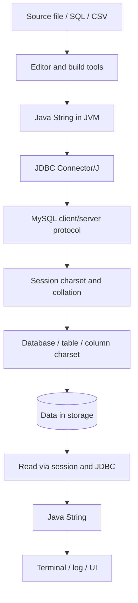

# Verifying Encoding Across Files, Clients, JDBC, and the Database

An application can use `utf8mb4` in the database yet still store Vietnamese text or emojis incorrectly. The fault can begin in a source file saved with the wrong encoding, a terminal sending bytes under a different charset, a JDBC driver negotiating an unexpected charset, a MySQL session declaring the wrong `character_set_client`, or an actual column still using `utf8mb3`. To fix this properly, you must inspect the entire data pipeline from the file to the database and back to the application.

This lesson belongs to the **DATABASE_MYSQL** module. The module aims to build mastery of MySQL from table design, data types, keys, and SQL queries through indexes, transactions, and concurrency control, alongside practicing execution plan reading, query tuning, privileges, backups, and relational database operational troubleshooting. Within the **Character Sets and Collations** chapter, this lesson focuses on verifying encoding end-to-end across files, clients, JDBC, and the database through explicit configuration, diagnostic queries, and round-trip tests.

## 1. The journey of a character

Suppose an application stores the string `Tiếng Việt: ă â ê ô ơ ư đ — 😀` in MySQL. This string must pass through multiple layers:



At each boundary, data can be encoded, decoded, or converted:

1. **File:** bytes in `.java`, `.sql`, `.csv`, `.properties`, or configuration files must be read by tools using the right encoding.
2. **JVM:** Java handles strings in Unicode; a `String` is not a UTF-8 byte array.
3. **JDBC:** Connector/J converts Java strings into bytes according to the negotiated or configured connection charset.
4. **MySQL session:** the server interprets bytes sent by the client using `character_set_client`, converts through `character_set_connection`, and returns results using `character_set_results`.
5. **Column:** MySQL stores strings under the column's character set; the collation governs comparison and sorting rules.
6. **Results:** data travels back through the protocol, driver, and application before a terminal or UI displays it.

A display error at the end of the path does not prove the data inside the database is corrupted. You must isolate whether the error started in the file, in bytes on the wire, during conversion into the column, or merely in how results are rendered.

## 2. Distinguishing character set, encoding, and collation

Three related yet non-synonymous concepts:

- **Character set** defines the set of representable characters.
- **Character encoding** is how characters are represented as bytes. For example, UTF-8 encodes a code point into one to four bytes.
- **Collation** specifies how strings are compared, sorted, and whether strings are treated as equivalent.

In MySQL, `utf8mb4` is the character set supporting full Unicode with up to four bytes per character. `utf8mb4_0900_ai_ci` is a collation of that character set: `ai` is accent-insensitive and `ci` is case-insensitive. Collation does not alter encoded bytes; it governs how strings are compared.

Do not confuse MySQL's historical `utf8` with full UTF-8. On many versions, the name `utf8` is an alias for `utf8mb3`, which supports at most three bytes per character. Only `utf8mb4` fully supports supplementary characters such as many emojis. Basic Vietnamese strings can fit in `utf8mb3`, so testing only Vietnamese letters is insufficient to prove the pipeline supports full Unicode.

An example test string should cover multiple character groups:

```text
Tiếng Việt: ă â ê ô ơ ư đ; hook/tilde/dot-below marks; emoji 😀 🧪; symbol € —
```

Use the exact same string across files, the application, SQL test statements, and post-read comparisons.

## 3. Standardizing encoding of source and data files

### 3.1. Saving files as UTF-8

Files containing Unicode content should be saved consistently as UTF-8:

- `.java` source files containing Vietnamese string literals or comments.
- `.sql` scripts containing sample data, migrations, and identifiers with Unicode characters if permitted by project conventions.
- `.csv`, `.json`, `.xml`, `.yml`, or configuration files read by the application.
- Documents and fixtures used in integration tests.

In your editor, verify the file's actual encoding rather than relying solely on what appears on screen. An editor may guess an encoding or render bytes incorrectly under its current setting. Upon saving, it may transform the original bytes if the wrong encoding is selected.

UTF-8 without BOM is usually the most compatible choice for source files and scripts. Some tools handle a BOM, while older tools may treat a BOM as the first character of the file and break the first SQL statement. If a pipeline spans multiple tools, standardize on UTF-8 without BOM and explicit line endings.

### 3.2. Configuring encoding for Java builds

With Maven, declare project and compiler encoding so builds do not depend on the host machine's code page:

```xml
<properties>
    <project.build.sourceEncoding>UTF-8</project.build.sourceEncoding>
    <maven.compiler.release>17</maven.compiler.release>
    <maven.compiler.encoding>UTF-8</maven.compiler.encoding>
</properties>
```

With Gradle using the Groovy DSL:

```groovy
tasks.withType(JavaCompile).configureEach {
    options.encoding = 'UTF-8'
}
```

JDK 18 and later default to UTF-8 for many default-charset APIs per JEP 400. Projects should still declare encoding explicitly in the build to keep outputs consistent across older JDKs, build plugins, and other file-processing tools.

In Git, `.gitattributes` can standardize text handling and line endings, yet does not guarantee files are saved in UTF-8. Example:

```gitattributes
*.java text eol=lf
*.sql text eol=lf
*.properties text eol=lf
*.csv text eol=lf
```

Encoding and line endings are two separate concerns. Check both when files behave differently on Windows and Linux.

### 3.3. Checking SQL and CSV files

If a `.sql` script contains Vietnamese literals, confirm the file is genuinely UTF-8 before executing it. If the file was already saved in the wrong encoding, changing the connection charset cannot recover the original characters.

For CSV files, standardize on:

- File encoding, typically UTF-8.
- Column delimiter and quote character.
- Escaping rules for quotes and embedded newlines inside fields.
- Header row and column ordering.
- The charset used by import/export tools.

Do not open a CSV in a spreadsheet application and re-save it as a quick encoding check; that application may interpret or convert the file using the local system locale.

## 4. Checking charsets on MySQL Server and sessions

### 4.1. Key charset variables

MySQL exposes several server- and session-level variables:

| Variable | Scope | Role |
|---|---|---|
| `character_set_server` | Global | Server default character set when creating new databases if unspecified. |
| `collation_server` | Global | Server default collation. |
| `character_set_client` | Session | Charset the server uses to interpret bytes sent by the client. |
| `character_set_connection` | Session | Charset used during string conversion and evaluation of statements. |
| `character_set_results` | Session | Charset used to convert string results returned to the client. |
| `collation_connection` | Session | Default collation for string expressions in the connection context. |

`character_set_database` and `collation_database` are deprecated in MySQL 8.0. When inspecting database metadata, prefer querying `INFORMATION_SCHEMA.SCHEMATA`; do not build new configurations relying on those two variables.

Check version and settings:

```sql
SELECT VERSION() AS mysql_version;

SELECT
    @@GLOBAL.character_set_server AS server_charset,
    @@GLOBAL.collation_server AS server_collation,
    @@SESSION.character_set_client AS client_charset,
    @@SESSION.character_set_connection AS connection_charset,
    @@SESSION.character_set_results AS results_charset,
    @@SESSION.collation_connection AS connection_collation;
```

You can quickly view variable groups:

```sql
SHOW SESSION VARIABLES LIKE 'character_set%';
SHOW SESSION VARIABLES LIKE 'collation%';
SHOW GLOBAL VARIABLES LIKE 'character_set%';
SHOW GLOBAL VARIABLES LIKE 'collation%';
```

Do not inspect only `character_set_server`. A server with a `utf8mb4` default can still have legacy tables or individually declared columns using another charset.

### 4.2. Meaning of `SET NAMES`

In an interactive MySQL session, you can set the connection charset:

```sql
SET NAMES utf8mb4 COLLATE utf8mb4_0900_ai_ci;
```

This statement updates session variables for client, connection, results, and connection collation. It tells the server how to interpret bytes sent by the client and how to encode returned results.

`SET NAMES` does NOT:

- Convert the charset of existing databases, tables, or columns.
- Repair bytes already written incorrectly into the database.
- Replace source-file encoding settings.
- Guarantee that the terminal or application actually sends valid UTF-8 bytes.

Use `SET NAMES utf8mb4` only when the client genuinely sends UTF-8 bytes. If the client sends Windows-1258 bytes while declaring UTF-8, the server will misdecode them. With JDBC, normally let Connector/J manage the connection charset; avoid running `SET NAMES` arbitrarily after the driver has established the connection because server state can drift out of sync with the driver's internal assumptions.

### 4.3. Server/database defaults do not replace schema declarations

You can create a database and table with explicit charset/collation:

```sql
CREATE DATABASE encoding_lab
    CHARACTER SET utf8mb4
    COLLATE utf8mb4_0900_ai_ci;

USE encoding_lab;

CREATE TABLE encoding_probe (
    probe_id BIGINT UNSIGNED NOT NULL AUTO_INCREMENT,
    content  VARCHAR(500) CHARACTER SET utf8mb4
                           COLLATE utf8mb4_0900_ai_ci NOT NULL,
    PRIMARY KEY (probe_id)
) ENGINE = InnoDB
  DEFAULT CHARACTER SET = utf8mb4
  COLLATE = utf8mb4_0900_ai_ci;
```

`utf8mb4_0900_ai_ci` belongs to MySQL 8.0. If your project uses MySQL 5.7, select a collation supported on that version, such as `utf8mb4_unicode_ci`. Do not copy collation names from another version without verifying.

Server and database defaults primarily affect objects created afterward. Changing the database default does not automatically convert older columns. When needed, create a dedicated migration after checking data and indexes.

## 5. Checking charset and collation of databases, tables, and columns

### 5.1. Checking the current database

```sql
SELECT
    SCHEMA_NAME,
    DEFAULT_CHARACTER_SET_NAME,
    DEFAULT_COLLATION_NAME
FROM INFORMATION_SCHEMA.SCHEMATA
WHERE SCHEMA_NAME = 'encoding_lab';
```

### 5.2. Checking tables

```sql
SELECT
    TABLE_NAME,
    TABLE_COLLATION
FROM INFORMATION_SCHEMA.TABLES
WHERE TABLE_SCHEMA = 'encoding_lab'
  AND TABLE_TYPE = 'BASE TABLE';
```

`TABLE_COLLATION` shows the table's default collation. The corresponding character set can be retrieved via collation metadata or viewed directly in `SHOW CREATE TABLE`.

```sql
SHOW CREATE TABLE encoding_lab.encoding_probe;
```

### 5.3. Checking individual columns

```sql
SELECT
    TABLE_NAME,
    COLUMN_NAME,
    CHARACTER_SET_NAME,
    COLLATION_NAME,
    COLUMN_TYPE
FROM INFORMATION_SCHEMA.COLUMNS
WHERE TABLE_SCHEMA = 'encoding_lab'
  AND CHARACTER_SET_NAME IS NOT NULL
ORDER BY TABLE_NAME, ORDINAL_POSITION;
```

This step is critical when a table has columns overriding the default charset/collation. A `VARCHAR` column can still use its own charset even when the table is `utf8mb4`.

### 5.4. Distinguishing charset and collation when reading metadata

Example:

```sql
SELECT
    CHARSET(content) AS value_charset,
    COLLATION(content) AS value_collation
FROM encoding_probe
LIMIT 1;
```

`CHARSET()` reports the expression's character set; `COLLATION()` reports the applied collation. These two functions are helpful when an expression involves `CONVERT()`, `CAST()`, or `COLLATE` and is no longer simply the raw column.

## 6. Checking the mysql command-line client and terminal

When running SQL directly from a terminal, the client must also send bytes in the right charset. You can specify the default charset when launching the MySQL client:

```bash
mysql --default-character-set=utf8mb4 \
  -h 127.0.0.1 -P 3306 -u app_user -p encoding_lab
```

Depending on your shell and setup, the command can be written on one line. The `--default-character-set` option configures the charset for the client connection; it does not convert a source file being read if that file was already encoded incorrectly.

After connecting, check the session:

```sql
SELECT
    @@character_set_client,
    @@character_set_connection,
    @@character_set_results,
    @@collation_connection;
```

If values differ from expectations, verify that the client supports that charset and that the connection option was applied. Do not troubleshoot by changing charsets repeatedly without inspecting incoming bytes.

### 6.1. Running SQL scripts from a file

When running a script in the MySQL client:

```sql
SOURCE C:/project/database/seed.sql;
```

Ensure that:

1. `seed.sql` is genuinely saved in UTF-8.
2. The MySQL client was launched with `--default-character-set=utf8mb4`.
3. The session reports `character_set_client=utf8mb4` and `character_set_connection=utf8mb4`.
4. Target columns have a charset capable of storing all required characters.

A `SET NAMES utf8mb4` statement placed at the top of a file cannot fix the file's bytes if the file is not UTF-8. It is only valid when the client sends UTF-8 bytes from the start.

### 6.2. Terminal displays incorrectly while stored data may still be valid

A terminal with an unsuitable encoding or font can render text incorrectly even when the server stored it properly. To separate display issues from storage issues, inspect with `HEX()` in MySQL and read the same data through another application known to support Unicode. Do not alter the schema or convert data merely because one terminal window shows garbled characters.

## 7. Checking JDBC and MySQL Connector/J

### 7.1. A Java String is not UTF-8 bytes

In Java, `String` represents Unicode text using UTF-16 code units. When calling `PreparedStatement.setString()`, Connector/J converts the string into the wire format for the MySQL connection. The charset of `.java` source files affects how the compiler reads literals; the connection charset affects how the driver transmits strings to the server.

These two steps are independent. If a source file was read with the wrong encoding, the Java `String` already holds wrong characters before JDBC sends anything. If the `String` is right yet the connection charset is wrong, bytes transmitted to the server can be misinterpreted.

### 7.2. Choosing Connector/J and configuring connections

Use a MySQL Connector/J version compatible with your MySQL Server and application JDK. With modern Connector/J, you can specify the connection's collation via the `connectionCollation` property if the project requires an explicit value:

```properties
spring.datasource.url=jdbc:mysql://localhost:3306/encoding_lab?connectionCollation=utf8mb4_0900_ai_ci
```

This collation suits MySQL 8.0. For older servers, choose a `utf8mb4` collation supported by that version, such as `utf8mb4_unicode_ci`.

Connector/J also provides the `characterEncoding` property. Its value is a Java-side encoding name such as `UTF-8`, not always a MySQL character set name. How Java names map to MySQL charsets depends on the driver version; Connector/J 8.0.26 and newer map `UTF-8` to `utf8mb4`, whereas older versions could map it to `utf8mb3`. Therefore, check documentation for your exact driver version before adding `characterEncoding=UTF-8` to the URL.

Do not configure multiple conflicting charset/collation properties. If using `connectionCollation`, understand that this collation determines the corresponding charset for the connection. After connecting, verify actual session variables rather than trusting the URL alone.

### 7.3. Do not run SET NAMES arbitrarily over JDBC

Connector/J manages connection charsets and Java string conversion. If the application executes:

```sql
SET NAMES latin1;
```

on a connection where the driver still believes UTF-8 is active, server and driver states can fall out of sync. The result can be one-way or two-way data corruption.

Configure the charset via driver-supported properties and verify the session. If init SQL is strictly required on a connection pool, set only values matching what the driver negotiated; do not alter encoding independently afterward.

### 7.4. Checking the session from the application's actual connection

Do not run a diagnostic query only in Workbench or the mysql client and conclude JDBC is configured properly. Run the query through a `Connection` obtained by the application from its `DataSource`:

```java
String sql = """
    SELECT
        @@character_set_client AS client_charset,
        @@character_set_connection AS connection_charset,
        @@character_set_results AS results_charset,
        @@collation_connection AS connection_collation
    """;

try (Connection connection = dataSource.getConnection();
     PreparedStatement statement = connection.prepareStatement(sql);
     ResultSet resultSet = statement.executeQuery()) {

    if (resultSet.next()) {
        System.out.println(resultSet.getString("client_charset"));
        System.out.println(resultSet.getString("connection_charset"));
        System.out.println(resultSet.getString("results_charset"));
        System.out.println(resultSet.getString("connection_collation"));
    }
}
```

If the application uses a connection pool, verify on connections borrowed from the pool after pool initialization. Session configuration belongs to each physical connection. A `SET NAMES` run on one connection does not automatically apply to other connections.

## 8. Running a JDBC round-trip test

A round-trip test sends a string from Java into the database, reads it back, and compares it against the original string. This validates the entire live pipeline rather than relying only on configuration inspection.

### 8.1. Creating the probe table

```sql
CREATE TABLE encoding_probe (
    probe_id BIGINT UNSIGNED NOT NULL AUTO_INCREMENT,
    content  VARCHAR(500) CHARACTER SET utf8mb4
                           COLLATE utf8mb4_0900_ai_ci NOT NULL,
    PRIMARY KEY (probe_id)
) ENGINE = InnoDB;
```

If you already created the table in an earlier section, you do not need to recreate it. On MySQL 5.7, change the collation to a supported one.

### 8.2. Sending the string via PreparedStatement

```java
String expected = "Tiếng Việt: ă â ê ô ơ ư đ — emoji 😀 🧪";

String insertSql = "INSERT INTO encoding_probe (content) VALUES (?)";
long probeId;

try (Connection connection = dataSource.getConnection();
     PreparedStatement insert = connection.prepareStatement(
         insertSql, Statement.RETURN_GENERATED_KEYS)) {

    insert.setString(1, expected);
    insert.executeUpdate();

    try (ResultSet keys = insert.getGeneratedKeys()) {
        if (!keys.next()) {
            throw new SQLException("Failed to obtain generated key");
        }
        probeId = keys.getLong(1);
    }
}
```

`setString()` lets the driver transmit the string as parameter data rather than concatenating text into SQL. Do not use `Statement` and concatenate user content directly into SQL statements.

### 8.3. Reading back and comparing strictly

```java
String selectSql = "SELECT content FROM encoding_probe WHERE probe_id = ?";

try (Connection connection = dataSource.getConnection();
     PreparedStatement select = connection.prepareStatement(selectSql)) {

    select.setLong(1, probeId);

    try (ResultSet resultSet = select.executeQuery()) {
        if (!resultSet.next()) {
            throw new SQLException("Test record not found");
        }

        String actual = resultSet.getString("content");
        if (!expected.equals(actual)) {
            throw new IllegalStateException("Unicode round-trip mismatch");
        }
    }
}
```

Comparing with `String.equals()` catches strings altered during transmission. If strings look identical yet `equals()` returns `false`, check Unicode normalization: a character can be represented as a precomposed code point or as a base character plus combining marks. Two visually identical strings can have different code point sequences.

### 8.4. Inspecting stored bytes in MySQL

```sql
SELECT
    probe_id,
    content,
    CHAR_LENGTH(content) AS character_count,
    LENGTH(content) AS byte_count,
    HEX(content) AS stored_bytes,
    CHARSET(content) AS value_charset,
    COLLATION(content) AS value_collation
FROM encoding_probe
WHERE probe_id = 1;
```

- `CHAR_LENGTH()` counts characters in the string.
- `LENGTH()` counts bytes of the string as represented in its character set.
- `HEX()` displays bytes in hexadecimal, helpful when characters are mangled.
- `CHARSET()` and `COLLATION()` confirm expression attributes.

Replace `probe_id = 1` with the actual ID returned by your test. For strings containing emojis, the byte count is normally larger than the character count because a single code point can take four bytes in UTF-8.

## 9. Verifying each hop independently

When a round-trip fails, check step by step to find the first boundary that altered the data.

### 9.1. Checking the string inside the JVM

Before sending via JDBC, print the string and its code points:

```java
String sample = "Tiếng Việt: ă â ê ô ơ ư đ — 😀";

System.out.println(sample);
sample.codePoints()
      .mapToObj(codePoint -> String.format("U+%04X", codePoint))
      .forEach(System.out::println);
```

If the console renders incorrectly yet the code point list matches expected content, the bug likely lies in the console's font or encoding. If code points are already wrong before calling JDBC, inspect source-file encoding and the build pipeline.

### 9.2. Checking bytes in the database

Run:

```sql
SELECT HEX(content), CHAR_LENGTH(content), LENGTH(content)
FROM encoding_probe
WHERE probe_id = 1;
```

If bytes in the database match the expected UTF-8 bytes yet the terminal displays wrong characters, focus on `character_set_results`, the driver, and the terminal. If the bytes themselves are already mojibake, data was likely misdecoded before or during write.

### 9.3. Comparing an independent client and JDBC

Read the same record via:

1. MySQL Workbench or the mysql command-line client configured for UTF-8.
2. A JDBC query executed through the application's connection pool.
3. Another admin tool if cross-checking is needed.

If only one client displays incorrectly, inspect that client's configuration first. If all clients read garbled text and `HEX()` shows incorrect bytes, investigate stored data. If JDBC returns a different `String` while the mysql client is right, inspect Connector/J and the application session.

## 10. Importing and exporting data files

### 10.1. LOAD DATA

When importing CSV files, specify the file's charset so outcomes do not rely on defaults:

```sql
LOAD DATA LOCAL INFILE 'C:/project/data/customers.csv'
INTO TABLE customers
CHARACTER SET utf8mb4
FIELDS TERMINATED BY ','
ENCLOSED BY '"'
LINES TERMINATED BY '\n'
IGNORE 1 LINES
(email, full_name);
```

`CHARACTER SET utf8mb4` declares the input file's encoding for the import operation. The CSV file itself must genuinely be encoded in UTF-8. `LOCAL` requires local infile support to be enabled and is governed by security settings on both client and server; enable it only when required by the project and when file sources are controlled.

On Windows, CSV files may use CRLF (`\r\n`) instead of LF (`\n`). Set `LINES TERMINATED BY` to match the actual file format; otherwise, line endings or data may be parsed improperly.

### 10.2. SELECT INTO OUTFILE

You can specify the charset when exporting data:

```sql
SELECT customer_id, email, full_name
INTO OUTFILE '/var/lib/mysql-files/customers-export.csv'
CHARACTER SET utf8mb4
FIELDS TERMINATED BY ','
ENCLOSED BY '"'
LINES TERMINATED BY '\n'
FROM customers;
```

The file is written on the MySQL server host at a path accessible to the server and constrained by `secure_file_priv`. `INTO OUTFILE` does not overwrite existing files. After exporting, inspect the file's bytes and open it with a tool configured for UTF-8.

## 11. Diagnosing common encoding errors

| Symptom | Possible cause | First check |
|---|---|---|
| Vietnamese turns into `?` | Character unrepresentable at one hop, or application substituted during decode/encode | Check file, Java code points, session charset, column charset, and `HEX()`. |
| String becomes `Tiếng Việt` | UTF-8 bytes decoded as another charset and re-saved, or double-encoded | Compare JVM code points against `HEX()`; verify declared client charset matches actual bytes. |
| Emoji raises `Incorrect string value` | One hop uses `utf8mb3` or a charset not supporting that code point | Check charsets of connection, database, table, and the column itself. |
| Workbench is right yet Java is wrong | Different Connector/J, URL, connection pool, or JDBC session configuration | Query charset variables through the actual `DataSource` and run a `PreparedStatement` round-trip. |
| Java is right yet mysql client is wrong | Terminal, code page, or mysql client charset mismatch | Use `--default-character-set=utf8mb4`, check session, and view in another terminal/font. |
| DB read is right yet CSV export is wrong | Export charset or CSV viewer guessed the wrong encoding | Specify `CHARACTER SET utf8mb4` and inspect exported file bytes. |
| Database default is utf8mb4 yet inserts fail | Legacy column has its own charset or data arrived over a misconfigured connection | Check `INFORMATION_SCHEMA.COLUMNS` and session variables. |
| Characters look alike yet Java equals is false | Different Unicode normalization | Compare code points and normalize NFC/NFD per application convention if required. |

### 11.1. Distinguishing display bugs from data bugs

A helpful diagnostic rule of thumb:

- If `HEX(column)` is right yet the UI displays incorrectly, focus on result charset, driver, terminal, or font.
- If the Java `String` is already wrong before sending, check source files, editor, compiler, and resource loading.
- If the Java `String` is right yet `HEX(column)` is wrong, check connection charset and column charset/collation.
- If only emojis fail, check for `utf8mb3` at any hop; basic Vietnamese can still work, making the bug easy to overlook.
- If the client sends UTF-8 bytes while declaring `character_set_client` as another charset, the server misinterprets bytes from the very beginning.

Never repair data based solely on screenshots. Confirm bytes and code points at both ends before deciding on a schema or data migration.

## 12. Converting schemas or repairing encoding-corrupted data

If you discover legacy columns not yet using `utf8mb4`, a schema conversion may be needed. However, distinguish two scenarios:

1. **Metadata and bytes match the old charset:** data is stored validly and only needs a controlled conversion to the target charset.
2. **Actual bytes do not match the charset declared in metadata:** data was already misinterpreted. Standard conversion may worsen corruption because MySQL trusts current metadata when decoding source bytes.

For the first scenario, the table conversion syntax is:

```sql
ALTER TABLE customers
    CONVERT TO CHARACTER SET utf8mb4
    COLLATE utf8mb4_0900_ai_ci;
```

Do not run this statement before confirming the data source and target collation. Conversion can affect indexes, unique keys, byte lengths, lock duration, and storage size. If the target collation treats previously distinct strings as equivalent, unique indexes may hit duplicates.

For scenarios where bytes and metadata mismatch, there is no single universal `ALTER TABLE` command safe for every case. Instead:

1. Back up and create a copy for testing.
2. Determine the true encoding of the original bytes and the encoding declared in metadata.
3. Determine whether corruption happened once or via double-encoding.
4. Test the conversion strategy on the copy, comparing `HEX()`, `CHAR_LENGTH()`, and read-back content.
5. Deploy only after verified reconciliation results and a clear rollback plan.

Do not use `SET NAMES` or `CONVERT TO CHARACTER SET` as trial-and-error fixes in production. These two operations solve different problems and cannot guess the original encoding of corrupted data.

## 13. End-to-end verification checklist

Before shipping a feature that stores Unicode data, verify:

- [ ] `.java`, `.sql`, `.csv`, and configuration files are saved in UTF-8.
- [ ] Editors and build tools read files as UTF-8; compiler encoding is configured explicitly.
- [ ] Java strings before JDBC transmission contain the right code points.
- [ ] Connector/J version is compatible and its charset mapping is clearly understood.
- [ ] Connection charset/collation is verified through the application's own connection.
- [ ] `character_set_client`, `character_set_connection`, and `character_set_results` match expectations.
- [ ] Database, table, and column use `utf8mb4` when full Unicode support is needed.
- [ ] Collations are chosen according to business comparison rules.
- [ ] Round-trip test via `PreparedStatement` returns the exact string.
- [ ] `HEX()`, `LENGTH()`, and `CHAR_LENGTH()` match test data.
- [ ] MySQL client, import/export, and terminal display properly.
- [ ] Connection pool initializes sessions consistently for every physical connection.
- [ ] Backup and testing plans exist before converting legacy data.

## 14. Practice exercises

### Exercise 1: Checking source file encoding

Create a Java file containing Vietnamese string literals and emojis. Save the file in UTF-8, configure build encoding, and print the string and its code point list.

**Task:** change how the file is opened in an editor or test a different encoding setting on a copy to observe corruption before strings ever reach JDBC.

### Exercise 2: Checking the MySQL session

Connect with the mysql client using `--default-character-set=utf8mb4`. Query session and global charset/collation variables.

**Task:** explain why `character_set_server=utf8mb4` is not sufficient proof that `character_set_client` is also UTF-8.

### Exercise 3: Checking the schema

Create a database, table, and column with `utf8mb4`. Then query `INFORMATION_SCHEMA.SCHEMATA`, `TABLES`, and `COLUMNS`.

**Task:** add another column using a different charset in the test environment and observe per-column metadata.

### Exercise 4: Round-trip over JDBC

Use `PreparedStatement` to write the string `Tiếng Việt: ă â ê ô ơ ư đ — 😀 🧪`, read it back with `ResultSet`, and compare using `String.equals()`.

**Task:** record outputs from JDBC and `HEX()` in MySQL; explain the roles of the driver and column charset.

### Exercise 5: Distinguishing mojibake from display bugs

Open the same record in the mysql client and via JDBC. Compare displayed text, Java code points, and MySQL `HEX()` bytes.

**Task:** determine whether the fault lies in storage or only in client display.

### Exercise 6: CSV import

Create a UTF-8 CSV containing Vietnamese text and emojis, then import it using `LOAD DATA LOCAL INFILE ... CHARACTER SET utf8mb4`.

**Task:** verify imported data using round-trip checks and metadata; test a file with a different encoding in a separate environment to recognize corruption symptoms.

## 15. Takeaways

Unicode encoding must be right at every hop: source files, editor/build, Java `String`, JDBC driver, MySQL protocol, session charset, and column charset. `utf8mb4` supports full Unicode; collation governs comparison and sorting. `SET NAMES` only declares the current connection's charset—it does not convert schemas or repair corrupted bytes.

Verify configuration from the application's actual connection, inspect metadata for every column, and run round-trip tests with Vietnamese text alongside non-BMP characters such as emojis. When encountering mojibake, use code points and `HEX()` to locate the first hop that altered data before deciding to modify the schema or convert data.
