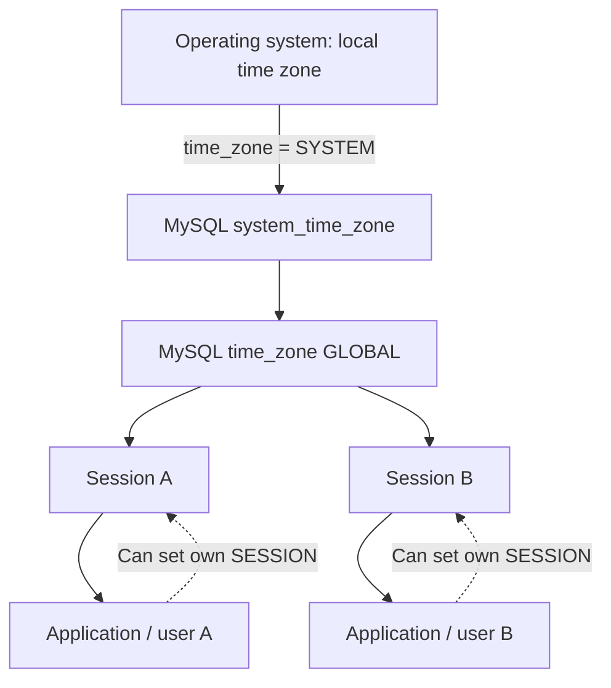

# Operating System, Server, and Session Time Zones

## Objectives

After this lesson, you can:

- Distinguish the operating system time zone, MySQL Server time zone, and individual connection session time zones.
- Inspect the `system_time_zone` and `time_zone` variables at GLOBAL and SESSION scopes.
- Configure UTC or named time zones for the server and sessions.
- Understand how MySQL handles `TIMESTAMP`, `DATETIME`, date/time functions, and Unix timestamps with respect to time zones.
- Recognize the role of timezone tables, Daylight Saving Time (DST) rules, and time zones in applications.
- Design connection pooling and operational practices that avoid time drift, double conversion, or misrecorded timestamps.

## 1. Why Must Time Zones Be Managed Across Multiple Layers?

An application may run on a server in one country, MySQL on a server in another country, and users may connect from many time zones. If components do not share a consistent interpretation of time, the same event can display as different clock times, daily reports can shift, or scheduled tasks can execute at the wrong instant.

MySQL involves distinct time zone layers:

1. **Operating system time zone (OS time zone):** the time zone configured on the host running the MySQL process. When MySQL uses `SYSTEM`, it relies on this system time zone.
2. **Server time zone (`time_zone` GLOBAL):** the default setting at the MySQL Server level. It is used to initialize the time zone for new sessions.
3. **Session time zone (`time_zone` SESSION):** the time zone of a specific connection. It affects many date/time functions, how `TIMESTAMP` values are read/written, and conversions within that session.
4. **Application/user time zone:** the time zone an application uses to display times or interpret schedules. It may differ from the MySQL session time zone.



The diagram shows the default relationship. A session can set its own time zone; changing the GLOBAL time zone does not automatically change already-open sessions. The application can also convert timestamps to the user's time zone at the presentation layer.

## 2. Distinguishing system_time_zone and time_zone

### 2.1. system_time_zone

`system_time_zone` is a read-only variable indicating the system time zone detected by MySQL when the server starts. Its value is typically an abbreviation or time zone name supplied by the operating system, such as `UTC`, `ICT`, or a similar platform-dependent string.

This variable reflects system state; it is not where you configure an application's session time zone. You cannot change it with `SET GLOBAL system_time_zone = ...`.

### 2.2. time_zone at GLOBAL Scope

`@@GLOBAL.time_zone` is the default time zone of the MySQL Server. Its value is typically `SYSTEM` if the server uses the OS time zone, or an explicitly configured offset/time zone name.

The GLOBAL value serves as the default for new connections. If GLOBAL is changed, existing sessions retain their current SESSION values.

### 2.3. time_zone at SESSION Scope

`@@SESSION.time_zone` determines the time zone of the current connection. An application may set a session to UTC immediately after borrowing a connection from the pool, whereas a reporting tool may use a business time zone to run daily queries.

Inspect all three values:

```sql
SELECT
    @@system_time_zone AS os_time_zone_seen_by_mysql,
    @@GLOBAL.time_zone AS server_time_zone,
    @@SESSION.time_zone AS session_time_zone;
```

Example output:

| Variable | Sample Value | Meaning |
|---|---|---|
| `system_time_zone` | `ICT` | MySQL detected the operating system time zone at startup |
| `@@GLOBAL.time_zone` | `SYSTEM` | Server inherits its default from the OS time zone |
| `@@SESSION.time_zone` | `SYSTEM` | Current session uses the system default |

If `@@GLOBAL.time_zone` is `+00:00`, new sessions typically inherit `+00:00` unless the application overrides it. `system_time_zone` may still be a local time zone; the two variables do not need to match.

## 3. Checking Time Zones on the Operating System and MySQL

### 3.1. Checking the Operating System

On Linux, inspect with:

```bash
timedatectl
date
```

On Windows, use:

```powershell
tzutil /g
Get-Date
```

These commands show the OS time zone and clock in the environment where the command runs. If MySQL runs inside a container, VM, or dedicated host, inspect the exact environment hosting the MySQL process; the time zone on an administrator's laptop says nothing about the database server's time zone.

### 3.2. Checking Variables and Current Time in MySQL

```sql
SELECT
    NOW() AS session_now,
    UTC_TIMESTAMP() AS utc_now,
    CURRENT_TIMESTAMP() AS current_timestamp_value,
    @@system_time_zone AS system_time_zone,
    @@GLOBAL.time_zone AS global_time_zone,
    @@SESSION.time_zone AS session_time_zone;
```

`NOW()` and `CURRENT_TIMESTAMP()` return the time in the SESSION time zone. `UTC_TIMESTAMP()` returns UTC time. If the two values differ, check which time zone the session is using before concluding that the server clock is wrong.

You can inspect the variables individually:

```sql
SHOW GLOBAL VARIABLES LIKE 'time_zone';
SHOW SESSION VARIABLES LIKE 'time_zone';
SHOW GLOBAL VARIABLES LIKE 'system_time_zone';
```

`system_time_zone` is read-only, so querying it with `SHOW` is purely observational.

### 3.3. Do Not Rely Only on Abbreviations

Abbreviations such as `CST`, `IST`, or `BST` can be ambiguous because they are used in multiple regions with different offsets or DST rules. When geographic rules are required, prefer IANA time zone names such as `Asia/Ho_Chi_Minh`, `Asia/Tokyo`, or `America/New_York`.

A fixed offset like `+07:00` only represents a constant shift from UTC at all times. It contains no history or seasonal transition rules for a region. For places with DST, an IANA name is more important than a fixed offset when converting historical or future dates and times.

## 4. Configuring Time Zone at the Server Level

### 4.1. Configuring UTC Default in the Configuration File

For self-managed servers, you can configure the `default-time-zone` option in `my.cnf` or `my.ini`. Example:

```ini
[mysqld]
default-time-zone = '+00:00'
```

After making the change, apply it following your environment's operational procedure; depending on version and deployment, a server restart may be required. For managed database services, use the configuration mechanism supported by your provider.

UTC is a useful default for systems storing event instants because it has no DST. The application can convert UTC to the user's time zone when displaying it.

### 4.2. Changing GLOBAL While the Server Is Running

If dynamic modification is allowed and the account holds the required administrative privilege, you can run:

```sql
SET GLOBAL time_zone = '+00:00';
```

This statement changes the default for sessions created afterward. It does not change `@@SESSION.time_zone` for the current connection or already-open connections.

For example, after changing GLOBAL, inspect:

```sql
SELECT
    @@GLOBAL.time_zone AS global_time_zone,
    @@SESSION.time_zone AS current_session_time_zone;
```

The two values can differ. To change the current session, you must set SESSION separately.

### 4.3. Persisting Configuration Across Restarts

`SET GLOBAL` normally changes runtime state only. To keep settings across server restarts, declare them in the configuration file or use a persistent configuration mechanism supported by your version. MySQL 8.0 provides `SET PERSIST` for eligible variables:

```sql
SET PERSIST time_zone = '+00:00';
```

Use `SET PERSIST` only after verifying version, privileges, variable persistability, and configuration management policy. Environments using configuration management or cloud services should store changes in the canonical configuration source to prevent being overwritten on the next deployment.

### 4.4. Configuring with a Named Time Zone

The server can use a named time zone such as `Asia/Ho_Chi_Minh` if timezone tables are loaded and that name exists:

```sql
SET GLOBAL time_zone = 'Asia/Ho_Chi_Minh';
```

Named time zones support historical rules and DST. However, for multi-region applications, it is usually better to keep sessions processing event data in UTC and convert to local time zones in the application layer or intentionally in reporting queries.

## 5. Configuring Time Zone at the Session Level

### 5.1. Setting the Session to UTC

To have the current session use UTC:

```sql
SET SESSION time_zone = '+00:00';
```

Or the equivalent shorthand in the current session:

```sql
SET time_zone = '+00:00';
```

Verify:

```sql
SELECT
    @@SESSION.time_zone,
    NOW() AS now_in_session,
    UTC_TIMESTAMP() AS utc_now;
```

When the session is in UTC, `NOW()` and `UTC_TIMESTAMP()` normally yield the same instant, though data-type formatting may differ. `SET SESSION` affects only the connection executing the statement.

### 5.2. Setting the Session to a Business Time Zone

For example, a report that groups events by local date in Vietnam:

```sql
SET SESSION time_zone = 'Asia/Ho_Chi_Minh';

SELECT
    CURDATE() AS local_business_date,
    NOW() AS local_session_time,
    UTC_TIMESTAMP() AS utc_time;
```

If only a fixed UTC+7 offset is needed, `'+07:00'` can be used. However, `Asia/Ho_Chi_Minh` expresses the geographic region more clearly and is managed by timezone tables. Do not use a fixed offset to represent a region whose DST rules change over time.

### 5.3. Sessions in a Connection Pool

A connection pool reuses physical connections. If request A executes `SET SESSION time_zone = 'Asia/Ho_Chi_Minh'` and returns the connection to the pool, request B might receive that same connection with its session time zone still set to Vietnam.

To prevent state leakage between requests:

- Set a fixed time zone when connections are created or during pool initialization.
- If each request needs a different time zone, set it explicitly on every checkout and restore state before returning the connection to the pool.
- Configure the pool to reset session state if supported by the driver/pool and verify the actual behavior.
- Do not assume closing a JDBC `Connection` object always closes the physical connection; with a pool, closing typically returns the connection to the pool.

A common policy is for all application connections to use UTC. When displaying dates/times to users, the application converts from UTC using a time library with a timezone database. This avoids having requests continually mutate session time zones.

## 6. How Does MySQL Handle TIMESTAMP and DATETIME?

Both types can store dates and times, yet their time zone behavior differs.

| Type | How It Stores and Reads | Converted by Session Timezone? | Used For |
|---|---|---|---|
| `TIMESTAMP` | MySQL converts from session timezone to UTC on write; converts from UTC to session timezone on read | Yes | An absolute instant such as payment time, login time, or event creation |
| `DATETIME` | Stores date/time components as provided, without automatic timezone conversion | No | Local wall-clock time, business-defined times, or values normalized under a separate convention |
| `DATE` | Stores a calendar date, with no time component | No | Date of birth, invoice date, or business date |

### 6.1. TIMESTAMP Converts by Session

Example:

```sql
CREATE TABLE timestamp_demo (
    event_id BIGINT UNSIGNED NOT NULL AUTO_INCREMENT,
    occurred_at TIMESTAMP NOT NULL,
    PRIMARY KEY (event_id)
) ENGINE = InnoDB;

SET SESSION time_zone = '+00:00';

INSERT INTO timestamp_demo (occurred_at)
VALUES ('2026-06-01 03:00:00');

SELECT occurred_at
FROM timestamp_demo;
```

Then switch the session to UTC+7:

```sql
SET SESSION time_zone = '+07:00';

SELECT occurred_at
FROM timestamp_demo;
```

MySQL displays the same instant in two different local times. The stored instant does not change; the displayed representation changes according to the session timezone.

### 6.2. DATETIME Does Not Auto-Convert

```sql
CREATE TABLE datetime_demo (
    event_id BIGINT UNSIGNED NOT NULL AUTO_INCREMENT,
    scheduled_local DATETIME NOT NULL,
    PRIMARY KEY (event_id)
) ENGINE = InnoDB;

SET SESSION time_zone = '+00:00';

INSERT INTO datetime_demo (scheduled_local)
VALUES ('2026-06-01 10:00:00');

SET SESSION time_zone = '+07:00';

SELECT scheduled_local
FROM datetime_demo;
```

The value `10:00:00` is still read as `10:00:00`. MySQL does not know whether this is 10:00 UTC or 10:00 in Vietnam. If `DATETIME` is used to store UTC instants, the application must maintain the convention that every value in the column is UTC and never interpret it as local time.

### 6.3. TIMESTAMP Limits

`TIMESTAMP` has a bounded time range, traditionally from 1970 to early 2038 UTC in mainstream MySQL versions. `DATETIME` has a much wider date/time range. When storing calendar dates or schedules outside `TIMESTAMP`'s range, consider `DATETIME` together with a separately stored timezone convention.

Do not choose `TIMESTAMP` solely because you want MySQL to auto-convert. Determine whether the data represents an absolute instant or a local calendar time.

## 7. Timezone-Dependent Date and Time Functions

Several functions use the session timezone:

| Function | General Behavior |
|---|---|
| `NOW()` / `CURRENT_TIMESTAMP()` | Current instant in the session timezone |
| `CURDATE()` / `CURRENT_DATE()` | Current date in the session timezone |
| `LOCALTIME()` / `LOCALTIMESTAMP()` | Equivalent to current-time functions in the session timezone |
| `UTC_TIMESTAMP()` | Current instant in UTC |
| `UTC_DATE()` | Current date in UTC |
| `UNIX_TIMESTAMP()` with no arguments | Unix timestamp of the current instant |
| `UNIX_TIMESTAMP(date)` | Interprets the date/time argument in the session timezone and converts to a Unix timestamp |
| `FROM_UNIXTIME(value)` | Converts a Unix timestamp into a date/time in the session timezone |

Example:

```sql
SET SESSION time_zone = '+07:00';

SELECT
    NOW() AS session_now,
    CURDATE() AS session_date,
    UTC_TIMESTAMP() AS utc_now,
    UTC_DATE() AS utc_date,
    FROM_UNIXTIME(1780275600) AS local_from_epoch;
```

The result of `FROM_UNIXTIME()` depends on the session timezone. If the same Unix timestamp is queried in two sessions with different timezones, the displayed date/time may differ while still representing the same instant.

`UNIX_TIMESTAMP('2026-06-01 10:00:00')` also depends on `@@SESSION.time_zone` because the input string contains no offset. If you need to interpret a time with an offset or a timezone different from the session, convert it explicitly before calling the function.

## 8. Converting with CONVERT_TZ and Timezone Tables

### 8.1. Using CONVERT_TZ

The `CONVERT_TZ(datetime, from_tz, to_tz)` function converts a date/time value from a source timezone to a target timezone:

```sql
SELECT CONVERT_TZ(
    '2026-06-01 10:00:00',
    'Asia/Ho_Chi_Minh',
    'UTC'
) AS utc_value;
```

The corresponding result is 03:00 UTC if the input is 10:00 in Vietnam on the example date. The function returns `NULL` if an argument is invalid or MySQL does not recognize the timezone given the available timezone data.

### 8.2. Why Are Timezone Tables Needed?

MySQL uses timezone tables in the `mysql` system database to handle region names like `Asia/Ho_Chi_Minh` or `America/New_York`. If these tables are not loaded or are outdated, conversions using named timezones may return `NULL` or apply stale rules.

You can check available timezone names:

```sql
SELECT Name
FROM mysql.time_zone_name
WHERE Name IN ('UTC', 'Asia/Ho_Chi_Minh', 'America/New_York');
```

Read access to the `mysql` database may be restricted. A practical test is also helpful:

```sql
SELECT CONVERT_TZ(
    '2026-01-01 12:00:00',
    'UTC',
    'Asia/Ho_Chi_Minh'
) AS timezone_test;
```

If the result is `NULL`, check timezone tables, timezone names, and required privileges. Do not replace region names with fixed offsets if the business needs historical rules or DST.

### 8.3. Loading and Updating Timezone Tables

On Unix-like systems, MySQL provides the `mysql_tzinfo_to_sql` utility to load OS zoneinfo data into MySQL's timezone tables. General example:

```bash
mysql_tzinfo_to_sql /usr/share/zoneinfo | mysql -u root -p mysql
```

The zoneinfo path and deployment steps depend on the operating system. On Windows or managed database services, follow platform/version-specific instructions; do not assume the command above works verbatim.

After loading or updating timezone tables, verify with `CONVERT_TZ()` and consider restarting the server per MySQL guidance if needed so components use the updated data consistently. Updating timezone data is a periodic operational task because national timezone rules can change.

## 9. Daylight Saving Time (DST) and Local Time

Some regions adjust clocks seasonally. When moving to summer time, a local time interval may not exist; when returning to standard time, a one-hour interval may occur twice.

For example, an appointment stored as `01:30` in a DST region can be ambiguous on the fall-back day: two different UTC instants both display as 01:30. Conversely, 02:30 during the jump from 02:00 to 03:00 may not exist.

Therefore, for appointments or schedules based on local time:

- Store the local calendar time and the IANA timezone name, e.g. `America/New_York`.
- Define a policy for ambiguous or nonexistent times: pick the first/last occurrence, reject, or shift to the next valid time.
- Once a schedule is confirmed as a specific instant, also store the UTC instant for consistent execution.
- Do not store only an offset such as `-05:00` if future DST rules must be applied.

For events that have already occurred, storing UTC instants is convenient for cross-timezone reconciliation. For future events tied to local wall-clock time, preserve the geographic timezone as well because statutory rules can change.

## 10. Time Zones in Java Applications

MySQL is only one part of the pipeline. A Java application also has a JVM default timezone, driver configuration, and data-type conventions.

Common Java types:

| Java Type | Meaning | Use When |
|---|---|---|
| `Instant` | An absolute instant on the UTC timeline | Payment time, event log, record creation time |
| `OffsetDateTime` | Date and time with a specific UTC offset | Preserving an offset sent by a client or exchanged via API |
| `ZonedDateTime` | Date and time tied to a `ZoneId` and timezone rules | Local schedules, times subject to DST |
| `LocalDateTime` | Date and time without offset/timezone | Local calendar time not yet resolved to an instant |
| `LocalDate` | Calendar date without time | Date of birth, accounting date, or holiday |

Do not map every MySQL `DATETIME` value to `Instant` without a convention. `DATETIME` itself contains no timezone. If the application treats `DATETIME` as UTC, document that convention clearly in the schema and code.

Example converting local time to an instant in Java:

```java
import java.time.LocalDateTime;
import java.time.ZoneId;
import java.time.ZonedDateTime;
import java.time.Instant;

LocalDateTime localAppointment = LocalDateTime.of(2026, 6, 1, 10, 0);
ZoneId zone = ZoneId.of("Asia/Ho_Chi_Minh");
ZonedDateTime zonedAppointment = localAppointment.atZone(zone);
Instant appointmentInstant = zonedAppointment.toInstant();
```

For DST regions, `atZone()` applies Java's default rule when encountering ambiguous or nonexistent times. If the business requires users to choose how to handle them, inspect `ZoneRules.getValidOffsets()` and `ZoneRules.getTransition()` to detect special cases instead of silently accepting defaults.

With JDBC, verify the behavior of your driver version when reading/writing `TIMESTAMP`, `DATETIME`, `Timestamp`, and `Calendar`. You can keep the session timezone at UTC and convert with `java.time` in the application tier. Do not convert in Java while also letting the server interpret the same value in a different timezone without an explicit convention.

## 11. Time Standardization Workflow for MySQL Systems

An operationally sound policy for multi-region systems typically includes:

1. **Clock synchronization:** use NTP or platform time sync so the OS clock does not drift significantly.
2. **Set server default:** use UTC (`+00:00`) unless there is a special requirement for the server to follow local time.
3. **Set application sessions:** keep the connection pool at UTC and verify `@@SESSION.time_zone` on connection creation.
4. **Choose column types:** use `TIMESTAMP` for instants within the supported range; use `DATETIME` for calendar times or when a wider date range is needed with a separate timezone convention.
5. **Store business timezone:** for local schedules, store `ZoneId` separately alongside the calendar time or confirmed instant.
6. **Display in the application:** convert UTC instants to the user's timezone at the presentation layer.
7. **Update timezone tables:** maintain IANA data in MySQL and the Java runtime on an operational schedule.
8. **Test DST:** test transition days, repeated hours, and skipped hours in supported regions.

Not every system is required to use `TIMESTAMP` for every column. What matters is determining whether the data represents an instant or a calendar time, documenting the convention clearly, and ensuring all layers follow it.

## 12. Common Issues and Troubleshooting

| Symptom | Possible Cause | How to Check |
|---|---|---|
| Time in MySQL differs from application host | OS timezone, server timezone, or session timezone differs | Compare `system_time_zone`, GLOBAL/SESSION `time_zone`, `NOW()`, and `UTC_TIMESTAMP()` |
| Existing connection keeps old time after `SET GLOBAL time_zone` | GLOBAL is only the default for new sessions | Check `@@SESSION.time_zone`; set SESSION or open a new connection |
| Same TIMESTAMP shows different hours on two clients | Two sessions use different timezones | Check `@@SESSION.time_zone`; compare the UTC instant |
| DATETIME does not change when timezone changes | DATETIME does not auto-convert by session | Confirm data convention and convert explicitly in application or SQL |
| `CONVERT_TZ()` returns NULL with region name | Timezone tables not loaded, unknown name, or invalid arguments | Inspect `mysql.time_zone_name` and test conversion with a confirmed zone |
| Daily report shifted by one day | Grouping by UTC when business requires local day, or vice versa | Confirm business timezone before using `DATE()`/`DATE_FORMAT()` |
| Request in pool gets different time than previous request | Session timezone was changed and not reset | Reset timezone on checkout or fix pool connections to UTC |
| Future schedule runs at wrong time across DST change | Stored only offset or DATETIME without ZoneId | Store IANA timezone name and handle ambiguous/nonexistent times |

## 13. Quick Diagnostic Query Set

You can use the following queries to capture the timezone state of a connection:

```sql
-- Operating system, server default, and current session timezone
SELECT
    @@system_time_zone AS system_time_zone,
    @@GLOBAL.time_zone AS global_time_zone,
    @@SESSION.time_zone AS session_time_zone;

-- Current time in session and UTC
SELECT
    NOW() AS session_now,
    UTC_TIMESTAMP() AS utc_now,
    TIMEDIFF(NOW(), UTC_TIMESTAMP()) AS displayed_difference;

-- Check timezone tables and region name conversion
SELECT Name
FROM mysql.time_zone_name
WHERE Name IN ('UTC', 'Asia/Ho_Chi_Minh');

SELECT CONVERT_TZ(
    '2026-06-01 10:00:00',
    'Asia/Ho_Chi_Minh',
    'UTC'
) AS converted_utc;

-- Verify date/time column types in the current schema
SELECT
    TABLE_NAME,
    COLUMN_NAME,
    DATA_TYPE,
    COLUMN_TYPE,
    DATETIME_PRECISION
FROM information_schema.COLUMNS
WHERE TABLE_SCHEMA = DATABASE()
  AND DATA_TYPE IN ('date', 'datetime', 'timestamp', 'time')
ORDER BY TABLE_NAME, ORDINAL_POSITION;
```

`TIMEDIFF(NOW(), UTC_TIMESTAMP())` compares two displayed values, useful for observing the offset at query time; do not use it to infer DST rules or replace geographic timezone names. When checking timezone tables, read access to the `mysql` database may be restricted; you can test with `CONVERT_TZ()` if you lack permission to query system tables.

## 14. Conclusion

The operating system time zone, MySQL GLOBAL time zone, and SESSION time zone are three distinct layers. `SYSTEM` causes the server to rely on the OS timezone; GLOBAL provides the default for new sessions; SESSION governs how the current connection interprets many date/time functions and `TIMESTAMP`.

For business systems, prefer a convention of storing instants in UTC, keeping application sessions in UTC, and converting to the user's timezone on display. Use `DATETIME` for calendar times when needed, store `ZoneId` separately for local schedules, keep timezone tables updated, and test DST edge cases. A clear policy across OS, server, session, and application keeps temporal data consistent across environments and regions.
