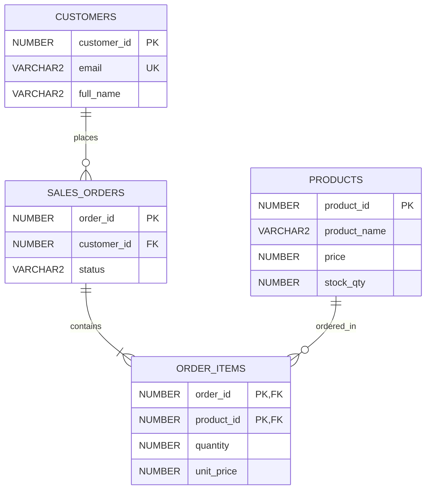
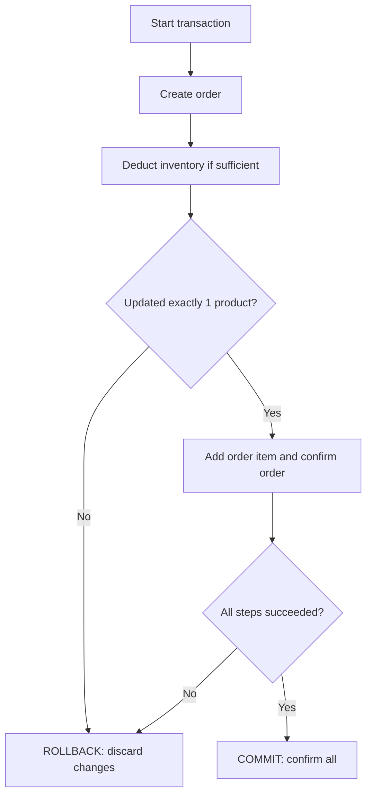

# Relational Storage, Data Integrity, and Transaction Processing in Oracle

A sales system does not merely need to **store data**; it must also answer three questions: which entity does the data belong to and how do entities relate; how do we prevent invalid data; and what happens when multiple users modify data concurrently or an operation fails partway through? These are the foundational problems that a relational database management system like **Oracle Database** solves.

After this lesson, you will be able to:

- Translate business requirements into tables, keys, and one-to-many and many-to-many relationships.
- Distinguish entity integrity, referential integrity, domain integrity, and cross-table business rules.
- Use transactions with `COMMIT`, `ROLLBACK`, and `SAVEPOINT` to group multiple SQL operations into a single unit of work.
- Explain why row locking, read consistency, and Oracle's `UNDO`/`REDO` mechanisms matter when multiple sessions operate concurrently.

## 1. From Storage Needs to the Relational Model

Suppose a store manages customers, products, orders, and line items within each order. The system must satisfy the following:

1. A customer can place multiple orders; each order belongs to exactly one customer.
2. An order can contain multiple products; the same product can appear across many different orders.
3. It must be impossible to create an order for a nonexistent customer, sell a negative quantity, or let inventory drop below zero.
4. When confirming an order, creating the order, recording the line items, and deducting inventory must **succeed together**, or nothing should be persisted if an error occurs.
5. Two people buying the last unit at the same time must not cause the system to oversell available stock.

If everything is stored in a single table like `customer_name, customer_email, order_id, product_name, quantity, stock_qty`, customer names and emails are repeated across many rows; product details are repeated for every order; and updating one row while missing others creates inconsistent data. Storing a list of products in one cell such as `"101:2,102:1"` also makes searching, foreign key validation, and calculating totals far more complicated.

The relational model separates **entities** and links them with **keys**:



In the diagram, `CUSTOMERS` and `SALES_ORDERS` have a **1–N** relationship. The **N–N** relationship between orders and products is modeled via the junction table `ORDER_ITEMS`, where each row holds one order–product pair and its corresponding quantity.

| Concept | Meaning | Example |
| --- | --- | --- |
| Table | A set of records sharing the same structure | `PRODUCTS` |
| Row | One record of an entity | Product ID `101` |
| Column | A typed attribute | `stock_qty NUMBER(12)` |
| Primary key | Unique identifier for each row, never `NULL` | `product_id` |
| Foreign key | Value referencing a valid key in another table | `sales_orders.customer_id` |
| Unique key | Prevents duplicate values under declared rules | `customers.email` |

This separation is also the intuition behind **data normalization**: each kind of fact is managed in its appropriate place. For example, a product's current name lives in `PRODUCTS`, while the **unit price at purchase time** must be recorded in `ORDER_ITEMS` so past orders do not change when current catalog prices change. Normalization does not forbid all data duplication; a snapshot carrying historical business meaning remains necessary data.

## 2. Implementing Relationships with Oracle SQL

The example below uses `NUMBER` for quantities and money, `VARCHAR2` for strings, and `TIMESTAMP WITH TIME ZONE` for timestamps. Identifier keys are declared with `GENERATED BY DEFAULT AS IDENTITY`, allowing Oracle to auto-generate numbers when an `INSERT` omits the key column. To keep the examples easy to follow, the sample data explicitly assigns fixed IDs.

```sql
CREATE TABLE customers (
    customer_id NUMBER(12) GENERATED BY DEFAULT AS IDENTITY,
    full_name   VARCHAR2(120 CHAR) NOT NULL,
    email       VARCHAR2(255 CHAR) NOT NULL,
    CONSTRAINT pk_customers PRIMARY KEY (customer_id),
    CONSTRAINT uq_customers_email UNIQUE (email)
);

CREATE TABLE products (
    product_id   NUMBER(12) GENERATED BY DEFAULT AS IDENTITY,
    product_name VARCHAR2(200 CHAR) NOT NULL,
    price        NUMBER(12, 2) NOT NULL,
    stock_qty    NUMBER(12) DEFAULT 0 NOT NULL,
    CONSTRAINT pk_products PRIMARY KEY (product_id),
    CONSTRAINT ck_products_price CHECK (price >= 0),
    CONSTRAINT ck_products_stock CHECK (stock_qty >= 0)
);

CREATE TABLE sales_orders (
    order_id    NUMBER(12) GENERATED BY DEFAULT AS IDENTITY,
    customer_id NUMBER(12) NOT NULL,
    status      VARCHAR2(20 CHAR) DEFAULT 'CREATED' NOT NULL,
    created_at  TIMESTAMP WITH TIME ZONE DEFAULT SYSTIMESTAMP NOT NULL,
    CONSTRAINT pk_sales_orders PRIMARY KEY (order_id),
    CONSTRAINT fk_orders_customer FOREIGN KEY (customer_id)
        REFERENCES customers (customer_id),
    CONSTRAINT ck_orders_status
        CHECK (status IN ('CREATED', 'CONFIRMED', 'CANCELLED'))
);

CREATE TABLE order_items (
    order_id   NUMBER(12) NOT NULL,
    product_id NUMBER(12) NOT NULL,
    quantity   NUMBER(12) NOT NULL,
    unit_price NUMBER(12, 2) NOT NULL,
    CONSTRAINT pk_order_items PRIMARY KEY (order_id, product_id),
    CONSTRAINT fk_items_order FOREIGN KEY (order_id)
        REFERENCES sales_orders (order_id),
    CONSTRAINT fk_items_product FOREIGN KEY (product_id)
        REFERENCES products (product_id),
    CONSTRAINT ck_items_quantity CHECK (quantity > 0),
    CONSTRAINT ck_items_price CHECK (unit_price >= 0)
);

-- Indexes to support finding orders by customer and line items by product.
CREATE INDEX ix_orders_customer ON sales_orders (customer_id);
CREATE INDEX ix_items_product ON order_items (product_id);
```

Key takeaways from this schema:

- **The primary key** of `ORDER_ITEMS` is the pair `(order_id, product_id)`: the same product appears at most once per order. If the business allows multiple lines for the same product with different prices or promotions, use `order_item_id` or `line_no` as the key instead.
- **Foreign keys** force every order to reference an existing customer, and every line item to reference both an existing order and an existing product.
- **`NOT NULL` and `CHECK`** constrain the value domain. `CHECK (stock_qty >= 0)` prevents negative inventory even if another program executes raw SQL directly.
- **Indexes** speed up lookups and can reduce contention when deleting or updating parent rows referenced by foreign keys. Oracle does not automatically create indexes on all foreign keys; you must evaluate them against actual queries and workloads. The primary key index `(order_id, product_id)` starts with `order_id`, so it is not equally optimal for queries filtering solely on `product_id`.
- **Foreign keys do not delete child rows by default.** Oracle lets you specify `ON DELETE CASCADE` or `ON DELETE SET NULL` when appropriate. For order history, hard deletes are usually discouraged in favor of status flags rather than cascading deletes.

`CREATE TABLE` and `CREATE INDEX` are DDL statements. In Oracle, DDL issues an **implicit commit** for any active transaction before executing, and a successful DDL statement is itself committed. Therefore, table structures should be created during a separate deployment step rather than mixed into the middle of DML sequences that might need to be rolled back.

### Initial Data and JOIN Queries

```sql
INSERT INTO customers (customer_id, full_name, email)
VALUES (1, 'An Nguyen', 'an@example.com');

INSERT INTO products (product_id, product_name, price, stock_qty)
VALUES (101, 'Introductory Oracle Book', 150000, 5);

INSERT INTO products (product_id, product_name, price, stock_qty)
VALUES (102, 'SQL Handbook', 80000, 10);

COMMIT;
```

Once orders exist, you can join the tables to see who bought what, in what quantity, and at what historical price:

```sql
SELECT o.order_id,
       c.full_name,
       p.product_name,
       i.quantity,
       i.unit_price,
       i.quantity * i.unit_price AS line_total
FROM sales_orders o
JOIN customers c   ON c.customer_id = o.customer_id
JOIN order_items i ON i.order_id = o.order_id
JOIN products p    ON p.product_id = i.product_id
WHERE o.order_id = 1001;
```

`JOIN` does not physically copy data between tables; it combines rows based on key conditions at query time. The `INNER JOIN` in the example returns only rows with matching relationships; if you need to display orders that do not yet have line items, consider `LEFT JOIN`.

## 3. Layers of Data Integrity

**Data integrity** means that the state stored in the database satisfies all defined invariants. You should never assume every operation sent to the database is valid just because the UI validated the input.

| Integrity Layer | Enforcement Mechanism | Consequence if Omitted |
| --- | --- | --- |
| Entity | `PRIMARY KEY`, `NOT NULL` | Two rows cannot be distinguished, or identifiers are missing |
| Referential | `FOREIGN KEY` | An order points to a nonexistent customer |
| Domain | Data types, `CHECK`, `NOT NULL` | Negative prices, zero quantities, invalid statuses |
| Business uniqueness | `UNIQUE` or appropriate unique index | Two accounts share the same email where uniqueness is required |
| Cross-row / cross-table | Transactions, locking, service logic, or specialized mechanisms | Inventory is deducted without confirming the order |

For example, the following statements are rejected by Oracle according to the declared constraints:

```sql
-- No customer_id = 999 exists: foreign key violation.
INSERT INTO sales_orders (order_id, customer_id)
VALUES (1999, 999);

-- Stock cannot be negative: CHECK constraint violation.
UPDATE products SET stock_qty = -1 WHERE product_id = 101;

-- Duplicate email: UNIQUE constraint violation.
INSERT INTO customers (customer_id, full_name, email)
VALUES (2, 'Binh Tran', 'an@example.com');
```

Each statement above is an **isolated error example**; do not run them as part of a successful order placement transaction. Oracle raises constraint errors such as `ORA-02291` for a missing parent row, `ORA-02290` for a `CHECK` violation, or `ORA-00001` for duplicate unique values. When a DML statement fails, the changes made by that statement alone are rolled back, but prior work in the same session's transaction is **not automatically rolled back in full**. The program must decide whether to `ROLLBACK` the remainder.

Two important limitations:

1. A `CHECK` constraint in Oracle evaluates expressions against the current row's data and cannot directly query another table to enforce, for example, that total sold quantity does not exceed inventory. Multi-table invariants require transactional operation design and synchronized update rules.
2. A `CHECK` expression accepts `UNKNOWN` when a column value is `NULL`; if an attribute is mandatory, declare `NOT NULL` explicitly. With `VARCHAR2`, Oracle currently treats the empty string `''` as `NULL`, which is important to remember when handling input data.

Normally, Oracle checks constraints immediately as each statement executes (*immediate*). Some constraints can be **declared up front** as `DEFERRABLE` to postpone checking until `COMMIT`; this is a specialized feature for cases where update ordering across related rows requires it, not a reason to defer all validation.

## 4. Why Are Transactions Needed?

Consider purchasing two copies of book `101` when initial inventory is **5**. The workflow consists of: creating order `1001`, deducting stock to **3**, inserting a line item with quantity **2**, and updating the order status to `CONFIRMED`.

If each step is committed independently, a network failure or constraint error on the third step could leave a created order and reduced stock with no order line items. This is a **partial / inconsistent state**: each individual SQL statement may look valid on its own, yet the overall business operation is broken.

A **transaction** groups multiple operations into one logical unit of work. The four ACID properties describe the guarantees the DBMS supports:

| ACID | Practical Meaning in Order Processing |
| --- | --- |
| **Atomicity** | Either the entire sequence of creating the order, deducting stock, and adding line items succeeds, or the changes are rolled back. |
| **Consistency** | State before and after the transaction must satisfy constraints; business logic still needs to be written correctly. |
| **Isolation** | Concurrent sessions must not observe one another's uncommitted changes; the isolation level determines which phenomena can still occur. |
| **Durability** | After `COMMIT` succeeds, Oracle uses logging and recovery mechanisms to preserve confirmed changes across system crashes per database guarantees. |

In Oracle, DML statements such as `INSERT`, `UPDATE`, and `DELETE` remain part of the current transaction until the session issues `COMMIT` or `ROLLBACK`. However, tools or drivers may enable **autocommit**, automatically committing after each statement; transaction boundaries must be explicitly configured at the application tier.



### PL/SQL Transaction Example with Error Handling

Run this example **once** against the sample data from the previous section. In SQL*Plus, SQLcl, or SQL Developer running in script mode, the `/` after the PL/SQL block executes the declared block.

```sql
BEGIN
    INSERT INTO sales_orders (order_id, customer_id, status)
    VALUES (1001, 1, 'CREATED');

    -- The stock_qty >= 2 condition is part of the same UPDATE statement.
    UPDATE products
       SET stock_qty = stock_qty - 2
     WHERE product_id = 101
       AND stock_qty >= 2;

    -- SQL%ROWCOUNT must be checked immediately after this UPDATE.
    IF SQL%ROWCOUNT <> 1 THEN
        RAISE_APPLICATION_ERROR(-20001, 'Product does not exist or insufficient stock');
    END IF;

    INSERT INTO order_items (order_id, product_id, quantity, unit_price)
    VALUES (1001, 101, 2, 150000);

    UPDATE sales_orders
       SET status = 'CONFIRMED'
     WHERE order_id = 1001;

    COMMIT;
EXCEPTION
    WHEN OTHERS THEN
        ROLLBACK;
        RAISE;
END;
/
```

After a successful run, order `1001` is confirmed with one line item of quantity 2, and `products.stock_qty` for product `101` drops from 5 to 3. If the inventory check fails or any unhandled error occurs, the `EXCEPTION` branch runs `ROLLBACK`: no partial order is left behind. Calling `RAISE` rethrows the error to the caller so the application knows the request did not succeed.

The block above illustrates a **standalone transaction**. In real applications, the service layer or transaction manager typically owns `COMMIT`/`ROLLBACK`; avoid embedding arbitrary commits inside procedures called within a larger transaction, because committing terminates the session's entire active transaction.

### `SAVEPOINT` for Partial Rollback

```sql
SAVEPOINT before_optional_change;

UPDATE products
   SET price = price + 1000
 WHERE product_id = 102;

ROLLBACK TO SAVEPOINT before_optional_change;

-- Changes in the same transaction prior to the SAVEPOINT remain pending commit.
COMMIT;
```

`ROLLBACK TO SAVEPOINT` reverts to a marker inside the **current transaction**, whereas an unqualified `ROLLBACK` undoes all uncommitted work. Neither operation can undo a transaction that has already been committed. `COMMIT` and `ROLLBACK` end the current transaction and release the corresponding transaction locks.

## 5. Concurrent Buyers: Correctness Under Contention

Another issue arises even when every request runs inside a transaction: **two concurrent transactions** can act on the same previously read value. For instance, only 3 units remain in stock and two customers each try to buy 2.

A dangerous anti-pattern is: read `stock_qty` into the application, compute `new_stock = old_stock - 2`, and overwrite via `UPDATE products SET stock_qty = :new_stock WHERE product_id = 101`. Both sessions read 3 and both write 1. The database ends up with 1 remaining even though two orders totaling 4 units were accepted: a classic **lost update** or non-atomic check-then-act bug.

The solution in our example uses a **conditional update in the database**:

```sql
UPDATE products
   SET stock_qty = stock_qty - :requested_qty
 WHERE product_id = :product_id
   AND stock_qty >= :requested_qty;
```

The application checks the affected row count: `1` means the required stock was reserved for that row; `0` means the product does not exist or inventory is insufficient. If multiple products must be updated, all updates and order line inserts must reside within the **same transaction**; if any step fails, roll back the entire order. Products should also be accessed in a consistent order to reduce deadlock risk on multi-item orders.

Possible timeline in Oracle (assuming initial `stock_qty = 3`):

| Time | Session A – buys 2 | Session B – buys 2 |
| --- | --- | --- |
| T1 | `UPDATE ... stock_qty >= 2` updates 3 → 1, acquires row lock | — |
| T2 | Not yet committed (`COMMIT`) | Also executes `UPDATE ... stock_qty >= 2`, waits on A's lock |
| T3 | `COMMIT`; value 1 becomes committed | Resumes and re-evaluates predicate against the committed state |
| T4 | Order A succeeds | Predicate `stock_qty >= 2` fails, updates 0 rows; B must roll back / report out of stock |

Oracle uses **row-level locking** for updates and **multi-version read consistency**. A plain `SELECT` does not wait for write locks to read committed data matching its snapshot; an `UPDATE` on the same row, however, must coordinate via locks. This reduces read blocking, but **does not automatically make read–compute–write application code safe**.

When business logic must read state and process it before updating, explicit locking can be considered:

```sql
SELECT stock_qty
FROM products
WHERE product_id = 101
FOR UPDATE;

-- Then validate/update in the same transaction and COMMIT or ROLLBACK.
```

`SELECT ... FOR UPDATE` locks the selected rows until the transaction ends; use it only when necessary because it forces other write transactions to wait. Conditional updates are usually cleaner and better suited for simple inventory deduction.

## 6. Isolation Levels, UNDO, and REDO in Oracle

Oracle defaults to **`READ COMMITTED`**. Each query receives a consistent view of committed data as of the start of that statement; a second query within the same transaction can see newly committed changes from another session. Thus Oracle prevents uncommitted reads (*dirty reads*), yet under `READ COMMITTED` you can still encounter **non-repeatable reads** or differing result sets across two queries (*phantoms*) when another transaction commits in between.

Oracle also supports `SERIALIZABLE` and `READ ONLY` modes at the transaction level:

```sql
-- Place at the start of a transaction, before any DML statements in that transaction.
SET TRANSACTION ISOLATION LEVEL SERIALIZABLE;

-- Subsequent queries and valid DML in the transaction use the transaction snapshot.
-- Must COMMIT or ROLLBACK when done.
```

`SERIALIZABLE` provides a transaction-consistent snapshot, but **does not guarantee that all competing transactions automatically succeed**. When a write conflict occurs, Oracle can raise `ORA-08177: can't serialize access for this transaction`; the application must roll back and decide whether to retry the **entire** transaction in a controlled manner. Oracle does not have a separate `REPEATABLE READ` level like some other DBMSs. `SET TRANSACTION READ ONLY` is useful for a batch of reports that need a stable snapshot without executing DML.

Two data structures support Oracle's transaction engine:

| Component | Primary Role | Connection to Our Scenario |
| --- | --- | --- |
| **UNDO** | Holds information needed to roll back uncommitted changes and reconstruct older versions for consistent reads | A shopper browsing items reads a valid committed state without seeing another buyer's uncommitted stock deduction |
| **REDO** | Records change vectors required for crash recovery | A committed order can be recovered if the database must recover from a system failure |
| **Row locks** | Coordinates concurrent writes to the same row | Two stock-deduction updates cannot arbitrarily overwrite the same product row |
| **SCN** (*System Change Number*) | Logical timestamp Oracle uses to order changes and ensure snapshot consistency | A query sees data consistent with its exact read point in time |

Do not confuse **UNDO** with **REDO**: UNDO primarily serves rollback and multi-version consistent reads; REDO serves durability and crash recovery. Operational internals also involve data files, the buffer cache, redo logs, the undo tablespace, checkpoints, and system configuration, though application designers must first master transaction boundaries and write contention.

## 7. Limits That Keys Alone Cannot Solve

Even a schema with complete `PRIMARY KEY`, `FOREIGN KEY`, and `CHECK` constraints cannot enforce every business rule:

- **Order total:** `SUM(order_items.quantity * order_items.unit_price)` is computed across multiple rows. If you also store `sales_orders.total_amount`, you need synchronized update rules within the same transaction, or prefer computing it from line items when appropriate. A row-level `CHECK` cannot directly validate a cross-table sum.
- **State transitions:** `CHECK (status IN (...))` only restricts the set of allowed statuses; it does not prevent transitioning backward from `CONFIRMED` to `CREATED`. State and transition rules require business logic, concurrency checks, and potentially optimistic locking.
- **Historical pricing:** A foreign key guarantees that the product exists, not that its price at sale time is preserved. Storing `unit_price` on the line item is a deliberate modeling decision.
- **Error handling and retries:** When a connection drops right at commit time, the application may not know whether the transaction succeeded. A unique business request identifier (*idempotency key*) backed by a `UNIQUE` constraint, plus status lookup logic, prevents duplicate orders on retries.
- **Retention and deletion:** Deleting a customer who has orders is rarely straightforward. Policies for retaining history, anonymizing/deleting personal data, and preserving business state must be designed before choosing `ON DELETE` behavior.

**Database-level checks** and **application-level checks** complement one another: the database protects core invariants regardless of who writes the data, while the application orchestrates workflows, provides user-friendly error messages, and handles context-dependent rules. Never replace a database constraint with an `if` statement in a single API endpoint, because batch jobs, admin tools, or other services can bypass that `if` check.

## 8. Self-Check Questions

1. **Why not store all orders in one table with a column `product_ids = '101,102'`?** Because it breaks single-value-per-cell structure, prevents foreign keys, complicates querying individual line items, and makes enforcing per-product quantities and prices difficult.
2. **Is `CHECK (stock_qty >= 0)` enough to stop two transactions from overselling?** It is not enough to express the relationship with confirmed order quantities. You need a conditional inventory update inside the transaction alongside order creation and row-count checking.
3. **What happens if a third `INSERT` fails after two preceding statements succeeded?** The failed statement is undone, while the two earlier statements may still remain pending commit in the transaction. You must explicitly roll back the transaction when business requirements demand all-or-nothing behavior.
4. **Why can two `SELECT` queries inside one `READ COMMITTED` transaction return different results?** Because each statement takes a committed snapshot corresponding to its own start time.
5. **What is the difference between `ROLLBACK` and `ROLLBACK TO SAVEPOINT`?** The first undoes all uncommitted changes in the transaction; the second undoes changes only back to the named savepoint within that transaction.

### How to Think When Designing a Write Feature

For every write feature—such as "place order," "transfer funds," or "enroll in a course"—identify in order: **entities and relationships**, **mandatory invariants**, **transaction boundaries**, **data subject to concurrent writes**, and **behavior under failures/retries**. Oracle provides tables, keys, constraints, transactions, undo, redo, and locking to implement those decisions. Final data quality depends on combining these mechanisms properly with your application's business rules.
