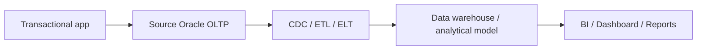

# Distinguishing OLTP, OLAP, and Mixed Workloads in Oracle Database

A sales system must both confirm an order within tens of milliseconds and calculate monthly revenue across millions of rows. Both operations use SQL and may even read the same `ORDERS` table, yet they produce **two very different workloads**. Designing a database purely around table names or `SELECT`/`INSERT` keywords leads to poor choices for indexes, partitioning, compute resources, and deployment architecture.

This lesson distinguishes three workload categories in **Oracle Database**:

- **OLTP (Online Transaction Processing):** short, high-concurrency business transactions requiring consistency and low response times.
- **OLAP (Online Analytical Processing):** reading, aggregating, and analyzing large data volumes to answer business questions.
- **Mixed workload / HTAP (Hybrid Transactional and Analytical Processing):** serving both transactional operations and analytical queries, often with freshness requirements so analytics can support operational decisions.

The goal is to recognize workloads by **access patterns, latency, concurrency, and data freshness requirements**, understand how workloads interfere with one another in Oracle, and choose appropriate data organization and resource strategies.

## 1. What Is a Workload? Why Can't We Classify by SQL Statement Type?

A **workload** is the actual set of queries and transactions running against a database over a period of time, along with their frequency, concurrent users, rows read/written, latency requirements, and resource limits.

Consider the same `ORDERS` table:

```sql
-- Find the 20 most recent orders for a customer.
SELECT order_id, created_at, status
FROM orders
WHERE customer_id = :p_customer_id
ORDER BY created_at DESC, order_id DESC
FETCH FIRST 20 ROWS ONLY;
```

This statement typically belongs to an **OLTP** workload: fetches few rows, executes very frequently, and requires fast UI response.

```sql
-- Monthly order totals over a long date range.
SELECT TRUNC(created_at, 'MM') AS month_begin,
       COUNT(*) AS order_count
FROM orders
WHERE created_at >= :p_from_date
  AND created_at < :p_to_date
GROUP BY TRUNC(created_at, 'MM')
ORDER BY month_begin;
```

The second statement typically belongs to an **OLAP** workload: it may scan many rows, group data, and compute aggregations. Both are `SELECT` statements; the deciding factor is **access pattern and business purpose**, not the SQL keyword.

More examples:

| Business Requirement | Typical Workload Type | Reason |
|---|---|---|
| Deduct inventory and create an order | OLTP | Several small operations must succeed or fail together |
| Check the status of one order by order ID | OLTP | Highly selective lookup requiring low latency |
| Compute 12-month revenue by region and category | OLAP | Scans, joins, and aggregates large numbers of records |
| Generate quarterly financial close reports | OLAP | Prioritizes analytical accuracy; may be long-running |
| Operations screen refreshing every few seconds while orders stream in continuously | Mixed / near-HTAP | Newly committed transactions must appear promptly in aggregations |

**Note on terminology:** "mixed workload" refers to OLTP and OLAP coexisting in one system or environment. **HTAP** specifically emphasizes analyzing transactional data near real time. Not every system that runs both reporting and transactions automatically constitutes an effective HTAP architecture.

## 2. OLTP: Optimized for Short Transactions and Consistency

OLTP serves operations such as logging in, recording payments, placing orders, transferring funds, updating remaining inventory, or changing record statuses.

### 2.1 Identifying Characteristics

- **High concurrency:** hundreds or thousands of sessions may simultaneously process small transactions; exact scale depends on hardware and the application.
- **Few rows read/written per request:** lookups by primary key, foreign key, order ID, or a highly selective predicate.
- **Response time is critical:** UIs and APIs care about tail latency such as `p95` and `p99`, especially under rising load.
- **Short, well-bounded transactions:** related modifications are confirmed with `COMMIT` or discarded with `ROLLBACK`.
- **Correctness under concurrency:** two buyers ordering the last item simultaneously must not drive stock negative.
- **Continuously changing data:** frequent `INSERT`, `UPDATE`, and `DELETE` make index maintenance costs and lock contention critical.

The **ACID** properties capture core transaction requirements:

| Property | Meaning in the Order Placement Example |
|---|---|
| **Atomicity** | Creating the order, line items, and deducting stock form one unit of work; on failure, roll back everything |
| **Consistency** | Constraints such as foreign keys, non-negative quantities, and business rules are upheld |
| **Isolation** | Concurrent transactions must not corrupt one another's business outcomes |
| **Durability** | After `COMMIT` succeeds, the system provides recovery mechanisms to preserve confirmed changes |

### 2.2 Example Order Transaction in Oracle

Suppose the database has this compact schema (DDL simplified to focus on workload behavior):

```sql
CREATE TABLE customers (
    customer_id NUMBER GENERATED BY DEFAULT AS IDENTITY PRIMARY KEY,
    email       VARCHAR2(255) NOT NULL UNIQUE
);

CREATE TABLE products (
    product_id NUMBER GENERATED BY DEFAULT AS IDENTITY PRIMARY KEY,
    name       VARCHAR2(200) NOT NULL,
    unit_price NUMBER(12,2) NOT NULL CHECK (unit_price >= 0)
);

CREATE TABLE inventory (
    product_id    NUMBER PRIMARY KEY REFERENCES products(product_id),
    available_qty NUMBER(10) NOT NULL CHECK (available_qty >= 0)
);

CREATE TABLE orders (
    order_id    NUMBER GENERATED BY DEFAULT AS IDENTITY PRIMARY KEY,
    customer_id NUMBER NOT NULL REFERENCES customers(customer_id),
    created_at  DATE DEFAULT SYSDATE NOT NULL,
    status      VARCHAR2(16) DEFAULT 'NEW' NOT NULL
                CHECK (status IN ('NEW', 'PAID', 'CANCELLED'))
);

CREATE TABLE order_items (
    order_id   NUMBER NOT NULL REFERENCES orders(order_id),
    product_id NUMBER NOT NULL REFERENCES products(product_id),
    quantity   NUMBER(10) NOT NULL CHECK (quantity > 0),
    unit_price NUMBER(12,2) NOT NULL CHECK (unit_price >= 0),
    CONSTRAINT pk_order_items PRIMARY KEY (order_id, product_id)
);
```

A transaction creating an order for **one product** can be expressed in PL/SQL. Bind variables `:p_customer_id`, `:p_product_id`, and `:p_quantity` are supplied by the caller:

```sql
DECLARE
    v_order_id orders.order_id%TYPE;
    v_unit_price products.unit_price%TYPE;
BEGIN
    -- Deduct inventory only if sufficient stock is available at UPDATE time.
    UPDATE inventory
       SET available_qty = available_qty - :p_quantity
     WHERE product_id = :p_product_id
       AND available_qty >= :p_quantity;

    IF SQL%ROWCOUNT <> 1 THEN
        RAISE_APPLICATION_ERROR(-20001, 'Insufficient stock');
    END IF;

    -- Fetch price from the database rather than trusting client-supplied price.
    SELECT unit_price INTO v_unit_price
      FROM products
     WHERE product_id = :p_product_id;

    INSERT INTO orders (customer_id, status)
    VALUES (:p_customer_id, 'NEW')
    RETURNING order_id INTO v_order_id;

    INSERT INTO order_items (order_id, product_id, quantity, unit_price)
    VALUES (v_order_id, :p_product_id, :p_quantity, v_unit_price);

    COMMIT;
EXCEPTION
    WHEN OTHERS THEN
        ROLLBACK;
        RAISE;
END;
/
```

This illustrates a standalone transaction and assumes the application has validated positive quantity, purchase authorization, and business rules. In production applications, the transaction management tier usually decides `COMMIT`/`ROLLBACK`; never let a procedure call `COMMIT` on its own if it participates in a broader transaction. Payment processing and transitioning to `PAID` belong to a separate business flow and must not be assumed complete merely because a `NEW` order was created.

Notice how `UPDATE ... WHERE available_qty >= :p_quantity` places the stock availability check inside **the same update statement**. Two transactions contending on the same inventory row are governed by Oracle's locking and condition re-evaluation; this avoids the pattern of reading quantity first and issuing an unconditional update afterward. Transactions must remain short to avoid holding locks for long, while application code handles errors and retries where appropriate.

### 2.3 Access Patterns and Indexing for OLTP

When you need a customer's recent orders, a composite index can support both filtering and ordering:

```sql
CREATE INDEX idx_orders_customer_recent
    ON orders (customer_id, created_at DESC, order_id DESC);
```

This is an index candidate for the "20 most recent orders" query at the start of the lesson, not a universal rule for every system. Oracle may choose `INDEX RANGE SCAN`, another access path, or `TABLE ACCESS` depending on statistics, data distribution, selected columns, and estimated cost.

In OLTP, **B-tree** indexes are typically effective for highly selective lookups. However, every extra index must be maintained as data changes. Indexing every column slows down writes, consumes storage, and increases operational overhead.

## 3. OLAP: Optimized for Reading and Aggregating Large Data Volumes

OLAP serves reporting, dashboards, trend analysis, customer segmentation, forecasting, and KPI root-cause analysis. Queries may read millions of rows to return a few dozen summary rows.

### 3.1 Identifying Characteristics

- **High scan-to-return ratio:** aggregating by month, region, product group, or sales channel.
- **Frequent `JOIN`, `GROUP BY`, `SUM`, `COUNT`, window functions, and sorting:** can consume substantial CPU, memory, I/O, and `TEMP` space.
- **Latency often measured in seconds or minutes:** depending on report type and SLA, not automatically sub-100 ms like an interactive API call.
- **Read-dominant:** analytical data is commonly loaded in batches, streams, or from a replica of operational data.
- **Flexible ad-hoc querying:** analysts can vary grouping dimensions, making it impossible to predict and index every predicate combination.
- **Explicit data freshness definitions:** yesterday's report, 15-minute-delayed data, or a near-real-time dashboard represent different requirements.

### 3.2 Example Analytical Query on the Same Transactional Schema

```sql
SELECT TRUNC(o.created_at, 'MM') AS month_begin,
       COUNT(DISTINCT o.order_id) AS paid_order_count,
       SUM(oi.quantity * oi.unit_price) AS gross_sales
FROM orders o
JOIN order_items oi ON oi.order_id = o.order_id
WHERE o.status = 'PAID'
  AND o.created_at >= :p_from_date
  AND o.created_at < :p_to_date
GROUP BY TRUNC(o.created_at, 'MM')
ORDER BY month_begin;
```

This query may read many orders and line items, join two tables, multiply, and aggregate. `COUNT(DISTINCT o.order_id)` avoids counting an order multiple times when it contains multiple products. `SUM(oi.quantity * oi.unit_price)` preserves the **price at order-line creation time** rather than using current prices from `PRODUCTS`.

The example only computes *total line-item value for orders currently in `PAID` status, grouped by order creation date*. A real accounting system must also account for refunds, discounts, taxes, fees, revenue recognition timing, and order status transitions over time. Picking the wrong metric definition produces wrong reports even if the SQL runs fast without errors.

### 3.3 Data Modeling for Analytics

In OLTP, normalization limits data duplication and keeps update rules clean: `CUSTOMERS`, `ORDERS`, `ORDER_ITEMS`, and `PRODUCTS` are separated by entities and relationships.

In OLAP, a **dimensional model** is often convenient for aggregation:

```text
DIM_DATE       DIM_CUSTOMER       DIM_PRODUCT
    \              |                 /
     \             |                /
        FACT_SALES (date, customer, product, quantity, amount...)
                       |
                 DIM_CHANNEL
```

`FACT_SALES` stores measurements at a defined **grain**, such as "one product line item in a paid order." Dimension tables hold attributes for filtering and grouping. The customer dimension may need historical tracking of segment or region changes per analytical policy, which a current-state OLTP customer table may not preserve.

OLAP does not strictly require a data warehouse or star schema; Oracle can run analytical queries directly against standard relational tables. However, when data grows large and users ask diverse questions, a purpose-built analytical model clarifies queries and KPI definitions.

### 3.4 How Does OLAP Optimization Differ from OLTP Optimization?

Common techniques in Oracle include:

1. **Partitioning:** partitioning large tables by time reduces scanned data when predicates enable *partition pruning*, while easing archival and retention management.
2. **Parallel Query:** splits scanning, joining, or aggregating across multiple parallel processes; this can shorten single-query runtime at the cost of higher resource consumption and potential impact on other transactions.
3. **Materialized views:** precompute and store aggregated results, such as daily revenue. `FAST`/`COMPLETE` and `ON DEMAND`/`ON COMMIT` policies govern refresh cost, staleness, and configuration requirements.
4. **Oracle Database In-Memory:** where edition/licensing and configuration permit, an in-memory columnar representation accelerates scans and aggregations while keeping traditional row storage underneath.
5. **Appropriate indexing:** B-tree indexes still help selective predicates; bitmap indexes can help read-heavy analytical environments, but are generally unsuitable for concurrently updated OLTP tables due to write overhead and lock contention.
6. **Optimizer statistics and execution plans:** help Oracle select join order, scan method, join algorithms, and aggregation strategies. Forcing "always use an index" on every query is rarely a good strategy.

Features such as Partitioning, Database In-Memory, Active Data Guard, and certain diagnostic packs may depend on Oracle version, edition, deployment service, and licensing. Verify the target Oracle environment before relying on them in your design.

## 4. Comparing OLTP and OLAP Across Key Dimensions

| Criterion | OLTP | OLAP |
|---|---|---|
| Core question | "Is this transaction processed accurately and fast?" | "What trends and root causes does the data show?" |
| Unit of work | One business action or short transaction | An analytical question potentially involving many transformations |
| Data volume per query | Typically few rows, selective lookups | Typically many rows, scans and aggregations |
| Dominant operations | Key-based `SELECT`, `INSERT`, `UPDATE`, `DELETE` | `SELECT` with `JOIN`, `GROUP BY`, window functions |
| Concurrency | Typically very high, many small transactions | Fewer concurrent queries, each heavier |
| What to optimize | `p95/p99` latency, throughput, lock wait time | Query completion time, I/O, CPU, `TEMP`, report throughput |
| Typical data model | Normalized, enforced constraints, indexes for short lookups | Fact tables, dimension tables, partitions, summaries or prebuilt datasets |
| Access pattern | Many small writes, selective reads | Read-heavy, aggregated outputs |
| Required freshness | Newly committed data available per isolation rules | Acceptable report SLA delay, or near real time |
| Risks under load growth | Lock waits, hot-row contention, log/commit waits, too many connections | Massive scans, CPU/I/O saturation, `TEMP` spills, long-running queries |

This table describes **tendencies**, not rigid rules: OLTP still executes many `SELECT`s, OLAP still runs data loads/writes, and dashboard queries can respond very fast if aggregations are precomputed.

## 5. Oracle-Specific Dynamics When Both Workloads Run Together

Oracle applies its transaction management and query optimization engine to both workload classes. Understanding these mechanisms helps distinguish **lock contention** from **resource contention**.

### 5.1 Read Consistency: Reports Reading While Transactions Write

At the default `READ COMMITTED` isolation level, every Oracle SQL statement sees a consistent snapshot as of the start of that statement (via SCN and older row versions reconstructed from `UNDO` when needed). A plain `SELECT` does not acquire locks on read rows the way `SELECT ... FOR UPDATE` does.

Suppose:

1. Session A begins a total-revenue query at 10:00:00.
2. Session B updates an order and executes `COMMIT` at 10:00:01.
3. Session A's in-flight query continues reading against its own statement-start snapshot; a subsequent query in Session A can see the new committed state.

This reduces cases where reporting `SELECT`s block OLTP updates merely by reading the same table. Yet **this does not make reports "free"**:

- Long-running queries still consume CPU, memory, and I/O, and may read significant `UNDO` to reconstruct older block versions.
- If the `UNDO` needed for a consistent-read snapshot is no longer available, queries can fail with `ORA-01555: snapshot too old`.
- Concurrent updates on the same row still wait on locks; `SELECT ... FOR UPDATE` also locks differently from a plain `SELECT`.

`SERIALIZABLE` isolation has transaction-level snapshot semantics and its own write-conflict rules; do not assume from the default mode that all isolation levels behave identically.

### 5.2 Why Analytics Can Slow Down OLTP Without Row Locks

Suppose a report scans hundreds of millions of rows at the exact moment API requests need to update inventory. The report consumes heavy CPU, reads vast numbers of blocks, performs large sorts/hash joins, uses `PGA`/`TEMP`, and puts pressure on the buffer cache. The API must then share system resources with the report, causing `p99` latency to spike even though the report holds no row locks blocking the API.

Picture it as:

```text
                  ORACLE DATABASE
             +----------------------+
Order API    | updates a few rows   | -> needs fast response
             |                      |
Dashboard    | scan + JOIN + GROUP  | -> needs heavy CPU, I/O, TEMP
             +----------------------+
                  SHARED RESOURCES
```

**Oracle Database Resource Manager** lets you define resource allocation and limit policies per workload group in supported configurations. Combined with index design, analytical concurrency caps, scheduling, separate services, and capacity planning, it reduces cross-workload interference. Adding CPU cores or indexes alone will not necessarily fix every bottleneck.

### 5.3 Scaling Capacity Is Not the Same as Isolating Workloads

Oracle RAC provides multiple instances accessing a single database and helps scale or maintain availability for certain workloads; deploying RAC **does not automatically isolate** a heavy analytical query from shared resource pressure. Likewise, adding partitions, caching, or parallel query does not turn a transactional schema into a well-designed analytical warehouse.

## 6. Mixed Workloads and HTAP: Balancing Transaction Speed with Fresh Analytics

A system has a **mixed workload** when operational transactions and analytical queries run within the same solution, whether on a single Oracle Database or across connected components. **HTAP** emphasizes analyzing operational data near real time while sustaining transactional throughput.

Consider an online store:

- Customer checkouts drive OLTP traffic.
- Warehouse staff need pending order counts and stock levels near real time.
- Managers want a regional revenue dashboard updated every minute.
- Finance only needs reconciled reports daily or monthly.

You do not have to route **every** question through the exact same query path: pending order counts from operational tables can be very fast, minute-level dashboards can query frequently refreshed summary tables, and financial reconciliation can run on a dedicated warehouse.

### 6.1 Three Typical Architectural Approaches

**Approach A — Same transactional tables, same database**

```text
App / API ────┐
              ├──> Oracle (ORDERS, ORDER_ITEMS, INVENTORY)
Dashboard ────┘
```

Suitable when data size is modest, heavy analytical queries are infrequent, or reports are highly selective. Data freshness is high because queries read committed data directly, though both workloads share resources and changes in reporting load can impact the API.

**Approach B — Within the Oracle ecosystem, optimizing the read path**

```text
Transaction API ──> Source Oracle
                      |
          +-----------+-----------------+
          |           |                 |
    Summary tables  In-Memory     Read replica
    / materialized  (if avail.)   (if avail.)
    views
          \           |                 /
           +----------+----------------+
                      |
                  Dashboard
```

You can use prebuilt summary tables, Database In-Memory where suitable, or offload reads to a read-only replica (such as Active Data Guard with appropriate configuration and licensing). Each option carries distinct synchronization mechanics, freshness, cost, and limits. A materialized view refreshing every 5 minutes does not provide second-by-second freshness; a read replica can exhibit **replication/apply lag**.

**Approach C — Offloading analytics to a data warehouse**



CDC (*Change Data Capture*) streams changes from the source database; ETL/ELT handles extraction, cleansing, and loading. The analytical schema can transform normalized tables into fact/dimension structures. This fits best when dashboards involve heavy joins/scans or ad-hoc exploration. In return, you must manage pipeline quality, sync lag, storage costs, and metric reconciliation.

### 6.2 Solution Selection Guide by Requirement

| Real-World Requirement | Reasonable Starting Point | What to Monitor |
|---|---|---|
| Filter orders, look up details, very small stats | OLTP tables with well-chosen indexes | `p95/p99`, rows scanned, lock waits |
| A few fixed dashboards refreshed every few minutes | Views/summaries with explicit refresh policy | Refresh cost, data lag, resource contention |
| Broad analysis over large history, ad-hoc questions | Dedicated data warehouse / analytical model | Query runtime, load cost, lag, reconciliation |
| Heavy reports needing read offload from primary Oracle | Read replica or separate analytical environment, if suitable | Apply lag, replica resources, licensing |
| Transactional API with strict SLA, unpredictable reporting spikes | Isolate resources / analytical execution path | Impact of reporting bursts on API `p99` |

These are starting guidelines, not final product prescriptions. Evaluate actual data volumes, query frequencies, SLAs, and licensed Oracle features.

### 6.3 Data Freshness Is a Contract, Not a Slogan

When stakeholders ask for a "real-time dashboard," clarify **maximum acceptable delay** and **as-of accuracy**:

- "Newly placed orders must appear within 2 seconds" differs from "summary totals must refresh within 15 minutes."
- A pipeline with 30-second transport lag does not mean every report reflects the exact present instant; aggregation, caching, and refresh steps also add delay.
- If data mutates while a report runs, define the snapshot point, late-arriving events policy, refunds/cancellations, and reconciliation rules.
- Display the dashboard's last update timestamp, such as "data as of 14:35:00," so readers do not mistake lagged metrics for live state.

## 7. Design Example for a Sales System

Suppose an application has three requirement groups:

| Flow | Illustrative Requirement | Classification |
|---|---|---|
| Place order, deduct stock, look up order | Very high daily request volume; API latency tracked at `p99` | OLTP |
| Monthly revenue reports by region and product | Multi-year historical scans; scheduled or analyst-triggered | OLAP |
| Minute-by-minute paid orders dashboard | Data fresh within 1–2 minutes; viewed concurrently by many users | Mixed / near-real-time analytics |

A sensible design could be:

1. **Transactional path:** order data is written to Oracle with primary/foreign keys, constraints, and API-supporting indexes; transactions stay short with concurrency error handling.
2. **Operational dashboard:** if the KPI set is bounded, consider per-minute summary tables or materialized views with a controlled refresh schedule. Validate refresh duration and transactional impact before going to production.
3. **Historical reporting:** stream changes or load periodically into an analytical environment; define fact/dimension tables and rules for status transitions.
4. **Reconciliation:** a metric like "revenue" must share one consistent definition between the dashboard and financial reports; successful data synchronization alone does not guarantee metrics are computed identically.

This design does not force small systems to run three infrastructure clusters. You can start with one database and split workloads only when operational metrics prove the need.

## 8. Measuring Workloads in Oracle: What Should You Observe?

Before optimizing or splitting systems, capture a **representative workload window**: peak transactional hours, dashboard refresh intervals, scheduled reporting jobs, and periods where workloads overlap.

| Area to Measure | Useful Signals | How to Interpret |
|---|---|---|
| OLTP transactions | TPS, requests/s, `p50/p95/p99` latency, error/timeout rate | Assesses user-facing responsiveness and peak stability |
| Locking and concurrency | Row-lock wait time, transaction duration, active connections | Reveals contention on hot data |
| Analytical queries | Elapsed time, rows processed, logical/physical reads, CPU, `TEMP` | Separates scan/join/sort cost from application overhead |
| Shared resources | CPU, I/O, memory pressure, run queues | Spots reports degrading transactions even without lock waits |
| Data sync paths | CDC/replica lag, refresh timestamps, latest data watermark | Verifies data freshness SLAs |
| Result correctness | Row-count reconciliation, revenue, refunds/cancellations, late events | Ensures speedups do not alter metric semantics |

Oracle exposes execution plans via tools such as `DBMS_XPLAN`; additional diagnostics (AWR, ASH, SQL Monitoring, etc.) may carry distinct licensing conditions or support scopes. When reading a plan, inspect access methods (`INDEX RANGE SCAN` vs. `TABLE ACCESS FULL`), estimated vs. actual rows if gathered, join order, and sort/hash operators. **A full table scan is not automatically a bug**: for OLAP queries reading most of a table, sequential or parallel scans can vastly outperform millions of small index lookups.

A meaningful experiment measures concurrently: (a) representative order load alone, (b) the report alone, and (c) both workloads together. If in (c) transaction `p99` spikes while row-lock waits stay flat, inspect CPU, I/O, memory, `TEMP`, and query plans before blaming locks.

## 9. Common Misconceptions

**"OLTP uses `INSERT/UPDATE`, OLAP uses `SELECT`."** False. Most OLTP applications read very frequently; the difference lies in data volume, access patterns, latency targets, and workload purpose.

**"Oracle has read consistency, so long reports cannot affect transactions."** False. Read consistency eliminates read-lock blocking for plain `SELECT`s, but does not remove CPU/I/O/memory contention or `UNDO` exhaustion risks on long queries.

**"Adding lots of indexes always makes queries faster."** False. Indexes help selective predicates at the cost of write and storage overhead; analytical queries scanning large fractions of a table often perform better with full scans and partition pruning.

**"Materialized views always hold the latest data."** False. Freshness depends on refresh mechanism and schedule. `ON COMMIT` carries its own overhead and is not suitable for every aggregation.

**"Routing queries to a standby gives instant results."** False. A replica may have apply lag and feature constraints; measure lag, define SLAs, and verify environment capabilities.

**"Any system with a dashboard is HTAP."** Incomplete. A dashboard backed by nightly batch exports mixes OLTP and OLAP in one system, yet lacks HTAP's near-real-time analytical freshness.

**"Query speed alone is enough to judge a design."** Incomplete. Verify data accuracy, freshness, and handling of refunds/cancellations—and never speed up reports at the expense of pushing transaction `p99` past its SLA.

## 10. Scenario Exercise and Reasoning Guide

An enterprise runs an Oracle Database for its ordering app. During peak hours, the inventory-update API slows down whenever a dashboard aggregating 24 months of history runs. Management wants the dashboard updated at least every 5 minutes. They propose indexing every column in `ORDERS` and cranking up parallel query for all reports.

Answer these step by step:

1. Which part is OLTP, which is OLAP, and why is this a mixed workload?
2. Does the report necessarily lock the inventory rows the API is updating?
3. What side effects can arise from adding many indexes and increasing parallel query?
4. With a 5-minute freshness SLA, what options reduce scanning 24 months of history directly on the transactional database?
5. Which signals should you measure to verify a solution improves both transactions and reporting?

**Reasoning hints:**

- Placing orders / deducting stock is OLTP; historical aggregation is OLAP. Together they compete for resources on the source Oracle instance.
- Plain `SELECT`s use read consistency, so API slowdowns can stem from CPU/I/O/`TEMP` pressure even without row locks blocking updates.
- Extra indexes increase DML maintenance cost; parallel query can consume heavy CPU and I/O right during peak transactional load.
- Depending on available Oracle capabilities, consider partitioning and plan tuning, incremental time-bucketed aggregations, materialized views with controlled refreshes, or offloading analytics via CDC/replica/data warehouse.
- Compare API `p95/p99`, transaction errors, dashboard runtime, metric lag, and system resources under the same mixed-load test scenario—never look solely at a standalone `SELECT` duration.

## 11. Takeaways for Designing on Oracle

A good OLTP query **touches minimal data, responds predictably, and keeps transactions short**. A good OLAP query **processes the required data volume at reasonable cost, produces accurate metrics, and meets reporting SLAs**. A good mixed-workload architecture satisfies both while explicitly specifying **data freshness** and **cross-workload impact**.

When facing a new requirement, do not start by asking "Do we need an index?" Ask instead: *Who runs this query? How often? How many rows does it read/write? How fast must it respond? How fresh must the data be? Which transactions will it contend with for resources?* Answers to those six questions form the real basis for choosing indexes, partitioning, summaries, Resource Manager policies, or a dedicated analytical architecture in Oracle Database.
