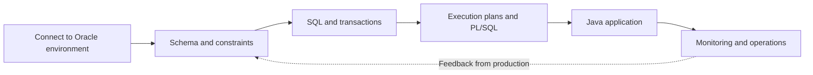
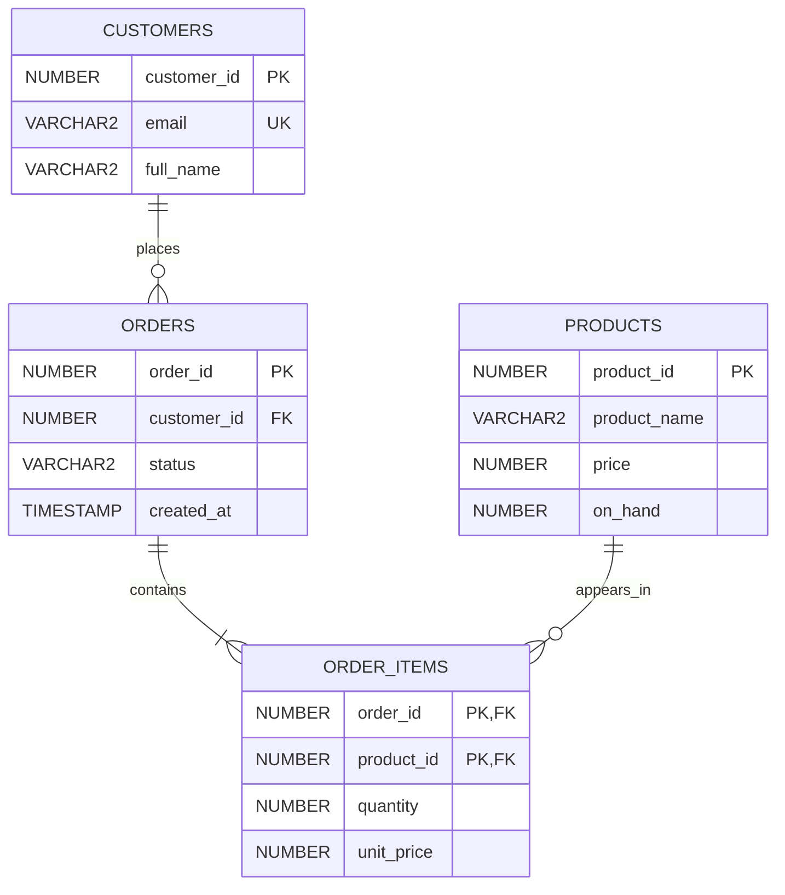

# Learning Path from Practice Environment to Applications and Oracle Database Operations

Learning Oracle Database effectively means following the lifecycle of a relational database management system: **setting up an actionable environment → designing data → querying and updating → guaranteeing transactions → tuning access → connecting applications → monitoring, securing, and recovering the system**. Each stage should produce a verifiable artifact before moving on to the next. This approach connects SQL statements directly to the real issues that arise when an application uses Oracle.

This guide uses a running example of a small sales system consisting of customers, products, orders, and order line items. Sample commands target **Oracle Database Free/XE or an appropriately privileged practice PDB**, and are not meant to be run directly against production systems.

## 1. Learning Roadmap: What to Learn and in What Order?

| Stage | Focus | Required Hands-On Deliverable | Gate to Advance |
|---|---|---|---|
| 1. Environment | Database instance, listener, service, CDB/PDB, user/schema, SQL tools | Connect to a PDB with a dedicated user account | Know which database, service, and schema you are connected to |
| 2. Relational model | Tables, Oracle data types, keys, relationships, constraints | Sales schema with linked tables | Invalid data violates constraints and is rejected |
| 3. Application SQL | `SELECT`, `JOIN`, aggregations, filtering, sorting, `INSERT/UPDATE/DELETE` | Query order lists and total amounts | Can explain query results across multiple records |
| 4. Transactions & concurrency | `COMMIT`, `ROLLBACK`, isolation, locking, consistency | Order creation and inventory deduction with rollback support | Mid-workflow errors leave no partial state behind |
| 5. SQL performance | Indexes, execution plans, statistics, read/write cost | Analyze a slow query | Backed by plan and data evidence before tuning |
| 6. Database-side logic | PL/SQL, procedures, functions, exceptions | Run a PL/SQL block and know when to use it | Distinguish database responsibilities from application responsibilities |
| 7. Application integration | Oracle JDBC, Spring Boot/JDBC, pools, transactions, migrations | Java API reading and writing Oracle data | Verify results and rollback through the application |
| 8. Operations | Access control, observability, backup/restore, errors, capacity | Operations checklist and one recovery scenario | Can diagnose and respond to incidents using evidence |



This is a dependency-ordered progression, not isolated topics. For example, without understanding foreign keys it is hard to diagnose order-creation errors; without understanding transactions you cannot safely implement stock deduction; without understanding execution plans, adding indexes turns into guesswork.

## 2. Stage 1 — Setting Up a Practice Environment and Understanding Connection Endpoints

### 2.1. What Do You Need to Prepare?

- **Oracle Database:** use a local Free/XE edition, a practice container, or a PDB on a training server. Pick one suitable version and keep it consistent across the module so results remain reproducible.
- **SQL client:** Oracle SQLcl, SQL Developer, or an Oracle JDBC-capable client to run SQL and inspect errors.
- **Practice machine:** sufficient RAM, disk space, and resources for your chosen Oracle version; if running containers, a working Docker installation.
- **Application stage:** JDK and a Java/Spring Boot project; not needed right away while learning DDL/SQL.

Example of launching a practice container using the Oracle Database Free image (image names, pull permissions, and environment variables may change by release; check the documentation for the specific image you use):

```bash
docker run -d --name oracle-lab -p 127.0.0.1:1521:1521 -e ORACLE_PWD=ChangeMeOnlyForLab123 container-registry.oracle.com/database/free:latest
docker logs oracle-lab
```

Use illustrative passwords only on a lab machine; replace with your own secrets and never put real passwords in source code or shared logs. Wait until the database reports ready before connecting. If a database is already provisioned for you, skip container setup.

In modern Oracle, keep these distinctions clear:

| Concept | Accurate Understanding in the Lab |
|---|---|
| **Instance** | Memory and processes serving the database; distinct from a client connection |
| **Listener** | Component accepting network connection requests, typically on port 1521 in the lab |
| **Service name** | Logical service name clients request to connect to the target database/PDB; not a table or user name |
| **CDB/PDB** | Container Database holding Pluggable Databases; application accounts are typically created inside a **PDB** |
| **User and schema** | User handles authentication; schema holds objects owned by that user, such as tables and views |

In a standard Oracle Database Free setup, the default PDB service is `FREEPDB1`. If using another host, get the actual service name from your administrator:

```text
Host          localhost
Port          1521
Service name  FREEPDB1
Admin user    SYSTEM (used only for lab setup)
App user      LAB_APP
```

From SQLcl you can connect via `sql system@//localhost:1521/FREEPDB1` and enter the password at the prompt. Connect as `SYSTEM` to the **PDB** to create the practice user:

```sql
CREATE USER lab_app IDENTIFIED BY "ChangeThisLabUserPassword123";
GRANT CREATE SESSION, CREATE TABLE, CREATE VIEW,
      CREATE SEQUENCE, CREATE PROCEDURE TO lab_app;
ALTER USER lab_app QUOTA 100M ON USERS;
```

These privileges are for lab exercises only. Production applications should receive only the minimum privileges needed for runtime functionality, and schema-deployment accounts should be separated from runtime accounts.

Next, reconnect with `sql lab_app@//localhost:1521/FREEPDB1` and verify:

```sql
SELECT USER AS schema_name,
       SYS_CONTEXT('USERENV', 'CON_NAME') AS pdb_name
FROM dual;
```

**Expected result:** the query returns `LAB_APP` and the expected PDB; you should be able to explain why application accounts never use `SYS` or `SYSTEM`. If you create a user in the CDB root instead of the PDB, Oracle may raise `ORA-65096`; fix the connection target rather than attempting to create a common user for lab exercises.

## 3. Stage 2 — Designing a Schema with Explicit Constraints

Before writing complex SQL, translate business requirements into entities and relationships:

- One **customer** has many **orders** (1–N).
- One **order** has many **order items** (1–N).
- One **product** can appear across many order items; `order_items` models the relationship between orders and products.
- The price at purchase time must be stored in `order_items.unit_price`; never recompute historical order totals from current product prices.



Create the four tables in schema `LAB_APP`:

```sql
CREATE TABLE customers (
    customer_id NUMBER(10) CONSTRAINT pk_customers PRIMARY KEY,
    full_name   VARCHAR2(100 CHAR) NOT NULL,
    email       VARCHAR2(255 CHAR) NOT NULL,
    CONSTRAINT uq_customers_email UNIQUE (email)
);

CREATE TABLE products (
    product_id   NUMBER(10) CONSTRAINT pk_products PRIMARY KEY,
    product_name VARCHAR2(120 CHAR) NOT NULL,
    price        NUMBER(12, 2) NOT NULL,
    on_hand      NUMBER(10) DEFAULT 0 NOT NULL,
    CONSTRAINT ck_products_price CHECK (price >= 0),
    CONSTRAINT ck_products_stock CHECK (on_hand >= 0)
);

CREATE TABLE orders (
    order_id    NUMBER(10) CONSTRAINT pk_orders PRIMARY KEY,
    customer_id NUMBER(10) NOT NULL,
    status      VARCHAR2(20 CHAR) DEFAULT 'NEW' NOT NULL,
    created_at  TIMESTAMP DEFAULT LOCALTIMESTAMP NOT NULL,
    CONSTRAINT fk_orders_customer
        FOREIGN KEY (customer_id) REFERENCES customers(customer_id),
    CONSTRAINT ck_orders_status
        CHECK (status IN ('NEW', 'PAID', 'CANCELLED'))
);

CREATE TABLE order_items (
    order_id   NUMBER(10) NOT NULL,
    product_id NUMBER(10) NOT NULL,
    quantity   NUMBER(10) NOT NULL,
    unit_price NUMBER(12, 2) NOT NULL,
    CONSTRAINT pk_order_items PRIMARY KEY (order_id, product_id),
    CONSTRAINT fk_items_order
        FOREIGN KEY (order_id) REFERENCES orders(order_id),
    CONSTRAINT fk_items_product
        FOREIGN KEY (product_id) REFERENCES products(product_id),
    CONSTRAINT ck_items_qty CHECK (quantity > 0),
    CONSTRAINT ck_items_price CHECK (unit_price >= 0)
);
```

These IDs are entered manually to keep the lab easy to reproduce; real applications can use `IDENTITY` or `SEQUENCE` to generate IDs and design how generated IDs are returned after `INSERT`. Running the DDL a second time in the same schema fails because the tables already exist: use a clean lab schema or manage changes with migrations rather than silently dropping tables containing data.

Oracle principles to grasp right away:

1. `NUMBER(p,s)` provides exact fixed-point precision; monetary columns here use `NUMBER(12,2)`—never use binary floating-point types for money.
2. `VARCHAR2(n CHAR)` limits length in characters; do not assume the size represents bytes. Choose `DATE`, `TIMESTAMP`, or `TIMESTAMP WITH TIME ZONE` based on time semantics.
3. `PRIMARY KEY`, `UNIQUE`, `FOREIGN KEY`, and `CHECK` protect data even when multiple applications write concurrently.
4. Oracle generally issues an **implicit commit** before and after DDL such as `CREATE TABLE` or `ALTER TABLE`; do not rely on `ROLLBACK` to undo DDL the way you undo DML.
5. `NULL` values require deliberate handling. A `CHECK` constraint does not automatically substitute for `NOT NULL`.

**Verification exercise:** try inserting two customers with the same email, an order item with `quantity = -1`, and an order with a nonexistent `customer_id`. Identify which constraint blocks each invalid operation. A well-designed schema enforces core data rules on its own rather than relying solely on the application UI.

## 4. Stage 3 — From Sample Data to Business-Meaningful Queries

Seed sample data using the `LAB_APP` account:

```sql
INSERT INTO customers (customer_id, full_name, email)
VALUES (1, 'An', 'an@example.test');

INSERT INTO products (product_id, product_name, price, on_hand)
VALUES (10, 'Keyboard', 350000, 5);

INSERT INTO orders (order_id, customer_id)
VALUES (100, 1);

INSERT INTO order_items (order_id, product_id, quantity, unit_price)
VALUES (100, 10, 2, 350000);

COMMIT;
```

At this stage, inserting into `order_items` **does not automatically deduct `products.on_hand`**: that is a business rule we will implement transactionally in the next stage.

Query the list of orders and their totals:

```sql
SELECT o.order_id,
       c.full_name,
       o.status,
       SUM(oi.quantity * oi.unit_price) AS total_amount
FROM orders o
JOIN customers c ON c.customer_id = o.customer_id
JOIN order_items oi ON oi.order_id = o.order_id
GROUP BY o.order_id, c.full_name, o.status
ORDER BY o.order_id;
```

With the data above, order `100` totals `700000`. This is computed by aggregating line items rather than stored as a precalculated column on `orders`.

Query orders for a single customer with a row limit:

```sql
SELECT o.order_id, o.status, o.created_at
FROM orders o
WHERE o.customer_id = 1
ORDER BY o.created_at DESC, o.order_id DESC
FETCH FIRST 10 ROWS ONLY;
```

After mastering basic queries, progressively practice variations: `INNER JOIN` vs. `LEFT JOIN`, `WHERE` vs. `HAVING`, `GROUP BY`, `EXISTS`, `CASE`, `NULL` handling, subqueries, and pagination. Note that `INNER JOIN` drops orders with no line items yet; if you need **all** orders listed, choose the appropriate join type and total calculation.

In applications, **use bind parameters** (such as `WHERE customer_id = ?` in JDBC) instead of concatenating user input directly into SQL. This prevents SQL injection and helps the database reuse statements more effectively in many cases.

**Expected result:** independently write three queries—total per order, customers with zero orders, and top-selling product—and explain how results and row counts change as more data is added.

## 5. Stage 4 — Transactions, Consistency, and Concurrent Access

Placing an order can require multiple operations: checking/deducting inventory, creating the order header, and inserting order line items. If only the first step succeeds while later steps fail, data becomes corrupted. Therefore, all related operations must execute within **one transaction** with clear success conditions.

Practice creating a new order while deducting one unit from stock:

```sql
SAVEPOINT before_checkout;

UPDATE products
SET on_hand = on_hand - 1
WHERE product_id = 10
  AND on_hand >= 1;

-- Proceed only if the result is "1 row updated".
-- If "0 rows updated": ROLLBACK TO before_checkout; and stop.

INSERT INTO orders (order_id, customer_id) VALUES (101, 1);

INSERT INTO order_items (order_id, product_id, quantity, unit_price)
SELECT 101, product_id, 1, price
FROM products
WHERE product_id = 10;

COMMIT;
```

If any statement after `UPDATE` fails, execute `ROLLBACK` instead of `COMMIT`. In application code, always inspect the **affected row count**; an `UPDATE` completing without syntax error yet affecting 0 rows does not mean inventory deduction succeeded.

Experiment once more using `SAVEPOINT` followed by `ROLLBACK TO before_checkout` prior to committing; compare inventory and order counts before and after. Note: `SAVEPOINT` is only an in-transaction marker and never replaces `COMMIT`.

### 5.1. What to Understand About Concurrency

Oracle uses undo-based read consistency so queries read an appropriate consistent snapshot without locking rows being modified by other sessions. Under the default `READ COMMITTED` isolation level, each statement observes committed data as of a specific point in time; transactions still need explicit concurrency control for writes.

Try opening two SQL sessions updating the same product simultaneously:

1. **Session A:** run `UPDATE products SET on_hand = on_hand - 1 WHERE product_id = 10` without committing yet.
2. **Session B:** run an `UPDATE` on the same row and observe lock waiting; notice that a plain `SELECT` can still read a consistent version.
3. **Session A:** run `COMMIT` or `ROLLBACK`; observe how Session B resumes.

From here, study **row locks**, deadlocks, lock timeouts, lost updates, and the differences between `READ COMMITTED` and `SERIALIZABLE`. In inventory control, a conditional update `on_hand >= ?` paired with row-count verification prevents overselling when concurrent requests target the same row. For more complex workflows, define lock ordering, isolation levels, and safe retry strategies.

**Expected result:** prove that a failed order placement neither reduces stock nor leaves an orphan order; explain why two concurrent requests can block one another.

## 6. Stage 5 — Reading Execution Plans Before Tuning SQL

Performance does not depend merely on whether a SQL query looks short or long, but on data volume, value distribution, indexes, statistics, and how the Oracle Optimizer chooses a plan.

On a table with many orders, lookups by `customer_id` can be supported by an index:

```sql
CREATE INDEX ix_orders_customer_id ON orders (customer_id);

EXPLAIN PLAN FOR
SELECT order_id, status, created_at
FROM orders
WHERE customer_id = 1;

SELECT * FROM TABLE(DBMS_XPLAN.DISPLAY);
```

Inspect operations such as `TABLE ACCESS FULL`, `INDEX RANGE SCAN`, and estimated costs. **Do not expect a tiny table of a few rows to always use an index:** a full scan can be cheaper. `EXPLAIN PLAN` shows an **estimated** plan and does not prove actual runtime; real performance analysis must include elapsed time, logical/physical reads, and the actual runtime plan when authorized to view it.

Practical guidelines:

- Primary keys and unique constraints typically have backing indexes; **foreign keys are not automatically indexed by Oracle**.
- Indexes speed up selective queries while consuming space and slowing writes; add indexes based on real queries and execution frequency.
- Check selectivity, column ordering in composite indexes, filter predicates, and sort clauses; never index every column blindly.
- Table and index statistics influence plan selection. Gathering statistics in operational environments must follow administrative policy rather than running ad hoc across the board.
- Question returned row counts, round-trips, join methods, and pagination before tuning Oracle instance parameters.

**Expected result:** save the query, explain the plan before and after adding the index, and explain why a different plan alone does not prove better performance without proper measurements.

## 7. Stage 6 — Putting PL/SQL in Its Right Place

PL/SQL is Oracle's procedural language supporting variables, conditionals, loops, procedures/functions, packages, and exceptions. It is best learned **after SQL and transactions**, because PL/SQL does not replace knowledge of set-based querying or data locking.

Example PL/SQL block reading stock and handling a missing product (run in SQLcl/SQL*Plus):

```sql
SET SERVEROUTPUT ON

DECLARE
    v_stock products.on_hand%TYPE;
BEGIN
    SELECT on_hand INTO v_stock
    FROM products
    WHERE product_id = 10;

    DBMS_OUTPUT.PUT_LINE('Current stock: ' || v_stock);
EXCEPTION
    WHEN NO_DATA_FOUND THEN
        DBMS_OUTPUT.PUT_LINE('Product not found');
END;
/
```

Once comfortable with anonymous blocks, learn `CREATE PROCEDURE`, `CREATE FUNCTION`, packages, `IN/OUT` parameters, cursors, exception handling, and calling PL/SQL from Java. Use PL/SQL when data-intensive logic belongs close to the database, for controlled reuse, or to cut network round-trips; keep HTTP routing, user authentication, and application-specific rules in the application tier. Never catch `WHEN OTHERS` and silently swallow errors: business errors must propagate to the caller and transactions must be handled consistently.

**Expected result:** write a procedure taking a product ID that returns stock or clearly signals when not found; know who owns `COMMIT` when a procedure is invoked inside an application transaction.

## 8. Stage 7 — Connecting Oracle to a Java / Spring Boot Application

When moving to the application layer, connect to the same database using Oracle JDBC. First verify connectivity with `LAB_APP`; only then build repositories, services, and APIs. The example below uses **Spring JDBC** so SQL, bind parameters, and transactions remain transparent. You do not need to start with an ORM to understand database mechanics.

In a Spring Boot project using compatible dependency management, add the required dependencies (if no BOM manages versions, specify a supported JDBC driver version):

```groovy
dependencies {
    implementation 'org.springframework.boot:spring-boot-starter-jdbc'
    runtimeOnly 'com.oracle.database.jdbc:ojdbc11'
}
```

Configure the application connection, supplying credentials from environment variables:

```yaml
spring:
  datasource:
    url: jdbc:oracle:thin:@//localhost:1521/FREEPDB1
    username: ${DB_USERNAME}
    password: ${DB_PASSWORD}
    hikari:
      maximum-pool-size: 5
```

Inside containers or other deployment setups, `localhost` refers to the host/container running the application itself, not automatically the Oracle container; adjust the hostname to match your actual network topology.

Example service inserting one product line into a new order. `orderId` is passed in **solely for our manual-ID lab schema**; production systems should generate IDs and guard against duplicate order requests:

```java
import java.math.BigDecimal;
import org.springframework.jdbc.core.JdbcTemplate;
import org.springframework.stereotype.Service;
import org.springframework.transaction.annotation.Transactional;

@Service
public class CheckoutService {
    private final JdbcTemplate jdbc;

    public CheckoutService(JdbcTemplate jdbc) {
        this.jdbc = jdbc;
    }

    @Transactional
    public void placeOrder(long orderId, long customerId,
                           long productId, int quantity) {
        if (quantity <= 0) {
            throw new IllegalArgumentException("Quantity must be positive");
        }

        BigDecimal unitPrice = jdbc.queryForObject(
            "SELECT price FROM products WHERE product_id = ?",
            BigDecimal.class,
            productId
        );

        int updated = jdbc.update(
            "UPDATE products SET on_hand = on_hand - ? " +
            "WHERE product_id = ? AND on_hand >= ?",
            quantity, productId, quantity
        );
        if (updated != 1) {
            throw new IllegalStateException("Insufficient stock");
        }

        jdbc.update(
            "INSERT INTO orders (order_id, customer_id) VALUES (?, ?)",
            orderId, customerId
        );
        jdbc.update(
            "INSERT INTO order_items " +
            "(order_id, product_id, quantity, unit_price) VALUES (?, ?, ?, ?)",
            orderId, productId, quantity, unitPrice
        );
    }
}
```

Here, `@Transactional` wraps the statements managed by Spring whenever the method is invoked through Spring's transaction proxy. If the `UPDATE` fails to deduct stock, an `INSERT` violates a constraint, or another runtime exception occurs, the transaction rolls back under default rules. Do not issue manual `COMMIT` calls between statements inside this service.

Key topics to master as an application approaches production:

- **Connections and pooling:** configure the datasource, pool size, timeouts, and connection return handling; oversized pools can overload the database.
- **Transaction boundaries:** place transactions around multi-step business actions; understand `@Transactional` caveats such as self-invocation within the same bean or coordinating across external systems.
- **Data type mapping:** `NUMBER` maps to `BigDecimal` or appropriate integer types; handle time zones deliberately.
- **Schema migrations:** manage versioned DDL changes with Flyway/Liquibase or DBA workflows rather than expecting every application instance to create tables from code state.
- **Testing:** write integration tests against a real Oracle instance for Oracle-specific SQL, constraints, and transactions; in-memory mock databases may not reproduce Oracle behavior accurately.
- **Security:** use bind parameters, secret managers, least-privilege accounts, and encrypted connections per environment requirements.

**Expected result:** invoking the order API reduces stock and writes both tables; intentionally passing a duplicate `orderId` or excessive quantity confirms no partial data is persisted. From there, expand to REST controllers, DTOs, validation, exception mapping, and API tests.

## 9. Stage 8 — From a Working App to an Operable Database

An app that works locally can still fail when connections surge, tables grow, accounts run out of quota, the listener misbehaves, or data must be restored. The operational stage requires clear separation of duties across **developer**, **DBA**, and **infrastructure**:

| Operational Area | What to Monitor and Understand | Hands-On Exercise or Evidence |
|---|---|---|
| Connectivity | Service/PDB, listener, session limits, pool connections | Distinguish network failures from auth failures or wrong service names |
| Resources | Tablespaces, quotas, datafile space, CPU, I/O, memory | Spot space exhaustion signs before writes fail |
| Performance | Slow queries, lock waits, deadlocks, contention, plan changes | Capture exact SQL, parameters, timestamps, and symptoms |
| Integrity | Constraints, failed transactions, retries, schema changes | Trigger a rollback scenario and verify resulting state |
| Security | Least privilege, user separation, secret management, patching, auditing | Audit privileges and verify the app does not log in as an admin |
| Backup/recovery | RMAN, restore/recover, backup storage, RPO/RTO | Review or participate in a restore drill in an isolated lab |
| Changes | Migrations, deployment and rollback plans, API-schema compatibility | Execute versioned migrations in a test environment |

Within the `LAB_APP` schema's own privileges, you can inspect the objects you own:

```sql
SELECT table_name FROM user_tables ORDER BY table_name;

SELECT index_name, table_name
FROM user_indexes
ORDER BY table_name, index_name;

SELECT constraint_name, constraint_type, status
FROM user_constraints
WHERE table_name = 'ORDERS'
ORDER BY constraint_name;
```

Administrative views such as `V$SESSION`, `V$SQL`, or `DBA_*` require appropriate privileges. When you lack access, document the issue and collaborate with a DBA; never escalate runtime application privileges just for diagnostic convenience.

### 9.1. Classifying Errors Before Acting

| Symptom | First Line of Investigation |
|---|---|
| `ORA-01017` | Username/password, account status, and target service |
| `ORA-12514` | Service name and listener/PDB registration status |
| `ORA-00942` | Whether the table/view exists in the schema or privileges were granted |
| `ORA-00001` | Unique/primary key violation; check IDs, business keys, and retry logic |
| `ORA-02291` | Foreign key referencing a nonexistent parent record |
| `ORA-02292` | Deleting a parent record that still has referencing child records |
| `ORA-00060` | Deadlock; identify participating transactions/locks and update ordering |
| `ORA-01536` | Tablespace quota exceeded for the user; contact administrator |

Error messages are the **starting point of investigation**, never the final root cause. When reporting an incident, include timestamps, action taken, service/schema, error codes, transaction context, and relevant queries (scrubbed of secrets and sensitive data).

### 9.2. Backups Differ from Proven Recovery

Backups only hold value if they can be restored. In Oracle, understand **RMAN** for physical backup/recovery, redo/archived redo logs where applicable, and **Data Pump** for logical export/import within appropriate scopes. Data Pump does not replace a full database recovery strategy.

Two crucial objectives are **RPO** (maximum acceptable data loss measured in time) and **RTO** (target time to restore service). Operational procedures must specify owners, backup storage locations, schedules, restore verification, failure alerting, and recovery runbooks. Practice restores in an isolated DBA-managed environment; never run recovery or destructive commands on a shared database.

## 10. Capstone Exercise: Taking One Feature Through the Full Lifecycle

Design a **single-product order placement** feature and complete these steps in order:

1. **Environment:** connect to Oracle with your lab user, confirm the right PDB, and capture the schema identification query output.
2. **Data:** create the four tables with keys and constraints; seed at least two customers, three products, and several sample orders.
3. **Queries:** write queries for order history, order totals, and best-selling products; handle orders without line items explicitly.
4. **Transactions:** create an order and deduct inventory in one transaction; test invalid foreign keys, duplicate IDs, and insufficient stock, verifying rollback.
5. **Concurrency:** have two sessions buy the last remaining unit of a product concurrently; explain the outcome using locks and conditional updates.
6. **Performance:** capture an execution plan for customer order lookup, test a purposeful index, and document observations backed by data.
7. **Application:** invoke a Java service/API over Oracle JDBC; use bind parameters, configure a connection pool, and keep secrets out of code.
8. **Operations:** prepare troubleshooting notes for connection errors, constraint violations, and slow queries; describe who runs backup/restore and when.

Your deliverable bundle can include: a data diagram, DDL/DML scripts, three queries with outputs, two documented rollback scenarios, Java code calling Oracle, captured execution plans, and a short incident runbook. Make sure you can **explain which business goal each piece serves**, rather than merely showing commands running without errors.

### Final Self-Check Questions

- Why must you connect to the PDB via the right service before creating a schema?
- Which constraints protect order validity even if application code has a bug?
- What happens if inventory is deducted yet inserting into `order_items` fails?
- Why must `UPDATE ... WHERE on_hand >= ?` be paired with checking the updated row count?
- Why isn't an index-using query guaranteed to be faster than a full scan?
- Who owns the transaction when a Spring service calls a PL/SQL procedure?
- What is the difference between a database that **has backups** and a system with **verified restore capability**?

Once you can answer all of these with hands-on evidence, you have built a complete foundational loop in Oracle: from connectivity and relational modeling, through SQL and transactions, to application integration and operational ownership. Advanced topics such as partitioning, materialized views, Data Guard, RAC, deeper optimizer tuning, and backup architectures can follow based on real project needs and environments.
