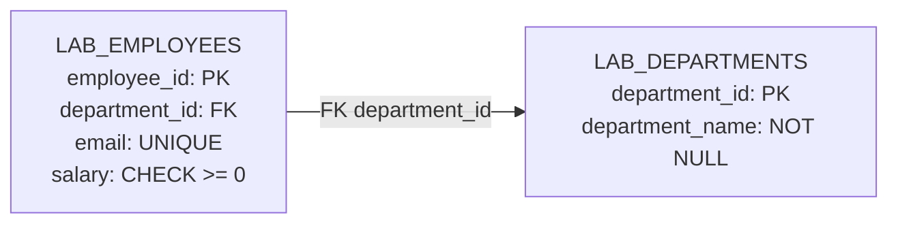
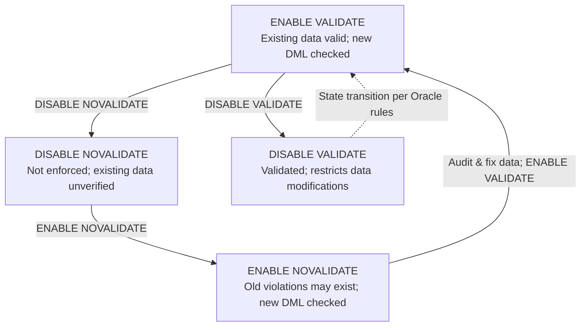

# ENABLE, DISABLE, VALIDATE, NOVALIDATE, and RELY in Oracle

When creating Oracle tables, constraints are among the strongest protections for relational data. Primary keys prevent duplicate identifiers, foreign keys link child tables to parent tables, `UNIQUE` prevents duplicate keys where uniqueness is required, and `CHECK` and `NOT NULL` constrain value domains. Yet a constraint does not have just two states ("exists" or "does not exist"): Oracle lets administrators **enable or disable enforcement, validate or skip validating existing rows**, and under certain conditions **mark a constraint as trusted for query rewrite**.

The five keywords in this lesson belong to distinct dimensions:

- **`ENABLE` / `DISABLE`:** Does Oracle **enforce constraint checks against data modifications**?
- **`VALIDATE` / `NOVALIDATE`:** Has Oracle **verified that all existing rows satisfy the constraint**?
- **`RELY` / `NORELY`:** Under appropriate conditions, may Oracle **trust an unvalidated constraint for query optimization**? This is **not** a switch that enables data checking.

These states are especially useful during bulk data loads, migrating legacy systems into new schemas, cleaning historical data, or building data warehouses. However, used carelessly, they can allow violating rows to persist in a table while operators assume the constraint is protecting the whole table.

This lesson runs on Oracle Database under the **Tables and Constraints** topic of *Database Engine Relational Oracle*. Examples use `LAB_DEPARTMENTS` and `LAB_EMPLOYEES` in a practice schema. Run constraint-management commands only on tables you own or are authorized to manage; **never disable constraints on live systems** just to experiment.

## 1. Role of Constraints in the Relational Model

Before changing states, know what each constraint guarantees.

| Constraint Type | Code in `USER_CONSTRAINTS` | Data Rule |
| --- | --- | --- |
| **PRIMARY KEY** | `P` | Every row has a non-`NULL`, unique key; Oracle normally creates or reuses a backing index. |
| **UNIQUE** | `U` | Key values must be unique per Oracle's `NULL` semantics; `NULL` values are permitted if the column lacks `NOT NULL`. |
| **FOREIGN KEY** | `R` | Non-`NULL` foreign key values must match a referenced key in the parent table, subject to composite-key/`NULL` rules. |
| **CHECK** | `C` | The condition expression must not evaluate to `FALSE`; `TRUE`, or `UNKNOWN` due to `NULL`, does not violate `CHECK`. |
| **NOT NULL** | Usually represented as type `C` in the data dictionary | The column must hold a value other than `NULL`. |

Example model:



When a constraint is `ENABLE VALIDATE`, Oracle not only holds the constraint definition, it has verified all existing rows and enforces the rule on applicable DML. Switching to another state can significantly change that guarantee.

**Constraint scope** always belongs to the table/schema inside the target Oracle container. In a CDB/PDB architecture, verify your session is connected to the **practice PDB** before running DDL. Changing constraint states is unrelated to user privileges: `GRANT` and `REVOKE` are a separate mechanism.

## 2. Two Independent Axes: Enforcement and Validation

Read constraint state as a pair:

1. **`ENABLE` / `DISABLE`**: Does Oracle check/enforce the rule when data is written?
2. **`VALIDATE` / `NOVALIDATE`**: Has Oracle verified that **existing rows** comply?

Combining them yields four common states:

| State | Existing Data | New or Modified DML | Practical Meaning |
| --- | --- | --- | --- |
| **`ENABLE VALIDATE`** | Checked and verified compliant | Checked/enforced by Oracle | Most reliable state for standard OLTP data. |
| **`ENABLE NOVALIDATE`** | **Not fully verified by Oracle**; historical violations may exist | New changes within enforcement scope are checked | Useful during transitions when blocking new violations before cleaning old data. |
| **`DISABLE NOVALIDATE`** | No current validation guarantee | Constraint is not enforced | Fits tightly controlled bulk loads/maintenance; high risk of bad data entering. |
| **`DISABLE VALIDATE`** | Marked validated per constraint | Does not enforce like `ENABLE`; imposes **special DML/DDL restrictions**, especially on constrained columns | Specialized state for certain data-warehouse/admin workflows; not "disable checking and freely edit." |



Not every constraint type, starting state, or Oracle version transitions the same way or at the same cost. For instance, **PRIMARY KEY/UNIQUE** constraints usually have backing indexes; disabling/re-enabling them can keep, drop, or rebuild indexes or scan for duplicate keys. **FOREIGN KEY** depends on the referenced parent key, and **NOT NULL** has its own modification rules. Inspect existing DDL, data, indexes, and dependent constraints before acting.

### ENABLE Does Not Mean Old Data Is Valid

This is the single biggest misconception about `ENABLE NOVALIDATE`. Suppose a `CHECK` constraint was previously disabled and a row with `salary = -50` was inserted. When you run:

```sql
ALTER TABLE lab_employees
ENABLE NOVALIDATE CONSTRAINT ck_lab_emp_salary;
```

Oracle checks the constraint for new applicable data modifications, but **does not scan and certify every existing row** just because `ENABLE` was used. The negative-salary row remains in the table. "No new violations allowed" is **not** the same as "the entire table is valid."

## 3. Creating Shared Practice Tables

Run these examples in `LAB_USER` or an equivalent practice account with `CREATE TABLE` and permanent tablespace quota; `SYSDBA` is not needed. `CREATE TABLE` and `ALTER TABLE` are **DDL** with Oracle's *implicit commit* behavior; do not mix them into transactions you intend to `ROLLBACK` completely.

```sql
CREATE TABLE lab_departments (
    department_id   NUMBER(6) CONSTRAINT pk_lab_dept PRIMARY KEY,
    department_name VARCHAR2(100 CHAR) NOT NULL
);

CREATE TABLE lab_employees (
    employee_id   NUMBER(8) CONSTRAINT pk_lab_emp PRIMARY KEY,
    department_id NUMBER(6) NOT NULL,
    email         VARCHAR2(180 CHAR) NOT NULL,
    salary        NUMBER(12,2) NOT NULL,
    CONSTRAINT uq_lab_emp_email UNIQUE (email),
    CONSTRAINT ck_lab_emp_salary CHECK (salary >= 0),
    CONSTRAINT fk_lab_emp_dept FOREIGN KEY (department_id)
        REFERENCES lab_departments (department_id)
);

INSERT INTO lab_departments (department_id, department_name)
VALUES (10, 'Engineering');

INSERT INTO lab_departments (department_id, department_name)
VALUES (20, 'Operations');

INSERT INTO lab_employees (
    employee_id, department_id, email, salary
) VALUES (1, 10, 'alice@example.test', 1500);

COMMIT;
```

Constraints are named explicitly so they are easy to manage later. By default, newly created constraints are enabled and validated per the DDL rules.

Inspect table metadata:

```sql
SELECT constraint_name,
       constraint_type,
       status,
       validated,
       NVL(rely, 'NORELY') AS rely_state,
       deferrable,
       deferred
FROM user_constraints
WHERE table_name = 'LAB_EMPLOYEES'
ORDER BY constraint_type, constraint_name;
```

Notable columns:

- `STATUS` shows `ENABLED` or `DISABLED`.
- `VALIDATED` shows `VALIDATED` or `NOT VALIDATED`.
- `RELY` shows whether the constraint is marked trusted for eligible query rewrite operations.
- `DEFERRABLE` and `DEFERRED` govern **check timing within a transaction**, which is distinct from `ENABLE`/`VALIDATE`.

Because `NOT NULL` also appears in the data dictionary as a constraint, the query may return more rows than the constraints you named explicitly. System-generated constraint names look like `SYS_C...`.

## 4. ENABLE VALIDATE: Enforcing and Verifying All Data

`ENABLE VALIDATE` is the target default whenever business data requires strict integrity.

```sql
ALTER TABLE lab_employees
ENABLE VALIDATE CONSTRAINT ck_lab_emp_salary;
```

Oracle guarantees:

1. **Existing data** satisfies `salary >= 0`.
2. **Subsequent applicable DML** cannot put the table into a violating state.

If the table already contains negative salaries from an earlier disable window, validation fails; you must clean the rows or resolve exceptions before demanding full validation.

For a **FOREIGN KEY**, `ENABLE VALIDATE` verifies that no child row references a nonexistent parent key under Oracle's `NULL` and composite-key semantics. For **PRIMARY KEY/UNIQUE**, it verifies valid, non-duplicate keys; for **CHECK**, the condition must evaluate per `TRUE`/`UNKNOWN` semantics. Spot-checking a few rows cannot replace formal validation.

### Cost on Large Tables

Validating existing rows may require scanning data and verifying indexes/relationships; on tables with hundreds of millions of rows, time and resource usage can be substantial. Locking and concurrent DML behavior during validation depend on constraint type, prior state, Oracle version, and options. A common strategy is:

```text
Unclean legacy data
    |
    v
ENABLE NOVALIDATE  --> block new violations
    |
    v
Audit and clean old data
    |
    v
ENABLE VALIDATE    --> Oracle verifies entire table
```

This limits the window during which a constraint is **unenforced**. Still, `ENABLE NOVALIDATE` does not certify existing rows, and `ENABLE VALIDATE` afterward still requires Oracle to verify the active condition.

## 5. DISABLE NOVALIDATE: Turning Off Enforcement Without Guarantees

This state most clearly illustrates the risk:

```sql
ALTER TABLE lab_employees
DISABLE NOVALIDATE CONSTRAINT ck_lab_emp_salary;
```

The constraint remains **in metadata**, yet is not enforced when DML modifies rows, nor is there any guarantee existing rows comply. Insert a negative-salary row in the lab:

```sql
INSERT INTO lab_employees (
    employee_id, department_id, email, salary
) VALUES (
    2, 10, 'legacy@example.test', -50
);

COMMIT;

SELECT employee_id, salary
FROM lab_employees
WHERE salary < 0;
```

The row `employee_id = 2` is stored with `salary = -50`. Thus, **`CHECK(salary >= 0)` still exists in the database definition**, yet stops protecting data while in `DISABLE NOVALIDATE`.

If a **FOREIGN KEY** is disabled instead of `CHECK`, child rows can reference nonexistent departments. If **PRIMARY KEY/UNIQUE** is disabled, loads can introduce duplicate keys, and the impact on backing indexes and dependent constraints must be analyzed first.

**Never use `DISABLE NOVALIDATE` to "fix" `ORA-02290` or `ORA-02291` in normal applications.** Doing so lets invalid data leak into reports, APIs, and joins that assume constraints are enforced.

## 6. ENABLE NOVALIDATE: Blocking New Violations While Keeping Old Debt

After inserting the negative-salary row above, run:

```sql
ALTER TABLE lab_employees
ENABLE NOVALIDATE CONSTRAINT ck_lab_emp_salary;
```

This tells Oracle to **enforce `CHECK` on new changes**, without **scanning the entire table to certify every old row**.

Try inserting a new invalid row:

```sql
-- Expected to fail: CHECK is ENABLEd.
INSERT INTO lab_employees (
    employee_id, department_id, email, salary
) VALUES (
    3, 10, 'new-bad@example.test', -10
);
-- Typically raises ORA-02290: check constraint violated.
```

The earlier `employee_id = 2` row is still readable:

```sql
SELECT employee_id, salary
FROM lab_employees
WHERE salary < 0;
```

Key distinction: `ENABLE NOVALIDATE` does not mean Oracle **allows every `UPDATE` on old rows** without checking. DML touching a violating row can still be rejected per constraint enforcement rules. Design proper data-remediation steps rather than assuming NOVALIDATE means "old rows are permanently exempt from checks."

### ENABLE VALIDATE Fails If Old Data Is Still Invalid

```sql
-- Run while employee_id = 2 still has a negative salary.
ALTER TABLE lab_employees
ENABLE VALIDATE CONSTRAINT ck_lab_emp_salary;
-- Typically raises ORA-02293: cannot validate CHECK due to violating rows.
```

Then fix the data and retry:

```sql
UPDATE lab_employees
SET salary = 0
WHERE employee_id = 2;

COMMIT;

ALTER TABLE lab_employees
ENABLE VALIDATE CONSTRAINT ck_lab_emp_salary;

SELECT constraint_name, status, validated
FROM user_constraints
WHERE table_name = 'LAB_EMPLOYEES'
  AND constraint_name = 'CK_LAB_EMP_SALARY';
```

Expected output for the two status columns is `ENABLED` and `VALIDATED`. At this point, existing data has been verified by Oracle and new DML remains protected.

### Manual Queries Do Not Replace Formal Validation

You can locate bad rows with SQL:

```sql
SELECT employee_id, salary
FROM lab_employees
WHERE salary < 0;
```

Yet a `SELECT` finding zero errors is a **diagnostic/cleanup step**, not the `VALIDATED` dictionary state. Under concurrent DML, a query snapshot can become stale by the next statement. Only a successful `ENABLE VALIDATE` transition marks the constraint as verified by Oracle under its formal semantics.

## 7. DISABLE VALIDATE: A Specialized State

`DISABLE VALIDATE` has a misleading name: **DISABLE** stops enforcing the constraint like `ENABLE`, while **VALIDATE** marks it validated; Oracle can **restrict modifications to the constrained columns** under this combination, especially in data-warehouse workflows with `PRIMARY KEY`/`UNIQUE`.

Syntax example:

```sql
-- Use on a test table only after understanding constraint type and DML consequences.
ALTER TABLE lab_employees
DISABLE VALIDATE CONSTRAINT uq_lab_emp_email;
```

For certain constraints, Oracle alters or drops backing indexes upon disabling. In `DISABLE VALIDATE`, do not assume you can freely `INSERT`/`UPDATE` as in `DISABLE NOVALIDATE`. Modifying columns participating in the constraint can be blocked, and DML/DDL operations face restrictions depending on constraint type.

In data-warehouse systems, this state can be useful when:

- Data has already been verified by a controlled load/maintenance pipeline.
- You want to preserve validity metadata while avoiding index/constraint maintenance overhead under a specific deployment strategy.
- Data is loaded primarily via partition exchange or ETL mechanisms designed around Oracle's restrictions.

**Do not choose `DISABLE VALIDATE` just to "turn off constraints for a faster import."** For imports that may contain dirty rows requiring later cleanup, `DISABLE NOVALIDATE` or a dedicated staging table is far more predictable. Let the DBA decide constraint state and index strategy during bulk loads.

## 8. RELY and NORELY: Marking Trust for Query Rewrite

**`RELY` is not a fifth state replacing the four combinations above.** It is **metadata indicating whether an unvalidated constraint may be trusted** in certain optimization/query mechanisms, particularly Oracle **query rewrite**. For an `ENABLE VALIDATE` constraint, Oracle already has formal proof of integrity, so adding `RELY` adds no extra data guarantee.

Keep three questions distinct:

| Question | Controlling Mechanism |
| --- | --- |
| Are violating DML writes blocked? | `ENABLE` / `DISABLE` |
| Have existing rows been verified by Oracle? | `VALIDATE` / `NOVALIDATE` |
| Can the optimizer/query rewrite trust an unvalidated constraint under an appropriate trust policy? | `RELY` / `NORELY` together with query rewrite configuration |

When `RELY` is set on an unvalidated constraint, **Oracle does not scan the table to verify it**. The DBA or ETL pipeline is asserting that the data relationship is reliable under system policy. If that assertion is **false**, query rewrites relying on the assumed relationship can return results inconsistent with actual data.

### Example: RELY on an Unvalidated FOREIGN KEY

First, proceed only if existing rows actually satisfy the parent-child relationship:

```sql
-- Check for orphan rows (with department_id NOT NULL in the sample table).
SELECT e.employee_id, e.department_id
FROM lab_employees e
LEFT JOIN lab_departments d
  ON d.department_id = e.department_id
WHERE d.department_id IS NULL;
```

Once violations are resolved in a controlled data workflow, you can put the foreign key into `NOVALIDATE` and set `RELY`:

```sql
-- Illustrative example on a test table; do not run on live systems.
ALTER TABLE lab_employees
DISABLE NOVALIDATE CONSTRAINT fk_lab_emp_dept;

ALTER TABLE lab_employees
ENABLE NOVALIDATE CONSTRAINT fk_lab_emp_dept;

ALTER TABLE lab_employees
MODIFY CONSTRAINT fk_lab_emp_dept RELY;

SELECT constraint_name, status, validated, NVL(rely, 'NORELY') AS rely_state
FROM user_constraints
WHERE table_name = 'LAB_EMPLOYEES'
  AND constraint_name = 'FK_LAB_EMP_DEPT';
```

At this point:

- `ENABLE` still enforces the FK on new data changes.
- `NOVALIDATE` still means existing rows are not formally certified.
- `RELY` provides trust metadata that query rewrite can consider when permitted.

**Never assume that a manual check returning 0 rows makes RELY permanently safe.** Without full coverage or concurrency control, data can drift. In mature pipelines, set `RELY` only when data quality processes guarantee the invariant and update rules are strictly upheld.

### When Does Query Rewrite Use RELY?

Systems using **materialized views** or query rewrite can use constraints to infer table relationships and rewrite queries. Oracle offers `QUERY_REWRITE_INTEGRITY` levels, commonly:

- **`ENFORCED`:** restricts rewrites to guarantees enforced by the database.
- **`TRUSTED`:** allows trusting declared relationships/constraints under supported rules.
- **`STALE_TOLERATED`:** permits looser rewrite choices, including stale materialized data in appropriate cases.

`RELY` takes effect when a constraint is **NOVALIDATE** and the environment allows the optimizer to trust it. **`RELY` does not guarantee the optimizer will always rewrite a query**, since `QUERY_REWRITE_ENABLED`, execution plans, materialized view eligibility, constraint type, and Oracle version all matter.

A DBA can **inspect** these parameters in an authorized session:

```sql
SELECT name, value
FROM v$parameter
WHERE name IN (
    'query_rewrite_enabled',
    'query_rewrite_integrity'
)
ORDER BY name;
```

This is a read-only inspection, not a recommendation to loosen trust settings. **Never change `QUERY_REWRITE_INTEGRITY` to `TRUSTED` or `STALE_TOLERATED` on a shared environment just to demo RELY.**

### Removing RELY and Returning to a Strong State

When you no longer intend to rely on an unvalidated constraint:

```sql
ALTER TABLE lab_employees
MODIFY CONSTRAINT fk_lab_emp_dept NORELY;

ALTER TABLE lab_employees
ENABLE VALIDATE CONSTRAINT fk_lab_emp_dept;
```

`NORELY` removes trust in unvalidated metadata for applicable optimizations; `ENABLE VALIDATE` is what directs Oracle to verify existing data and enforce the constraint strongly. Depending on constraint type and state, Oracle may handle `RELY` display metadata differently once validated; check `USER_CONSTRAINTS` to see actual values.

## 9. Different Constraint Types Have Different Operational Impacts

Do not apply the exact same playbook mechanically to every constraint.

### CHECK and NOT NULL

`CHECK` is convenient for observing `ENABLE NOVALIDATE` because conditions usually depend on one row. Remember, `CHECK(salary >= 0)` **does not forbid `NULL`**: a CHECK expression evaluating to `UNKNOWN` due to `NULL` is not a violation. Add `NOT NULL` or an explicit expression whenever a value is mandatory.

`NOT NULL` constraints have their own semantics and dictionary representation. Changing `NOT NULL` state involves `ALTER TABLE ... MODIFY column ...` and specific syntax rules; do not assume every `CHECK` syntax works identically.

### PRIMARY KEY and UNIQUE

`PRIMARY KEY` enforces uniqueness and non-NULL; `UNIQUE` enforces uniqueness per Oracle semantics. Oracle normally relies on a **backing index** to enforce both types.

When disabling them, Oracle may **drop the auto-created unique index** or retain/use another index depending on how it was created and metadata. Re-enabling can require rebuilding the index or fail if duplicates entered while disabled. Therefore:

- Never assume `DISABLE`/`ENABLE` on a PK merely flips a zero-cost metadata flag.
- Inspect `USER_INDEXES` and `USER_CONSTRAINTS.INDEX_NAME` when analyzing backing indexes.
- When designing a strategy that keeps a nonunique index to speed constraint transitions on large tables, DBAs must plan it upfront and verify release behavior.

Inspection example:

```sql
SELECT c.constraint_name,
       c.constraint_type,
       c.status,
       c.validated,
       c.index_name
FROM user_constraints c
WHERE c.table_name = 'LAB_EMPLOYEES'
  AND c.constraint_type IN ('P', 'U');

SELECT index_name, uniqueness, status
FROM user_indexes
WHERE table_name = 'LAB_EMPLOYEES';
```

### FOREIGN KEY

`FOREIGN KEY` spans **two tables**. On validation, Oracle verifies that foreign key values match the referenced parent key. If disabled during a load, checking for orphans is mandatory before trusting the data:

```sql
SELECT e.employee_id, e.department_id
FROM lab_employees e
LEFT JOIN lab_departments d
  ON d.department_id = e.department_id
WHERE d.department_id IS NULL;
```

If this query returns rows, orphan foreign keys exist (under our example's mandatory `department_id` model). `ENABLE NOVALIDATE` **protects new writes** while tolerating old orphan rows; `ENABLE VALIDATE` fails while any orphan remains.

Oracle **does not automatically create an index on every foreign key column** just because an FK is added. In systems with parent key updates/deletes and high concurrency, child FK indexing affects performance and locking. Analyze actual workload; `ENABLE`/`DISABLE` does not replace proper indexing.

## 10. DEFERRABLE Is Neither VALIDATE Nor NOVALIDATE

A concept frequently confused with this topic is **deferred constraint checking** (*deferrable constraints*).

- `ENABLE`: whether the constraint is enforced.
- `VALIDATE`: whether existing data has been verified.
- `DEFERRABLE`/`NOT DEFERRABLE`: whether checking **can** be postponed until later within a transaction.
- `INITIALLY IMMEDIATE`/`INITIALLY DEFERRED`: default checking timing when declared deferrable.

Example of an FK designed for end-of-transaction checking:

```sql
CREATE TABLE lab_def_parent (
    id NUMBER(6) PRIMARY KEY
);

CREATE TABLE lab_def_child (
    id        NUMBER(6) PRIMARY KEY,
    parent_id NUMBER(6),
    CONSTRAINT fk_lab_def_child_parent
        FOREIGN KEY (parent_id)
        REFERENCES lab_def_parent (id)
        DEFERRABLE INITIALLY IMMEDIATE
);
```

In a transaction that inserts the child before the parent, the application can **explicitly defer** the deferrable constraint:

```sql
SET CONSTRAINTS fk_lab_def_child_parent DEFERRED;

INSERT INTO lab_def_child (id, parent_id)
VALUES (1, 100);

INSERT INTO lab_def_parent (id)
VALUES (100);

COMMIT;
```

`SET CONSTRAINTS ... DEFERRED` controls check timing inside the transaction when the constraint is `DEFERRABLE`. If data still violates the rule at check/commit time, Oracle rejects the commit. This is **not** `ENABLE NOVALIDATE`: the FK can still be `ENABLE VALIDATE`, differing only in when checking occurs.

Never use deferrable constraints as a substitute for cleaning dirty legacy data in ETL; they solve two completely different problems.

## 11. Bulk Data Load or System Migration Workflows

Suppose a legacy system has an employee table containing some nonexistent departments. The team wants to load the data into Oracle and bring the table into full integrity. Among several approaches, the safest is usually separating a **staging table** from the core business table.

### Approach A: Staging Table First, Clean Data Second

1. Load raw data into a flexible staging table capable of holding rows that still need cleanup.
2. Detect `NULL` issues, duplicate keys, out-of-domain values, and orphan foreign keys via SQL reconciliation.
3. Log error reports, correction rules, source lineage, and approver sign-offs; handle rejected or missing records.
4. Load clean data into the target **`ENABLE VALIDATE`** table in controlled batches/transactions.
5. Track loaded row counts, rejections, and post-load reconciliation checks.

Advantage: the live business table avoids periods with disabled constraints. Trade-off: requires designing staging tables and transformation steps.

### Approach B: Controlled State Transitions on the Target Table

When loading directly into the target table under an approved downtime/locking plan:

```text
Start: ENABLE VALIDATE
    |
    | DBA approves maintenance window & recovery plan
    v
DISABLE NOVALIDATE (only if truly needed)
    |
    | Load data, capture logs, analyze errors
    v
ENABLE NOVALIDATE
    |
    | Block new violations; clean old data
    | Reconcile duplicate keys, orphan FKs, invalid CHECKs
    v
ENABLE VALIDATE
    |
    | Verify dictionary & row counts, end maintenance
    v
Normal operations
```

This is a **decision framework**, not a blanket recommendation to disable every constraint during imports. Some systems keep PK and UNIQUE enabled and adjust only select FKs/CHECKs; others rely on partition exchange loads, index rebuilds, or cross-table batch integrity. **Never disable `PRIMARY KEY` or `FOREIGN KEY` on a production table receiving live writes** without a strict consistency plan.

### Pre-Validation Error-Detection Query Templates

Negative salaries:

```sql
SELECT employee_id, salary
FROM lab_employees
WHERE salary < 0;
```

Orphan foreign keys:

```sql
SELECT e.department_id, COUNT(*) AS affected_rows
FROM lab_employees e
LEFT JOIN lab_departments d
  ON d.department_id = e.department_id
WHERE d.department_id IS NULL
GROUP BY e.department_id;
```

Duplicate emails:

```sql
SELECT email, COUNT(*) AS duplicate_count
FROM lab_employees
GROUP BY email
HAVING COUNT(*) > 1;
```

In this example, `EMAIL` is `NOT NULL`, so duplicate counting does not need special `NULL` handling. If a `UNIQUE` constraint is composite with nullable columns, understand Oracle's composite uniqueness semantics for `NULL` before writing reconciliation queries.

These queries locate invalid rows before running `ENABLE VALIDATE`. **Getting zero rows back does not automatically mark a constraint `VALIDATED`:** only when Oracle completes the validation DDL does the data dictionary record verified status.

## 12. Inspecting States via the Data Dictionary

When an administrator says "the constraint is enabled," verify **both `STATUS` and `VALIDATED`**, not just one column.

```sql
SELECT table_name,
       constraint_name,
       constraint_type,
       status,
       validated,
       NVL(rely, 'NORELY') AS rely_state,
       deferrable,
       deferred
FROM user_constraints
WHERE table_name IN ('LAB_DEPARTMENTS', 'LAB_EMPLOYEES')
ORDER BY table_name, constraint_name;
```

When a DBA queries across schemas:

```sql
SELECT owner,
       table_name,
       constraint_name,
       status,
       validated,
       NVL(rely, 'NORELY') AS rely_state
FROM dba_constraints
WHERE owner = 'LAB_USER'
  AND table_name = 'LAB_EMPLOYEES'
ORDER BY constraint_name;
```

`USER_CONSTRAINTS` shows constraints in the current schema, while `DBA_CONSTRAINTS` requires corresponding dictionary privileges. In multitenant environments, run queries inside the right PDB; root DBAs can query views with `CON_ID` when comparing across containers.

### Finding Constraints Not in the Desired State

In the practice schema:

```sql
SELECT table_name, constraint_name, status, validated,
       NVL(rely, 'NORELY') AS rely_state
FROM user_constraints
WHERE status = 'DISABLED'
   OR validated = 'NOT VALIDATED'
   OR rely = 'RELY'
ORDER BY table_name, constraint_name;
```

This query surfaces **states needing investigation**, not an automatic verdict that data is corrupt. Some data-warehouse tables intentionally use `NOVALIDATE`/`RELY`. During system audits, compare against **approved policy** and each table's role.

To inspect columns belonging to each constraint:

```sql
SELECT constraint_name,
       column_name,
       position
FROM user_cons_columns
WHERE table_name = 'LAB_EMPLOYEES'
ORDER BY constraint_name, position;
```

For FKs, `USER_CONSTRAINTS.R_CONSTRAINT_NAME` points to the parent key constraint; join back to parent constraint metadata to trace relationships. Never guess parent tables solely from custom FK names, especially in schemas with multiple alternate keys.

## 13. Common Oracle Errors During State Transitions

| Error Code / Symptom | Typical Cause | Resolution |
| --- | --- | --- |
| `ORA-02290` | DML violates an enforced `CHECK` constraint. | Check expression; fix input data rather than disabling the constraint. |
| `ORA-02291` | FK references a nonexistent parent key. | Load parent first or fix FK value; inspect transaction flow. |
| `ORA-02292` | Deleting/updating parent key while child rows reference it. | Decide deletion/update policy; do not disable FK casually. |
| `ORA-00001` | Violates uniqueness of an enforced PK/UNIQUE. | Resolve duplicate keys; use idempotent insert/merge patterns. |
| `ORA-02293` | Cannot validate because rows violate `CHECK`. | Query failing condition, clean rows, then re-validate. |
| `ORA-02298` | Cannot validate FK because parent keys are missing. | Query orphan rows; populate parent or fix child rows. |
| `ORA-02299` or corresponding uniqueness error | Duplicate keys found when validating UNIQUE. | Find duplicate groups and resolve per business rules. |
| `ORA-02437` | Cannot validate PRIMARY KEY because rows violate key rules. | Clean NULL/duplicate keys per constraint definition. |
| Re-enabling PK/UNIQUE is slow or fails on index | Oracle needs a backing index, which was dropped on disable or fails due to duplicates. | Check indexes, constraints, and rebuild plan. |
| Constraint shows `ENABLED` yet bad rows appear in reports | In `ENABLE NOVALIDATE` with historical violations. | Check `VALIDATED`; clean data and run `ENABLE VALIDATE`. |
| RELY enabled yet SQL does not rewrite | Query rewrite depends on settings, plans, materialized views, constraint type, etc. | Never treat RELY as a command forcing the optimizer to rewrite. |

When troubleshooting, record the **full error code, constraint name, container, DDL/DML statement, index/FK dependencies, and dictionary snapshot**. A failed `ENABLE VALIDATE` must be resolved at its root cause rather than ignoring errors or falsely marking things "validated."

### Critical Note: DDL Is a Transaction Boundary

`ALTER TABLE ... DISABLE/ENABLE/MODIFY CONSTRAINT` commands are **DDL**. Oracle normally performs an implicit commit before and after successful DDL statements. Therefore:

- Never assume you can run `ALTER TABLE ... DISABLE`, insert bad rows, and run `ROLLBACK` to "revert the entire database before the DDL."
- Never mix constraint-altering DDL inside open business transactions where DML atomicity is required.
- Whenever an administrative operation might fail, prepare a **target-state plan, stop conditions, and recovery steps**, because `ROLLBACK` does not undo structural DDL changes.

## 14. Comprehensive Exercises

### Exercise A — Observing the Four States

Using `LAB_EMPLOYEES` and `CK_LAB_EMP_SALARY`:

1. Confirm the constraint is `ENABLE VALIDATE` in `USER_CONSTRAINTS`.
2. Switch to `DISABLE NOVALIDATE`, insert a negative salary row, and `COMMIT`.
3. Switch to `ENABLE NOVALIDATE`, then try inserting another negative salary row. Note the error.
4. Run `ENABLE VALIDATE` while the negative row remains and observe the validation error.
5. Update the negative row to a valid value, `COMMIT`, and run `ENABLE VALIDATE` successfully.
6. Re-query `STATUS` and `VALIDATED`, and explain the difference between the two `ENABLE` runs.

**Key lesson:** `ENABLE` controls enforcement; `VALIDATE` verifies all existing data. Neither term substitutes for the other.

### Exercise B — FK States and RELY

1. Confirm child rows reference valid departments.
2. On the test table, transition `FK_LAB_EMP_DEPT` to `ENABLE NOVALIDATE` following the documented steps.
3. Set `RELY` and inspect `USER_CONSTRAINTS.RELY`.
4. Explain why `RELY` does not repair orphan rows if data is actually broken.
5. Switch back to `NORELY`, then run `ENABLE VALIDATE`.

**Key lesson:** `RELY` is a metadata hint for optimization/trust in appropriate scenarios, not DML protection or a data-checking tool.

### Exercise C — Designing Safe ETL

Suppose a batch job must load 5 million child rows:

- 0.2% of rows reference nonexistent departments.
- Duplicate emails may arrive from multiple sources.
- Online users continue creating new orders/records concurrently.

Compare a **staging table** against running `DISABLE NOVALIDATE` directly on the live table. Detail risks to foreign keys, uniqueness, concurrent transactions, and DDL implicit commits. Design the sequence for data validation, rejected-row logging, and conditions to return to `ENABLE VALIDATE`.

### Exercise D — Interpreting Dictionary States

Given three hypothetical rows:

| Constraint | STATUS | VALIDATED | RELY |
| --- | --- | --- | --- |
| `PK_ORDER_ID` | `ENABLED` | `VALIDATED` | `NORELY` |
| `FK_ORDER_CUSTOMER` | `ENABLED` | `NOT VALIDATED` | `RELY` |
| `CK_ORDER_AMOUNT` | `DISABLED` | `NOT VALIDATED` | `NORELY` |

Answer:

1. Which constraint protects both existing rows and new DML? **`PK_ORDER_ID`**.
2. Which constraint blocks new violations without certifying old rows? **`FK_ORDER_CUSTOMER`**.
3. Which constraint is not enforcing DML? **`CK_ORDER_AMOUNT`**.
4. Does `RELY` on the FK prove every order belongs to an existing customer? **No**.
5. To get all constraints to `ENABLE VALIDATE`, what is needed? **Audit/fix historical data, resolve dependencies, and run formal validation**.

### Cleaning Up the Learning Environment

Once the data is no longer needed, ensure constraints are returned to `ENABLE VALIDATE` as appropriate, then drop **only your own test tables**:

```sql
-- Child tables before parent tables.
DROP TABLE lab_def_child PURGE;
DROP TABLE lab_def_parent PURGE;
DROP TABLE lab_employees PURGE;
DROP TABLE lab_departments PURGE;
```

`DROP` commands are DDL; `PURGE` bypasses the Recycle Bin. If you did not create the two `LAB_DEF_*` tables from the deferrable section, omit those two `DROP` statements. Never run cleanup commands on environments holding data that must be kept.

## 15. Self-Check Questions

1. **How does `ENABLE` differ from `VALIDATE`?** `ENABLE` controls constraint enforcement on data operations; `VALIDATE` verifies existing rows satisfy the constraint.
2. **Can `ENABLE NOVALIDATE` permit previously inserted invalid rows to remain?** Yes; Oracle has not verified all historical rows, even though it checks new changes.
3. **Why is `DISABLE NOVALIDATE` risky?** The constraint is neither enforced nor validated on existing rows, so DML can introduce further violations.
4. **Is `DISABLE VALIDATE` identical to `DISABLE NOVALIDATE`?** No; it retains validated status and imposes specific restrictions on data/constraint operations, especially on keys.
5. **When `ENABLE VALIDATE` on an FK fails with `ORA-02298`, what should you do?** Locate child keys missing a parent, fix the child rows or populate the parent table, and re-validate.
6. **What else must be checked when `ENABLE VALIDATE` runs on PK/UNIQUE?** Duplicate or `NULL` key values per constraint type, plus the backing index.
7. **Does `RELY` cause Oracle to start rejecting bad INSERTs?** No. `RELY` is not an enforcement mechanism; `ENABLE`/`DISABLE` controls DML checking.
8. **How does `RELY` relate to query rewrite?** It lets the optimizer use unvalidated constraint metadata under trusted rewrite settings and conditions, though it never forces every query to rewrite.
9. **Is `DEFERRABLE` synonymous with `NOVALIDATE`?** No. Deferrability controls check timing within a transaction; `NOVALIDATE` tracks whether existing data was verified.
10. **Is `STATUS='ENABLED'` enough to conclude the whole table is clean?** No; also check `VALIDATED` and constraint type.
11. **Can `ALTER TABLE ... ENABLE CONSTRAINT` be rolled back like an UPDATE?** No; it is DDL with implicit commit behavior.
12. **Why should most systems use staging tables instead of disabling constraints on business tables?** So invalid rows can be detected and cleaned before touching live tables, avoiding unprotected windows and concurrency hazards.

## Conclusion

To manage constraints safely in Oracle, do not ask only "is it turned on?" Ask three questions: **"Is it enforced on DML?", "Has historical data been verified?", and "May the optimizer trust an unverified constraint?"** Those three questions are answered respectively by **`ENABLE/DISABLE`**, **`VALIDATE/NOVALIDATE`**, and **`RELY/NORELY`**.

For normal business data, **`ENABLE VALIDATE`** is the clear target state with the strongest guarantee. **`ENABLE NOVALIDATE`** serves as a practical transition step to block new violations while cleaning legacy debt. **`DISABLE NOVALIDATE`** belongs only in tightly controlled load/maintenance workflows; **`DISABLE VALIDATE`** has specialized semantics; and **`RELY`** never replaces integrity validation. Combining these states properly, checking the data dictionary, and designing clean ETL pipelines turns Oracle constraints into reliable data protection rather than a confusing set of flags.
