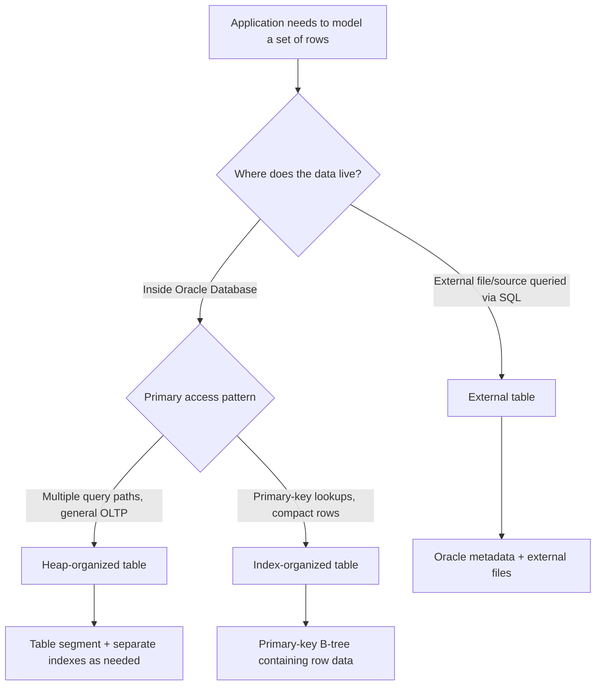
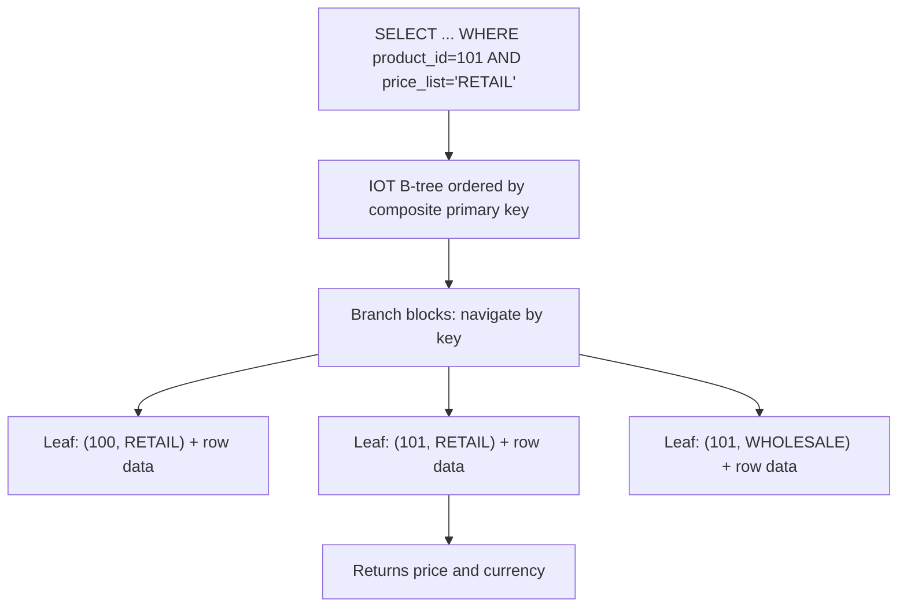
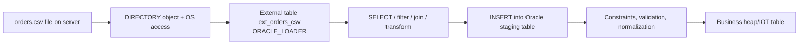
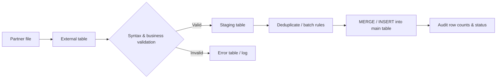

# Index-Organized Tables, External Tables, and Choosing Table Structure in Oracle Database

When writing `CREATE TABLE` in Oracle Database, we do more than name columns and pick data types. A more consequential architectural decision is **how Oracle will store and access the data**. Standard heap tables store rows inside a table segment and rely on separate indexes to speed up lookups. An **index-organized table (IOT)** stores the row data itself inside a B-tree structure sorted by primary key. An **external table** lets you query data residing in files or sources outside the database using SQL, rather than loading every row into a regular Oracle segment.

These three approaches solve distinct needs:

- An order-management application with diverse queries and updates across multiple columns typically starts with a **heap-organized table**.
- Short code catalogs, mapping tables, or compact rows frequently queried by **primary key** may be good candidates for an **index-organized table**.
- A pipeline receiving periodic CSV files from partners that must be inspected and transformed before loading into business tables is well suited to an **external table**.

The goal of this lesson is to understand how each works, read and write their DDL, examine primary keys and constraints, recognize transactional and operational limits, and choose table organization based on **workload** rather than names or the misconception that "newer table types are always faster."

## 1. Big Picture: Logical Table vs. Storage Organization

In the relational model, a **table** represents a set of rows with columns, optionally paired with **primary keys**, **foreign keys**, **unique constraints**, and **check constraints**. In Oracle, how rows are stored and accessed depends on **table organization**.



### 1.1. A Table's Name Does Not Reveal Its Organization

A table named `ORDERS` might be a heap table, an IOT, or another specialized structure depending on its DDL. By default, omitting an organization clause in `CREATE TABLE` produces a **heap-organized table**. For an IOT, specify `ORGANIZATION INDEX`. For a traditional external table, specify `ORGANIZATION EXTERNAL` and external source properties.

| Characteristic | Heap Table | Index-Organized Table | `ORACLE_LOADER` External Table |
|---|---|---|---|
| Where does row data live? | Table segment inside Oracle | Leaf blocks of the primary-key B-tree | External files accessed by Oracle |
| Is a primary key mandatory? | Not syntactically mandatory, though usually recommended | **Mandatory** | Not used as an OLTP table with Oracle-enforced PK/FK |
| Standard `INSERT`/`UPDATE`/`DELETE`? | Yes | Yes | **No** for `ORACLE_LOADER` external tables |
| Secondary indexes supported? | Yes | Can have secondary indexes | No standard B-tree indexes directly on files like heap |
| Primary-key lookup | Uses index then accesses table | Traverses data-bearing B-tree | Reads and parses files via access driver |
| ROWID access | Physical ROWID in standard heap | Logical ROWID (`UROWID`) | No internal rowid like standard heap rows |
| DML transactions / rollback | Yes | Yes | External file contents are outside Oracle DML transactions |
| Oracle datafile backups | Protects tablespace data | Protects tablespace data | Does not automatically back up external files |
| Best suited for | General-purpose application workloads | Key-driven reads/writes on compact rows | Querying or ingesting external files |

**Important:** heap, IOT, and external tables are **storage-organization choices**. Partitioning, compression, tablespaces, additional indexes, and connection pooling are separate axes—they interact, yet are distinct design decisions.

## 2. Heap-Organized Tables: The Default Baseline

In a heap table, rows reside in one or more data blocks of a table segment. Oracle makes no guarantee that rows are stored in primary-key order. When you create a separate B-tree index, index entries hold key values and row locators, typically a physical **ROWID**.


Example:

```sql
CREATE TABLE product_price_heap (
    product_id    NUMBER(12) NOT NULL,
    price_list    VARCHAR2(20 CHAR) NOT NULL,
    unit_price    NUMBER(12, 2) NOT NULL,
    currency_code CHAR(3 CHAR) DEFAULT 'VND' NOT NULL,
    CONSTRAINT pk_product_price_heap
        PRIMARY KEY (product_id, price_list),
    CONSTRAINT ck_product_price_heap
        CHECK (unit_price >= 0)
);
```

Oracle creates or reuses an appropriate index to enforce the primary key per constraint rules. **Having a primary key index does not mean the heap table segment itself is physically sorted by the PK.** Non-key columns remain in the heap table segment.

When querying:

```sql
SELECT unit_price, currency_code
FROM product_price_heap
WHERE product_id = 101
  AND price_list = 'RETAIL';
```

The optimizer may probe the index by key, obtain the ROWID, and fetch the needed columns from the heap table. Yet on tiny tables or under other conditions, it can still choose a full table scan. **Never assume every PK query produces the exact same execution plan.**

### 2.1. Why Is Heap Usually the First Choice?

- Does not force every row into a single clustering order by PK.
- Flexible when applications filter and sort across many different columns.
- Handles wide rows, many optional columns, and diverse reporting queries cleanly.
- Standard relational constraints, indexes, and DML mechanics apply universally.
- DBAs, ORMs, and applications are already tailored around heap storage.

However, a heap table is not always optimal for tables read overwhelmingly via a short primary key with minimal secondary lookups—one scenario worth evaluating for an IOT.

## 3. Index-Organized Tables (IOT): Data Lives Inside the Primary-Key B-Tree

### 3.1. Core Mechanism

In an **index-organized table**, the B-tree ordered by the **primary key** is the storage structure for the row data itself. Leaf entries store key values alongside non-key row data, rather than storing just key + physical ROWID pointing to a separate heap segment.



For full primary-key lookups, Oracle retrieves the data directly from the IOT's B-tree without a separate table block hop. Queries filtering on a **leading prefix** of a composite PK can also benefit from key clustering.

An IOT is not "a heap table + a specially tagged index"; it is **a fundamentally different storage organization**. Because row data travels inside the B-tree, row width, key selection, and update patterns directly affect index structure.

### 3.2. Creating an IOT with `ORGANIZATION INDEX`

Example price-catalog table with one row per product and price-list pair:

```sql
CREATE TABLE product_price_iot (
    product_id    NUMBER(12) NOT NULL,
    price_list    VARCHAR2(20 CHAR) NOT NULL,
    unit_price    NUMBER(12, 2) NOT NULL,
    currency_code CHAR(3 CHAR) DEFAULT 'VND' NOT NULL,
    updated_at    TIMESTAMP(6),
    CONSTRAINT pk_product_price_iot
        PRIMARY KEY (product_id, price_list),
    CONSTRAINT ck_product_price_iot
        CHECK (unit_price >= 0)
)
ORGANIZATION INDEX;
```

Highlights:

1. `ORGANIZATION INDEX` specifies IOT storage.
2. `PRIMARY KEY (product_id, price_list)` is **mandatory** for standard IOTs.
3. The two-column key orders rows inside the B-tree by composite key order.
4. `unit_price`, `currency_code`, and `updated_at` are row data stored within the IOT organization per configuration/limits.
5. `CHECK` and `NOT NULL` work identically to regular business tables.

DML example:

```sql
INSERT INTO product_price_iot (
    product_id, price_list, unit_price, currency_code, updated_at
)
VALUES (101, 'RETAIL', 125000.00, 'VND', SYSTIMESTAMP);

INSERT INTO product_price_iot (
    product_id, price_list, unit_price, currency_code, updated_at
)
VALUES (101, 'WHOLESALE', 112000.00, 'VND', SYSTIMESTAMP);

INSERT INTO product_price_iot (
    product_id, price_list, unit_price, currency_code, updated_at
)
VALUES (102, 'RETAIL', 89000.00, 'VND', SYSTIMESTAMP);

COMMIT;

SELECT product_id, price_list, unit_price
FROM product_price_iot
WHERE product_id = 101
ORDER BY price_list;
```

Applications interact with an IOT through ordinary SQL—no need to know block addresses or ROWIDs for business queries.

### 3.3. Primary Key Order Is a Data-Layout Decision

With primary key `(product_id, price_list)`:

- `WHERE product_id = :id` benefits because all rows for a given `product_id` sit together in key order.
- `WHERE product_id = :id AND price_list = :list` pinpoints a single row cleanly.
- `WHERE price_list = 'RETAIL'` without `product_id` cannot rely efficiently on primary-key ordering alone; it may need a secondary index or another design.

Reversing key order to `(price_list, product_id)` helps the opposite workload while changing data clustering. Never choose PK column order merely out of an "ID always goes first" habit; weigh **uniqueness**, **prefix query volume**, **key width**, and **key mutability** together.

### 3.4. IOTs Still Support Transactions and Constraints

An IOT is a managed Oracle table, not an external file. Operations like:

```sql
UPDATE product_price_iot
SET unit_price = 127000.00,
    updated_at = SYSTIMESTAMP
WHERE product_id = 101
  AND price_list = 'RETAIL';

SAVEPOINT after_price_change;

UPDATE product_price_iot
SET unit_price = -1
WHERE product_id = 102
  AND price_list = 'RETAIL';
```

reject the second statement via `CHECK (unit_price >= 0)` if a matching row is found. To revert earlier changes, use full `ROLLBACK` or place savepoints intentionally before the changes you may want to undo (`SAVEPOINT` placed after the first update will not revert the first update).

Oracle applies undo, redo, locking, and concurrency control on IOT DML just like any other Oracle table. **IOT does not mean automatically faster or exempt from transactional consistency.**

## 4. ROWID, Logical Rowid, and IOT Secondary Indexes

### 4.1. Heap Uses Physical ROWID; IOT Uses Logical ROWID

On heap tables, `ROWID` encodes a row's physical location (data object, file, block, slot). On IOTs, leaf positions shift during B-tree splits and rebalancing, so Oracle uses a **logical rowid**, represented as `UROWID`.

```sql
SELECT product_id,
       price_list,
       ROWID AS iot_logical_rowid
FROM product_price_iot
ORDER BY product_id, price_list;
```

The pseudocolumn is still named `ROWID`, yet IOT values must not be interpreted with assumptions about **18-character physical heap ROWIDs**. Logical rowids encode the row's primary key along with an optional physical guess to speed access.

**Never use rowid as a business key.** Even though logical rowids are more logical than physical rowids, they never substitute for a stable primary key in APIs, foreign keys, or messages. When a primary key changes or a row is deleted, identifier semantics change too.

### 4.2. IOT Secondary Indexes

An IOT can still have secondary indexes on columns outside the leading PK prefix:

```sql
CREATE INDEX ix_product_price_iot_list
ON product_price_iot (price_list, unit_price);
```

On heap tables, a secondary index points to a physical ROWID. On IOTs, secondary indexes use **logical rowids** (with physical guesses) to relocate rows inside the B-tree rather than pointing to a permanently fixed physical slot.

Consequently:

- Primary-key lookups on an IOT can be very direct.
- Secondary-index lookups fetching non-indexed IOT columns can incur extra probing; net benefit depends on selectivity and fetched columns.
- Secondary indexes add storage and maintenance overhead on `INSERT`, `UPDATE`, and `DELETE`.
- Very wide primary keys inflate both storage/comparison costs and secondary index size.

Never assume "an IOT with a secondary index is always slower than a heap table." Measure execution plans, logical reads, CPU, and elapsed time on your actual workload.

### 4.3. IOT Indexes and Heap Indexes Are Not Identical

| Perspective | Heap + Primary Key Index | IOT |
|---|---|---|
| Where rows are stored | In heap table segment | Inside PK B-tree structure |
| Primary key structure | Separate index backing PK | B-tree storing the row data itself |
| Wide-column PK lookup | Index probe followed by table block read | Data may be read directly from IOT B-tree |
| Lookup on non-PK column | Needs secondary index or scan | Needs secondary index or scan |
| Changing a PK value | Updates PK index | Relocates entry logically within B-tree |
| Very wide rows | Heap handles flexibly | Needs overflow evaluation and B-tree sizing |
| Physical row order | Not guaranteed in PK order | Maintained in PK B-tree order |

## 5. IOT Overflow Segments: When Rows Are Wide

In an IOT, if rows are very wide, packing every column into leaf entries bloats the B-tree and reduces entries per block. Oracle supports an **overflow segment** to push non-key columns beyond a threshold into a separate segment.

Example in a **lab schema** with `USERS` tablespace and quota:

```sql
CREATE TABLE catalog_info_iot (
    catalog_id     NUMBER(12) NOT NULL,
    catalog_code   VARCHAR2(30 CHAR) NOT NULL,
    status_code    VARCHAR2(12 CHAR) NOT NULL,
    description    VARCHAR2(1000 CHAR),
    updated_at     TIMESTAMP(6),
    CONSTRAINT pk_catalog_info_iot PRIMARY KEY (catalog_id)
)
ORGANIZATION INDEX
PCTTHRESHOLD 30
INCLUDING status_code
OVERFLOW TABLESPACE users;
```

How it works:

- `PCTTHRESHOLD 30` caps the percentage of block size allowed for an IOT row-piece before spilling to overflow, keeping leaf blocks compact.
- `INCLUDING status_code` specifies the cutoff column up through which columns stay in the index leaf before spilling remaining columns to overflow per IOT rules. Primary key columns always stay in the index organization.
- `OVERFLOW TABLESPACE users` sets where overflow data is stored if created (use your real tablespace policy in production).

**Not every row automatically spills to overflow**; placement depends on row size and thresholds. When queries select columns stored in overflow, Oracle reads an extra segment, increasing logical/physical I/O. Overflow works best when:

- The PK and hot lookup columns are small.
- Long descriptive columns are rarely queried.
- Leaf entries stay compact for fast PK lookups.

Conversely, if every query reads all the wide columns, chasing overflow segments erodes IOT benefits. Never add overflow blindly without measuring.

## 6. When Does an IOT Help, and When Does It Hurt?

### 6.1. Workloads Worth Testing with IOT

1. **Lookup / dictionary tables:** frequent exact lookups on a code returning a few small attributes.
2. **Composite-key mapping tables:** e.g., `(product_id, price_list)` or `(tenant_id, external_key)` queried by full PK or leading prefix.
3. **Entities clustered by primary key:** records with composite keys queried by leading column, such as entity history `(entity_id, sequence_no)`.
4. **Small-to-medium, very hot lookup tables** where skipping the index-to-heap hop pays off.

An IOT is not a "free" lookup upgrade. If a heap table with a covering index already satisfies queries cleanly, differences may be minor—and PK update costs plus IOT maintenance still apply.

### 6.2. Workloads Calling for Caution

- Very wide rows, many LOBs, or large text columns read frequently.
- Wide, frequently updated primary keys, or keys carrying columns rarely filtered.
- Queries filtering primarily across many non-PK columns requiring several secondary indexes.
- Very high concurrent insert/update rates causing B-tree block splits or hot-key contention.
- Workloads better served by heap partitioning, compression, or columnar features per edition.
- Applications/ORMs expecting immutable physical ROWIDs or features unsupported on IOTs in your release.

Above all, **an index-organized table is not automatically faster than heap just because its name contains "index."** It is a physical storage layout choice—benchmark with representative queries and DML.

## 7. External Tables: Reading Files Like a SQL Table

### 7.1. Concept and Data Flow

An **external table** exposes data stored in external files or sources as a table definition in Oracle's data dictionary. Users can run `SELECT` and join it with internal tables using SQL. Under the common **`ORACLE_LOADER`** model, source data stays in files on the database server; Oracle **does not load those rows into an Oracle table segment merely by creating the external table**.



When queried, Oracle uses an **access driver** to read and parse the file per the definition. An external table is **metadata + an access mechanism**, not an OLTP table with internal row segments, PK enforcement, or transactional DML.

### 7.2. How Do External Tables and SQL*Loader Differ?

| Aspect | External Table | SQL*Loader |
|---|---|---|
| Data source | External file/source described by table metadata | Input file processed by loader utility |
| Primary entry point | SQL `SELECT` against external table name | Client/server load utility per control file |
| When file is read | When a query reads the external table | When the load job executes |
| Data in internal segment immediately? | No, until `INSERT`/`CTAS` into internal table | Yes, once loaded successfully |
| Validation & transformation | SQL over external table, often into staging | SQL*Loader control file options and bad/discard logs |
| Best fit | SQL-based staging integration, file inspection, joins/transforms | Direct ETL bulk loading with control files |

Both tools complement each other in ETL pipelines. Never declare one "always faster" without testing file size, format, parallelism, transformations, logging, and real throughput.

### 7.3. Distinguishing the Two Classic Access Drivers

In standard Oracle releases:

- **`ORACLE_LOADER`:** exposes external tables to **read** text/record files such as structured CSVs; direct `INSERT`/`UPDATE`/`DELETE` DML on the external table is not supported like an internal table.
- **`ORACLE_DATAPUMP`:** binary external table format for Oracle data exchange, supporting unloading data into dump files via `CREATE TABLE AS SELECT` where permitted. It is **not a plain SQL text dump**, nor does it make standard external tables arbitrary mutable OLTP tables.

Modern Oracle versions and cloud services also add cloud/object-storage external access drivers. Always verify driver names, DDL, and limits for your exact platform. The hands-on section below uses **`ORACLE_LOADER` with server-side text files** to demonstrate core principles.

## 8. DIRECTORY Objects and File Permissions

### 8.1. Paths Are Server Paths, Not Your Laptop

A classic beginner mistake: writing `LOCATION ('orders.csv')` expecting Oracle to read a file sitting on the laptop running SQL Developer. In server-file external tables, Oracle reads files from the **database server environment** using the path pointed to by a `DIRECTORY` object.

In a practice PDB, a DBA may prepare a server directory such as:

```text
/u02/oracle/inbound/orders_2026_11.csv
```

This path illustrates Linux/Unix conventions; on Windows or managed cloud DBs, paths and access differ. Creating an Oracle `DIRECTORY` does not create the OS directory on disk, nor does it grant OS file permissions.

A DBA, in the right container with `CREATE ANY DIRECTORY` or admin privileges, declares:

```sql
CREATE OR REPLACE DIRECTORY inbound_dir
AS '/u02/oracle/inbound';
```

Then grants permissions:

```sql
GRANT READ, WRITE ON DIRECTORY inbound_dir TO lab_ingest;
```

Explanation:

- `READ` permits reading source files via the directory object.
- `WRITE` may be needed so Oracle's access driver can write **log/bad/discard files** (avoid granting unnecessary write access).
- `LAB_INGEST` still needs database privileges like `CREATE SESSION`, `CREATE TABLE`, and tablespace quota for internal tables.
- The OS process account running Oracle must **actually have OS permissions** to read the file and write logs in that directory.

**Never map a directory holding secrets, backups, or sensitive configs as an ingest `DIRECTORY`.** Lock down OS paths, OS permissions, `DIRECTORY` grants, and SQL accounts; never accept unchecked user-supplied paths.

### 8.2. Sample Input CSV File

Suppose the file contains:

```csv
order_id,customer_code,amount,order_date
1001,C-01,245000.50,2026-11-11
1002,C-02,37000.00,2026-11-12
1003,C-01,59000.00,2026-11-12
```

Simplifying assumptions for this learning example:

1. File encoding matches Oracle's read configuration.
2. One record fits on one physical line without embedded newlines inside quoted fields.
3. Field delimiter is a comma; decimal separator in `amount` is a period.
4. Line 1 is a header row to skip.
5. `order_date` uses `YYYY-MM-DD`.

Real-world CSVs may contain BOMs, escaped quotes, embedded commas, multi-line fields, Unicode characters, missing columns, or varied date formats. Always establish a **data format contract** and tune access parameters rather than treating this sample as a universal CSV parser.

## 9. Creating an `ORACLE_LOADER` External Table

In `LAB_INGEST` with `READ`/`WRITE` on the directory and `CREATE TABLE`:

```sql
CREATE TABLE ext_orders_csv (
    order_id_text   VARCHAR2(30 CHAR),
    customer_code   VARCHAR2(30 CHAR),
    amount_text     VARCHAR2(30 CHAR),
    order_date_text VARCHAR2(10 CHAR)
)
ORGANIZATION EXTERNAL (
    TYPE ORACLE_LOADER
    DEFAULT DIRECTORY inbound_dir
    ACCESS PARAMETERS (
        RECORDS DELIMITED BY NEWLINE
        SKIP 1
        BADFILE 'ext_orders_csv.bad'
        LOGFILE 'ext_orders_csv.log'
        FIELDS TERMINATED BY ','
               OPTIONALLY ENCLOSED BY '"'
        MISSING FIELD VALUES ARE NULL
        (
            order_id_text   CHAR(30),
            customer_code   CHAR(30),
            amount_text     CHAR(30),
            order_date_text CHAR(10)
        )
    )
    LOCATION ('orders_2026_11.csv')
)
REJECT LIMIT 10;
```

Clause breakdown:

| Clause | Role |
|---|---|
| `ORGANIZATION EXTERNAL` | Marks the table as an external table |
| `TYPE ORACLE_LOADER` | Selects the file-reading loader access driver |
| `DEFAULT DIRECTORY inbound_dir` | Default `DIRECTORY` object for source and driver files |
| `RECORDS DELIMITED BY NEWLINE` | Defines record boundaries by line |
| `SKIP 1` | Skips the first header line in this example |
| `FIELDS TERMINATED BY ','` | Comma-separated fields |
| `OPTIONALLY ENCLOSED BY '"'` | Supports double-quoted fields |
| `MISSING FIELD VALUES ARE NULL` | Maps trailing missing fields to NULL per driver rules |
| `LOCATION (...)` | Source filename(s), not arbitrary ad-hoc filesystem paths per query |
| `BADFILE` / `LOGFILE` | Logs rejected records and loader diagnostics |
| `REJECT LIMIT 10` | Maximum driver-rejected records allowed before query aborts |

Columns are declared as `VARCHAR2` intentionally so we can **inspect raw text values before converting to NUMBER/DATE**. If you declare NUMBER/DATE directly in the external table, the loader catches certain format errors earlier, changing how bad rows are logged and inspected.

### 9.1. Querying the External Table with SQL

```sql
SELECT order_id_text,
       customer_code,
       amount_text,
       order_date_text
FROM ext_orders_csv
ORDER BY order_id_text;
```

When the file and permissions are valid, Oracle returns the three sample rows. `EXT_ORDERS_CSV` appears as a table in the dictionary while its rows remain in the external file.

Never assume returning three rows means Oracle loaded them into a DML-mutable table segment. If the file on disk is overwritten later, subsequent external-table queries reflect the new file contents immediately, outside Oracle transaction isolation.

### 9.2. Inspecting External Table Metadata

```sql
SELECT table_name,
       type_name,
       default_directory_name
FROM user_external_tables
WHERE table_name = 'EXT_ORDERS_CSV';

SELECT table_name,
       location
FROM user_external_locations
WHERE table_name = 'EXT_ORDERS_CSV';
```

These views show the access driver and file locations. If dictionary queries succeed yet `SELECT` from the external table fails, check **the physical file, DIRECTORY path, OS permissions, access parameters, or file contents**—metadata alone does not prove the source file exists on disk.

### 9.3. Why Can External Tables Fail Only at SELECT Time?

With external tables, `CREATE TABLE` primarily stores metadata and access definitions. Depending on setup, missing files, malformed records, or unwritable log directories may surface only when Oracle actually reads the table.

For instance:

```sql
SELECT COUNT(*) FROM ext_orders_csv;
```

generally reads and parses the external file through the access driver rather than reading an internal segment counter. On huge files or slow storage, `COUNT(*)` incurs substantial I/O.

## 10. Loading External Data into Constrained Oracle Tables

In business systems, an external table is usually the **ingestion boundary**. Once validated, data moves into durable Oracle tables with constraints and transactions.

### 10.1. Creating an Internal Staging Table

```sql
CREATE TABLE orders_stage (
    import_batch   VARCHAR2(30 CHAR) NOT NULL,
    order_id       NUMBER(12) NOT NULL,
    customer_code  VARCHAR2(30 CHAR) NOT NULL,
    amount         NUMBER(14, 2) NOT NULL,
    order_date     DATE NOT NULL,
    loaded_at      TIMESTAMP(6) DEFAULT LOCALTIMESTAMP NOT NULL,
    CONSTRAINT ck_orders_stage_amount CHECK (amount >= 0)
);
```

In this staging table:

- `NUMBER` and `DATE` validate data types inside Oracle's schema.
- `NOT NULL` and `CHECK` enforce baseline rules.
- `import_batch` provides file/batch lineage.
- Avoid putting a PK on staging prematurely if you need to **capture duplicate rows** before deciding whether to deduplicate, overwrite, or reject.

### 10.2. Controlled Type Conversion

With a well-formed sample file:

```sql
INSERT INTO orders_stage (
    import_batch,
    order_id,
    customer_code,
    amount,
    order_date
)
SELECT
    'NOV_2026',
    TO_NUMBER(TRIM(order_id_text)),
    TRIM(customer_code),
    TO_NUMBER(
        TRIM(amount_text),
        '999999999999D99',
        'NLS_NUMERIC_CHARACTERS = ''.,'''
    ),
    TO_DATE(TRIM(order_date_text), 'FXYYYY-MM-DD')
FROM ext_orders_csv;

COMMIT;
```

Key details:

1. `TO_NUMBER` converts ID and monetary amount from text to numeric values.
2. For `amount`, `NLS_NUMERIC_CHARACTERS` fixes decimal and grouping characters per the file contract instead of session defaults.
3. `FXYYYY-MM-DD` enforces strict date format matching.
4. If one row fails `TO_NUMBER`/`TO_DATE` in a standard `INSERT ... SELECT`, the whole statement fails—design explicit error capture rather than assuming bad rows are skipped silently.
5. `COMMIT` persists rows inserted into the **internal Oracle table**; it does not commit or lock the external CSV file.

In production, separate quality validation, batch tagging, idempotency, unique keys, deduplication, file checksums, and error logging. General pipeline:



### 10.3. Reject Limit and SQL Conversion Errors Are Different Layers

`REJECT LIMIT` and `BADFILE` in `ORACLE_LOADER` apply to read/parse/conversion errors inside the **access driver** per the external table definition. Because we deliberately typed all external columns as text, `'abc'` in `amount_text` is read cleanly by the loader and fails only later when `INSERT ... SELECT` calls `TO_NUMBER`. **Never assume `REJECT LIMIT 10` skips SQL-level conversion or business errors.**

For messy multi-source feeds, consider:

- SQL pre-checks before inserting (such as `VALIDATE_CONVERSION` on supporting Oracle versions).
- Loading raw rows into a raw staging table to preserve inputs and attach error codes.
- **DML error logging** (`DBMS_ERRLOG` and `LOG ERRORS`) where appropriate, understanding exactly which error classes get logged vs. fail the statement.
- Batching and reporting reject metrics per file/partner without silently dropping bad data.

The goal is not "insert everything at all costs," but **meaningful, validated, traceable data**.

### 10.4. Where Should Constraints Live?

Never treat an external file as having OLTP **PK/FK/UNIQUE/CHECK** enforcement. Once moved through `ORDERS_STAGE` into core business tables:

```sql
CREATE TABLE orders_main (
    order_id       NUMBER(12) PRIMARY KEY,
    customer_code  VARCHAR2(30 CHAR) NOT NULL,
    amount         NUMBER(14, 2) NOT NULL,
    order_date     DATE NOT NULL,
    CONSTRAINT ck_orders_main_amount CHECK (amount >= 0)
);
```

Core tables enforce PKs, unique keys, and foreign keys per design. Before copying from stage to main, define what happens if the same `order_id` arrives twice: fail, keep first, overwrite, or version. A `MERGE` cannot resolve conflicting duplicate source rows automatically—the business must define the rule.

## 11. Critical Limitations of External Tables

### 11.1. DML and Transactions

`ORACLE_LOADER` external tables act as **read-only** SQL data sources: you cannot run `UPDATE ext_orders_csv` or `DELETE` on the file, nor lock the file with Oracle transactions. Database `COMMIT` and `ROLLBACK` have zero effect on an external CSV file on disk.

`ORACLE_DATAPUMP` supports **unloading** data into binary dump files via supported `CREATE TABLE` syntax, yet is still not an OLTP CRUD table like heap. Always check exact access-driver limits for your version.

### 11.2. Constraints and Indexes

Never model critical relationships assuming external files provide **B-tree indexes and PK/FK enforcement** like internal tables. Oracle can gather/use optimizer statistics on external tables where supported, yet does not manage CSV files as heap/IOT segments with rowids and B-tree indexes.

If queries frequently join or filter by key, load validated rows into an internal Oracle table and index it properly. Re-scanning millions of CSV lines on every UI screen load rarely meets OLTP SLAs.

### 11.3. File Consistency

If an external file is overwritten while Oracle is reading it, queries can return inconsistent data or fail. Always stage files atomically into the inbound directory once complete:

1. Partner uploads file to a quarantine/temp area invisible to external queries.
2. System verifies file size, checksum, filename, format, and ownership.
3. Only after completion does an automated step move/deliver the file into Oracle's target path per an agreed handoff protocol.
4. Ingest job records batch ID, status, loaded row count, and errors.
5. After successful ingestion, archive or retire the file per retention policy.

On filesystems, rename atomicity requires source and destination to reside on the same filesystem; never assume every upload or move is atomic.

### 11.4. Backup and Disaster Recovery

RMAN protects Oracle datafiles, control files, and redo logs within backup scope, yet **does not automatically back up external CSV files** just because an external table points to them. Maintain separate backups, checksums, versioning, and standby replication for external source files.

With Oracle Data Guard or multi-host setups, a file at a path on the primary host **does not automatically exist on the standby host**; design shared storage or file replication separately.

### 11.5. Data Security

External paths touch files outside Oracle's datafile storage controls. Ensure you:

- Restrict `DIRECTORY` objects and `READ`/`WRITE` grants by least privilege.
- Lock down OS permissions for the Oracle process and ingest service accounts.
- Protect sensitive data inside source files, logs, bad files, and archives.
- Avoid putting personal data or secret tokens in filenames.
- Apply matching permissions in backup and DR environments.
- Never assume tablespace TDE automatically encrypts external CSV files on disk.

## 12. Differences Between External Tables and Temporary Tables

Both can appear in ETL pipelines, yet they serve completely different roles:

| Type | Where Does It Live? | Data Lifecycle | DML |
|---|---|---|---|
| **`ORACLE_LOADER` external table** | External file outside the database | Governed by external file, not Oracle `COMMIT` | Read via SQL |
| **Global temporary table (GTT)** | Table metadata in Oracle; session/transaction temp rows | `ON COMMIT DELETE ROWS` or `PRESERVE ROWS` | Session-scoped DML |
| **Private temporary table (PTT)** | Session-private temp object (18c+) | Transaction or session scope per PTT mode | Limited DML |
| **Heap staging table** | Persistent segment inside Oracle | Persists across commits until deleted/archived | Full DML |

GTT example:

```sql
CREATE GLOBAL TEMPORARY TABLE session_order_ids (
    order_id NUMBER(12) NOT NULL
)
ON COMMIT DELETE ROWS;
```

A GTT supports intermediate in-session processing, yet **does not read CSV files** like an external table. "Temporary" on a GTT refers to in-database data lifetime, whereas "external" refers to **storing data outside the database**.

## 13. Metadata and Execution Plans: Inspecting Real Structure

### 13.1. Identifying Heap vs. IOT

Connect as the schema owning the lab tables:

```sql
SELECT table_name,
       iot_type,
       tablespace_name
FROM user_tables
WHERE table_name IN (
    'PRODUCT_PRICE_HEAP',
    'PRODUCT_PRICE_IOT',
    'CATALOG_INFO_IOT',
    'EXT_ORDERS_CSV'
)
ORDER BY table_name;
```

`IOT_TYPE` identifies IOT tables (`IOT` / `IOT_OVERFLOW` etc. when applicable); standard heap tables show `NULL`. Inspect external tables via `USER_EXTERNAL_TABLES` rather than relying solely on `IOT_TYPE`.

View related indexes:

```sql
SELECT table_name,
       index_name,
       index_type,
       uniqueness
FROM user_indexes
WHERE table_name IN (
    'PRODUCT_PRICE_HEAP',
    'PRODUCT_PRICE_IOT'
)
ORDER BY table_name, index_name;
```

An IOT's primary index differs structurally from a heap secondary index; interpret `INDEX_TYPE` according to the values returned by your Oracle release.

### 13.2. Comparing Execution Plans

```sql
EXPLAIN PLAN FOR
SELECT unit_price, currency_code
FROM product_price_heap
WHERE product_id = 101
  AND price_list = 'RETAIL';

SELECT * FROM TABLE(DBMS_XPLAN.DISPLAY);

EXPLAIN PLAN FOR
SELECT unit_price, currency_code
FROM product_price_iot
WHERE product_id = 101
  AND price_list = 'RETAIL';

SELECT * FROM TABLE(DBMS_XPLAN.DISPLAY);
```

On heap, plans may show an index scan followed by table access by rowid; on IOT, plans show traversal through the IOT primary-key B-tree. Keep in mind:

- Tiny sample tables with a few rows often trigger full scans instead.
- `EXPLAIN PLAN` shows estimated plans, not actual runtime execution stats.
- Optimizer choices depend on statistics, histograms, bind variables, row counts, optimizer version, and storage.
- Benchmark under identical workloads and conditions before claiming a win.

For external tables, Oracle uses an **external table access** operation via the access driver; it cannot attach a B-tree secondary index directly onto CSV files like a heap table.

### 13.3. Metrics to Measure

| Metric | Decision Relevance |
|---|---|
| p50 / p95 / p99 latency | Do transactional queries meet target latency? |
| Logical reads / buffer gets | Logical block reads during queries/writes |
| Physical I/O | Disk read cost, especially with overflow or external files |
| CPU per execution | Parsing, type conversion, and key comparison cost |
| Rows returned / processed | Are comparisons using identical result sets and volumes? |
| DML throughput | Insert/update/delete rates under representative load |
| Index / table segment size | Storage footprint across heap, IOT, and secondary indexes |
| Wait events / lock contention | Concurrency or storage bottlenecks |
| ETL error / reject rate | Is external file quality clean enough for target tables? |
| Batch load time | External scan + validation + insert vs. alternatives |

Never pick a structure from a single `SELECT` timing. An IOT may speed PK reads while slowing heavy writes or secondary-index queries; an external table simplifies ingestion yet cannot serve low-latency repetitive OLTP lookups.

## 14. Structure Selection Guide for Common Problems

| Scenario | First Candidate to Evaluate | Why |
|---|---|---|
| Orders queried by customer, status, date, and updated often | **Heap** + appropriate PK/indexes | Multiple query paths; flexible DML and indexing |
| Status lookup table with short key and very hot lookups | **Heap or IOT** (benchmark first) | IOT avoids index-to-heap hop, though gain depends on size |
| Mapping table `(tenant_id, external_id)` queried by pair or tenant | **IOT** worth testing | Composite PK gives helpful key clustering |
| Records with kilobytes of text queried across many columns | **Heap** (or IOT with overflow, benchmarked) | Wide rows bloat IOT B-trees |
| Daily CSV files read, filtered, and transformed into Oracle | **`ORACLE_LOADER` external table** + staging | Direct SQL over files and quality checks before load |
| Transactional table needing FKs, ACID, and direct updates | **Heap or IOT** (never `ORACLE_LOADER` as primary store) | Requires PK/FK and transactions |
| Temp dataset within a multi-step session | **GTT / PTT** per feature/version | Session/transaction temp lifecycle, not external file |
| Huge table queried by time or tenant | **Partitioning** on supported table org | Partitioning solves pruning/maintenance, distinct from IOT/external |
| Datasets in object storage / cloud data lakes | Platform-supported **external data** mechanisms | Evaluate drivers, auth, formats, pushdown, and cost |
| Append-heavy audit table with long retention | **Heap + partitioning/retention** is common starting point | Write patterns, time-based drops, and history queries govern design |

**Partitioning does not automatically force choosing IOT or heap.** Compatibility and options vary by Oracle version and edition. Similarly, materialized views, in-memory column store, and compression are not synonyms for external tables.

### 14.1. Six-Step Decision Process

1. **Identify data origin:** durable rows inside Oracle, or external files/sources?
2. **Identify constraints:** do you need PK, FK, CHECK, transactions, rollback, and immediate auditing?
3. **Identify primary access paths:** PK/composite prefix, secondary indexes, or full scans/reports?
4. **Examine row shape:** key width, row width, hot updated columns, NULL rates, LOBs.
5. **Measure representative workloads:** benchmark heap vs. IOT for DML and queries, and measure ingestion/parsing costs for external tables.
6. **Assess operations:** backups, privileges, storage, migrations, file changes, DBA/ORM tooling, monitoring, and error recovery.

Never pick an IOT merely to "save writing `CREATE INDEX`," and never pick an external table merely to "avoid creating a table segment" when rows require transactional management.

## 15. Misconceptions to Avoid

### "An IOT is identical to a heap table with a primary key."

**False.** Heap tables and their PK indexes are separate storage structures; an IOT stores row data directly inside the primary-key B-tree. That affects physical storage, rowids, secondary indexes, and key updates.

### "An IOT never needs additional indexes."

**False.** Queries filtering on columns outside the leading PK prefix still benefit from secondary indexes, and every index adds maintenance cost.

### "An IOT is always faster because it skips table blocks."

**Not guaranteed.** Wide rows, overflow reads, secondary indexes, full scans, B-tree splits, contention, and optimizer plans can make an IOT slower than heap on certain workloads.

### "An external table is Oracle's version of a temporary table."

**False.** External tables point to external sources; GTTs and PTTs manage session/transaction-scoped temporary rows inside the database.

### "`CREATE EXTERNAL TABLE` copies the CSV file into the database."

**False.** With `ORACLE_LOADER`, `CREATE` defines metadata and access parameters. Rows enter Oracle segments only when loaded into internal tables via `INSERT`, `CTAS`, or similar tools.

### "If a SELECT from an external table succeeds, the data has passed business constraints."

**False.** Successfully reading/parsing a file does not verify unique IDs, valid foreign keys, non-negative amounts, or date ranges. Enforce constraints at the staging/target database layers.

### "External table files are included in RMAN backups."

**Not automatically.** External files require their own backup strategy. Backing up datafiles containing external table metadata does not back up external CSV bytes.

### "A `DIRECTORY` object automatically grants OS file permissions."

**False.** Oracle privileges and OS filesystem/ASM/cloud storage permissions are separate security layers; both must be satisfied.

## 16. Common Issues and Troubleshooting

| Symptom / Error Code | Cause Category | First Check |
|---|---|---|
| `ORA-00001` on IOT | Duplicate PK or unique key | Input PK values and idempotency logic |
| `ORA-01400` on IOT | Mandatory column (including PK) given `NULL` | Schema, parameter binding, input payload |
| `ORA-02290` on IOT/heap | Data violates `CHECK` | Constraint name and business value |
| Slow PK lookups on IOT | Key/plan/stats, block I/O, overflow, contention | Execution plan, workload, row width |
| High DML cost on IOT | Key updates, secondary indexes, block splits, contention | Write pattern, table/index stats, wait events |
| `ORA-29913` querying external table | ODCI / external access driver error (often wraps detailed errors) | Read full error stack, log/bad files, and directory |
| `KUP-04040` in loader message | Source file missing or inaccessible in context | Filename, server path, DIRECTORY, and OS permissions |
| `ORA-30653` or reject limit message | Loader-rejected records exceeded limit | Bad file, CSV format, delimiters, and field types |
| `ORA-29400` | Data cartridge / external access error | Underlying `KUP-*` error and access parameters |
| `ORA-00942` querying external table | Table missing or missing privileges | Schema owner, grants, and PDB/service |
| `ORA-01031` creating DIRECTORY/external | Missing system or object privileges | `CREATE ANY DIRECTORY`, `CREATE TABLE`, directory grants |
| `TO_NUMBER` / `TO_DATE` fails loading staging | File value violates conversion rule | Raw text, NLS formats, row-level inspection |
| External query worked yesterday, returns different data today | File replaced, partially written, or path changed | File delivery workflow, checksums, versioning, schedule |

**Never "fix" `ORA-29913` merely by raising `REJECT LIMIT UNLIMITED`.** If the root cause is a missing file, OS permissions, bad delimiters, or leaked sensitive fields, ignoring infinite rejects hides broken data ingestion.

### 16.1. Systematic External Table Troubleshooting Workflow

1. Confirm your session is in the **right PDB and schema** via `SYS_CONTEXT('USERENV', 'CON_NAME')` and `USER`.
2. Inspect definitions in `USER_EXTERNAL_TABLES` and `USER_EXTERNAL_LOCATIONS`.
3. Confirm the `DIRECTORY` object points to a **server** directory, not a local workstation path.
4. Verify source filename, characters, encoding, line endings, and OS permissions match the contract.
5. Check Oracle `READ` and `WRITE` grants (for log/bad files) adhering to least privilege.
6. Read the full `ORA-29913` / `KUP-*` stack and log/bad files before changing DDL.
7. Run a bounded test query in a lab environment, then test conversion/staging separately.
8. Log rows read, rows rejected, rows validated, and rows committed to core tables.

When failures occur mid-pipeline, preserve batch files and logs for reproduction. Never edit a file while another process is actively reading or writing it.

## 17. CDB/PDB Architecture, Privileges, and Operations

In Oracle Multitenant, application schemas, tablespaces, and objects reside inside **PDBs**. When practicing:

```sql
SELECT USER AS login_user,
       SYS_CONTEXT('USERENV', 'CON_NAME') AS container_name,
       SYS_CONTEXT('USERENV', 'SERVICE_NAME') AS service_name
FROM dual;
```

Never create practice tables in `CDB$ROOT` by mistake when targeting a lab PDB. Verify `DIRECTORY` objects and grants inside the active container per Oracle version rules, rather than assuming a `DIRECTORY` in another container applies here.

Operational considerations:

- **Heap / IOT:** stored in Oracle datafiles, covered by RMAN backup/recovery, redo/undo, and tablespace management. Monitor segment/index growth, optimizer stats, corruption checks, and maintenance.
- **External tables:** metadata lives inside Oracle, while external files have separate lifecycles, backups, security, and monitoring. Restoring a PDB does not guarantee external files exist on the target server.
- **Schema migration:** converting heap to IOT or vice versa in production is not a single keyword edit. Plan data migration, constraints, indexes, supported online/offline methods, DML sync, and rollback.
- **ETL jobs:** tag files with batch IDs, checksums, receipt timestamps, and processing states, supporting safe retries and idempotency.

For multi-million-row tables with strict uptime requirements, work with DBAs to choose Oracle-supported conversion tools for your release rather than dropping and recreating tables just to toggle `ORGANIZATION INDEX`.

## 18. End-to-End Hands-On Lab

Requires a lab PDB with quota for a test schema. Creating `DIRECTORY` objects and placing files on the database server must be performed by an authorized administrator—never in production or OS system directories.

### Step 1 — Create Two Logically Identical Tables with Different Organizations

Use the `PRODUCT_PRICE_HEAP` DDL from Section 2 and `PRODUCT_PRICE_IOT` from Section 3. Load identical rows into both:

```sql
INSERT INTO product_price_heap
    (product_id, price_list, unit_price, currency_code)
VALUES (101, 'RETAIL', 125000, 'VND');

INSERT INTO product_price_heap
    (product_id, price_list, unit_price, currency_code)
VALUES (101, 'WHOLESALE', 112000, 'VND');

COMMIT;
```

For the IOT, use the matching rows inserted in Section 3. If you already ran the earlier example, avoid duplicate PKs by using a clean schema or distinct IDs.

### Step 2 — Inspect Metadata and ROWIDs

```sql
SELECT table_name, iot_type
FROM user_tables
WHERE table_name IN (
    'PRODUCT_PRICE_HEAP',
    'PRODUCT_PRICE_IOT'
)
ORDER BY table_name;

SELECT product_id, price_list, ROWID
FROM product_price_heap
ORDER BY product_id, price_list;

SELECT product_id, price_list, ROWID
FROM product_price_iot
ORDER BY product_id, price_list;
```

Note the difference between physical ROWIDs and logical UROWIDs returned by the IOT. Never judge table organization solely by ROWID string length; confirm via the data dictionary.

### Step 3 — Test Queries by Primary Key vs. Secondary Column

Compare these two queries on both heap and IOT:

```sql
SELECT unit_price
FROM product_price_iot
WHERE product_id = 101
  AND price_list = 'RETAIL';

SELECT product_id, unit_price
FROM product_price_iot
WHERE price_list = 'RETAIL';
```

Predict which query aligns better with PK `(product_id, price_list)`. Inspect execution plans on lab data, and explain why tiny tables may still choose a full scan despite index-friendly predicates.

### Step 4 — Test Constraints

On the IOT, try inserting a duplicate `(101, 'RETAIL')` pair and observe the primary key error. Try a negative price in a lab transaction and observe the check constraint error. Explain why an IOT maintains uniqueness and transactional behavior just like a regular table.

### Step 5 — Prepare the External File

Have your DBA or lab admin create `orders_2026_11.csv` in a server directory with the sample contents from Section 8. Create the `DIRECTORY` object, grant `LAB_INGEST`, and verify OS permissions for the Oracle process as in Section 8.

Never drop a file onto your laptop matching the `LOCATION` filename expecting the server database to find it.

### Step 6 — Create the External Table and Inspect Source Rows

Create `EXT_ORDERS_CSV` from Section 9. Run:

```sql
SELECT COUNT(*) AS raw_rows
FROM ext_orders_csv;

SELECT *
FROM ext_orders_csv
ORDER BY order_id_text;
```

Reconcile row counts against the source file and note read time. If loader errors occur, read the log/bad files and adjust the data contract after identifying the cause.

### Step 7 — Load Staging and Observe Constraints

Create `ORDERS_STAGE` and run `INSERT ... SELECT` from Section 10. After committing:

```sql
SELECT import_batch,
       COUNT(*) AS row_count,
       SUM(amount) AS total_amount
FROM orders_stage
GROUP BY import_batch
ORDER BY import_batch;
```

With the sample file, three rows and their corresponding sum appear. Always verify results against your actual lab file rather than assuming fixed sample outputs.

### Step 8 — Safely Test Malformed Input

On a **copy of the lab file**, change one row's `amount` to `ABC` and re-run `SELECT` on the external table. Because the external column is typed as text, the loader reads it cleanly, while `TO_NUMBER` fails during staging insertion unless handled beforehand.

Design a pattern to route invalid rows into an error table/log and load only valid rows—never raise `REJECT LIMIT` expecting it to skip SQL conversion errors.

### Step 9 — Choose Structures for a New Scenario

Suppose a project ingests 2 GB of CSV daily into a core orders table holding 100 million orders, where the application primarily:

- Filters by `customer_id` and `created_at` ranges.
- Updates `status` daily.
- Requires primary keys and foreign keys to customers.
- Needs lineage back to source file/batch.

Proposal:

1. External table to read files and validate raw inputs.
2. Internal staging table storing typed rows tagged with `batch_id`.
3. **Heap** orders table as a sound initial choice, evaluating time-based partitioning and workload-aligned indexes per version.
4. Reserve IOTs for small auxiliary lookup tables with matching PK-lookup patterns after benchmarking.
5. Manage external source files and logs under backup, security, and retention policies.

This shows you never have to force **one single table type across an entire system**. External tables, heap tables, and IOTs work together across layers.

## 19. Self-Check Questions

1. Where do heap tables store rows and indexes? How does an IOT change that layout?
2. Why does an IOT require a primary key? How does a composite key affect access order?
3. How does `WHERE product_id=...` differ from `WHERE price_list=...` on an IOT with PK `(product_id, price_list)`?
4. How does an IOT's logical rowid (`UROWID`) differ from a heap physical rowid? Should either be used as a REST API ID?
5. What role do secondary indexes play on an IOT, and why do they still incur maintenance overhead?
6. When are `PCTTHRESHOLD`/`OVERFLOW` useful on an IOT? Why aren't all wide-row tables good IOT candidates?
7. Where does an `ORACLE_LOADER` external table store its data? Does `CREATE EXTERNAL TABLE` copy the CSV into Oracle datafiles?
8. Why are a `DIRECTORY` object and OS permissions two separate security layers?
9. Which errors does `REJECT LIMIT` handle? Why might `'ABC'` in a text CSV column fail only later when `TO_NUMBER` runs?
10. Can an external table serve as a live orders table needing `UPDATE`/`DELETE`/FK/ACID transactions? Why not?
11. How does an external table differ from a global temporary table?
12. How do you distinguish heap tables, IOTs, and external tables in the data dictionary?
13. Why doesn't an RMAN database backup automatically back up external table CSV files?
14. In a CDB/PDB environment, what must you confirm before creating tables and `DIRECTORY` objects?
15. Beyond timing a single PK `SELECT`, what else must be measured to choose between IOT and heap?

**Conclusion:** Choose table structure based on **data origin, transaction/constraint requirements, access paths, row shape, and operational needs**. Heap tables are the versatile default for most relational workloads; IOTs are worth testing for compact, PK-lookup-heavy data; and external tables bridge external files into SQL before validation and durable storage. Strong Oracle designs use **the right table type for each stage of data**, rather than forcing one organization onto every problem.
