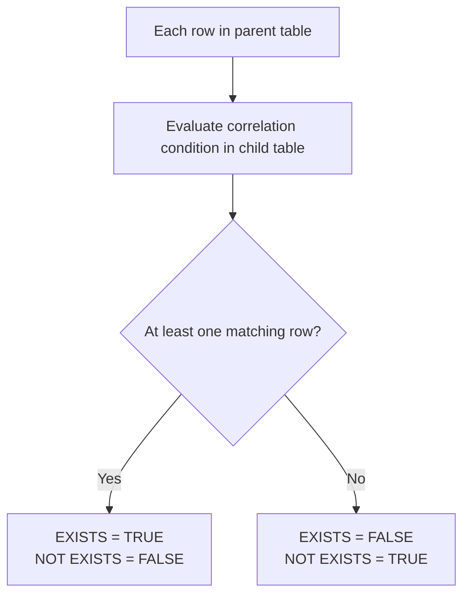

# IN, NOT IN, and the NULL Trap in Oracle Database Subqueries

SQL queries frequently need to check whether a value belongs to a set: an order status is in an allowed list, an employee belongs to a department, a customer has no transactions, or a record has no relationship with another table. Oracle provides two familiar operators, **`IN`** and **`NOT IN`**, to express those checks, often combined with a **subquery**.

What makes this error-prone is that **`NULL` is not an ordinary value**. It represents unknown or missing data, so comparisons involving NULL usually evaluate to **UNKNOWN**, not TRUE or FALSE. Because `WHERE` keeps only rows where the condition is TRUE, a `NOT IN` query can unexpectedly return 0 rows simply because the subquery returned a single NULL.

This lesson explains SQL three-valued logic, how `IN`/`NOT IN` behave with literal lists and subqueries, NULL edge cases on both sides, replacing them with `NOT EXISTS`, and reading Oracle execution plans. Examples use a department, employee, and order model that you can run directly in a lab schema.

## 1. What Are IN and NOT IN Used For?

### 1.1. IN — checking set membership

`IN` evaluates to TRUE when the left-hand expression equals at least one element in the right-hand set:

```sql
SELECT employee_id, employee_name, department_id
FROM employees
WHERE department_id IN (10, 20, 30);
```

This retrieves employees belonging to one of the three departments 10, 20, or 30.

The right-hand set can be:

- A literal list: `IN (10, 20, 30)`.
- An expression list: `IN (:id1, :id2, :id3)`.
- A single-column subquery: `IN (SELECT department_id FROM departments ...)`.

Subquery example:

```sql
SELECT employee_id, employee_name
FROM employees e
WHERE e.department_id IN (
    SELECT d.department_id
    FROM departments d
    WHERE d.location_id = 1700
);
```

The outer query returns employees in departments at location 1700. The subquery can return multiple rows; Oracle uses that result set to check membership.

### 1.2. NOT IN — checking set non-membership

`NOT IN` is the negation of `IN`:

```sql
SELECT employee_id, employee_name, department_id
FROM employees
WHERE department_id NOT IN (10, 20, 30);
```

This selects employees whose `department_id` differs from 10, 20, and 30, provided the comparison evaluates to TRUE.

Subquery example:

```sql
SELECT d.department_id, d.department_name
FROM departments d
WHERE d.department_id NOT IN (
    SELECT e.department_id
    FROM employees e
);
```

The typical intent is finding departments without employees. However, if `EMPLOYEES.DEPARTMENT_ID` contains even one NULL value, the result can be unexpected. This is the core trap covered in this lesson.

## 2. SQL Has Three Logic Values: TRUE, FALSE, and UNKNOWN

### 2.1. NULL does not equal NULL

In SQL, `NULL` does not represent a concrete value comparable with `=`. It represents an unknown or absent value. Therefore:

```sql
SELECT
    CASE WHEN 5 = 5 THEN 'TRUE'
         WHEN NOT (5 = 5) THEN 'FALSE'
         ELSE 'UNKNOWN'
    END AS normal_comparison,
    CASE WHEN 5 = NULL THEN 'TRUE'
         WHEN NOT (5 = NULL) THEN 'FALSE'
         ELSE 'UNKNOWN'
    END AS null_comparison,
    CASE WHEN NULL = NULL THEN 'TRUE'
         WHEN NOT (NULL = NULL) THEN 'FALSE'
         ELSE 'UNKNOWN'
    END AS null_to_null
FROM dual;
```

Both comparisons involving NULL yield UNKNOWN. To check whether a column is NULL, use:

```sql
WHERE department_id IS NULL

-- or
WHERE department_id IS NOT NULL
```

Do not write `department_id = NULL` or `department_id <> NULL` to test for NULL.

### 2.2. WHERE keeps only TRUE

The `WHERE` clause does not retain rows when the condition is FALSE **or UNKNOWN**. Example:

```sql
SELECT 'TRUE' AS result FROM dual WHERE 1 = 1
UNION ALL
SELECT 'FALSE' FROM dual WHERE 1 = 2
UNION ALL
SELECT 'UNKNOWN' FROM dual WHERE 1 = NULL;
```

Only the TRUE row is returned. The other two do not appear. Thus, an expression that seems "not false" yet evaluates to UNKNOWN still drops the row.

### 2.3. Basic truth tables

Key rules:

| A | NOT A |
|---|---|
| TRUE | FALSE |
| FALSE | TRUE |
| UNKNOWN | UNKNOWN |

| A | B | A AND B |
|---|---|---|
| TRUE | TRUE | TRUE |
| TRUE | UNKNOWN | UNKNOWN |
| FALSE | UNKNOWN | FALSE |
| UNKNOWN | UNKNOWN | UNKNOWN |

| A | B | A OR B |
|---|---|---|
| TRUE | UNKNOWN | TRUE |
| FALSE | UNKNOWN | UNKNOWN |
| FALSE | FALSE | FALSE |
| UNKNOWN | UNKNOWN | UNKNOWN |

AND with a FALSE operand produces FALSE; OR with a TRUE operand produces TRUE. In the remaining cases, UNKNOWN can propagate.

## 3. Why Does NULL Cause NOT IN to Return 0 Rows?

### 3.1. NOT IN is equivalent to a chain of inequalities against every element

Logically:

```sql
x IN (a, b, c)
```

is semantically equivalent to:

```sql
x = a OR x = b OR x = c
```

Whereas:

```sql
x NOT IN (a, b, c)
```

is equivalent to:

```sql
x <> a AND x <> b AND x <> c
```

When one element in the set is NULL, `x <> NULL` evaluates to UNKNOWN because it cannot be determined whether x equals NULL. ANDing with UNKNOWN can turn the entire condition into UNKNOWN.

### 3.2. Small example with a NULL

Run directly:

```sql
SELECT
    CASE WHEN 10 IN (10, 20, NULL)
         THEN 'TRUE'
         WHEN NOT (10 IN (10, 20, NULL))
         THEN 'FALSE'
         ELSE 'UNKNOWN'
    END AS match_found,
    CASE WHEN 30 IN (10, 20, NULL)
         THEN 'TRUE'
         WHEN NOT (30 IN (10, 20, NULL))
         THEN 'FALSE'
         ELSE 'UNKNOWN'
    END AS no_match_but_null,
    CASE WHEN 30 NOT IN (10, 20, NULL)
         THEN 'TRUE'
         WHEN NOT (30 NOT IN (10, 20, NULL))
         THEN 'FALSE'
         ELSE 'UNKNOWN'
    END AS not_in_result
FROM dual;
```

Interpretation:

- `10 IN (10, 20, NULL)` is TRUE because one equality check succeeded.
- `30 IN (10, 20, NULL)` is UNKNOWN: 30 equals neither 10 nor 20, and `30 = NULL` is UNKNOWN; there is insufficient evidence to conclude FALSE.
- `30 NOT IN (10, 20, NULL)` is also UNKNOWN because NOT UNKNOWN remains UNKNOWN.

Since `WHERE` keeps only TRUE, this query returns zero rows:

```sql
SELECT 30 AS candidate
FROM dual
WHERE 30 NOT IN (10, 20, NULL);
```

### 3.3. Outcome table when the set contains NULL

| Left-Hand Value | IN (10, 20, NULL) | NOT IN (10, 20, NULL) | Kept by WHERE? |
|---:|---|---|---|
| 10 | TRUE | FALSE | IN yes; NOT IN no |
| 20 | TRUE | FALSE | IN yes; NOT IN no |
| 30 | UNKNOWN | UNKNOWN | Neither keeps it |
| NULL | UNKNOWN | UNKNOWN | Neither keeps it |

Point to remember: **a NULL in the set does not invalidate every IN check**. If a matching value is found, `IN` is still TRUE. The trap strikes when proving "no element matches" while the set contains an undetermined value.

### 3.4. A subquery returning NULL has the same effect

No literal NULL is needed. Just one NULL row in a subquery's output suffices:

```sql
SELECT department_id, department_name
FROM departments
WHERE department_id NOT IN (
    SELECT department_id
    FROM employees
);
```

If the subquery returns `10`, `20`, and `NULL`:

- Department 10: matches, so NOT IN is FALSE.
- Department 20: matches, so NOT IN is FALSE.
- Department 30: matches neither 10 nor 20, yet comparing against NULL is UNKNOWN; the combined AND becomes UNKNOWN.

No department is selected—not even department 30, which has no employees. This is a common cause of "find missing data" queries returning 0 rows.

## 4. NULL on the Left-Hand Side Also Matters

Even when the subquery contains no NULLs, the left-hand value can be NULL:

```sql
SELECT
    CASE WHEN NULL IN (10, 20)
         THEN 'TRUE'
         WHEN NOT (NULL IN (10, 20))
         THEN 'FALSE'
         ELSE 'UNKNOWN'
    END AS null_in,
    CASE WHEN NULL NOT IN (10, 20)
         THEN 'TRUE'
         WHEN NOT (NULL NOT IN (10, 20))
         THEN 'FALSE'
         ELSE 'UNKNOWN'
    END AS null_not_in
FROM dual;
```

Both evaluate to UNKNOWN. Therefore:

```sql
SELECT employee_id
FROM employees
WHERE department_id NOT IN (
    SELECT department_id
    FROM departments
);
```

does not return employees whose `department_id IS NULL`. That is often the right behavior if the rule means "has a `department_id` that is not in the departments list." However, to include unassigned employees as well, state it explicitly:

```sql
SELECT employee_id
FROM employees
WHERE department_id IS NULL
   OR department_id NOT IN (
       SELECT department_id
       FROM departments
       WHERE department_id IS NOT NULL
   );
```

Adding the `IS NULL` branch is a business decision, not merely a syntax trick.

## 5. Complete Example with Parent and Child Tables

### 5.1. Create lab data

Run in a test schema:

```sql
CREATE TABLE dept_lab (
    department_id   NUMBER(6) CONSTRAINT pk_dept_lab PRIMARY KEY,
    department_name VARCHAR2(60 CHAR) NOT NULL
);

CREATE TABLE employee_lab (
    employee_id   NUMBER(8) CONSTRAINT pk_employee_lab PRIMARY KEY,
    employee_name VARCHAR2(80 CHAR) NOT NULL,
    department_id NUMBER(6)
);

INSERT INTO dept_lab VALUES (10, 'Sales');
INSERT INTO dept_lab VALUES (20, 'Engineering');
INSERT INTO dept_lab VALUES (30, 'Finance');
INSERT INTO dept_lab VALUES (40, 'Human Resources');

INSERT INTO employee_lab VALUES (1001, 'An', 10);
INSERT INTO employee_lab VALUES (1002, 'Binh', 20);
INSERT INTO employee_lab VALUES (1003, 'Chi', 10);
INSERT INTO employee_lab VALUES (1004, 'Dung', NULL);

COMMIT;
```

To focus on NULLs, the child table omits a foreign key and intentionally permits NULL `department_id`. In real systems, an FK to `DEPT_LAB` still permits NULL unless the column has `NOT NULL`.

### 5.2. Inspect data

```sql
SELECT * FROM dept_lab ORDER BY department_id;

SELECT * FROM employee_lab ORDER BY employee_id;
```

There are four departments; three employees have departments and one employee is unassigned.

### 5.3. Find departments with employees using IN

```sql
SELECT department_id, department_name
FROM dept_lab
WHERE department_id IN (
    SELECT department_id
    FROM employee_lab
)
ORDER BY department_id;
```

Result is departments 10 and 20. The subquery's NULL row does not erase matched rows: 10 and 20 still satisfy `IN`. Departments 30 and 40 do not match, and their IN expressions evaluate to UNKNOWN due to NULL in the set; thus they are not returned.

### 5.4. Find departments without employees using NOT IN — the logic bug version

```sql
SELECT department_id, department_name
FROM dept_lab
WHERE department_id NOT IN (
    SELECT department_id
    FROM employee_lab
)
ORDER BY department_id;
```

The surprising result is **zero rows**. The subquery returns 10, 20, 10, and NULL. For departments 30 and 40, Oracle cannot conclude they differ from NULL, so NOT IN evaluates to UNKNOWN.

### 5.5. Fix NOT IN by excluding NULL in the subquery

If the meaning is "departments not appearing in the list of non-NULL department IDs assigned to employees," simply exclude NULL:

```sql
SELECT department_id, department_name
FROM dept_lab
WHERE department_id NOT IN (
    SELECT department_id
    FROM employee_lab
    WHERE department_id IS NOT NULL
)
ORDER BY department_id;
```

Result is departments 30 and 40. This is correct when:

- The outer column is NOT NULL, or
- You deliberately want to exclude NULL values on the left-hand side per NOT IN semantics.

In the lab, `DEPT_LAB.DEPARTMENT_ID` is a primary key and cannot be NULL, so filtering NULL in the subquery suffices.

### 5.6. Use NOT EXISTS — usually the safer approach

```sql
SELECT d.department_id, d.department_name
FROM dept_lab d
WHERE NOT EXISTS (
    SELECT 1
    FROM employee_lab e
    WHERE e.department_id = d.department_id
)
ORDER BY d.department_id;
```

Result is likewise departments 30 and 40. The correlated subquery simply asks: **is there any employee row whose department_id equals the outer department?** If not, `NOT EXISTS` is TRUE.

The employee row with NULL `department_id` fails equality with any specific `department_id`, so it does not break the query. This is why `NOT EXISTS` is commonly preferred for anti-joins when the inner column may be NULL.

### 5.7. Side-by-side comparison

| Formulation | When Subquery Has NULL | Lab Dataset Result |
|---|---|---|
| `IN (SELECT department_id ...)` | Non-matches become UNKNOWN; matches stay TRUE | Departments 10, 20 |
| `NOT IN (SELECT department_id ...)` | NULL in set turns non-matches into UNKNOWN | Zero rows |
| `NOT IN (... WHERE department_id IS NOT NULL)` | Removes NULL from inner set | Departments 30, 40 |
| `NOT EXISTS (correlated subquery)` | Inner NULL never makes equality TRUE | Departments 30, 40 |

## 6. NOT EXISTS: Expressing an Anti-Join

### 6.1. EXISTS cares only whether rows exist

`EXISTS(subquery)` returns TRUE when the subquery returns at least one row, regardless of what is in the `SELECT` list. Therefore, the standard style is:

```sql
WHERE EXISTS (
    SELECT 1
    FROM child_table c
    WHERE c.parent_id = p.parent_id
)
```

`NOT EXISTS` returns TRUE when zero rows satisfy the correlation condition.



The subquery can read multiple columns, join other tables, or include additional predicates; EXISTS depends solely on whether any qualifying row exists.

### 6.2. Find customers with no orders

```sql
SELECT c.customer_id, c.customer_name
FROM customers c
WHERE NOT EXISTS (
    SELECT 1
    FROM orders o
    WHERE o.customer_id = c.customer_id
)
ORDER BY c.customer_id;
```

This is a standard anti-join pattern in business systems. If `ORDERS.CUSTOMER_ID` contains NULLs, those NULL rows do not match any specific customer and do not cause the query to return empty as `NOT IN` would.

### 6.3. EXISTS does not inspect SELECT column values

These forms share identical existence semantics:

```sql
WHERE EXISTS (SELECT 1 FROM employee_lab e
              WHERE e.department_id = d.department_id)

WHERE EXISTS (SELECT NULL FROM employee_lab e
              WHERE e.department_id = d.department_id)

WHERE EXISTS (SELECT e.employee_id FROM employee_lab e
              WHERE e.department_id = d.department_id)
```

Selected values do not determine EXISTS; **row existence** is what matters. Use `SELECT 1` to state the intent clearly.

### 6.4. NOT EXISTS and outer NULL values

Suppose:

```sql
SELECT e.employee_id
FROM employee_lab e
WHERE NOT EXISTS (
    SELECT 1
    FROM dept_lab d
    WHERE d.department_id = e.department_id
);
```

An employee with `department_id IS NULL` is returned by NOT EXISTS because no department satisfies `d.department_id = NULL`. This differs from:

```sql
SELECT e.employee_id
FROM employee_lab e
WHERE e.department_id NOT IN (
    SELECT d.department_id
    FROM dept_lab d
);
```

Here the subquery has no NULLs (`department_id` is PK), yet a NULL on the left still turns `NULL NOT IN (...)` into UNKNOWN, so unassigned employees are not returned.

If the goal is finding only employees with a specific non-NULL department code missing from the departments table, add:

```sql
WHERE e.department_id IS NOT NULL
  AND NOT EXISTS (
      SELECT 1
      FROM dept_lab d
      WHERE d.department_id = e.department_id
  )
```

If the goal is finding both unassigned employees and employees with invalid department codes, write two explicit logic branches. Never assume NOT EXISTS and NOT IN are interchangeable without considering outer NULLs.

## 7. When Should You Use IN, NOT IN, or EXISTS?

### 7.1. IN for membership and semi-join

Use `IN` when the intent is "this value belongs to the queried set of values":

```sql
SELECT p.product_id, p.product_name
FROM products p
WHERE p.category_id IN (
    SELECT c.category_id
    FROM categories c
    WHERE c.is_active = 'Y'
);
```

If the subquery contains NULL, non-matching values become UNKNOWN and are dropped while matches remain kept. For membership checks, that is usually natural semantics.

### 7.2. NOT IN when NULLs are controlled on both sides

`NOT IN` fits when:

- It is a literal list guaranteed to contain no NULLs.
- The subquery column is guaranteed NOT NULL or explicitly filtered for NULLs.
- The outer column's NULL semantics are also explicitly handled.

Example:

```sql
SELECT d.department_id
FROM dept_lab d
WHERE d.department_id NOT IN (
    SELECT e.department_id
    FROM employee_lab e
    WHERE e.department_id IS NOT NULL
);
```

This is clear if you want to keep NOT IN syntax and understand the nullability conditions.

### 7.3. NOT EXISTS for "no related row exists"

Use `NOT EXISTS` when the question is a relationship between outer and inner rows:

```sql
SELECT d.department_id
FROM dept_lab d
WHERE NOT EXISTS (
    SELECT 1
    FROM employee_lab e
    WHERE e.department_id = d.department_id
);
```

This is usually the clearest way to ask "no matching child record exists." It avoids NULL poisoning on the inner column, while still requiring an explicit policy if NULL on the outer key has special meaning.

### 7.4. Decision table

| Need | Usually Suitable Formulation | Notes |
|---|---|---|
| Value in a non-NULL literal list | `IN` | Readable |
| Value in a subquery set | `IN` | Matches remain TRUE even if set has NULL |
| Value not in a non-NULL literal list | `NOT IN` | Consider NULLs on left-hand side |
| Value not in a subquery set | `NOT IN` after controlling NULLs | Both outer side and inner set need clear semantics |
| No related child row exists | `NOT EXISTS` | Usually the best choice for anti-join |
| Related child row exists | `EXISTS` | No DISTINCT needed in subquery |
| Must also keep outer NULL keys | `NOT EXISTS` or `IS NULL` branch | Decide per business rules |

## 8. IN and NOT IN with Literal Lists

### 8.1. Lists without NULL

```sql
SELECT employee_id
FROM employee_lab
WHERE department_id IN (10, 20);

SELECT employee_id
FROM employee_lab
WHERE department_id NOT IN (10, 20);
```

The second query does not return employees with NULL `department_id`, because NOT IN with a NULL left-hand operand evaluates to UNKNOWN. To include unassigned employees:

```sql
SELECT employee_id
FROM employee_lab
WHERE department_id IS NULL
   OR department_id NOT IN (10, 20);
```

### 8.2. Literal lists containing NULL

```sql
SELECT 30 AS candidate
FROM dual
WHERE 30 NOT IN (10, 20, NULL);
```

Zero rows are returned. If you want to exclude 10 and 20 without treating NULL as a set member, remove NULL from the list:

```sql
SELECT 30 AS candidate
FROM dual
WHERE 30 NOT IN (10, 20);
```

### 8.3. Bind variable lists

Applications can bind one value per placeholder:

```sql
SELECT employee_id
FROM employee_lab
WHERE department_id IN (:dept_1, :dept_2, :dept_3);
```

If a bind parameter is set to NULL, IN semantics change just as with a literal NULL. Do not treat a NULL bind as an automatically "unused parameter." For optional lists, the application must decide:

- Strip NULL elements before building the list/binds.
- Use a separate branch when no filter is provided.
- Separate "no filter passed" from "filter for NULL values."

Never concatenate user-supplied lists directly into SQL strings. Bind variables are safer, though placeholder counts must still be managed in ways supported by your driver and application.

## 9. Empty Subqueries: A Special Case

A subquery can return **zero rows**. When that happens:

- `x IN (empty set)` is FALSE.
- `x NOT IN (empty set)` is TRUE, even when x is NULL under empty-set semantics.

In Oracle, a subquery returning zero rows is valid; an empty literal list `IN ()` is not valid SQL syntax.

Example:

```sql
SELECT 10 AS candidate
FROM dual
WHERE 10 IN (
    SELECT department_id
    FROM dept_lab
    WHERE department_id < 0
);

SELECT 10 AS candidate
FROM dual
WHERE 10 NOT IN (
    SELECT department_id
    FROM dept_lab
    WHERE department_id < 0
);
```

The first query returns zero rows; the second returns a row because the inner set is empty. Do not confuse an empty subquery with a subquery containing NULL: **an empty set has no comparisons producing UNKNOWN**.

## 10. Composite IN: Multiple Columns and NULL

Oracle supports row-value comparisons to test a pair or tuple of values:

```sql
SELECT order_id, customer_id, status_code
FROM orders
WHERE (customer_id, status_code) IN (
    SELECT customer_id, status_code
    FROM allowed_customer_status
);
```

Column count and data types must be compatible on both sides. When NULL appears in a component, tuple comparison can evaluate to UNKNOWN depending on whether other components match; do not apply simple scalar intuition blindly.

Illustrative example:

```sql
SELECT CASE
           WHEN (1, 2) IN (
               SELECT 1, CAST(NULL AS NUMBER) FROM dual
           ) THEN 'TRUE'
           WHEN NOT (
               (1, 2) IN (
                   SELECT 1, CAST(NULL AS NUMBER) FROM dual
               )
           ) THEN 'FALSE'
           ELSE 'UNKNOWN'
       END AS tuple_result
FROM dual;
```

The first component matches, while the second compares against NULL and yields UNKNOWN; therefore the whole tuple comparison is UNKNOWN. When writing composite NOT IN, be extra careful if any key column is nullable. A correlated NOT EXISTS with per-column predicates is usually easier to control:

```sql
SELECT o.order_id
FROM orders o
WHERE NOT EXISTS (
    SELECT 1
    FROM allowed_customer_status a
    WHERE a.customer_id = o.customer_id
      AND a.status_code = o.status_code
);
```

If business logic requires NULL to match NULL, write explicit null-safe rules per column, for example:

```sql
WHERE (
        a.customer_id = o.customer_id
        OR (a.customer_id IS NULL AND o.customer_id IS NULL)
      )
  AND (
        a.status_code = o.status_code
        OR (a.status_code IS NULL AND o.status_code IS NULL)
      )
```

This is a "NULL equals NULL" definition intentionally chosen by the application; it is not the default semantics of `=`.

## 11. Common Logic Mistakes

### 11.1. NOT IN poisoned by NULL in child data

```sql
-- Can return 0 rows if the subquery has even one NULL.
SELECT d.department_id
FROM dept_lab d
WHERE d.department_id NOT IN (
    SELECT e.department_id
    FROM employee_lab e
);
```

Fix by filtering NULL or using NOT EXISTS, depending on meaning:

```sql
-- Option 1: exclude NULL from the set.
SELECT d.department_id
FROM dept_lab d
WHERE d.department_id NOT IN (
    SELECT e.department_id
    FROM employee_lab e
    WHERE e.department_id IS NOT NULL
);

-- Option 2: use an anti-join.
SELECT d.department_id
FROM dept_lab d
WHERE NOT EXISTS (
    SELECT 1
    FROM employee_lab e
    WHERE e.department_id = d.department_id
);
```

### 11.2. NOT IN skips outer NULLs

```sql
SELECT employee_id
FROM employee_lab
WHERE department_id NOT IN (10, 20);
```

Unassigned employees are not returned. To include them:

```sql
SELECT employee_id
FROM employee_lab
WHERE department_id IS NULL
   OR department_id NOT IN (10, 20);
```

### 11.3. Using DISTINCT does not fix NULLs

An ineffective fix:

```sql
WHERE d.department_id NOT IN (
    SELECT DISTINCT e.department_id
    FROM employee_lab e
)
```

`DISTINCT` still retains one NULL row if the set has NULLs. It removes duplicate values, not NULL. Add `WHERE e.department_id IS NOT NULL` if you actually need to exclude NULLs.

### 11.4. Using NVL to replace NULL with a dummy number

Example:

```sql
WHERE NVL(d.department_id, -1) NOT IN (
    SELECT NVL(e.department_id, -1)
    FROM employee_lab e
)
```

This avoids UNKNOWN in the comparison but risks **the sentinel value -1 becoming a valid code** later or altering semantics. It also applies a function to columns, which can impede standard index usage. Use a sentinel only when domain/constraints guarantee that value can never occur and NULL meaning is settled; normally `NOT EXISTS` is cleaner.

### 11.5. Confusing NULL with empty strings

In Oracle SQL, a zero-length `VARCHAR2` string is treated as NULL. Thus:

```sql
SELECT
    CASE WHEN '' IS NULL THEN 'EMPTY_IS_NULL'
         ELSE 'OTHER'
    END AS oracle_empty_string
FROM dual;
```

If a subquery selects a string column containing empty strings, those values appear as NULL and trigger the NOT IN trap. Data imported from other systems may treat empty strings as distinct from NULL; normalize contracts clearly on entry into Oracle.

### 11.6. Using NOT IN on failing type-conversion expressions

Example:

```sql
WHERE numeric_code NOT IN (
    SELECT TO_NUMBER(text_code)
    FROM imported_codes
)
```

If `text_code` contains characters that cannot convert to NUMBER, the query fails with conversion errors; that is a data-type issue, not NULL logic. Clean/validate data and unify types on both sides before comparing. Avoid relying on implicit conversion, as it can trigger errors like `ORA-01722` or unpredictable plans.

## 12. IN/NOT IN vs JOIN and Anti-Join

### 12.1. IN can often be handled by the optimizer as a semi-join

Example:

```sql
SELECT d.department_id, d.department_name
FROM dept_lab d
WHERE d.department_id IN (
    SELECT e.department_id
    FROM employee_lab e
);
```

Semantically, this is a **semi-join**: it returns an outer row only if at least one inner row matches. If a department has 100 employees, the department still appears once; it is not multiplied by employee count like a regular join.

### 12.2. JOIN can multiply rows

```sql
SELECT d.department_id, d.department_name
FROM dept_lab d
JOIN employee_lab e
  ON e.department_id = d.department_id;
```

Sales appears twice because it has two employees. If you only need existence checking, `IN` or `EXISTS` expresses the intent better. If using JOIN followed by `DISTINCT` to deduplicate, weigh the cost and semantics.

### 12.3. NOT EXISTS expresses anti-join semantics

```sql
SELECT d.department_id, d.department_name
FROM dept_lab d
WHERE NOT EXISTS (
    SELECT 1
    FROM employee_lab e
    WHERE e.department_id = d.department_id
);
```

This is an **anti-join**: returning outer rows when no inner row satisfies the condition. The Oracle optimizer can transform suitable NOT EXISTS/NOT IN queries into a physical anti-join, while preserving expression NULL semantics.

### 12.4. NOT IN is not simply LEFT JOIN ... IS NULL in all cases

Another approach:

```sql
SELECT d.department_id, d.department_name
FROM dept_lab d
LEFT JOIN employee_lab e
  ON e.department_id = d.department_id
WHERE e.employee_id IS NULL;
```

Because `EMPLOYEE_ID` is a NOT NULL primary key, checking NULL on it identifies unmatched rows. Yet checking a nullable child column could misclassify a matched row whose column is NULL as unmatched. Choose a guaranteed NOT NULL column, usually the PK.

A LEFT JOIN anti-join can also match NOT EXISTS in many cases, provided child conditions sit in `ON` properly. Moving child predicates to `WHERE` can accidentally turn the outer join into an inner join.

## 13. Oracle Optimizer and Performance

### 13.1. IN, EXISTS, and JOIN have no rule that "one syntax is always faster"

The Oracle optimizer can rewrite subqueries into joins or semi/anti-joins when transformations preserve semantics. SQL style should prioritize **clear intent and accurate NULL handling** first, then examine the execution plan.

Influencing factors:

- Row counts of the outer table and subquery.
- Predicate selectivity.
- Indexes on linking keys.
- Statistics/histograms and NULL distribution.
- Subquery unnesting eligibility.
- Cardinality estimates and join methods (nested loops, hash, merge).
- Bind peeking/adaptive behavior and optimizer version.

### 13.2. Anti-join and null-aware anti-join

For a NOT IN that might contain NULLs, Oracle must preserve three-valued semantics. Depending on version and execution plan, you may see operations related to **null-aware anti-join**, such as `ANTI NA` or `ANTI SNA` in the plan. That is an optimizer implementation detail, not a reason to skip NULL checks in SQL design.

`NOT EXISTS` with an equality correlation is usually easier to convert into a standard anti-join because an inner NULL can never make equality with a non-NULL outer key TRUE. However, extra predicates, data types, and outer NULLs can still affect semantics.

### 13.3. Indexes on linking keys

Example:

```sql
CREATE INDEX ix_employee_lab_dept
ON employee_lab(department_id);
```

An index can help EXISTS/NOT EXISTS locate child rows by `department_id`, especially when the outer table has few rows and child access uses nested loops. For large tables, a hash anti-join may fit better. The optimizer decides based on cost and statistics; an index does not guarantee the plan will use it.

### 13.4. Viewing the execution plan

```sql
EXPLAIN PLAN FOR
SELECT d.department_id
FROM dept_lab d
WHERE NOT EXISTS (
    SELECT 1
    FROM employee_lab e
    WHERE e.department_id = d.department_id
);

SELECT *
FROM TABLE(DBMS_XPLAN.DISPLAY);
```

To analyze an executed query, use `DBMS_XPLAN.DISPLAY_CURSOR` with appropriate privileges and gathered execution statistics. `EXPLAIN PLAN` shows only an estimated plan; on tiny lab tables, a full scan can be cheaper than index access.

## 14. Correlated vs Non-Correlated Subqueries

### 14.1. Non-correlated subquery

```sql
SELECT department_id
FROM dept_lab
WHERE department_id IN (
    SELECT department_id
    FROM employee_lab
    WHERE employee_id >= 1000
);
```

The subquery does not reference outer-query columns. Logically, it describes the set of `department_id` values from employees with matching `employee_id`.

### 14.2. Correlated subquery

```sql
SELECT d.department_id
FROM dept_lab d
WHERE NOT EXISTS (
    SELECT 1
    FROM employee_lab e
    WHERE e.department_id = d.department_id
      AND e.employee_id >= 1000
);
```

The subquery references `d.department_id` from the outer query. It expresses "no employee belongs to this department and satisfies the `employee_id` condition." The optimizer can usually unnest/optimize it; it does not necessarily execute the subquery in full per row like a manual loop.

### 14.3. Conditions must sit on the right side

For example, finding departments with no active employees:

```sql
SELECT d.department_id
FROM dept_lab d
WHERE NOT EXISTS (
    SELECT 1
    FROM employee_lab e
    WHERE e.department_id = d.department_id
      AND e.status = 'ACTIVE'
);
```

`status='ACTIVE'` sits inside the subquery because we only care about the existence of active employees. Putting this filter outside via a misplaced outer join/WHERE condition can change the meaning. Write out the business question in plain words before choosing the SQL construct.

## 15. Data Scenarios and Expected Outcomes

Suppose the subquery returns:

```text
{10, 20}
```

then:

| x | x IN set | x NOT IN set |
|---:|---|---|
| 10 | TRUE | FALSE |
| 30 | FALSE | TRUE |
| NULL | UNKNOWN | UNKNOWN |

If the set returns:

```text
{10, 20, NULL}
```

then:

| x | x IN set | x NOT IN set |
|---:|---|---|
| 10 | TRUE | FALSE |
| 30 | UNKNOWN | UNKNOWN |
| NULL | UNKNOWN | UNKNOWN |

If the set is empty:

```text
{}
```

then:

| x | x IN empty set | x NOT IN empty set |
|---|---|---|
| 10 | FALSE | TRUE |
| NULL | FALSE | TRUE |

The final table reflects empty-set membership logic: no element can match, and no element violates the all-unequal condition. This differs fundamentally from a set containing NULL.

## 16. Practical Questions and Choosing Semantics

### 16.1. "Find departments with no employees"

Commonly written as:

```sql
SELECT d.department_id
FROM dept_lab d
WHERE NOT EXISTS (
    SELECT 1
    FROM employee_lab e
    WHERE e.department_id = d.department_id
);
```

### 16.2. "Find employees with a nonexistent department code"

To exclude employees who have not been assigned a department:

```sql
SELECT e.employee_id, e.department_id
FROM employee_lab e
WHERE e.department_id IS NOT NULL
  AND NOT EXISTS (
      SELECT 1
      FROM dept_lab d
      WHERE d.department_id = e.department_id
  );
```

This is an orphan-reference check. In a system with an enabled foreign key and consistent data, this case should not occur unless constraints were disabled/novalidated or data came from an unvalidated source.

### 16.3. "Find customers without a completed order"

```sql
SELECT c.customer_id, c.customer_name
FROM customers c
WHERE NOT EXISTS (
    SELECT 1
    FROM orders o
    WHERE o.customer_id = c.customer_id
      AND o.status = 'COMPLETED'
);
```

If `customer_id` in `orders` has NULLs, it does not match any specific customer ID and does not break the query. If `customer_id` in the outer table is NULL, that row is kept by NOT EXISTS; add `c.customer_id IS NOT NULL` if unwanted.

### 16.4. "Find statuses not in the allowed catalog"

```sql
SELECT s.record_id, s.status_code
FROM incoming_status s
WHERE s.status_code IS NOT NULL
  AND s.status_code NOT IN (
      SELECT a.status_code
      FROM allowed_status a
      WHERE a.status_code IS NOT NULL
  );
```

This checks out-of-catalog values with NULL handled separately. If NULL means "unclassified," you may need to report it in a separate validation bucket rather than ignoring it completely.

## 17. Comprehensive Practice Lab

Execute in a dedicated lab schema; never run table creation/drop commands on production systems.

### Step 1 — Observe NOT IN when the subquery contains NULL

```sql
SELECT d.department_id
FROM dept_lab d
WHERE d.department_id NOT IN (
    SELECT e.department_id
    FROM employee_lab e
);
```

Record the returned row count and explain why departments 30 and 40 do not appear.

### Step 2 — Exclude inner NULLs

```sql
SELECT d.department_id
FROM dept_lab d
WHERE d.department_id NOT IN (
    SELECT e.department_id
    FROM employee_lab e
    WHERE e.department_id IS NOT NULL
)
ORDER BY d.department_id;
```

Confirm that departments 30 and 40 appear.

### Step 3 — Rewrite using NOT EXISTS

```sql
SELECT d.department_id
FROM dept_lab d
WHERE NOT EXISTS (
    SELECT 1
    FROM employee_lab e
    WHERE e.department_id = d.department_id
)
ORDER BY d.department_id;
```

Compare the result with Step 2. Explain why inner NULLs do not break the correlated comparison.

### Step 4 — Test an employee without a department

The lab dataset already has `employee_id` 1004 with NULL `department_id`. Try:

```sql
SELECT employee_id
FROM employee_lab
WHERE department_id NOT IN (
    SELECT department_id
    FROM dept_lab
);

SELECT employee_id
FROM employee_lab e
WHERE NOT EXISTS (
    SELECT 1
    FROM dept_lab d
    WHERE d.department_id = e.department_id
);
```

The two queries differ on row 1004. Explain the results based on the outer NULL; then decide which fits the requirement "employees with an invalid department_id."

### Step 5 — Try an empty subquery

```sql
SELECT department_id
FROM dept_lab
WHERE department_id NOT IN (
    SELECT department_id
    FROM employee_lab
    WHERE 1 = 0
);
```

The result includes all departments because the subquery is empty. Try replacing it with a subquery returning NULL and compare.

### Step 6 — Test NULL with literal lists

```sql
SELECT 'MATCH' AS test_case FROM dual
WHERE 10 IN (10, NULL);

SELECT 'NO_MATCH' AS test_case FROM dual
WHERE 30 IN (10, NULL);

SELECT 'NOT_MATCH' AS test_case FROM dual
WHERE 30 NOT IN (10, NULL);
```

Predict whether each query returns a row before running it.

### Step 7 — Compare IN with JOIN

```sql
SELECT d.department_id
FROM dept_lab d
WHERE d.department_id IN (
    SELECT e.department_id
    FROM employee_lab e
);

SELECT d.department_id
FROM dept_lab d
JOIN employee_lab e
  ON e.department_id = d.department_id;
```

Count how many times department 10 appears in both results. Explain how semi-join membership differs from a join returning row pairs.

### Step 8 — Read the execution plan

Create the lab index:

```sql
CREATE INDEX ix_employee_lab_department
ON employee_lab(department_id);
```

Then run `EXPLAIN PLAN` and `DBMS_XPLAN.DISPLAY` for the NOT EXISTS and fixed NOT IN queries. Note the operations chosen by the optimizer. On small tables, a full scan can be reasonable; test on large enough data when evaluating performance.

### Step 9 — Write queries matching business requirements

Write SQL for these requirements:

1. Customers with at least one order.
2. Customers who have never placed an order.
3. Orders whose `product_id` does not exist in the products table, excluding NULL `product_id`.
4. Records without an assigned status.
5. Statuses not in the valid catalog, while keeping NULLs in a separate reporting group.

Each answer should state explicitly whether NULLs are kept, dropped, or treated as invalid data.

## 18. Best Practices When Writing IN/NOT IN

1. **Check nullability on both sides.** Do not just check foreign keys; nullable columns can still hold NULL.
2. **Understand subquery output.** A NULL row can originate from real data, expressions, outer joins, or type conversions.
3. **Remember WHERE keeps only TRUE.** UNKNOWN is filtered out just like FALSE in filter predicates.
4. **Use IS NULL/IS NOT NULL.** Never test NULL using equality or inequality operators.
5. **NOT IN requires NULL control.** Filter inner NULLs and decide explicitly on outer NULLs.
6. **Prefer NOT EXISTS for non-existence of related rows.** It expresses anti-joins cleanly and avoids inner NULL poisoning.
7. **Do not use DISTINCT to remove NULL.** DISTINCT keeps one NULL if present.
8. **Do not use arbitrary sentinel values.** NVL/COALESCE can collide with valid values and alter logic.
9. **Distinguish membership from joins.** IN/EXISTS do not multiply outer rows by match count; JOIN can.
10. **Check composite keys component by component.** NULL in any column can affect row comparisons.
11. **Use bind variables.** Avoid concatenating user-provided lists directly into SQL.
12. **Measure plans and workloads.** Do not conclude EXISTS is faster than IN or vice versa solely from syntax.

## 19. Self-Check Questions

1. When does `IN` evaluate to TRUE? How does its returned row count differ from a regular JOIN?
2. Which chain of comparisons is `NOT IN` logically equivalent to?
3. Why does `30 NOT IN (10, 20, NULL)` evaluate to UNKNOWN instead of TRUE?
4. Why can a single NULL in a subquery prevent NOT IN from returning any non-matching rows?
5. Why is `10 IN (10, NULL)` still TRUE?
6. How does `WHERE` treat UNKNOWN?
7. Does `NULL NOT IN (10, 20)` return TRUE?
8. Why doesn't DISTINCT solve NULL poisoning?
9. When is adding `WHERE inner_col IS NOT NULL` sufficient to fix NOT IN?
10. When must an `outer_col IS NULL` branch be added?
11. Why is NOT EXISTS usually better suited for "no child rows" questions?
12. How does NOT EXISTS handle outer NULLs differently from NOT IN?
13. What do IN and NOT IN return on an empty subquery?
14. What risks arise with composite NOT IN when a key component is nullable?
15. When is `LEFT JOIN ... IS NULL` equivalent to NOT EXISTS, and which column must be checked?
16. Which join types can the Oracle optimizer convert IN/EXISTS/NOT EXISTS into?
17. When reading an execution plan, why shouldn't you draw conclusions from a tiny lab table with only a few rows?

**Principle to remember:** `IN` is a set membership test; `NOT IN` is the negation of membership and is sensitive to NULLs on both the outer side and inner set; `NOT EXISTS` expresses the absence of rows satisfying a correlated condition. When writing queries, establish what NULL means in the business domain and pick syntax that preserves that exact meaning. Never mask bugs by adding DISTINCT or replacing NULL with an arbitrary dummy number without proving the semantics.
