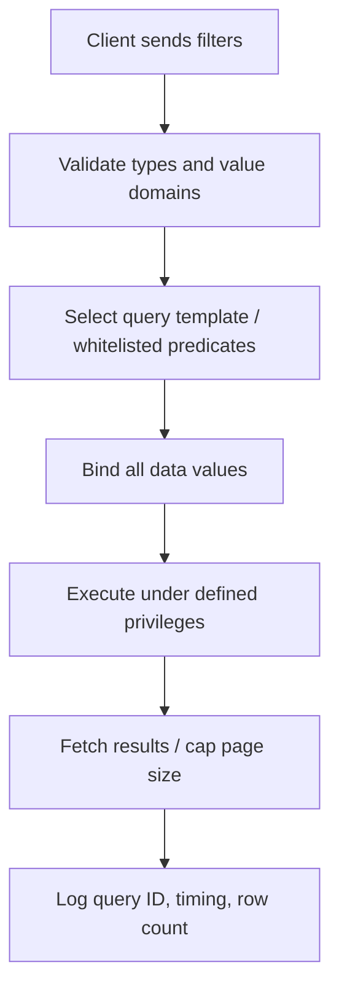

# Dynamic SQL for Flexible Filtering and Security Principles in Oracle Database

An order search screen may allow filtering by customer, status, creation date, total amount, and sorting by multiple columns. Users may enter only a couple of conditions while leaving the rest empty. Writing a separate SQL statement for every filter combination quickly causes the number of statements to explode. **Dynamic SQL** lets a program construct statements at runtime based on valid application choices.

Dynamic SQL is useful when the statement structure truly changes: optional filter counts, table/column names chosen from an allowlist, or query shapes determined only at runtime. However, concatenating user input directly into a SQL string allows attackers to alter statement semantics, read unauthorized data, or perform unintended operations.

Core principles:

- Use **bind variables** for data values.
- Concatenate only syntax fragments controlled by the program.
- Table names, column names, operators, and sort directions must come from a **whitelist (allowlist)**.
- Follow least privilege and understand whose privileges dynamic SQL executes under.
- Handle errors, log safely, and test every filter branch as part of the design.

This lesson focuses on Oracle SQL/PLSQL: `EXECUTE IMMEDIATE`, `OPEN FOR`, `DBMS_SQL`, building optional filters, protecting object names, SQL injection, definer/invoker rights, and performance evaluation.

## 1. Static SQL vs. Dynamic SQL

### 1.1. Static SQL

Static SQL has a structure known at program write/compile time:

```sql
SELECT order_id, customer_id, status, created_at
FROM orders
WHERE customer_id = :customer_id;
```

The `customer_id` value can vary across executions, while the statement structure stays fixed. Prefer this approach whenever it can express the requirement.

In PL/SQL:

```sql
DECLARE
    l_count NUMBER;
BEGIN
    SELECT COUNT(*)
    INTO l_count
    FROM orders
    WHERE customer_id = 1001;
END;
/
```

Oracle knows the SQL statement when compiling PL/SQL, validating object names and data types via static SQL checks. Static SQL is generally easier to read, trace dependencies for, and manage privileges on.

### 1.2. Dynamic SQL

Dynamic SQL is a statement stored as a string and parsed/executed at runtime:

```sql
DECLARE
    l_sql   VARCHAR2(1000);
    l_count NUMBER;
BEGIN
    l_sql := 'SELECT COUNT(*) FROM orders WHERE customer_id = :b1';

    EXECUTE IMMEDIATE l_sql
        INTO l_count
        USING 1001;
END;
/
```

The statement structure lives in `l_sql`; the value 1001 is bound separately. Bind variables let Oracle reuse cursors when statements and parse environments are compatible, while preventing data values from becoming SQL syntax.

### 1.3. When is dynamic SQL needed?

Appropriate scenarios:

1. A screen has optional filter conditions, and only supplied conditions should be included in the SQL.
2. Reports allow choosing a sort or grouping column from a predefined list.
3. Administrative tools operate on multiple tables whose names are determined at runtime.
4. Deployment utilities create or alter database objects from validated configuration.
5. Generic query engines do not know column counts or column types until reading metadata.

Dynamic SQL is not needed merely because data values change. For instance, `WHERE customer_id = :id` already handles varying `customer_id` values via bind variables; there is no reason to concatenate IDs into strings.

## 2. Dynamic SQL Mechanisms in Oracle

Oracle provides two primary ways to execute dynamic SQL in PL/SQL:

| Mechanism | When to use? | Characteristics |
|---|---|---|
| **Native Dynamic SQL (NDS)** | Most common scenarios | `EXECUTE IMMEDIATE`, `OPEN FOR`, concise and easy-to-use syntax |
| **DBMS_SQL** | Number/type of binds or column count unknown at compile time | Low-level API: parse, bind, define, execute, fetch |

Start with Native Dynamic SQL. Use `DBMS_SQL` only when dynamic metadata or variable parameter/column counts genuinely require it.

### 2.1. EXECUTE IMMEDIATE

`EXECUTE IMMEDIATE` parses and executes a dynamic SQL statement or PL/SQL block. Common clauses:

- `INTO` receives a single row from SELECT.
- `BULK COLLECT INTO` receives multiple rows into collections.
- `USING` passes bind arguments.
- `RETURNING INTO` receives values returned by DML.

**DML not returning rows:**

```sql
DECLARE
    l_sql VARCHAR2(1000);
BEGIN
    l_sql := 'UPDATE orders
              SET status = :b1
              WHERE order_id = :b2';

    EXECUTE IMMEDIATE l_sql
        USING 'APPROVED', 5001;
END;
/
```

**Single-row SELECT:**

```sql
DECLARE
    l_sql       VARCHAR2(1000);
    l_order_sum NUMBER;
BEGIN
    l_sql := 'SELECT total_amount
              FROM orders
              WHERE order_id = :b1';

    EXECUTE IMMEDIATE l_sql
        INTO l_order_sum
        USING 5001;
END;
/
```

If a SELECT returns multiple rows when using scalar `INTO`, Oracle raises an error such as `ORA-01422`. If it returns no rows, `NO_DATA_FOUND` is raised. Use a cursor or `BULK COLLECT` whenever multiple rows may be returned.

**Multi-row SELECT with BULK COLLECT:**

```sql
DECLARE
    TYPE t_order_ids IS TABLE OF orders.order_id%TYPE;
    l_order_ids t_order_ids;
BEGIN
    EXECUTE IMMEDIATE
        'SELECT order_id FROM orders WHERE status = :b1'
        BULK COLLECT INTO l_order_ids
        USING 'PENDING';
END;
/
```

**DML with RETURNING INTO:**

```sql
DECLARE
    l_new_status orders.status%TYPE;
BEGIN
    EXECUTE IMMEDIATE
        'UPDATE orders
         SET status = :b1
         WHERE order_id = :b2
         RETURNING status INTO :b3'
        USING 'APPROVED', 5001
        RETURNING INTO l_new_status;
END;
/
```

For output binds, declare compatible types and use the proper `OUT`/`IN OUT` or `RETURNING INTO` syntax for the statement type.

### 2.2. OPEN FOR with REF CURSOR

When a query returns multiple rows and must be read row by row, you can open a `SYS_REFCURSOR`:

```sql
DECLARE
    l_sql VARCHAR2(1000);
    l_rc  SYS_REFCURSOR;
    l_id  orders.order_id%TYPE;
    l_amt orders.total_amount%TYPE;
BEGIN
    l_sql := 'SELECT order_id, total_amount
              FROM orders
              WHERE status = :b1
              ORDER BY created_at DESC';

    OPEN l_rc FOR l_sql USING 'PENDING';

    LOOP
        FETCH l_rc INTO l_id, l_amt;
        EXIT WHEN l_rc%NOTFOUND;
        -- Process current row.
        NULL;
    END LOOP;

    CLOSE l_rc;
EXCEPTION
    WHEN OTHERS THEN
        IF l_rc%ISOPEN THEN
            CLOSE l_rc;
        END IF;
        RAISE;
END;
/
```

In real applications, procedures commonly return a REF CURSOR to the caller rather than fetching everything locally. The caller receiving the cursor must close it after use to release resources.

### 2.3. Placeholders and bind order

When dynamic SQL is a **SQL statement**, Oracle associates bind arguments by **placeholder position**. Do not assume a name like `:customer_id` automatically matches a PL/SQL variable of the same name:

```sql
DECLARE
    l_value NUMBER;
BEGIN
    EXECUTE IMMEDIATE
        'SELECT :x + :x FROM dual'
        INTO l_value
        USING 10, 20;
    -- Two placeholder occurrences receive two bind arguments positionally.
END;
/
```

When dynamic SQL is an anonymous PL/SQL block or `CALL` statement, placeholders associate by unique name rather than SQL-statement positional binding. Verify the statement type and binding rules before repeating placeholder names.

For maintainability:

- Use meaningful placeholder names such as `:b_customer` and `:b_status`.
- Document bind order right at the call site.
- When adding conditions, update both the SQL string and the `USING` list together.
- Never concatenate values into SQL just to avoid managing bind order.

### 2.4. DDL via EXECUTE IMMEDIATE

DDL statements such as CREATE, ALTER, and DROP can be executed dynamically:

```sql
BEGIN
    EXECUTE IMMEDIATE
        'CREATE TABLE temp_report_data (
             report_id NUMBER,
             created_at DATE
         )';
END;
/
```

DDL does not support binding object names or structural clauses. Table/column names must be concatenated only after strict validation. In addition, Oracle DDL generally performs an **implicit commit** before execution and after DDL succeeds; do not treat dynamic DDL like DML that can be rolled back with a transaction.

Never accept raw DDL sent by users and run it via `EXECUTE IMMEDIATE`. Schema deployment tools must use dedicated privileges, validated inputs, and auditing.

## 3. DBMS_SQL When Column or Bind Counts Are Unknown

Native Dynamic SQL works well when bind counts/types and column counts/types are known in code. If a program must read an arbitrary SELECT where column counts are known only after parsing, `DBMS_SQL` provides a low-level API.

General workflow:

1. `DBMS_SQL.OPEN_CURSOR` creates a cursor handle.
2. `DBMS_SQL.PARSE` parses the statement.
3. `DBMS_SQL.BIND_VARIABLE` binds variables.
4. For queries, `DBMS_SQL.DESCRIBE_COLUMNS` retrieves metadata.
5. `DBMS_SQL.DEFINE_COLUMN` defines output buffers for each column.
6. `DBMS_SQL.EXECUTE` executes the statement.
7. `DBMS_SQL.FETCH_ROWS` fetches rows; `COLUMN_VALUE` retrieves values.
8. `DBMS_SQL.CLOSE_CURSOR` closes the cursor.

Illustrative skeleton:

```sql
DECLARE
    l_cursor INTEGER;
    l_exec   INTEGER;
    l_value  NUMBER;
BEGIN
    l_cursor := DBMS_SQL.OPEN_CURSOR;

    DBMS_SQL.PARSE(
        l_cursor,
        'SELECT order_id FROM orders WHERE status = :b1',
        DBMS_SQL.NATIVE
    );

    DBMS_SQL.BIND_VARIABLE(l_cursor, ':b1', 'PENDING');
    DBMS_SQL.DEFINE_COLUMN(l_cursor, 1, l_value);
    l_exec := DBMS_SQL.EXECUTE(l_cursor);

    WHILE DBMS_SQL.FETCH_ROWS(l_cursor) > 0 LOOP
        DBMS_SQL.COLUMN_VALUE(l_cursor, 1, l_value);
        -- Process l_value.
        NULL;
    END LOOP;

    DBMS_SQL.CLOSE_CURSOR(l_cursor);
EXCEPTION
    WHEN OTHERS THEN
        IF DBMS_SQL.IS_OPEN(l_cursor) THEN
            DBMS_SQL.CLOSE_CURSOR(l_cursor);
        END IF;
        RAISE;
END;
/
```

This skeleton handles a single NUMBER column; a general framework must handle data types, precision, LOBs, NULLs, and proper define/fetch logic. `DBMS_SQL` is more complex than NDS, so do not use it unless truly required.

Oracle also supports converting between DBMS_SQL cursors and REF CURSORs via APIs such as `DBMS_SQL.TO_REFCURSOR`/`TO_CURSOR_NUMBER` when appropriate. Check privileges and version constraints before building frameworks around those APIs.

## 4. Building Queries with Optional Filters

### 4.1. Sample requirements

An order search screen lets users enter:

- Customer ID (optional).
- Status (optional).
- Creation date from/to (optional).
- Sort column from a fixed list.
- Sort direction ASC or DESC.

The goal is adding conditions only when parameters are supplied. Statement structure varies with the number of filters, while **filter values are always bound separately**.

### 4.2. Simple approach: optional predicates with OR

A static SQL statement can be written as:

```sql
SELECT order_id, customer_id, status, created_at
FROM orders
WHERE (:p_customer_id IS NULL OR customer_id = :p_customer_id)
  AND (:p_status IS NULL OR status = :p_status);
```

In dynamic SQL:

```sql
DECLARE
    l_rc SYS_REFCURSOR;
BEGIN
    OPEN l_rc FOR
        'SELECT order_id, customer_id, status, created_at
         FROM orders
         WHERE (:b1 IS NULL OR customer_id = :b2)
           AND (:b3 IS NULL OR status = :b4)'
        USING 1001, 1001, 'PENDING', 'PENDING';
END;
/
```

Because this is a SQL statement, four placeholder occurrences require four bind arguments. This keeps a single SQL statement, though `(:p IS NULL OR col = :p)` conditions can make it harder for the optimizer to pick optimal access paths in some workloads. Measure against realistic data and binds.

### 4.3. Appending predicates dynamically, binding all values

Another approach appends only **fixed condition fragments authored in code**:

```sql
CREATE OR REPLACE PROCEDURE open_order_search (
    p_customer_id IN orders.customer_id%TYPE,
    p_status      IN orders.status%TYPE,
    p_result      OUT SYS_REFCURSOR
)
AUTHID DEFINER
AS
    l_sql VARCHAR2(32767) :=
        'SELECT order_id, customer_id, status, created_at
           FROM orders
          WHERE 1 = 1';
BEGIN
    IF p_customer_id IS NOT NULL THEN
        l_sql := l_sql || ' AND customer_id = :b_customer';
    END IF;

    IF p_status IS NOT NULL THEN
        l_sql := l_sql || ' AND status = :b_status';
    END IF;

    IF p_customer_id IS NOT NULL AND p_status IS NOT NULL THEN
        OPEN p_result FOR l_sql USING p_customer_id, p_status;
    ELSIF p_customer_id IS NOT NULL THEN
        OPEN p_result FOR l_sql USING p_customer_id;
    ELSIF p_status IS NOT NULL THEN
        OPEN p_result FOR l_sql USING p_status;
    ELSE
        OPEN p_result FOR l_sql;
    END IF;
END;
/
```

This snippet illustrates appending predicates in deterministic order. In a SQL statement, bind arguments match placeholder appearance order: if only status is supplied, the status placeholder is the sole placeholder and `USING p_status` is exact. As optional filters multiply, bind-combination branches grow rapidly; at that point, encapsulate bind building or use a controlled framework.

### 4.4. Adding half-open date ranges

For timestamp filters, usually prefer:

```sql
created_at >= :b_from
AND created_at < :b_to_exclusive
```

For example, when a user picks 01/11 through 30/11, the application can compute the start of December as the exclusive upper bound. This avoids missing fractional seconds at the end of the day. For TSTZ columns, standardize the timezone of both binds and local boundary rules.

Avoid building predicates like:

```sql
TO_CHAR(created_at, 'YYYY-MM-DD') = '2026-11-30'
```

just to compare dates; converting the column to text can inhibit index usage and introduces format dependencies. Use typed binds and ranges.

### 4.5. Handling dynamic sorting safely

You cannot bind a column name or ASC/DESC keyword as a value:

```sql
ORDER BY :sort_column
```

does not make Oracle sort by the bound column name; binds are data values. To select a column, map a known choice key to a fixed SQL expression:

```sql
DECLARE
    l_sort_expression VARCHAR2(100);
    l_direction       VARCHAR2(4);
    l_sql             VARCHAR2(2000);
    l_rc              SYS_REFCURSOR;
    p_sort_key        VARCHAR2(20) := 'CREATED';
    p_sort_direction VARCHAR2(4)  := 'DESC';
BEGIN
    l_sort_expression :=
        CASE UPPER(p_sort_key)
            WHEN 'CREATED' THEN 'created_at'
            WHEN 'AMOUNT'  THEN 'total_amount'
            WHEN 'ID'      THEN 'order_id'
            ELSE 'order_id'
        END;

    IF UPPER(p_sort_direction) = 'ASC' THEN
        l_direction := 'ASC';
    ELSIF UPPER(p_sort_direction) = 'DESC' THEN
        l_direction := 'DESC';
    ELSE
        RAISE_APPLICATION_ERROR(-20001, 'Invalid sort direction');
    END IF;

    l_sql := 'SELECT order_id, total_amount, created_at
              FROM orders
              ORDER BY ' || l_sort_expression || ' ' || l_direction;

    OPEN l_rc FOR l_sql;
END;
/
```

All strings concatenated into SQL here come from program-defined CASE/IF branches, never arbitrary user values. In real applications, reject invalid sort keys rather than silently falling back to ID if doing so could mislead users.

## 5. Bind Variables: The Boundary Between Data and Syntax

### 5.1. Never concatenate values into SQL statements

Dangerous example:

```sql
-- Unsafe:
l_sql := 'SELECT order_id
          FROM orders
          WHERE customer_name = ''' || p_customer_name || '''';
EXECUTE IMMEDIATE l_sql;
```

If input contains quotes and SQL syntax, the statement string can be altered. An input like `' OR '1' = '1` can turn a single-customer lookup into an always-true condition, depending on how concatenation is written.

Safe approach:

```sql
l_sql := 'SELECT order_id
          FROM orders
          WHERE customer_name = :b1';

OPEN p_result FOR l_sql USING p_customer_name;
```

Bind variables pass values separately to the SQL engine. Quotes, semicolons, or keywords inside values are treated purely as data, never parsed as syntax.

### 5.2. Binds protect values, not object names

Binds work for value expressions:

```sql
WHERE customer_id = :b_customer
AND created_at >= :b_from
```

However, binds cannot be used for:

- Table names: `FROM :table_name`.
- Column names: `ORDER BY :column_name`.
- Schema, index, or constraint names.
- Operators: `WHERE amount :operator :value`.
- Keywords or sort directions: `ORDER BY created_at :direction`.

These elements are SQL structure. Select them from a whitelist and concatenate only program-controlled expressions.

### 5.3. Binds enable cursor reuse

These two SQL statements have different text:

```sql
SELECT * FROM orders WHERE customer_id = 1001;
SELECT * FROM orders WHERE customer_id = 1002;
```

Concatenating literals forces Oracle to parse separate statements. Using one statement:

```sql
SELECT * FROM orders WHERE customer_id = :b1;
```

and binding 1001, 1002 improves cursor sharing, reduces hard parses, and separates data from syntax. Cursor sharing also depends on schema, optimizer environment, bind metadata, and other compatibility criteria.

### 5.4. Binds do not mean every value gets the same execution plan

Bind variables cause the optimizer to estimate cardinality using statistics, bind peeking, and adaptive cursor sharing. With heavily skewed data, a common value and a rare value may need different plans. Rely on statistics and observe actual cursors; never abandon binds merely because one plan looks suboptimal.

## 6. SQL Injection and Attack Vectors

### 6.1. SQL injection happens when data becomes syntax

Suppose code concatenates:

```sql
l_sql := 'SELECT order_id FROM orders WHERE status = '''
         || p_status || '''';
```

A normal user sends `PENDING`. An attacker sending quotes, operators, and comments can rewrite the SQL structure. Impact depends on the privileges of the schema running the statement:

- Bypassing filter conditions.
- Reading additional data.
- Unexpectedly updating or deleting data.
- Invoking privileged PL/SQL or packages if the statement permits.
- Abusing privileges of a definer-rights procedure.

### 6.2. SQL injection in dynamic PL/SQL blocks

Concatenating input into anonymous blocks is especially dangerous because blocks can contain multiple PL/SQL statements:

```sql
-- Unsafe: input can alter block structure.
l_block := 'BEGIN
              UPDATE audit_target
                 SET note_text = ''' || p_note || '''
               WHERE audit_id = 1;
            END;';
EXECUTE IMMEDIATE l_block;
```

Use binds instead:

```sql
l_block := 'BEGIN
              UPDATE audit_target
                 SET note_text = :b_note
               WHERE audit_id = :b_id;
            END;';

EXECUTE IMMEDIATE l_block USING p_note, 1;
```

In anonymous PL/SQL blocks, placeholders associate by unique name; when duplicate placeholder names occur, follow the binding rules for that statement type and avoid ambiguous placeholders. In new code, keep placeholders simple and verify bind order and types.

### 6.3. Second-order SQL injection

Not every malicious payload arrives directly from a user screen. A value can be stored in a configuration table and later read and concatenated into dynamic SQL. When stored, it was merely data; when concatenated into SQL later, it becomes syntax.

For example, column names or filters stored in a config table entered by an administrator. When reused, still apply whitelist/identifier validation—never trust data simply because it already lives in the database.

### 6.4. NLS injection and implicit conversion

Converting DATE/NUMBER values into strings via NLS settings can produce unexpected text:

```sql
-- Avoid: date value converted to text using session NLS.
l_sql := 'SELECT ... WHERE created_at = '''
         || p_date
         || '''';
```

Numeric values can also format using session decimal/grouping characters. Never construct SQL relying on implicit `NLS_DATE_FORMAT` or `NLS_NUMERIC_CHARACTERS`. Bind typed DATE, TIMESTAMP, and NUMBER values to eliminate this entire string-conversion class.

### 6.5. LIKE still treats wildcards specially even when bound

Bind variables prevent SQL injection, yet do not alter the wildcard meaning of `%` and `_` in the LIKE operator. If search should treat those characters literally, escape them explicitly:

```sql
WHERE customer_name LIKE :b_pattern ESCAPE '\'
```

The application must escape the escape character first, then escape `%` and `_`, and only then append wildcards intentionally permitted by search. This is a search-semantics concern, distinct from SQL injection.

## 7. Whitelisting Table Names, Column Names, and Keywords

### 7.1. Whitelists beat arbitrary string checks

Suppose a report allows sorting by creation date, amount, or order ID. Map them:

| Value sent by app | Fixed SQL fragment |
|---|---|
| `CREATED` | `created_at` |
| `AMOUNT` | `total_amount` |
| `ID` | `order_id` |

Never concatenate raw input:

```sql
-- Wrong:
l_sql := 'SELECT ... ORDER BY ' || p_sort_column;
```

Use a mapping instead:

```sql
CASE UPPER(p_sort_column)
    WHEN 'CREATED' THEN l_sort_column := 'created_at';
    WHEN 'AMOUNT'  THEN l_sort_column := 'total_amount';
    WHEN 'ID'      THEN l_sort_column := 'order_id';
    ELSE
        RAISE_APPLICATION_ERROR(-20002, 'Unsupported sort key');
END CASE;
```

Then concatenate only `l_sort_column` produced by the mapping.

### 7.2. DBMS_ASSERT aids identifier validation

Oracle provides the `DBMS_ASSERT` package to validate certain SQL name/string forms. Common functions:

| Function | General purpose |
|---|---|
| `SIMPLE_SQL_NAME` | Validates a simple SQL name form |
| `QUALIFIED_SQL_NAME` | Validates a properly qualified SQL name |
| `SQL_OBJECT_NAME` | Validates that a SQL object name exists per function rules |
| `ENQUOTE_NAME` | Validates and quotes an identifier |
| `ENQUOTE_LITERAL` | Quotes a literal according to SQL rules |

Illustrative example:

```sql
DECLARE
    l_table_name VARCHAR2(128);
    l_sql        VARCHAR2(1000);
    l_count      NUMBER;
BEGIN
    -- p_table_name must be restricted per application policy.
    l_table_name := DBMS_ASSERT.SQL_OBJECT_NAME('APP_REPORTS');
    l_sql := 'SELECT COUNT(*) FROM ' || l_table_name;
    EXECUTE IMMEDIATE l_sql INTO l_count;
END;
/
```

`DBMS_ASSERT` validates syntax/names according to each function's contract. It **does not replace business whitelists, authorization, or least privilege**. A valid object name can still be a table the caller is unauthorized to view; an existing object does not imply the user has permission to access it.

If only three specific report tables are permitted, a three-table whitelist remains far clearer control than accepting any valid name.

### 7.3. ENQUOTE_LITERAL does not replace binds

`DBMS_ASSERT.ENQUOTE_LITERAL` can assist in quoting literals inside SQL-generation utilities, yet for data values in executed statements, **bind variables remain the preferred choice**. Manual quoting is error-prone with NLS, encoding, quotes, and data types.

Do not use `DBMS_ASSERT` to "sanitize" entire SQL statements. It is neither a SQL parser nor a general-purpose injection filter.

## 8. Building Multi-Condition Dynamic Queries Safely

### 8.1. Concatenate only code-defined predicates

Example adding filter conditions:

```sql
IF p_customer_id IS NOT NULL THEN
    l_sql := l_sql || ' AND customer_id = :b_customer';
END IF;

IF p_status IS NOT NULL THEN
    l_sql := l_sql || ' AND status = :b_status';
END IF;

IF p_from_date IS NOT NULL THEN
    l_sql := l_sql || ' AND created_at >= :b_from';
END IF;

IF p_to_date IS NOT NULL THEN
    l_sql := l_sql || ' AND created_at < :b_to';
END IF;
```

The concatenated fragments are fixed literals in source code. Nothing comes directly from user content. Values are bound in the exact order predicates are added.

### 8.2. Keep bind order consistent

With four optional filters, you could branch by combination like the two-filter example in section 4.3. With more filters, combinatorial branches explode; better options include:

- Using static predicates with binds and evaluating their plans.
- Using a helper package that builds SQL and manages a typed bind list.
- Using `DBMS_SQL` to bind parameters dynamically one by one.
- Splitting query groups into dedicated procedures/query templates.

Do not build an overly generalized binding framework if you only have a few fixed filters; complexity itself is a maintenance risk.

### 8.3. Variable-length IN lists

You cannot bind a string `'10,20,30'` to a single placeholder and expect Oracle to treat it as three values:

```sql
-- Does not work as a three-element list:
WHERE department_id IN (:id_list)
```

A placeholder represents a single scalar value. Valid alternatives:

1. Generate one code-authored placeholder `:bN` per element and bind each value individually.
2. Use a SQL collection type and `TABLE(collection_bind)` if supported by the application/driver.
3. Insert the list into a global temporary table or batch-keyed staging table and join against it.

Example with three binds:

```sql
SELECT employee_id
FROM employees
WHERE department_id IN (:b1, :b2, :b3);
```

Values 10, 20, and 30 must be passed via `USING`; never concatenate them as literals. If a list can contain NULLs, apply proper `IN/NOT IN` and NULL semantics.

### 8.4. Empty filters require explicit definitions

If a user does not select a status, the status condition should be skipped. If a user submits an explicitly empty status list, business logic might mean "return zero rows" or "do not filter by status". Those two meanings are opposite.

Never let an empty list accidentally generate `IN ()`. Handle it in the application before constructing SQL:

- Filter not provided: omit predicate.
- Filter provided as an empty set: return zero rows or reject as invalid input per contract.
- Filter has values: generate placeholders and bind.

## 9. Execution Privileges: AUTHID DEFINER vs. AUTHID CURRENT_USER

Dynamic SQL carries not only injection risk, but also **privilege execution** implications.

### 9.1. Definer-rights

PL/SQL stored procedures default to definer-rights unless specified otherwise:

```sql
CREATE OR REPLACE PROCEDURE report_orders
AUTHID DEFINER
AS
BEGIN
    -- SQL executes under the owner's privilege context per definer-rights model.
    NULL;
END;
/
```

In a definer-rights unit, privileges are checked against the unit owner; roles are generally disabled during execution of named definer-rights PL/SQL. Required privileges on referenced objects must be granted directly to the owner per Oracle rules, not via the owner's roles.

If a procedure accepts arbitrary table names or SQL fragments from callers, it can become a **privilege-escalation vector**: callers exploit the owner's broader privileges to access objects they cannot query directly. Therefore, definer-rights units require narrow APIs, strict whitelists, and business-level authorization checks.

### 9.2. Invoker-rights

Declaration:

```sql
CREATE OR REPLACE PROCEDURE user_scoped_report
AUTHID CURRENT_USER
AS
BEGIN
    NULL;
END;
/
```

`AUTHID CURRENT_USER` runs the procedure under the invoker's privileges within Oracle's defined contexts. It fits utilities intended to operate under each caller's own permissions, yet does not automatically solve all authorization concerns. You must still validate inputs, verify objects, and understand current schema, roles, privileges, and called packages.

### 9.3. Choosing a privilege model by purpose

| Purpose | Consideration |
|---|---|
| Business API accessing a fixed set of application-schema tables | Definer-rights with minimal owner privileges and narrow interface |
| Utility running queries under each caller's own permissions | Invoker-rights may be appropriate |
| DBA tool administering multiple schemas | Dedicated administrative privileges, strict controls, auditing; never exposed to app accounts |
| End-user reporting | Grant access via scoped views/APIs; avoid accepting arbitrary SQL |

Never grant `SELECT ANY TABLE`, `UPDATE ANY TABLE`, or similar broad privileges just to make a dynamic procedure run. Grant least privileges on the exact objects required.

## 10. Dynamic DDL and Operational Impacts

### 10.1. Table names cannot be bound

DDL often requires concatenating identifiers:

```sql
EXECUTE IMMEDIATE
    'CREATE INDEX ix_orders_status
     ON orders(status)';
```

If object names come from configuration, validate names and restrict scope:

```sql
DECLARE
    l_table VARCHAR2(128);
    l_sql   VARCHAR2(1000);
BEGIN
    CASE UPPER('ORDERS')
        WHEN 'ORDERS' THEN l_table := 'ORDERS';
        WHEN 'INVOICES' THEN l_table := 'INVOICES';
        ELSE
            RAISE_APPLICATION_ERROR(-20010, 'Unsupported table');
    END CASE;

    l_sql := 'CREATE INDEX ix_status_dynamic ON '
             || l_table || '(status)';
    EXECUTE IMMEDIATE l_sql;
END;
/
```

In this example, the table name comes from a fixed mapping. Index names should also follow controlled naming conventions to avoid collisions, special characters, or exceeding the version's identifier length limit.

### 10.2. DDL performs an implicit commit

DDL in Oracle can commit the current transaction before running and commit again after DDL succeeds. Therefore:

- Never run dynamic DDL mid-business transaction expecting rollback to undo everything.
- Separate schema migrations from user requests.
- Verify pre- and post-DDL state.
- Have a dedicated recovery plan; do not treat DROP/ALTER as ordinarily rollbackable operations.

### 10.3. Running DDL with elevated privileges

A package may hold privileges to create or drop objects. If that package accepts object names or DDL fragments from untrusted input, it can be abused. Keep DDL tools separate from search APIs, restrict execution to authorized operations teams, log audit trails, and predefine allowed operations.

## 11. Error Handling and Cursor Management

### 11.1. Never swallow errors

Avoid:

```sql
EXCEPTION
    WHEN OTHERS THEN
        NULL;
```

This misleads the application into thinking the operation succeeded when SQL failed. At minimum, close cursors/resources and re-raise:

```sql
EXCEPTION
    WHEN OTHERS THEN
        IF l_rc%ISOPEN THEN
            CLOSE l_rc;
        END IF;
        RAISE;
```

If translating errors to business codes, preserve root cause via secure logging and raise `RAISE_APPLICATION_ERROR` with a safe message; never return raw SQL or sensitive data to the UI.

### 11.2. Safe statement and bind logging

For diagnostics, you can log:

- Template/query ID.
- Enabled filter names.
- Parse/execute duration and returned row count.
- Oracle error code and module/action/client identifier.
- Template hash or masked bind metadata.

Never log passwords, tokens, personal data, or raw sensitive bind values. If logging raw SQL, ensure it never contains concatenated user literals; the design goal is keeping values bound.

### 11.3. Close cursors on every path

A REF CURSOR is a resource. If an application opens a cursor without fetching/closing, the session holds resources longer than necessary. The caller receiving the cursor must close it in a finally/try-with-resources block per its framework. With DBMS_SQL, always close cursors in exception handlers if still open.

## 12. Performance and Maintainability

### 12.1. Dynamic SQL can generate many SQL texts

If every filter combination produces a different SQL text, the database has to manage multiple cursors. This is not always bad; omitting unused predicates can help the optimizer choose better plans. However, concatenating literal values per execution explodes statement counts and drives up hard parses.

Combining dynamic predicates with bind values:

- Templates with the same structure can share cursors.
- Only distinct predicate combinations create distinct SQL texts.
- Individual data values never alter the SQL text.

### 12.2. Fixed OR predicates vs. dynamic predicates?

| Approach | Advantage | Trade-off |
|---|---|---|
| `(:p IS NULL OR col = :p)` | Single static SQL, easy to bind | Can hinder optimal index/cardinality choices in some workloads |
| Dynamic predicates for supplied filters | SQL contains only active conditions | Multiple SQL texts across filter combinations; must manage bind order |
| Multiple specialized query templates | Predictable plans, clear logic per query group | More code/templates to maintain |

No single option fits every system. Evaluate execution plans, buffer gets, parse counts, and latency on real workloads.

### 12.3. Pagination and ORDER BY

Oracle 12c+ example supporting the row limiting clause:

```sql
SELECT order_id, created_at, total_amount
FROM orders
WHERE status = :b1
ORDER BY created_at DESC, order_id DESC
OFFSET :b2 ROWS
FETCH NEXT :b3 ROWS ONLY;
```

Filter, offset, and page size values can be bound. Column names and sort directions must still be controlled via whitelists. Appending a unique key at the end of ORDER BY (such as `order_id`) keeps ordering deterministic when rows share `created_at`.

For deep pages, large OFFSETs read and discard many rows. Consider keyset pagination:

```sql
SELECT order_id, created_at, total_amount
FROM orders
WHERE status = :b_status
  AND (
       created_at < :b_last_created
       OR (created_at = :b_last_created AND order_id < :b_last_id)
  )
ORDER BY created_at DESC, order_id DESC
FETCH FIRST :b_page_size ROWS ONLY;
```

Keyset pagination requires consistent ordering and comparison operators, explicit NULL handling, and binding all cursor values.

## 13. A Secure Architecture for Search APIs

A search procedure should maintain clear boundaries:



Layers:

1. **API layer:** enforces lengths, types, filter limits, page sizes, and sort keys.
2. **Query builder:** concatenates only approved fixed predicates/identifiers.
3. **Bind layer:** manages data types and bind order.
4. **Privilege layer:** procedure runs with least privilege and proper AUTHID.
5. **Execution layer:** cursors close promptly; timeouts/cancellations supported per framework.
6. **Observability:** logs template ID, elapsed time, error codes, and row counts; masks sensitive data.

Never let clients send a `WHERE` fragment, `ORDER BY` fragment, or full SQL statement. APIs should accept structured fields, not SQL syntax.

## 14. Unsafe SQL Patterns and Safe Alternatives

| Unsafe pattern | Risk | Fix |
|---|---|---|
| Concatenating input into `WHERE name = '...'` | SQL injection | Bind values |
| Concatenating implicitly converted numbers/dates | NLS injection and formatting bugs | Bind NUMBER/DATE/TIMESTAMP |
| Concatenating sort column directly | Alters syntax / leaks unintended columns | Whitelist mapping |
| Concatenating sort direction directly | Injects SQL tokens | Accept only ASC/DESC via enum |
| Accepting arbitrary table names in definer-rights proc | Exploits owner privileges | Whitelist + authorization + least privilege |
| Concatenating ID list as literal string | Injection, excessive parsing, quoting bugs | Bind per element or use collection/table |
| Using `IN (:csv_text)` | A single bind is one scalar value | Per-element placeholders or SQL collection |
| Swallowing all exceptions | Masks failures, corrupts state | Safe logging, cleanup, re-raise |
| Running DDL inside business transactions | Unintended implicit commits | Separate schema migrations and admin |
| Logging raw sensitive bind values | Data leakage | Redact/tokenize, log metadata |

## 15. Guided Hands-On Practice

Run in a lab schema using an existing `ORDERS` table or a dedicated test table. Do not grant DBA privileges to the practice account.

### Step 1 — Simple dynamic SQL with binds

```sql
DECLARE
    l_sql   VARCHAR2(1000);
    l_count NUMBER;
BEGIN
    l_sql := 'SELECT COUNT(*) FROM orders WHERE status = :b1';
    EXECUTE IMMEDIATE l_sql INTO l_count USING 'PENDING';
    DBMS_OUTPUT.PUT_LINE('Rows: ' || l_count);
END;
/
```

Re-run with a different status and observe that the SQL text remains unchanged.

### Step 2 — Create a REF CURSOR with OPEN FOR

```sql
DECLARE
    l_rc SYS_REFCURSOR;
BEGIN
    OPEN l_rc FOR
        'SELECT order_id, total_amount
         FROM orders
         WHERE customer_id = :b1'
        USING 1001;

    -- In the lab you can fetch here; close the cursor after use.
    CLOSE l_rc;
END;
/
```

### Step 3 — Add optional filters

Write a procedure following section 4.3 with two filters (customer and status). Test four cases:

1. No filters.
2. Customer only.
3. Status only.
4. Both customer and status.

Record the SQL text and bind order in each case.

### Step 4 — Test the sort whitelist

Allow sorting by CREATED, AMOUNT, ID. Submit an unlisted value like `TOTAL_AMOUNT DESC NULLS FIRST` and verify the API rejects it. Never concatenate raw input into SQL.

### Step 5 — Observe SQL injection

In a private lab, test two versions:

- An unsafe literal-concatenation version with input containing quotes and an always-true condition.
- A bound version with the same input.

Compare the resulting SQL structure and output. Never test on production data or objects outside your control.

### Step 6 — Handle IN lists

Write a query with three placeholders and bind three IDs. Then test an empty list and a list containing NULL; define intended semantics before generating SQL.

### Step 7 — Test AUTHID

In a lab schema with two users and a dedicated table, create definer-rights and invoker-rights procedures per DBA guidance. Grant minimal privileges, invoke from the other user, and observe which privileges apply. Never grant ANY privileges just to run an experiment.

### Step 8 — Measure execution plans

Compare:

- Optional OR predicates.
- Dynamic predicates adding only supplied filters.
- Specialized query templates for frequent filters.

Collect plans, buffer gets, elapsed times, and parse counts on representative data. A table with only a handful of rows is insufficient to declare a winning strategy.

## 16. Safe Dynamic SQL Design Checklist

Before deploying dynamic SQL into an application, verify:

- [ ] There is a genuine need for statement structure to vary.
- [ ] Every data value is bound with the proper data type.
- [ ] User input is never concatenated into literals, predicates, or PL/SQL blocks.
- [ ] Table names, column names, sort keys, and operators come from whitelists.
- [ ] If using DBMS_ASSERT, you understand what it validates and what it does not.
- [ ] Empty lists, NULLs, and omitted filters have explicit semantics.
- [ ] Bind placeholders and USING order are controlled and tested across all branches.
- [ ] AUTHID privileges and direct grants vs. roles are understood clearly.
- [ ] Procedures do not amplify caller privileges beyond intended scope.
- [ ] DDL is isolated from business transactions.
- [ ] Cursors are closed both on success and in exception handlers.
- [ ] Errors are logged without exposing sensitive data.
- [ ] Logs capture query/template ID and execution duration.
- [ ] Execution plans and workloads have been measured.

## 17. Self-Check Questions

1. How does static SQL differ from dynamic SQL in when statement structure is determined?
2. When should you use `EXECUTE IMMEDIATE` versus `OPEN FOR`?
3. How do `INTO` and `BULK COLLECT INTO` differ when a SELECT returns multiple rows?
4. Does Native Dynamic SQL bind SQL-statement placeholders by position or by name?
5. Why can't table names or column names be bound via placeholders?
6. Why must a whitelist be used for sort keys and ASC/DESC?
7. What checks does `DBMS_ASSERT` support, and why does it not replace authorization?
8. How can SQL injection occur inside an anonymous PL/SQL block?
9. What is second-order SQL injection?
10. How can NLS injection arise when converting DATE/NUMBER values into strings?
11. How do bind variables help cursor sharing, and do they guarantee one good execution plan for every value?
12. How do `AUTHID DEFINER` and `AUTHID CURRENT_USER` differ in privilege context?
13. Why is a definer-rights procedure accepting arbitrary table names risky?
14. By what mechanism does dynamic DDL affect transactions?
15. Why can't `IN (:id_list)` treat a CSV string as multiple elements?
16. When should you choose DBMS_SQL over Native Dynamic SQL?
17. Why must REF CURSORs and DBMS_SQL cursors be closed in exception handlers?

Dynamic SQL is a powerful tool for building flexible queries, yet it is safe only when **structure and data remain strictly separated**. Keep SQL inside controlled templates, bind every value, whitelist every identifier, and run with least privilege. When these boundaries are cleanly designed, applications can handle diverse filtering and sorting needs while protecting data and remaining maintainable and tunable over the long term.
