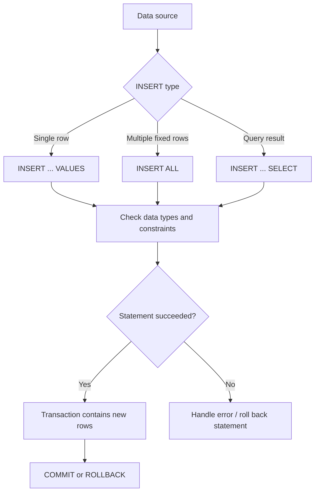

# Single-Row INSERT, Multi-Row INSERT, and INSERT from SELECT in Oracle Database

`INSERT` is the DML statement used to add new rows to a table. In Oracle applications, data can come from a user form, a set of values generated in code, a staging table, an aggregation query, or another table. While all of these perform data insertion, the SQL syntax differs depending on the source:

- **Single-row INSERT:** adds one row using `VALUES`.
- **Multi-row INSERT:** adds multiple rows in a single statement, such as `INSERT ALL` or `INSERT ... SELECT`.
- **INSERT from SELECT:** retrieves a set of rows from a source query and writes them into a target table.

Understanding these three forms correctly helps reduce database round trips, control data types, handle constraints, and design data loading processes that can be re-run safely. This lesson uses Oracle SQL/PLSQL syntax and focuses on column lists, default values, identity/sequence, multi-table insert, transactions, data errors, bulk processing, and performance.

## 1. How Does INSERT Add Data to a Table?

A relational table stores rows according to its declared column structure. When inserting rows, Oracle needs to know:

1. **Target table**: the object receiving the data.
2. **Target columns**: which columns will be assigned values.
3. **Value source**: literals, bind variables, expressions, or a SELECT result.
4. **Constraints**: whether the data satisfies NOT NULL, PRIMARY KEY, UNIQUE, FOREIGN KEY, CHECK, and other rules.
5. **Transaction**: whether the changes are committed or rolled back.

Simple example:

```sql
INSERT INTO departments (
    department_id,
    department_name,
    location_id
)
VALUES (
    50,
    'Research',
    1700
);
```

The statement adds one row to the `DEPARTMENTS` table. If the statement succeeds, the row is in the current transaction; other sessions cannot see it until the transaction is committed.

Overview diagram:



## 2. Single-Row INSERT with VALUES

### 2.1. Basic Syntax

```sql
INSERT INTO table_name (
    column_1,
    column_2,
    ...
)
VALUES (
    expression_1,
    expression_2,
    ...
);
```

The number of values must match the number of listed columns; data types and expressions must be compatible with the target columns. If the column list is omitted, Oracle requires providing values in the table's column order and must satisfy columns without defaults/nullability.

You should **always specify the column list**:

```sql
INSERT INTO customers (
    customer_id,
    customer_name,
    email_address,
    status
)
VALUES (
    1001,
    'Nguyen An',
    'an@example.test',
    'ACTIVE'
);
```

The column list makes the statement self-describing, avoids depending on DDL column order, and reduces the risk of assigning values to the wrong columns when the table changes.

### 2.2. Omitting the Column List: Why Is It Error-Prone?

Example:

```sql
INSERT INTO customers
VALUES (
    1002,
    'Tran Binh',
    'binh@example.test',
    'ACTIVE'
);
```

Oracle matches values by the table's column order. If a new column is added to the table or the column order differs from the author's assumption, the statement may fail or assign values with the wrong meaning. When the schema changes, INSERT statements without column lists are often difficult to maintain.

### 2.3. Single-Row INSERT from DUAL

`DUAL` is a special single-row table, commonly used to evaluate expressions or generate a single SELECT row:

```sql
INSERT INTO system_events (
    event_id,
    event_name,
    created_at
)
SELECT
    9001,
    'IMPORT_STARTED',
    SYSTIMESTAMP
FROM dual;
```

In terms of result, this adds one row from a query. This approach is useful when values are generated by SQL functions, expressions, or when SELECT syntax is needed. For a simple literal row, `VALUES` is usually clearer.

### 2.4. Expression Values and SQL Functions

`VALUES` does not only accept literals. You can use bind variables, operations, and functions:

```sql
INSERT INTO audit_log (
    audit_id,
    action_code,
    actor_name,
    created_at,
    note
)
VALUES (
    audit_seq.NEXTVAL,
    'CUSTOMER_CREATED',
    USER,
    SYSTIMESTAMP,
    'Created from customer screen'
);
```

Expressions are evaluated in the statement context. `SYSTIMESTAMP` returns the database host system timestamp with the appropriate timezone/precision; `USER` returns the current database user name. If the application needs a client-generated timestamp or a specific business timezone, define the time source explicitly rather than using system functions by default.

## 3. Column Lists, DEFAULT, and NULL

### 3.1. Omitting Columns from INSERT

Suppose we have a table:

```sql
CREATE TABLE customer_demo (
    customer_id   NUMBER(10) PRIMARY KEY,
    customer_name VARCHAR2(100 CHAR) NOT NULL,
    status        VARCHAR2(20 CHAR) DEFAULT 'NEW' NOT NULL,
    created_at    TIMESTAMP(6) DEFAULT SYSTIMESTAMP NOT NULL,
    note          VARCHAR2(300 CHAR)
);
```

You can insert without passing `STATUS`, `CREATED_AT`, and `NOTE`:

```sql
INSERT INTO customer_demo (
    customer_id,
    customer_name
)
VALUES (
    1,
    'Le Chi'
);
```

Result:

- `STATUS` receives the default `NEW`.
- `CREATED_AT` receives `SYSTIMESTAMP` at execution time.
- `NOTE` has no default, so it receives NULL because the column is nullable.

Omitting a column from the INSERT list is different from explicitly passing NULL.

### 3.2. Omitting a Column and Passing NULL Are Not the Same

With a column that has a default:

```sql
INSERT INTO customer_demo (
    customer_id,
    customer_name,
    status
)
VALUES (
    2,
    'Do Dung',
    NULL
);
```

Here `STATUS` is explicitly passed as NULL. If the column has a NOT NULL constraint, the statement fails; Oracle does not automatically replace NULL with a normal default just because the column has a default.

If you want to use the default, you can:

```sql
INSERT INTO customer_demo (
    customer_id,
    customer_name
)
VALUES (
    3,
    'Pham Ha'
);
```

Or in versions that support the DEFAULT keyword in values expressions:

```sql
INSERT INTO customer_demo (
    customer_id,
    customer_name,
    status
)
VALUES (
    4,
    'Vu Nam',
    DEFAULT
);
```

Check the syntax for your Oracle version when working with older systems. Omitting the column from the list is the simplest and most compatible way to get the default.

### 3.3. DEFAULT ON NULL

Oracle supports declaring a default that applies when the input value is NULL:

```sql
CREATE TABLE source_channel_demo (
    channel_id NUMBER(10) PRIMARY KEY,
    channel_code VARCHAR2(20 CHAR)
        DEFAULT ON NULL 'WEB'
);
```

With this configuration, when inserting NULL for `CHANNEL_CODE`, the default can be used according to Oracle's `DEFAULT ON NULL` semantics. Syntax availability and interaction with column types should be verified per release; it also implies a NOT NULL constraint in the corresponding Oracle declaration forms. Do not use default-on-null if NULL has a distinct business meaning such as "unspecified".

### 3.4. DEFAULT in INSERT ... SELECT

You cannot by default write `DEFAULT` as an arbitrary SELECT expression:

```sql
-- Do not use DEFAULT as a normal SELECT expression:
INSERT INTO customer_demo (customer_id, customer_name, status)
SELECT customer_id, customer_name, DEFAULT
FROM customer_stage;
```

If you want the target column to receive its default, omit that column from the target list:

```sql
INSERT INTO customer_demo (
    customer_id,
    customer_name
)
SELECT
    customer_id,
    customer_name
FROM customer_stage;
```

Oracle applies the default to the omitted target column. The number and order of columns in SELECT must match the target column list.

### 3.5. How Oracle Handles Empty Strings

In Oracle SQL, a zero-length character string in VARCHAR2 is treated as NULL:

```sql
INSERT INTO customer_demo (
    customer_id,
    customer_name,
    note
)
VALUES (
    5,
    'Hoang Lan',
    ''
);
```

`NOTE` is stored with NULL semantics, not as a distinct empty string. If the application needs to distinguish between "not provided", "empty string provided", and "unknown", you must design an additional status or data convention.

## 4. Key Generation with IDENTITY and SEQUENCE

### 4.1. Identity Column

Oracle supports identity columns for automatic number generation:

```sql
CREATE TABLE order_demo (
    order_id NUMBER GENERATED ALWAYS AS IDENTITY
        CONSTRAINT pk_order_demo PRIMARY KEY,
    customer_id NUMBER(10) NOT NULL,
    status VARCHAR2(20 CHAR) DEFAULT 'NEW' NOT NULL,
    created_at TIMESTAMP(6) DEFAULT SYSTIMESTAMP NOT NULL
);
```

Insert a row without providing `ORDER_ID`:

```sql
INSERT INTO order_demo (customer_id)
VALUES (1001);
```

With `GENERATED ALWAYS`, the application cannot explicitly pass a value into the identity column in a normal INSERT; Oracle generates the value automatically. Common variants:

| Declaration | Meaning |
|---|---|
| `GENERATED ALWAYS AS IDENTITY` | Always let Oracle generate the value; does not accept explicit values in normal INSERT |
| `GENERATED BY DEFAULT AS IDENTITY` | Oracle generates when the column is omitted; explicit values can be provided |
| `GENERATED BY DEFAULT ON NULL AS IDENTITY` | Oracle generates when the column is omitted or the input value is NULL per declaration semantics |

Identity columns are backed by an internal sequence managed by Oracle. Do not rely on identity columns to produce gap-free sequential numbers; sequences can produce gaps due to rollbacks, caching, or errors.

### 4.2. Explicit SEQUENCE

Sequences are useful when keys are generated across multiple tables or need independent management:

```sql
CREATE SEQUENCE order_seq
    START WITH 10000
    INCREMENT BY 1
    CACHE 100
    NOCYCLE;
```

Insert one row:

```sql
INSERT INTO order_demo (
    order_id,
    customer_id,
    status
)
VALUES (
    order_seq.NEXTVAL,
    1002,
    'NEW'
);
```

This example assumes `ORDER_ID` is not a GENERATED ALWAYS identity column; do not use two key-generation mechanisms simultaneously in a conflicting way. In a real system, choose one clear mechanism.

### 4.3. NEXTVAL and CURRVAL

- `sequence_name.NEXTVAL` retrieves the next sequence value in the session.
- `sequence_name.CURRVAL` returns the most recent NEXTVAL value retrieved by that session; the session must call NEXTVAL first.

Example:

```sql
SELECT order_seq.NEXTVAL FROM dual;
SELECT order_seq.CURRVAL FROM dual;
```

A sequence is not a transactional counter:

- Rollback does not return allocated values.
- Multiple sessions can fetch values concurrently.
- CACHE and instance failures can lose some cached values.
- Gap-free consecutive numbers are not guaranteed.

If you need gap-free business codes due to audit regulations, you must design a dedicated numbering/key allocation process; standard sequences do not provide that guarantee.

### 4.4. Retrieving the Newly Generated Key

With a single-row INSERT, you can use `RETURNING INTO`:

```sql
DECLARE
    l_new_order_id order_demo.order_id%TYPE;
BEGIN
    INSERT INTO order_demo (
        customer_id,
        status
    )
    VALUES (
        1003,
        'NEW'
    )
    RETURNING order_id INTO l_new_order_id;

    DBMS_OUTPUT.PUT_LINE('New order: ' || l_new_order_id);
END;
/
```

If the key is allocated by a sequence, you can fetch NEXTVAL first and use the same value across related tables in one transaction:

```sql
DECLARE
    l_order_id NUMBER;
BEGIN
    l_order_id := order_seq.NEXTVAL;

    INSERT INTO order_header (order_id, customer_id)
    VALUES (l_order_id, 1001);

    INSERT INTO order_audit (order_id, action_code)
    VALUES (l_order_id, 'CREATED');
END;
/
```

This ensures both rows use the same key. Both INSERTs remain in the same transaction; the caller decides whether to COMMIT or ROLLBACK.

## 5. Inserting Multiple Fixed Rows with INSERT ALL

### 5.1. Why Is Multi-Row Insert Needed?

If you need to add 100 rows, issuing 100 individual INSERT statements from the application can cause many round trips and increase parse/execute overhead. Oracle provides **multi-table insert** syntax with `INSERT ALL`/`INSERT FIRST`, where a source query produces rows and INTO branches decide where to write the data.

For traditional Oracle versions, you should not assume multi-tuple syntax from some other DBMSs is always supported:

```sql
-- This form is not portable syntax across many Oracle releases:
INSERT INTO departments (department_id, department_name)
VALUES (50, 'Research'), (60, 'Support');
```

Use `INSERT ALL` or `INSERT ... SELECT ... UNION ALL` if broad compatibility is needed. Some newer releases may add row constructor syntax; check the documentation for your exact version rather than carrying over syntax from MySQL/PostgreSQL to Oracle.

### 5.2. INSERT ALL with Multiple Fixed Rows into One Table

```sql
INSERT ALL
    INTO departments (department_id, department_name, location_id)
    VALUES (50, 'Research', 1700)
    INTO departments (department_id, department_name, location_id)
    VALUES (60, 'Support', 1800)
    INTO departments (department_id, department_name, location_id)
    VALUES (70, 'Training', 1700)
SELECT 1
FROM dual;
```

The source SELECT returns one row from DUAL. Each INTO branch creates a new row in the target table. The result is three rows added in a single statement.

### 5.3. INSERT ALL from a Source Dataset

`INSERT ALL` can also apply to each row of a SELECT:

```sql
INSERT ALL
    INTO employee_archive (
        employee_id,
        employee_name,
        archive_reason
    )
    VALUES (
        employee_id,
        employee_name,
        'YEAR_END'
    )
SELECT employee_id, employee_name
FROM employees
WHERE status = 'INACTIVE';
```

For each source SELECT row, the INTO branch is executed. If the source SELECT returns 500 rows, the branch above adds 500 rows to the archive.

### 5.4. INSERT ALL with Multiple Target Tables

One source SELECT can distribute data across multiple tables:

```sql
INSERT ALL
    INTO order_audit (
        order_id,
        action_code,
        action_time
    )
    VALUES (
        order_id,
        'IMPORTED',
        SYSTIMESTAMP
    )
    INTO order_search_index (
        order_id,
        customer_id,
        status
    )
    VALUES (
        order_id,
        customer_id,
        status
    )
SELECT order_id, customer_id, status
FROM orders_stage
WHERE import_batch_id = 20261114;
```

Each source row creates one audit row and one search index row in this example. Target tables must be designed to accept the same source set; a constraint or trigger on one target table can cause the statement to fail according to error-handling rules.

### 5.5. Conditional INSERT FIRST and INSERT ALL

Two forms of conditional multi-table insert:

- `INSERT ALL`: executes **every matching WHEN branch** for each source row.
- `INSERT FIRST`: executes the **first matching WHEN branch** for each source row and stops evaluating subsequent branches.

Transaction classification example:

```sql
INSERT ALL
    WHEN amount >= 100000000 THEN
        INTO high_value_transactions (
            transaction_id, amount
        )
        VALUES (
            transaction_id, amount
        )
    WHEN amount >= 10000000 THEN
        INTO medium_value_transactions (
            transaction_id, amount
        )
        VALUES (
            transaction_id, amount
        )
    WHEN amount < 10000000 THEN
        INTO standard_transactions (
            transaction_id, amount
        )
        VALUES (
            transaction_id, amount
        )
SELECT transaction_id, amount
FROM transaction_stage;
```

Each source row satisfies exactly one branch under mutually exclusive conditions. If conditions overlap, INSERT ALL can write one source row into multiple tables; this may be intentional or a design bug.

With `INSERT FIRST`:

```sql
INSERT FIRST
    WHEN amount >= 100000000 THEN
        INTO high_value_transactions (
            transaction_id, amount
        )
        VALUES (
            transaction_id, amount
        )
    WHEN amount >= 10000000 THEN
        INTO medium_value_transactions (
            transaction_id, amount
        )
        VALUES (
            transaction_id, amount
        )
    ELSE
        INTO standard_transactions (
            transaction_id, amount
        )
        VALUES (
            transaction_id, amount
        )
SELECT transaction_id, amount
FROM transaction_stage;
```

If amount >= 100000000, only the first branch is executed; the second branch does not run even though amount >= 10000000 is also true. `ELSE` handles rows that do not match any WHEN in INSERT FIRST/ALL conditional syntax.

### 5.6. Values in VALUES of Multi-Table Insert

Expressions in the INTO branch reference columns from the source SELECT. Therefore, the source SELECT must provide all required columns:

```sql
INSERT ALL
    INTO employee_copy (employee_id, employee_name)
    VALUES (employee_id, employee_name)
SELECT employee_id, employee_name
FROM employees;
```

If an INTO branch references an alias not present in the source SELECT, the statement is invalid. Use clear aliases when source expressions are complex.

## 6. Inserting Multiple Rows with SELECT and UNION ALL

### 6.1. Generating Multiple Rows with SELECT ... UNION ALL

A readable option for a fixed set of values:

```sql
INSERT INTO departments (
    department_id,
    department_name,
    location_id
)
SELECT 80, 'Security', 1700 FROM dual
UNION ALL
SELECT 90, 'Operations', 1800 FROM dual
UNION ALL
SELECT 100, 'Analytics', 1700 FROM dual;
```

Each SELECT creates one row; `UNION ALL` retains all rows including duplicates. If you use `UNION`, Oracle must deduplicate across all SELECT columns, which can drop intentional duplicate rows and incur sort/hash overhead.

### 6.2. How Do UNION ALL and INSERT ALL Differ?

| Criterion | INSERT ALL | INSERT ... SELECT ... UNION ALL |
|---|---|---|
| How multiple fixed rows are created | Each INTO is a branch | Each SELECT is a source row |
| Multiple target tables | Can distribute into multiple tables | Source SELECT normally loads into one INSERT target table |
| Branching conditions | WHEN / FIRST / ALL | WHERE inside each SELECT |
| Mental model | One source, multiple write branches | Multiple SELECT branches forming the source set |
| ETL usage | Very suitable when one source distributes to multiple targets | Suitable when the source set is constructed from multiple SELECTs |

Choose the expression that clearest represents the data structure. There is no need to use INSERT ALL just because you have two or three fixed rows.

### 6.3. Using a CTE as the Source for INSERT

You can prepare data in a common table expression:

```sql
INSERT INTO customer_summary (
    customer_id,
    order_count,
    total_amount
)
WITH order_totals AS (
    SELECT customer_id,
           COUNT(*) AS order_count,
           SUM(total_amount) AS total_amount
    FROM orders
    WHERE status = 'COMPLETED'
    GROUP BY customer_id
)
SELECT customer_id,
       order_count,
       total_amount
FROM order_totals;
```

CTEs separate the dataset-building step from the write step. The placement of WITH and SELECT can be structured differently depending on the version/statement; the example above is the INSERT form with subquery factoring supported by Oracle in modern releases. When working with older releases, verify the corresponding syntax.

## 7. INSERT ... SELECT: Loading Data from a Query

### 7.1. General Syntax

```sql
INSERT INTO target_table (
    target_column_1,
    target_column_2,
    ...
)
SELECT
    source_expression_1,
    source_expression_2,
    ...
FROM source_table
WHERE condition;
```

Rules:

- The number of SELECT expressions must equal the number of listed target columns.
- Positions must have compatible data types.
- The order of SELECT expressions maps by position to the target column list.
- WHERE filters the source row set.
- If SELECT returns 0 rows, INSERT adds 0 rows; the statement can still succeed.

Example:

```sql
INSERT INTO inactive_customers (
    customer_id,
    customer_name,
    email_address,
    archived_at
)
SELECT
    customer_id,
    customer_name,
    email_address,
    SYSTIMESTAMP
FROM customers
WHERE status = 'INACTIVE';
```

Each inactive customer from the source is added to the archive table. There is no need for a row-by-row PL/SQL loop if a single INSERT SELECT statement can do the entire job.

### 7.2. Loading from a Staging Table

In ETL, data is often landed in a staging table first:

```sql
INSERT INTO orders (
    order_id,
    customer_id,
    order_date,
    total_amount,
    status
)
SELECT
    s.order_id,
    s.customer_id,
    TO_DATE(s.order_date_text, 'FXYYYY-MM-DD'),
    TO_NUMBER(
        s.amount_text,
        '999999999999D99',
        'NLS_NUMERIC_CHARACTERS = ''.,'''
    ),
    'NEW'
FROM orders_stage s
WHERE s.batch_id = :batch_id
  AND s.validation_status = 'VALID';
```

The example converts dates and numbers from text to target data types. In a real pipeline, you must handle unparseable data, duplicates, missing foreign keys, and batch reruns. Never assume every row marked VALID is guaranteed to satisfy all target table constraints.

### 7.3. INSERT SELECT with JOIN

You can combine multiple source tables:

```sql
INSERT INTO order_customer_snapshot (
    order_id,
    customer_id,
    customer_name,
    order_amount
)
SELECT
    o.order_id,
    c.customer_id,
    c.customer_name,
    o.total_amount
FROM orders o
JOIN customers c
  ON c.customer_id = o.customer_id
WHERE o.created_at >= DATE '2026-11-01'
  AND o.created_at <  DATE '2026-12-01';
```

The JOIN determines how rows are matched. If the relationship is not 1-to-1, the query can produce multiple rows per order and lead to duplicates in the target table. Verify cardinality and keys before inserting.

### 7.4. INSERT SELECT with GROUP BY

Building an aggregation table:

```sql
INSERT INTO monthly_sales (
    sales_year,
    sales_month,
    customer_id,
    order_count,
    sales_total
)
SELECT
    EXTRACT(YEAR FROM order_date),
    EXTRACT(MONTH FROM order_date),
    customer_id,
    COUNT(*),
    SUM(total_amount)
FROM orders
WHERE order_date >= DATE '2026-11-01'
  AND order_date <  DATE '2026-12-01'
  AND status = 'COMPLETED'
GROUP BY
    EXTRACT(YEAR FROM order_date),
    EXTRACT(MONTH FROM order_date),
    customer_id;
```

INSERT simply receives the grouped result set. Ensure the unique key on the summary table reflects the true grain, such as (sales_year, sales_month, customer_id). If re-run for the same period without deleting or merging according to policy, the statement may violate a unique constraint or create logical duplicates.

### 7.5. INSERT SELECT with DISTINCT

If the source has duplicate rows and the business only needs one row per value set:

```sql
INSERT INTO active_categories (
    category_id,
    category_name
)
SELECT DISTINCT
    category_id,
    category_name
FROM product_import_stage
WHERE category_id IS NOT NULL;
```

`DISTINCT` removes duplicate rows across the entire SELECT list. It does not replace a UNIQUE constraint on the target table, because two sessions can insert concurrently or data can duplicate on a key narrower than the full projection.

### 7.6. INSERT SELECT from the Target Table Itself

You can create copies or snapshots from the same table:

```sql
INSERT INTO orders_archive (
    order_id,
    customer_id,
    order_date,
    total_amount
)
SELECT
    order_id,
    customer_id,
    order_date,
    total_amount
FROM orders
WHERE order_date < DATE '2024-01-01';
```

This is a single statement that reads the source set under Oracle's read consistency mechanism and inserts into the target table. If the source and target are the same table, be careful with filter conditions so subsequent runs do not keep generating additional rows matching the filter.

## 8. Data Types and Conversions During INSERT

### 8.1. Column Matching Is Positional, Not by Alias

Example:

```sql
INSERT INTO employee_copy (
    employee_id,
    employee_name,
    department_id
)
SELECT
    department_id,
    employee_name,
    employee_id
FROM employees;
```

Source aliases or column names are not matched automatically by name. The first SELECT expression goes into employee_id, the second into employee_name, and the third into department_id. This example can be logically wrong even if the data types happen to be compatible.

Order the SELECT expressions to match the target column order and use meaningful aliases for readability:

```sql
INSERT INTO employee_copy (
    employee_id,
    employee_name,
    department_id
)
SELECT
    e.employee_id,
    e.employee_name,
    e.department_id
FROM employees e;
```

### 8.2. Avoid Implicit Conversion

Do not rely on Oracle implicitly converting strings to dates or numbers based on NLS settings:

```sql
-- Avoid relying on NLS:
INSERT INTO orders (order_id, order_date, total_amount)
VALUES (7001, '11/12/2026', '1,250.50');
```

Instead, use typed literals or explicit conversion:

```sql
INSERT INTO orders (order_id, order_date, total_amount)
VALUES (
    7001,
    DATE '2026-12-11',
    1250.50
);
```

If the source is text:

```sql
INSERT INTO orders (order_id, order_date, total_amount)
SELECT
    order_id_text,
    TO_DATE(order_date_text, 'FXYYYY-MM-DD'),
    TO_NUMBER(
        amount_text,
        '999999999999D99',
        'NLS_NUMERIC_CHARACTERS = ''.,'''
    )
FROM orders_stage;
```

Input formats must match the file contract. Explicit conversion makes errors easier to investigate and keeps results independent of session settings.

### 8.3. CLOB, LOB, and Large Data Types

When inserting LOBs:

- Bind CLOB/BLOB content from the application using the appropriate driver API.
- Insert LOB values from a source table using INSERT SELECT.
- Avoid concatenating very large content into dynamic SQL strings.
- With LOB locators, understand locator and transaction lifecycles.

Example of copying a CLOB:

```sql
INSERT INTO document_archive (
    document_id,
    document_title,
    document_body
)
SELECT
    document_id,
    document_title,
    document_body
FROM document_store
WHERE archived_flag = 'Y';
```

Do not convert large CLOBs to VARCHAR2 just to pass them into VALUES; SQL string length limits and application memory can cause the operation to fail or consume excessive resources.

## 9. INSERT and Data Constraints

### 9.1. NOT NULL

A NOT NULL column must receive a non-NULL value from a literal, bind, default, or SELECT:

```sql
INSERT INTO customer_demo (
    customer_id,
    customer_name
)
VALUES (
    10,
    NULL
);
```

The statement fails because `CUSTOMER_NAME` is NOT NULL. Oracle typically raises `ORA-01400`. If you omit customer_name from INSERT and it has no default, the result is still NULL and also fails.

### 9.2. PRIMARY KEY and UNIQUE

```sql
INSERT INTO dept_lab (department_id, department_name)
VALUES (10, 'Another Sales');
```

If department_id 10 already exists and is a PK, Oracle rejects the new row with a unique constraint error, typically `ORA-00001`. Do not check beforehand with SELECT and assume the insert will definitely succeed; two sessions can both check "not present" and both attempt to insert. Database constraints are the final safeguard for uniqueness.

### 9.3. FOREIGN KEY

```sql
INSERT INTO employee_lab (
    employee_id,
    employee_name,
    department_id
)
VALUES (
    2001,
    'Minh',
    999
);
```

If the employee table has an FK to department and department 999 does not exist, the statement fails, typically with `ORA-02291`. If the FK column is nullable and the value is NULL, the FK does not require finding a parent row for NULL; add NOT NULL if the business rule requires every employee to have a department.

### 9.4. CHECK Constraint

```sql
INSERT INTO orders (
    order_id,
    total_amount,
    status
)
VALUES (
    7002,
    -100,
    'NEW'
);
```

If there is a CHECK `total_amount >= 0`, the row is rejected. Remember that CHECK in Oracle accepts UNKNOWN: a check expression evaluating to UNKNOWN due to NULL is not equivalent to FALSE. If a column is required to have a value, combine NOT NULL with CHECK.

### 9.5. Deferrable Constraints

Some PK/UNIQUE/FOREIGN KEY constraints can be declared DEFERRABLE so they are checked at commit time rather than immediately after each statement, depending on constraint state:

```sql
SET CONSTRAINTS ALL DEFERRED;
```

Only use this when the schema already defines the constraints as DEFERRABLE and the transaction needs a temporary intermediate state that does not yet satisfy the constraint. `SET CONSTRAINTS` does not turn a NOT DEFERRABLE constraint into a deferred one. Re-check before COMMIT; errors can surface at the end of the transaction rather than at the INSERT statement.

## 10. Triggers and Side Effects During INSERT

INSERT can fire triggers:

- BEFORE INSERT FOR EACH ROW.
- AFTER INSERT FOR EACH ROW.
- Statement-level BEFORE/AFTER INSERT.
- Compound triggers with corresponding sections.

Example of a trigger assigning creation timestamp:

```sql
CREATE OR REPLACE TRIGGER trg_customer_demo_bi
BEFORE INSERT ON customer_demo
FOR EACH ROW
BEGIN
    IF :NEW.created_at IS NULL THEN
        :NEW.created_at := SYSTIMESTAMP;
    END IF;
END;
/
```

In production systems, avoid placing the same value-generation rule in multiple places (DEFAULT, triggers, and application code) without a clear precedence order. Triggers can also write audit records, update auxiliary tables, or call other logic, making INSERT cost higher than expected.

A multi-row INSERT fires row triggers for each row and statement triggers for the statement according to Oracle semantics. If a trigger raises an unhandled error, the statement can fail. Do not assume a large INSERT SELECT runs triggers only once for the entire set.

## 11. Transactions: COMMIT and ROLLBACK After INSERT

### 11.1. INSERT Does Not Auto-Commit by Default

Example:

```sql
INSERT INTO customer_demo (customer_id, customer_name)
VALUES (20, 'Test User');

-- The current session sees uncommitted rows.
SELECT *
FROM customer_demo
WHERE customer_id = 20;

-- Commit the transaction:
COMMIT;
```

Normal DML changes such as INSERT, UPDATE, and DELETE belong to a transaction. `COMMIT` makes changes permanent; `ROLLBACK` discards uncommitted changes in the transaction.

### 11.2. ROLLBACK

```sql
INSERT INTO customer_demo (customer_id, customer_name)
VALUES (21, 'Temporary User');

ROLLBACK;
```

After rollback, the new row is no longer in the committed data state. Allocated sequence/identity values are not necessarily rolled back; therefore, gaps in keys may appear.

### 11.3. SAVEPOINT

You can mark a point inside a transaction:

```sql
INSERT INTO customer_demo (customer_id, customer_name)
VALUES (22, 'First User');

SAVEPOINT before_second_insert;

INSERT INTO customer_demo (customer_id, customer_name)
VALUES (23, 'Second User');

ROLLBACK TO before_second_insert;

COMMIT;
```

After commit, row 22 is kept; row 23 was rolled back to the savepoint. A savepoint is not an independent transaction.

### 11.4. Statement Atomicity and Multiple Rows

With a standard INSERT statement not using row-level error logging, if one row in an INSERT SELECT violates a constraint and causes the statement to fail, Oracle rolls back the changes of **that statement**. Earlier statements in the same transaction remain until the caller commits or rolls back.

This matters when a workflow has multiple steps:

1. Insert batch header.
2. Insert details.
3. Update status.
4. Commit when all steps succeed.

If step 3 fails, the application can roll back the entire transaction so no orphaned header/detail rows are left behind.

## 12. Multi-Row INSERT and Row-Level Error Handling

### 12.1. Default Behavior: One Error Can Fail the Entire Statement

Suppose the source has 1,000 rows and one row violates a unique constraint. With a regular INSERT SELECT, the statement fails rather than simply skipping the invalid row. If the business needs to load valid rows and record each failed row, a dedicated mechanism must be designed.

### 12.2. DML Error Logging

Oracle supports DML error logging via `DBMS_ERRLOG` for many INSERT/UPDATE/DELETE/MERGE scenarios. Example creating an error table:

```sql
BEGIN
    DBMS_ERRLOG.CREATE_ERROR_LOG(
        dml_table_name => 'ORDERS'
    );
END;
/
```

Oracle creates the error table using the default naming convention (typically prefixed with `ERR$_`) in the appropriate schema. Then:

```sql
INSERT INTO orders (
    order_id,
    customer_id,
    total_amount,
    status
)
SELECT
    order_id,
    customer_id,
    amount,
    'NEW'
FROM orders_stage
WHERE batch_id = :batch_id
LOG ERRORS INTO err$_orders ('BATCH_20261114')
REJECT LIMIT UNLIMITED;
```

Eligible row errors are written into the error table along with error details and tags. You can then inspect them:

```sql
SELECT ora_err_number$,
       ora_err_mesg$,
       ora_err_tag$,
       order_id,
       customer_id
FROM err$_orders
WHERE ora_err_tag$ = 'BATCH_20261114';
```

DML error logging cannot capture every error type in all scenarios. Certain statement-level errors, structural errors, parse errors, or specific constraint/trigger failures can still cause the statement to fail. Test with expected error types on your exact version and schema before using in production. Do not use REJECT LIMIT UNLIMITED as a way to hide data errors; monitor the reject count and set a batch-abort policy.

### 12.3. FORALL and SAVE EXCEPTIONS in PL/SQL

If data is in a PL/SQL collection and the same DML needs to execute repeatedly, `FORALL` can reduce context switches between the PL/SQL engine and the SQL engine:

```sql
DECLARE
    TYPE t_customer_ids IS TABLE OF customer_demo.customer_id%TYPE;
    TYPE t_customer_names IS TABLE OF customer_demo.customer_name%TYPE;

    l_ids   t_customer_ids := t_customer_ids(101, 102, 103);
    l_names t_customer_names := t_customer_names(
        'Customer A',
        'Customer B',
        'Customer C'
    );
BEGIN
    FORALL i IN 1 .. l_ids.COUNT
        INSERT INTO customer_demo (
            customer_id,
            customer_name
        )
        VALUES (
            l_ids(i),
            l_names(i)
        );
END;
/
```

`FORALL` is not a regular FOR loop: it dispatches DML executions using bulk binding. For large datasets, it can be combined with collections populated via BULK COLLECT.

To continue processing remaining elements when some DML iterations fail, use `SAVE EXCEPTIONS`:

```sql
DECLARE
    TYPE t_ids IS TABLE OF NUMBER;
    l_ids t_ids := t_ids(101, 102, 101, 103);
BEGIN
    FORALL i IN 1 .. l_ids.COUNT SAVE EXCEPTIONS
        INSERT INTO customer_demo (
            customer_id,
            customer_name
        )
        VALUES (
            l_ids(i),
            'Bulk customer'
        );
EXCEPTION
    WHEN OTHERS THEN
        IF SQLCODE = -24381 THEN
            FOR i IN 1 .. SQL%BULK_EXCEPTIONS.COUNT LOOP
                DBMS_OUTPUT.PUT_LINE(
                    'Index=' || SQL%BULK_EXCEPTIONS(i).ERROR_INDEX
                    || ', Code=' || SQL%BULK_EXCEPTIONS(i).ERROR_CODE
                );
            END LOOP;
        ELSE
            RAISE;
        END IF;
END;
/
```

`SQL%BULK_EXCEPTIONS` provides the iteration index and error code. The application needs to map the iteration index back to source data to log the specific row. SAVE EXCEPTIONS does not automatically commit or roll back; the transaction remains managed by the caller.

### 12.4. Choosing INSERT SELECT, INSERT ALL, or FORALL?

| Data source | Typically suitable option | Reason |
|---|---|---|
| Single row from a form | INSERT VALUES | Simple, direct binding |
| Set of rows already in tables | INSERT SELECT | Database processes the dataset in SQL |
| Small set of fixed rows to insert in one statement | INSERT ALL or SELECT UNION ALL | Reduces statement count |
| Single SELECT needing distribution to multiple tables | INSERT ALL/FIRST | Multi-table insert |
| Collection in PL/SQL looping over the same DML | FORALL | Bulk binding, reduces context switches |
| Very large file/source | SQL*Loader, external table, direct-path/bulk strategy | Optimizes load process for scale |

Do not use FORALL just to replace an INSERT SELECT that can process all data directly in the database. Conversely, there is no need to build a staging table if the program already has a small-to-medium collection and FORALL is a clean fit.

## 13. Direct-Path INSERT and High-Volume Data Loading

### 13.1. Conventional Path

Normally, INSERT uses conventional path:

- Oracle uses the buffer cache via standard DML mechanisms.
- Generates undo/redo as required for recovery.
- Can insert into existing blocks with free space in the segment.
- Interacts with locks, triggers, and constraints according to DML rules.

This is the right choice for most OLTP workloads and standard inserts.

### 13.2. Direct-Path INSERT

For certain INSERT SELECT statements, you can request direct-path using a hint:

```sql
INSERT /*+ APPEND */ INTO orders_archive (
    order_id,
    customer_id,
    order_date,
    total_amount
)
SELECT
    order_id,
    customer_id,
    order_date,
    total_amount
FROM orders
WHERE order_date < DATE '2024-01-01';
```

Direct-path insert can write data into newly allocated space above the high-water mark, reducing some conventional-path overhead and proving useful for bulk loads. However, it comes with restrictions on concurrent access, triggers/constraints, indexes, logging, and subsequent operations on the same object. Oracle may ignore the hint if conditions are not met; verify the actual execution plan and behavior.

### 13.3. Do Not Read the Table Again After Direct-Path Insert Before Commit

Certain direct-path operations in the same transaction can lead to `ORA-12838` if the session attempts to access or modify the direct-path modified object before committing. Follow transaction rules and direct-path restrictions; do not add `APPEND` simply to make a statement run faster.

### 13.4. NOLOGGING Does Not Mean No Backups Needed

Some bulk loads can use NOLOGGING depending on configuration/options, but this affects media recovery capabilities. NOLOGGING does not eliminate all redo in every case, and newly loaded data may require an appropriate backup immediately afterward. Never change logging mode in production just for speed without a DBA-approved backup/standby/DR plan.

## 14. Performance and Scalability

### 14.1. Reducing Round Trips

If an application sends 1,000 separate INSERTs:

- It can generate many database calls.
- Each statement requires its own execution and error management.
- Network latency accumulates significantly.

A single INSERT SELECT or multi-row/bulk strategy can reduce round trips and leverage set-based processing in the database. The benefit depends on data volume, indexes, triggers, constraints, and network conditions.

### 14.2. Indexes Make INSERT More Expensive

Each inserted row may require updating associated indexes. Tables with many indexes help SELECT queries but make INSERT heavier:

- Increases redo/undo and I/O.
- Increases B-tree maintenance work.
- Can cause block contention on hot index keys.
- Can restrict direct-path loads or require index rebuilds as part of bulk load workflows.

Do not drop indexes in production to speed up loading without evaluating data integrity, concurrent queries, and recovery plans.

### 14.3. Statistics After Bulk Load

After loading large volumes of data, the optimizer may need fresh statistics to pick good plans for subsequent queries. DBAs can gather statistics according to policy:

```sql
BEGIN
    DBMS_STATS.GATHER_TABLE_STATS(
        ownname => USER,
        tabname => 'ORDERS_ARCHIVE',
        cascade => TRUE
    );
END;
/
```

Do not mechanically gather statistics after every small INSERT; for large bulk loads, consider timing, incremental statistics if partitioned, and active workloads.

### 14.4. What to Measure?

| Metric | Meaning |
|---|---|
| Rows inserted | Actual number of rows added |
| Elapsed time | Time to completion |
| CPU time | Compute cost |
| Logical/physical reads | Reads of source and related structures |
| Redo/undo | Recovery and transaction overhead |
| Index maintenance | Cost of updating indexes |
| Wait events | Waiting on I/O, locks, log buffer, or contention |
| Reject count | Source data quality |
| Parse count | Parse cost and cursor reuse |

Measure on representative data sizes and concurrency. A statement that runs fast on 100 rows in a lab does not prove the strategy works for 100 million rows in production.

## 15. Safe Re-Runnable INSERT: Idempotency and Duplicates

### 15.1. Re-Running INSERT SELECT Can Create Duplicates

Example:

```sql
INSERT INTO monthly_sales (
    sales_year,
    sales_month,
    customer_id,
    sales_total
)
SELECT
    EXTRACT(YEAR FROM order_date),
    EXTRACT(MONTH FROM order_date),
    customer_id,
    SUM(total_amount)
FROM orders
GROUP BY
    EXTRACT(YEAR FROM order_date),
    EXTRACT(MONTH FROM order_date),
    customer_id;
```

If run twice, the same aggregation can be inserted twice if the table has no unique constraint. You need to define a rerun strategy:

- Delete the target partition/period before reloading in a controlled process.
- Use a unique key and handle duplicates.
- Use MERGE when the business logic requires insert/update by key.
- Attach a batch ID and processing status to identify each run.

### 15.2. NOT EXISTS Does Not Replace a Unique Constraint

Pattern:

```sql
INSERT INTO customer_snapshot (
    customer_id,
    snapshot_date,
    customer_name
)
SELECT
    c.customer_id,
    :snapshot_date,
    c.customer_name
FROM customers c
WHERE NOT EXISTS (
    SELECT 1
    FROM customer_snapshot s
    WHERE s.customer_id = c.customer_id
      AND s.snapshot_date = :snapshot_date
);
```

The statement skips keys that already exist at query time. However, two concurrent sessions can still both see no existing row and both insert. Create a UNIQUE constraint on (customer_id, snapshot_date) so the database enforces uniqueness:

```sql
ALTER TABLE customer_snapshot
ADD CONSTRAINT uq_customer_snapshot
UNIQUE (customer_id, snapshot_date);
```

The application still needs to handle duplicate errors according to policy. Pre-checking with SELECT only assists logic; the constraint is the database-level guarantee.

### 15.3. INSERT and MERGE

If you only need to add new rows, use INSERT. If the source can match existing rows and needs to update or insert, consider `MERGE`:

```sql
MERGE INTO customer_snapshot t
USING customer_stage s
   ON (t.customer_id = s.customer_id)
WHEN MATCHED THEN
    UPDATE SET t.customer_name = s.customer_name
WHEN NOT MATCHED THEN
    INSERT (customer_id, customer_name)
    VALUES (s.customer_id, s.customer_name);
```

MERGE has its own semantics and limitations, especially when the source contains multiple rows with the same key or under concurrency. Do not replace INSERT with MERGE if the update branch is not needed.

## 16. INSERT in PL/SQL and Applications

### 16.1. SQL%ROWCOUNT

Immediately after DML, PL/SQL can read the number of affected rows:

```sql
DECLARE
    l_inserted NUMBER;
BEGIN
    INSERT INTO inactive_customers (
        customer_id,
        customer_name
    )
    SELECT customer_id, customer_name
    FROM customers
    WHERE status = 'INACTIVE';

    l_inserted := SQL%ROWCOUNT;
    DBMS_OUTPUT.PUT_LINE('Inserted rows: ' || l_inserted);
END;
/
```

`SQL%ROWCOUNT` reflects the number of rows affected by the most recent DML statement in the session/PLSQL context. Read it immediately after the statement being measured; another DML statement will overwrite this implicit cursor attribute.

### 16.2. Bind Variables in Applications

In Java/JDBC, use PreparedStatement:

```java
String sql = """
    INSERT INTO customer_demo (
        customer_id,
        customer_name,
        status
    )
    VALUES (?, ?, ?)
    """;

try (PreparedStatement ps = connection.prepareStatement(sql)) {
    ps.setLong(1, 2001L);
    ps.setString(2, "Nguyen Mai");
    ps.setString(3, "NEW");
    ps.executeUpdate();
}
```

Binding separates data from SQL syntax, prevents SQL injection, and allows the driver/database to manage data types better. Never concatenate customer names, amounts, or dates directly into SQL text.

### 16.3. JDBC Batch Execution

If the application holds many rows in memory, JDBC batching can reduce round trips:

```java
String sql = """
    INSERT INTO customer_demo (
        customer_id,
        customer_name,
        status
    )
    VALUES (?, ?, ?)
    """;

try (PreparedStatement ps = connection.prepareStatement(sql)) {
    for (Customer customer : customers) {
        ps.setLong(1, customer.id());
        ps.setString(2, customer.name());
        ps.setString(3, customer.status());
        ps.addBatch();
    }

    int[] counts = ps.executeBatch();
    connection.commit();
}
```

This is JDBC-side batch execution; it differs from `INSERT ALL` and `FORALL`. The driver may optimize array binding depending on configuration. Handle BatchUpdateException, transaction state, and per-element results according to the driver API.

## 17. Common Errors When Using INSERT

| Error / Symptom | Common cause | How to investigate |
|---|---|---|
| `ORA-00947: not enough values` | Fewer VALUES/SELECT expressions than target columns | Compare column list and value count |
| `ORA-00913: too many values` | More expressions than target columns | Check SELECT projection |
| `ORA-01400` | Inserting NULL into a NOT NULL column | Check required columns, defaults, and source |
| `ORA-00001` | Duplicate PK/UNIQUE | Check keys, duplicate data, retries |
| `ORA-02291` | FK parent row not found | Check parent rows and load order |
| `ORA-02290` | CHECK constraint violated | Check values against the rule |
| `ORA-01722` | String-to-NUMBER conversion failed | Check text values and NLS numeric settings |
| `ORA-018xx` | String-to-DATE/TIMESTAMP conversion failed | Check format mask and source values |
| `ORA-12838` | Accessing/modifying object after direct-path in same transaction | Commit per direct-path rules |
| Zero rows inserted | Source SELECT returned 0 rows or WHERE filtered everything out | Run source SELECT independently, check SQL%ROWCOUNT |
| Rows multiplied | Source JOIN has 1:N cardinality or duplicate source rows | Check keys and source row counts |
| Re-run creates duplicates | Non-idempotent process, missing unique key/batch control | Define retry logic and constraints |
| Default not applied | NULL was passed explicitly | Omit column or use valid DEFAULT |
| INSERT SELECT is slow | Large source scan, joins/sorts, indexes/triggers/redo | Check execution plan, I/O, indexes, and bulk strategy |

When investigating errors, separate three questions: **is the SQL valid, is the source data valid, and what is the current transaction state?** A constraint error rolls back the statement but does not automatically roll back all preceding statements in the transaction.

## 18. Comprehensive Lab Exercise

Perform this in a dedicated lab schema. If table names already exist, use a new schema or change the suffix; never run DDL dropping tables in a production environment.

### Step 1 — Create the Target Table

```sql
CREATE TABLE product_demo (
    product_id   NUMBER(10) CONSTRAINT pk_product_demo PRIMARY KEY,
    product_code VARCHAR2(30 CHAR) NOT NULL,
    product_name VARCHAR2(100 CHAR) NOT NULL,
    unit_price   NUMBER(12, 2) NOT NULL,
    status       VARCHAR2(20 CHAR) DEFAULT 'NEW' NOT NULL,
    created_at   TIMESTAMP(6) DEFAULT SYSTIMESTAMP NOT NULL,
    CONSTRAINT uq_product_demo_code UNIQUE (product_code),
    CONSTRAINT ck_product_demo_price CHECK (unit_price >= 0)
);
```

### Step 2 — Single-Row INSERT

```sql
INSERT INTO product_demo (
    product_id,
    product_code,
    product_name,
    unit_price
)
VALUES (
    1,
    'P-001',
    'Keyboard',
    450000
);
```

Verify that status and created_at receive their defaults.

### Step 3 — Multi-Row INSERT Using INSERT ALL

```sql
INSERT ALL
    INTO product_demo (
        product_id, product_code, product_name, unit_price
    )
    VALUES (
        2, 'P-002', 'Mouse', 180000
    )
    INTO product_demo (
        product_id, product_code, product_name, unit_price
    )
    VALUES (
        3, 'P-003', 'Monitor', 3200000
    )
    INTO product_demo (
        product_id, product_code, product_name, unit_price
    )
    VALUES (
        4, 'P-004', 'USB Hub', 250000
    )
SELECT 1 FROM dual;
```

Confirm three rows were added by a single statement.

### Step 4 — Create a Staging Table and Load from SELECT

```sql
CREATE TABLE product_stage (
    stage_id NUMBER(10),
    product_code VARCHAR2(30 CHAR),
    product_name VARCHAR2(100 CHAR),
    unit_price_text VARCHAR2(30 CHAR),
    batch_id VARCHAR2(30 CHAR)
);

INSERT INTO product_stage VALUES (
    101, 'P-005', 'Webcam', '1250000.00', 'BATCH_A'
);
INSERT INTO product_stage VALUES (
    102, 'P-006', 'Speaker', '890000.00', 'BATCH_A'
);
INSERT INTO product_stage VALUES (
    103, 'P-007', 'Dock', '2100000.00', 'BATCH_A'
);
COMMIT;
```

Load into the target table:

```sql
INSERT INTO product_demo (
    product_id,
    product_code,
    product_name,
    unit_price
)
SELECT
    stage_id,
    product_code,
    product_name,
    TO_NUMBER(
        unit_price_text,
        '999999999999D99',
        'NLS_NUMERIC_CHARACTERS = ''.,'''
    )
FROM product_stage
WHERE batch_id = 'BATCH_A';
```

### Step 5 — Verify Row Counts

```sql
SELECT COUNT(*) AS product_count
FROM product_demo;

SELECT product_id, product_code, unit_price, status
FROM product_demo
ORDER BY product_id;
```

Compare against the expected row count and check defaults.

### Step 6 — Test Constraint Errors

Try a negative price:

```sql
INSERT INTO product_demo (
    product_id, product_code, product_name, unit_price
)
VALUES (
    20, 'P-020', 'Invalid Product', -1
);
```

Observe the CHECK error. Then try a duplicate product_code or product_id and note the corresponding constraint type.

### Step 7 — Test Transactions and Rollback

```sql
INSERT INTO product_demo (
    product_id, product_code, product_name, unit_price
)
VALUES (
    21, 'P-021', 'Temporary Product', 100000
);

SAVEPOINT before_commit_test;

INSERT INTO product_demo (
    product_id, product_code, product_name, unit_price
)
VALUES (
    22, 'P-022', 'Second Temporary Product', 200000
);

ROLLBACK TO before_commit_test;
COMMIT;
```

Verify row 21 exists after commit and row 22 does not exist.

### Step 8 — Test INSERT FIRST and INSERT ALL

Create appropriate classification target tables and use data from product_stage or a source SELECT. Test a row that satisfies two WHEN conditions simultaneously:

- With INSERT ALL, every matching branch is executed.
- With INSERT FIRST, only the first matching branch is executed.

Record the row count in each target table.

### Step 9 — Measure SQL%ROWCOUNT

```sql
DECLARE
    l_rows NUMBER;
BEGIN
    INSERT INTO product_demo (
        product_id, product_code, product_name, unit_price
    )
    SELECT
        stage_id + 1000,
        product_code || '-COPY',
        product_name || ' Copy',
        TO_NUMBER(
            unit_price_text,
            '999999999999D99',
            'NLS_NUMERIC_CHARACTERS = ''.,'''
        )
    FROM product_stage
    WHERE batch_id = 'BATCH_A';

    l_rows := SQL%ROWCOUNT;
    DBMS_OUTPUT.PUT_LINE('Inserted: ' || l_rows);
    ROLLBACK;
END;
/
```

Check the number of inserted rows before rollback. Because of ROLLBACK, the COPY rows are not retained.

### Step 10 — Design a Safe Re-Runnable Process

Redesign the product_stage load batch so that:

1. Each batch has its own identifier.
2. Product code is unique in the target table.
3. Re-running a batch does not create duplicates.
4. Failed rows are logged separately.
5. It is possible to determine whether a batch is completed or incomplete.

Propose constraints, a batch-control table, and a retry strategy. Do not rely solely on a SELECT NOT EXISTS check before inserting.

## 19. Self-Check Questions

1. What is the basic syntax of a single-row INSERT? Why should columns be listed?
2. How does omitting a column from the INSERT list differ from passing NULL?
3. How do DEFAULT and DEFAULT ON NULL differ?
4. Why is an empty string in Oracle VARCHAR2 treated as NULL?
5. How does IDENTITY GENERATED ALWAYS differ from BY DEFAULT?
6. How do sequence NEXTVAL/CURRVAL behave per session? Why do sequences have gaps?
7. How does INSERT ALL create multiple fixed rows?
8. How does INSERT FIRST differ from conditional INSERT ALL?
9. Does INSERT SELECT map source expressions to target columns by name or by position?
10. How does UNION ALL differ from UNION when generating multiple rows?
11. Does INSERT SELECT raise an error if SELECT returns 0 rows?
12. Why can a source JOIN multiply target rows?
13. Which constraints protect primary keys, foreign keys, and value domains?
14. How does statement atomicity differ from transaction atomicity?
15. Can DML error logging capture every error?
16. How does FORALL differ from INSERT ALL and INSERT SELECT?
17. What are the benefits and limitations of direct-path INSERT?
18. Why should you not rely on SELECT NOT EXISTS to enforce uniqueness across concurrent sessions?
19. When should you use MERGE instead of INSERT?
20. Which metrics should be measured when loading millions of rows?

**Selection principle:** use `INSERT ... VALUES` for a single row; use `INSERT ALL` or `UNION ALL` for a fixed set of rows; use `INSERT ... SELECT` when data can already be expressed as a query; use `FORALL` when iterating DML over a PL/SQL collection; and use an appropriate bulk-load strategy for large volumes. In all cases, explicit column lists, explicit data types, database-level constraints, and controlled transactions are the foundation for inserting data accurately and operating safely.
