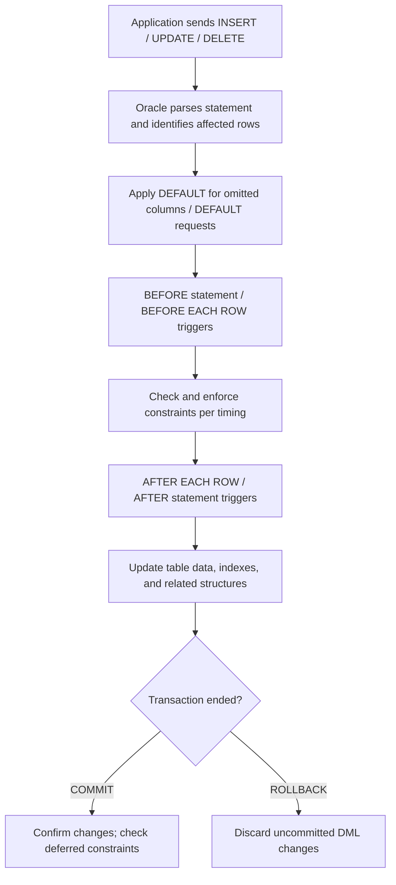

# DEFAULT, Triggers, and Constraints in the Oracle Data Change Lifecycle

An INSERT or UPDATE statement can change more than just the values sent by the application. Oracle can populate default values, fire triggers to normalize or log changes, check constraints, update indexes, and perform foreign-key-related actions. These mechanisms all participate in the **data change lifecycle**.

The three components serve distinct roles:

- **DEFAULT** provides a value when INSERT omits a column or requests the default.
- **Trigger** executes automatically when a matching DML/DDL event occurs; triggers can validate, transform data, write audits, or run related logic.
- **Constraint** enforces data integrity rules at the database level, such as NOT NULL, PRIMARY KEY, UNIQUE, FOREIGN KEY, and CHECK.

Understanding the boundaries between them prevents bugs such as defaults not firing when NULL is passed, triggers masking invalid input data, constraints only checking at COMMIT, triggers querying the table currently being modified, or audits recording rolled-back transactions.

This lesson focuses on Oracle Database SQL/PLSQL, how these mechanisms interact during INSERT/UPDATE/DELETE, how to implement and inspect them, and hands-on examples for a lab schema.

## 1. Big Picture of a Data Change

When an application sends an INSERT, Oracle parses the statement, determines target columns and source expressions, applies default values for eligible columns, runs triggers per event timing, checks constraints at their configured timing, and updates data and related structures. DML changes remain in the transaction until COMMIT or ROLLBACK.

A helpful mental model:



This is a conceptual model to understand each mechanism's responsibility. Exact trigger timing order is covered in section 5; constraints can be checked immediately or deferred to the end of the transaction if the schema declares DEFERRABLE and the transaction sets DEFERRED state.

**Key point:** DEFAULT, triggers, and constraints do not replace one another. Defaults supply valid initial values; triggers execute automated event-driven logic; constraints are the database-enforced integrity barrier.

## 2. Preparing the Example Table

Let us use a customer account table to observe defaults, triggers, and constraints:

```sql
CREATE TABLE customer_account (
    customer_id NUMBER GENERATED BY DEFAULT AS IDENTITY
        CONSTRAINT pk_customer_account PRIMARY KEY,
    customer_name VARCHAR2(100 CHAR) NOT NULL,
    email_address VARCHAR2(200 CHAR),
    status VARCHAR2(20 CHAR) DEFAULT 'NEW' NOT NULL,
    credit_limit NUMBER(12, 2) DEFAULT 0 NOT NULL,
    created_at TIMESTAMP(6) DEFAULT SYSTIMESTAMP NOT NULL,
    updated_at TIMESTAMP(6),
    CONSTRAINT uq_customer_account_email UNIQUE (email_address),
    CONSTRAINT ck_customer_account_credit
        CHECK (credit_limit >= 0),
    CONSTRAINT ck_customer_account_status
        CHECK (status IN ('NEW', 'ACTIVE', 'SUSPENDED'))
);
```

Meaning:

- `CUSTOMER_ID` auto-generates via identity and is the primary key.
- `CUSTOMER_NAME` is required.
- `EMAIL_ADDRESS` has a UNIQUE constraint; because the column is nullable, multiple rows can leave email NULL.
- `STATUS` defaults to NEW and cannot be NULL.
- `CREDIT_LIMIT` defaults to 0 and cannot be negative.
- `CREATED_AT` automatically receives creation time if INSERT omits the column.
- `UPDATED_AT` is reserved for a trigger recording the latest update time.

Inspect structure:

```sql
DESC customer_account;

SELECT column_name,
       data_type,
       nullable,
       data_default,
       identity_column
FROM user_tab_columns
WHERE table_name = 'CUSTOMER_ACCOUNT'
ORDER BY column_id;
```

Object names in data dictionary views are stored in uppercase unless created as quoted identifiers. When querying, use the exact owner and object name.

## 3. DEFAULT — Column Default Values

### 3.1. What Does DEFAULT Do?

A default is an Oracle expression used to supply a column value when INSERT omits that column, or when the statement uses the `DEFAULT` keyword in the corresponding position.

Syntax in DDL:

```sql
column_name datatype DEFAULT default_expression
```

Example:

```sql
CREATE TABLE task_demo (
    task_id NUMBER PRIMARY KEY,
    task_name VARCHAR2(100 CHAR) NOT NULL,
    task_status VARCHAR2(20 CHAR) DEFAULT 'OPEN' NOT NULL,
    priority NUMBER DEFAULT 3 NOT NULL,
    created_at DATE DEFAULT SYSDATE NOT NULL
);
```

When adding a row while omitting task_status, priority, and created_at:

```sql
INSERT INTO task_demo (
    task_id,
    task_name
)
VALUES (
    1,
    'Prepare monthly report'
);
```

Oracle assigns `OPEN`, `3`, and the timestamp from `SYSDATE`. There is no need to repeat these values in every INSERT.

### 3.2. Omitting a Column vs. Explicitly Passing NULL

This is a critical distinction.

**Omitting the column:**

```sql
INSERT INTO customer_account (
    customer_name,
    email_address
)
VALUES (
    'Nguyen An',
    'an@example.test'
);
```

`STATUS` receives NEW, `CREDIT_LIMIT` receives 0, and `CREATED_AT` receives SYSTIMESTAMP.

**Explicitly passing NULL:**

```sql
INSERT INTO customer_account (
    customer_name,
    status
)
VALUES (
    'Tran Binh',
    NULL
);
```

This statement violates NOT NULL on STATUS. A regular default is not used to replace a NULL value explicitly passed by the statement.

If a column is nullable and does not have DEFAULT ON NULL, explicitly passing NULL stores NULL:

```sql
INSERT INTO customer_account (
    customer_name,
    email_address
)
VALUES (
    'Le Chi',
    NULL
);
```

EMAIL_ADDRESS receives NULL; the UNIQUE constraint remains satisfied.

### 3.3. Using the DEFAULT Keyword in VALUES

You can request Oracle to use the default directly in the value slot:

```sql
INSERT INTO customer_account (
    customer_name,
    status,
    credit_limit
)
VALUES (
    'Do Dung',
    DEFAULT,
    DEFAULT
);
```

`DEFAULT` is useful when the column list is fixed while certain values should come from DDL. Verify syntax support on your target Oracle release if maintaining legacy systems.

### 3.4. DEFAULT ON NULL

Oracle supports `DEFAULT ON NULL` to apply a default even when the statement explicitly passes NULL:

```sql
CREATE TABLE notification_demo (
    notification_id NUMBER GENERATED BY DEFAULT AS IDENTITY,
    channel_code VARCHAR2(20 CHAR)
        DEFAULT ON NULL 'WEB',
    created_at TIMESTAMP(6)
        DEFAULT ON NULL SYSTIMESTAMP
);
```

Example:

```sql
INSERT INTO notification_demo (
    channel_code,
    created_at
)
VALUES (
    NULL,
    NULL
);
```

The columns are assigned their declared defaults. `DEFAULT ON NULL` has Oracle version-specific semantics and limitations; it also makes the column effectively NOT NULL per feature rules. Inspect DDL and metadata after creation, especially when combined with identity, certain data types, or older releases.

Only use DEFAULT ON NULL if the domain genuinely treats "not provided" and "explicitly NULL" identically. If NULL means "unspecified", do not silently convert it into an assumed value.

### 3.5. Does DEFAULT Apply During UPDATE?

Defaults do not automatically run whenever UPDATE omits a column. They only apply when the statement explicitly requests them:

```sql
UPDATE customer_account
SET status = DEFAULT
WHERE customer_id = 1;
```

Rows whose status is not updated do not have their status overwritten by the default. The statement above explicitly requests the column's default value.

### 3.6. Common Default Expressions

Common examples:

| Expression | Meaning |
|---|---|
| `0` | Fixed numeric value |
| `'NEW'` | Fixed string |
| `SYSDATE` | DATE in database system time |
| `SYSTIMESTAMP` | System timestamp with fractional seconds and timezone |
| `CURRENT_DATE` | DATE in session time zone |
| `CURRENT_TIMESTAMP` | Timestamp in session time zone |
| `USER` | Current database user |

Choose time functions based on semantics:

- `SYSDATE`/`SYSTIMESTAMP` reflect database host system time.
- `CURRENT_DATE`/`CURRENT_TIMESTAMP` reflect the session time zone.
- Plain DATE/TIMESTAMP types do not store a timezone like TSTZ.

Do not default to system time if the business requires a timestamp confirmed by an external system. When multiple timezones are involved, standardize normalization and storage types.

### 3.7. Default Is Not Where All Business Logic Belongs

Defaults fit simple, stable initial values. They do not replace:

- Data validation.
- Multi-column relationships.
- User authorization.
- Approval workflows.
- Logic spanning multiple systems or tables.

If a value depends on multiple columns or complex rules, consider application logic, procedures, or scoped triggers. Invariant data rules should still be protected by constraints.

## 4. Constraints — Integrity Rules

A constraint is a rule enforced by Oracle to prevent data from violating the relational model. It applies across every write path hitting the database: applications, SQL scripts, PL/SQL, imports, or batch jobs.

### 4.1. NOT NULL

Ensures a column must have a value:

```sql
customer_name VARCHAR2(100 CHAR) NOT NULL
```

If INSERT passes NULL or omits a column lacking a default, Oracle rejects the row. The typical error is `ORA-01400`.

NOT NULL is a column-level constraint. You cannot fully replace it with a simple CHECK if you want explicit nullability metadata.

### 4.2. PRIMARY KEY

A primary key uniquely identifies each row and combines two requirements:

- Key values cannot duplicate.
- Every key component column is NOT NULL.

Example:

```sql
CONSTRAINT pk_customer_account
    PRIMARY KEY (customer_id)
```

A table can have only one primary key, though that key can span multiple columns. When INSERT duplicates a key, Oracle raises a unique constraint error, typically `ORA-00001`.

### 4.3. UNIQUE

UNIQUE guarantees that a value or combination of values does not duplicate per Oracle rules:

```sql
CONSTRAINT uq_customer_account_email
    UNIQUE (email_address)
```

For a single nullable column, multiple rows can contain NULL because Oracle does not treat NULLs as identical non-null values violating a unique constraint. When a unique key has multiple columns, handling of NULL combinations has specific nuances; do not blindly generalize single-column rules to all composite keys.

If email is required, combine UNIQUE with NOT NULL. If only entered emails must be unique, keep it nullable with UNIQUE as shown.

### 4.4. FOREIGN KEY

A foreign key ensures a child key value references a permitted key in the parent table:

```sql
CREATE TABLE department_demo (
    department_id NUMBER
        CONSTRAINT pk_department_demo PRIMARY KEY,
    department_name VARCHAR2(80 CHAR) NOT NULL
);

CREATE TABLE employee_demo (
    employee_id NUMBER
        CONSTRAINT pk_employee_demo PRIMARY KEY,
    employee_name VARCHAR2(100 CHAR) NOT NULL,
    department_id NUMBER,
    CONSTRAINT fk_employee_department
        FOREIGN KEY (department_id)
        REFERENCES department_demo(department_id)
);
```

Inserting an employee referencing a nonexistent department fails, typically with `ORA-02291`:

```sql
INSERT INTO employee_demo (
    employee_id,
    employee_name,
    department_id
)
VALUES (
    1001,
    'Pham Minh',
    999
);
```

A nullable foreign key can accept NULL; if every employee must belong to a department, add NOT NULL to department_id.

When a parent row is deleted, you can declare behavior:

```sql
FOREIGN KEY (department_id)
REFERENCES department_demo(department_id)
ON DELETE CASCADE
```

or `ON DELETE SET NULL` if the child column allows NULL. Omitting ON DELETE causes Oracle by default to block deleting a referenced parent row. Oracle does not provide `ON UPDATE CASCADE` like some other DBMSs; changing parent keys must be designed using constraints and transactions.

### 4.5. CHECK

CHECK ensures the expression for each row does not evaluate to FALSE:

```sql
CONSTRAINT ck_customer_account_credit
    CHECK (credit_limit >= 0)
```

Negative values are rejected, typically with `ORA-02290`.

An important detail: CHECK allows expressions evaluating to TRUE or UNKNOWN. If credit_limit is NULL, `NULL >= 0` evaluates to UNKNOWN; CHECK does not reject NULL by itself. If a column requires a number, combine them:

```sql
credit_limit NUMBER(12, 2) NOT NULL,
CONSTRAINT ck_credit_nonnegative CHECK (credit_limit >= 0)
```

CHECK should express rules scoped to that single row. Rules depending on other rows or cross-table sums need better mechanisms such as FKs, unique constraints, materialized logic, or controlled transactions/procedures.

### 4.6. Constraints and Common Errors

| Constraint | Rule | Common error |
|---|---|---|
| NOT NULL | Cannot accept NULL | `ORA-01400` |
| PRIMARY KEY | Unique and non-NULL | `ORA-00001` or corresponding null error |
| UNIQUE | No duplicate keys | `ORA-00001` |
| FOREIGN KEY | Child key references valid parent key | `ORA-02291` when parent missing |
| FOREIGN KEY on parent delete | Cannot delete referenced parent without cascade action | `ORA-02292` |
| CHECK | Expression cannot evaluate to FALSE | `ORA-02290` |

Do not validate only in application code and skip database constraints. Application-side validation gives users fast feedback; constraints are the final mechanism keeping data consistent across concurrent clients and transactions.

## 5. Triggers — Event-Driven Automated Logic

A trigger is a PL/SQL unit automatically invoked by Oracle when a specified event occurs. DML triggers fire on INSERT, UPDATE, or DELETE; other triggers can fire on DDL or database/system events.

### 5.1. Row-Level and Statement-Level Triggers

A **statement-level trigger** runs once per statement, whether the statement affects 1 or 10,000 rows.

A **row-level trigger** declares `FOR EACH ROW` and runs for each affected row.

Skeleton example:

```sql
CREATE OR REPLACE TRIGGER trg_customer_account_bi_stmt
BEFORE INSERT ON customer_account
BEGIN
    -- Runs once before the INSERT statement.
    NULL;
END;
/

CREATE OR REPLACE TRIGGER trg_customer_account_bi_row
BEFORE INSERT ON customer_account
FOR EACH ROW
BEGIN
    -- Runs once for each inserted row.
    NULL;
END;
/
```

If an INSERT SELECT adds 500 rows, the statement-level trigger runs once; the row-level trigger runs for every processed row. Therefore, never place statement-wide aggregation inside a row trigger when it can run once at statement timing.

### 5.2. BEFORE and AFTER

- **BEFORE trigger** runs before the corresponding DML/row event. BEFORE EACH ROW can reassign `:NEW` values.
- **AFTER trigger** runs after the corresponding DML/row event. Typically used for logging or executing logic that depends on the change having happened.

BEFORE INSERT example:

```sql
CREATE OR REPLACE TRIGGER trg_employee_normalize_bi
BEFORE INSERT ON employee_demo
FOR EACH ROW
BEGIN
    :NEW.employee_name := TRIM(:NEW.employee_name);
END;
/
```

The name is normalized before storage. If the input consists solely of whitespace, `TRIM` produces NULL; the NOT NULL constraint then rejects the row.

You cannot assign `:NEW` inside an AFTER row trigger. If you need to modify the value being saved, use BEFORE EACH ROW or perform a separate UPDATE in appropriate logic.

### 5.3. :OLD and :NEW

In a row trigger:

| Event | :OLD | :NEW |
|---|---|---|
| INSERT | No old row values | Values about to be inserted |
| UPDATE | Values before change | Values after change |
| DELETE | Row values before deletion | No new row values |

Status change audit example:

```sql
CREATE TABLE customer_status_audit (
    audit_id NUMBER GENERATED ALWAYS AS IDENTITY PRIMARY KEY,
    customer_id NUMBER NOT NULL,
    old_status VARCHAR2(20 CHAR),
    new_status VARCHAR2(20 CHAR),
    changed_at TIMESTAMP(6) DEFAULT SYSTIMESTAMP NOT NULL,
    changed_by VARCHAR2(128 CHAR) DEFAULT USER NOT NULL
);

CREATE OR REPLACE TRIGGER trg_customer_status_audit
AFTER UPDATE OF status ON customer_account
FOR EACH ROW
BEGIN
    IF :OLD.status <> :NEW.status
       OR (:OLD.status IS NULL AND :NEW.status IS NOT NULL)
       OR (:OLD.status IS NOT NULL AND :NEW.status IS NULL)
    THEN
        INSERT INTO customer_status_audit (
            customer_id,
            old_status,
            new_status
        )
        VALUES (
            :OLD.customer_id,
            :OLD.status,
            :NEW.status
        );
    END IF;
END;
/
```

In the example table, STATUS is NOT NULL, so the two NULL-check branches simply demonstrate null-safe comparison if the trigger is used on a nullable column. You can simplify the condition when the schema guarantees both values are non-NULL.

The audit trigger runs in the same transaction as UPDATE. If the transaction rolls back, the audit row also rolls back. This is usually the desired semantics for business audits tied to committed changes.

### 5.4. INSERTING, UPDATING, and DELETING

Inside a trigger you can detect the event type:

```sql
CREATE OR REPLACE TRIGGER trg_employee_dml_audit
AFTER INSERT OR UPDATE OR DELETE ON employee_demo
FOR EACH ROW
BEGIN
    IF INSERTING THEN
        -- :NEW has data, :OLD has no old row.
        NULL;
    ELSIF UPDATING THEN
        -- Both :OLD and :NEW are available.
        NULL;
    ELSIF DELETING THEN
        -- :OLD has data, :NEW has no new row.
        NULL;
    END IF;
END;
/
```

`UPDATING('COLUMN_NAME')` checks whether a column was named in the UPDATE's SET clause. It does not prove the value actually changed:

```sql
UPDATE customer_account
SET status = status
WHERE customer_id = 1;
```

An UPDATE OF STATUS trigger still fires even when old and new values are equal. If you only want to react when the value differs, compare `:OLD` and `:NEW` explicitly.

### 5.5. Column-Specific Triggers

You can scope the event:

```sql
CREATE OR REPLACE TRIGGER trg_customer_credit_change
BEFORE UPDATE OF credit_limit ON customer_account
FOR EACH ROW
BEGIN
    IF :NEW.credit_limit < :OLD.credit_limit THEN
        NULL; -- Example: apply approved business logic.
    END IF;
END;
/
```

This trigger only fires on UPDATE statements mentioning CREDIT_LIMIT in the SET clause. If you want to inspect every UPDATE and compare values, declare BEFORE UPDATE and check inside.

## 6. Lifecycle of an INSERT/UPDATE/DELETE and Trigger Timing

Oracle defines timing points for DML triggers. For a standard statement:

1. BEFORE STATEMENT triggers run once before processing rows.
2. For each row: BEFORE EACH ROW triggers run; then the row is modified and constraints are checked per their timing; AFTER EACH ROW triggers run.
3. After the statement finishes processing rows: AFTER STATEMENT triggers run once.
4. If DEFERRABLE constraints are in DEFERRED state, final checking occurs at COMMIT.

This sequence distinguishes work done before each row, after each row, and after the entire statement. Never design logic depending on unspecified ordering among multiple triggers at the same timing point; consolidate related logic or use Oracle version-supported trigger ordering clauses when truly necessary.

Single-statement example:

```sql
UPDATE customer_account
SET credit_limit = credit_limit + 100
WHERE status = 'ACTIVE';
```

- BEFORE STATEMENT: can log the start of an update operation.
- BEFORE EACH ROW: can validate or adjust `:NEW.credit_limit`.
- CHECK constraint: ensures credit_limit is non-negative per configured timing.
- AFTER EACH ROW: can audit each change.
- AFTER STATEMENT: can update summary metrics once.
- COMMIT: confirms the entire transaction and checks deferred constraints.

### 6.1. DEFAULT and BEFORE INSERT Triggers

Defaults are applied when Oracle constructs the row from the INSERT column/value list. BEFORE EACH ROW triggers can read and adjust `:NEW` before the row is stored. Therefore, the trigger sees any applied default value and can modify it.

Example:

```sql
CREATE OR REPLACE TRIGGER trg_customer_account_biu
BEFORE INSERT OR UPDATE ON customer_account
FOR EACH ROW
BEGIN
    :NEW.customer_name := TRIM(:NEW.customer_name);

    IF UPDATING THEN
        :NEW.updated_at := SYSTIMESTAMP;
    END IF;
END;
/
```

When INSERT omits STATUS, the default NEW is applied. The trigger normalizes CUSTOMER_NAME; it leaves STATUS untouched. Constraints validate the final values entering the row. On UPDATE, the trigger sets UPDATED_AT.

### 6.2. AFTER Triggers Are Not Where to Modify :NEW

AFTER EACH ROW fits auditing or secondary actions, not assigning values of the row currently being inserted/updated. If you need to normalize data before constraint checks, use BEFORE EACH ROW or application expressions/logic.

## 7. Compound Triggers — Coordinating Row-Level and Statement-Level

A common issue occurs when a row trigger needs to aggregate data from the exact table being modified. If a row trigger queries that table, Oracle raises a mutating-table error (`ORA-04091`), because the table is mid-change and a query could observe inconsistent state.

A compound trigger lets you share state across timing sections of a single DML statement, typically collecting keys in EACH ROW and processing them in AFTER STATEMENT.

### 7.1. Mutating Table Error Example

Do not write a row trigger on ORDER_LINE that immediately queries ORDER_LINE inside the trigger:

```sql
-- Pattern prone to ORA-04091:
CREATE OR REPLACE TRIGGER trg_order_line_bad
AFTER INSERT ON order_line
FOR EACH ROW
DECLARE
    l_total NUMBER;
BEGIN
    SELECT SUM(line_amount)
    INTO l_total
    FROM order_line
    WHERE order_id = :NEW.order_id;
END;
/
```

While INSERT/UPDATE/DELETE is modifying ORDER_LINE, a row trigger reading the same table hits the mutating-table restriction.

### 7.2. Using a Compound Trigger to Defer Queries to AFTER STATEMENT

Assume these tables:

```sql
CREATE TABLE order_header_demo (
    order_id NUMBER PRIMARY KEY,
    total_amount NUMBER(14, 2) DEFAULT 0 NOT NULL
);

CREATE TABLE order_line_demo (
    line_id NUMBER PRIMARY KEY,
    order_id NUMBER NOT NULL
        REFERENCES order_header_demo(order_id),
    line_amount NUMBER(12, 2) NOT NULL
);
```

Compound trigger:

```sql
CREATE OR REPLACE TRIGGER trg_order_line_total
FOR INSERT OR UPDATE OR DELETE ON order_line_demo
COMPOUND TRIGGER
    TYPE t_order_id_list IS TABLE OF order_line_demo.order_id%TYPE
        INDEX BY PLS_INTEGER;

    g_order_ids t_order_id_list;
    g_count PLS_INTEGER := 0;

    PROCEDURE remember_order(p_order_id IN order_line_demo.order_id%TYPE) IS
    BEGIN
        IF p_order_id IS NOT NULL THEN
            g_count := g_count + 1;
            g_order_ids(g_count) := p_order_id;
        END IF;
    END remember_order;

    AFTER EACH ROW IS
    BEGIN
        IF INSERTING THEN
            remember_order(:NEW.order_id);
        ELSIF DELETING THEN
            remember_order(:OLD.order_id);
        ELSE
            remember_order(:OLD.order_id);
            remember_order(:NEW.order_id);
        END IF;
    END AFTER EACH ROW;

    AFTER STATEMENT IS
    BEGIN
        FOR i IN 1 .. g_count LOOP
            UPDATE order_header_demo h
            SET total_amount = (
                SELECT NVL(SUM(l.line_amount), 0)
                FROM order_line_demo l
                WHERE l.order_id = g_order_ids(i)
            )
            WHERE h.order_id = g_order_ids(i);
        END LOOP;
    END AFTER STATEMENT;
END;
/
```

The row trigger only collects order_id values; once the statement finishes, AFTER STATEMENT queries ORDER_LINE_DEMO to sum totals and update ORDER_HEADER_DEMO. If UPDATE moves a line from an old order to a new order, the trigger remembers both order_ids.

This example may update the same order multiple times if the statement affects multiple lines of the same order. In high-volume workloads, deduplicate collected keys or use set-based structures to reduce recalculations. The goal here is illustrating timing, not providing an optimal aggregation framework for all tables.

Compound triggers do not eliminate every mutating-table error in all scenarios; they provide timing sections to place table queries after row processing finishes.

## 8. INSTEAD OF Triggers on Views

Some views cannot be inserted/updated/deleted directly due to joins, aggregates, or complex structures. An `INSTEAD OF trigger` lets you define replacement DML logic on the view:

```sql
CREATE OR REPLACE VIEW employee_department_v AS
SELECT e.employee_id,
       e.employee_name,
       d.department_name
FROM employee_demo e
JOIN department_demo d
  ON d.department_id = e.department_id;
```

An INSTEAD OF INSERT trigger can decompose view values and insert into base tables:

```sql
CREATE OR REPLACE TRIGGER trg_employee_department_v_ioi
INSTEAD OF INSERT ON employee_department_v
FOR EACH ROW
DECLARE
    l_department_id department_demo.department_id%TYPE;
BEGIN
    SELECT department_id
    INTO l_department_id
    FROM department_demo
    WHERE department_name = :NEW.department_name;

    INSERT INTO employee_demo (
        employee_id,
        employee_name,
        department_id
    )
    VALUES (
        :NEW.employee_id,
        :NEW.employee_name,
        l_department_id
    );
END;
/
```

If department_name is not unique, SELECT INTO raises TOO_MANY_ROWS. In real designs, use identifying keys or UNIQUE constraints rather than display names. INSTEAD OF triggers turn a view into a write interface; they do not remove constraints from underlying base tables.

## 9. Triggers and Transactions

### 9.1. Standard Triggers Share the Calling Statement's Transaction

DML executed by a standard trigger is part of the calling transaction. For example:

1. UPDATE CUSTOMER_ACCOUNT changes status.
2. AFTER UPDATE trigger inserts into CUSTOMER_STATUS_AUDIT.
3. Application executes ROLLBACK.

Both the status change and the audit row are rolled back. This guarantees business audits reflect committed changes.

If a trigger raises an unhandled error, the triggering statement fails and changes made by the statement/trigger are rolled back under statement atomicity. Earlier statements in the same transaction remain managed by the transaction owner.

### 9.2. Do Not COMMIT or ROLLBACK Inside Standard Triggers

Standard triggers must not commit or roll back the caller's transaction. Never design triggers to decide transaction completion; the application or orchestrating procedure must manage transactions.

Autonomous transactions are a separate mechanism declarable in routines called from triggers. However, if used to write and independently commit an audit, the audit record persists even if the business DML rolls back. Use them only when the requirement truly demands independent event logging (such as certain diagnostic logs), and explicitly accept that consistency model.

### 9.3. Triggers Can Cause Cascading Side Effects

An UPDATE can fire a trigger writing to an audit table; the audit table may have its own trigger; that logic may modify yet another table. Systems easily suffer from:

- Unintended recursion or repeated calls.
- Increased SQL executions and redo.
- Cross-table deadlocks/contention.
- Mutating table errors.
- Poor traceability because logic is hidden from the initial DML statement.

Keep triggers small, narrowly scoped, and avoid duplicating rules across layers. Multi-step business workflows are usually easier to control inside explicitly invoked procedures or application services.

## 10. Constraint Timing: IMMEDIATE and DEFERRED

By default, constraints are checked immediately. For constraints declared DEFERRABLE, a transaction can defer checking until the end of the transaction.

### 10.1. DEFERRABLE Foreign Key Example

```sql
CREATE TABLE invoice_header_demo (
    invoice_id NUMBER
        CONSTRAINT pk_invoice_header_demo PRIMARY KEY
);

CREATE TABLE invoice_line_demo (
    line_id NUMBER
        CONSTRAINT pk_invoice_line_demo PRIMARY KEY,
    invoice_id NUMBER,
    CONSTRAINT fk_invoice_line_header
        FOREIGN KEY (invoice_id)
        REFERENCES invoice_header_demo(invoice_id)
        DEFERRABLE INITIALLY IMMEDIATE
);
```

The constraint is declared DEFERRABLE but defaults to IMMEDIATE initially. You can switch state inside a transaction:

```sql
SET CONSTRAINTS fk_invoice_line_header DEFERRED;

INSERT INTO invoice_line_demo (line_id, invoice_id)
VALUES (1, 100);

INSERT INTO invoice_header_demo (invoice_id)
VALUES (100);

COMMIT;
```

Mid-transaction, the child row is inserted before the parent row. At COMMIT, Oracle re-checks and commits only if all deferred constraints are satisfied.

If the parent row is not created before commit, COMMIT fails. The application must handle the error and fix or roll back the transaction.

### 10.2. INITIALLY IMMEDIATE and INITIALLY DEFERRED

- `DEFERRABLE INITIALLY IMMEDIATE`: can be deferred inside a transaction, but checks immediately by default.
- `DEFERRABLE INITIALLY DEFERRED`: deferred to transaction end by default.
- `NOT DEFERRABLE`: cannot be switched to deferred via SET CONSTRAINTS.

In Oracle, primary key, unique, and foreign key constraints are common candidates for DEFERRABLE. NOT NULL cannot be deferred. Verify supported constraint types and syntax on your specific release before designing workflows around deferred checking.

### 10.3. Using SET CONSTRAINTS Intentionally

```sql
SET CONSTRAINTS ALL DEFERRED;
SET CONSTRAINTS ALL IMMEDIATE;
```

The command affects DEFERRABLE constraints in the current transaction. Switching to IMMEDIATE makes Oracle check deferred constraints at that moment; if data currently violates them, the command fails.

Deferred constraints are useful when loading rows with circular relationships or temporary insert ordering constraints. They are not a way to disable constraints and must never be used to hide bad data.

## 11. ENABLE, DISABLE, VALIDATE, and NOVALIDATE States

Constraints have states controlling enforcement and validation of existing data:

| State | General meaning |
|---|---|
| ENABLE VALIDATE | Constraint is active; existing data is verified and new DML must comply |
| ENABLE NOVALIDATE | New DML is checked; legacy data has not been fully verified |
| DISABLE NOVALIDATE | Constraint is not enforced for current data as ENABLE does |

Example:

```sql
ALTER TABLE customer_account
ENABLE VALIDATE CONSTRAINT ck_customer_account_credit;

ALTER TABLE customer_account
DISABLE CONSTRAINT ck_customer_account_credit;
```

ENABLE NOVALIDATE can be useful during phased cleanup of legacy data while still protecting new DML, depending on constraint type and Oracle policies. However, it means historical data may still violate the rule; do not report the constraint status as if the entire table were verified.

Inspect metadata:

```sql
SELECT constraint_name,
       constraint_type,
       status,
       validated,
       deferrable,
       deferred
FROM user_constraints
WHERE table_name = 'CUSTOMER_ACCOUNT'
ORDER BY constraint_name;
```

`STATUS`, `VALIDATED`, `DEFERRABLE`, and `DEFERRED` help DBAs understand exactly how a constraint is enforced.

## 12. How Do Triggers and Constraints Coordinate?

### 12.1. BEFORE Triggers Do Not Replace Constraints

You could write a trigger rejecting negative credit_limit:

```sql
IF :NEW.credit_limit < 0 THEN
    RAISE_APPLICATION_ERROR(-20010, 'Credit limit cannot be negative');
END IF;
```

However, if the simple invariant rule is that credit_limit is non-negative, the CHECK constraint should still exist:

```sql
CONSTRAINT ck_customer_account_credit
    CHECK (credit_limit >= 0)
```

Reasons:

- Constraints are clearly visible in the schema and data dictionary.
- The database enforces the rule across all DML paths.
- The optimizer and administration tools recognize constraints.
- Triggers can be disabled or miswritten; constraints are dedicated integrity mechanisms.

Triggers should handle things constraints cannot express cleanly, such as value normalization, auditing, or secondary logic updates.

### 12.2. Triggers Can Make Invalid Input Satisfy a Constraint

Example BEFORE INSERT trigger trimming names:

```sql
:NEW.customer_name := TRIM(:NEW.customer_name);
```

If a user sends `'  Nguyen An  '`, the stored value is `'Nguyen An'`. If they send only spaces, TRIM produces NULL and the NOT NULL constraint rejects it. Constraints evaluate values after BEFORE row logic has adjusted them.

This illustrates how triggers and constraints work together: the trigger normalizes, and the constraint validates the final result.

### 12.3. Do Not Use Triggers to Silently Fix Invalid Data

If input is invalid, silently replacing it with a default value hides source bugs. For instance, forcing a negative credit_limit to 0 masks a calculation error. Auto-correct only when the rule is explicitly defined and callers understand the outcome.

For critical data, raising a specific error is usually safer than silent mutation.

## 13. Triggers, Foreign Keys, and Delete Actions

When deleting a parent row:

- If a child FK exists with no delete action declared, Oracle normally rejects the delete.
- `ON DELETE CASCADE` deletes related child rows.
- `ON DELETE SET NULL` sets the child FK to NULL, so the child column must allow NULL.

Example:

```sql
CREATE TABLE project_demo (
    project_id NUMBER PRIMARY KEY,
    project_name VARCHAR2(100 CHAR) NOT NULL
);

CREATE TABLE task_project_demo (
    task_id NUMBER PRIMARY KEY,
    project_id NUMBER,
    task_name VARCHAR2(100 CHAR) NOT NULL,
    CONSTRAINT fk_task_project
        FOREIGN KEY (project_id)
        REFERENCES project_demo(project_id)
        ON DELETE SET NULL
);
```

If the child table has DELETE or UPDATE triggers, test behavior during cascades per your Oracle version and operation type. Never build audits assuming a trigger captures all cascading effects without verifying it first.

DELETE is DML, so it fires DML triggers. `TRUNCATE` is DDL, not DELETE; it does not fire DELETE row triggers and has different transaction semantics. Do not use TRUNCATE when DELETE-specific logic or auditing is required.

## 14. DDL and System Triggers

Beyond DML triggers, Oracle supports triggers for DDL or database events, such as:

- CREATE, ALTER, DROP object.
- LOGON, LOGOFF.
- STARTUP, SHUTDOWN within appropriate scopes/privileges.

DDL trigger skeleton example:

```sql
CREATE OR REPLACE TRIGGER trg_schema_ddl_audit
AFTER DDL ON SCHEMA
BEGIN
    INSERT INTO schema_ddl_audit (
        event_name,
        object_name,
        event_time,
        database_user
    )
    VALUES (
        ORA_SYSEVENT,
        ORA_DICT_OBJ_NAME,
        SYSTIMESTAMP,
        ORA_LOGIN_USER
    );
END;
/
```

This is an illustrative example; the audit table must exist and the trigger needs appropriate privileges. DDL triggers execute within DDL context, carrying specific restrictions on allowed operations and transactions. Do not use DDL triggers for heavy work, external system calls, or recursive DDL loops.

LOGON/DDL triggers can impact connections or schema-wide deployments. Review and test thoroughly in a separate environment before enabling in production.

## 15. Managing Triggers in the Data Dictionary

### 15.1. Viewing Schema Triggers

```sql
SELECT trigger_name,
       table_name,
       triggering_event,
       trigger_type,
       status
FROM user_triggers
ORDER BY table_name, trigger_name;
```

### 15.2. Viewing Trigger Source Code

```sql
SELECT line, text
FROM user_source
WHERE name = 'TRG_CUSTOMER_ACCOUNT_BIU'
  AND type = 'TRIGGER'
ORDER BY line;
```

### 15.3. Enabling/Disabling Triggers

```sql
ALTER TRIGGER trg_customer_account_biu DISABLE;
ALTER TRIGGER trg_customer_account_biu ENABLE;
```

Or for an entire table:

```sql
ALTER TABLE customer_account
DISABLE ALL TRIGGERS;

ALTER TABLE customer_account
ENABLE ALL TRIGGERS;
```

Disabling triggers can skip normalization, auditing, or dependent updates. When re-enabling, rows written while triggers were disabled do not automatically run triggers retroactively. If disabling during bulk loads, plan post-load verification/backfill.

### 15.4. Viewing Constraints and Their Columns

```sql
SELECT c.constraint_name,
       c.constraint_type,
       c.status,
       c.validated,
       cc.column_name,
       cc.position
FROM user_constraints c
JOIN user_cons_columns cc
  ON cc.constraint_name = c.constraint_name
 AND cc.table_name = c.table_name
WHERE c.table_name = 'CUSTOMER_ACCOUNT'
ORDER BY c.constraint_name, cc.position;
```

`USER_CONSTRAINTS` provides type and status; `USER_CONS_COLUMNS` shows columns and positions in multi-column constraints.

## 16. Common Trigger and Constraint Errors

| Error / Symptom | Cause | Resolution |
|---|---|---|
| `ORA-01400` | NULL enters a NOT NULL column | Check input, defaults, and triggers |
| `ORA-00001` | Duplicate PK/UNIQUE | Identify keys, retries, and uniqueness |
| `ORA-02290` | CHECK expression evaluates to FALSE | Check rule and post-BEFORE-trigger value |
| `ORA-02291` | FK parent row not found | Load parent first or check key |
| `ORA-02292` | Deleting a referenced parent | Choose cascade/set null or handle child rows |
| `ORA-04091` | Row trigger queries mutating table | Compound trigger/statement timing or redesign |
| `ORA-04098` | Trigger invalid or revalidation failed | Check USER_ERRORS and recompile |
| `ORA-04088` | Error during trigger execution | Read underlying error and trigger source |
| Constraint fails at COMMIT | DEFERRABLE constraint is DEFERRED | Validate entire transaction before commit |
| Audit missing rows after rollback | Audit trigger rolled back with transaction | Expected transactional semantics; decide if independent log is needed |
| updated_at changes despite unchanged values | Trigger runs whenever column is in SET clause | Compare :OLD/:NEW if real change detection is needed |
| Multi-row INSERT is abnormally slow | Row trigger runs many SQLs per row | Measure workload, move aggregation to statement/compound trigger |
| Legacy data violates constraint | ENABLE NOVALIDATE or previously disabled constraint | Check VALIDATED and clean legacy data |

To inspect compilation errors:

```sql
SELECT line, position, text
FROM user_errors
WHERE name = 'TRG_CUSTOMER_ACCOUNT_BIU'
  AND type = 'TRIGGER'
ORDER BY sequence;
```

Do not look only at the outer ORA-04088 error; the root error is usually in the following message or inside the trigger source.

## 17. Practical Design: Where Should Rules Live?

| Rule type | Typically suitable mechanism | Example |
|---|---|---|
| Simple initial value | DEFAULT | status NEW, created_at |
| Input NULL must use default | DEFAULT ON NULL if domain-appropriate | channel WEB |
| Auto-generated key value | IDENTITY or SEQUENCE | customer_id |
| Required data | NOT NULL | customer_name |
| No duplicates | PRIMARY KEY / UNIQUE | customer_id, email |
| Valid reference | FOREIGN KEY | employee.department_id |
| Single-row value domain | CHECK | credit_limit >= 0 |
| Normalize value before save | BEFORE EACH ROW trigger or application | TRIM name |
| Record transaction-bound changes | AFTER trigger or audit facility | old_status/new_status |
| Aggregate after multi-row statement | AFTER STATEMENT / compound trigger or separate process | update order total |
| Customize writes through a view | INSTEAD OF trigger | multi-table join view |
| Multi-step business workflow | Procedure/application service | approval, publishing, integration |

Key principles:

1. Use constraints for data integrity rules expressible directly.
2. Use defaults for initial values; do not use triggers just to assign simple constants.
3. Use triggers when logic genuinely needs automated database-event binding.
4. Keep triggers small and traceable; avoid placing entire workflows inside triggers.
5. Avoid duplicating the same rule across application, defaults, triggers, and constraints without a clear source of truth.
6. Document trigger side effects and whether they share the caller's transaction.
7. Use auditing appropriate for compliance/control requirements; ad-hoc triggers do not automatically meet all audit standards.

## 18. Comprehensive Lab Exercise

Perform in a lab schema. If tables already exist, use different names or a dedicated schema; never run DROP statements in shared environments.

### Step 1 — Create Table with DEFAULT and Constraints

```sql
CREATE TABLE account_lab (
    account_id NUMBER GENERATED BY DEFAULT AS IDENTITY
        CONSTRAINT pk_account_lab PRIMARY KEY,
    account_name VARCHAR2(100 CHAR) NOT NULL,
    account_status VARCHAR2(20 CHAR) DEFAULT 'NEW' NOT NULL,
    balance NUMBER(12, 2) DEFAULT 0 NOT NULL,
    created_at TIMESTAMP(6) DEFAULT SYSTIMESTAMP NOT NULL,
    updated_at TIMESTAMP(6),
    CONSTRAINT ck_account_lab_balance CHECK (balance >= 0),
    CONSTRAINT ck_account_lab_status
        CHECK (account_status IN ('NEW', 'ACTIVE', 'CLOSED'))
);
```

### Step 2 — Insert and Observe Defaults

```sql
INSERT INTO account_lab (account_name)
VALUES ('Account One');

INSERT INTO account_lab (
    account_name,
    account_status,
    balance
)
VALUES (
    'Account Two',
    DEFAULT,
    DEFAULT
);

SELECT *
FROM account_lab
ORDER BY account_id;
```

Note identity, status, balance, and created_at.

### Step 3 — Compare Omitting a Column vs. Passing NULL

Try:

```sql
INSERT INTO account_lab (account_name, account_status)
VALUES ('Invalid Account', NULL);
```

Observe the NOT NULL error. Then create another lab table with DEFAULT ON NULL and compare results.

### Step 4 — Create a BEFORE Trigger

```sql
CREATE OR REPLACE TRIGGER trg_account_lab_biu
BEFORE INSERT OR UPDATE ON account_lab
FOR EACH ROW
BEGIN
    :NEW.account_name := TRIM(:NEW.account_name);

    IF UPDATING THEN
        :NEW.updated_at := SYSTIMESTAMP;
    END IF;
END;
/
```

Try inserting a name with leading/trailing spaces and updating balance. Observe updated_at.

### Step 5 — Test CHECK Constraint

```sql
INSERT INTO account_lab (account_name, balance)
VALUES ('Negative Balance', -10);
```

Explain why the BEFORE trigger does not replace the CHECK constraint and note the error.

### Step 6 — Log Old/New Audit

Create an audit table and an AFTER UPDATE trigger on account_status. Change NEW to ACTIVE, then ROLLBACK. Check both account_lab and the audit table to confirm both changes rolled back together.

### Step 7 — Test FK and Delete Behavior

Create department/employee tables with an FK. Insert parent and child rows, try deleting the parent without an ON DELETE action. Then test ON DELETE CASCADE or SET NULL in another lab table.

### Step 8 — Test Deferred Constraints

Create an FK as DEFERRABLE INITIALLY IMMEDIATE. Switch to DEFERRED, insert child row before parent row, then COMMIT. Try omitting the parent row and observe the failure at COMMIT.

### Step 9 — Observe Mutating Table

In a dedicated lab schema, test a row trigger querying the table being inserted/updated. Observe ORA-04091. Then use a compound trigger: collect keys in AFTER EACH ROW and query the table in AFTER STATEMENT.

### Step 10 — Query Metadata

Run queries against USER_CONSTRAINTS, USER_CONS_COLUMNS, USER_TRIGGERS, USER_SOURCE, and USER_ERRORS. Note which constraints/triggers are ENABLE, VALIDATED, and VALID.

### Step 11 — Test Impact of Disabling a Trigger

In the lab, disable the normalization trigger and insert data with trailing spaces. Re-enable it and observe whether old rows are normalized automatically. Explain why backfill/validation processes are needed when triggers are disabled during bulk loads.

## 19. Self-Check Questions

1. In which cases is DEFAULT applied? How does omitting a column differ from passing NULL?
2. How does DEFAULT ON NULL differ from normal DEFAULT?
3. Does a default run automatically when UPDATE omits that column?
4. Why do identity/sequence generators not guarantee gap-free consecutive numbers?
5. What rules does PRIMARY KEY combine?
6. How does UNIQUE on a single nullable column handle multiple NULLs?
7. Why does CHECK (amount >= 0) not reject NULL by itself?
8. Does a nullable FOREIGN KEY require finding a parent row for NULL?
9. How do ON DELETE CASCADE and ON DELETE SET NULL differ?
10. How does a row-level trigger differ from a statement-level trigger in execution frequency?
11. What do :OLD and :NEW mean for INSERT, UPDATE, and DELETE?
12. Does UPDATING('column') prove the value actually changed?
13. What can a BEFORE EACH ROW trigger do with :NEW? Can AFTER EACH ROW assign :NEW?
14. How do immediate and deferred constraints differ?
15. Why can a row trigger querying the table being modified raise ORA-04091?
16. Which scenarios do compound triggers help solve?
17. Do a standard trigger and its audit row share the same transaction?
18. Why can an autonomous transaction audit create log rows for rolled-back changes?
19. Does TRUNCATE fire DELETE row triggers?
20. How does ENABLE NOVALIDATE differ from ENABLE VALIDATE?
21. When should you use constraints, defaults, triggers, or procedures?
22. Which data dictionary views should you query to inspect constraint and trigger status?

DEFAULT, triggers, and constraints work together to protect the data lifecycle, each with its own responsibility. **DEFAULT initializes values; triggers run automated event-driven logic; constraints enforce integrity.** When designing schemas, put every rule in its proper place, understand when it executes, and know how it participates in transactions. This keeps data consistent whether changes arrive from applications, batch jobs, PL/SQL, or data-loading tools.
