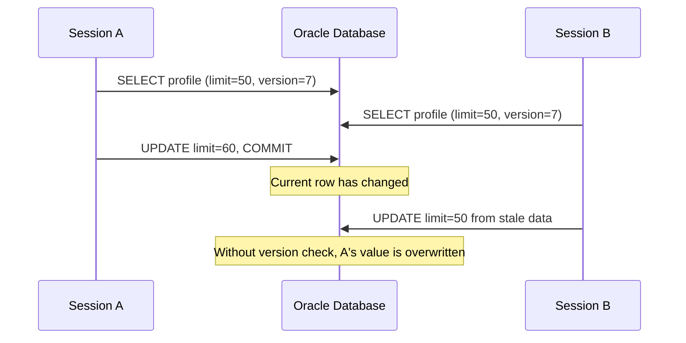
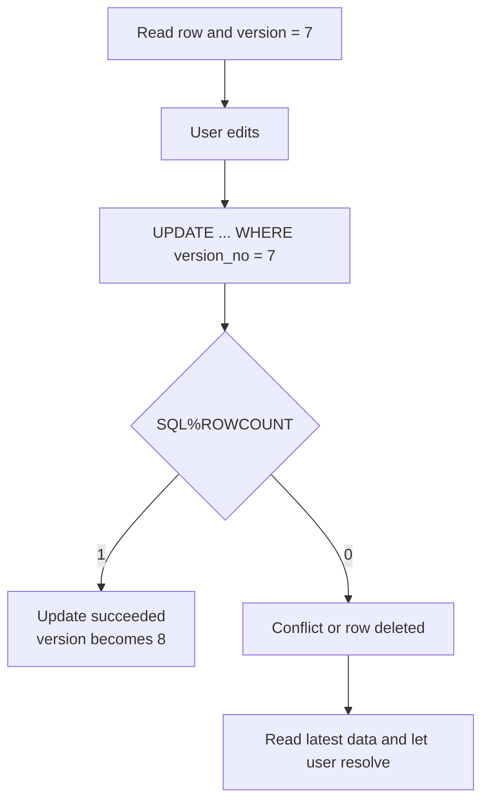

# Lost Updates and Optimistic Locking with a Version Column in Oracle Database

In multi-user applications, two sessions can read the same row, each user modifies the data based on what they see, and then both save sequentially. If the second write does not check whether the data changed since it was read, it can overwrite the first user's changes. This phenomenon is called a **lost update**.

Oracle provides row locks and multiple transaction isolation levels, but a regular SELECT statement does not automatically lock a row to protect the entire duration while a user reads, thinks, and submits a form. For data-editing screens, a common solution is **optimistic locking**: store a **version column** in each row, send the version the user read back to the database, and allow the UPDATE only if the current version still equals that old version.

Core pattern:

```sql
UPDATE customer_profile
SET    display_name = :new_name,
       version_no   = version_no + 1
WHERE  customer_id  = :customer_id
AND    version_no   = :expected_version;
```

If `SQL%ROWCOUNT` equals 1, the update succeeded. If it equals 0, the row was deleted or another session already changed the version; the application must report a conflict and let the user decide how to proceed.

This lesson focuses on how lost updates occur in Oracle, the differences between optimistic and pessimistic locking, version column design, conflict handling in PL/SQL/JDBC, multi-row scenarios, and common implementation mistakes.

## 1. What is a lost update?

### 1.1. Two users editing the same row

Suppose a customer profile has:

| CUSTOMER_ID | DISPLAY_NAME | CREDIT_LIMIT |
|---:|---|---:|
| 1001 | An Nguyen | 50,000,000 |

Two users A and B open the same profile. Both read `CREDIT_LIMIT = 50,000,000`.

- A changes the credit limit to 60,000,000 and saves.
- B is still viewing the old data, changes the display name, and submits the entire form with credit limit 50,000,000.
- If B's UPDATE statement writes both columns back without checking the version, A's 60,000,000 limit is overwritten back to 50,000,000.

A's change was committed yet is missing from the final state of the row. That is a lost update.

### 1.2. Two-session timeline



Two regular SELECTs can read the same committed version. A successful read does not mean that session retains ownership of the row until its UPDATE.

### 1.3. Lost updates are not dirty reads

Phenomena to distinguish:

| Phenomenon | Meaning |
|---|---|
| Dirty read | Reading uncommitted data from another transaction |
| Lost update | A later write loses an earlier committed write by using stale data |
| Non-repeatable read | Two reads of the same row within one transaction receive different values under a permissive isolation level |
| Write-write conflict | Two transactions both want to modify a row and must coordinate via locks or conflict detection |

Oracle does not permit dirty reads under standard isolation levels. However, an application can still cause a lost update at the business layer if it reads data, lets a user edit for a long time, and writes back without checking a version.

## 2. Why doesn't regular SELECT prevent lost updates?

### 2.1. READ COMMITTED and consistent reads

Oracle defaults to the `READ COMMITTED` isolation level. A SELECT statement sees committed data as of that statement's snapshot. When another session is modifying a row without having committed, readers can use undo to reconstruct the previously committed version.

Regular SELECT does not acquire row locks just to read. Thus:

- A can SELECT the row.
- B can SELECT the same row.
- A can UPDATE and COMMIT.
- B still holds the old data in application memory.
- B can submit its UPDATE afterward.

That final step must be protected by a conflict-control mechanism.

### 2.2. Oracle still locks during DML

When A runs UPDATE, Oracle acquires the necessary row lock. If B runs UPDATE on the same row while A has not committed, B usually waits for A to finish. After A commits, B can proceed according to the predicates and values B's UPDATE sent.

Row locks resolve concurrent writes by two writers at the database layer. They do not automatically know that the value B sent was computed from stale data a user read several minutes earlier.

### 2.3. Blind overwrite example

Create the lab table:

```sql
CREATE TABLE account_edit_lab (
    account_id   NUMBER(10) CONSTRAINT pk_account_edit_lab PRIMARY KEY,
    owner_name   VARCHAR2(100 CHAR) NOT NULL,
    balance      NUMBER(14, 2) NOT NULL,
    version_no   NUMBER(10) DEFAULT 0 NOT NULL,
    CONSTRAINT ck_account_edit_balance CHECK (balance >= 0)
);

INSERT INTO account_edit_lab (
    account_id, owner_name, balance, version_no
)
VALUES (101, 'Nguyen An', 5000, 0);

COMMIT;
```

In two separate sessions:

**Session A — read:**

```sql
SELECT account_id, owner_name, balance
FROM account_edit_lab
WHERE account_id = 101;
```

**Session B — read the same row:**

```sql
SELECT account_id, owner_name, balance
FROM account_edit_lab
WHERE account_id = 101;
```

**Session A — change balance and commit:**

```sql
UPDATE account_edit_lab
SET balance = 6000
WHERE account_id = 101;

COMMIT;
```

**Session B — write back the stale balance it had read:**

```sql
UPDATE account_edit_lab
SET owner_name = 'An Nguyen',
    balance = 5000
WHERE account_id = 101;

COMMIT;
```

The final balance becomes 5000. B's UPDATE statement has no syntax error and violates no constraint; it is wrong in terms of concurrent data semantics.

### 2.4. Updating only columns the user actually changed reduces risk

If B only edits the name, the statement:

```sql
UPDATE account_edit_lab
SET owner_name = 'An Nguyen'
WHERE account_id = 101;
```

does not rewrite the old balance, so it does not overwrite A's change on the balance column. This is a helpful improvement when the application can send only modified columns.

Still, this approach does not protect business rules spanning multiple columns. If a user read an old state and decided to update a column based on that state, the application still needs to detect that the version changed. A version column provides an explicit row-level check.

## 3. What is optimistic locking?

### 3.1. Concept

Optimistic locking assumes conflicts happen infrequently. The application does not hold a row lock for the entire time a user has a form open. Instead:

1. When reading a row, fetch both its values and its current version.
2. Keep that version alongside the data in the application.
3. On save, the UPDATE succeeds only if the version in the database still equals the version read.
4. If the UPDATE succeeds, increment the version.
5. If zero rows are updated, report a conflict.



### 3.2. Version column

A version column is a column incremented on each successful update. An integer NUMBER is commonly used:

```sql
version_no NUMBER(10) DEFAULT 0 NOT NULL
```

The initial value can be 0. Each accepted change increments by 1:

```sql
UPDATE account_edit_lab
SET balance    = :new_balance,
    version_no = version_no + 1
WHERE account_id = :account_id
  AND version_no = :expected_version;
```

Suppose the application read `version_no = 0`. If nobody else modified it, the condition matches and the row is updated to version 1. If another session updated first, the current version is 1 so `version_no = 0` no longer matches; the UPDATE affects 0 rows.

### 3.3. Why increment version in the same UPDATE?

Do not split into two statements:

```sql
UPDATE account_edit_lab
SET balance = :new_balance
WHERE account_id = :account_id
  AND version_no = :expected_version;

UPDATE account_edit_lab
SET version_no = version_no + 1
WHERE account_id = :account_id;
```

Between the two statements an error or another transaction could intervene; the version and data could fall out of sync. Update data and version together in **one atomic statement**:

```sql
UPDATE account_edit_lab
SET balance = :new_balance,
    version_no = version_no + 1
WHERE account_id = :account_id
  AND version_no = :expected_version;
```

The check predicate and the version increment sit inside a single DML operation locked and executed by Oracle under transaction rules.

## 4. Implementing optimistic locking in SQL

### 4.1. Reading data and version

The application must fetch the version alongside the displayed columns:

```sql
SELECT account_id,
       owner_name,
       balance,
       version_no
FROM account_edit_lab
WHERE account_id = :account_id;
```

Example output:

| ACCOUNT_ID | OWNER_NAME | BALANCE | VERSION_NO |
|---:|---|---:|---:|
| 101 | Nguyen An | 5,000 | 0 |

The application keeps `VERSION_NO = 0` as the expected version. Never fetch the latest version right before UPDATE and use it to write stale data; that defeats conflict detection.

### 4.2. Version-checked UPDATE

```sql
UPDATE account_edit_lab
SET owner_name = :new_owner_name,
    balance    = :new_balance,
    version_no = version_no + 1
WHERE account_id = :account_id
  AND version_no = :expected_version;
```

After the statement, check the number of affected rows:

```sql
DECLARE
    l_rows PLS_INTEGER;
BEGIN
    UPDATE account_edit_lab
    SET balance = 6500,
        version_no = version_no + 1
    WHERE account_id = 101
      AND version_no = 0;

    l_rows := SQL%ROWCOUNT;

    IF l_rows = 1 THEN
        DBMS_OUTPUT.PUT_LINE('Update accepted');
    ELSE
        DBMS_OUTPUT.PUT_LINE('Conflict: row changed or deleted');
    END IF;
END;
/
```

In applications, `SQL%ROWCOUNT = 0` is a business outcome to handle, not necessarily an Oracle error. Do not rely solely on checking `SQLCODE` to detect optimistic lock conflicts; a valid UPDATE statement can execute without error while matching zero rows.

### 4.3. Using RETURNING to get the new version

You can receive the post-update version using `RETURNING INTO`:

```sql
DECLARE
    l_new_version account_edit_lab.version_no%TYPE;
BEGIN
    UPDATE account_edit_lab
    SET balance = 6500,
        version_no = version_no + 1
    WHERE account_id = 101
      AND version_no = 0
    RETURNING version_no INTO l_new_version;

    IF SQL%ROWCOUNT = 1 THEN
        DBMS_OUTPUT.PUT_LINE('New version=' || l_new_version);
    END IF;
END;
/
```

Scalar `RETURNING INTO` fits when the statement updates at most one row. If the UPDATE can affect multiple rows, use an appropriate multi-value mechanism (such as collections/bulk returning) or query the version via SELECT under transaction control.

### 4.4. INSERTing a new row

On INSERT, initialize the version:

```sql
INSERT INTO account_edit_lab (
    account_id,
    owner_name,
    balance,
    version_no
)
VALUES (
    :account_id,
    :owner_name,
    :balance,
    0
);
```

You can specify DEFAULT 0 in DDL and omit `version_no` from the column list. Either way, version must be NOT NULL with a deterministic initial value.

### 4.5. DELETE must also check version

If a user deletes a row from a previously opened screen, ensure they are deleting the exact version they read:

```sql
DELETE FROM account_edit_lab
WHERE account_id = :account_id
  AND version_no = :expected_version;
```

If `SQL%ROWCOUNT` equals 0, the row may have been modified or deleted by someone else. Do not omit the version predicate in DELETE if the goal is to prevent users from deleting a newer version they have never seen.

## 5. Two-session lab with a version column

### 5.1. Reinitialize the test row

Run once:

```sql
DELETE FROM account_edit_lab
WHERE account_id = 101;

INSERT INTO account_edit_lab (
    account_id, owner_name, balance, version_no
)
VALUES (101, 'Nguyen An', 5000, 0);

COMMIT;
```

### 5.2. Both A and B read version 0

Session A:

```sql
SELECT balance, version_no
FROM account_edit_lab
WHERE account_id = 101;
```

Session B runs the same SELECT. Both receive balance 5000, version 0.

### 5.3. A updates first

Session A:

```sql
UPDATE account_edit_lab
SET balance = 6000,
    version_no = version_no + 1
WHERE account_id = 101
  AND version_no = 0;

COMMIT;
```

A updates one row. The row now has balance 6000, version 1.

### 5.4. B attempts to update with the stale version

Session B:

```sql
UPDATE account_edit_lab
SET balance = 4500,
    version_no = version_no + 1
WHERE account_id = 101
  AND version_no = 0;
```

After the statement, check the update count on the client or in PL/SQL via `SQL%ROWCOUNT`. You cannot query `SQL%ROWCOUNT` directly as a SQL column in SELECT. Session B updates 0 rows because the current version is 1.

### 5.5. Re-read and resolve

Session B re-reads:

```sql
SELECT balance, version_no
FROM account_edit_lab
WHERE account_id = 101;
```

The result is balance 6000, version 1. The application can:

- Inform the user that the data was updated by someone else.
- Display the new value alongside what the user was attempting to save.
- Let the user compare and deliberately reapply changes.
- Cancel the operation if it cannot be safely merged automatically.

Never automatically fetch the new version and resubmit the entire stale payload; doing so turns a conflict into another overwrite.

## 6. Distinguishing optimistic locking and pessimistic locking

### 6.1. Pessimistic locking with SELECT FOR UPDATE

Pessimistic locking assumes significant contention is likely and acquires locks early:

```sql
SELECT account_id, balance
FROM account_edit_lab
WHERE account_id = 101
FOR UPDATE;
```

The session holds the row lock until COMMIT or ROLLBACK. Other sessions wanting to UPDATE the same row must wait or handle WAIT/NOWAIT/SKIP LOCKED behavior.

### 6.2. Optimistic locking with a version column

Optimistic locking does not hold a row lock while the user views the form. It only locks the row during the actual UPDATE execution and validates the version in the same statement.

| Criterion | Optimistic locking | Pessimistic locking |
|---|---|---|
| Check timing | At write time | At start of operation needing lock |
| Holds row lock while user thinks | No | Potentially yes if transaction stays open |
| On conflict | UPDATE 0 rows, application handles conflict | Other writer waits or fails to acquire lock |
| Best suited for | Edit forms, APIs, rare conflicts | Short workflows, high contention, protection needed before read/write |
| Primary cost | Conflict detection and resolution | Lock waits, holding transactions and resources |

### 6.3. When to choose which?

Choose optimistic locking when:

- Users may keep screens open for long periods.
- Many users view records while few edit the same row concurrently.
- You do not want to hold database connections/transactions while users interact.
- Conflicts can be reported and resolved by the user.

Choose pessimistic locking when:

- Business logic must lock before reading or allocating resources.
- Operations are brief and run within a short transaction.
- Conflicts are frequent and retries/conflict resolution are expensive.
- Strict serialization on a row/resource is explicitly required.

Never hold `SELECT FOR UPDATE` while waiting for user input on a web page. Long transactions tie up connections and row locks, increasing blocking, deadlocks, and connection pool exhaustion.

### 6.4. WAIT, NOWAIT, and SKIP LOCKED

Example of locking with a wait duration:

```sql
SELECT account_id, balance
FROM account_edit_lab
WHERE account_id = 101
FOR UPDATE WAIT 5;
```

If the lock cannot be acquired within the wait window, Oracle raises the appropriate error. Options include:

- `NOWAIT`: do not wait; return an error immediately if the row is locked.
- `WAIT n`: wait up to n seconds.
- `SKIP LOCKED`: skip rows currently locked, typically useful for queue workers.

`SKIP LOCKED` is not a general-purpose handling strategy for edit forms; skipping a row could trick the application into thinking the row does not exist.

## 7. Choosing the version data type

### 7.1. Incrementing NUMBER

Common recommendation:

```sql
version_no NUMBER(10) DEFAULT 0 NOT NULL
```

Advantages:

- Exact comparison.
- Increments via `version_no + 1`.
- Independent of system clocks.
- Never collides due to two sessions writing the same timestamp.
- Easy to serialize in JSON/REST if values stay within the client's safe integer range.

If the system expects extremely high update counts over a row's lifetime, choose a larger precision. Never make version nullable; comparing `version_no = :expected_version` with NULL will not match.

### 7.2. Timestamp as version

Some systems use `last_updated_at`:

```sql
UPDATE customer_profile
SET display_name = :new_name,
    last_updated_at = SYSTIMESTAMP
WHERE customer_id = :customer_id
  AND last_updated_at = :expected_timestamp;
```

This approach carries risks:

- Precision/rounding across drivers or JSON serialization may differ.
- Timestamps may not be unique if precision/clock resolution is insufficient for the workload.
- Clocks can drift or differ across systems.
- Time zones and serialization formats must stay consistent.

If using timestamps, store and return the exact precision emitted by the database without formatting away fractional seconds. An integer version is usually simpler and more reliable.

### 7.3. Data hashing

Some designs compare a hash of columns instead of a version:

```sql
UPDATE customer_profile
SET display_name = :new_name
WHERE customer_id = :customer_id
  AND STANDARD_HASH(display_name, 'SHA256') = :old_name_hash;
```

Hashing can help in legacy schemas where adding a version column is impossible, but you must clearly define participating columns, NULL handling, data types, normalization, and collision considerations. Hashing one column does not protect other columns; computing hashes can make predicates heavier. Do not replace a version column with hashes if you can manage the schema.

## 8. Ensuring every write path increments version

### 8.1. Mandatory rule

Optimistic locking is only sound if **every write path that can modify the row updates the version**:

- Web/mobile screens.
- REST APIs.
- Batch jobs.
- Stored procedures.
- Admin tools.
- Triggers or integrations.
- Operational support scripts.

If a batch UPDATE modifies data without incrementing the version, users holding stale versions can overwrite it undetected.

### 8.2. Updating version in the application layer

Every UPDATE statement must include:

```sql
SET version_no = version_no + 1
WHERE ... AND version_no = :expected_version
```

The advantage is that the SQL explicitly shows the optimistic lock condition and is easy to read. The drawback is that every caller must adhere to the convention; a single UPDATE forgetting the version breaks the mechanism.

### 8.3. Using a trigger to increment version

A BEFORE UPDATE trigger can automatically increment version for all UPDATEs:

```sql
CREATE OR REPLACE TRIGGER trg_account_edit_version
BEFORE UPDATE ON account_edit_lab
FOR EACH ROW
BEGIN
    :NEW.version_no := :OLD.version_no + 1;
END;
/
```

With this design, application UPDATEs must still check the expected version:

```sql
UPDATE account_edit_lab
SET balance = :new_balance
WHERE account_id = :account_id
  AND version_no = :expected_version;
```

The trigger increments the version after the row matches. Do not increment version both in the UPDATE statement and in the trigger without an explicit convention, or version may increment twice. Triggers prevent write paths from forgetting to bump version, though they make DML behavior less explicit and require reviewing interactions with bulk loads, replication, other triggers, and migrations.

### 8.4. Disallow arbitrary version updates

If applications are allowed to set the version column directly, a buggy client can reset version to an old value or skip numbers arbitrarily. You can:

- Encapsulate DML inside packages/procedures.
- Grant column-level UPDATE privileges appropriately.
- Use triggers to enforce version progression.
- Design APIs to accept only the expected version, never a client-chosen new version.

The application only needs to send the version it read; the database increments version when accepting the change.

## 9. Handling conflicts properly

### 9.1. An UPDATE affecting zero rows has multiple causes

With the statement:

```sql
UPDATE customer_profile
SET display_name = :new_name,
    version_no = version_no + 1
WHERE customer_id = :id
  AND version_no = :expected_version;
```

`SQL%ROWCOUNT = 0` can mean:

1. The ID does not exist.
2. The row was deleted.
3. The version changed.
4. Another WHERE predicate is no longer satisfied.

If the API needs to distinguish "not found" from "conflict," it can re-query the row within an appropriate transaction after the UPDATE returns 0:

```sql
SELECT version_no, display_name
FROM customer_profile
WHERE customer_id = :id;
```

If no row exists, return not found. If the row exists with a version different from the expected version, return conflict. Re-reading is only for reporting; never use its result to automatically overwrite the newer data.

### 9.2. Business error codes

A procedure can translate conflicts into application error codes:

```sql
CREATE OR REPLACE PROCEDURE update_account_balance (
    p_account_id       IN account_edit_lab.account_id%TYPE,
    p_expected_version IN account_edit_lab.version_no%TYPE,
    p_new_balance      IN account_edit_lab.balance%TYPE
)
AS
    l_rows PLS_INTEGER;
BEGIN
    UPDATE account_edit_lab
    SET balance = p_new_balance,
        version_no = version_no + 1
    WHERE account_id = p_account_id
      AND version_no = p_expected_version;

    l_rows := SQL%ROWCOUNT;

    IF l_rows = 0 THEN
        RAISE_APPLICATION_ERROR(
            -20051,
            'Optimistic locking conflict or account not found'
        );
    END IF;
END;
/
```

This example does not COMMIT inside the procedure. Transaction boundaries generally belong to the caller so the caller can combine multiple business operations and commit or roll back together. If the API needs to distinguish not found vs. conflict, add the appropriate check logic.

### 9.3. Should you automatically retry?

Not every conflict can be safely retried:

- If the operation is adding/subtracting a delta and can be expressed atomically, you can rewrite the UPDATE against the current value.
- If a user replaced an entire form, automatically resubmitting old data with the new version can overwrite someone else's changes.
- If the operation produces external side effects (sending email, creating external transactions), retries must use idempotency keys or deduplication guards.

When a conflict is detected, the safe option is usually to load the new data, show the difference, and let business logic or the user decide how to merge.

### 9.4. REST/API responses

An API can represent version with a JSON field:

```json
{
  "accountId": 101,
  "balance": 6000,
  "version": 8
}
```

The client sends back the version it read when saving. If the version does not match, the API can return HTTP 409 Conflict. A REST design can also use ETag/If-Match:

- GET returns an ETag representing the version.
- Client sends `If-Match` on PUT/PATCH.
- Server updates only if the ETag still matches.
- On mismatch, return 412 Precondition Failed or 409 per the API contract.

ETags must stably represent the resource version; never let clients invent new versions.

## 10. Optimistic locking with JDBC

### 10.1. Reading both data and version

```java
String selectSql = """
    SELECT account_id, balance, version_no
    FROM account_edit_lab
    WHERE account_id = ?
    """;

try (PreparedStatement ps = connection.prepareStatement(selectSql)) {
    ps.setLong(1, accountId);

    try (ResultSet rs = ps.executeQuery()) {
        if (!rs.next()) {
            throw new IllegalArgumentException("Account not found");
        }

        BigDecimal oldBalance = rs.getBigDecimal("balance");
        long expectedVersion = rs.getLong("version_no");
        // Return oldBalance and expectedVersion to the business layer.
    }
}
```

In web applications, connections and transactions should not be kept open for the entire time a user reads/thinks. Carry the version as part of the screen/API payload and open a short transaction when saving.

### 10.2. Versioned UPDATE and update-count check

```java
String updateSql = """
    UPDATE account_edit_lab
    SET balance = ?,
        version_no = version_no + 1
    WHERE account_id = ?
      AND version_no = ?
    """;

try (PreparedStatement ps = connection.prepareStatement(updateSql)) {
    ps.setBigDecimal(1, newBalance);
    ps.setLong(2, accountId);
    ps.setLong(3, expectedVersion);

    int updated = ps.executeUpdate();

    if (updated == 1) {
        connection.commit();
    } else if (updated == 0) {
        connection.rollback();
        throw new OptimisticLockException(
            "The account was changed or deleted by another request"
        );
    } else {
        connection.rollback();
        throw new IllegalStateException(
            "Unexpected number of rows updated: " + updated
        );
    }
}
```

This is an illustrative example. In production applications, place transaction management at a service boundary and guarantee rollback even when PreparedStatement throws SQLException. With connection pools, restore auto-commit/isolation state per framework conventions.

### 10.3. Creating a custom exception

```java
public final class OptimisticLockException extends RuntimeException {
    public OptimisticLockException(String message) {
        super(message);
    }
}
```

The controller layer can map this exception to a conflict response and instruct the client to reload data. Never return stack traces or sensitive SQL to clients.

### 10.4. Short transactions and commit boundaries

A service pattern:

1. Receive ID, new data, and expected version.
2. Open transaction.
3. Run version-checked UPDATE.
4. Check update count.
5. Commit if exactly one row was updated.
6. Roll back on conflict or error.

Do not open a transaction when a user opens a page and hold it until they click Save minutes later. Optimistic locking is designed to detect changes between two points in time without holding locks across that interval.

## 11. Optimistic locking in JPA/Hibernate

JPA supports versioned entities using the `@Version` annotation:

```java
@Entity
@Table(name = "ACCOUNT_EDIT_LAB")
public class AccountEdit {
    @Id
    @Column(name = "ACCOUNT_ID")
    private Long accountId;

    @Column(name = "BALANCE", nullable = false)
    private BigDecimal balance;

    @Version
    @Column(name = "VERSION_NO", nullable = false)
    private Long versionNo;
}
```

The provider uses the version to detect concurrent updates via JPA's optimistic locking mechanism. If versions do not match, the application may receive `OptimisticLockException` or a framework/transaction-layer wrapper exception.

Notes:

- Do not manually modify the version in the entity when the provider manages `@Version`.
- All write paths outside JPA must still honor the version column.
- Native SQL/bulk updates can bypass entity lifecycle/version handling; you must manually increment version and synchronize the persistence context.
- When a transaction rolls back due to optimistic lock failure, the entity/transaction state should be discarded and reloaded; do not continue reusing the stale object as if no error occurred.

## 12. Multiple rows, batches, and versions

### 12.1. Updating multiple rows sharing the same expected version

An UPDATE can apply a version predicate to a set of rows:

```sql
UPDATE inventory_item
SET quantity = :new_quantity,
    version_no = version_no + 1
WHERE warehouse_id = :warehouse_id
  AND version_no = :expected_version;
```

This makes sense if business rules require all selected rows to share the same version. However, when multiple rows have distinct versions, you must pass the expected version per row; a single shared value cannot be used when row versions differ.

### 12.2. Per-row updates with FORALL

PL/SQL can use collections of IDs and expected versions:

```sql
DECLARE
    TYPE t_id_list IS TABLE OF inventory_item.item_id%TYPE;
    TYPE t_version_list IS TABLE OF inventory_item.version_no%TYPE;
    TYPE t_qty_list IS TABLE OF inventory_item.quantity%TYPE;

    l_ids        t_id_list := t_id_list(10, 11, 12);
    l_versions   t_version_list := t_version_list(3, 7, 2);
    l_quantities t_qty_list := t_qty_list(50, 60, 70);
BEGIN
    FORALL i IN 1 .. l_ids.COUNT
        UPDATE inventory_item
        SET quantity = l_quantities(i),
            version_no = version_no + 1
        WHERE item_id = l_ids(i)
          AND version_no = l_versions(i);

    FOR i IN 1 .. l_ids.COUNT LOOP
        DBMS_OUTPUT.PUT_LINE(
            'Item=' || l_ids(i)
            || ', affected=' || SQL%BULK_ROWCOUNT(i)
        );
    END LOOP;
END;
/
```

`SQL%BULK_ROWCOUNT(i)` reports the number of rows affected by the corresponding iteration. A value of 0 means conflict or missing row. The application must map back to the source ID and decide whether to roll back the entire batch or accept partial results. The inspection loop must follow FORALL in the same block to read bulk DML counts accurately.

### 12.3. Handling partial success

For batches, explicitly define:

- **All-or-nothing:** if one row conflicts, roll back the entire batch.
- **Partial success:** update non-conflicting rows, return the list of conflicting rows.
- **Per-row retry:** reload the latest version and rerun if permitted by business rules.

Do not let partial results happen accidentally from exception handling. Transaction boundaries and API responses must reflect the chosen policy.

## 13. Arithmetic operations that can update atomically

Not every case requires reading a value and then writing a new absolute value. If the business operation is adding/subtracting a delta, express the math directly inside UPDATE:

```sql
UPDATE account_edit_lab
SET balance = balance - :amount,
    version_no = version_no + 1
WHERE account_id = :account_id
  AND balance >= :amount;
```

This is an atomic operation on the row's current value. Two sessions both deducting money are serialized by Oracle at the row lock level; after waiting, the second statement evaluates predicates against the current state per DML semantics. If balance is insufficient, `SQL%ROWCOUNT` is 0.

This pattern fits rules like "deduct amount if current balance suffices." It does not replace optimistic locking for multi-field edit forms where users submit an old snapshot of the entire object.

### 13.1. Distinguishing version checks and business conditions

Both can be combined:

```sql
UPDATE account_edit_lab
SET balance = balance - :amount,
    version_no = version_no + 1
WHERE account_id = :account_id
  AND version_no = :expected_version
  AND balance >= :amount;
```

If the update count is 0, it could be due to a version conflict, insufficient balance, or missing account. If you need to distinguish them, read the current state and return the corresponding business error. Do not omit the balance condition merely because a version check is present.

### 13.2. When operations do not commute

An operation like "set balance to 5,000" depends on the value the user saw; it can overwrite an earlier change. An operation like "add 500" can be applied to the current value if business rules allow. Determine whether an operation is a **set** or a **delta operation** before choosing optimistic locking or an atomic update.

## 14. Can ORA_ROWSCN replace a version column?

Oracle provides the `ORA_ROWSCN` pseudocolumn to obtain the SCN associated with row/block changes. It is useful for certain monitoring queries or change detection at an appropriate level, but it should not be used by default in place of an application version column.

Key points to understand:

- By default, `ORA_ROWSCN` may reflect a block-level SCN rather than an exact per-row SCN.
- Tables created with `ROWDEPENDENCIES` track finer-grained row-level dependency info, yet semantics and precision still require careful understanding.
- An SCN value is not an application version token designed to increment strictly by one per update.
- Delayed block cleanout and internal mechanisms can complicate interpreting change timestamps.
- `ORA_ROWSCN` does not replace authorization, constraints, or business predicates.

Observation example:

```sql
SELECT account_id,
       balance,
       ORA_ROWSCN
FROM account_edit_lab
WHERE account_id = 101;
```

You can compare SCN before/after operations in a lab, but if you need stable application-level optimistic locking, use a schema-managed `VERSION_NO` column.

## 15. Common design mistakes

| Mistake | Consequence | Fix |
|---|---|---|
| Only SELECT then UPDATE by ID | Overwrites another session's changes | Add expected version to WHERE |
| Incrementing version in a separate statement | Gap between data and version | Increment version in the same UPDATE |
| Not incrementing version in batch jobs | Old clients fail to detect changes | Standardize all write paths |
| Nullable version column | Comparing version to NULL never matches | NOT NULL with initial default |
| Client freely supplies new version | Can bypass or break the mechanism | Database increments version |
| Using low-precision timestamps | May miss two closely spaced edits | Use NUMBER version or preserve full precision |
| Auto-retrying with new version and stale payload | Overwrites the newly detected change | Reload new data and merge deliberately |
| Checking version on UPDATE but not DELETE | Deletes a newer row the user never saw | Include expected version on DELETE |
| Treating ORA_ROWSCN as an absolute token | Wrong assumptions about block/row SCN | Dedicated version column |
| Holding SELECT FOR UPDATE while user types | Long locks, blocking, tied-up connections | Use optimistic locking for long forms |
| Ignoring update count 0 | UI reports success even though 0 rows changed | Distinguish conflict vs. not found |
| Bulk update without per-row counts | Misses conflicts on individual rows | Use SQL%BULK_ROWCOUNT and a batch policy |
| Both trigger and app increment version | Version jumps by two or becomes confusing | Choose a single place to manage increments |
| Native SQL/JPA bulk update skips version | Persistence context and version drift | Increment version explicitly and sync/clear context |

## 16. Comprehensive lab exercise

Run in an isolated lab schema. The steps below use table `account_edit_lab` created in section 2.3.

### Step 1 — Observe a lost update

1. Reset balance to 5000.
2. Open sessions A and B; both SELECT the same row.
3. A runs UPDATE balance to 6000 and COMMITs.
4. B runs UPDATE balance to 4500 without a version check and COMMITs.
5. Observe the final value and explain why A's change was lost.

### Step 2 — Add version checking

Ensure the row has version 0:

```sql
UPDATE account_edit_lab
SET balance = 5000,
    version_no = 0
WHERE account_id = 101;
COMMIT;
```

Then both A and B read version 0. A updates with `WHERE version_no = 0`, increments version to 1, and commits. B uses expected version 0; verify the update count is 0.

### Step 3 — Test concurrent delete

1. A reads the row and version.
2. B updates the row, increments version, and commits.
3. A runs DELETE with ID and the old expected version.
4. Confirm DELETE deletes zero rows.

### Step 4 — Distinguish conflict and not found

Write a procedure accepting ID/expected version, performing a conditional UPDATE, and returning one of three outcomes:

- `UPDATED`: exactly one row.
- `NOT_FOUND`: ID no longer exists.
- `CONFLICT`: row exists with a different version.

Do not rely on a pre-check SELECT as the guarantee; the versioned UPDATE is the authoritative operation.

### Step 5 — Test pessimistic locking

1. Session A runs SELECT FOR UPDATE.
2. Session B runs UPDATE on the same row.
3. Observe B waiting.
4. A runs COMMIT or ROLLBACK.
5. Compare with optimistic locking where A does not hold locks while a user edits.

### Step 6 — Test a version trigger

On a separate test table, create a BEFORE UPDATE trigger to increment version. Test UPDATEs with and without `SET version_no = version_no + 1`. Observe version increments and establish a single-owner policy for version bumping.

### Step 7 — Test bulk optimistic update

Use FORALL with three IDs and different expected versions. Intentionally give one ID a stale version. Read `SQL%BULK_ROWCOUNT(i)` and report conflicting rows.

### Step 8 — Test API/JDBC

Write an endpoint or service method:

1. Read ID, data, and version.
2. Return version to the client.
3. Receive version back on save.
4. Execute conditional UPDATE.
5. Return conflict if update count is 0.

Test two clients opening the same profile and saving sequentially to observe the response.

## 17. Implementation checklist

Before rolling out optimistic locking into a system, confirm:

- [ ] Every row has a NOT NULL version column with a deterministic initial value.
- [ ] The application reads the version alongside data.
- [ ] UPDATE includes ID + expected version in WHERE.
- [ ] Version is incremented in the same statement that updates data.
- [ ] DELETE also checks expected version when deletions must be guarded.
- [ ] All batches, procedures, jobs, and other APIs obey the version rule.
- [ ] Only the database or one consistent layer manages incrementing version.
- [ ] Update count 0 is handled cleanly as conflict or not found.
- [ ] Stale payloads are never auto-retried with a new version without merging.
- [ ] Transactions are short with clear commit boundaries.
- [ ] There is a policy for bulk partial success vs. all-or-nothing.
- [ ] Tested with two real concurrent sessions, not just single-connection unit tests.
- [ ] API/ORM passes version explicitly; native/bulk DML does not bypass version.
- [ ] Do not use ORA_ROWSCN as a version token without understanding its limits.

## 18. Self-check questions

1. When does a lost update occur? How does it differ from a dirty read?
2. Why does a regular SELECT in Oracle not hold a row lock until the user clicks Save?
3. How does READ COMMITTED provide statement-level snapshots?
4. What does optimistic locking assume about conflict frequency?
5. When must the version column be read and sent back?
6. Why must `version_no = :expected_version` be in the UPDATE's WHERE clause?
7. Why is incrementing the version in the same UPDATE important?
8. What scenarios can `SQL%ROWCOUNT = 0` represent?
9. When should version be checked in DELETE?
10. How does optimistic locking differ from SELECT FOR UPDATE in lock timing?
11. Why shouldn't you hold a transaction and row lock while a user fills out a form?
12. How does a NUMBER version differ in reliability from a timestamp version?
13. Why must every data-writing path increment the version?
14. How can a trigger manage versions, and what is the risk if the app also increments it?
15. What limitations does ORA_ROWSCN have when used as an optimistic lock token?
16. When can an atomic arithmetic UPDATE replace read-modify-write?
17. Which attribute reports per-iteration results in FORALL?
18. Why can auto-retrying with a new version and an old payload recreate a lost update?
19. What does JPA `@Version` help with, and what must be watched in bulk native SQL?
20. How can an API represent versions using ETag/If-Match?

**Key rule to remember:** Oracle's row locks protect an in-flight write operation; they do not protect data that a user read a long time ago. For edit screens and long-lived API workflows, read the version together with the data and only UPDATE/DELETE while the version still matches. Update data and increment the version in the same statement, inspect the affected row count, and handle conflicts according to business rules. This detects concurrent changes without holding locks for the entire user interaction.
