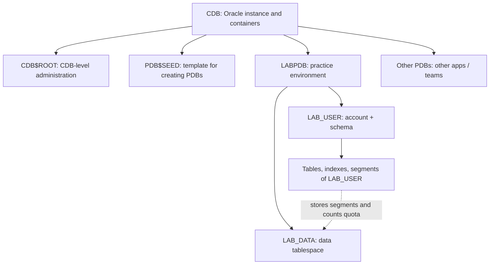

# Creating a PDB, Practice Account, Tablespace, and Storage Quota in Oracle

A good Oracle practice environment must **isolate learner data**, clearly separate which accounts hold administrative privileges versus exercise-only rights, and bound storage resources so one lab does not exhaust space for everyone else. With Oracle's **multitenant** architecture, this environment can be structured along the chain: **CDB → PDB → tablespace → user/schema → quota**.

This lesson builds a cohesive end-to-end example:

- A container database (CDB) is running; the administrator has privileges to create a pluggable database.
- The practice PDB is named `LABPDB`.
- The dedicated data tablespace inside the PDB is `LAB_DATA`.
- The student account is `LAB_USER`, allowed to create tables in its own schema with a **256 MB quota** on `LAB_DATA`.
- A sample table is created using the student account itself to verify how the environment is used.

The commands shown fit Oracle Database administration with multitenant support (such as Oracle Database 19c and later), though **datafile paths, service names, permissions, and the number of allowed PDBs depend on your installation**. Replace placeholders inside `<...>` with your environment's real values; never reuse example passwords in shared systems.

## 1. Understanding the Isolation Layers

In Oracle multitenant, a **CDB** (*container database*) contains the root container `CDB$ROOT`, the seed container `PDB$SEED`, and **PDBs** (*pluggable databases*). A PDB operates like a separate database for objects, schemas, and many PDB-level settings, while sharing the CDB's instance infrastructure and administrative mechanisms.



| Component | Function | Boundary to remember |
| --- | --- | --- |
| `CDB$ROOT` | Administers the CDB and PDBs; holds CDB-level metadata | Do not create exercise tables or ordinary users here. |
| `PDB$SEED` | Oracle template used when creating new PDBs | Not a place for learners to create objects. |
| `LABPDB` | Container dedicated to the practice lab | Log into the PDB's service so operations happen in the right place. |
| Tablespace `LAB_DATA` | Logical storage space for segments, backed by datafiles | A storage resource, not an account or schema. |
| User `LAB_USER` | Login identity and owner of the same-named schema | Can create objects only with appropriate privileges and quota when space allocation is needed. |
| Quota | Segment space limit for **one user on one permanent tablespace** | Not a limit on total PDB size or total row count. |

Common point of confusion: a **schema** is the set of objects owned by a user; a **tablespace** is where the corresponding physical segments are stored. One schema can store objects across multiple tablespaces, and multiple schemas can share one tablespace. Specifying `DEFAULT TABLESPACE LAB_DATA` sets the default location for allocating segments when no tablespace is explicitly specified; it **does not automatically grant storage permission**. Quota is configured separately.

Additionally, an ordinary user created **inside a PDB** is a *local user*, such as `LAB_USER`. A *common user* is created to exist across relevant containers and normally must follow the default `C##` prefix. This lab uses a local user to prevent privileges from spanning the entire CDB.

## 2. Preparing an Admin Session and Checking the Environment

The administrator needs appropriate privileges to create/open a PDB and to create tablespaces, users, and grants inside the PDB. On an Oracle Linux host configured with OS authentication, a common method is starting SQL*Plus with DBA privileges:

```bash
sqlplus / as sysdba
```

This command only works when the OS account and Oracle instance are configured for OS authentication. In SQL Developer or a container environment, use the admin connection provided by your system with the right role and service address. Do not grant `SYSDBA` to student accounts merely to simplify a lab.

In SQL*Plus or SQLcl, check the current container and existing PDBs:

```sql
SHOW CON_NAME;
SHOW PDBS;

SELECT con_id, name, open_mode
FROM v$pdbs
ORDER BY con_id;
```

`SHOW CON_NAME` and `SHOW PDBS` are **command-line tool commands**, not standard SQL; if your UI does not support them, run:

```sql
SELECT SYS_CONTEXT('USERENV', 'CON_NAME') AS current_container
FROM dual;
```

To **create** a PDB, the admin session must be in `CDB$ROOT`. If you have privileges to switch containers:

```sql
ALTER SESSION SET CONTAINER = CDB$ROOT;
```

If you are only provided a single existing PDB (very common in online learning environments, Oracle Free, or XE), **you do not need to create another PDB**: identify the provided PDB service name and skip straight to creating the tablespace and account. Creating additional PDBs depends on privileges, edition, and deployment limits; do not attempt to alter product limits or drop existing PDBs to bypass limits.

### Oracle-Managed Files or manual paths?

Oracle has two common ways to define datafiles for a PDB and tablespace:

1. **Oracle-Managed Files (OMF):** Oracle manages filenames and paths when `DB_CREATE_FILE_DEST` is configured properly. This is convenient for the examples below.
2. **DBA-managed paths:** DDL specifies mapping between `PDB$SEED` datafiles and the new PDB using `FILE_NAME_CONVERT`, as well as explicit `DATAFILE` paths when creating tablespaces. Paths must actually exist and suit the OS, storage layout, and Oracle write permissions.

Check in the admin session:

```sql
SHOW PARAMETER db_create_file_dest;
```

If the value is empty, do not copy the OMF-based examples verbatim: a DBA must configure the file destination or use valid path mappings. Behavior can vary across ASM, filesystems, container images, and cloud-managed Oracle.

## 3. Creating the Practice PDB `LABPDB`

Operations in this section run in an admin session at **`CDB$ROOT`**. When OMF is configured and the environment permits creating a new PDB, run:

```sql
CREATE PLUGGABLE DATABASE LABPDB
    ADMIN USER LAB_ADMIN IDENTIFIED BY "<PDB_ADMIN_PASSWORD>"
    ROLES = (DBA);
```

Oracle creates the new PDB from `PDB$SEED`. `LAB_ADMIN` is the **local administrative user** for `LABPDB` declared at creation time; it is distinct from `LAB_USER` meant for students. The `ROLES = (DBA)` clause illustrates administrative privileges granted to the PDB admin user, **not** a privilege template for learners doing exercises.

If not using OMF and the DBA manages datafile paths manually, file mapping looks like the following; this is an **alternative approach**—do not run both `CREATE PLUGGABLE DATABASE` statements:

```sql
-- Syntax illustration only: replace with actual PDB$SEED path and valid destination.
CREATE PLUGGABLE DATABASE LABPDB
    ADMIN USER LAB_ADMIN IDENTIFIED BY "<PDB_ADMIN_PASSWORD>"
    ROLES = (DBA)
    FILE_NAME_CONVERT = (
        '/path/to/oradata/pdbseed/',
        '/path/to/oradata/labpdb/'
    );
```

`FILE_NAME_CONVERT` mappings must match the exact source datafile names/paths Oracle uses; do not guess paths from the PDB name. A DBA can inspect `PDB$SEED` datafile metadata from root admin views to choose the right mapping. On systems using OMF, the OMF approach is usually preferable to constructing filenames manually.

### Opening the PDB and saving its open state

The newly created PDB must be opened to accept user connections:

```sql
ALTER PLUGGABLE DATABASE LABPDB OPEN READ WRITE;

SELECT name, open_mode
FROM v$pdbs
WHERE name = 'LABPDB';
```

The expected result is `LABPDB` with `OPEN_MODE = READ WRITE`. To tell Oracle to remember the PDB's open state for the next CDB startup, run:

```sql
ALTER PLUGGABLE DATABASE LABPDB SAVE STATE;
```

`SAVE STATE` preserves the saved open mode across restarts where supported, but it **does not replace** DBA checks of the listener, services, or actual instance startup. A PDB's default service name usually relates to the PDB name, though an environment may register different services; confirm which services the listener advertises.

To continue administrative setup inside the PDB using the same sufficiently privileged session:

```sql
ALTER SESSION SET CONTAINER = LABPDB;

SELECT SYS_CONTEXT('USERENV', 'CON_NAME') AS current_container
FROM dual;
```

**Proceed only when the result is `LABPDB`**. This is a critical safeguard: a `CREATE USER` statement accidentally executed in root easily fails on common-user naming rules or creates an improperly scoped configuration.

## 4. Creating a Data Tablespace Inside the PDB

A tablespace is the logical storage layer holding segments such as tables and indexes, backed by one or more **datafiles**. Tablespace `LAB_DATA` separates exercise data from system tablespaces like `SYSTEM` or `SYSAUX`. All statements in this section run under an admin account in `LABPDB`.

When OMF is active in the PDB, an example creating a smallfile permanent tablespace:

```sql
CREATE TABLESPACE LAB_DATA
    DATAFILE SIZE 128M
    AUTOEXTEND ON NEXT 32M MAXSIZE 1G
    EXTENT MANAGEMENT LOCAL
    SEGMENT SPACE MANAGEMENT AUTO;
```

Meaning of the options:

| Clause | Role |
| --- | --- |
| `DATAFILE SIZE 128M` | Allocates an initial file of around 128 MB; not the user's quota. |
| `AUTOEXTEND ON` | Allows the file to grow when space is needed and storage permits. |
| `NEXT 32M` | Each auto-extension grows by the configured increment. |
| `MAXSIZE 1G` | Growth ceiling for **this datafile**, not a limit on all files in the entire PDB. |
| `EXTENT MANAGEMENT LOCAL` | Uses locally managed extents for the tablespace. |
| `SEGMENT SPACE MANAGEMENT AUTO` | Lets Oracle automatically manage free space inside segments via ASSM. |

In environments not using OMF, the DBA must specify an explicit datafile path, for example:

```sql
-- Alternative approach; substitute appropriate path and run only one LAB_DATA creation method.
CREATE TABLESPACE LAB_DATA
    DATAFILE '/path/to/oradata/labpdb/lab_data01.dbf'
    SIZE 128M
    AUTOEXTEND ON NEXT 32M MAXSIZE 1G;
```

Do not place files in arbitrary directories or pick paths where Oracle lacks write permission. Datafiles are database resources managed by Oracle; manually deleting or editing them while the database is active can corrupt the environment.

After creation, from an admin account with dictionary read privileges:

```sql
SELECT tablespace_name, contents, status, extent_management,
       segment_space_management
FROM dba_tablespaces
WHERE tablespace_name = 'LAB_DATA';

SELECT tablespace_name, file_name,
       ROUND(bytes / 1024 / 1024, 1) AS size_mb,
       autoextensible,
       ROUND(maxbytes / 1024 / 1024, 1) AS max_size_mb
FROM dba_data_files
WHERE tablespace_name = 'LAB_DATA';
```

`DBA_DATA_FILES` shows file limits and current allocations. To evaluate usable space, a DBA must also examine free space inside the tablespace, other datafiles, PDB/storage limits, and actual extension headroom. A file with `MAXSIZE 1G` does not guarantee the server still has 1 GB of free space to allocate.

### Temporary and undo tablespaces are not `LAB_DATA`

Oracle also uses a **temporary tablespace** for temporary operations like sorts/hashes that spill to disk, and **undo** for rollbacks and read consistency. `LAB_DATA` in this example holds only students' permanent data segments. Do not put exercise tables into `SYSTEM` or set a temporary tablespace as the default permanent tablespace.

If the PDB does not have a temporary tablespace named `TEMP`, check existing names before creating users:

```sql
SELECT tablespace_name, contents
FROM dba_tablespaces
WHERE contents = 'TEMPORARY';
```

The next section assumes a valid temporary tablespace named `TEMP` exists.

## 5. Creating a Least-Privilege Practice Account with Dedicated Quota

From the admin session inside **`LABPDB`**, create the local user:

```sql
CREATE USER LAB_USER
    IDENTIFIED BY "<STUDENT_PASSWORD>"
    DEFAULT TABLESPACE LAB_DATA
    TEMPORARY TABLESPACE TEMP
    QUOTA 256M ON LAB_DATA
    ACCOUNT UNLOCK;

GRANT CREATE SESSION, CREATE TABLE, CREATE VIEW, CREATE SEQUENCE
TO LAB_USER;
```

Each component has a distinct role and cannot replace another:

- `CREATE SESSION` allows the user to connect; having an account and password alone is not enough.
- `CREATE TABLE` permits creating tables in its own schema; `CREATE VIEW` and `CREATE SEQUENCE` support labs that use them. The last two privileges can be omitted if the lesson only needs tables and DML.
- `DEFAULT TABLESPACE LAB_DATA` chooses the default storage destination for segments owned by this user.
- `QUOTA 256M ON LAB_DATA` caps allocated segment space for **this user in this tablespace**. The limit is measured in extent/segment bytes, not character lengths within rows or row counts.
- `TEMPORARY TABLESPACE TEMP` assigns the temporary tablespace; quotas on permanent tablespaces do not directly govern TEMP usage.
- `ACCOUNT UNLOCK` ensures the account status allows login, provided other authentication policies are satisfied.

There is no need to grant `DBA`, `CREATE ANY TABLE`, `SELECT ANY TABLE`, or `UNLIMITED TABLESPACE` to learners working inside their own schema. Overly broad privileges make it hard to isolate impact across students. In particular, a user with `UNLIMITED TABLESPACE` can bypass configured quota limits; avoid granting that privilege or roles that carry unwanted rights.

### Reviewing the account and quota

An administrator inside the PDB can inspect:

```sql
SELECT username, account_status,
       default_tablespace, temporary_tablespace
FROM dba_users
WHERE username = 'LAB_USER';

SELECT username, tablespace_name,
       ROUND(bytes / 1024 / 1024, 2) AS used_mb,
       CASE
           WHEN max_bytes = -1 THEN 'UNLIMITED'
           ELSE TO_CHAR(ROUND(max_bytes / 1024 / 1024, 2))
       END AS quota_mb
FROM dba_ts_quotas
WHERE username = 'LAB_USER';

SELECT grantee, privilege
FROM dba_sys_privs
WHERE grantee = 'LAB_USER'
ORDER BY privilege;
```

`DBA_TS_QUOTAS.MAX_BYTES = -1` represents unlimited quota in this view; it does not mean infinite database capacity. The queries above only run if the querying user can read `DBA_*` views; ordinary students use `USER_*` views for their own objects.

### Adjusting quotas later

For example, when increasing quota for a larger experiment:

```sql
ALTER USER LAB_USER QUOTA 512M ON LAB_DATA;
```

To prevent the user from allocating any new segments in the tablespace, set quota to 0:

```sql
ALTER USER LAB_USER QUOTA 0 ON LAB_DATA;
```

**Quota 0 does not automatically delete stored data**; it blocks further space allocation. If objects already occupy space, reclaiming space requires separate policies and operations. To continue the practice exercise below, keep or restore the initial `256M` quota:

```sql
ALTER USER LAB_USER QUOTA 256M ON LAB_DATA;
```

## 6. Connecting with the Student Account and Creating Test Data

From a machine with SQL*Plus and network reachability to the listener, an **Easy Connect** example is:

```bash
sqlplus LAB_USER@//<DB_HOST>:1521/<PDB_SERVICE>
```

The tool will prompt for the password. Replace `<DB_HOST>` and `<PDB_SERVICE>` with the actual hostname and service of `LABPDB`; port `1521` is a common example, not a mandatory rule. Use the **PDB service**, not a service pointing to root by mistake. SQL Developer and JDBC also require the PDB's exact service name.

In the **`LAB_USER`** session, confirm user and container before creating data:

```sql
SELECT SYS_CONTEXT('USERENV', 'SESSION_USER') AS session_user,
       SYS_CONTEXT('USERENV', 'CON_NAME') AS container_name
FROM dual;
```

The expected values are `LAB_USER` and `LABPDB`.

Then create a table in your schema. Including `TABLESPACE LAB_DATA` makes the storage location explicit:

```sql
CREATE TABLE lab_students (
    student_id  NUMBER GENERATED BY DEFAULT AS IDENTITY,
    full_name   VARCHAR2(120 CHAR) NOT NULL,
    joined_at   TIMESTAMP DEFAULT SYSTIMESTAMP NOT NULL,
    CONSTRAINT pk_lab_students PRIMARY KEY (student_id)
) TABLESPACE LAB_DATA;

INSERT INTO lab_students (full_name) VALUES ('Nguyen An');
INSERT INTO lab_students (full_name) VALUES ('Tran Binh');
COMMIT;

SELECT student_id, full_name, joined_at
FROM lab_students
ORDER BY student_id;
```

Oracle allocates extents for the table and its primary key index; consumed space will not necessarily equal the raw byte sum of two rows. In the same `LAB_USER` session, you can inspect your own segments and quota:

```sql
SELECT segment_name, segment_type, tablespace_name,
       ROUND(bytes / 1024 / 1024, 3) AS allocated_mb
FROM user_segments
WHERE tablespace_name = 'LAB_DATA'
ORDER BY segment_name;

SELECT tablespace_name,
       ROUND(bytes / 1024 / 1024, 3) AS used_mb,
       ROUND(max_bytes / 1024 / 1024, 3) AS quota_mb
FROM user_ts_quotas
WHERE tablespace_name = 'LAB_DATA';
```

`USER_SEGMENTS` displays allocated segment space, while `USER_TS_QUOTAS` shows usage/quota by tablespace. When `CREATE TABLE` specifies `TABLESPACE LAB_DATA` but the user lacks quota on that tablespace, Oracle can raise `ORA-01950`; if quota runs out while allocating more space, `ORA-01536` may occur.

## 7. Distinguishing Quota, Datafile Size, and Disk Capacity

The three levels of space control in this example operate independently in meaning:

```text
Disk/ASM/cloud storage: actual physical capacity available
    |
    +-- LAB_DATA datafile: 128 MB initial, autoextend up to 1 GB
            |
            +-- LAB_USER: 256 MB quota on LAB_DATA
            +-- Other users: separate quotas if sharing LAB_DATA
```

If a user has a 256 MB quota while the datafile starts at only 128 MB, Oracle **can** automatically grow the file via `AUTOEXTEND`, provided tablespace/storage conditions allow it. Conversely, a 256 MB quota does not guarantee 256 MB of physical storage has been pre-reserved exclusively for that user. If the datafile hits `MAXSIZE`, storage runs out of space, or the tablespace encounters an issue, allocation can fail **before the user's quota is exhausted**.

| Symptom | Common cause | Where to check |
| --- | --- | --- |
| User cannot create a table despite having `CREATE TABLE` | No quota or 0 quota on target tablespace | `DBA_TS_QUOTAS`, default tablespace, `CREATE TABLE` privilege |
| `ORA-01536` raised while inserting data | User exceeded quota on the tablespace | `BYTES`, `MAX_BYTES` in `DBA_TS_QUOTAS` |
| `ORA-01653` when extending a table | Tablespace cannot allocate a new extent | Free space, datafiles, `AUTOEXTEND`, `MAXBYTES`, underlying storage |
| `CREATE USER LAB_USER` reports `ORA-65096` | Trying to create a local username inside `CDB$ROOT` | `SHOW CON_NAME` or `SYS_CONTEXT('USERENV','CON_NAME')` |
| Creating PDB fails | Privileges, edition/PDB count limit, or invalid datafile config | Session privileges, OMF/paths, Oracle error returned, CDB state |
| Login fails with `ORA-01017`, `ORA-01045`, or `ORA-12514` | Wrong credentials, missing `CREATE SESSION`, or listener unaware of service | User/password, privileges, service name, listener; each code has a different cause |

When troubleshooting, read the **exact error code and message** before changing configuration. For instance, `ORA-01653` is not necessarily caused by a user lacking quota; raising quota when the tablespace itself can no longer allocate extents will not solve the problem. Never use `GRANT DBA` or `GRANT UNLIMITED TABLESPACE` as a blanket fix for storage errors.

## 8. Safe Administration Conventions for a Learning Environment

An environment shared by multiple learners should maintain the following rules:

1. **Give each group/lesson its own PDB only when database-level isolation is genuinely needed** and permitted by the deployment; otherwise, use separate local users/schemas inside a shared learning PDB.
2. **Separate admin accounts from exercise accounts:** DBAs create PDBs, tablespaces, and users; students work only within their schemas and granted privileges.
3. **Limit privileges and quotas:** grant only privileges required by the lesson and reasonable quotas; monitor files and storage as well as quotas.
4. **Use the right PDB service name** and always verify the current container before running DDL. Commands run in the wrong container can fail or affect a broader scope than intended.
5. **Never commit real passwords into repositories or lesson screenshots;** use your environment's secret management mechanisms and rotate passwords when reassigning accounts.
6. **Never delete datafiles directly at the OS level.** Dropping users, tablespaces, or PDBs can cause data loss and must be scoped, backed up, and performed intentionally by an administrator.

If an account needs to be paused while keeping its work intact, the administrator can lock it inside the right PDB:

```sql
ALTER USER LAB_USER ACCOUNT LOCK;
```

This prevents new logins with the locked account; it does not substitute for revoking privileges or terminating active sessions when needed. To allow the student to log in again once authorized, use `ALTER USER LAB_USER ACCOUNT UNLOCK` along with appropriate authentication checks.

## 9. Practice Exercises and Self-Check Questions

**Exercise A — Verify the right workspace:** Log in with an admin account and identify `CDB$ROOT`, `PDB$SEED`, and existing PDBs. If allowed to create PDBs, create `LABPDB`, open it `READ WRITE`, save its open state, and switch the session to `LABPDB`. Explain why student tables should not be created in `CDB$ROOT`.

**Exercise B — Separate privileges and resources:** Create tablespace `LAB_DATA` and local user `LAB_USER` with `CREATE SESSION`, `CREATE TABLE`, and a 256 MB quota. Inspect `DBA_USERS`, `DBA_TS_QUOTAS`, and `DBA_DATA_FILES`. Point out which limits apply to the user and which apply to the datafile.

**Exercise C — Work with a least-privilege account:** Connect to the PDB service as `LAB_USER`, create `LAB_STUDENTS`, insert rows, and query `USER_SEGMENTS` and `USER_TS_QUOTAS`. Explain why allocated segment space is typically larger than the raw size of the inserted rows.

**Exercise D — Error reasoning:** If a user has a 256 MB quota yet hits a space allocation error, state at least two independent possible causes and the corresponding queries/views to tell them apart before modifying any quota.

**Key check questions:**

- Are `LABPDB` and `LAB_DATA` the same kind of object? **No.** A PDB is a logical container database; a tablespace is a storage organization unit inside a PDB.
- Is creating a user with `DEFAULT TABLESPACE LAB_DATA` enough to create tables? **No.** You also need table creation privileges, connection privileges, and an appropriate quota for segment allocation.
- Does `QUOTA 256M ON LAB_DATA` cap the entire PDB at 256 MB? **No.** It limits the segment space allocated to that specific user within that tablespace.
- Does `AUTOEXTEND ON` guarantee you can never run out of space? **No.** `MAXSIZE`, underlying storage capacity, PDB limits, and other operational constraints still apply.
- Is `SYSDBA` needed for a student to insert data into their own tables? **No.** A local user account with appropriate minimal privileges and quota is enough.

Upon completion, learners will have a **practice PDB (or provisioned PDB), a tablespace dedicated to exercise data, a local account with limited privileges, and a measurable quota**. This provides a safe foundation for studying DDL, DML, constraints, indexes, and Oracle transactions without relying on admin accounts for every SQL statement.
