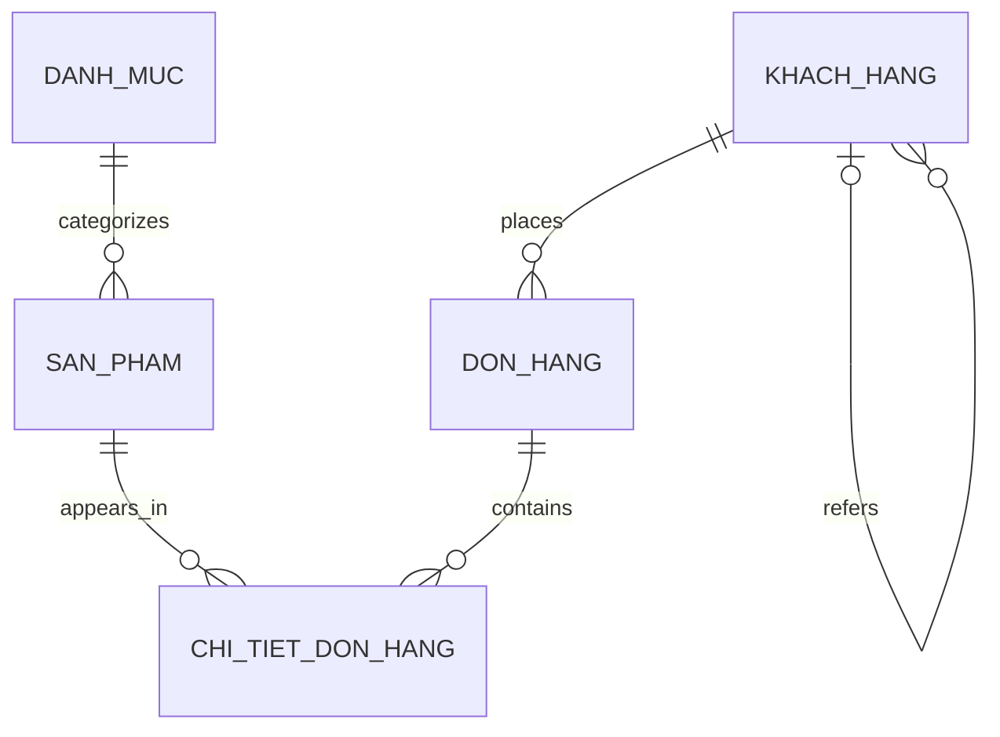

# Designing a Sample Dataset with Relationships, NULLs, and Boundary Values

A useful Oracle Database practice environment needs more than a few random rows. The dataset must include **relationships between tables**, cases **with and without child data**, and values **at valid or invalid boundaries**. That way, the same dataset can be used to practice `JOIN`, `GROUP BY`, `NULL`, foreign keys, constraints, transactions, and spotting query-design bugs.

This lesson builds a small sales-system dataset designed to run inside **a dedicated practice Oracle schema**. Every identifier is explicitly specified so that when re-run in a fresh schema, exercises continue to reference the exact same rows.

## 1. Defining Goals Before Creating Data

A good sample dataset should answer these questions:

- **Relationships:** Which table is parent, and which is child? Do primary keys and foreign keys actually enforce the relationships?
- **Optionality:** Which columns allow `NULL`? Are there parent rows without child rows yet? Are there optional foreign keys left blank?
- **Boundary values:** Are `0`, tiny decimals, numbers near data-type limits, leap dates, maximum quantities, and strings with diacritics or quotes handled properly?
- **Integrity:** How does the system accept valid cases and reject violations of `PRIMARY KEY`, `FOREIGN KEY`, `UNIQUE`, `NOT NULL`, and `CHECK`?
- **Predictability:** Can learners anticipate a query's expected output to observe the difference between `INNER JOIN` and `LEFT JOIN` firsthand?

You do not need millions of records to test these behaviors. While learning the relational model, **a small, purposeful dataset** is usually much easier to reason about than a large randomly generated one.

## 2. Choosing a Business Domain and Designing Relationships

The example uses five tables:

| Table | Role | Primary key | Relationships |
| --- | --- | --- | --- |
| `danh_muc` | Product category group | `ma_danh_muc` | One category can have many products |
| `san_pham` | Product info and current price | `ma_san_pham` | Each product belongs to one category |
| `khach_hang` | Buyers and contact info | `ma_khach_hang` | One customer can have many orders; may be referred by another customer |
| `don_hang` | Purchase orders, order date, and status | `ma_don_hang` | Each order belongs to one customer; an order can have many line items |
| `chi_tiet_don_hang` | Product and quantity per order | (`ma_don_hang`, `ma_san_pham`) | Junction table linking orders and products |



In this dataset, every product **must** belong to a category and every order **must** have a customer. Conversely, a customer may not have placed any order yet, a category may have no products yet, and a draft order may not have line items yet. The `nguoi_gioi_thieu_id` column is a **nullable self-referencing foreign key**: a customer does not need a referrer.

### Data design conventions

1. Use fixed integer keys in practice data rather than depending on `IDENTITY` or sequence allocation order.
2. Define primary keys, foreign keys, value domains, and mandatory constraints right in the table structure so Oracle protects data from every write source.
3. Store `don_gia_luc_dat` in order details: the price recorded at order time is not altered when a product's current `don_gia` changes.
4. Clearly distinguish **no orders**, **an order without line items**, **a cancelled order**, **a zero amount**, and **an unknown value (`NULL`)**. These are different business situations.
5. Use only fictional contact details, such as email addresses under the `.test` domain, to avoid putting real personal data into a learning environment.

## 3. Creating the Sample Schema in Oracle

The statements below target an **empty practice schema** using an account permitted to create tables. Run them in order because child tables have foreign keys referencing parent tables. Never run this in a schema holding data you need to preserve. Use a tool like SQL Developer, SQLcl, or SQL*Plus to send the SQL statements to Oracle Database.

```sql
-- 1. Categories: can exist even before any products belong to them.
CREATE TABLE danh_muc (
    ma_danh_muc  NUMBER(4) CONSTRAINT pk_danh_muc PRIMARY KEY,
    ten_danh_muc VARCHAR2(80 CHAR) NOT NULL,
    CONSTRAINT uq_danh_muc_ten UNIQUE (ten_danh_muc)
);

-- 2. Customers: email, phone, birth date, and referrer
-- are all details that may not be provided yet.
CREATE TABLE khach_hang (
    ma_khach_hang      NUMBER(6) CONSTRAINT pk_khach_hang PRIMARY KEY,
    ho_ten             VARCHAR2(120 CHAR) NOT NULL,
    email              VARCHAR2(150 CHAR),
    so_dien_thoai      VARCHAR2(20 CHAR),
    ngay_sinh          DATE,
    ngay_dang_ky       DATE NOT NULL,
    nguoi_gioi_thieu_id NUMBER(6),
    CONSTRAINT uq_khach_hang_email UNIQUE (email),
    CONSTRAINT fk_khach_hang_gioi_thieu
        FOREIGN KEY (nguoi_gioi_thieu_id)
        REFERENCES khach_hang (ma_khach_hang),
    CONSTRAINT ck_khach_hang_khong_tu_gt
        CHECK (nguoi_gioi_thieu_id IS NULL
               OR nguoi_gioi_thieu_id <> ma_khach_hang)
);

-- 3. Products: always belong to a category.
CREATE TABLE san_pham (
    ma_san_pham   NUMBER(6) CONSTRAINT pk_san_pham PRIMARY KEY,
    ma_danh_muc   NUMBER(4) NOT NULL,
    ten_san_pham  VARCHAR2(120 CHAR) NOT NULL,
    don_gia       NUMBER(12, 2) NOT NULL,
    so_luong_ton  NUMBER(5) NOT NULL,
    mo_ta         VARCHAR2(300 CHAR),
    CONSTRAINT fk_san_pham_danh_muc
        FOREIGN KEY (ma_danh_muc) REFERENCES danh_muc (ma_danh_muc),
    CONSTRAINT ck_san_pham_gia CHECK (don_gia >= 0),
    CONSTRAINT ck_san_pham_ton CHECK (so_luong_ton BETWEEN 0 AND 99999)
);

-- 4. Orders: delivery date and address may not be set yet.
CREATE TABLE don_hang (
    ma_don_hang   NUMBER(9) CONSTRAINT pk_don_hang PRIMARY KEY,
    ma_khach_hang NUMBER(6) NOT NULL,
    ngay_dat      DATE NOT NULL,
    ngay_giao     DATE,
    dia_chi_giao  VARCHAR2(200 CHAR),
    ghi_chu       VARCHAR2(200 CHAR),
    trang_thai    VARCHAR2(12 CHAR) DEFAULT 'DRAFT' NOT NULL,
    CONSTRAINT fk_don_hang_khach_hang
        FOREIGN KEY (ma_khach_hang) REFERENCES khach_hang (ma_khach_hang),
    CONSTRAINT ck_don_hang_trang_thai
        CHECK (trang_thai IN ('DRAFT', 'PAID', 'SHIPPED', 'CANCELLED')),
    CONSTRAINT ck_don_hang_ngay_giao
        CHECK (ngay_giao IS NULL OR ngay_giao >= ngay_dat),
    CONSTRAINT ck_don_hang_da_giao
        CHECK (trang_thai <> 'SHIPPED' OR ngay_giao IS NOT NULL)
);

-- 5. Each (order, product) pair has at most one line item.
CREATE TABLE chi_tiet_don_hang (
    ma_don_hang    NUMBER(9) NOT NULL,
    ma_san_pham    NUMBER(6) NOT NULL,
    so_luong       NUMBER(5) NOT NULL,
    don_gia_luc_dat NUMBER(12, 2) NOT NULL,
    chiet_khau_pct NUMBER(5, 2) DEFAULT 0 NOT NULL,
    CONSTRAINT pk_chi_tiet_don_hang
        PRIMARY KEY (ma_don_hang, ma_san_pham),
    CONSTRAINT fk_chi_tiet_don_hang
        FOREIGN KEY (ma_don_hang) REFERENCES don_hang (ma_don_hang),
    CONSTRAINT fk_chi_tiet_san_pham
        FOREIGN KEY (ma_san_pham) REFERENCES san_pham (ma_san_pham),
    CONSTRAINT ck_chi_tiet_so_luong
        CHECK (so_luong BETWEEN 1 AND 99999),
    CONSTRAINT ck_chi_tiet_gia CHECK (don_gia_luc_dat >= 0),
    CONSTRAINT ck_chi_tiet_chiet_khau
        CHECK (chiet_khau_pct BETWEEN 0 AND 100)
);
```

Note a few choices in the DDL:

- `NUMBER(12, 2)` stores numbers with two decimal places and up to 10 integer digits. It works well to demonstrate `0`, `0.01`, and `9999999999.99`.
- `VARCHAR2(120 CHAR)` sets the limit by character count instead of relying on default byte/char length semantics. Vietnamese content still requires a database character set and connection path with proper Unicode support.
- `NULL` in a foreign-key column does not violate the relationship; any **non-`NULL` value** must point to an existing parent record.
- `UNIQUE (email)` allows multiple customers to have `email IS NULL` in Oracle for a single-column unique constraint. Two **non-`NULL` identical** emails will be rejected.
- `CHECK` validates row-level conditions. It does not by itself enforce every business rule, such as allowing transitions only from `PAID` to `SHIPPED` or computing order totals.

## 4. Inserting Purposeful Data

Run the `INSERT` statements below **after creating all five tables**. Keep the exact IDs and dates so the practice queries in later sections produce easily verifiable outputs.

```sql
-- Category 30 intentionally has no products.
INSERT INTO danh_muc VALUES (10, 'Sách');
INSERT INTO danh_muc VALUES (20, 'Phụ kiện');
INSERT INTO danh_muc VALUES (30, 'Khóa học');

-- Customers 104 and 105 intentionally have no orders.
-- Customers 102 and 104 have NULL email; '' for customer 105 is also
-- treated as NULL by Oracle for VARCHAR2.
INSERT INTO khach_hang
    (ma_khach_hang, ho_ten, email, so_dien_thoai,
     ngay_sinh, ngay_dang_ky, nguoi_gioi_thieu_id)
VALUES
    (101, 'Nguyễn An', 'an@example.test', NULL,
     DATE '1995-01-01', DATE '2024-01-05', NULL);

INSERT INTO khach_hang
    (ma_khach_hang, ho_ten, email, so_dien_thoai,
     ngay_sinh, ngay_dang_ky, nguoi_gioi_thieu_id)
VALUES
    (102, 'Trần Bình', NULL, '0900000002',
     DATE '2000-02-29', DATE '2024-01-06', 101);

INSERT INTO khach_hang
    (ma_khach_hang, ho_ten, email, so_dien_thoai,
     ngay_sinh, ngay_dang_ky, nguoi_gioi_thieu_id)
VALUES
    (103, 'Lê Chi', 'chi@example.test', '0900000003',
     NULL, DATE '2024-01-07', 102);

INSERT INTO khach_hang
    (ma_khach_hang, ho_ten, email, so_dien_thoai,
     ngay_sinh, ngay_dang_ky, nguoi_gioi_thieu_id)
VALUES
    (104, 'Đặng Dũng', NULL, NULL,
     DATE '1980-12-31', DATE '2024-01-08', NULL);

INSERT INTO khach_hang
    (ma_khach_hang, ho_ten, email, so_dien_thoai,
     ngay_sinh, ngay_dang_ky, nguoi_gioi_thieu_id)
VALUES
    (105, 'O''Brien', '', '0900000005',
     NULL, DATE '2024-01-09', 101);

-- Product 1005 intentionally does not appear in any order detail yet.
-- Prices 0, 0.01, very large price, and stock 0 are intentional edge cases.
INSERT INTO san_pham VALUES
    (1001, 10, 'Sách SQL cơ bản', 120000, 12, 'Nhập môn SQL');
INSERT INTO san_pham VALUES
    (1002, 20, 'Bút bi', 0, 0, NULL);
INSERT INTO san_pham VALUES
    (1003, 20, 'Nhãn dán', 0.01, 99999, '');
INSERT INTO san_pham VALUES
    (1004, 10, 'Gói tài liệu giới hạn', 9999999999.99, 1, 'Kiểm tra biên NUMBER');
INSERT INTO san_pham VALUES
    (1005, 10, 'Sách Oracle chuyên sâu', 350000.25, 20, NULL);

-- Order 5004 is in DRAFT status and intentionally has no line items.
-- 2024-02-29 is a leap day; delivery date is 2024-03-01.
INSERT INTO don_hang VALUES
    (5001, 101, DATE '2024-02-28', NULL,
     '1 Đường A, Hà Nội', NULL, 'PAID');
INSERT INTO don_hang VALUES
    (5002, 102, DATE '2024-02-29', DATE '2024-03-01',
     '2 Đường B, Hà Nội', 'Giao sau 17h', 'SHIPPED');
INSERT INTO don_hang VALUES
    (5003, 101, DATE '2024-03-01', NULL,
     NULL, NULL, 'CANCELLED');
INSERT INTO don_hang VALUES
    (5004, 103, DATE '2024-03-02', NULL,
     NULL, NULL, 'DRAFT');

-- Price in order details is price at order time, not joined from current product price.
-- Includes discounts of 0%, 12.5%, and 100%, quantities of 1, 3, and 99999.
INSERT INTO chi_tiet_don_hang VALUES (5001, 1001, 1, 120000, 12.50);
INSERT INTO chi_tiet_don_hang VALUES (5001, 1003, 3, 0.01, 0);
INSERT INTO chi_tiet_don_hang VALUES (5002, 1002, 1, 0, 0);
INSERT INTO chi_tiet_don_hang VALUES (5002, 1004, 1, 9999999999.99, 0);
INSERT INTO chi_tiet_don_hang VALUES (5003, 1003, 99999, 0.01, 100);

COMMIT;
```

This dataset **intentionally includes rare edge cases**, rather than realistic business figures. For example, a cancelled order still retains its line items to trace what was selected at ordering time; an ultra-high-priced product tests arithmetic precision. Selling an item whose current stock is 0 can also happen when stock was updated after the sale. Business rules such as inventory reservation, payment, cancellation, and revenue recognition must be defined separately when building a real system.

### Map of test cases built into the dataset

| Data ID | Test case | What to observe |
| --- | --- | --- |
| Category `30` | Category without products | `LEFT JOIN` and child-side columns returning `NULL` |
| Product `1005` | Product not yet sold in any order | `NOT EXISTS`, `LEFT JOIN ... IS NULL` |
| Customers `104`, `105` | No orders | Difference between `INNER JOIN` and `LEFT JOIN` |
| Customers `102`, `104`, `105` | `NULL` email; customer `105` inserted as `''` | `IS NULL`, `COUNT(email)`, Oracle's empty-string rule |
| Customers `102`, `103`, `105` | Have a referrer; remaining customers do not | Optional self-referencing foreign key |
| Customer `102` | Birth date `2000-02-29` | Valid leap date |
| Customer `105` | Name `O'Brien` | Single quote in SQL literal: `O''Brien` |
| Products `1002`, `1003`, `1004` | Prices `0`, `0.01`, `9999999999.99` | Boundaries of `NUMBER(12,2)` |
| Products `1002`, `1003` | Stock `0` and `99999` | Both ends of valid stock domain |
| Order `5002` | Ordered `2024-02-29`, delivered `2024-03-01` | Leap-day boundary and date ordering check |
| Order `5003` | Status `CANCELLED`, delivery date `NULL` | Not equating `NULL` with corrupt data |
| Order `5004` | Draft order without line items | `SUM` over empty set, `NVL` |
| Detail `(5003, 1003)` | Quantity `99999`, discount `100%` | Upper boundaries of quantity and percentage |

## 5. Querying to Observe Relationships, NULLs, and Boundary Values

The following queries are **read-only practice exercises** that do not alter the seed data. Expected outputs assume the `INSERT` script above was run with no additional row changes.

### 5.1. Counting rows and inspecting NULL columns

```sql
SELECT COUNT(*) AS tong_khach,
       COUNT(email) AS khach_co_email,
       SUM(CASE WHEN email IS NULL THEN 1 ELSE 0 END) AS khach_thieu_email
FROM khach_hang;
```

The result is **5 customers, 2 with email, 3 missing email**. `COUNT(*)` counts every row, whereas `COUNT(email)` counts only rows where `email` is non-`NULL`. Customer `105` was inserted with `''`, which Oracle treats as `NULL` for current `VARCHAR2` strings.

```sql
-- Correct: finding unknown/unprovided values.
SELECT ma_khach_hang, ho_ten
FROM khach_hang
WHERE email IS NULL
ORDER BY ma_khach_hang;

-- Semantically wrong: comparing against NULL yields UNKNOWN,
-- so no rows satisfy the WHERE condition.
SELECT ma_khach_hang
FROM khach_hang
WHERE email = NULL;
```

The first query returns `102`, `104`, `105`; the second returns zero rows. In SQL's three-valued logic, `NULL` is not an empty string, the number `0`, or a value comparable with standard `=`. To find non-`NULL` values, use `IS NOT NULL`.

### 5.2. How does `INNER JOIN` differ from `LEFT JOIN`?

```sql
-- Every customer, including those who never placed an order, still appears.
SELECT k.ma_khach_hang,
       k.ho_ten,
       COUNT(d.ma_don_hang) AS so_don
FROM khach_hang k
LEFT JOIN don_hang d
    ON d.ma_khach_hang = k.ma_khach_hang
GROUP BY k.ma_khach_hang, k.ho_ten
ORDER BY k.ma_khach_hang;
```

| Customer | Order count |
| --- | ---: |
| `101` | 2 |
| `102` | 1 |
| `103` | 1 |
| `104` | 0 |
| `105` | 0 |

`COUNT(d.ma_don_hang)` ignores unmatched null-padded rows whose order key is `NULL`, returning `0` for customers without orders. If you wrote `COUNT(*)` in the `LEFT JOIN` above, the last two customers would be counted as `1` because each customer still produces one outer-join row.

To select only customers who have not placed any order:

```sql
SELECT k.ma_khach_hang, k.ho_ten
FROM khach_hang k
LEFT JOIN don_hang d
    ON d.ma_khach_hang = k.ma_khach_hang
WHERE d.ma_don_hang IS NULL
ORDER BY k.ma_khach_hang;
```

The result is customers `104` and `105`. An equivalent approach in intent uses `NOT EXISTS` with a correlated subquery. When looking for customers lacking **orders in a particular status**, place the status predicate in the right spot; putting `d.trang_thai = 'PAID'` carelessly in `WHERE` turns the `LEFT JOIN` into an `INNER JOIN` for non-matching rows.

### 5.3. Totals including an order without line items

```sql
SELECT d.ma_don_hang,
       d.trang_thai,
       COUNT(ct.ma_san_pham) AS so_dong_chi_tiet,
       NVL(SUM(
           ct.so_luong * ct.don_gia_luc_dat
           * (1 - ct.chiet_khau_pct / 100)
       ), 0) AS tong_tien_minh_hoa
FROM don_hang d
LEFT JOIN chi_tiet_don_hang ct
    ON ct.ma_don_hang = d.ma_don_hang
GROUP BY d.ma_don_hang, d.trang_thai
ORDER BY d.ma_don_hang;
```

| Order | Status | Line items | Illustrative total |
| --- | --- | ---: | ---: |
| `5001` | `PAID` | 2 | `105000.03` |
| `5002` | `SHIPPED` | 2 | `9999999999.99` |
| `5003` | `CANCELLED` | 1 | `0` |
| `5004` | `DRAFT` | 0 | `0` |

For order `5001`, the book priced at `120000` with a `12.5%` discount becomes `105000`; adding three stickers priced at `0.01` gives `105000.03`. Order `5003` has a `100%` discount, which **does not automatically make it count toward revenue**; revenue calculations must filter eligible order statuses per business rules. Order `5004` has no line items, so `SUM(...)` returns `NULL` before `NVL(..., 0)` turns it into `0` for display. Do not automatically treat `NULL` as `0` in every problem; convert only when semantics call for it.

Real financial exercises must also define line-level rounding rules, taxes, currencies, and refunds. The formula above is an **illustrative formula** to test `JOIN`, aggregation, and decimals, not a billing standard for a payment system.

### 5.4. Finding products and categories without child records

```sql
-- Products that have never appeared in any order line item.
SELECT sp.ma_san_pham, sp.ten_san_pham
FROM san_pham sp
WHERE NOT EXISTS (
    SELECT 1
    FROM chi_tiet_don_hang ct
    WHERE ct.ma_san_pham = sp.ma_san_pham
);

-- Categories with no products yet.
SELECT dm.ma_danh_muc, dm.ten_danh_muc
FROM danh_muc dm
LEFT JOIN san_pham sp
    ON sp.ma_danh_muc = dm.ma_danh_muc
WHERE sp.ma_san_pham IS NULL;
```

The results are product `1005` and category `30`, respectively. These are essential cases because a dataset where every parent always has children hides rows dropped by `INNER JOIN`.

### 5.5. Self-joining a table to see referrers

```sql
SELECT k.ma_khach_hang,
       k.ho_ten,
       gt.ho_ten AS nguoi_gioi_thieu
FROM khach_hang k
LEFT JOIN khach_hang gt
    ON gt.ma_khach_hang = k.nguoi_gioi_thieu_id
ORDER BY k.ma_khach_hang;
```

Customer `102` was referred by `101`; `103` by `102`; `105` by `101`. The referrer name column for `101` and `104` is `NULL`. A foreign key referencing the same table obeys the exact same foreign-key rules as relationships between two distinct tables.

### 5.6. Boundary date queries

```sql
-- Fetch orders from 2024-02-29 through the end of 2024-03-01.
SELECT ma_don_hang, ngay_dat
FROM don_hang
WHERE ngay_dat >= DATE '2024-02-29'
  AND ngay_dat <  DATE '2024-03-02'
ORDER BY ngay_dat;
```

The result includes orders `5002` and `5003`. Using a **half-open interval** (`>=` and `<`) captures `DATE` values containing hours, minutes, and seconds on March 1. In Oracle, the `DATE` type always includes a time component; avoid relying solely on `BETWEEN DATE '2024-02-29' AND DATE '2024-03-01'` if you want to cover March 1 up to 23:59:59.

## 6. Adding Invalid Cases to See Constraints in Action

Valid data only proves the database **accepts** prepared cases. To observe integrity enforcement, run each statement below individually after loading the sample data. **These are deliberate error examples, not part of Section 4's seed script**. Do not alter tables or disable constraints to make them succeed.

| Deliberately invalid operation | Constraint that must block it | Common Oracle error |
| --- | --- | --- |
| Add a customer with existing email `an@example.test` | `UNIQUE (email)` | `ORA-00001` |
| Add a line item for nonexistent order `9999` | `FOREIGN KEY` to `don_hang` | `ORA-02291` |
| Add a product with negative unit price | `CHECK (don_gia >= 0)` | `ORA-02290` |
| Add an order with `ma_khach_hang = NULL` | `NOT NULL` | `ORA-01400` |
| Add a line item with `so_luong = 0` or `101%` discount | Detail table `CHECK` | `ORA-02290` |

```sql
-- Example 1: duplicate email matching customer 101.
INSERT INTO khach_hang
    (ma_khach_hang, ho_ten, email, ngay_dang_ky)
VALUES
    (106, 'Test customer', 'an@example.test', DATE '2024-03-10');

-- Example 2: order 9999 does not exist.
INSERT INTO chi_tiet_don_hang
    (ma_don_hang, ma_san_pham, so_luong,
     don_gia_luc_dat, chiet_khau_pct)
VALUES
    (9999, 1001, 1, 120000, 0);

-- Example 3: negative price violates CHECK.
INSERT INTO san_pham
    (ma_san_pham, ma_danh_muc, ten_san_pham,
     don_gia, so_luong_ton)
VALUES
    (1006, 10, 'Invalid product', -0.01, 0);

-- Example 4: mandatory foreign key left NULL.
INSERT INTO don_hang
    (ma_don_hang, ma_khach_hang, ngay_dat)
VALUES
    (5005, NULL, DATE '2024-03-10');

-- Example 5: quantity below 1.
INSERT INTO chi_tiet_don_hang
    (ma_don_hang, ma_san_pham, so_luong,
     don_gia_luc_dat, chiet_khau_pct)
VALUES
    (5001, 1005, 0, 350000.25, 0);
```

If your SQL tool halts on the first error, run **one `INSERT` at a time** to observe each constraint. Rejected statements insert no rows; if you made other successful edits while experimenting, you can `ROLLBACK` uncommitted changes or recreate the practice schema to reset to the initial dataset.

You can also test cases such as `don_gia = 10000000000` for `NUMBER(12,2)` (exceeds integer-digit precision), a name string exceeding the `VARCHAR2` limit, `DATE '2023-02-29'` (invalid calendar date), delivery date earlier than order date, or a nonexistent referrer. Each case tests a different data-model assumption.

## 7. Oracle-Specific Traps When Designing Practice Data

### 7.1. `NULL`, empty strings, whitespace-only strings, and zero

In Oracle Database, a zero-length string in `VARCHAR2` is currently treated as `NULL`, such as customer `105`'s `''` email. However, `' '` containing **a single space** is character data; it must not be mistaken for a valid email. Applications may need `TRIM`, input validation, or extra constraints depending on requirements. The `0` price of product `1002` is a **known numeric value**, not `NULL`.

The three situations below carry distinct meanings:

```sql
-- Unknown email: customers 102, 104, 105.
SELECT ma_khach_hang FROM khach_hang WHERE email IS NULL;

-- Known selling price and it is 0: product 1002.
SELECT ma_san_pham FROM san_pham WHERE don_gia = 0;

-- No delivery date yet: orders 5001, 5003, 5004.
SELECT ma_don_hang FROM don_hang WHERE ngay_giao IS NULL;
```

`NVL(email, 'Not provided')` can be used for **display**, but replacing `NULL` with a placeholder string and storing it back into the column corrupts the data's meaning. Likewise, avoid abusing sentinel dates like `1900-01-01` or `-1` for unknown info when the schema already permits `NULL`.

### 7.2. `CHECK` and three-valued logic

In SQL, a predicate can evaluate to `TRUE`, `FALSE`, or `UNKNOWN` in the presence of `NULL`. A `CHECK` constraint rejects `FALSE`, but does not automatically reject `UNKNOWN`. That is why mandatory columns like `don_gia`, `so_luong`, and `chiet_khau_pct` declare **`NOT NULL` separately**; writing `CHECK (so_luong > 0)` alone is not enough to prevent `NULL`.

### 7.3. Numeric limits, precision, and rounding

Values `0.01`, `350000.25`, and `9999999999.99` help observe how Oracle handles `NUMBER(12,2)`. Never switch monetary columns to binary floating-point types and expect every decimal calculation to stay exact. In Java, monetary data is usually mapped to `BigDecimal`; on the Oracle side, use `NUMBER(p,s)` sized to your chosen magnitude and decimal-scale rules.

Column limits should reflect **actual business rules**, rather than always picking unconstrained `NUMBER` or an arbitrarily huge cap. This dataset intentionally includes a huge price to force aggregate queries and applications to respect declared domains.

### 7.4. Dates and display formats

`DATE '2024-02-29'` is an ANSI/Oracle date literal that does not rely on the session's date format. When queried to screen, how `DATE` is rendered may depend on the tool's NLS settings; a difference in formatted text is not necessarily a difference in stored value. When deterministic formatting is needed:

```sql
SELECT ma_don_hang,
       TO_CHAR(ngay_dat, 'YYYY-MM-DD HH24:MI:SS') AS ngay_dat_hien_thi
FROM don_hang
ORDER BY ma_don_hang;
```

If later exercises need time zones, explicitly define `TIMESTAMP WITH TIME ZONE` / `TIMESTAMP WITH LOCAL TIME ZONE`; the `DATE` columns in the current sample carry no time-zone information.

### 7.5. DDL, COMMIT, and re-runnability

Oracle's `CREATE TABLE` statements perform an **implicit commit**. Do not assume you can `ROLLBACK` a DDL script that created tables the way you undo a series of `INSERT`s. This lesson's script cleanly separates **structure creation** and **data loading**, ending with a single `COMMIT` after loading. For a clean, repeatable reset, use a **fresh dedicated practice schema** or drop the sandbox schema's tables in dependency order and rebuild from scratch.

When preparing automated exercises, save DDL and seed SQL as ordered files, use fixed IDs, and run in an isolated environment. Avoid generating data using current dates (`SYSDATE`) or random numbers when exercises require exact output comparisons across runs.

## 8. Expanding the Dataset by Learning Objective

Once you understand the five core tables, expand **by the test cases you want to observe** rather than adding arbitrary rows:

| Practice goal | Data or rules to add | What to watch out for |
| --- | --- | --- |
| `GROUP BY`, `HAVING` | More orders across multiple statuses and price tiers | Distinguish total order value from eligible revenue |
| Pagination, sorting | Two customers sharing the same name with different IDs, orders on the same date | Use a deterministic tie-breaker, e.g., `ORDER BY ngay_dat, ma_don_hang` |
| Transactions and locks | Two sessions updating the same inventory row | Keep concurrency tests separate from the baseline seed; observe commit/rollback |
| Optional foreign keys | Nullable referrer, alternate address, or assigned owner | Allow `NULL` only when the relationship is truly optional |
| Strings and Unicode | Vietnamese names with diacritics, names with single quotes, strings near max length | Control encoding, escaping, and `CHAR`/`BYTE` semantics |
| Currency calculations | Discounts producing sub-cent fractions, multiple tax tiers | Define rounding rules before constructing expected outputs |
| Bad external data | Duplicate IDs, missing parent IDs, domain violations | Load into a staging table or run controlled failing statements without disabling seed constraints |

### Self-practice exercises

1. Write a SQL query listing every category along with its product count, including categories with `0` products.
2. List customers who have no referrer, then list each referrer alongside the count of customers they referred.
3. Find orders with no line items, without confusing them with orders whose total amount is `0`.
4. Compute total amounts per order, counting only `PAID` or `SHIPPED` orders when illustrating revenue; explain why `CANCELLED` orders must be handled separately.
5. Find products that have not appeared in any order detail, then modify the query to count only details belonging to eligible sales orders.
6. Try inserting products with stock `-1`, `0`, and `99999`: which cases are accepted? Explain using `NOT NULL` and `CHECK`.

These exercises use the exact same dataset while exploring different facets of the model. Predict the output rows before running each query, then inspect with your SQL tool to see how **relational structure and `NULL` rules** shaped the results.

## 9. Operating Principles for Sample Datasets

A single practice dataset can be shared across SQL, PL/SQL, and Java/JDBC applications, provided you maintain these principles:

- **Environment isolation:** Create a sandbox schema or database with appropriate privileges; never mix sample data into systems serving real users.
- **Fixed inputs:** Maintain one canonical DDL version and one seed version so everyone starts from the same baseline state.
- **Purposeful data:** Each special row should map to a clear learning case. Records like `104`, `105`, `5004`, `1005`, and category `30` represent edge cases easily missed when creating only "happy-path" data.
- **Never alter the seed to fit a broken query:** When `LEFT JOIN` gives unexpected results, review filter placement, aggregation, and `NULL` semantics before touching the data.
- **Keep negative test cases separate:** Statements meant to violate constraints run independently; the baseline dataset must remain valid.
- **Use synthetic/fictional data only:** In lessons and testing, real personal info or real transactions are never needed to demonstrate foreign keys, `NULL`s, or boundary conditions.

When designed purposefully like this, a sample dataset becomes **a tool to verify how Oracle enforces relationships and integrity**, as well as a stable foundation for subsequent SQL, PL/SQL, and Java labs.
