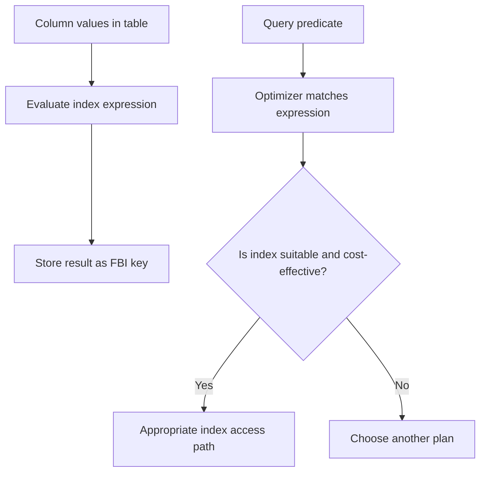

# Function-Based Indexes and Matching Query Expressions in Oracle Database

A standard B-tree index stores keys built from the values of one or more columns. However, many applications do not filter directly on raw column values. For example, a case-insensitive email search screen, a report grouping orders by day using `TRUNC(date_column)`, or a query normalizing codes with `UPPER`/`TRIM`. With only a standard index on the base column, Oracle may have to evaluate the function for every row and cannot use that index as desired.

A **function-based index (FBI)** solves this by indexing the result of an expression. For example:

```sql
CREATE INDEX ix_customer_email_upper
ON customers (UPPER(email_address));
```

To leverage the index, the query predicate should use the matching expression:

```sql
SELECT customer_id, email_address
FROM customers
WHERE UPPER(email_address) = UPPER(:email);
```

Oracle can match the expression in the query to the indexed expression and use the FBI if the optimizer judges it beneficial. An expression that merely looks similar or yields an equivalent business result may not be recognized as the same index expression. The safe approach is to define the expression once, use it consistently in DDL and SQL, and inspect the execution plan.

This lesson covers creating and using function-based indexes, matching query expression requirements, handling `NULL`s and NLS, user-defined functions, unique indexes, virtual columns, optimizer statistics, limitations, and diagnosing why Oracle might not use an index.

## 1. Why Are Function-Based Indexes Needed?

### 1.1. Standard indexes and functions on columns

Suppose you have an index:

```sql
CREATE INDEX ix_customers_email
ON customers(email_address);
```

The following query searches by raw value:

```sql
SELECT customer_id
FROM customers
WHERE email_address = :email;
```

This predicate shape suits an index on `EMAIL_ADDRESS`. However, if the requirement is case-insensitive search:

```sql
SELECT customer_id
FROM customers
WHERE UPPER(email_address) = UPPER(:email);
```

Oracle needs to compare the result of `UPPER(email_address)`. A standard index stores raw values rather than `UPPER(email_address)`, so it does not directly support this predicate. The optimizer may pick a full table scan or another plan.

### 1.2. FBIs store expression results

Create the index:

```sql
CREATE INDEX ix_customers_email_upper
ON customers(UPPER(email_address));
```

Query using the matching expression:

```sql
SELECT customer_id
FROM customers
WHERE UPPER(email_address) = UPPER(:email);
```

The index stores keys computed from `UPPER(email_address)` for every row eligible to be indexed. When a query uses the same expression, Oracle can search precomputed keys in the FBI rather than applying the function to every row in the table. Index usage is still decided by the cost-based optimizer; an FBI's existence does not mean every matching query will always use it.

### 1.3. How it works



## 2. Creating and Using Basic FBIs

### 2.1. Prepare practice data

Create a lab table:

```sql
CREATE TABLE customer_fbi_lab (
    customer_id   NUMBER(10)
        CONSTRAINT pk_customer_fbi_lab PRIMARY KEY,
    full_name     VARCHAR2(100 CHAR) NOT NULL,
    email_address VARCHAR2(200 CHAR),
    phone_number  VARCHAR2(30 CHAR),
    created_at    DATE DEFAULT SYSDATE NOT NULL,
    status_code   VARCHAR2(20 CHAR) DEFAULT 'NEW' NOT NULL
);

INSERT INTO customer_fbi_lab (
    customer_id, full_name, email_address, phone_number, created_at, status_code
)
VALUES (
    1, 'Nguyen An', 'An@example.test', '0901000001',
    DATE '2026-01-10', 'ACTIVE'
);

INSERT INTO customer_fbi_lab (
    customer_id, full_name, email_address, phone_number, created_at, status_code
)
VALUES (
    2, 'Tran Binh', 'binh@Example.test', '0902000002',
    DATE '2026-01-11', 'ACTIVE'
);

INSERT INTO customer_fbi_lab (
    customer_id, full_name, email_address, phone_number, created_at, status_code
)
VALUES (
    3, 'Le Chi', 'chi@example.test', NULL,
    DATE '2026-02-01', 'INACTIVE'
);

INSERT INTO customer_fbi_lab (
    customer_id, full_name, email_address, phone_number, created_at, status_code
)
VALUES (
    4, 'Pham Dung', NULL, '0904000004',
    DATE '2026-02-15', 'ACTIVE'
);

COMMIT;
```

### 2.2. Query before creating the FBI

```sql
SELECT customer_id, email_address
FROM customer_fbi_lab
WHERE UPPER(email_address) = UPPER('AN@EXAMPLE.TEST');
```

The query finds the matching email row even though the stored casing differs. With only a regular index on `EMAIL_ADDRESS`, the optimizer has no precomputed `UPPER(email_address)` keys.

### 2.3. Create the FBI

```sql
CREATE INDEX ix_customer_fbi_email_upper
ON customer_fbi_lab (UPPER(email_address));
```

Query using the matching expression:

```sql
SELECT customer_id, email_address
FROM customer_fbi_lab
WHERE UPPER(email_address) = UPPER(:email);
```

The bind variable on the right-hand side is normalized with `UPPER`. You can normalize the bind value in the application tier and write:

```sql
WHERE UPPER(email_address) = :normalized_email
```

As long as the bind value is normalized according to the rule. The FBI is built on the column expression on the left-hand side; there is no need to apply the function to the bind if the application already normalized it.

### 2.4. Will the index be used?

Inspect the plan:

```sql
EXPLAIN PLAN FOR
SELECT customer_id
FROM customer_fbi_lab
WHERE UPPER(email_address) = 'AN@EXAMPLE.TEST';

SELECT *
FROM TABLE(DBMS_XPLAN.DISPLAY);
```

On a tiny lab table, the optimizer may pick a full table scan because reading the entire table is cheaper than index access. That does not prove the FBI is wrong. Gather statistics, scale up representative data, and inspect the actual plan on a sufficiently selective workload.

## 3. Matching Query Expression Requirements

### 3.1. Core rule

If an index is created on:

```sql
CREATE INDEX ix_customer_upper_name
ON customer_fbi_lab (UPPER(full_name));
```

The predicate should use:

```sql
WHERE UPPER(full_name) = :name_upper
```

Do not assume the optimizer will automatically deduce every equivalent business expression. For instance, an index on `UPPER(full_name)` is not an index on `TRIM(UPPER(full_name))`:

```sql
WHERE TRIM(UPPER(full_name)) = :name_upper
```

The new predicate adds `TRIM`. If leading/trailing whitespace must be stripped, create the index on the exact expression `TRIM(UPPER(full_name))` or normalize the data on write.

### 3.2. Matching expressions, not just the same column

| FBI definition | Matching predicate | Notes |
|---|---|---|
| `UPPER(email_address)` | `UPPER(email_address) = :v` | Identical expression form |
| `TRIM(phone_number)` | `TRIM(phone_number) = :v` | Handles whitespace |
| `TRUNC(created_at)` | `TRUNC(created_at) = :day` | Filters by date with time truncated |
| `amount * tax_rate` | `amount * tax_rate > :v` | Numeric expression requires compatible type and scale |
| `NVL(status_code, 'NEW')` | `NVL(status_code, 'NEW') = :v` | `NULL` values mapped to `NEW` |

Oracle can canonicalize certain syntax variations and equivalent expressions during parse/optimization, but you should not rely on the optimizer always recognizing every algebraic form. For stable deployments, use the exact expression defined and verify the plan.

### 3.3. Aliases do not change the index expression

Example:

```sql
SELECT UPPER(full_name) AS normalized_name
FROM customer_fbi_lab
WHERE UPPER(full_name) = :name_upper;
```

An alias is only the output column name in the projection. The predicate must still contain the matching expression; you cannot normally reference a `SELECT` alias in the `WHERE` clause of the same query block:

```sql
-- Cannot use a SELECT alias directly in WHERE of the same query block:
SELECT UPPER(full_name) AS normalized_name
FROM customer_fbi_lab
WHERE normalized_name = :name_upper;
```

To reuse an expression, you can use an inline view or a virtual column, though you must still confirm the optimizer recognizes the index.

### 3.4. Differences in function order

The following expressions should not be assumed equivalent:

```sql
UPPER(TRIM(full_name))
TRIM(UPPER(full_name))
```

In certain character sets and datasets, results may coincide, yet you should not assume they are always semantically identical or matched identically by the optimizer. Define the exact normalization rule and use the same function order in both the index and predicate.

### 3.5. Comparison operators must also fit

An FBI on `UPPER(email_address)` supports equality and range predicates compatible with the indexed key:

```sql
WHERE UPPER(email_address) = :email
```

However, a query:

```sql
WHERE SUBSTR(UPPER(email_address), 1, 5) = :prefix
```

filters on a different expression. An index on `UPPER(email_address)` is not always as effective as an index on `SUBSTR(UPPER(email_address), 1, 5)`. Identify the exact query pattern before creating an FBI.

## 4. Common Function-Based Index Patterns

### 4.1. Case-insensitivity

```sql
CREATE INDEX ix_customer_name_ci
ON customer_fbi_lab (UPPER(full_name));

SELECT customer_id, full_name
FROM customer_fbi_lab
WHERE UPPER(full_name) = UPPER(:name);
```

This is a common pattern for case-insensitive search. For languages with complex comparison rules, simple `UPPER` may be insufficient; consider linguistic collation/NLS.

### 4.2. Whitespace normalization

```sql
CREATE INDEX ix_customer_phone_trim
ON customer_fbi_lab (TRIM(phone_number));

SELECT customer_id
FROM customer_fbi_lab
WHERE TRIM(phone_number) = :phone;
```

By default, `TRIM` strips leading and trailing spaces per Oracle semantics. If multiple whitespace characters must be stripped or phone formats standardized, define the rule explicitly. Do not let each client normalize differently.

### 4.3. Filtering by date, ignoring time of day

If an application frequently queries:

```sql
SELECT customer_id
FROM customer_fbi_lab
WHERE TRUNC(created_at) = DATE '2026-02-15';
```

you can create:

```sql
CREATE INDEX ix_customer_created_day
ON customer_fbi_lab (TRUNC(created_at));
```

The predicate must use the matching `TRUNC(created_at)`. However, if a regular index exists on `CREATED_AT`, a range query is usually a more flexible choice:

```sql
WHERE created_at >= DATE '2026-02-15'
  AND created_at <  DATE '2026-02-16'
```

Range predicates do not wrap the column in a function and can use a standard B-tree index. Compare both approaches against the workload, especially when queries span multiple days or long date ranges.

### 4.4. Monthly queries

FBI:

```sql
CREATE INDEX ix_orders_month
ON orders (TRUNC(order_date, 'MM'));
```

Matching predicate:

```sql
WHERE TRUNC(order_date, 'MM') = DATE '2026-11-01'
```

Or use a range on the base column:

```sql
WHERE order_date >= DATE '2026-11-01'
  AND order_date <  DATE '2026-12-01'
```

Range predicates normally leverage a regular index on `ORDER_DATE` and avoid maintaining an extra expression index. An FBI fits when the monthly expression is repeated, selective, and delivers measurable benefit.

### 4.5. Normalizing codes with REPLACE or SUBSTR

For example, storing product codes with hyphens while searching with hyphens stripped:

```sql
CREATE INDEX ix_product_code_compact
ON products (REPLACE(product_code, '-', ''));

SELECT product_id
FROM products
WHERE REPLACE(product_code, '-', '') = :compact_code;
```

If prefix lookup is required:

```sql
CREATE INDEX ix_product_code_prefix
ON products (SUBSTR(product_code, 1, 3));

SELECT product_id
FROM products
WHERE SUBSTR(product_code, 1, 3) = :prefix;
```

The index expression must mirror the exact business rule. If product codes later contain spaces, dots, or Unicode characters needing normalization, the existing expression will not handle those cases automatically.

### 4.6. Arithmetic expressions

An FBI can be created on a numeric expression:

```sql
CREATE INDEX ix_order_net_amount
ON order_lines (quantity * unit_price);

SELECT line_id
FROM order_lines
WHERE quantity * unit_price > :minimum_amount;
```

Datatypes, precision, and scale of both operands affect the result. Avoid implicit conversions between `VARCHAR2` and `NUMBER`. If an expression could overflow or raise a conversion error on some rows, index creation or DML maintaining the index may fail.

## 5. NULLs and Function-Based Indexes

### 5.1. B-tree indexes do not store all-NULL keys

Standard Oracle B-tree indexes do not create entries for rows where all key columns are `NULL`. For a single-expression FBI:

```sql
CREATE INDEX ix_email_upper
ON customer_fbi_lab (UPPER(email_address));
```

If `EMAIL_ADDRESS` is `NULL`, `UPPER(email_address)` is also `NULL`; that row has no key entry in this single-column B-tree index.

This means the predicate:

```sql
WHERE UPPER(email_address) IS NULL
```

cannot be satisfied by a normal range scan on a single-column FBI as expected, because `NULL` rows have no entries in the index. The optimizer may choose a table scan.

### 5.2. Mapping NULLs with NVL

One way to generate keys for `NULL`s as well:

```sql
CREATE INDEX ix_email_upper_nvl
ON customer_fbi_lab (NVL(UPPER(email_address), '#NO_EMAIL#'));
```

The predicate must use the same expression:

```sql
WHERE NVL(UPPER(email_address), '#NO_EMAIL#') = :email_key
```

However, the sentinel must be guaranteed never to be a valid email value. If the sentinel can appear in real data, two distinct groups will collide. Enforce constraints/validation ensuring the sentinel is outside the domain, and handle `NULL` values according to business rules.

### 5.3. Indexing an extra NOT NULL column

A composite B-tree index with at least one non-NULL key column can store an entry for a row whose first expression key is `NULL`:

```sql
CREATE INDEX ix_email_upper_with_id
ON customer_fbi_lab (UPPER(email_address), customer_id);
```

Because `CUSTOMER_ID` is a `NOT NULL` primary key, rows with `NULL` email still have an index entry thanks to the second component. However, a predicate on `UPPER(email_address) IS NULL` alone may not be selective enough and access path efficiency depends on the optimizer. Do not add extra columns to an index without a workload need; wider indexes consume more space and DML overhead.

### 5.4. NULL semantics in NVL and COALESCE

These two expressions can differ in datatype and conversion rules:

```sql
NVL(status_code, 'NEW')
COALESCE(status_code, 'NEW')
```

Do not assume every `NULL`-substitution expression is treated by the optimizer as the same expression. Use the exact function and datatype declared in the FBI. In particular, `NVL` converts arguments based on its first argument's datatype rules, whereas `COALESCE` follows `CASE` expression datatype rules. Verify both query results and execution plans.

## 6. Unique FBIs and Case-Insensitive Constraints

### 6.1. Unique function-based index

If emails must be unique case-insensitively:

```sql
CREATE UNIQUE INDEX uq_customer_email_ci
ON customer_fbi_lab (LOWER(email_address));
```

The unique index enforces uniqueness on the result of `LOWER(email_address)`, so `An@example.test` and `an@example.test` conflict under this expression.

### 6.2. Checking for duplicates before creation

If existing data already contains normalized duplicates, `CREATE UNIQUE INDEX` will fail. Check first:

```sql
SELECT LOWER(email_address) AS normalized_email,
       COUNT(*) AS duplicate_count
FROM customer_fbi_lab
WHERE email_address IS NOT NULL
GROUP BY LOWER(email_address)
HAVING COUNT(*) > 1;
```

Resolve duplicates according to business rules before creating the unique index. Do not delete data automatically just to make DDL succeed.

### 6.3. NULLs in unique FBIs

Oracle unique B-tree indexes allow multiple rows with `NULL` keys per unique index semantics; FBIs producing `NULL` behave according to those same rules. If email is mandatory, declare `NOT NULL` on the base column. If email is nullable yet only one row may omit an email, an additional constraint or design is needed to reflect that rule accurately.

### 6.4. Conditional unique index

An FBI can enforce conditional uniqueness using `CASE`:

```sql
CREATE TABLE user_alias_lab (
    alias_id NUMBER(10) PRIMARY KEY,
    tenant_id NUMBER(10) NOT NULL,
    alias_name VARCHAR2(100 CHAR) NOT NULL,
    active_flag CHAR(1) NOT NULL
);

CREATE UNIQUE INDEX uq_active_alias_per_tenant
ON user_alias_lab (
    CASE
        WHEN active_flag = 'Y' THEN tenant_id
    END,
    CASE
        WHEN active_flag = 'Y' THEN UPPER(alias_name)
    END
);
```

Active rows produce key `(tenant_id, UPPER(alias_name))` and must be unique. For inactive rows, both expressions evaluate to `NULL`, so the composite B-tree stores no entry when all keys are `NULL`; multiple inactive rows may share the same alias. This is a conditional uniqueness pattern, though `NULL` semantics should be tested thoroughly and active status restricted to valid values via a `CHECK` constraint.

### 6.5. Adding a CHECK constraint for the status domain

```sql
ALTER TABLE user_alias_lab
ADD CONSTRAINT ck_user_alias_active
CHECK (active_flag IN ('Y', 'N'));
```

The constraint prevents statuses outside `'Y'`/`'N'`. FBIs and unique indexes only enforce expression uniqueness; they do not replace column domain checks.

## 7. NLS, Collation, and String Expressions

### 7.1. UPPER does not cover every linguistic rule

`UPPER` is useful for case-insensitive comparisons under Oracle's case-conversion rules and character set. However, some languages have more complex accent, sort, or collation rules.

When linguistic comparison is needed, consider `NLSSORT`:

```sql
CREATE INDEX ix_customer_name_linguistic
ON customer_fbi_lab (
    NLSSORT(full_name, 'NLS_SORT = BINARY_CI')
);
```

The predicate must use the matching expression:

```sql
WHERE NLSSORT(full_name, 'NLS_SORT = BINARY_CI')
    = NLSSORT(:name, 'NLS_SORT = BINARY_CI')
```

This is an example of case-insensitive linguistic sorting. Choose an `NLS_SORT` appropriate for the application's language and accent rules; `BINARY_CI` does not automatically mean every language is compared as required by the business.

### 7.2. NLS parameters and determinism

An expression index that depends on NLS/session settings must be designed carefully. If an expression converts `DATE`/`NUMBER` to text using an implicit format, results can vary across sessions:

```sql
TO_CHAR(order_date)
TO_CHAR(amount)
```

Do not build an FBI on conversions lacking explicit formats/NLS and expect stable behavior. If a string representation of a date or number truly needs indexing, specify the format model and NLS parameter explicitly:

```sql
TO_CHAR(order_date, 'YYYYMMDD')
TO_CHAR(amount, 'FM9999999990D00', 'NLS_NUMERIC_CHARACTERS = ''.,''')
```

Even better, for date or numeric filtering, keep native datatypes and use `DATE`/`NUMBER` predicates instead of converting to text.

### 7.3. Changing NLS settings can alter expression meaning

Different sessions can have different `NLS_SORT`, `NLS_COMP`, `NLS_DATE_FORMAT`, or `NLS_NUMERIC_CHARACTERS`. If queries and FBIs depend on session state, the same SQL text can mean different things across sessions. Prefer deterministic expressions with explicit format parameters and properly typed binds.

## 8. User-Defined Functions in FBIs

### 8.1. Functions must be deterministic

Oracle requires a function used in a function-based index to meet deterministic requirements. A deterministic function promises that identical inputs always produce identical outputs.

Example code-normalization function:

```sql
CREATE OR REPLACE FUNCTION normalize_product_code (
    p_code IN VARCHAR2
)
RETURN VARCHAR2
DETERMINISTIC
IS
BEGIN
    RETURN UPPER(REPLACE(TRIM(p_code), '-', ''));
END;
/
```

Create the FBI:

```sql
CREATE INDEX ix_product_code_normalized
ON products (normalize_product_code(product_code));
```

Query:

```sql
SELECT product_id
FROM products
WHERE normalize_product_code(product_code) =
      normalize_product_code(:input_code);
```

Oracle does not verify whether the function logic is genuinely deterministic. The `DETERMINISTIC` keyword is a contract made by the author. Never use `SYSDATE`, `SYSTIMESTAMP`, `DBMS_RANDOM`, sequences, package state, session context, queries on other tables, or external state inside a function declared `DETERMINISTIC` for an FBI.

### 8.2. Changing a function's implementation

An FBI stores values computed at index creation and DML maintenance time. If the function's logic changes, existing stored keys may no longer match the new implementation. After modifying the function:

- Check the index status.
- Rebuild or recreate the FBI according to procedure.
- Gather statistics if needed.
- Verify query results and execution plans.

Do not deploy a normalization function change while ignoring indexes that depend on it.

### 8.3. EXECUTE privileges and dependencies

When the function resides in another schema, the index owner needs `EXECUTE` privilege granted directly as required by Oracle; do not rely on privileges granted solely via roles for dependencies in stored objects. Verify dependencies and privileges before deployment.

### 8.4. Do not use functions to hide data-dependent logic

A function reading another configuration table can return different outputs even when the indexed table's column has not changed. Because the index is not updated when the configuration table changes, keys stored in the FBI can become stale. Keep indexed logic self-contained in the same row's columns, a virtual column, or a truly deterministic expression; never declare `DETERMINISTIC` merely to bypass a compiler restriction.

## 9. Virtual Columns as a Way to Name Expressions

### 9.1. Virtual columns

Oracle allows declaring a virtual column computed from an expression:

```sql
ALTER TABLE customer_fbi_lab
ADD normalized_email
    GENERATED ALWAYS AS (UPPER(email_address)) VIRTUAL;
```

Then create an index:

```sql
CREATE INDEX ix_customer_normalized_email
ON customer_fbi_lab(normalized_email);
```

Queries can reference the virtual column:

```sql
SELECT customer_id
FROM customer_fbi_lab
WHERE normalized_email = :email_upper;
```

A virtual column gives the expression a name that can be reused across queries. It does not store values like a regular physical column, while an index on the virtual column stores the computed expression keys.

### 9.2. Virtual columns vs. direct FBIs

| Criterion | Direct FBI | Virtual column + index |
|---|---|---|
| Expression declaration | Inside `CREATE INDEX` | Inside `ALTER`/`CREATE TABLE` |
| Logical name usable in SQL | No separate column | Has a virtual column name |
| Expression reuse | Queries must write the matching expression | Queries can use the virtual column name |
| Metadata and schema docs | Expression resides in index metadata | Expression resides in table metadata |
| Best suited for | One expression serving a few queries | Widely reused logical attribute |

Virtual columns often help standardize expressions in large codebases. Direct FBIs are concise when an expression serves one specific access pattern.

### 9.3. Virtual columns can have constraints

You can combine a virtual column with constraints or indexes to express rules:

```sql
ALTER TABLE customer_fbi_lab
ADD email_key
    GENERATED ALWAYS AS (LOWER(email_address)) VIRTUAL;

CREATE UNIQUE INDEX uq_customer_email_key
ON customer_fbi_lab(email_key);
```

This provides a named normalized email key. If email is `NULL`, `email_key` is also `NULL` and unique index `NULL` semantics still apply. Add `NOT NULL` on the base email column if required by the business.

## 10. Multi-Column FBIs and Key Order

### 10.1. Composite function-based indexes

An FBI can combine expressions and regular columns:

```sql
CREATE INDEX ix_order_status_upper_date
ON orders (
    UPPER(status),
    order_date
);
```

Query:

```sql
SELECT order_id
FROM orders
WHERE UPPER(status) = :status_upper
  AND order_date >= :from_date;
```

Key order affects the access path. Index `(UPPER(status), order_date)` fits when predicates begin with status equality followed by a date range. If the workload usually filters by date first and status is unselective, another order may fit better.

### 10.2. Leading columns and skip scan

In a composite index, a predicate on the leading column is usually critical. Filtering only on the second column may prevent efficient index use; index skip scan may be considered in some cases, though you should not rely on it as a substitute for proper key design.

### 10.3. Expression in part of the key

```sql
CREATE INDEX ix_customer_status_name
ON customer_fbi_lab (
    status_code,
    UPPER(full_name)
);
```

A predicate can use:

```sql
WHERE status_code = :status
  AND UPPER(full_name) = :name_upper
```

The index can support both the status condition and the name expression. Filtering on `UPPER(full_name)` without `status_code` may still have access path options depending on distribution and index skip scan; check the plan.

## 11. FBIs and LIKE Comparisons

### 11.1. Prefix search

With the query:

```sql
WHERE UPPER(full_name) LIKE 'NGUYEN%'
```

an FBI on `UPPER(full_name)` can support a prefix range scan under compatible conditions. The pattern must have a fixed prefix; a leading wildcard like `%NGUYEN` normally cannot produce an efficient B-tree range scan.

### 11.2. Bind patterns

Applications may supply a pattern:

```sql
WHERE UPPER(full_name) LIKE :pattern
```

with a bind normalized to `NGUYEN%`. Selectivity and bind peeking can influence the plan. If the pattern starts with a wildcard, a B-tree index usually does not help much.

### 11.3. Escaping wildcards

If users search for literal `%` or `_`, escape them per `LIKE` semantics:

```sql
WHERE UPPER(full_name) LIKE :pattern ESCAPE '\'
```

Bind variables protect SQL syntax, but do not strip `%` and `_` of their wildcard meaning. That is a search semantics concern, not a function-based index bug.

## 12. Why Might the Optimizer Not Use an FBI?

Having an index while the plan still does a full scan is normal in some workloads. Check:

1. Does the predicate use the exact matching expression?
2. Are bind and column datatypes compatible?
3. Is implicit conversion altering the expression?
4. Is the FBI `VALID` and usable?
5. Are table and index statistics current?
6. Is the predicate selective enough for an index to be cheaper than a full scan?
7. Does the query select so many columns that table access by ROWID costs more than a full scan?
8. Are there session-dependent functions or NLS settings?
9. Do hints or parameters affect the access path?
10. Does the FBI encounter `NULL` keys omitted from the B-tree?

### 12.1. Checking index status

```sql
SELECT index_name,
       index_type,
       status,
       visibility,
       uniqueness
FROM user_indexes
WHERE table_name = 'CUSTOMER_FBI_LAB'
ORDER BY index_name;
```

### 12.2. Viewing indexed expressions

```sql
SELECT index_name,
       column_position,
       column_expression
FROM user_ind_expressions
WHERE table_name = 'CUSTOMER_FBI_LAB'
ORDER BY index_name, column_position;
```

`USER_IND_EXPRESSIONS` shows the exact expression stored by the index. It is a vital reference when suspecting a mismatch between DDL and predicates.

### 12.3. Viewing column/index metadata

```sql
SELECT index_name,
       column_name,
       column_position,
       descend
FROM user_ind_columns
WHERE table_name = 'CUSTOMER_FBI_LAB'
ORDER BY index_name, column_position;
```

For expression keys, the dictionary may show system-generated column names/expression identifiers; use `USER_IND_EXPRESSIONS` to view the detailed expression.

### 12.4. Viewing index DDL

```sql
SELECT DBMS_METADATA.GET_DDL(
           'INDEX',
           'IX_CUSTOMER_FBI_EMAIL_UPPER'
       )
FROM dual;
```

`GET_DDL` helps inspect the exact expression, tablespace, uniqueness, and storage attributes. Requires appropriate metadata privileges.

## 13. Statistics for Function-Based Indexes

### 13.1. Gathering statistics

After creating an FBI, gather statistics for the table and index:

```sql
BEGIN
    DBMS_STATS.GATHER_TABLE_STATS(
        ownname          => USER,
        tabname          => 'CUSTOMER_FBI_LAB',
        estimate_percent => DBMS_STATS.AUTO_SAMPLE_SIZE,
        method_opt       => 'FOR ALL COLUMNS SIZE AUTO',
        cascade          => TRUE
    );
END;
/
```

Statistics help the optimizer estimate selectivity of the expression index. If an expression produces very few distinct values or a heavily skewed distribution, histograms and column stats can be crucial.

### 13.2. Inspecting index statistics

```sql
SELECT index_name,
       num_rows,
       distinct_keys,
       leaf_blocks,
       clustering_factor,
       last_analyzed
FROM user_indexes
WHERE table_name = 'CUSTOMER_FBI_LAB';
```

`DISTINCT_KEYS`, `LEAF_BLOCKS`, and `CLUSTERING_FACTOR` help clarify structure and estimated cost. A high clustering factor can make table access by ROWID require many block reads.

### 13.3. Expression statistics

Oracle maintains expression statistics for function-based indexes and exposes them in related dictionary views. When evaluating, inspect `USER_TAB_COL_STATISTICS`/`USER_IND_STATISTICS` alongside `USER_IND_EXPRESSIONS`; internal hidden column names should not be hardcoded in applications.

### 13.4. Gathering after major data changes

`INSERT`/`UPDATE`/`DELETE` operations can shift expression distributions. Automatic statistics gathering handles updates according to maintenance windows and stale thresholds, while bulk-loading or heavily skewed systems may require explicit `DBMS_STATS` schedules. Do not gather stats after every tiny DML; measure and monitor stale stats.

## 14. Maintenance and Operational Cost of FBIs

### 14.1. DML must recompute expressions

When columns participating in an expression change, Oracle must recompute the index key:

- `INSERT`: evaluates the expression and inserts the entry.
- `UPDATE` of referenced columns: removes/inserts or updates the appropriate entry.
- `DELETE`: removes the entry.

Therefore, FBIs increase write overhead, redo/undo, storage, and index maintenance. Create an FBI only for access patterns that deliver real value.

### 14.2. Storage and key size

An expression can produce a longer value than the raw column or create large keys. Check key length limits, character set, and block size. If an expression returns long strings, consider deliberate `SUBSTR` or a virtual column with appropriate bounds; never truncate strings if truncation could cause collisions.

### 14.3. Rebuild and invalidation

If an index becomes `UNUSABLE` or a function dependency changes, a rebuild may be needed:

```sql
ALTER INDEX ix_product_code_normalized REBUILD;
```

Rebuilds consume resources and incur I/O/locking impact depending on online options, edition, and release. Plan them in appropriate maintenance windows. Do not rebuild periodically just because an index is an FBI; check status, statistics, and actual issues first.

### 14.4. Invisible indexes for testing

In releases supporting invisible indexes, you can create an index invisible or toggle visibility to test impact without allowing the optimizer system-wide to choose it automatically:

```sql
ALTER INDEX ix_customer_fbi_email_upper INVISIBLE;
ALTER SESSION SET optimizer_use_invisible_indexes = TRUE;
```

The test session can consider invisible indexes when the parameter is enabled. Restore visibility and session parameters after testing. Check policies and release behavior before using this in production.

## 15. FBIs vs. Rewriting Predicates

Seeing a function on a column does not automatically require an FBI. Sometimes you can rewrite the predicate to use a regular index.

| Original query | Potentially suitable alternative | When to consider an FBI |
|---|---|---|
| `TRUNC(order_date) = :day` | Range on `ORDER_DATE` from start of day to before next day | Many queries genuinely require the `TRUNC` expression |
| `UPPER(email) = :email` | Normalize data/values and store a canonical column | Case-insensitive comparison needed on legacy data |
| `amount * tax_rate > :x` | Compute equivalent threshold if safely transformable | Repeated, selective expression |
| `NVL(status, 'NEW') = :s` | Split `NULL`/non-`NULL` branches if sensible | Default `NULL` rule is a common access pattern |
| `SUBSTR(code,1,3) = :p` | Prefix range if collation/encoding rules align | Prefix expression is a primary requirement |

Predicate rewrites must preserve semantics, especially with `NULL`, numeric types, dates, and timezones. Do not perform algebraic transformations by intuition if they could alter overflow, rounding, or conversion behavior.

## 16. Implicit Conversion and Datatype Matching

### 16.1. Implicit conversion can break index access

Suppose a column is `VARCHAR2`:

```sql
CREATE INDEX ix_customer_code
ON customers(customer_code);
```

If the application binds a `NUMBER`:

```sql
WHERE customer_code = :numeric_code
```

Oracle may perform one-sided conversion according to datatype precedence rules. If the effective expression becomes `TO_NUMBER(customer_code)`, the regular index on `CUSTOMER_CODE` no longer matches the predicate directly, and non-numeric strings can trigger `ORA-01722`.

Bind the proper `VARCHAR2` type when the column stores string codes:

```sql
WHERE customer_code = :code_text
```

### 16.2. FBIs on conversions are not a default fix

You might think of:

```sql
CREATE INDEX ix_customer_code_number
ON customers (TO_NUMBER(customer_code));
```

However, if any row contains a string that cannot be converted to `NUMBER`, creating or maintaining the index will fail with a conversion error. Use this only when data is strictly controlled and the domain is genuinely numeric. Better yet, fix the column datatype if the data is inherently numeric.

### 16.3. Date conversions

Do not write queries relying on implicit `DATE`-to-character or character-to-`DATE` conversion:

```sql
WHERE TO_CHAR(created_at) = :date_text
```

If an expression index is required, specify the format explicitly:

```sql
CREATE INDEX ix_event_date_text
ON events (TO_CHAR(created_at, 'YYYYMMDD'));
```

The predicate must use the same format:

```sql
WHERE TO_CHAR(created_at, 'YYYYMMDD') = :date_key
```

Nevertheless, a range predicate on `CREATED_AT` is usually a better choice and avoids relying on text representations.

## 17. Limitations and Design Considerations

### 17.1. Functions must be suitable for index expressions

Expressions cannot depend on data outside the row scope in ways that make keys unstable. User-defined functions must fulfill deterministic requirements. Certain complex datatypes/expressions are unsuitable for index keys; check Oracle documentation for your release when working with LOBs, object types, nested structures, or long expressions.

### 17.2. Do not use time-dependent functions

Unsuitable example:

```sql
CREATE INDEX ix_event_recent
ON events (
    CASE
        WHEN created_at >= SYSDATE - 7 THEN 1
        ELSE 0
    END
);
```

The expression result changes as time passes even though the row has not changed. An index cannot automatically recompute keys merely because the current date advances. To filter recent time windows, use a range predicate on `CREATED_AT` or an appropriate partitioning/maintenance design.

### 17.3. Expressions must not change meaning per session

Do not rely on session NLS settings, session timezone, or package state without encoding rules stably into the expression. An FBI must produce keys consistent with predicates across all sessions.

### 17.4. Do not replace constraints with non-unique FBIs

A non-unique FBI only accelerates queries; it does not enforce uniqueness. When data constraints are required, use a `UNIQUE` function-based index or appropriate constraint. With complex logic, verify expression uniqueness and `NULL` semantics carefully.

### 17.5. Function-based indexes and partitioning

FBIs can be used on partitioned tables following local/global index and partition key rules. Local/global index design, partition pruning, maintenance, and expression keys must be evaluated together. Do not assume a global FBI fits every partition exchange/load workflow.

## 18. FBI Design Process

A practical workflow:

1. **Collect real SQL:** identify predicates, joins, sorts, and query frequency.
2. **Define the exact expression:** document functions, function order, datatypes, NLS, and `NULL` behavior.
3. **Check existing indexes:** avoid redundant or unnecessary indexes.
4. **Evaluate query rewrites:** check whether range predicates, data normalization, or canonical columns can be used instead.
5. **Create the FBI in a test environment:** match the query's exact expression.
6. **Gather statistics:** for both the table and the index.
7. **Inspect plans:** check access predicates, index name, and estimated/actual rows.
8. **Measure workload:** compare CPU, logical reads, elapsed time, and DML cost.
9. **Test edge cases:** `NULL`s, empty strings, Unicode, NLS variations, and conversion-error values.
10. **Deploy and monitor:** document DDL, dependencies, rebuild procedures, and DML impact.

## 19. Comprehensive Hands-On Lab

Run in a lab schema using the `CUSTOMER_FBI_LAB` table from Section 2. Do not run experimental DDL in a production schema.

### Step 1 — Compare a regular index and an FBI

Create a regular index on `EMAIL_ADDRESS`:

```sql
CREATE INDEX ix_customer_email_plain
ON customer_fbi_lab(email_address);
```

Run:

```sql
SELECT customer_id
FROM customer_fbi_lab
WHERE email_address = 'An@example.test';

SELECT customer_id
FROM customer_fbi_lab
WHERE UPPER(email_address) = 'AN@EXAMPLE.TEST';
```

Compare plans before and after creating the FBI in Section 2.3.

### Step 2 — Test mismatched expressions

Create an FBI on `UPPER(FULL_NAME)`, then test predicates `UPPER(FULL_NAME)` and `TRIM(UPPER(FULL_NAME))`. Record the plans and explain why you should not assume both expressions share the index.

### Step 3 — Test TRUNC(date)

Create an index on `TRUNC(CREATED_AT)`. Compare:

```sql
WHERE TRUNC(created_at) = DATE '2026-02-15'
```

with:

```sql
WHERE created_at >= DATE '2026-02-15'
  AND created_at < DATE '2026-02-16'
```

Test both a regular index on `CREATED_AT` and an FBI. Measure plans on sufficiently large data.

### Step 4 — Test NULLs

Run:

```sql
SELECT customer_id
FROM customer_fbi_lab
WHERE UPPER(email_address) IS NULL;
```

Observe that a single-column index does not store entries with `NULL` keys. Try designing an `NVL` expression with a sentinel and demonstrate that the sentinel cannot collide with valid data.

### Step 5 — Unique FBI

Create data with two emails differing only in case. Try creating a unique FBI and note the error. Resolve the duplicate in the lab, then recreate the index.

### Step 6 — Virtual column

Add virtual column `NORMALIZED_EMAIL = UPPER(EMAIL_ADDRESS)`, create an index on the virtual column, and write queries referencing that column name. Compare DDL/metadata with a direct FBI.

### Step 7 — Inspect metadata

```sql
SELECT index_name, column_expression
FROM user_ind_expressions
WHERE table_name = 'CUSTOMER_FBI_LAB';

SELECT index_name, status, num_rows, distinct_keys
FROM user_indexes
WHERE table_name = 'CUSTOMER_FBI_LAB';
```

Cross-check expressions and index status.

### Step 8 — Gather statistics and view the actual plan

```sql
BEGIN
    DBMS_STATS.GATHER_TABLE_STATS(
        ownname => USER,
        tabname => 'CUSTOMER_FBI_LAB',
        cascade => TRUE
    );
END;
/
```

Run a query with `GATHER_PLAN_STATISTICS` and use `DBMS_XPLAN.DISPLAY_CURSOR` with `ALLSTATS LAST`. Record actual rows, buffers, and access predicates.

### Step 9 — Measure DML cost

Compare insert/update time for the same dataset into tables with and without an FBI in a separate lab test. Note that while an FBI accelerates certain queries, it increases maintenance cost whenever data changes.

### Step 10 — Build an expression checklist

For a real application query, record:

- Expression in the index.
- Expression in `WHERE`/`JOIN`/`ORDER BY`.
- Bind datatype.
- `NULL` behavior.
- NLS/timezone assumptions.
- Function deterministic status/dependencies.
- Execution plan and measured metrics.

## 20. Self-Check Questions

1. What values does a function-based index store?
2. Why does a regular index on `EMAIL_ADDRESS` not necessarily support `UPPER(EMAIL_ADDRESS)`?
3. How must a predicate match an FBI?
4. Why should `TRIM(UPPER(col))` not be assumed to use an FBI on `UPPER(col)`?
5. Can a `SELECT` alias be used directly in `WHERE` of the same query block?
6. When is a `TRUNC(date_column)` FBI helpful, and when is a range predicate better?
7. How does a B-tree index handle rows where the entire key is `NULL`?
8. Why can using an `NVL` sentinel be risky?
9. How can a unique FBI enforce case-insensitive uniqueness?
10. Why must duplicates be checked before creating a unique FBI?
11. How do `NLS_SORT`/`NLSSORT` relate to linguistic string comparisons?
12. What contract must a user-defined function satisfy to be used in an FBI?
13. Why is declaring `DETERMINISTIC` not proof that Oracle verified the function?
14. What must be done when a function's implementation changes?
15. How does a virtual column differ from a direct FBI in naming and reusing expressions?
16. How does key order in a composite FBI affect access paths?
17. Why does a leading wildcard in `LIKE` usually fail to use a B-tree range scan effectively?
18. How can implicit conversion alter an expression and trigger `ORA-01722`?
19. Which metadata views help inspect index expressions and status?
20. Why do FBIs increase `INSERT`/`UPDATE`/`DELETE` cost?
21. Does the optimizer always use an FBI when the expression matches? Why or why not?
22. Which metrics should be measured before deploying an FBI?

**Key principle:** A function-based index stores keys computed from an expression, so queries must use the matching expression for the optimizer to recognize and consider the index. Standardize functions, function order, datatypes, `NULL`s, and NLS consistently between DDL and SQL. Then gather statistics and verify with actual execution plans. Create an FBI only when the access pattern provides enough value to justify storage and ongoing DML maintenance overhead.
