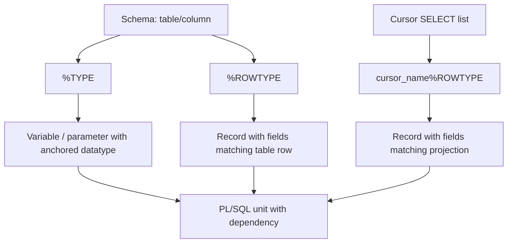

# %TYPE, %ROWTYPE, and Schema-Anchored Declarations in PL/SQL

In PL/SQL, variables and records often need data types matching columns or row structures in the database. If you declare data types, lengths, precision, and scale manually by repeating schema metadata, source code can drift out of sync with tables when structures change. Oracle provides two very useful declaration attributes:

- `%TYPE`: takes the datatype of a referenced column, variable, or component to declare a variable or parameter.
- `%ROWTYPE`: declares a record whose fields correspond to the columns of a table, view, or cursor's select list.

These two attributes create **anchored declarations**. Instead of copying data types manually, the program directly references an existing object in the schema or another PL/SQL declaration.

Example:

```sql
DECLARE
    l_customer_id customers.customer_id%TYPE;
    l_email       customers.email_address%TYPE;
    l_customer    customers%ROWTYPE;
BEGIN
    SELECT customer_id, email_address
    INTO l_customer_id, l_email
    FROM customers
    WHERE customer_id = 1001;

    SELECT *
    INTO l_customer
    FROM customers
    WHERE customer_id = 1001;
END;
/
```

Anchored declarations reduce datatype duplication and make the relationship between PL/SQL and the schema explicit. However, they also create dependencies: the PL/SQL object must be compiled against the referenced table, column, or cursor. When the schema changes, the unit may require invalidation/recompilation, and application logic must still be verified.

## 1. Why Anchor Types to the Schema?

### 1.1. The Problem with Hard-Coding Datatypes

Suppose the CUSTOMER_ID column is declared as:

```sql
CREATE TABLE customers (
    customer_id NUMBER(12),
    customer_name VARCHAR2(120 CHAR),
    email_address VARCHAR2(240 CHAR)
);
```

A procedure declares:

```sql
CREATE OR REPLACE PROCEDURE find_customer (
    p_customer_id IN NUMBER
)
AS
    l_customer_name VARCHAR2(120);
BEGIN
    SELECT customer_name
    INTO l_customer_name
    FROM customers
    WHERE customer_id = p_customer_id;
END;
/
```

The datatype and length have been duplicated. If CUSTOMER_NAME increases from 120 to 300 characters, the variable l_customer_name still only has a length of 120. If CUSTOMER_ID changes precision or datatype, the parameter retains its independent NUMBER declaration.

This creates two sources of truth: the schema defines the actual datatype, while PL/SQL defines its own datatype based on a prior assumption. The two sources can diverge.

### 1.2. Anchoring Datatypes with %TYPE

Replace it with:

```sql
CREATE OR REPLACE PROCEDURE find_customer (
    p_customer_id IN customers.customer_id%TYPE
)
AS
    l_customer_name customers.customer_name%TYPE;
BEGIN
    SELECT customer_name
    INTO l_customer_name
    FROM customers
    WHERE customer_id = p_customer_id;
END;
/
```

When CUSTOMER_ID or CUSTOMER_NAME changes type or length in the schema, dependent PL/SQL units can be invalidated and will pick up the new metadata upon recompilation. There is no need to manually edit hard-coded datatypes in every declaration.

### 1.3. Anchoring Row Structures with %ROWTYPE

When you need to hold multiple columns of a row:

```sql
DECLARE
    l_customer customers%ROWTYPE;
BEGIN
    SELECT *
    INTO l_customer
    FROM customers
    WHERE customer_id = 1001;

    DBMS_OUTPUT.PUT_LINE(l_customer.customer_name);
    DBMS_OUTPUT.PUT_LINE(l_customer.email_address);
END;
/
```

`l_customer` has fields matching the columns in the row structure of CUSTOMERS. No need to manually declare each field.

### 1.4. Relationship Diagram



## 2. %TYPE: Anchoring the Datatype of a Column or Variable

### 2.1. Syntax

```sql
variable_name table_name.column_name%TYPE;
```

Or anchored to an already declared variable:

```sql
variable_name another_variable%TYPE;
```

Where table_name.column_name points to a column in a table or view; another_variable is a previously declared variable or parameter within an accessible scope.

### 2.2. Anchoring to a Table Column

```sql
DECLARE
    l_customer_id customers.customer_id%TYPE;
    l_name        customers.customer_name%TYPE;
    l_email       customers.email_address%TYPE;
BEGIN
    SELECT customer_id, customer_name, email_address
    INTO l_customer_id, l_name, l_email
    FROM customers
    WHERE customer_id = 1001;
END;
/
```

Datatype, precision/scale, and character length are pulled from the corresponding column metadata. This is the recommended approach for variables receiving data from that column.

### 2.3. Anchoring to a Variable or Parameter

```sql
DECLARE
    l_customer_id customers.customer_id%TYPE;
    l_parent_id   l_customer_id%TYPE;
    l_child_id    l_customer_id%TYPE;
BEGIN
    l_parent_id := 1001;
    l_child_id := l_parent_id;
END;
/
```

Anchoring to a variable keeps multiple variables in the same module using a single consistent type. When the source variable changes declaration, variables anchored to it adopt the new type once the unit is recompiled.

### 2.4. Using %TYPE for Parameters

```sql
CREATE OR REPLACE PROCEDURE update_customer_email (
    p_customer_id IN customers.customer_id%TYPE,
    p_email       IN customers.email_address%TYPE
)
AS
BEGIN
    UPDATE customers
    SET email_address = p_email
    WHERE customer_id = p_customer_id;
END;
/
```

Parameters have datatypes matching the columns used by the procedure. Callers must still pass business-valid values; %TYPE does not automatically validate email format, uniqueness, or access permissions.

### 2.5. Using %TYPE for Return Types

```sql
CREATE OR REPLACE FUNCTION get_customer_name (
    p_customer_id IN customers.customer_id%TYPE
)
RETURN customers.customer_name%TYPE
AS
    l_name customers.customer_name%TYPE;
BEGIN
    SELECT customer_name
    INTO l_name
    FROM customers
    WHERE customer_id = p_customer_id;

    RETURN l_name;
END;
/
```

The return type is anchored to the column. If the function needs to handle the no-row case, its behavior must be explicitly defined; the example above raises NO_DATA_FOUND if the customer is not found.

## 3. What Does %TYPE Inherit and What Does It Not Inherit?

### 3.1. Datatype and Size

The declaration:

```sql
l_email customers.email_address%TYPE;
```

inherits the datatype and relevant size attributes of the column. For NUMBER, the column's precision/scale is part of the type metadata; for VARCHAR2, the length and CHAR/BYTE semantics apply.

### 3.2. NOT NULL Is Not Inherited

A very important point: declaring a variable with %TYPE from a NOT NULL column **does not automatically make the PL/SQL variable NOT NULL**.

Example:

```sql
CREATE TABLE customer_anchor_demo (
    customer_id NUMBER(10) NOT NULL,
    customer_name VARCHAR2(100 CHAR) NOT NULL
);
```

In PL/SQL:

```sql
DECLARE
    l_customer_name customer_anchor_demo.customer_name%TYPE;
BEGIN
    l_customer_name := NULL;
    DBMS_OUTPUT.PUT_LINE('Variable can hold NULL');
END;
/
```

The variable can hold NULL. The NOT NULL constraint is enforced when writing to the table column, not automatically turned into a PL/SQL variable constraint.

If an internal variable must always have a value, declare the constraint explicitly:

```sql
DECLARE
    l_customer_name customer_anchor_demo.customer_name%TYPE NOT NULL
        := 'Unknown';
BEGIN
    NULL;
END;
/
```

A variable with a NOT NULL constraint must be initialized at declaration and cannot be assigned NULL later.

### 3.3. Column DEFAULT Is Not Inherited

Suppose:

```sql
CREATE TABLE job_anchor_demo (
    job_id NUMBER(10) PRIMARY KEY,
    status_code VARCHAR2(20 CHAR) DEFAULT 'NEW' NOT NULL
);
```

Declaration:

```sql
DECLARE
    l_status job_anchor_demo.status_code%TYPE;
BEGIN
    DBMS_OUTPUT.PUT_LINE(
        CASE
            WHEN l_status IS NULL THEN 'NULL'
            ELSE l_status
        END
    );
END;
/
```

`l_status` does not automatically receive the default NEW. The default belongs to INSERT operations on the column, not as the initial value of every PL/SQL variable anchored to that type.

### 3.4. Other Constraints Are Also Not Inherited

%TYPE does not carry over:

- PRIMARY KEY or UNIQUE.
- FOREIGN KEY.
- CHECK constraints.
- Column defaults.
- Trigger behavior.
- Application-layer business rules.

The datatype is anchored, while value validity must still be checked at the appropriate place.

### 3.5. Comparison Table

| Column Attribute | %TYPE Variable |
|---|---|
| Datatype | Yes |
| Precision/scale or length | Per the anchored datatype |
| Character length semantics | Per the column type |
| NOT NULL constraint | Not automatically inherited |
| DEFAULT expression | Not automatically inherited |
| PRIMARY/FOREIGN/UNIQUE constraint | No |
| CHECK constraint | No |

## 4. %ROWTYPE: Declaring a Record Matching a Row Structure

### 4.1. Syntax

```sql
record_name table_name%ROWTYPE;
```

The record has fields for the columns of the table/view. Field names correspond to column names and field datatypes correspond to column datatypes.

### 4.2. Reading an Entire Row with SELECT INTO

```sql
DECLARE
    l_customer customers%ROWTYPE;
BEGIN
    SELECT *
    INTO l_customer
    FROM customers
    WHERE customer_id = 1001;

    DBMS_OUTPUT.PUT_LINE(
        'ID=' || l_customer.customer_id
    );
    DBMS_OUTPUT.PUT_LINE(
        'Name=' || l_customer.customer_name
    );
    DBMS_OUTPUT.PUT_LINE(
        'Email=' || NVL(l_customer.email_address, '(none)')
    );
END;
/
```

SELECT INTO must return exactly one row. If there are no rows, PL/SQL raises NO_DATA_FOUND; if there is more than one row, it raises TOO_MANY_ROWS.

### 4.3. Accessing Fields

Use dot notation:

```sql
l_customer.customer_id
l_customer.customer_name
l_customer.email_address
```

A record is not a scalar value. To pass individual values to a procedure or use them in SQL expressions, access the corresponding field.

### 4.4. View Records

You can anchor to a view:

```sql
CREATE OR REPLACE VIEW active_customer_v AS
SELECT customer_id,
       customer_name,
       email_address
FROM customers
WHERE status_code = 'ACTIVE';
```

Declaration:

```sql
DECLARE
    l_active_customer active_customer_v%ROWTYPE;
BEGIN
    SELECT *
    INTO l_active_customer
    FROM active_customer_v
    WHERE customer_id = 1001;
END;
/
```

The record reflects the projection of the view, not necessarily all columns of the source table. If the view definition changes, dependent PL/SQL may need recompilation.

## 5. %ROWTYPE of an Explicit Cursor

### 5.1. Why Is Cursor %ROWTYPE Needed?

table%ROWTYPE represents the full row structure of a table/view. However, real queries often select only a subset of columns or produce expressions/aggregates. In those cases, use cursor %ROWTYPE so the record matches the SELECT list.

### 5.2. Declaring a Cursor and Record

```sql
DECLARE
    CURSOR c_customer IS
        SELECT customer_id,
               customer_name,
               email_address
        FROM customers
        WHERE status_code = 'ACTIVE';

    l_customer c_customer%ROWTYPE;
BEGIN
    OPEN c_customer;

    LOOP
        FETCH c_customer INTO l_customer;
        EXIT WHEN c_customer%NOTFOUND;

        DBMS_OUTPUT.PUT_LINE(
            l_customer.customer_name || ': ' ||
            NVL(l_customer.email_address, '(none)')
        );
    END LOOP;

    CLOSE c_customer;
END;
/
```

l_customer has three fields matching the cursor's projection. There is no need to declare an extra manual record with three datatypes.

### 5.3. Cursor SELECT Expressions Must Have Aliases

If a cursor selects an expression:

```sql
DECLARE
    CURSOR c_sales IS
        SELECT customer_id,
               COUNT(*) AS order_count,
               SUM(total_amount) AS total_amount
        FROM orders
        GROUP BY customer_id;

    l_sales c_sales%ROWTYPE;
BEGIN
    OPEN c_sales;
    FETCH c_sales INTO l_sales;
    CLOSE c_sales;

    DBMS_OUTPUT.PUT_LINE(l_sales.order_count);
END;
/
```

Give clear aliases to expressions so fields have usable names. The aliases ORDER_COUNT and TOTAL_AMOUNT become field names of the cursor record.

### 5.4. Cursor FOR LOOP

A cursor FOR LOOP implicitly declares its loop record:

```sql
DECLARE
    CURSOR c_customer IS
        SELECT customer_id, customer_name
        FROM customers
        WHERE status_code = 'ACTIVE';
BEGIN
    FOR r_customer IN c_customer LOOP
        DBMS_OUTPUT.PUT_LINE(
            r_customer.customer_id || ' ' ||
            r_customer.customer_name
        );
    END LOOP;
END;
/
```

In a cursor FOR LOOP, Oracle automatically opens the cursor, fetches each row, and closes the cursor on completion or exception. The loop record variable exists only within the loop scope; there is no need to declare a separate cursor%ROWTYPE if you only process rows inside the loop.

### 5.5. Cursor Parameters

A cursor can accept parameters:

```sql
DECLARE
    CURSOR c_orders (
        p_customer_id orders.customer_id%TYPE
    ) IS
        SELECT order_id, order_date, total_amount
        FROM orders
        WHERE customer_id = p_customer_id;

    l_order c_orders%ROWTYPE;
BEGIN
    OPEN c_orders(1001);
    FETCH c_orders INTO l_order;
    CLOSE c_orders;
END;
/
```

The parameter is also anchored with %TYPE; the cursor record matches the SELECT list. This shows how to combine both attributes in one module.

## 6. %ROWTYPE and SELECT List Must Match

### 6.1. Table %ROWTYPE for Full Rows

```sql
DECLARE
    l_customer customers%ROWTYPE;
BEGIN
    SELECT *
    INTO l_customer
    FROM customers
    WHERE customer_id = 1001;
END;
/
```

Because the record is defined from the entire table structure, the SELECT list must match the full count and order of fields. Do not use table %ROWTYPE arbitrarily to receive a small projection.

### 6.2. Small Projection: Use Cursor %ROWTYPE

```sql
DECLARE
    CURSOR c_customer_summary IS
        SELECT customer_id,
               customer_name
        FROM customers;

    l_summary c_customer_summary%ROWTYPE;
BEGIN
    OPEN c_customer_summary;
    FETCH c_customer_summary INTO l_summary;
    CLOSE c_customer_summary;
END;
/
```

The record has exactly two fields matching the projection. This is a clearer choice when the query does not fetch the entire row.

### 6.3. SELECT INTO with a User-Defined Record

When you need a specific projection without declaring an explicit cursor, you can declare a RECORD:

```sql
DECLARE
    TYPE t_customer_summary IS RECORD (
        customer_id   customers.customer_id%TYPE,
        customer_name customers.customer_name%TYPE,
        order_count   PLS_INTEGER
    );

    l_summary t_customer_summary;
BEGIN
    SELECT customer_id,
           customer_name,
           0
    INTO l_summary
    FROM customers
    WHERE customer_id = 1001;
END;
/
```

A user-defined record is suitable when combining fields anchored from multiple sources or computed fields. It lets you design a custom shape rather than tying everything to a single table.

### 6.4. Cursor Field Names

A cursor can define aliases for expressions:

```sql
CURSOR c_report IS
    SELECT department_id,
           COUNT(*) AS employee_count,
           AVG(salary) AS average_salary
    FROM employees
    GROUP BY department_id;
```

The names EMPLOYEE_COUNT and AVERAGE_SALARY become fields of the cursor record.

## 7. %TYPE and %ROWTYPE in Collections and BULK COLLECT

### 7.1. Collection of Type-Anchored Scalars

```sql
DECLARE
    TYPE t_customer_ids IS TABLE OF customers.customer_id%TYPE
        INDEX BY PLS_INTEGER;

    l_customer_ids t_customer_ids;
BEGIN
    l_customer_ids(1) := 1001;
    l_customer_ids(2) := 1002;
END;
/
```

Elements share the datatype of CUSTOMER_ID. If the column changes datatype and the unit is recompiled, collection elements follow the anchored type as well.

### 7.2. Collection of Row-Anchored Records

```sql
DECLARE
    TYPE t_customer_rows IS TABLE OF customers%ROWTYPE
        INDEX BY PLS_INTEGER;

    l_customers t_customer_rows;
BEGIN
    SELECT *
    BULK COLLECT INTO l_customers
    FROM customers
    WHERE status_code = 'ACTIVE';

    DBMS_OUTPUT.PUT_LINE('Rows=' || l_customers.COUNT);
END;
/
```

The collection holds multiple records matching the CUSTOMERS row structure. BULK COLLECT loads the result set into the collection in one shot or in batches.

### 7.3. BULK COLLECT with Cursor Records

```sql
DECLARE
    CURSOR c_customer IS
        SELECT customer_id, customer_name
        FROM customers
        WHERE status_code = 'ACTIVE';

    TYPE t_customer_rows IS TABLE OF c_customer%ROWTYPE;
    l_customers t_customer_rows;
BEGIN
    OPEN c_customer;
    FETCH c_customer BULK COLLECT INTO l_customers LIMIT 500;
    CLOSE c_customer;

    FOR i IN 1 .. l_customers.COUNT LOOP
        DBMS_OUTPUT.PUT_LINE(l_customers(i).customer_name);
    END LOOP;
END;
/
```

The example above fetches at most 500 rows once. For large datasets, place FETCH inside a loop to process subsequent batches; fetching only once and closing the cursor leaves remaining rows unprocessed.

### 7.4. Batched BULK COLLECT

```sql
DECLARE
    CURSOR c_customer IS
        SELECT customer_id, customer_name
        FROM customers
        WHERE status_code = 'ACTIVE'
        ORDER BY customer_id;

    TYPE t_customer_rows IS TABLE OF c_customer%ROWTYPE;
    l_batch t_customer_rows;
BEGIN
    OPEN c_customer;

    LOOP
        FETCH c_customer BULK COLLECT INTO l_batch LIMIT 500;
        EXIT WHEN l_batch.COUNT = 0;

        FOR i IN 1 .. l_batch.COUNT LOOP
            DBMS_OUTPUT.PUT_LINE(l_batch(i).customer_name);
        END LOOP;
    END LOOP;

    CLOSE c_customer;
END;
/
```

LIMIT bounds memory usage when datasets are large. Batch size should be tuned based on record width, PGA, and processing cost.

### 7.5. FORALL with Type-Anchored Collections

```sql
DECLARE
    TYPE t_customer_ids IS TABLE OF customers.customer_id%TYPE
        INDEX BY PLS_INTEGER;
    l_ids t_customer_ids;
BEGIN
    l_ids(1) := 1001;
    l_ids(2) := 1002;
    l_ids(3) := 1003;

    FORALL i IN INDICES OF l_ids
        UPDATE customers
        SET status_code = 'REVIEW'
        WHERE customer_id = l_ids(i);
END;
/
```

%TYPE keeps element types aligned with the column. FORALL reduces context switches when executing DML across many elements; it does not alter transaction or constraint rules.

## 8. User-Defined Records Combined with %TYPE

### 8.1. When a Record Has Multiple Data Sources

```sql
DECLARE
    TYPE t_customer_order_summary IS RECORD (
        customer_id   customers.customer_id%TYPE,
        customer_name customers.customer_name%TYPE,
        order_count   PLS_INTEGER,
        total_amount  orders.total_amount%TYPE
    );

    l_summary t_customer_order_summary;
BEGIN
    SELECT c.customer_id,
           c.customer_name,
           COUNT(o.order_id),
           NVL(SUM(o.total_amount), 0)
    INTO l_summary
    FROM customers c
    LEFT JOIN orders o
      ON o.customer_id = c.customer_id
    WHERE c.customer_id = 1001
    GROUP BY c.customer_id, c.customer_name;
END;
/
```

A user-defined record lets fields pull types from two different tables and include computed fields. This is usually better than using customers%ROWTYPE because the returned data is not a full row of a single table.

### 8.2. Using SUBTYPE to Name Business Types

```sql
DECLARE
    SUBTYPE t_customer_id IS customers.customer_id%TYPE;
    SUBTYPE t_customer_email IS customers.email_address%TYPE;

    l_customer_id t_customer_id;
    l_email       t_customer_email;
BEGIN
    l_customer_id := 1001;
END;
/
```

SUBTYPE creates a business-meaningful type name based on an anchored type. It does not create a completely distinct datatype and does not automatically enforce the source column's constraints.

### 8.3. Package Types for Shared APIs

You can publish subtypes in a package specification:

```sql
CREATE OR REPLACE PACKAGE customer_api_types AS
    SUBTYPE t_customer_id IS customers.customer_id%TYPE;
    SUBTYPE t_customer_email IS customers.email_address%TYPE;
END customer_api_types;
/
```

Other packages/procedures can reference customer_api_types.t_customer_id. This helps standardize API types, though the package spec introduces an additional schema dependency and spec changes can invalidate dependent units.

## 9. Schema Dependencies and Recompilation

### 9.1. Anchored Declarations Create Dependencies

When stored PL/SQL references:

```sql
customers.customer_id%TYPE
customers%ROWTYPE
```

Oracle needs the anchored object's metadata to compile the unit. Dependencies are tracked in the data dictionary. If a table/column changes in a way that affects the unit, the unit's status can become INVALID and require recompilation.

### 9.2. Checking Object Status

```sql
SELECT object_name,
       object_type,
       status,
       last_ddl_time
FROM user_objects
WHERE object_type IN ('PROCEDURE', 'FUNCTION', 'PACKAGE', 'PACKAGE BODY')
ORDER BY object_type, object_name;
```

INVALID objects can be automatically recompiled by Oracle upon invocation, or compiled explicitly:

```sql
ALTER PROCEDURE update_customer_email COMPILE;
ALTER PACKAGE customer_api_types COMPILE SPECIFICATION;
ALTER PACKAGE customer_api_types COMPILE BODY;
```

Only run compile on appropriate objects. If errors occur, inspect USER_ERRORS:

```sql
SELECT name,
       type,
       line,
       position,
       text
FROM user_errors
ORDER BY name, sequence;
```

### 9.3. Viewing Dependencies

```sql
SELECT name,
       type,
       referenced_owner,
       referenced_name,
       referenced_type
FROM user_dependencies
WHERE name = 'UPDATE_CUSTOMER_EMAIL'
ORDER BY referenced_owner, referenced_name;
```

USER_DEPENDENCIES shows dependencies within the current schema. DBAs can use ALL_DEPENDENCIES or DBA_DEPENDENCIES depending on privileges for broader visibility.

### 9.4. Fine-Grained Dependency

Oracle supports column-level fine-grained dependency tracking for certain reference types. This reduces unnecessary invalidations when table changes do not affect components used by a unit. However, do not assume every DDL leaves units valid: changes to structure, datatypes, column names, view definitions, or package specifications can still impact dependencies.

### 9.5. Changing Column Datatypes

If an anchored column changes datatype, the unit may need recompilation and anchored variables/parameters will adopt the new metadata. That alone does not guarantee application logic remains valid:

- Variables might receive larger values than before.
- Comparisons or arithmetic might change precision/scale.
- Package/procedure interfaces might change signatures.
- Clients calling the procedure might need recompilation or redeployment.
- Existing data might not convert to the new datatype.

Anchoring reduces type drift bugs, but it does not replace schema migration workflows and contract testing.

## 10. %ROWTYPE and Table Structure Changes

### 10.1. Adding Columns

Suppose a unit uses:

```sql
DECLARE
    l_customer customers%ROWTYPE;
BEGIN
    SELECT *
    INTO l_customer
    FROM customers
    WHERE customer_id = 1001;
END;
/
```

If the table adds a column, the rowtype record reflects the new structure upon recompilation. Dependent units may be invalidated/recompiled depending on dependencies and release. Code referencing fields by name must still be reviewed if logic needs to handle the new column.

### 10.2. SELECT * Creates Coupling to Row Structure

SELECT * INTO table%ROWTYPE is convenient when the entire row is truly needed. However, it couples to the full projection and column order. If only three fields are needed, use a cursor %ROWTYPE or a user-defined record to declare the projection explicitly.

### 10.3. Adding a Column with a Default

When a table adds a column with a default, the table %ROWTYPE gains the corresponding field after compile. A record variable does not automatically apply the column's default on initialization; the record field remains a PL/SQL value that must be assigned or populated from SELECT.

### 10.4. Renaming or Dropping Columns

If a unit references a renamed/dropped column, compilation can fail with an invalid identifier error. Record fields also change to match the new structure. Code must be updated as part of migration rather than expecting %ROWTYPE to rename fields in source code automatically.

### 10.5. Ordered Migration

A safe workflow:

1. Identify PL/SQL units dependent on the column/table.
2. Prepare DDL and code compatible with the new schema.
3. Run the migration in a test environment.
4. Recompile invalid units and check USER_ERRORS.
5. Run integration tests for APIs and DML.
6. Deploy in an order that supports rollback or backward compatibility.
7. Monitor INVALID objects after deployment.

## 11. %TYPE and %ROWTYPE in Packages, Procedures, and Functions

### 11.1. Package Specifications

Anchored datatypes can appear in public interfaces:

```sql
CREATE OR REPLACE PACKAGE customer_service AS
    PROCEDURE set_email (
        p_customer_id IN customers.customer_id%TYPE,
        p_email       IN customers.email_address%TYPE
    );
END customer_service;
/
```

This keeps the interface aligned with the schema. However, changing a column datatype can change the compiled package specification and cascade dependencies to callers.

### 11.2. Package Bodies

```sql
CREATE OR REPLACE PACKAGE BODY customer_service AS
    PROCEDURE set_email (
        p_customer_id IN customers.customer_id%TYPE,
        p_email       IN customers.email_address%TYPE
    )
    IS
    BEGIN
        UPDATE customers
        SET email_address = p_email
        WHERE customer_id = p_customer_id;
    END set_email;
END customer_service;
/
```

Specification and body must have matching signatures. When the schema changes, recompile the package and any required callers.

### 11.3. %ROWTYPE as a Parameter

Rowtype records can be used in internal PL/SQL APIs:

```sql
CREATE OR REPLACE PROCEDURE print_customer (
    p_customer IN customers%ROWTYPE
)
AS
BEGIN
    DBMS_OUTPUT.PUT_LINE(p_customer.customer_name);
END;
/
```

This record type is tied to the table structure and fits PL/SQL-to-PL/SQL calls. However, a %ROWTYPE record cannot be passed directly across every SQL/driver boundary like a scalar. For public APIs exposed to external applications, prefer %TYPE scalar parameters, well-defined object types, or dedicated JSON/REST contracts.

### 11.4. Avoid Exposing Full Rowtypes in Public Contracts

If a procedure accepts customers%ROWTYPE, adding a column to CUSTOMERS changes the record interface and increases coupling. If callers only need ID and email, declaring two %TYPE parameters yields a narrower, clearer contract with fewer dependencies.

## 12. Comparing %TYPE, %ROWTYPE, and User-Defined RECORDs

| Mechanism | Shape | When to Use |
|---|---|---|
| %TYPE | Single datatype | Variable/parameter corresponding to a column or another variable |
| Table/view %ROWTYPE | All columns of a row | Reading or processing a full row |
| Cursor %ROWTYPE | Columns in cursor's SELECT list | Processing a specific projection |
| TYPE ... IS RECORD | Developer-chosen fields | Combining multiple sources, adding computed fields, defining custom shapes |
| SUBTYPE | Domain type name based on another datatype | Naming shared types and improving clarity |

No single mechanism is best for every case. Pick the smallest record shape sufficient for the business need, avoiding pulling an entire row into code when only a few columns are required.

## 13. Common Errors and How to Handle Them

| Error/Symptom | Cause | Resolution |
|---|---|---|
| PLS-00201 identifier must be declared | Referenced table/column/variable not visible or missing privileges | Check schema, object name, synonyms, and direct privileges |
| PLS-00302 component must be declared | Field does not exist in record/cursor projection | Check column name, alias, and rowtype structure |
| PLS-00306 wrong number or types of arguments | Anchored parameter signature changed or caller passed wrong types | Compare signatures and caller datatypes |
| ORA-06502 numeric/value error | Value exceeds buffer/precision or conversion fails | Check anchored datatype, actual value, and conversions |
| ORA-01422 TOO_MANY_ROWS | SELECT INTO record returned multiple rows | Add unique predicate or use a cursor |
| ORA-01403 NO_DATA_FOUND | SELECT INTO returned no rows | Handle exception or check existence per business rules |
| Object INVALID after DDL | Dependency impacted | Check USER_ERRORS/DEPENDENCIES and recompile |
| %TYPE variable receives NULL | Column NOT NULL is not inherited | Declare NOT NULL explicitly if needed |
| %TYPE variable lacks default | Column DEFAULT does not apply to variables | Initialize variable explicitly |
| SELECT list does not match %ROWTYPE | Using table rowtype for partial projection or wrong order | Use full SELECT * matching structure or a cursor/custom record |
| Callers affected after package spec change | Public signature depends on schema | Version APIs and coordinate migrations |

## 14. Practical Design Rules

### 14.1. Use %TYPE for Column-Bound Scalars

If a variable holds customer_id, email, or amount from a specific column, prefer:

```sql
l_customer_id customers.customer_id%TYPE;
l_email       customers.email_address%TYPE;
l_amount      orders.total_amount%TYPE;
```

This keeps datatype and size aligned with the schema.

### 14.2. Use %ROWTYPE When You Truly Need the Full Row

```sql
l_customer customers%ROWTYPE;
```

Suitable for logic requiring many columns of the row. If only a few columns are used, consider cursor %ROWTYPE or a user-defined record to reduce coupling.

### 14.3. Use Cursor %ROWTYPE for Stable Projections

```sql
CURSOR c_summary IS
    SELECT customer_id,
           COUNT(*) AS order_count
    FROM orders
    GROUP BY customer_id;

l_summary c_summary%ROWTYPE;
```

The projection is defined in the cursor; the record matches that exact shape.

### 14.4. Do Not Rely on SELECT * in Long-Lived APIs

SELECT * is convenient in internal row-oriented operations, but in complex queries or stable interfaces, an explicit column list controls the projection, prevents accidentally pulling new columns, and lowers risk during schema changes.

### 14.5. Separate Schema Datatypes and Business Datatypes When Needed

Not every variable must be anchored directly to a column. A computed value with its own business rules may need its own subtype/record. For example, a maximum retry count may be PLS_INTEGER even if a table column stores it as NUMBER(5). Choose types based on value domain and operations, not mechanical anchoring.

### 14.6. Control Dependencies in Package Specifications

Put %TYPE in a package spec when that type is genuinely part of the contract. If it is only used internally, place the declaration in the package body to reduce caller dependencies on the schema.

## 15. Comprehensive Example: Customer Operations Package

### 15.1. Package Specification

```sql
CREATE OR REPLACE PACKAGE customer_repo AS
    SUBTYPE t_customer_id IS customers.customer_id%TYPE;
    SUBTYPE t_email IS customers.email_address%TYPE;

    PROCEDURE change_email (
        p_customer_id IN t_customer_id,
        p_email       IN t_email
    );

    PROCEDURE show_customer (
        p_customer_id IN t_customer_id
    );
END customer_repo;
/
```

### 15.2. Package Body

```sql
CREATE OR REPLACE PACKAGE BODY customer_repo AS
    PROCEDURE change_email (
        p_customer_id IN t_customer_id,
        p_email       IN t_email
    )
    IS
    BEGIN
        UPDATE customers
        SET email_address = p_email
        WHERE customer_id = p_customer_id;

        IF SQL%ROWCOUNT = 0 THEN
            RAISE_APPLICATION_ERROR(-20061, 'Customer not found');
        END IF;
    END change_email;

    PROCEDURE show_customer (
        p_customer_id IN t_customer_id
    )
    IS
        l_customer customers%ROWTYPE;
    BEGIN
        SELECT *
        INTO l_customer
        FROM customers
        WHERE customer_id = p_customer_id;

        DBMS_OUTPUT.PUT_LINE(
            l_customer.customer_id || ': ' ||
            l_customer.customer_name
        );
    END show_customer;
END customer_repo;
/
```

The package body uses %ROWTYPE for full-row operations and anchored subtypes for the API. Procedures do not COMMIT; transactions belong to the caller.

### 15.3. Calling the Package

```sql
BEGIN
    customer_repo.change_email(
        p_customer_id => 1001,
        p_email => 'an@example.test'
    );

    customer_repo.show_customer(
        p_customer_id => 1001
    );

    COMMIT;
END;
/
```

In a real system, add uniqueness checks, validation, and contract-specific error handling. This example only illustrates anchored declarations and dependencies.

## 16. Practice Exercises

Run in a dedicated lab schema. Create tables and objects with a LAB suffix so you do not overwrite active objects.

### Step 1 — Create Table

```sql
CREATE TABLE customer_anchor_lab (
    customer_id NUMBER(12) NOT NULL,
    customer_name VARCHAR2(120 CHAR) NOT NULL,
    email_address VARCHAR2(240 CHAR),
    status_code VARCHAR2(20 CHAR) DEFAULT 'NEW' NOT NULL,
    CONSTRAINT pk_customer_anchor_lab PRIMARY KEY (customer_id)
);

INSERT INTO customer_anchor_lab (
    customer_id, customer_name, email_address
)
VALUES (1, 'Nguyen An', 'an@example.test');

COMMIT;
```

### Step 2 — Declare Scalars with %TYPE

```sql
DECLARE
    l_id customer_anchor_lab.customer_id%TYPE;
    l_name customer_anchor_lab.customer_name%TYPE;
BEGIN
    SELECT customer_id, customer_name
    INTO l_id, l_name
    FROM customer_anchor_lab
    WHERE customer_id = 1;

    DBMS_OUTPUT.PUT_LINE(l_id || ': ' || l_name);
END;
/
```

### Step 3 — Test NOT NULL and DEFAULT

Declare variables with %TYPE from CUSTOMER_NAME and STATUS_CODE. Assign NULL to the variables and observe that they can hold NULL. Create a variable with an explicit NOT NULL constraint and observe the initialization requirement. Verify the variable does not automatically receive the default NEW.

### Step 4 — Use Table %ROWTYPE

```sql
DECLARE
    l_customer customer_anchor_lab%ROWTYPE;
BEGIN
    SELECT *
    INTO l_customer
    FROM customer_anchor_lab
    WHERE customer_id = 1;

    DBMS_OUTPUT.PUT_LINE(l_customer.customer_name);
END;
/
```

### Step 5 — Use Cursor %ROWTYPE

Create a cursor selecting CUSTOMER_ID and UPPER(CUSTOMER_NAME) AS NORMALIZED_NAME. Declare a record with cursor%ROWTYPE, fetch, and read both fields. Compare its shape against CUSTOMER_ANCHOR_LAB%ROWTYPE.

### Step 6 — Use Collections and BULK COLLECT

Declare a collection TABLE OF customer_anchor_lab%ROWTYPE, bulk collect the data, and loop through each record. Then add LIMIT and a fetch loop to process a large set in batches.

### Step 7 — Observe Dependencies

Create a procedure referencing customer_anchor_lab.customer_name%TYPE and customer_anchor_lab%ROWTYPE. Inspect USER_DEPENDENCIES and USER_OBJECTS.

### Step 8 — Modify the Schema in Lab

Add a new column to the table. Check procedure status, recompile, and observe the new rowtype. Try changing a datatype in a separate test table if data allows; check compile errors and signature impact.

### Step 9 — Test Projection Mismatch

Use table %ROWTYPE to receive a SELECT with only two columns and observe the error. Fix it using cursor %ROWTYPE or a user-defined RECORD.

### Step 10 — Design a Package API

Create a package spec using anchored subtypes for CUSTOMER_ID and EMAIL_ADDRESS. Place internal records in the body. Explain why public types and internal types carry different dependency scopes.

## 17. Self-Check Questions

1. What is an anchored declaration?
2. Where does %TYPE get its datatype from?
3. How does %ROWTYPE build a record structure?
4. Why anchor parameters to columns instead of repeating NUMBER/VARCHAR2?
5. Does %TYPE inherit column NOT NULL and DEFAULT?
6. What do precision/scale and length semantics mean when anchoring types?
7. When should you use table %ROWTYPE, and when should you use cursor %ROWTYPE?
8. Why must the SELECT list match the record structure?
9. Why do cursor expressions need aliases?
10. How does a cursor FOR LOOP manage records and cursors?
11. Can %TYPE be used for collection elements?
12. What does BULK COLLECT LIMIT help control?
13. When is a user-defined record better than %ROWTYPE?
14. How does SUBTYPE help an API?
15. How do anchored declarations create schema dependencies?
16. How can column-changing DDL render stored PL/SQL INVALID?
17. How do you inspect USER_DEPENDENCIES and USER_ERRORS?
18. Why doesn't %ROWTYPE automatically update source code when a column is renamed or dropped?
19. Why shouldn't table %ROWTYPE be exposed in every public API?
20. Why does %TYPE reduce datatype drift without replacing schema migrations and integration tests?

**Rule to remember:** use %TYPE when a variable or parameter represents a datatype already defined in the schema; use %ROWTYPE when you need a record matching a full row or a cursor projection. These attributes anchor datatypes and structures, without carrying over NOT NULL, DEFAULT, or table constraints. They also create schema dependencies, so changes to tables, views, or cursors can affect compilation status and PL/SQL contracts. Choose just enough data shape, check dependencies during migrations, and recompile/retest affected units.
