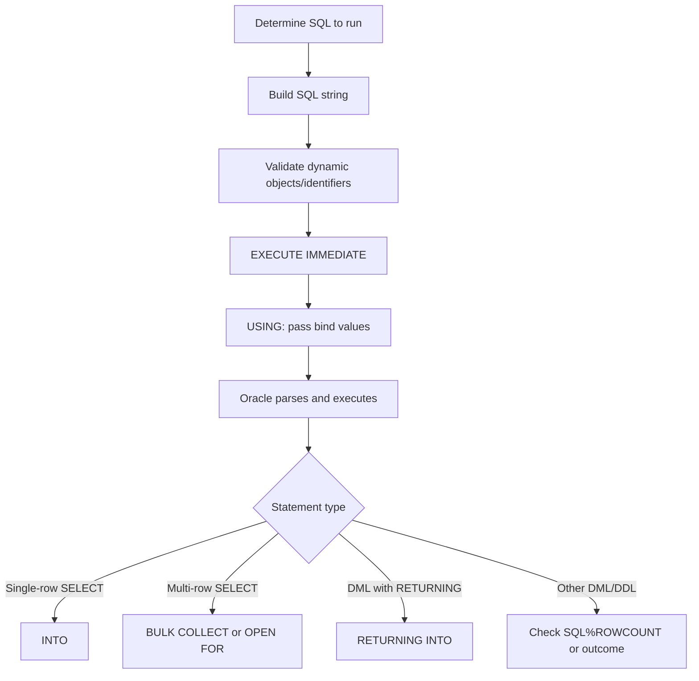

# EXECUTE IMMEDIATE, USING, and RETURNING INTO in PL/SQL

PL/SQL usually uses static SQL: SQL statements are written directly in source code, allowing Oracle to check syntax and resolve objects when compiling the unit. However, there are situations where a SQL statement is only determined at runtime—such as a table name chosen by configuration, filter conditions assembled from user choices, or an administrative utility operating across multiple objects. In those cases, PL/SQL can use **dynamic SQL**.

Native Dynamic SQL (NDS) is the way to write dynamic SQL directly inside PL/SQL. Its central statement is `EXECUTE IMMEDIATE`. Data values are passed via `USING`, and DML results can be retrieved via `RETURNING INTO`.

Example of an update with binds:

```sql
EXECUTE IMMEDIATE
    'UPDATE employees
     SET salary = salary + :increment
     WHERE employee_id = :employee_id'
USING p_increment, p_employee_id;
```

Example receiving the updated value:

```sql
EXECUTE IMMEDIATE
    'UPDATE employees
     SET salary = salary + :increment
     WHERE employee_id = :employee_id
     RETURNING salary INTO :new_salary'
USING p_increment, p_employee_id
RETURNING INTO l_new_salary;
```

Dynamic SQL is very flexible, yet it adds responsibilities: preventing SQL injection, binding the right data types, separating data values from object names, checking affected row counts, managing exceptions and transactions, and understanding the boundary between `EXECUTE IMMEDIATE` and `DBMS_SQL`.

## 1. What is dynamic SQL?

### 1.1. Static SQL

With static SQL, the statement is written directly:

```sql
DECLARE
    l_name employees.last_name%TYPE;
BEGIN
    SELECT last_name
    INTO l_name
    FROM employees
    WHERE employee_id = 100;

    DBMS_OUTPUT.PUT_LINE(l_name);
END;
/
```

Oracle can analyze and validate the SQL structure when compiling PL/SQL. Referenced objects, columns, and data types are explicit in source code. This is the preferred choice whenever the SQL statement is known in advance.

### 1.2. Dynamic SQL

With dynamic SQL, the statement is a string built or selected at runtime:

```sql
DECLARE
    l_sql  VARCHAR2(1000);
    l_name employees.last_name%TYPE;
BEGIN
    l_sql := 'SELECT last_name
              FROM employees
              WHERE employee_id = :id';

    EXECUTE IMMEDIATE l_sql
        INTO l_name
        USING 100;

    DBMS_OUTPUT.PUT_LINE(l_name);
END;
/
```

Oracle parses and executes the supplied SQL statement at runtime. The statement can vary by object name, conditions, or query structure. Data values should be passed using bind variables.

### 1.3. When is dynamic SQL needed?

Appropriate scenarios:

- Table or view names are chosen from configuration.
- An admin utility needs to operate across multiple tables sharing a convention.
- Column lists or filter conditions are selected from an allowed set.
- A report has projection or sort keys varying per request.
- DDL needs to create, alter, or drop objects based on deployment parameters.
- A generic API must process SQL statements whose column/bind counts are known only at runtime.

Do not use dynamic SQL just because parameters exist. When table names and SQL structure are fixed, static SQL with binds is usually easier to read, safer, and easier to validate.

### 1.4. Execution flow



## 2. EXECUTE IMMEDIATE syntax

### 2.1. General form

Common template:

```sql
EXECUTE IMMEDIATE dynamic_string
    [ INTO {define_variable | record} [, ...] ]
    [ USING [ IN | OUT | IN OUT ] bind_argument [, ...] ]
    [ RETURNING INTO bind_argument [, ...] ];
```

Parts:

- `dynamic_string`: a string containing a SQL statement, PL/SQL block, or `CALL` statement.
- `INTO`: receives results from a single-row `SELECT`.
- `USING`: supplies bind arguments for placeholders in the dynamic string.
- `RETURNING INTO`: receives values returned by DML.

Not every clause is used at the same time. Usage depends on the statement type.

### 2.2. Executing DML

```sql
BEGIN
    EXECUTE IMMEDIATE
        'UPDATE employees
         SET salary = salary * 1.05
         WHERE department_id = :dept_id'
    USING 50;
END;
/
```

DML runs in the current transaction. `EXECUTE IMMEDIATE` does not auto-`COMMIT`. The caller decides `COMMIT` or `ROLLBACK` per business boundaries.

### 2.3. Executing a single-row SELECT

```sql
DECLARE
    l_name employees.last_name%TYPE;
    l_salary employees.salary%TYPE;
BEGIN
    EXECUTE IMMEDIATE
        'SELECT last_name, salary
         FROM employees
         WHERE employee_id = :id'
    INTO l_name, l_salary
    USING 100;
END;
/
```

The number of variables in `INTO` must match the number of expressions in the `SELECT` list, in matching order and compatible data types. If the `SELECT` returns no rows, `NO_DATA_FOUND` is raised; if it returns more than one row, `TOO_MANY_ROWS` is raised.

### 2.4. Executing a dynamic PL/SQL block

```sql
DECLARE
    l_result NUMBER;
BEGIN
    EXECUTE IMMEDIATE
        'BEGIN :out_value := :input_value * 2; END;'
    USING OUT l_result, IN 25;

    DBMS_OUTPUT.PUT_LINE(l_result);
END;
/
```

When `dynamic_string` is an anonymous PL/SQL block or `CALL` statement, `USING` can pass `IN`, `OUT`, and `IN OUT` parameters. In this example, the first placeholder is `OUT` and the second is `IN`.

### 2.5. Dynamic DDL

```sql
BEGIN
    EXECUTE IMMEDIATE
        'CREATE TABLE runtime_log (
            log_id NUMBER,
            message VARCHAR2(200)
         )';
END;
/
```

DDL normally does not use bind variables for object names or DDL structure. The DDL string is constructed after identifiers are validated. DDL triggers an implicit commit per Oracle rules; do not treat it like DML that can be rolled back with a business transaction.

## 3. USING and bind variables

### 3.1. Bind values instead of literal values

Example of avoiding direct value concatenation:

```sql
l_sql := 'SELECT last_name FROM employees WHERE employee_id = '
         || p_employee_id;
EXECUTE IMMEDIATE l_sql INTO l_name;
```

Use bind variables instead:

```sql
l_sql := 'SELECT last_name
          FROM employees
          WHERE employee_id = :id';

EXECUTE IMMEDIATE l_sql
    INTO l_name
    USING p_employee_id;
```

Bind variables pass values strictly as data rather than turning values into SQL syntax. This reduces SQL injection risk, avoids quoting/formatting bugs, and supports cursor reuse when SQL text stays stable.

### 3.2. Positional binding

In a dynamic SQL statement, bind arguments bind positionally according to placeholder appearance order in the SQL string, not by placeholder name.

Example:

```sql
EXECUTE IMMEDIATE
    'UPDATE employees
     SET salary = :new_salary
     WHERE employee_id = :employee_id'
USING p_new_salary, p_employee_id;
```

The `USING` order must be `new_salary` first, `employee_id` second, matching placeholder order in the statement.

### 3.3. Repeated placeholders in a SQL statement

For a dynamic SQL statement, every occurrence of a placeholder is a bind position. If the same placeholder name appears twice, you must supply two bind arguments in order:

```sql
EXECUTE IMMEDIATE
    'SELECT employee_id
     FROM employees
     WHERE department_id = :value
        OR manager_id = :value'
INTO l_employee_id
USING p_value, p_value;
```

Identical placeholder names do not automatically share a single bind argument in a SQL statement. An easy rule is to count occurrences from left to right.

### 3.4. Placeholders in a dynamic PL/SQL block

For a dynamic anonymous PL/SQL block or `CALL` statement, placeholders bind by unique name. If the same placeholder name repeats, only one bind argument is supplied for that name.

Example:

```sql
DECLARE
    l_result NUMBER;
BEGIN
    EXECUTE IMMEDIATE
        'BEGIN :x := :x + 10; END;'
    USING IN OUT l_result;
END;
/
```

This rule differs from dynamic SQL statements. When converting a string from `SELECT`/`UPDATE` to a PL/SQL block or vice versa, review placeholder binding and `USING` order carefully.

### 3.5. Table names, column names, and keywords cannot be bound

Bind variables represent **values**, not identifiers or SQL syntax.

You cannot write:

```sql
EXECUTE IMMEDIATE
    'SELECT * FROM :table_name'
USING p_table_name;
```

Oracle needs to know object names during the parse phase; placeholders cannot stand in for table names. Likewise, you cannot bind column names, `ORDER BY` keywords, `ASC`/`DESC`, or predicate fragments.

If object names must vary, concatenate validated identifiers into the SQL string; still bind filter values via `USING`.

### 3.6. Bind data types

Bind arguments must match the data types SQL expects. For instance, `DATE` columns should receive `DATE`; `NUMBER` columns should receive `NUMBER`; string codes should receive `VARCHAR2`:

```sql
EXECUTE IMMEDIATE
    'SELECT customer_name
     FROM customers
     WHERE customer_id = :id'
INTO l_name
USING p_customer_id;
```

Avoid converting dates or numbers to text and relying on session NLS settings for Oracle to parse them back. Binding the proper type keeps semantics consistent and avoids unintended implicit conversions.

### 3.7. Binding NULL

You can pass a PL/SQL variable holding `NULL` via `USING`:

```sql
EXECUTE IMMEDIATE
    'UPDATE customers
     SET email_address = :email
     WHERE customer_id = :id'
USING l_email, p_customer_id;
```

If `l_email` is `NULL`, the column is set to `NULL` (if constraints permit). Predicates comparing with `NULL` still follow three-valued logic; `column = :value` does not return `TRUE` when `NULL` is bound. To check for `NULL`, use an explicit SQL predicate like `IS NULL` or carefully designed logic.

### 3.8. Binds cannot replace optional structural clauses

If the user chooses one of several sort fields, map the selection against an allowed identifier list:

```sql
CASE p_sort_option
    WHEN 'DATE' THEN l_order_by := 'order_date';
    WHEN 'AMOUNT' THEN l_order_by := 'total_amount';
    WHEN 'ID' THEN l_order_by := 'order_id';
    ELSE
        RAISE_APPLICATION_ERROR(-20070, 'Unsupported sort option');
END CASE;

l_sql := 'SELECT order_id, order_date, total_amount
          FROM orders
          WHERE customer_id = :id
          ORDER BY ' || l_order_by;

OPEN l_cursor FOR l_sql USING p_customer_id;
```

Never concatenate raw client input into SQL. A whitelist restricts valid identifiers; `customer_id` is still bound.

## 4. INTO and SELECT results

### 4.1. INTO for a single row

```sql
DECLARE
    l_customer customers%ROWTYPE;
BEGIN
    EXECUTE IMMEDIATE
        'SELECT *
         FROM customers
         WHERE customer_id = :id'
    INTO l_customer
    USING 1001;
END;
/
```

The record must match the `SELECT` list. With `table%ROWTYPE`, `SELECT *` from that table is straightforward; for partial projections, use a `cursor%ROWTYPE` or custom record.

### 4.2. INTO cannot receive multiple rows

If a query can return multiple rows, `EXECUTE IMMEDIATE ... INTO` raises `TOO_MANY_ROWS`. Two common alternatives are:

- `BULK COLLECT INTO` to load multiple rows into collections.
- `OPEN ... FOR` to open a dynamic cursor and fetch rows/batches.

### 4.3. BULK COLLECT INTO

```sql
DECLARE
    TYPE t_id_list IS TABLE OF employees.employee_id%TYPE;
    TYPE t_name_list IS TABLE OF employees.last_name%TYPE;

    l_ids   t_id_list;
    l_names t_name_list;
BEGIN
    EXECUTE IMMEDIATE
        'SELECT employee_id, last_name
         FROM employees
         WHERE department_id = :dept_id'
    BULK COLLECT INTO l_ids, l_names
    USING 50;

    DBMS_OUTPUT.PUT_LINE('Rows=' || l_ids.COUNT);
END;
/
```

Collections in `BULK COLLECT` must match the column count and data types of the `SELECT` list. For very large result sets, unbounded `BULK COLLECT` can consume excessive PGA memory; a cursor with `LIMIT` may be more suitable.

### 4.4. Dynamic ref cursor with OPEN FOR

When batch fetching is needed:

```sql
DECLARE
    TYPE t_ref_cursor IS REF CURSOR;
    l_cursor t_ref_cursor;
    l_id     employees.employee_id%TYPE;
    l_name   employees.last_name%TYPE;
BEGIN
    OPEN l_cursor FOR
        'SELECT employee_id, last_name
         FROM employees
         WHERE department_id = :dept_id
         ORDER BY employee_id'
    USING 50;

    LOOP
        FETCH l_cursor INTO l_id, l_name;
        EXIT WHEN l_cursor%NOTFOUND;

        DBMS_OUTPUT.PUT_LINE(l_id || ': ' || l_name);
    END LOOP;

    CLOSE l_cursor;
END;
/
```

`OPEN FOR` is the right fit for dynamic queries returning many rows. Cursors must be closed on both success and exception paths to avoid resource leaks.

### 4.5. SYS_REFCURSOR

You can use the built-in weak ref cursor:

```sql
DECLARE
    l_cursor SYS_REFCURSOR;
    l_id     employees.employee_id%TYPE;
    l_name   employees.last_name%TYPE;
BEGIN
    OPEN l_cursor FOR
        'SELECT employee_id, last_name
         FROM employees
         WHERE department_id = :dept_id'
    USING 50;

    LOOP
        FETCH l_cursor INTO l_id, l_name;
        EXIT WHEN l_cursor%NOTFOUND;
        DBMS_OUTPUT.PUT_LINE(l_name);
    END LOOP;

    CLOSE l_cursor;
END;
/
```

`SYS_REFCURSOR` is a weak cursor type: the `SELECT` structure is not fully validated at compile time. The caller must know the projection and fetch with the exact column count, order, and data types.

## 5. RETURNING INTO with dynamic DML

### 5.1. RETURNING in static SQL

Oracle supports DML `RETURNING` to retrieve values from rows just inserted, updated, or deleted without running another `SELECT`:

```sql
DECLARE
    l_new_salary employees.salary%TYPE;
BEGIN
    UPDATE employees
    SET salary = salary + 500
    WHERE employee_id = 100
    RETURNING salary INTO l_new_salary;
END;
/
```

`RETURNING` eliminates a logical round trip between DML and `SELECT`, while capturing the exact value modified by that DML statement.

### 5.2. RETURNING INTO in EXECUTE IMMEDIATE

With dynamic DML:

```sql
DECLARE
    l_new_salary employees.salary%TYPE;
BEGIN
    EXECUTE IMMEDIATE
        'UPDATE employees
         SET salary = salary + :increment
         WHERE employee_id = :id
         RETURNING salary INTO :new_salary'
    USING 500, 100
    RETURNING INTO l_new_salary;

    DBMS_OUTPUT.PUT_LINE(l_new_salary);
END;
/
```

In this pattern:

- `:increment` is passed via `USING`.
- `:id` is passed via `USING`.
- Output placeholders in the `RETURNING` clause connect to the variables in `RETURNING INTO`.

Output variables are not placed in the `USING` list as normal inputs. `RETURNING INTO` is a separate clause for receiving returned values.

### 5.3. RETURNING multiple columns

You can return multiple columns into multiple variables:

```sql
DECLARE
    l_new_name employees.last_name%TYPE;
    l_new_salary employees.salary%TYPE;
BEGIN
    EXECUTE IMMEDIATE
        'UPDATE employees
         SET salary = salary + :increment
         WHERE employee_id = :id
         RETURNING last_name, salary INTO :name_out, :salary_out'
    USING 500, 100
    RETURNING INTO l_new_name, l_new_salary;
END;
/
```

The variable count and order in `RETURNING INTO` must match the expressions in `RETURNING`. Data types must be compatible with returned values.

### 5.4. INSERT RETURNING

Example retrieving a newly generated ID:

```sql
DECLARE
    l_new_id orders.order_id%TYPE;
BEGIN
    EXECUTE IMMEDIATE
        'INSERT INTO orders (
             order_id, customer_id, order_date, total_amount
         )
         VALUES (
             order_seq.NEXTVAL, :customer_id, :order_date, :amount
         )
         RETURNING order_id INTO :new_id'
    USING 1001, SYSDATE, 2500
    RETURNING INTO l_new_id;

    DBMS_OUTPUT.PUT_LINE('New order=' || l_new_id);
END;
/
```

This example assumes the `ORDERS` table and `ORDER_SEQ` sequence exist and values satisfy constraints. `order_seq.NEXTVAL` is an expression inside the SQL string; client-supplied data remains bound.

### 5.5. DELETE RETURNING

`RETURNING` can also retrieve values right before rows are deleted:

```sql
DECLARE
    l_deleted_amount orders.total_amount%TYPE;
BEGIN
    EXECUTE IMMEDIATE
        'DELETE FROM orders
         WHERE order_id = :id
         RETURNING total_amount INTO :amount_out'
    USING 9001
    RETURNING INTO l_deleted_amount;
END;
/
```

Returned values belong to the row affected by the DML. If auditing is needed, record results within an appropriate transaction; `RETURNING` does not automatically create an audit record.

### 5.6. RETURNING BULK COLLECT INTO

When DML affects multiple rows and multiple values are needed, bulk returning can be used where supported by Oracle:

```sql
DECLARE
    TYPE t_id_list IS TABLE OF orders.order_id%TYPE;
    l_deleted_ids t_id_list;
BEGIN
    EXECUTE IMMEDIATE
        'DELETE FROM orders
         WHERE order_date < :cutoff
         RETURNING order_id INTO :id_out'
    USING DATE '2020-01-01'
    RETURNING BULK COLLECT INTO l_deleted_ids;

    DBMS_OUTPUT.PUT_LINE(
        'Deleted rows=' || l_deleted_ids.COUNT
    );
END;
/
```

Verify bulk returning support for your specific release and DML type. For large row counts, the resulting collection can consume substantial PGA memory. If you do not need the ID list, simply use `SQL%ROWCOUNT` for the affected row count.

### 5.7. When DML affects no rows

If `WHERE` matches no rows, `SQL%ROWCOUNT` is 0. Do not assume a scalar output variable from `RETURNING` holds meaningful data when no rows were returned. Check row count right after `EXECUTE IMMEDIATE`; distinguish not-found vs. conflict according to the application contract.

## 6. SQL%ROWCOUNT and implicit cursor attributes

### 6.1. Checking DML row counts

```sql
DECLARE
    l_rows PLS_INTEGER;
BEGIN
    EXECUTE IMMEDIATE
        'UPDATE employees
         SET salary = salary * 1.05
         WHERE department_id = :dept_id'
    USING 50;

    l_rows := SQL%ROWCOUNT;
    DBMS_OUTPUT.PUT_LINE('Updated=' || l_rows);
END;
/
```

`SQL%ROWCOUNT` reports the number of rows affected by the most recent SQL statement executed through the implicit SQL cursor in the current PL/SQL session. Read it right after the statement being checked, before running another SQL statement that could overwrite implicit cursor attributes.

### 6.2. SQL%FOUND and SQL%NOTFOUND

After DML, you can check:

```sql
IF SQL%FOUND THEN
    DBMS_OUTPUT.PUT_LINE('At least one row affected');
ELSE
    DBMS_OUTPUT.PUT_LINE('No row affected');
END IF;
```

For DML, `SQL%FOUND` is true when at least one row was affected. For `SELECT INTO`, finding no rows raises `NO_DATA_FOUND` before execution reaches such a check.

### 6.3. SQL%ISOPEN

The implicit cursor is managed by Oracle; `SQL%ISOPEN` is always false after the statement completes. For explicit/ref cursors, use that cursor's own attributes to manage lifecycle.

### 6.4. Rowcount and RETURNING

`RETURNING INTO` provides column values while `SQL%ROWCOUNT` provides row counts. The two complement each other:

```sql
EXECUTE IMMEDIATE
    'UPDATE employees
     SET salary = :salary
     WHERE employee_id = :id
     RETURNING salary INTO :salary_out'
USING p_salary, p_employee_id
RETURNING INTO l_saved_salary;

l_rows := SQL%ROWCOUNT;
```

If updating a single employee, the expected row count is 1. If the business key is not unique or the predicate is not tight enough, row count may exceed 1; decide ahead of time whether that is allowed.

## 7. Dynamic DDL and safe identifiers

### 7.1. Why does DDL need identifier concatenation?

Table names, column names, index names, and partitions are part of SQL syntax. Bind variables cannot replace identifiers:

```sql
-- Invalid:
EXECUTE IMMEDIATE 'TRUNCATE TABLE :table_name'
USING p_table_name;
```

Build the SQL string only after validating object names.

### 7.2. Whitelisting is the clearest control

Example allowing only two tables:

```sql
DECLARE
    l_table_name VARCHAR2(30);
    l_sql        VARCHAR2(1000);
BEGIN
    CASE UPPER(p_table_choice)
        WHEN 'CURRENT' THEN
            l_table_name := 'ORDERS_CURRENT';
        WHEN 'ARCHIVE' THEN
            l_table_name := 'ORDERS_ARCHIVE';
        ELSE
            RAISE_APPLICATION_ERROR(-20071, 'Invalid table choice');
    END CASE;

    l_sql := 'DELETE FROM ' || l_table_name ||
             ' WHERE customer_id = :id';

    EXECUTE IMMEDIATE l_sql USING p_customer_id;
END;
/
```

A whitelist maps external choices to fixed, program-controlled identifiers. This is the preferred approach when the set of valid objects is small and known.

### 7.3. DBMS_ASSERT

Oracle provides the `DBMS_ASSERT` package to validate certain identifier/literal forms:

- `SIMPLE_SQL_NAME` validates a simple SQL name.
- `QUALIFIED_SQL_NAME` validates a qualified name under supported syntax.
- `SQL_OBJECT_NAME` validates an existing SQL object name.
- `ENQUOTE_NAME` and `ENQUOTE_LITERAL` quote identifiers/literals according to their rules.

Example:

```sql
DECLARE
    l_object_name VARCHAR2(261);
    l_sql         VARCHAR2(1000);
BEGIN
    l_object_name := DBMS_ASSERT.SQL_OBJECT_NAME(p_object_name);

    l_sql := 'SELECT COUNT(*) FROM ' || l_object_name ||
             ' WHERE status_code = :status';

    EXECUTE IMMEDIATE l_sql INTO l_count USING p_status;
END;
/
```

`DBMS_ASSERT` is a syntax/object validation layer, not a substitute for authorization or a business whitelist. An existing object may still be one the caller is not permitted to access. Verify owner, object type, and allowed lists per application requirements.

### 7.4. Schema qualification

If the application must target a specific schema, validate schema and object separately and build the qualified name per policy. Never take a raw `owner.table` string from users and concatenate it straight into SQL.

### 7.5. Dynamic ORDER BY

Keywords `ASC`/`DESC` and column names cannot be bound:

```sql
CASE UPPER(p_sort_column)
    WHEN 'ORDER_DATE' THEN l_sort_column := 'order_date';
    WHEN 'TOTAL_AMOUNT' THEN l_sort_column := 'total_amount';
    ELSE
        RAISE_APPLICATION_ERROR(-20072, 'Invalid sort column');
END CASE;

IF UPPER(p_sort_direction) = 'DESC' THEN
    l_direction := 'DESC';
ELSIF UPPER(p_sort_direction) = 'ASC' THEN
    l_direction := 'ASC';
ELSE
    RAISE_APPLICATION_ERROR(-20073, 'Invalid sort direction');
END IF;

l_sql := 'SELECT order_id, order_date, total_amount
          FROM orders
          ORDER BY ' || l_sort_column || ' ' || l_direction;
```

Each structural element must come from its own whitelist. Filter values in `WHERE` should still be bind variables.

## 8. SQL injection in dynamic SQL

### 8.1. Concatenating values is risky

Dangerous example:

```sql
l_sql := 'SELECT *
          FROM users
          WHERE username = ''' || p_username || '''';

EXECUTE IMMEDIATE l_sql;
```

If input contains quotes and SQL fragments, it can alter statement syntax. For instance, crafted input can close the string, add an `OR` condition, or append clauses depending on application structure.

### 8.2. Bind values

Fix it to:

```sql
l_sql := 'SELECT user_id, username
          FROM users
          WHERE username = :username';

EXECUTE IMMEDIATE l_sql
    INTO l_user_id, l_saved_username
    USING p_username;
```

Binding ensures input is processed strictly as a data value. Quotes, semicolons, or SQL-like strings are never interpreted as syntax.

### 8.3. Do not use manual quoting instead of binding

Escaping quotes manually or calling `ENQUOTE_LITERAL` can help in rare cases where a literal must be emitted, but it is not a replacement for binding data values. Binding is superior for safety, data typing, and cursor reuse.

### 8.4. Validate identifiers separately

Binding does not apply to table/column names. For identifiers:

1. Prefer whitelisting.
2. If an identifier comes from config, verify owner and object type.
3. Use `DBMS_ASSERT` appropriately to validate syntax/existence.
4. Quote identifiers properly if names contain special characters and the application explicitly permits them.
5. Never let clients pass a complete SQL clause.

### 8.5. Do not concatenate arbitrary user predicates

Instead of accepting a raw `WHERE` string from clients, define structured filters:

- `status`: accepts only allowed values.
- `from_date`/`to_date`: bound as `DATE`/`TIMESTAMP`.
- `customer_id`: bound as `NUMBER`.
- `sort_column`: whitelisted.
- `sort_direction`: whitelisted `ASC`/`DESC`.

The program builds SQL from controlled pieces. This is both safe and gives the API a clear contract.

### 8.6. Dynamic SQL and access privileges

Stored PL/SQL can execute under definer rights or invoker rights. In a definer-rights unit, object privileges required for static/dynamic SQL generally must be granted directly to the owner per Oracle rules; owner roles are disabled in definer-rights context. In an invoker-rights unit, the current user's privileges affect execution. Check `AUTHID`, grants, and security models whenever dynamic SQL accesses caller-selected objects.

## 9. Dynamic DDL and transactions

### 9.1. DDL performs an implicit commit

Commands like `CREATE`, `ALTER`, `DROP`, and `TRUNCATE` follow Oracle's implicit commit rules. Using `EXECUTE IMMEDIATE` does not change these semantics:

```sql
BEGIN
    EXECUTE IMMEDIATE 'CREATE TABLE runtime_stage (id NUMBER)';
END;
/
```

Do not assume `ROLLBACK` can undo DDL like DML. DDL generally commits any open transaction before executing and commits upon success per Oracle rules.

### 9.2. Do not mix DDL with business transactions

If a procedure both updates orders and runs a dynamic `ALTER TABLE`, the DDL will commit prior DML changes. That is a major risk to transaction boundaries.

Separate the work:

- DDL/schema migrations run in dedicated deployment/admin steps.
- Business DML runs in transactions managed by the service/caller.
- If multiple DML steps must be able to roll back together, never place DDL between them.

### 9.3. Dynamic DML does not auto-commit

Example:

```sql
EXECUTE IMMEDIATE
    'UPDATE orders SET status_code = :status WHERE order_id = :id'
USING 'CLOSED', 9001;
```

The transaction stays open. The caller can `COMMIT` or `ROLLBACK`. Do not issue `COMMIT` inside helper procedures unless the procedure contract explicitly requires it and the design approves it.

### 9.4. DDL and object dependencies

Dynamic DDL can create, drop, or alter objects that other PL/SQL units depend on. Monitor `INVALID` objects, compile errors, and deployment ordering. Successful DDL does not guarantee downstream procedures/views remain valid.

## 10. Exception handling in dynamic SQL

### 10.1. Common errors

| Error | Common cause |
|---|---|
| `ORA-00942` | Table/view does not exist or missing privilege |
| `ORA-00904` | Invalid identifier/column name |
| `ORA-01008` | Not all placeholders bound |
| `ORA-01006` | Bind placeholder does not exist or improper binding |
| `ORA-01722` | String-to-`NUMBER` conversion failed |
| `ORA-01403` | `SELECT INTO` returned no rows |
| `ORA-01422` | `SELECT INTO` returned multiple rows |
| `ORA-06502` | Value/target variable size or type mismatch |
| `ORA-20000` to `ORA-20999` | Application error via `RAISE_APPLICATION_ERROR` |

Exact messages depend on the SQL statement, data types, privileges, and version. Never catch errors and assume every failure means "table does not exist."

### 10.2. Catching and re-raising exceptions

```sql
BEGIN
    EXECUTE IMMEDIATE l_sql USING p_id;
EXCEPTION
    WHEN OTHERS THEN
        -- Log in a controlled manner if needed.
        RAISE;
END;
```

If you only need to log, re-raise the exception so the caller knows the operation failed. Never swallow errors and continue as if DML succeeded.

### 10.3. Logging SQL statements and binds

Logs help diagnostics, yet SQL text/binds can contain sensitive data. Never write passwords, tokens, personal information, or financial secrets to unprotected logs. Log SQL identifiers, `SQL_ID`, module/action, error codes, and bind metadata masked/redacted per policy.

### 10.4. FORMAT_ERROR_BACKTRACE

In PL/SQL, you can capture the backtrace:

```sql
EXCEPTION
    WHEN OTHERS THEN
        DBMS_OUTPUT.PUT_LINE(SQLERRM);
        DBMS_OUTPUT.PUT_LINE(DBMS_UTILITY.FORMAT_ERROR_BACKTRACE);
        RAISE;
```

`DBMS_OUTPUT` is only for illustrations/labs. Real applications should log via a controlled logger while preserving stack/error semantics.

### 10.5. Distinguishing parse errors from execute errors

Because dynamic SQL is parsed at runtime, column typos, missing objects, or syntax bugs surface only when that code branch executes. A procedure can compile cleanly yet fail in production on a rarely exercised SQL string. Test every dynamic SQL branch, not just compiling the PL/SQL unit.

## 11. Multi-row dynamic SQL and cursor lifecycle

### 11.1. OPEN FOR, FETCH, CLOSE

With a known query shape:

```sql
DECLARE
    l_cursor SYS_REFCURSOR;
    l_id employees.employee_id%TYPE;
    l_name employees.last_name%TYPE;
BEGIN
    OPEN l_cursor FOR
        'SELECT employee_id, last_name
         FROM employees
         WHERE department_id = :dept_id'
    USING 50;

    LOOP
        FETCH l_cursor INTO l_id, l_name;
        EXIT WHEN l_cursor%NOTFOUND;
        DBMS_OUTPUT.PUT_LINE(l_name);
    END LOOP;

    CLOSE l_cursor;
EXCEPTION
    WHEN OTHERS THEN
        IF l_cursor%ISOPEN THEN
            CLOSE l_cursor;
        END IF;
        RAISE;
END;
/
```

The exception handler closes the cursor if still open and re-raises the error. In larger codebases, ensure equivalent cleanup for all resources.

### 11.2. Weak vs. strong REF CURSOR

`SYS_REFCURSOR` is a weak ref cursor. It can be opened for varying projections, though the compiler does not verify fetch structure alignment.

A strong `REF CURSOR` defines an explicit return type:

```sql
DECLARE
    TYPE t_employee_cursor IS REF CURSOR
        RETURN employees%ROWTYPE;
    l_cursor t_employee_cursor;
    l_employee employees%ROWTYPE;
BEGIN
    OPEN l_cursor FOR
        SELECT *
        FROM employees
        WHERE department_id = 50;

    FETCH l_cursor INTO l_employee;
    CLOSE l_cursor;
END;
/
```

Strong cursors fit when the projection is fixed and stricter type checking is desired. Dynamic queries with varying `SELECT` lists typically require a weak ref cursor or `DBMS_SQL`.

### 11.3. Returning a ref cursor from a procedure

A procedure can return a cursor to the caller:

```sql
CREATE OR REPLACE PROCEDURE open_employees_by_dept (
    p_department_id IN employees.department_id%TYPE,
    p_result OUT SYS_REFCURSOR
)
AS
BEGIN
    OPEN p_result FOR
        'SELECT employee_id, last_name, salary
         FROM employees
         WHERE department_id = :dept_id'
    USING p_department_id;
END;
/
```

The caller is responsible for fetching and closing the cursor per the calling interface. Ref cursors hold session/database resources until closed.

## 12. NDS vs. DBMS_SQL

### 12.1. Native Dynamic SQL

`EXECUTE IMMEDIATE` and `OPEN FOR` belong to Native Dynamic SQL. Use NDS when the count and types of binds/defines are known at compile time.

Advantages:

- Concise, readable syntax.
- Easy integration with PL/SQL variables, records, and collections.
- Built-in support for binds and `RETURNING INTO`.
- Usually the first choice for dynamic SQL with relatively known structure.

### 12.2. DBMS_SQL

`DBMS_SQL` is a lower-level dynamic SQL API. It is useful when the program does not know column counts, data types, or bind variable counts until runtime.

General workflow:

1. `OPEN_CURSOR`.
2. `PARSE` SQL string.
3. `BIND_VARIABLE` for each placeholder.
4. `DEFINE_COLUMN` for each column if querying.
5. `EXECUTE`.
6. `FETCH_ROWS` and `COLUMN_VALUE`.
7. `CLOSE_CURSOR` on every path.

Illustrative DML example:

```sql
DECLARE
    l_cursor_id INTEGER;
    l_rows      INTEGER;
BEGIN
    l_cursor_id := DBMS_SQL.OPEN_CURSOR;

    DBMS_SQL.PARSE(
        l_cursor_id,
        'UPDATE employees
         SET salary = salary + :increment
         WHERE department_id = :dept_id',
        DBMS_SQL.NATIVE
    );

    DBMS_SQL.BIND_VARIABLE(l_cursor_id, ':increment', 500);
    DBMS_SQL.BIND_VARIABLE(l_cursor_id, ':dept_id', 50);

    l_rows := DBMS_SQL.EXECUTE(l_cursor_id);
    DBMS_OUTPUT.PUT_LINE('Rows=' || l_rows);

    DBMS_SQL.CLOSE_CURSOR(l_cursor_id);
EXCEPTION
    WHEN OTHERS THEN
        IF DBMS_SQL.IS_OPEN(l_cursor_id) THEN
            DBMS_SQL.CLOSE_CURSOR(l_cursor_id);
        END IF;
        RAISE;
END;
/
```

### 12.3. Comparison

| Criterion | Native Dynamic SQL | DBMS_SQL |
|---|---|---|
| Syntax | `EXECUTE IMMEDIATE`, `OPEN FOR` | Multi-step procedural API |
| Binds/defines known at compile time | Very suitable | Usable |
| Column count known only at runtime | More limited | Suitable |
| Query column types known only at runtime | Inconvenient | Can describe/read via API |
| Complexity | Lower | Higher |
| `RETURNING INTO` | Direct syntax | Requires appropriate API/flow |

### 12.4. Converting cursors between DBMS_SQL and REF CURSOR

Oracle provides cursor conversion APIs in both directions:

- `DBMS_SQL.TO_REFCURSOR` converts an appropriately parsed/executed `DBMS_SQL` cursor into a `REF CURSOR`.
- `DBMS_SQL.TO_CURSOR_NUMBER` converts a `REF CURSOR` into a `DBMS_SQL` cursor number.

These APIs are useful when a generic layer parses a dynamic query and hands the cursor off to another layer. Respect ownership: after converting, do not continue closing or using the cursor through both interfaces as two independent cursors. Check cursor state and API rules for your release.

## 13. FORALL and dynamic DML

### 13.1. When to use it?

When executing the same DML statement across many collection elements, `FORALL` reduces context switches between the PL/SQL and SQL engines. Dynamic DML can be used inside `FORALL` when the statement string is fixed for the block and bind values come from collections.

### 13.2. Example

```sql
DECLARE
    TYPE t_id_list IS TABLE OF employees.employee_id%TYPE
        INDEX BY PLS_INTEGER;
    TYPE t_salary_list IS TABLE OF employees.salary%TYPE
        INDEX BY PLS_INTEGER;

    l_ids      t_id_list;
    l_salaries t_salary_list;
BEGIN
    l_ids(1) := 100;
    l_ids(2) := 101;
    l_ids(3) := 102;

    l_salaries(1) := 5000;
    l_salaries(2) := 5500;
    l_salaries(3) := 6000;

    FORALL i IN INDICES OF l_ids
        EXECUTE IMMEDIATE
            'UPDATE employees
             SET salary = :salary
             WHERE employee_id = :id'
        USING l_salaries(i), l_ids(i);
END;
/
```

### 13.3. Inspecting per-iteration row counts

After `FORALL`, you can use `SQL%BULK_ROWCOUNT(i)` to check how many rows each iteration affected:

```sql
FOR i IN INDICES OF l_ids LOOP
    DBMS_OUTPUT.PUT_LINE(
        'ID=' || l_ids(i) ||
        ', rows=' || SQL%BULK_ROWCOUNT(i)
    );
END LOOP;
```

If an ID does not exist, its iteration row count will be 0. If you need remaining iterations to continue when an error occurs, review `SAVE EXCEPTIONS` and `SQL%BULK_EXCEPTIONS`; partial-success semantics must be designed clearly.

### 13.4. Keep the dynamic SQL string stable

Do not generate a different SQL string for each element unnecessarily. Using one SQL statement with varying binds minimizes parse overhead and keeps behavior predictable. If table/column names vary per iteration, reconsider the design; differing dynamic statements inside `FORALL` are generally inappropriate.

## 14. Privileges and security in stored PL/SQL

### 14.1. AUTHID DEFINER

Stored procedures run under definer rights by default unless invoker rights are declared. In a definer-rights context, owner roles are disabled; required privileges on objects in other schemas typically must be granted directly to the owner. Dynamic SQL is resolved and privilege-checked at runtime, so missing-privilege errors may surface only when that branch runs.

### 14.2. AUTHID CURRENT_USER

With an invoker-rights unit:

```sql
CREATE OR REPLACE PROCEDURE run_dynamic_report
AUTHID CURRENT_USER
AS
BEGIN
    NULL;
END;
/
```

The current user's privileges govern object access. This is useful for utilities designed to run with the caller's privileges, though object owners, synonym resolution, grants, and privilege boundaries must be clearly understood.

### 14.3. Do not escalate privileges via caller-supplied identifiers

A procedure accepting a table name and running `DELETE` can become a tool to delete data from any table accessible under the procedure's privileges. Whitelist objects, operations, and predicates. Never check only syntactic identifier validity.

### 14.4. Least privilege

Grant only necessary privileges to owners/callers. If a utility only needs `SELECT` on two tables, do not grant broad `DELETE` or DDL privileges. Separate admin packages from business packages and audit high-impact operations.

## 15. Performance and cursor reuse

### 15.1. Stable SQL text

Two SQL strings differing only by literals can create separate cursors:

```sql
'SELECT * FROM orders WHERE customer_id = 1001'
'SELECT * FROM orders WHERE customer_id = 1002'
```

Using a single SQL text with binds:

```sql
'SELECT * FROM orders WHERE customer_id = :id'
```

gives Oracle the opportunity to reuse the cursor and avoid hard parses. Bind peeking and adaptive cursor sharing may still produce different child cursors depending on workload and plan needs.

### 15.2. Never concatenate bind values into SQL text

Beyond SQL injection, concatenating literals proliferates distinct SQL texts, hurting the shared pool and parse CPU. Keep the structural text stable and bind only values.

### 15.3. Dynamic SQL carries parse overhead

Dynamic SQL must be parsed at runtime. Cursor caching and the shared pool help reuse, yet do not eliminate all parse overhead. Avoid building fresh SQL strings unnecessarily on every call.

### 15.4. Do not use EXECUTE IMMEDIATE for static SQL

When the SQL statement is fixed, write static SQL:

```sql
UPDATE employees
SET salary = salary + p_increment
WHERE employee_id = p_employee_id;
```

This lets the compiler validate objects/columns and track dependencies cleanly. Reserve dynamic SQL for cases where structure genuinely must change at runtime.

## 16. Data type limitations and considerations

### 16.1. SQL data types vs. PL/SQL data types

Bind variables must use data types the SQL engine can handle. Some PL/SQL-only types are not SQL data types and cannot be bound into regular SQL statements like scalar SQL types. Support for `BOOLEAN`, records, associative arrays, or package types depends on the Oracle release and context (SQL statement vs. dynamic PL/SQL block).

When passing complex structures, consider schema-level SQL object/collection types or an appropriate package interface. Never assume every PL/SQL record can be bound into arbitrary dynamic SQL.

### 16.2. CHAR semantics and length

When passing `VARCHAR2`, `CHAR`, or `NCHAR`, data type and length semantics must be compatible. A target variable that is too short can raise `ORA-06502`. Use `%TYPE` when values correspond to columns and verify data cannot exceed expectations.

### 16.3. Dates and timestamps

Bind `DATE`/`TIMESTAMP` directly:

```sql
EXECUTE IMMEDIATE
    'SELECT COUNT(*)
     FROM orders
     WHERE order_date >= :from_date
       AND order_date < :to_date'
INTO l_count
USING p_from_date, p_to_date;
```

Do not format dates with `TO_CHAR` into SQL string literals when you can bind the native type. With `TIMESTAMP WITH TIME ZONE`, preserve time zone semantics explicitly.

### 16.4. NULL and OUT binds

`OUT`/`IN OUT` binds must supply valid target variables. `OUT` variables can be assigned inside the dynamic block; `IN OUT` variables both pass a value in and receive a result out. Never pass literals or constants for `OUT` or `IN OUT`.

## 17. Checklist for writing safe dynamic SQL

A workflow you can apply:

1. **Confirm necessity:** justify why the SQL truly needs to be dynamic; prefer static SQL if structure is fixed.
2. **Separate structure from data:** identifiers/keywords are structure; filter values are binds.
3. **Validate identifiers:** whitelist first, with `DBMS_ASSERT` supporting syntax/existence checks.
4. **Keep SQL text stable:** avoid concatenating literal data values.
5. **Bind in exact order/mode:** count placeholders; distinguish SQL statements from PL/SQL blocks.
6. **Choose the right output mechanism:** `INTO` for one row, `BULK COLLECT` or `OPEN FOR` for many rows, `RETURNING INTO` for DML.
7. **Check row counts:** handle zero/multiple rows per business contract.
8. **Manage resources:** close ref cursors and `DBMS_SQL` cursors even when exceptions occur.
9. **Handle errors:** log safely and re-raise exceptions when appropriate.
10. **Respect transaction rules:** dynamic DML does not auto-commit; DDL performs an implicit commit.
11. **Verify privileges:** check `AUTHID`, direct grants, object owners, and least privilege.
12. **Test all branches:** parse/runtime errors, `NULL`s, data types, injection payloads, privileges, and performance.

## 18. Comprehensive hands-on lab

Perform these exercises in your own lab schema. The `EMPLOYEES`/`ORDERS` tables below are examples; substitute test tables with equivalent structure if your schema lacks them.

### Step 1 — Single-row dynamic SELECT

Write a block using `EXECUTE IMMEDIATE` to retrieve `LAST_NAME` by `EMPLOYEE_ID`. Pass the ID via `USING` and receive the result via `INTO`.

### Step 2 — Dynamic UPDATE with USING

Write a procedure taking `employee_id` and `increment`. Build a fixed SQL text, bind both values in the right order, and read `SQL%ROWCOUNT`.

### Step 3 — Repeated placeholders

Create a `SELECT` statement containing the same placeholder name twice in a SQL statement. Try passing one bind versus two binds and observe the error/behavior. Then convert it into a dynamic PL/SQL block to see unique-name binding rules.

### Step 4 — RETURNING INTO

`UPDATE` a row and retrieve the new salary via `RETURNING INTO`. Test a non-existent ID and handle a row count of 0. Extend it to return two columns.

### Step 5 — INSERT RETURNING

`INSERT` a lab record and retrieve the sequence-generated ID via `RETURNING INTO`. Commit or roll back per scenario.

### Step 6 — Multi-row SELECT

Use `OPEN SYS_REFCURSOR FOR`, fetch row by row, and close the cursor. Add an exception handler guaranteeing the cursor is closed.

### Step 7 — BULK COLLECT

Use `EXECUTE IMMEDIATE ... BULK COLLECT INTO` for a small dataset. Then use `OPEN FOR` and `FETCH BULK COLLECT LIMIT` to process a larger set in batches.

### Step 8 — Dynamic DDL

Create a lab table with `EXECUTE IMMEDIATE`. Try rolling back after the DDL and observe the implicit commit. Never run this inside a business transaction or production schema.

### Step 9 — Preventing SQL injection

Create an example concatenating `username` directly to observe how input with quotes alters SQL. Fix it with binds. For table names, use a whitelist and appropriate `DBMS_ASSERT`.

### Step 10 — FORALL with dynamic DML

Load multiple employee IDs and salaries into collections, then run `FORALL` with `EXECUTE IMMEDIATE`. Read `SQL%BULK_ROWCOUNT` to detect iterations affecting zero rows.

### Step 11 — Comparing NDS and DBMS_SQL

Write the same DML with `EXECUTE IMMEDIATE` and `DBMS_SQL`. Note lines of code, binding, execution, and cursor cleanup. Test a query with varying projection to see where `DBMS_SQL` fits better.

### Step 12 — Checking privileges

Place a procedure in an owner schema accessing objects in another schema. Test `AUTHID DEFINER` with role grants versus direct grants; then test `AUTHID CURRENT_USER`. Document required privileges under each security model.

## 19. Self-check questions

1. What is dynamic SQL and when is it genuinely needed?
2. Which types of statements can `EXECUTE IMMEDIATE` execute?
3. How does `INTO` differ from `USING`?
4. Does `USING` bind by position or by name in a dynamic SQL statement?
5. How must repeated placeholders in a SQL statement be bound?
6. How do repeated placeholder rules differ in a dynamic PL/SQL block?
7. Why can table names, column names, or keywords not be bound?
8. How should dynamic identifiers be validated?
9. Why is a whitelist usually better than accepting raw identifiers from clients?
10. How do bind variables prevent SQL injection?
11. Why should you avoid manually quoting literals instead of binding?
12. How does `INTO` handle a `SELECT` returning multiple rows?
13. When should you use `BULK COLLECT INTO` vs. `OPEN FOR`?
14. Which DML statements can use `RETURNING INTO`?
15. Why are `RETURNING` target variables passed separately from `USING`?
16. What does `SQL%ROWCOUNT` report and when should it be read?
17. Does dynamic DML auto-`COMMIT`?
18. How does dynamic DDL affect transactions?
19. When should `DBMS_SQL` be used instead of Native Dynamic SQL?
20. How does `SYS_REFCURSOR` differ from a strong `REF CURSOR`?
21. Why might dynamic SQL parse errors surface only when a specific branch runs?
22. How do `AUTHID DEFINER` and `CURRENT_USER` affect dynamic SQL privileges?
23. What does combining `FORALL` with `EXECUTE IMMEDIATE` achieve?
24. How should cursors be closed and exceptions handled?
25. Why does keeping SQL text stable and binding values help cursor reuse?

**Core principle to remember:** use `EXECUTE IMMEDIATE` when the SQL structure is genuinely known only at runtime. Pass values via `USING` and capture DML values via `RETURNING INTO`; use `INTO` for single-row `SELECT`, and `BULK COLLECT` or `OPEN FOR` for multiple rows. Placeholders bind positionally in SQL statements, whereas dynamic PL/SQL blocks/`CALL` follow unique-name rules. Identifiers cannot be bound and must be whitelisted/validated before concatenation. Dynamic DML remains in the caller's transaction while DDL triggers an implicit commit; always control exceptions, privileges, and cursor lifecycles.
