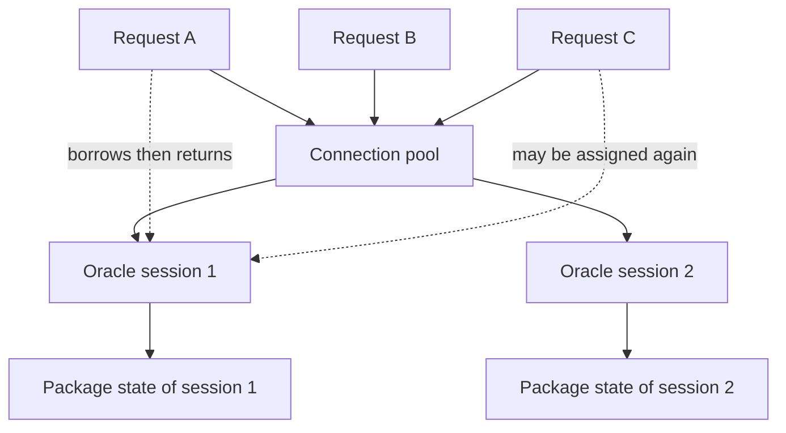

# Session-scoped package state and the impact of connection pools

In Oracle Database, a PL/SQL package can maintain state in the memory of a database session. That state includes package variables, cursors, and other package-level data initialized when the package is instantiated in a session. It typically persists across multiple procedure/function calls, even after COMMIT or ROLLBACK, and is only lost when the package is reset, invalidated by Oracle mechanisms, or the session ends.

This behavior easily causes bugs when an application uses a **connection pool**. An application typically borrows a logical connection to process a request and then calls close to return the connection to the pool. The pool may keep the physical connection/database session open and reassign that session to another request. If the package stored a user ID, tenant ID, language, permissions, filters, or temporary data in package globals, a subsequent request may see values from the previous request.

The key point to remember is that **package state belongs to the database session, not to the request, thread, or the application's Connection object**. A stateful package is not automatically reinitialized on every procedure call, every COMMIT, or every time the application returns a logical connection to the pool.

This lesson explains the package state lifecycle, how Oracle initializes packages, the difference between stateful/stateless packages and SERIALLY_REUSABLE, errors when packages are invalidated, how pools reuse sessions, risks regarding user and tenant data, as well as reset/cleanup strategies and safe package design.

## 1. What is package state?

### 1.1. Packages have a specification and a body

A PL/SQL package usually consists of:

- **Package specification:** declares public components such as procedures, functions, constants, types, cursors, and variables.
- **Package body:** implements subprograms and may declare private components; the end of the body may have an initialization section.

Example:

```sql
CREATE OR REPLACE PACKAGE request_context AS
    g_request_count PLS_INTEGER := 0;
    g_current_user  VARCHAR2(128);

    PROCEDURE begin_request(p_user IN VARCHAR2);
    PROCEDURE end_request;
END request_context;
/

CREATE OR REPLACE PACKAGE BODY request_context AS
    PROCEDURE begin_request(p_user IN VARCHAR2) IS
    BEGIN
        g_request_count := g_request_count + 1;
        g_current_user := p_user;
    END;

    PROCEDURE end_request IS
    BEGIN
        g_current_user := NULL;
    END;
BEGIN
    g_request_count := 0;
    g_current_user := NULL;
END request_context;
/
```

The variables g_request_count and g_current_user are package state. They reside in the package instance within a database session. The initialization section at the end of the package body runs when the package is first instantiated in the session.

### 1.2. Where is state held?

Package state is tied to the Oracle session. It is not data stored in a table and is not automatically shared across sessions.

```sql
BEGIN
    request_context.begin_request('APP_USER_A');
END;
/

SELECT request_context.g_current_user
FROM dual;
```

Within the same session, subsequent calls can see the previously assigned value. Another session has its own package instance and does not automatically see this value.

### 1.3. Package state differs from table data

| Characteristic | Package variable | Table data |
|---|---|---|
| Scope | One database session | Shared according to privileges and transactions |
| Storage | Session memory | Database storage |
| COMMIT/ROLLBACK | Does not undo package values | Affects data per transaction |
| Session termination | State is lost | Committed data remains |
| Sharing across sessions | Not automatically shared | Can be read by other sessions |
| Use for request state | Possible, but lifecycle must be managed | More suitable if persistence/sharing is needed |

Package variables are suitable for caches or internal per-session state with a clear lifecycle. They are not a mechanism for persistent data storage, system-wide counters, or storing user information shared across multiple requests.

## 2. Package lifecycle in a session

### 2.1. When is a package instantiated?

A package is typically instantiated in a session when a member of the package is referenced for the first time. Oracle allocates package state for the session and executes any required initialization. From that point on, the state is preserved for subsequent calls within the session.

```sql
CREATE OR REPLACE PACKAGE demo_state AS
    g_value NUMBER := 10;
    PROCEDURE increase_value;
END demo_state;
/

CREATE OR REPLACE PACKAGE BODY demo_state AS
    PROCEDURE increase_value IS
    BEGIN
        g_value := g_value + 1;
    END;
END demo_state;
/
```

In a session:

```sql
BEGIN
    demo_state.increase_value;
    DBMS_OUTPUT.PUT_LINE(demo_state.g_value);

    demo_state.increase_value;
    DBMS_OUTPUT.PUT_LINE(demo_state.g_value);
END;
/
```

The value increments with each call. If a new session runs the same code, the new package instance starts with the initial value.

### 2.2. Initialization section

A package body can contain an executable section at the end, after declarations and subprograms:

```sql
CREATE OR REPLACE PACKAGE BODY session_settings AS
    g_initialized_at TIMESTAMP;
    g_mode VARCHAR2(20);

    PROCEDURE set_mode(p_mode IN VARCHAR2) IS
    BEGIN
        g_mode := p_mode;
    END;
BEGIN
    g_initialized_at := SYSTIMESTAMP;
    g_mode := 'DEFAULT';
END session_settings;
/
```

The initialization section runs when the package is instantiated in the session. It does not re-run on every procedure call in the package. If initialization performs queries, reads configuration, or allocates large data structures, that cost may appear on the first call to the package in the session.

### 2.3. State persists across multiple calls

```sql
BEGIN
    session_settings.set_mode('REPORT');
END;
/

BEGIN
    DBMS_OUTPUT.PUT_LINE(session_settings.g_mode);
END;
/
```

Two blocks running in the same session observe the same package state. If the second block runs on a different physical session, the value may still be DEFAULT.

### 2.4. COMMIT and ROLLBACK do not reset package state

Package variables do not belong to a transaction:

```sql
BEGIN
    demo_state.g_value := 99;
    ROLLBACK;
    DBMS_OUTPUT.PUT_LINE(demo_state.g_value);
END;
/
```

ROLLBACK does not restore g_value back to 10. Likewise, COMMIT does not clear package state. If code uses package variables to store temporary values within a transaction, it must explicitly restore state when the transaction fails or completes.

### 2.5. Session termination

When a database session actually terminates, that session's package instances and state are released. However, in pooled applications, calling close on a logical connection usually just returns the physical session to the pool. Therefore, you cannot assume package state is gone merely because application code called close.

## 3. Stateful and stateless packages

### 3.1. Stateful packages

A package is considered stateful when it holds mutable state between calls, for example:

```sql
CREATE OR REPLACE PACKAGE shopping_context AS
    g_customer_id NUMBER;
    g_discount_rate NUMBER := 0;

    PROCEDURE set_customer(p_customer_id NUMBER);
    PROCEDURE set_discount(p_rate NUMBER);
END shopping_context;
/
```

This package has session-scoped state. After one request sets customer 1001 and discount 0.1, another request reusing the session can see those values unless reset.

### 3.2. Stateless packages

A package can avoid mutable package globals and pass data through parameters/local variables:

```sql
CREATE OR REPLACE PACKAGE order_calculation AS
    FUNCTION calculate_total(
        p_amount IN NUMBER,
        p_tax_rate IN NUMBER
    ) RETURN NUMBER;
END order_calculation;
/

CREATE OR REPLACE PACKAGE BODY order_calculation AS
    FUNCTION calculate_total(
        p_amount IN NUMBER,
        p_tax_rate IN NUMBER
    ) RETURN NUMBER
    IS
        l_total NUMBER;
    BEGIN
        l_total := p_amount * (1 + p_tax_rate);
        RETURN l_total;
    END;
END order_calculation;
/
```

The function uses parameters and local variables, without storing request data in package globals. This design reduces the risk of state leakage when physical sessions are reused.

### 3.3. Constants and package state

A package constant cannot be modified after initialization, yet it is still a package member initialized in the session. Distinguish immutable constants used as configuration from mutable variables containing request data.

If a constant is computed from runtime data in the initialization section, different sessions may compute different values depending on when they were instantiated. Do not treat a package constant as a system-wide configuration that is always synchronized immediately.

### 3.4. Cursors and resources in packages

A package can declare cursor variables or explicit cursors at package scope. An open cursor can persist across calls in a session until closed or until the session is reset/terminated. Leaving cursors open in package globals can exhaust the open cursor limit or hold resources longer than expected.

Prefer opening, fetching, and closing cursors within a single operation with a clear lifecycle; do not let a subsequent request depend on a cursor opened by a previous request.

## 4. Connection pools and database sessions

### 4.1. Logical connections and physical sessions

Applications typically do not create a new database session for every HTTP request. A connection pool maintains a set of open physical connections to Oracle. When a request needs the database:

1. The application borrows a logical connection from the pool.
2. The logical connection maps to a physical connection/database session.
3. The request executes SQL/PLSQL on that session.
4. The application closes the logical connection to return it to the pool.
5. The pool may hand out the same physical session to another request.



Request A and request C may use the same session 1 at different times. Session 1's package state remains after request A unless reset.

### 4.2. Connection.close does not necessarily terminate the database session

In a pool, Connection.close usually closes the logical handle and returns the connection to the pool. The pool keeps the physical connection open for reuse. Therefore:

- Package globals may remain intact.
- ALTER SESSION settings may remain.
- Application contexts or client identifiers may remain if not cleared.
- Global temporary tables with ON COMMIT PRESERVE ROWS may retain session data.
- Temporary LOBs, cursors, or session resources may require cleanup per API and configuration.

Exact behavior depends on the driver/pool. Read the pool documentation and configure reset/initialization callbacks; do not assume close equals logoff.

### 4.3. The pool may assign a different session to the next request

If a pool has multiple physical connections, the next request may receive a different session. As a result, package-state bugs may appear intermittently:

- Request A sets g_tenant_id = 10 on session 1.
- Request B is assigned session 2 and sees the default value.
- Request C is assigned session 1 again and sees leftover tenant 10.

The bug depends on which connection is assigned and the session's usage history, making it hard to reproduce if you only test with one connection or one request.

### 4.4. One physical session is not one request

Do not design package globals assuming a session processes only one user or one request during its lifetime. A pool can reuse a session across many requests, users, or tenants. That is why session state must be managed as a resource with its own lifecycle.

### 4.5. Application pools and Database Resident Connection Pooling

Pooling can exist at multiple layers:

- Pools in the application/JDBC/UCP or application server manage physical connections held by the application.
- Database Resident Connection Pooling (DRCP) manages pooled servers on the database side and can be used alongside compatible client pools.

Pooling layers have different attach/detach and session management mechanisms. Regardless of which layer is used, the application still needs to understand which session state is preserved, which state is reset, and under what conditions a request is attached to a prior session. Do not assume package state will be reset just because a pooling mechanism is enabled.

## 5. Risks when package globals hold request data

### 5.1. Data leakage between users

Example package holding the current user:

```sql
CREATE OR REPLACE PACKAGE app_user_state AS
    g_user_id NUMBER;

    PROCEDURE set_user(p_user_id NUMBER);
    FUNCTION current_user RETURN NUMBER;
END app_user_state;
/

CREATE OR REPLACE PACKAGE BODY app_user_state AS
    PROCEDURE set_user(p_user_id NUMBER) IS
    BEGIN
        g_user_id := p_user_id;
    END;

    FUNCTION current_user RETURN NUMBER IS
    BEGIN
        RETURN g_user_id;
    END;
END app_user_state;
/
```

If request A sets user 1001 and returns the connection to the pool, request B may receive the same session and see user 1001. If the application uses this value to filter data or make authorization decisions, this can become a severe privilege/access bug.

### 5.2. Tenant context leakage

A package global like g_tenant_id can be forgotten when a request finishes. A request for tenant 20 may accidentally run on a session still holding tenant 10. If SQL policies or other packages rely on this variable, tenant data can be read or written incorrectly.

Do not use package globals as a security boundary. Every tenant/user context must be set and verified on each session checkout, and cleared when returning the session.

### 5.3. Locale, timezone, and format leakage

A package may store language, timezone, or formatting preferences. A subsequent request receiving the old session may mistakenly use those values, causing dates/times or strings to be interpreted incorrectly.

NLS settings are also separate session state. If the application alters NLS via ALTER SESSION, it must reset or fully configure them on every checkout.

### 5.4. Stale caches

A package may cache configuration data, permission lists, or lookup information. If table data changes, each session may retain its own stale cache for a long time. The more sessions in the pool, the more divergent caches can exist.

Package caches need a clear policy for:

- Time-to-live (TTL).
- Invalidation conditions.
- Refreshing when data changes.
- Memory limits.
- Handling when a session is returned to the pool.

If caching shared across sessions is required, consider an appropriate database-level or application-level caching mechanism instead of relying on per-session package globals.

### 5.5. Counters are not system-wide counters

g_request_count in a package is a per-session counter. With 20 sessions in a pool, there can be 20 different values. It does not guarantee total request counts, does not survive restarts/session termination, and is not synchronized across sessions.

If aggregate metrics or unique sequences are needed, use tables, sequences, or an appropriate statistics mechanism.

## 6. Package state is not rolled back by transactions

### 6.1. Package variables and DML have different lifecycles

```sql
BEGIN
    app_user_state.set_user(1001);

    UPDATE audit_demo
    SET note = 'started'
    WHERE audit_id = 1;

    ROLLBACK;
END;
/
```

The DML is rolled back, yet app_user_state.g_user_id remains 1001. The two types of state have different management mechanisms.

### 6.2. Savepoints do not restore package state either

SAVEPOINT and ROLLBACK TO only control transaction changes. They do not restore package global values to their state prior to the savepoint.

If a procedure involves both DML and package state, clearly design the update ordering and exception cleanup.

### 6.3. Exceptions do not automatically reset packages

When an exception exits a procedure, package state can still remain in the session. If a package updated globals before failing, a subsequent request may see partial/dirty state.

Example:

```sql
BEGIN
    app_user_state.set_user(2002);
    RAISE_APPLICATION_ERROR(-20080, 'Simulated failure');
END;
/
```

The exception does not cause the package to revert to its old value. Cleanup must be coded explicitly or performed by the session management layer.

## 7. Resetting package state

### 7.1. DBMS_SESSION.RESET_PACKAGE

Oracle provides:

```sql
BEGIN
    DBMS_SESSION.RESET_PACKAGE;
END;
/
```

RESET_PACKAGE requests freeing the state of instantiated packages in the session. The reset takes effect after the current PL/SQL call finishes according to Oracle package/session rules; do not call it in the middle of an operation and then continue relying on the just-reset package state.

RESET_PACKAGE affects all package state in the session, not just a single package chosen by the application. Therefore, evaluate dependencies and the cost of reinitializing packages on subsequent use.

### 7.2. DBMS_SESSION.MODIFY_PACKAGE_STATE

Oracle also provides:

```sql
BEGIN
    DBMS_SESSION.MODIFY_PACKAGE_STATE(
        DBMS_SESSION.REINITIALIZE
    );
END;
/
```

Two commonly cited options:

- DBMS_SESSION.REINITIALIZE: requests that package state be reinitialized the next time packages are referenced; may retain part of allocated memory for reuse.
- DBMS_SESSION.FREE_ALL_RESOURCES: frees package state and related memory under the corresponding mechanism; subsequent use must reinstantiate.

Memory/performance details and release-specific behavior should be checked against the Oracle documentation for the deployed version.

### 7.3. Resetting packages is not resetting the entire session

RESET_PACKAGE does not automatically clean up every kind of session state. It does not replace:

- Rolling back uncommitted transactions.
- Closing cursors opened by the application.
- Clearing application contexts.
- Resetting CLIENT_IDENTIFIER, MODULE/ACTION.
- Restoring ALTER SESSION settings.
- Cleaning up data in global temporary tables.
- Cleaning up other resources managed by the driver or application.

A pool needs a comprehensive session reset procedure, not just calling RESET_PACKAGE and assuming the session is clean.

### 7.4. Cost of resetting

Resetting all package state on every checkout can cause:

- Re-running initialization sections.
- Reloading package caches.
- Increased CPU and first-request latency.
- Additional configuration queries.
- Increased parse/initialization workload.

Therefore, first design packages to be stateless for request data. Reset packages only when genuinely necessary and after measuring the impact.

### 7.5. When to call reset?

It can be considered at request boundaries if the application must use stateful legacy packages. The reset must occur outside the PL/SQL flow actively using package state, invoked after the request finishes and before the session returns to the pool. It must be coordinated with pool callbacks and transaction cleanup.

Do not call RESET_PACKAGE arbitrarily inside a business procedure that uses multiple other packages, because subsequent calls may have to reinitialize them and break code assumptions.

## 8. Cleaning up session state outside packages

### 8.1. CLIENT_IDENTIFIER

An application can attach a client identifier to the session:

```sql
BEGIN
    DBMS_SESSION.SET_IDENTIFIER('user-1001');
END;
/
```

When returning the connection to the pool, clear it:

```sql
BEGIN
    DBMS_SESSION.CLEAR_IDENTIFIER;
END;
/
```

CLIENT_IDENTIFIER is useful for auditing, tracing, and certain context-based policies. It is not itself an authentication or authorization mechanism; it must be set from a trusted source and paired with proper security policies.

### 8.2. Application context

An application context is a session context with a namespace, attribute, and value. The namespace is usually protected by a trusted package declared when creating the context.

Conceptual example:

```sql
CREATE OR REPLACE PACKAGE app_context_api AS
    PROCEDURE set_tenant(p_tenant_id IN VARCHAR2);
    PROCEDURE clear_tenant;
END app_context_api;
/

CREATE OR REPLACE PACKAGE BODY app_context_api AS
    PROCEDURE set_tenant(p_tenant_id IN VARCHAR2) IS
    BEGIN
        DBMS_SESSION.SET_CONTEXT(
            namespace => 'APP_CTX',
            attribute => 'TENANT_ID',
            value     => p_tenant_id
        );
    END;

    PROCEDURE clear_tenant IS
    BEGIN
        DBMS_SESSION.CLEAR_CONTEXT(
            namespace => 'APP_CTX',
            attribute => 'TENANT_ID'
        );
    END;
END app_context_api;
/

CREATE CONTEXT app_ctx USING app_context_api;
```

This is a structural example. CREATE CONTEXT must be executed by a user with appropriate privileges; the trusted package must satisfy Oracle rules and the namespace must be protected. Do not allow arbitrary callers to set arbitrary tenant IDs.

### 8.3. CLEAR_CONTEXT

DBMS_SESSION.CLEAR_CONTEXT clears context by namespace/client identifier/attribute depending on how the application uses contexts. Use the exact parameters and scope. If the context was set with a client identifier, cleanup must specify the matching client identifier per the deployed model.

Do not confuse CLEAR_CONTEXT with RESET_PACKAGE: contexts and package state are two separate mechanisms.

### 8.4. MODULE and ACTION

Attach request info for tracing:

```sql
BEGIN
    DBMS_APPLICATION_INFO.SET_MODULE(
        module_name => 'ORDER_API',
        action_name => 'CREATE_ORDER'
    );
END;
/
```

When finished:

```sql
BEGIN
    DBMS_APPLICATION_INFO.SET_MODULE(NULL, NULL);
END;
/
```

MODULE/ACTION help observe workload via V$SESSION and administrative tools. They are also session state and must be reset so subsequent requests are not mislabeled.

### 8.5. ALTER SESSION

Statements such as:

```sql
ALTER SESSION SET NLS_DATE_FORMAT = 'YYYY-MM-DD';
ALTER SESSION SET CURRENT_SCHEMA = APP_OWNER;
```

alter the session environment. If the pool reuses sessions, changes can persist into the next request. Avoid altering session parameters per request whenever possible by binding proper data types and using explicit identifiers; if needed, save original values and reset via tested callbacks.

### 8.6. Global temporary tables

Global temporary tables have shared metadata, while temporary data is session-scoped or transaction-scoped depending on declaration:

- ON COMMIT DELETE ROWS: data is deleted when the transaction commits.
- ON COMMIT PRESERVE ROWS: data is retained until the session ends or is deleted via appropriate operations.

With pooled sessions, PRESERVE ROWS can leave data behind for the next request if not cleaned up. Do not assume closing a logical connection terminates the session or clears session-specific data.

## 9. Designing connection-pool-safe packages

### 9.1. Prefer parameters over package globals

Do not let a procedure implicitly depend on a global user/tenant set by a prior call:

```sql
app_user_state.set_user(p_user_id);
orders_api.list_orders;
```

Pass request data through the interface:

```sql
orders_api.list_orders(
    p_user_id   => p_user_id,
    p_from_date => p_from_date,
    p_to_date   => p_to_date,
    p_result    => l_result
);
```

Passing request data via parameters makes input/output relationships explicit and independent of session usage history.

### 9.2. Local variables in subprograms

Local variables are created within the scope of a call and do not automatically persist like package globals across calls:

```sql
CREATE OR REPLACE PACKAGE order_service AS
    PROCEDURE create_order(
        p_customer_id IN NUMBER,
        p_amount IN NUMBER
    );
END order_service;
/

CREATE OR REPLACE PACKAGE BODY order_service AS
    PROCEDURE create_order(
        p_customer_id IN NUMBER,
        p_amount IN NUMBER
    ) IS
        l_tax_rate NUMBER;
        l_total NUMBER;
    BEGIN
        l_tax_rate := 0.08;
        l_total := p_amount * (1 + l_tax_rate);

        INSERT INTO orders(customer_id, total_amount)
        VALUES (p_customer_id, l_total);
    END;
END order_service;
/
```

Local state has a lifetime tied to the call stack. If state needs to be shared among multiple subprograms within a single request, pass an explicit record/context or use an abstraction with explicit cleanup.

### 9.3. Do not use package globals for authorization

Do not use g_is_admin, g_user_id, or g_tenant_id as the source for authorization decisions without authenticating on every call. A request could be given a session retaining state from a prior request. Security must rely on authenticated identity/context and server-side policies, not mutable values a caller could leave behind.

### 9.4. If state must be kept, provide clear begin/end APIs

A legacy stateful package can provide:

```sql
PROCEDURE begin_request(...);
PROCEDURE end_request;
PROCEDURE reset_state;
```

begin_request must assign all required fields, not just the fields passed by the caller. end_request must clear all sensitive data, cursors, and flags. reset_state can be provided to restore default values. The pool layer must invoke cleanup on both success and exception paths.

### 9.5. Idempotent cleanup

Cleanup should be safe to invoke multiple times without raising errors or leaving state behind. For example, close cursors only if open; clear contexts even if unset; assign NULL/defaults to all globals; reset module/action. If cleanup fails, the connection should not be returned to the pool as a clean session.

## 10. SERIALLY_REUSABLE packages

### 10.1. Purpose

A package with pragma SERIALLY_REUSABLE is designed to reuse package memory per server call instead of retaining package state for the entire session lifetime. Package state is initialized when the call starts and released/reused after the call finishes according to Oracle mechanisms.

Example:

```sql
CREATE OR REPLACE PACKAGE batch_helper AS
    PRAGMA SERIALLY_REUSABLE;
    g_processed_count PLS_INTEGER := 0;
    PROCEDURE add_one;
END batch_helper;
/

CREATE OR REPLACE PACKAGE BODY batch_helper AS
    PRAGMA SERIALLY_REUSABLE;

    PROCEDURE add_one IS
    BEGIN
        g_processed_count := g_processed_count + 1;
    END;
END batch_helper;
/
```

The pragma must be declared in both the specification and the body according to Oracle rules. Check the documentation for your deployed version before implementing.

### 10.2. Do not use to share state across requests

Because state only exists within the scope of a server call, values cannot store data needed in a subsequent call. This can be useful when a package needs temporary working state during a long call, but it does not replace parameters or tables for cross-request data.

### 10.3. Trade-offs

SERIALLY_REUSABLE can reduce memory retained in sessions when many sessions use packages with large working state. In return, the package cannot rely on state persisting across calls. There are restrictions on how the package can be called and how it interacts with other PL/SQL constructs; verify compatibility before adding the pragma to an existing package.

### 10.4. Comparison

| Package type | State lifetime | Suitable for |
|---|---|---|
| Standard stateful | From instantiation until reset/session end | Caches or genuinely session-scoped state |
| Stateless by design | No mutable request state kept in package globals | APIs used with connection pools |
| SERIALLY_REUSABLE | Per server call | Temporary working state when reducing per-session memory |

## 11. Package invalidation and ORA-04068

### 11.1. Why are packages invalidated?

Packages have dependencies on other objects. When a package or a dependency changes, Oracle may mark the unit INVALID or render existing state incompatible. Examples:

- Recompiling package specification/body.
- Altering a table/view/type that the package depends on.
- Changing a package spec causing dependent units to require recompilation.
- Deploying DDL while the application still has sessions holding package state.

### 11.2. Related errors

| Error | General meaning |
|---|---|
| ORA-04061 | Existing state of package body has been invalidated |
| ORA-04065 | Unit not executed because it was altered/dropped or its state is no longer valid |
| ORA-04068 | Existing state of packages has been discarded |
| ORA-06508 | PL/SQL could not find program unit to execute or unit is invalid |

The exact error depends on DDL ordering, dependency status, and Oracle version.

### 11.3. Discarded state

When Oracle discards package state, package variables no longer hold their old values; the package can be reinitialized on subsequent calls. Applications should not continue assuming globals still hold values from a previous request.

### 11.4. Conditional retries

Do not automatically retry every ORA-04068 without inspecting the transaction. If the previous call performed DML or called an external service, blind retries can produce duplicate side effects. You must:

1. Determine which step raised the error.
2. Determine whether the transaction committed.
3. Roll back uncommitted changes if the contract permits.
4. Ensure the operation is idempotent or uses an idempotency key.
5. Reopen/validate the connection if required by the pool.
6. Retry at an appropriate request boundary with a retry limit.

### 11.5. Session exit behavior

Some Oracle versions provide the SESSION_EXIT_ON_PACKAGE_STATE_ERROR parameter to control session behavior on package state errors. Exact values and behavior should be confirmed for your release/RU. If the session is terminated, the pool must discard that physical connection and create/acquire another session; never return a dead connection to the pool.

### 11.6. Deploying packages while a pool is active

When deploying a new package:

- Identify packages and dependencies that will become invalid.
- Choose an appropriate deployment window or rolling strategy.
- Compile and check for errors before opening traffic.
- Monitor ORA-04068/04061/06508 after deployment.
- Have a safe retry policy in the application.
- Consider draining/evicting old sessions if supported by the release and pool.

Do not assume deploying a package body will not affect sessions currently holding package state. Behavior depends on the type of change, dependencies, and version.

## 12. Connection pool: checkout, reset, and return

### 12.1. Request boundaries

A request lifecycle should include the following steps:

1. Borrow connection.
2. Start transaction or determine transaction policy.
3. Set up required session context for the request.
4. Attach client identifier/module/action if needed.
5. Execute SQL/PLSQL.
6. Explicitly commit or roll back.
7. Close cursors/resources.
8. Clear context and session attributes.
9. Reset package state if required by architecture.
10. Return connection to the pool.

Exact ordering depends on the application, but cleanup must run in finally/equivalent even when an exception occurs.

### 12.2. Application-tier pseudocode

```java
Connection connection = dataSource.getConnection();
try {
    connection.setAutoCommit(false);

    callBeginRequestContext(connection, authenticatedUser, tenantId);
    executeBusinessOperation(connection);

    connection.commit();
} catch (Exception e) {
    rollbackQuietly(connection);
    throw e;
} finally {
    try {
        clearRequestContext(connection);
        resetSessionAttributes(connection);
    } catch (Exception cleanupError) {
        // Mark/evict the physical connection using the pool's API.
    } finally {
        connection.close(); // typically returns the logical connection to the pool
    }
}
```

This is pseudocode, not a specific pool's API. clearRequestContext must clear package globals, application contexts, client identifiers, and any session settings modified by the application. If cleanup fails, never assume the session is safe to reuse.

### 12.3. Pool Callbacks

Pools/drivers may provide callbacks or labeling/initialization mechanisms to:

- Initialize a session when a physical connection is created.
- Set up session state on checkout.
- Reset session state on return.
- Classify connections by labels such as NLS, schema, or role.
- Validate connections before reissuing them.

Callback names and execution timing differ across JDBC/UCP, application servers, and frameworks. Read the documentation for the pool in use. An initialization callback that only runs on physical connection creation is insufficient for per-request state; reset/checkout handling must be designed separately.

### 12.4. Connection Labeling

Some pools support labels to find connections already configured with matching session state, such as NLS language or current schema. Labeling reduces the cost of switching state, though it can increase the number of session groups and does not inherently prevent sensitive data leakage. Do not put user-specific secrets or tenant identity into labels as an authorization mechanism.

### 12.5. Validating a Connection Is Not Resetting State

Validation typically checks whether a connection is alive or can execute a test query. It does not necessarily clear package globals, application contexts, or ALTER SESSION settings. Distinguish health checks from session cleanup.

## 13. Handling Package State in Java/JDBC Applications

### 13.1. Logical Close

```java
try (Connection connection = dataSource.getConnection()) {
    // Use the connection during the request.
}
```

try-with-resources calls close on the logical connection. The pool typically reclaims the connection for reuse; do not treat this code as a database logoff.

### 13.2. Calling a Cleanup Procedure

The application can invoke a cleanup procedure via JDBC:

```java
try (CallableStatement call =
         connection.prepareCall("{ call app_session_cleanup.reset_request_state }")) {
    call.execute();
}
```

The cleanup procedure must be designed and tested to:

- Clear all request-specific package globals.
- Clear application contexts for the right namespaces.
- Clear the client identifier.
- Reset module/action.
- Close request-scoped cursors or resources.
- Avoid issuing COMMIT/ROLLBACK outside the agreed contract.

### 13.3. Do Not Rely on the Happy Path for Cleanup

If cleanup is placed only after successful processing lines, exceptions will skip it. Use finally blocks, transaction synchronization, or framework/pool callbacks to clean up all exit paths.

### 13.4. Evict Connections When Cleanup Fails

If you cannot confirm the session was cleaned, mark the connection as non-reusable and instruct the pool to discard the physical connection via its supported API. Calling regular close may simply return a dirty session to the pool.

### 13.5. Transaction Managers

In applications using JTA or a transaction manager, a connection may be enlisted in a transaction, and closing the logical handle does not mean the transaction has finished. Session reset must run after the transaction completes and in an order compatible with the pool/transaction manager.

## 14. DRCP and Session State

### 14.1. Why Distinguish It?

DRCP shares pooled server processes across client connections/sessions at the database level. It differs from a connection pool residing purely in the JVM. Sessions can attach/detach from pooled servers; how session state is preserved depends on configuration, client, and purity.

### 14.2. Session Purity

Some DRCP-integrated clients/pools define purity, commonly offering options such as:

- NEW: requests a fresh session under DRCP semantics.
- SELF: requests the session previously attached to that connection if still eligible.
- DEFAULT: default behavior per client/configuration.

Exact names and APIs depend on the driver/DRCP release. Purity controls session attachment, not a blanket guarantee that every kind of state is cleaned up automatically the way the application wants.

### 14.3. Verifying with DRCP

If deploying DRCP:

- Verify whether the client driver supports DRCP and purity.
- Inspect pool configuration and connection class.
- Test package state across multiple checkouts.
- Test application contexts, NLS, GTTs, and cursors.
- Measure the impact of requesting NEW sessions on pool utilization.
- Verify behavior after reconnect, failover, and package invalidation.

Do not mix findings from standard application pools with DRCP without specifying the exact configuration.

## 15. Testing for State Leakage Bugs

### 15.1. Two Manual Sessions

Create a package:

```sql
CREATE OR REPLACE PACKAGE pool_state_lab AS
    g_marker VARCHAR2(100);
    PROCEDURE set_marker(p_value VARCHAR2);
END pool_state_lab;
/

CREATE OR REPLACE PACKAGE BODY pool_state_lab AS
    PROCEDURE set_marker(p_value VARCHAR2) IS
    BEGIN
        g_marker := p_value;
    END;
END pool_state_lab;
/
```

In Session A:

```sql
BEGIN
    pool_state_lab.set_marker('REQUEST_A');
END;
/

SELECT pool_state_lab.g_marker FROM dual;
```

In the same Session A, the value remains REQUEST_A. In Session B, the value is independent and initially NULL. This is session-scoped state.

### 15.2. Simulating Reuse of the Same Session

In Session A, simulate a request finishing by issuing only COMMIT and running another block:

```sql
COMMIT;

BEGIN
    DBMS_OUTPUT.PUT_LINE(pool_state_lab.g_marker);
END;
/
```

The value REQUEST_A remains. COMMIT does not reset packages.

### 15.3. Simulating Cleanup

```sql
BEGIN
    pool_state_lab.g_marker := NULL;
END;
/
```

Or in a separate lab, test:

```sql
BEGIN
    DBMS_SESSION.RESET_PACKAGE;
END;
/
```

Call the package again and observe initialization/default behavior. Note when the reset takes effect according to PL/SQL call rules.

### 15.4. Simulating a Pool

Write an integration test using a small pool with one physical connection. Request A sets the marker and closes the logical connection. Request B borrows a connection from the pool and reads the marker. Without a reset callback, Request B can see A's marker.

Then add cleanup on return/checkout and repeat the test. Run an additional pool with multiple physical sessions to confirm how the bug depends on which session is assigned.

### 15.5. Testing Exceptions

Have Request A set user/tenant context and then raise an exception before cleanup. Verify the finally/callback still runs. Request B must never read A's values.

### 15.6. Testing Invalidation

In a lab environment:

1. Open two sessions.
2. Session A instantiates the package and sets state.
3. Session B recompiles the package or a dependency.
4. Session A calls the package next.
5. Observe any package state error, subsequent state, and retry behavior.

Never test package recompilation on packages actively used by production applications just to reproduce errors.

## 16. Observing Sessions and Package State

### 16.1. Identifying Sessions

A DBA can inspect sessions:

```sql
SELECT sid,
       serial#,
       username,
       status,
       machine,
       program,
       module,
       action,
       client_identifier
FROM v$session
WHERE username = USER;
```

V$SESSION requires appropriate privileges. SID/SERIAL# identify the database session; module/action/client_identifier help correlate sessions with requests. Do not use SID as a persistent identifier across reconnects.

### 16.2. Package and Dependency Metadata

```sql
SELECT object_name,
       object_type,
       status,
       last_ddl_time
FROM user_objects
WHERE object_type IN ('PACKAGE', 'PACKAGE BODY')
ORDER BY object_name, object_type;
```

Inspect dependencies:

```sql
SELECT name,
       type,
       referenced_owner,
       referenced_name,
       referenced_type
FROM user_dependencies
WHERE type IN ('PACKAGE', 'PACKAGE BODY')
ORDER BY name, referenced_name;
```

Dictionary views report object status/dependencies, not all runtime package global values across every session. Do not directly read or alter package state memory of another session.

### 16.3. V$OPEN_CURSOR

A DBA can inspect cursors per session:

```sql
SELECT sid,
       user_name,
       sql_id,
       cursor_type,
       sql_text
FROM v$open_cursor
WHERE sid = :sid;
```

Open cursors in a session can come from SQL caches or actively open cursors depending on cursor_type; not every row proves the application forgot to close an explicit cursor. Use this information alongside session statistics and code paths when investigating.

### 16.4. Session Memory

Package state consumes per-session memory. When there are many physical sessions and large package caches, total memory usage can become significant. DBAs can monitor session memory via appropriate views such as V$SESSTAT/V$STATNAME or V$PROCESS depending on server mode and privileges. Do not assume a single metric isolates package state alone; use version-appropriate tracing/diagnostics.

## 17. Common Anti-Patterns

### 17.1. Storing User ID in Globals Without Clearing

Bug: subsequent requests can inherit the previous user.

Better design: pass user ID via parameters or set an authenticated context on every checkout and clear it on return.

### 17.2. Using Package Globals as a Permission Cache

Bug: permissions change in the database, but session caches are not invalidated; other users may receive stale caches.

Better design: define cache scope/TTL/invalidation, partition by identity, and never rely on caches as the final authorization mechanism.

### 17.3. Using Package Counters as System-Wide Metrics

Bug: counters are per-session, lost on session termination, and unsynchronized.

Better design: sequences, summary tables, metrics backends, or appropriate atomic mechanisms.

### 17.4. Relying on COMMIT to Reset

Bug: package state does not belong to transactions.

Better design: explicit cleanup separate from transaction cleanup.

### 17.5. Resetting Only When the Request Succeeds

Bug: exceptions skip cleanup.

Better design: finally/callbacks, check cleanup errors, and evict the connection whenever a clean session cannot be guaranteed.

### 17.6. Resetting Only Packages While Ignoring Session Context

Bug: application contexts, client identifiers, NLS, or GTTs remain behind.

Better design: a session reset checklist covering all state the application can modify.

### 17.7. Resetting All Packages on Every Call Without Measuring

Bug: repeated initialization, lost caches, and higher latency.

Better design: stateless packages; deliberate resets at request boundaries with measured cost.

### 17.8. Assuming the Pool Always Hands Out the Same Session

Bug: bugs appear intermittently because requests are routed to different sessions.

Better design: test with multi-session pools, covering both reused and fresh sessions.

## 18. Design and Operations Workflow

### 18.1. When Designing a New Package

1. Determine whether package globals are genuinely needed.
2. Prefer parameters and local variables for request data.
3. Distinguish immutable configuration from mutable session state.
4. If state exists, document owner, scope, initialization, and reset semantics.
5. Never use globals for authorization/tenant isolation without reliable verification and cleanup.
6. Close cursors/resources within the same operation.
7. Consider SERIALLY_REUSABLE only when its lifecycle and restrictions fit.

### 18.2. When Integrating a Connection Pool

1. Determine how long the pool keeps physical sessions alive.
2. Identify checkout/return callback APIs or labeling features.
3. Inventory all session state the application can modify.
4. Design matching initialization and reset steps.
5. Call cleanup inside finally.
6. Roll back uncommitted transactions.
7. Clear package/context/client/module/NLS/GTT state per policy.
8. Evict the connection if cleanup or validation fails.
9. Test across multiple requests and multiple physical sessions.

### 18.3. When Deploying a New Package

1. Inventory packages and dependencies.
2. Identify units/session state that may be invalidated.
3. Compile in a staging environment.
4. Inspect USER_ERRORS and INVALID objects.
5. Assess active sessions holding old state.
6. Prepare safe retries/idempotency and pool eviction/draining if needed.
7. Monitor package state errors after release.

### 18.4. When Investigating Incidents

Collect:

- Request ID, authenticated user/tenant.
- Pool name, checkout/return timestamps, and connection label.
- Database SID/SERIAL#, client identifier, module/action.
- Package/object version and DDL/recompilation timestamps.
- Error stack, transaction status, and retry history.
- Test results using both the same physical session and a fresh session.

Do not log sensitive values from package globals. Log only field names or appropriately masked states.

## 19. Package and Connection Pool Checklist

- [ ] Does the package have mutable global state?
- [ ] Does that state truly need to persist across multiple calls?
- [ ] Can request data be moved to parameters/local variables?
- [ ] Does package initialization run expensive queries or cache loads?
- [ ] Are any cursors or resources held at package scope?
- [ ] Is COMMIT/ROLLBACK mistakenly expected to reset packages?
- [ ] Does the pool reuse physical sessions across users/requests?
- [ ] Does Connection.close merely return the logical handle to the pool?
- [ ] Does cleanup run on both success and exception paths?
- [ ] Are package globals, application contexts, and CLIENT_IDENTIFIER all reset?
- [ ] Are MODULE/ACTION, NLS, CURRENT_SCHEMA, and GTTs handled?
- [ ] Does cleanup failure cause the connection to be evicted?
- [ ] Have tests been run with both one physical connection and multiple sessions?
- [ ] Have package invalidation/ORA-04068 scenarios been tested post-deployment?
- [ ] Are retries idempotent and transaction-safe?
- [ ] Are memory, open cursors, and package initialization costs monitored?

## 20. Self-Check Questions

1. Does package state belong to a request, a connection object, or a database session?
2. When is a package instantiated in a session?
3. How many times does the initialization section run during a package instance's lifecycle?
4. Why do package variables retain their values after COMMIT and ROLLBACK?
5. How does a stateful package differ from a stateless package?
6. Why are package globals unsuitable for storing a request's user/tenant identity?
7. How does a logical connection differ from a physical database session?
8. Why does Connection.close in a pool not necessarily terminate the Oracle session?
9. Under what circumstances can another request receive the previous request's package state?
10. Why can state leakage bugs appear intermittently when a pool has multiple connections?
11. Is package state shared between two Oracle sessions?
12. What does DBMS_SESSION.RESET_PACKAGE do and when does it take effect?
13. Does RESET_PACKAGE clear application contexts, GTT rows, and ALTER SESSION state?
14. How does REINITIALIZE differ from FREE_ALL_RESOURCES in purpose?
15. How does SERIALLY_REUSABLE alter the lifetime of package state?
16. How do ORA-04068 and ORA-04061 relate to package invalidation?
17. Why should you not blindly retry after a package state error?
18. What purposes do CLIENT_IDENTIFIER and application contexts serve?
19. Why is connection validation not equivalent to resetting session state?
20. What does connection labeling help with, and what security mechanism does it not replace?
21. How does DRCP differ from an application connection pool?
22. Why should package globals not be used as system-wide counters?
23. Where in the request lifecycle should cleanup be called?
24. When cleanup fails, how should the pool handle the connection?
25. Which scenarios should be tested to detect state leakage?

**Principle to remember:** package state lives per database session. Connection pools reuse physical sessions, so package globals and session attributes can persist across multiple requests. Design stateless packages for request data, pass context explicitly, and if state must be kept, define explicit initialization/cleanup. Cleanup must execute even on exceptions, covering package state as well as application contexts and session settings. After package invalidation, handle ORA-04068 with respect to transactions and idempotency; never blindly retry or return an uncleaned session to the pool.
