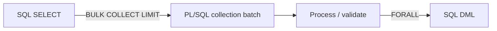

# BULK COLLECT, LIMIT, and PGA Memory Limits in PL/SQL

PL/SQL normally processes data row by row: fetching one row from the SQL engine, running PL/SQL logic, and then fetching the next row. With large data sets, row-by-row processing can cause many control transfers between the SQL engine and the PL/SQL engine. **Bulk SQL** mechanisms reduce those switches by transferring many rows at once.

Two important components are:

- **BULK COLLECT:** retrieves multiple rows from the SQL engine into PL/SQL collections in a single fetch.
- **LIMIT:** restricts the number of rows retrieved in each bulk fetch on an explicit cursor or ref cursor.

Example of batch fetching:

```sql
DECLARE
    CURSOR c_orders IS
        SELECT order_id, customer_id, total_amount
        FROM orders
        WHERE order_date >= DATE '2026-01-01';

    TYPE t_order_rows IS TABLE OF c_orders%ROWTYPE;
    l_batch t_order_rows;
BEGIN
    OPEN c_orders;
    LOOP
        FETCH c_orders BULK COLLECT INTO l_batch LIMIT 500;
        EXIT WHEN l_batch.COUNT = 0;
        FOR i IN 1 .. l_batch.COUNT LOOP
            DBMS_OUTPUT.PUT_LINE(l_batch(i).order_id);
        END LOOP;
    END LOOP;
    CLOSE c_orders;
END;
/
```

LIMIT in this example caps each fetch at 500 rows. It does not impose an absolute byte limit on memory. If each row contains many columns or long strings, a 500-row batch can consume far more PGA than 500 narrow rows. Therefore, choose a batch size based on row width, concurrent sessions, PGA budget, and actual measurements.

## 1. Why Is BULK COLLECT Needed?

### 1.1. Row-by-Row Processing Has Switching Overhead

In the traditional PL/SQL model, each FETCH transfers one row from the SQL engine to the PL/SQL engine. When processing millions of rows, the number of switches can become huge:

```sql
DECLARE
    CURSOR c_orders IS
        SELECT order_id, total_amount
        FROM orders;
    l_order_id orders.order_id%TYPE;
    l_amount   orders.total_amount%TYPE;
BEGIN
    OPEN c_orders;
    LOOP
        FETCH c_orders INTO l_order_id, l_amount;
        EXIT WHEN c_orders%NOTFOUND;
        NULL; -- Process each row.
    END LOOP;
    CLOSE c_orders;
END;
/
```

This pattern is clear and suitable for logic that genuinely requires per-row handling. However, if the work mostly consists of moving data back and forth between SQL and PL/SQL, the switch count can create significant overhead.

### 1.2. Bulk Fetching Transfers Many Rows at Once

```sql
DECLARE
    TYPE t_order_ids IS TABLE OF orders.order_id%TYPE;
    l_order_ids t_order_ids;
BEGIN
    SELECT order_id
    BULK COLLECT INTO l_order_ids
    FROM orders
    WHERE status_code = 'READY';
    DBMS_OUTPUT.PUT_LINE('Rows=' || l_order_ids.COUNT);
END;
/
```

Instead of calling FETCH once per row, the SQL engine transfers a result set into a collection. This can reduce context switches and increase throughput for batch reading/processing jobs.

### 1.3. Bulk SQL Is Not Always Faster

BULK COLLECT carries costs for allocating and holding collections in memory, copying data between the SQL engine and PL/SQL engine, iterating over collections in PL/SQL, and potentially holding more data than needed.

If SQL can perform the entire task in a single UPDATE, INSERT SELECT, MERGE, or DELETE statement, prefer set-based processing in SQL:

```sql
UPDATE orders
SET status_code = 'ARCHIVED'
WHERE order_date < DATE '2025-01-01';
```

This approach is usually simpler and more efficient than fetching all rows into PL/SQL and updating them one by one. BULK COLLECT fits when per-element PL/SQL logic is required or data must be passed to another batch process.

## 2. Collections Receiving BULK COLLECT Data

### 2.1. What Is a Collection?

A collection is a PL/SQL structure holding multiple elements of the same scalar or record type. Common types include associative arrays, nested tables, and VARRAYs. BULK COLLECT can populate compatible collections; the element type must match the SELECT list.

### 2.2. Single-Column Collection

```sql
DECLARE
    TYPE t_employee_ids IS TABLE OF employees.employee_id%TYPE;
    l_employee_ids t_employee_ids;
BEGIN
    SELECT employee_id
    BULK COLLECT INTO l_employee_ids
    FROM employees
    WHERE department_id = 50;

    FOR i IN 1 .. l_employee_ids.COUNT LOOP
        DBMS_OUTPUT.PUT_LINE(l_employee_ids(i));
    END LOOP;
END;
/
```

A nested table is declared using TYPE ... IS TABLE OF. After SELECT, the collection can be iterated using COUNT and element indices.

### 2.3. Associative Array

```sql
DECLARE
    TYPE t_employee_ids IS TABLE OF employees.employee_id%TYPE
        INDEX BY PLS_INTEGER;
    l_employee_ids t_employee_ids;
BEGIN
    SELECT employee_id
    BULK COLLECT INTO l_employee_ids
    FROM employees
    WHERE department_id = 50;
    DBMS_OUTPUT.PUT_LINE('Count=' || l_employee_ids.COUNT);
END;
/
```

An associative array uses PL/SQL indexing and does not require constructor initialization like nested tables or VARRAYs. With standard bulk fetches, elements are loaded sequentially starting at index 1.

### 2.4. Multi-Column Collection Using a Record

```sql
DECLARE
    CURSOR c_employee IS
        SELECT employee_id, last_name, salary
        FROM employees
        WHERE department_id = 50;
    TYPE t_employee_rows IS TABLE OF c_employee%ROWTYPE;
    l_employees t_employee_rows;
BEGIN
    SELECT employee_id, last_name, salary
    BULK COLLECT INTO l_employees
    FROM employees
    WHERE department_id = 50;
END;
/
```

The collection type is anchored to the cursor projection. The SELECT list must be compatible with that record. If the cursor includes expressions, provide clear column aliases.

### 2.5. Multiple Parallel Collections

```sql
DECLARE
    TYPE t_id_list IS TABLE OF employees.employee_id%TYPE;
    TYPE t_name_list IS TABLE OF employees.last_name%TYPE;
    TYPE t_salary_list IS TABLE OF employees.salary%TYPE;
    l_ids      t_id_list;
    l_names    t_name_list;
    l_salaries t_salary_list;
BEGIN
    SELECT employee_id, last_name, salary
    BULK COLLECT INTO l_ids, l_names, l_salaries
    FROM employees
    WHERE department_id = 50;

    FOR i IN 1 .. l_ids.COUNT LOOP
        DBMS_OUTPUT.PUT_LINE(
            l_ids(i) || ': ' || l_names(i) || ' / ' || l_salaries(i)
        );
    END LOOP;
END;
/
```

The collections receive corresponding elements in the same row order. When keeping multiple related columns together, a record collection is usually easier to read and less prone to index mismatch than parallel collections.

## 3. BULK COLLECT in SELECT INTO

### 3.1. Fetching the Entire Result Set

Syntax:

```sql
SELECT select_list
BULK COLLECT INTO collection [, collection ...]
FROM ...
WHERE ...;
```

Example:

```sql
DECLARE
    TYPE t_names IS TABLE OF employees.last_name%TYPE;
    l_names t_names;
BEGIN
    SELECT last_name
    BULK COLLECT INTO l_names
    FROM employees
    WHERE department_id = 50;
    DBMS_OUTPUT.PUT_LINE(l_names.COUNT);
END;
/
```

SELECT BULK COLLECT INTO loads the entire result set of the SELECT statement into the collection. This is straightforward for result sets that are small or clearly bounded.

### 3.2. Zero Rows Does Not Raise NO_DATA_FOUND

Unlike scalar/record SELECT ... INTO, SELECT ... BULK COLLECT INTO does not raise NO_DATA_FOUND simply because the query returns no rows. The resulting collection is empty and COUNT equals 0:

```sql
DECLARE
    TYPE t_ids IS TABLE OF employees.employee_id%TYPE;
    l_ids t_ids;
BEGIN
    SELECT employee_id
    BULK COLLECT INTO l_ids
    FROM employees
    WHERE department_id = -999;

    IF l_ids.COUNT = 0 THEN
        DBMS_OUTPUT.PUT_LINE('No rows');
    END IF;
END;
/
```

Do not write a NO_DATA_FOUND exception handler as the mechanism for checking empty results with SELECT BULK COLLECT.

### 3.3. SELECT BULK COLLECT Has No LIMIT Clause

The SELECT ... BULK COLLECT INTO syntax has no LIMIT clause. If the query returns a very large number of rows, the collection receives the entire result set and may consume substantial PGA memory.

To restrict how many rows are retrieved per fetch, use an explicit cursor or ref cursor with:

```sql
FETCH cursor_name BULK COLLECT INTO collection LIMIT n;
```

This is the core difference between full bulk collection and batch bulk fetching.

### 3.4. ROWNUM/FETCH FIRST Does Not Replace Full Batching

You can cap the total number of rows returned by a query using a SQL predicate or row limiting clause, but that alters the result set rather than creating a loop that processes all data across multiple batches. If you need to process all rows within a memory limit, fetch from a cursor with LIMIT.

### 3.5. Dynamic SELECT BULK COLLECT

```sql
DECLARE
    TYPE t_ids IS TABLE OF employees.employee_id%TYPE;
    l_ids t_ids;
BEGIN
    EXECUTE IMMEDIATE
        'SELECT employee_id
         FROM employees
         WHERE department_id = :dept_id'
    BULK COLLECT INTO l_ids
    USING 50;
END;
/
```

This still bulk collects the entire result of the dynamic SELECT. EXECUTE IMMEDIATE does not add LIMIT to this syntax. If you need to fetch multiple batches from a dynamic query, open a REF CURSOR and use FETCH BULK COLLECT LIMIT.

## 4. FETCH BULK COLLECT with LIMIT

### 4.1. Syntax

```sql
FETCH cursor_name
BULK COLLECT INTO collection [, collection ...]
LIMIT number_of_rows;
```

LIMIT is the maximum number of rows transferred into the collection in a single fetch. If fewer than LIMIT rows remain, the final fetch returns only the remaining rows.

### 4.2. Standard Loop Pattern

```sql
DECLARE
    CURSOR c_orders IS
        SELECT order_id, customer_id, total_amount
        FROM orders
        WHERE status_code = 'READY'
        ORDER BY order_id;
    TYPE t_order_rows IS TABLE OF c_orders%ROWTYPE;
    l_batch t_order_rows;
BEGIN
    OPEN c_orders;
    LOOP
        FETCH c_orders BULK COLLECT INTO l_batch LIMIT 500;
        EXIT WHEN l_batch.COUNT = 0;
        FOR i IN 1 .. l_batch.COUNT LOOP
            DBMS_OUTPUT.PUT_LINE(l_batch(i).order_id);
        END LOOP;
    END LOOP;
    CLOSE c_orders;
END;
/
```

Each FETCH loads up to 500 rows into l_batch. After processing the batch, the loop fetches the next batch.

### 4.3. Why Check collection.COUNT = 0?

The safe pattern is:

```sql
FETCH c_orders BULK COLLECT INTO l_batch LIMIT 500;
EXIT WHEN l_batch.COUNT = 0;
```

Do not rely mechanically on:

```sql
EXIT WHEN c_orders%NOTFOUND;
```

With bulk fetching, a single fetch can return a batch of rows while the cursor simultaneously reaches the end of the data source. Exiting based solely on %NOTFOUND right after the fetch can skip processing the final batch just retrieved. Checking the collection count ensures every non-empty batch is processed before the loop terminates.

### 4.4. The Collection Is Replaced by the New Batch

On each FETCH BULK COLLECT, the target collection is repopulated with the results of that fetch; do not treat it as an accumulator across batches. Process the elements before the next fetch.

If you want to accumulate all rows into another collection, you would have to append them explicitly, which grows total memory linearly with the full result set and defeats the memory bound.

### 4.5. Closing the Cursor on Exception

```sql
DECLARE
    CURSOR c_orders IS
        SELECT order_id, total_amount FROM orders;
    TYPE t_order_rows IS TABLE OF c_orders%ROWTYPE;
    l_batch t_order_rows;
BEGIN
    OPEN c_orders;
    LOOP
        FETCH c_orders BULK COLLECT INTO l_batch LIMIT 500;
        EXIT WHEN l_batch.COUNT = 0;
        FOR i IN 1 .. l_batch.COUNT LOOP
            NULL; -- Process row.
        END LOOP;
    END LOOP;
    CLOSE c_orders;
EXCEPTION
    WHEN OTHERS THEN
        IF c_orders%ISOPEN THEN
            CLOSE c_orders;
        END IF;
        RAISE;
END;
/
```

In production code, exception handling must preserve the original error and may log safely. Never swallow errors merely to close the cursor cleanly.

### 4.6. Ordered Results

If processing order matters, add an ORDER BY with a sufficiently stable key, typically a unique key or tie-breaker column for duplicate values. Without ORDER BY, Oracle does not guarantee row order across fetches or execution plans.

## 5. LIMIT Caps Rows, Not Bytes

### 5.1. Same LIMIT, Different Memory Usage

Two batches can both have 500 rows yet use very different amounts of memory:

| Row characteristic | Example | Impact |
|---|---|---|
| Narrow | NUMBER ID, DATE | Each element is relatively small |
| Medium | ID, several short VARCHAR2s, NUMBER | Grows with column count and actual data |
| Wide | Many long VARCHAR2s, RAW, or complex records | Batch can consume substantial memory |
| Contains nested/LOB locators | Complex data structures | Adds overhead and resource lifetime considerations |

LIMIT 500 does not mean at most 500 KB or 5 MB. It only limits the row count.

### 5.2. Rough Estimation

```text
Batch memory ≈ rows in batch × average data size per row
              + collection overhead
              + metadata/allocator overhead
              + intermediate processing memory
```

This is only a directional estimate. Actual size depends on data types, character sets, data lengths, collection storage layout, alignment, runtime internals, and any copies created by processing logic.

Illustrative examples:

| Assumed average row size | LIMIT | Estimated raw data |
|---:|---:|---:|
| 100 bytes | 500 | 50 KB |
| 1 KB | 500 | 500 KB |
| 4 KB | 500 | 2 MB |
| 4 KB | 5,000 | 20 MB |

These figures exclude overhead, temporary values, collection metadata, parallel collections, and memory used by other sessions. Do not treat them as a PGA guarantee.

### 5.3. Row Width Matters as Much as Row Count

If a query runs SELECT * against an 80-column table, a 1,000-row batch can be far heavier than a query selecting only the 3 needed columns. Select only the columns actually used:

```sql
SELECT order_id, customer_id, total_amount
FROM orders
WHERE status_code = 'READY';
```

Trimming the projection reduces transferred data, collection memory, and processing CPU.

### 5.4. Multiple Collections Increase Memory

If fetching simultaneously into 5 parallel collections, each collection holds an array of elements. A record collection often makes keeping fields aligned easier, though memory still depends on the sum of all fields. Avoid creating unnecessary collection copies or large temporary variables.

### 5.5. Intermediate Copies and Strings

Processing code may allocate a second collection for transformations, concatenated strings across columns, intermediate JSON/XML CLOBs, arrays/buffers in another package, or temporary variables holding the same data. Peak PGA is not simply the size of l_batch. Account for memory across the entire pipeline and concurrent sessions.

## 6. PGA in Oracle Database

### 6.1. What Is PGA?

The Program Global Area (PGA) is a private memory region for a server process or background process. In dedicated server mode, PGA typically contains private session memory, stack space, sort/hash work areas, and process working memory. PL/SQL collections and processing variables can contribute to session/process memory.

PGA differs from SGA:

| PGA | SGA |
|---|---|
| Private memory per process/session depending on server mode | Shared memory for the instance |
| Contains stack, session memory, and work areas | Contains buffer cache, shared pool, redo buffer, and shared structures |
| Not directly read by other sessions as a shared pool | Shared across multiple sessions/processes |
| Usually scales with active processes/sessions | Managed at the instance level |

In shared server mode, UGA/session memory may reside in the SGA instead of the PGA. Thus, the exact location of session memory depends on the connection architecture; PGA parameters remain important for work areas and process memory.

### 6.2. PGA_AGGREGATE_TARGET

`PGA_AGGREGATE_TARGET` is the instance-level PGA management target. Oracle uses this value to automatically size SQL work areas such as sorts and hash joins. It is a target, not a hard limit for every type of memory allocated by a session.

As total memory demand grows, Oracle may shrink tunable work areas—for example, sorts or hashes may spill to one-pass or multi-pass execution. However, do not assume this mechanism automatically shrinks PL/SQL collections.

### 6.3. PGA_AGGREGATE_LIMIT

`PGA_AGGREGATE_LIMIT` is the hard ceiling on total instance PGA enforced by Oracle. When exceeded, Oracle may terminate sessions or processes consuming untunable memory, raising errors such as ORA-04036.

PGA_AGGREGATE_LIMIT is not a per-BULK COLLECT quota. One session performing a massive bulk collect can help push total PGA past the limit, especially when multiple sessions run concurrently.

### 6.4. Single-Session PGA vs. Total Instance PGA

Suppose each session holds 20 MB in collections and 40 sessions run concurrently:

```text
20 MB/session × 40 sessions = 800 MB estimated batch data
```

Actual usage also includes overhead and other memory. The key takeaway is that a batch size may be safe in single-session testing yet cause pressure when concurrency increases.

### 6.5. Do Not Confuse Work Areas with Collections

Sorts, hash joins, and bitmap merges use work areas managed by Oracle's automatic PGA memory management. PL/SQL collections are application data held in session memory. Raising or lowering PGA_AGGREGATE_TARGET affects overall behavior, but it is no substitute for choosing a sensible LIMIT and bounding collection count and concurrency.

## 7. How to Choose LIMIT

### 7.1. No Single Value Fits Every Workload

LIMIT 100, 500, 1,000, or 10,000 can each be appropriate in a specific context. A good value depends on row width, fetched column count, data types and string lengths, number of collections and temporary structures, concurrent sessions, available PGA, processing time per batch, context switch cost, and transaction characteristics.

Do not copy a LIMIT value from another system without measuring.

### 7.2. Starting Points for Testing

You can test a range from small to large, such as 100, 250, 500, 1,000, and 2,000 rows. These are benchmark starting points, not fixed recommendations.

For very wide rows or high concurrency, start lower. For narrow rows and simple batch processing, you can test higher values if memory headroom permits.

### 7.3. Measure Repeatedly

For each LIMIT, record elapsed time, rows per second, fetch/batch count, current and peak observed PGA memory, CPU time, buffer gets/physical reads, p95 latency if serving requests, and concurrent session count.

Increasing LIMIT may reduce fetch calls while making each batch larger. Once elapsed time stops improving noticeably while PGA rises sharply, larger values no longer provide clear benefit.

### 7.4. Optimize for Both Throughput and Memory

Do not select LIMIT solely by lowest execution time. Set memory budgets per job/session and per instance. For instance, a batch that is 5% faster yet uses 4x more memory can destabilize the system under higher concurrency.

### 7.5. Adaptive Batch Sizing

Some applications configure LIMIT by job type or data width. If implementing dynamic adjustment, enforce min/max bounds and rely on trustworthy metrics. Avoid oscillating LIMIT continuously based on a single noisy measurement.

## 8. Combining BULK COLLECT with FORALL

### 8.1. Two-Way Bulk Operations

BULK COLLECT moves multiple rows from SQL to PL/SQL. FORALL passes multiple values from PL/SQL collections to a single DML statement executed across a set of binds.



Combining both mechanisms is commonly useful for ETL, batch updates, or data processing that requires PL/SQL logic.

### 8.2. Example: Batch Update

```sql
DECLARE
    CURSOR c_orders IS
        SELECT order_id, total_amount
        FROM orders
        WHERE status_code = 'READY'
        ORDER BY order_id;
    TYPE t_order_rows IS TABLE OF c_orders%ROWTYPE;
    l_batch t_order_rows;
    TYPE t_order_ids IS TABLE OF orders.order_id%TYPE
        INDEX BY PLS_INTEGER;
    TYPE t_new_statuses IS TABLE OF orders.status_code%TYPE
        INDEX BY PLS_INTEGER;
    l_ids t_order_ids;
    l_statuses t_new_statuses;
BEGIN
    OPEN c_orders;
    LOOP
        FETCH c_orders BULK COLLECT INTO l_batch LIMIT 500;
        EXIT WHEN l_batch.COUNT = 0;
        l_ids.DELETE;
        l_statuses.DELETE;
        FOR i IN 1 .. l_batch.COUNT LOOP
            l_ids(i) := l_batch(i).order_id;
            l_statuses(i) := 'PROCESSED';
        END LOOP;
        FORALL i IN 1 .. l_ids.COUNT
            UPDATE orders
            SET status_code = l_statuses(i)
            WHERE order_id = l_ids(i);
    END LOOP;
    CLOSE c_orders;
EXCEPTION
    WHEN OTHERS THEN
        IF c_orders%ISOPEN THEN
            CLOSE c_orders;
        END IF;
        RAISE;
END;
/
```

This example illustrates the flow; in practice, verify cursor consistency, row locking, transaction boundaries, and whether the cursor query could re-read rows just updated. Use a staging/claim pattern or appropriate status predicates to prevent duplicate processing.

### 8.3. FORALL with INDICES OF

If a collection is sparse or has non-contiguous indices, use the appropriate syntax:

```sql
FORALL i IN INDICES OF l_ids
    UPDATE orders
    SET status_code = l_statuses(i)
    WHERE order_id = l_ids(i);
```

Collections referenced in the DML must have elements at every index traversed by FORALL. When using parallel collections, ensure corresponding indices exist in all of them.

### 8.4. SQL%BULK_ROWCOUNT

After FORALL, SQL%BULK_ROWCOUNT(i) reports how many rows the DML affected at iteration i:

```sql
FOR i IN 1 .. l_ids.COUNT LOOP
    DBMS_OUTPUT.PUT_LINE(
        'Order=' || l_ids(i) ||
        ', affected=' || SQL%BULK_ROWCOUNT(i)
    );
END LOOP;
```

Read these attributes before executing another DML statement that overwrites implicit cursor attributes.

### 8.5. SAVE EXCEPTIONS

If one iteration of FORALL fails, by default execution stops at the first error and remaining iterations are not run. Use SAVE EXCEPTIONS when you want Oracle to continue remaining iterations and report collected errors via SQL%BULK_EXCEPTIONS:

```sql
DECLARE
    e_bulk_errors EXCEPTION;
    PRAGMA EXCEPTION_INIT(e_bulk_errors, -24381);
BEGIN
    FORALL i IN 1 .. l_ids.COUNT SAVE EXCEPTIONS
        UPDATE orders
        SET status_code = l_statuses(i)
        WHERE order_id = l_ids(i);
EXCEPTION
    WHEN e_bulk_errors THEN
        FOR j IN 1 .. SQL%BULK_EXCEPTIONS.COUNT LOOP
            DBMS_OUTPUT.PUT_LINE(
                'Index=' || SQL%BULK_EXCEPTIONS(j).ERROR_INDEX ||
                ', Code=' || SQL%BULK_EXCEPTIONS(j).ERROR_CODE
            );
        END LOOP;
        RAISE;
END;
/
```

After failure, iterate through SQL%BULK_EXCEPTIONS to inspect ERROR_INDEX and ERROR_CODE. Never silently ignore these errors; record failed rows and decide retry/quarantine behavior according to business rules.

### 8.6. Bulk Collect Does Not Create Transaction Batches

FETCH LIMIT 500 does not automatically COMMIT after every 500 rows. If FORALL updates 500 rows, those changes remain part of the current transaction until COMMIT or ROLLBACK. Batch fetching is a memory and data-flow bound, not a transaction boundary.

## 9. Transactions, Undo, and Batch Commits

### 9.1. Do Not Commit Just Because a Batch Fetch Finished

If business logic requires the entire job to succeed or fail together, keep the transaction aligned with that design and commit only upon completion. Committing after every batch leaves partial completion if a later batch fails.

### 9.2. When Is Batch Committing Appropriate?

Committing per batch can be appropriate when data volume is large and business rules allow independent batch processing, backed by checkpoint/restart logic, idempotency or duplicate-prevention mechanisms, batch status audit tables, and a failed-row handling policy.

Do not commit per batch merely to address PGA usage; LIMIT already bounds the rows per fetch. Transaction size and collection memory are separate concerns.

### 9.3. FOR UPDATE and Fetching Across Commits

If a cursor uses FOR UPDATE, committing while the cursor is still being fetched can cause ORA-01002 fetch out of sequence or release row locks in conflict with transaction semantics. Do not arbitrarily commit inside a FOR UPDATE cursor fetch loop.

If you need to split transactions, design batch claim/update steps, lock one batch and close/finish the cursor before committing, or use an appropriate restartable pattern.

### 9.4. Undo/Redo and Lock Duration

FORALL reduces context switches, but the DML still generates undo/redo and holds locks just like regular DML. A huge batch can hold many locks and increase undo pressure; smaller batches may shorten lock duration while increasing fetch/control overhead. Measure both separately.

### 9.5. Restartability

A multi-batch job should maintain clear checkpoints: Job ID and batch ID, processed key range or watermark, success/failure row counts, commit timestamp, and retry state.

Do not use collection indices or fetch positions as durable checkpoints because collections exist only in session memory.

## 10. Error Management and Invalid Data

### 10.1. Errors During Fetch

Parse/execute errors for SELECT happen when opening/executing the cursor; conversion or processing errors can occur during fetch. Close the cursor on error. Never catch OTHERS and keep fetching from a cursor in an indeterminate state.

### 10.2. Errors During Per-Element Processing

If PL/SQL element-processing logic can fail, decide whether to abort the entire batch and roll back the transaction, log the element error and continue, move invalid rows to a quarantine table, or separately retry recoverable rows.

Catching errors inside a FOR loop handles PL/SQL exceptions in element logic; this differs from SAVE EXCEPTIONS in FORALL.

### 10.3. SAVE EXCEPTIONS and Error Mapping

SQL%BULK_EXCEPTIONS stores the iteration index and error code. ERROR_INDEX is the iteration index relative to the collection/FORALL bounds used; map it back to the business key before logging.

### 10.4. DML Error Logging

For certain set-based DML statements, Oracle DML error logging (LOG ERRORS) can write row-level errors to an error table without row-by-row PL/SQL processing. This is an alternative to bulk DML, though it has restrictions on error types and statement forms; check release behavior and transaction requirements.

### 10.5. Never Swallow Errors

If a batch fails while the code marks the whole job successful, data becomes inconsistent. Always maintain clear success/failure/partial statuses and report counts of rows read, processed, written, skipped, and failed.

## 11. Monitoring PGA and Session Memory

### 11.1. V$PGASTAT

DBAs can inspect instance-level PGA statistics:

```sql
SELECT name, value, unit
FROM v$pgastat
ORDER BY name;
```

Commonly watched metrics include aggregate PGA target parameter, aggregate PGA auto target, total PGA allocated, total PGA inuse, maximum PGA allocated, over allocation count, and global memory bound. Exact metric names and values depend on version/configuration. V$PGASTAT reports instance-level metrics, not just the currently running job.

### 11.2. Current Session PGA

```sql
SELECT n.name,
       s.value
FROM v$sesstat s
JOIN v$statname n
  ON n.statistic# = s.statistic#
WHERE s.sid = TO_NUMBER(SYS_CONTEXT('USERENV', 'SID'))
  AND n.name IN (
      'session pga memory',
      'session pga memory max'
  )
ORDER BY n.name;
```

These statistics let you observe current session memory and peak session memory since session creation/reset per Oracle semantics. Take before/after snapshots around the workload to observe the delta.

### 11.3. V$PROCESS_MEMORY

```sql
SELECT pid,
       serial#,
       category,
       allocated,
       used,
       max_allocated
FROM v$process_memory
ORDER BY pid, category;
```

Correlate processes with sessions via V$PROCESS/V$SESSION when privileges allow. Categories may include memory areas such as SQL, PL/SQL, Freeable, and Other depending on release.

### 11.4. V$PROCESS and V$SESSION

```sql
SELECT s.sid,
       s.serial#,
       s.username,
       s.module,
       s.action,
       p.spid,
       p.pga_used_mem,
       p.pga_alloc_mem,
       p.pga_max_mem
FROM v$session s
JOIN v$process p
  ON p.addr = s.paddr
WHERE s.username = USER;
```

Column names and access privileges depend on Oracle release. In shared server mode, session/process relationships and UGA placement differ from dedicated server; interpret metrics according to the architecture.

### 11.5. Tagging Batch Jobs with MODULE/ACTION

```sql
BEGIN
    DBMS_APPLICATION_INFO.SET_MODULE(
        module_name => 'BULK_JOB',
        action_name => 'FETCH_ORDERS'
    );
END;
/
```

Setting module/action helps DBAs identify batch sessions in V$SESSION and monitoring tools. Clear or update the action when the job completes so connection pools do not retain stale labels.

### 11.6. Do Not Rely Only on Memory Snapshots

Before/after snapshots can miss peak memory occurring mid-batch. Use sampling during job execution, session PGA max, and instance-level metrics. In production workloads, observe multiple concurrent sessions and compare against baseline load.

## 12. PGA Limits and Common Errors

### 12.1. ORA-04030

ORA-04030 typically indicates that a process cannot allocate additional PGA/private process memory. Causes include excessive per-process memory usage, OS limits, or memory pressure. Oversized collections can contribute to this error.

### 12.2. ORA-04036

ORA-04036 indicates that total PGA memory consumed by the instance exceeded PGA_AGGREGATE_LIMIT. Oracle may terminate memory-consuming sessions/processes under its management rules to protect the instance.

### 12.3. How to Mitigate Batch Memory Pressure

1. Lower LIMIT to reduce the number of rows held simultaneously.
2. SELECT only the columns required.
3. Process each batch completely before fetching the next batch.
4. Avoid keeping collection copies or appending every batch into a master collection.
5. Reduce concurrent jobs/sessions or cap concurrency.
6. Inspect row width, LOBs, and long string columns.
7. Monitor session/process PGA and instance PGA.
8. Re-evaluate whether logic can be moved into set-based SQL.
9. Check for leaks caused by package globals or long-lived collections.
10. Adjust DBA-level PGA parameters only after evaluating the full workload.

### 12.4. Do Not Raise PGA Limits to Mask Design Flaws

Increasing PGA_AGGREGATE_LIMIT may temporarily hide symptoms without fixing unbounded collection growth or excessive concurrency. First identify whether memory comes from batch collections, sort/hash work areas, parallel queries, or other workloads.

### 12.5. Freeing Collections

You can clear elements or release variables when no longer needed:

```sql
l_batch.DELETE;
```

With nested tables/VARRAYs, DELETE and collection scope have specific semantics. When a collection goes out of scope, memory may be reclaimed/reused by the PL/SQL memory manager; not every byte is guaranteed to return immediately to the OS. DBMS_SESSION.FREE_UNUSED_USER_MEMORY may be considered in suitable cases, but do not call it routinely as a substitute for good memory design.

## 13. Factors That Make LIMIT Hard to Predict

### 13.1. Variable VARCHAR2 Lengths

A VARCHAR2 column declared as 4,000 bytes does not mean every row occupies 4,000 bytes, yet a single batch might contain many long values. Measure on representative data, including tail values rather than averages alone.

### 13.2. Character Sets and Semantics

VARCHAR2(100 CHAR) can occupy varying numbers of bytes depending on character set and content. Character length does not equate to a fixed byte count. Multi-byte strings make naive character-based memory estimates inaccurate.

### 13.3. LOBs

When a SELECT returns LOB locators, locator memory and LOB lifecycle differ from materializing full LOB contents into VARCHAR2. If code reads entire CLOB/BLOB payloads into buffers, actual memory can far exceed what the batch row count suggests. Process LOBs in chunks and release resources properly.

### 13.4. Object Types and Nested Collections

Object types, nested collections, or structured types can introduce overhead and extra copying. Benchmark with the application's real data types rather than testing only NUMBER columns.

### 13.5. Multiple Concurrent Batch Sessions

PGA is a shared aggregate resource. Running LIMIT 1,000 per session might work in isolation yet fail when 100 sessions run simultaneously. Test peak concurrency and pool size, not just single-session LIMIT.

## 14. Dynamic SQL and Batch BULK COLLECT

### 14.1. Opening a Dynamic REF CURSOR

```sql
DECLARE
    l_cursor SYS_REFCURSOR;
    TYPE t_order_rows IS TABLE OF orders%ROWTYPE;
    l_batch t_order_rows;
BEGIN
    OPEN l_cursor FOR
        'SELECT *
         FROM orders
         WHERE customer_id = :customer_id
         ORDER BY order_id'
    USING 1001;

    LOOP
        FETCH l_cursor BULK COLLECT INTO l_batch LIMIT 250;
        EXIT WHEN l_batch.COUNT = 0;
        FOR i IN 1 .. l_batch.COUNT LOOP
            NULL; -- Process row.
        END LOOP;
    END LOOP;
    CLOSE l_cursor;
EXCEPTION
    WHEN OTHERS THEN
        IF l_cursor%ISOPEN THEN
            CLOSE l_cursor;
        END IF;
        RAISE;
END;
/
```

A dynamic REF CURSOR enables using LIMIT during FETCH. The query SELECT list must be compatible with the collection record type.

### 14.2. Dynamic EXECUTE IMMEDIATE BULK COLLECT

```sql
EXECUTE IMMEDIATE
    'SELECT order_id FROM orders WHERE customer_id = :id'
BULK COLLECT INTO l_ids
USING p_customer_id;
```

This is not a multi-batch fetch mechanism. If the result set can be large, use OPEN FOR and FETCH BULK COLLECT LIMIT.

## 15. Impact on Performance and the Optimizer

### 15.1. BULK COLLECT Does Not Automatically Improve the Query Plan

BULK COLLECT changes how rows are transferred from the SQL engine to the PL/SQL engine. It does not create indexes, reduce the number of blocks SELECT must read, or fix cardinality estimates. The query plan still depends on SQL, statistics, bind values, and the optimizer.

### 15.2. Tune the SELECT First

Before increasing LIMIT, inspect predicates, partition pruning/index access, column projection, sort/hash spills to TEMP, join order/cardinality estimates, and whether processing can move to set-based SQL. If the SELECT unnecessarily full-scans a huge table, bulk fetching will not remove that I/O cost.

### 15.3. Measure Context Switches and Total Time

BULK COLLECT reduces fetch overhead, while PL/SQL logic still runs for every element. If processing is CPU-heavy or invokes many subprograms, the bottleneck may be in business logic rather than fetching.

### 15.4. Parallel Query and PGA

Parallel query can spawn multiple PX server processes, each allocating its own work area memory. Combining many bulk-collecting sessions with parallel query can significantly raise total memory consumption. Measure DOP, PX server count, PGA, and concurrency together.

### 15.5. Fetch LIMIT Does Not Bound Total Time or Volume

LIMIT caps batch memory, not total rows processed or total job runtime. A cursor can still fetch millions of small batches; timeouts, cancellation, checkpointing, and monitoring are still required.

## 16. Common Anti-Patterns

### 16.1. BULK COLLECT of a Huge Table All at Once

```sql
SELECT *
BULK COLLECT INTO l_all_rows
FROM orders;
```

If the table is large, the collection can consume excessive memory. Use a cursor with FETCH LIMIT or set-based SQL.

### 16.2. Fetching with LIMIT While Accumulating Every Batch

Each individual batch is bounded, yet the combined collection still grows with the entire result set. Process and write results out per batch instead of keeping everything in PGA.

### 16.3. Choosing an Oversized LIMIT Out of Habit

Fetching 50,000 rows simply to reduce fetch calls without accounting for row width and session count is risky. Benchmark multiple LIMIT values, measure PGA and concurrency, and pick a balanced point.

### 16.4. Choosing an Undersized LIMIT

Too-small batches increase fetch calls, loop iterations, and control overhead. If memory headroom allows and the workload needs throughput, test increasing LIMIT.

### 16.5. Using SELECT * Unnecessarily

Fetching entire rows makes batches heavy and increases memory usage. Select only the fields needed.

### 16.6. Exiting on cursor%NOTFOUND in the Wrong Place

With bulk fetching, check collection.COUNT = 0 after FETCH so the final batch is never skipped.

### 16.7. Committing Every Batch Without Checkpoints

A job may stop midway without knowing which batches were processed; reruns can cause duplicates or skipped rows. Design idempotency, checkpoints, and partial-completion handling before using per-batch commits.

### 16.8. Failing to Close Cursors on Exception

Sessions can leak open cursors/resources, which is especially dangerous with connection pools. Use exception cleanup that checks cursor%ISOPEN and closes the cursor.

### 16.9. Confusing LIMIT with a PGA Cap

LIMIT is not a byte budget. It does not guarantee a session uses a fixed amount of memory.

## 17. Batch Size Selection and Benchmarking Workflow

### Step 1 — Define the Workload

Document the query, expected row count, data types, row width, processing logic, and resulting DML.

### Step 2 — Check Set-Based Alternatives

Try pure SQL UPDATE/INSERT SELECT/MERGE/DELETE first. If per-row PL/SQL logic is needed, document why.

### Step 3 — Pick a Starting Batch Size

Choose a moderate LIMIT based on row width and memory budget. Do not start with a huge number.

### Step 4 — Measure Single-Session Execution

Run with multiple LIMIT values, recording elapsed time, rows/second, fetch count, current/max PGA, and CPU.

### Step 5 — Measure Concurrency

Run multiple sessions matching pool size and expected load. Observe total PGA, p95 latency, throughput, and wait events.

### Step 6 — Test Edge-Case Data

Test rows with long strings, NULLs, LOBs, wide records, and maximum result sizes.

### Step 7 — Test Error Scenarios

Test mid-batch exceptions, DML constraint violations, SAVE EXCEPTIONS, rollback, and restart.

### Step 8 — Choose an Operational Limit

Pick a LIMIT with memory headroom, not merely the value with peak throughput. Set a concurrency cap if total per-session memory could exceed budget.

### Step 9 — Monitor Post-Deployment

Track PGA, ORA-04030/04036, job duration, batch counts, and max memory. Adjust if row width or concurrency changes.

## 18. Lab: Comparing Row-by-Row Fetch vs. BULK COLLECT LIMIT

Run this in a lab schema. Generate enough data to observe differences; never run heavy loads in production.

### 18.1. Create the Table

```sql
CREATE TABLE bulk_orders_lab (
    order_id NUMBER(12) NOT NULL,
    customer_id NUMBER(10) NOT NULL,
    order_date DATE NOT NULL,
    amount NUMBER(14, 2) NOT NULL,
    note VARCHAR2(500 CHAR)
);
```

Populate the lab data using INSERT SELECT or a controlled data-generation script. Ensure a mix of short and long NOTE values to benchmark realistic memory behavior.

### 18.2. Baseline Count

```sql
SELECT COUNT(*), SUM(amount)
FROM bulk_orders_lab;
```

Record row count and total amount to cross-check results across approaches.

### 18.3. Row-by-Row Cursor Fetch

```sql
DECLARE
    CURSOR c_orders IS
        SELECT order_id, amount
        FROM bulk_orders_lab
        ORDER BY order_id;
    l_id NUMBER;
    l_amount NUMBER;
    l_total NUMBER := 0;
BEGIN
    OPEN c_orders;
    LOOP
        FETCH c_orders INTO l_id, l_amount;
        EXIT WHEN c_orders%NOTFOUND;
        l_total := l_total + l_amount;
    END LOOP;
    CLOSE c_orders;
    DBMS_OUTPUT.PUT_LINE(l_total);
END;
/
```

### 18.4. Full BULK COLLECT

```sql
DECLARE
    TYPE t_amounts IS TABLE OF bulk_orders_lab.amount%TYPE;
    l_amounts t_amounts;
    l_total NUMBER := 0;
BEGIN
    SELECT amount
    BULK COLLECT INTO l_amounts
    FROM bulk_orders_lab;

    FOR i IN 1 .. l_amounts.COUNT LOOP
        l_total := l_total + l_amounts(i);
    END LOOP;
    DBMS_OUTPUT.PUT_LINE(l_total);
END;
/
```

Compare execution time and PGA against the row-by-row cursor. Try scaling up row count to observe the risk of holding the entire collection.

### 18.5. BULK COLLECT with LIMIT

```sql
DECLARE
    CURSOR c_orders IS
        SELECT order_id, amount
        FROM bulk_orders_lab
        ORDER BY order_id;
    TYPE t_order_rows IS TABLE OF c_orders%ROWTYPE;
    l_batch t_order_rows;
    l_total NUMBER := 0;
BEGIN
    OPEN c_orders;
    LOOP
        FETCH c_orders BULK COLLECT INTO l_batch LIMIT 500;
        EXIT WHEN l_batch.COUNT = 0;
        FOR i IN 1 .. l_batch.COUNT LOOP
            l_total := l_total + l_batch(i).amount;
        END LOOP;
    END LOOP;
    CLOSE c_orders;
    DBMS_OUTPUT.PUT_LINE(l_total);
END;
/
```

### 18.6. Test Multiple LIMIT Values

Run the same logic with LIMIT 100, 250, 500, 1,000, and 2,000. Record:

| LIMIT | Elapsed | Rows/sec | Fetch count | Session PGA max | Notes |
|---:|---:|---:|---:|---:|---|
| 100 |  |  |  |  |  |
| 250 |  |  |  |  |  |
| 500 |  |  |  |  |  |
| 1,000 |  |  |  |  |  |
| 2,000 |  |  |  |  |  |

Fill in real measurements; never infer performance purely from theory.

### 18.7. Test Row Width

Re-run with a query selecting only ID/AMOUNT versus a query also selecting NOTE. Compare at the same LIMIT to see how row width affects memory.

### 18.8. Test Concurrency

Run the same batch job across 1, 5, and 10 sessions in a bounded environment. Measure instance/session PGA and aggregate throughput. Do not look only at single-session PGA.

### 18.9. Test Exceptions and Restart

Inject a mid-batch processing error, verify the cursor closes, the transaction rolls back according to policy, and checkpoints accurately reflect committed batches.

### 18.10. Summary

Select LIMIT based on throughput, PGA headroom, concurrency, and transaction requirements. Document row width and environment details so results are reproducible.

## 19. BULK COLLECT Operational Checklist

- [ ] Verified whether per-row PL/SQL processing is needed or set-based SQL can be used.
- [ ] Query selects only necessary columns.
- [ ] Chosen collection type matches the record/column projection.
- [ ] SELECT BULK COLLECT used only when total result size is reasonably bounded.
- [ ] FETCH BULK COLLECT LIMIT used for large sets requiring batch processing.
- [ ] Loop checks collection.COUNT = 0 after fetch.
- [ ] Batch is processed completely before fetching the next batch.
- [ ] All batches are not accumulated into a huge collection when memory bounding is the goal.
- [ ] Cursor is closed in both success and exception paths.
- [ ] LIMIT benchmarked across row width and concurrency.
- [ ] Current/max session PGA and instance PGA measured.
- [ ] Memory of all collections and intermediate copies accounted for.
- [ ] LOBs, long strings, and complex data types evaluated.
- [ ] Transaction/commit policy designed separately from batch fetching.
- [ ] FORALL/SAVE EXCEPTIONS includes clear error and row-count handling.
- [ ] Checkpointing/idempotency implemented if committing per batch.
- [ ] Checked for ORA-04030, ORA-04036, and memory headroom.
- [ ] Batch job concurrency capped according to PGA budget.

## 20. Self-Check Questions

1. What kind of overhead between the SQL engine and PL/SQL engine does BULK COLLECT reduce?
2. Why is set-based SQL usually better than fetching and processing row by row?
3. Which collection types are commonly used with BULK COLLECT?
4. How does SELECT BULK COLLECT INTO handle a query returning zero rows?
5. Why is SELECT BULK COLLECT INTO unsuitable for unbounded result sets?
6. Which FETCH syntax uses LIMIT?
7. Does LIMIT cap row count or byte count?
8. Why should you check collection.COUNT = 0 instead of cursor%NOTFOUND right after a bulk fetch?
9. How does the target collection change across consecutive FETCH BULK COLLECT calls?
10. Why does accumulating every batch into a master collection defeat the memory benefit?
11. How does row width affect batch memory?
12. How does PGA differ from SGA in scope and purpose?
13. How does PGA_AGGREGATE_TARGET differ from PGA_AGGREGATE_LIMIT?
14. Why can a batch size safe for one session cause failures when many sessions run concurrently?
15. How do you choose LIMIT through benchmarking?
16. In what two directions do BULK COLLECT and FORALL reduce context switches?
17. What information do SQL%BULK_ROWCOUNT and SQL%BULK_EXCEPTIONS provide?
18. How does SAVE EXCEPTIONS change how FORALL handles errors?
19. Why does LIMIT not automatically create a transaction boundary?
20. When can committing per batch be appropriate?
21. Why should you not commit in the middle of fetching a FOR UPDATE cursor?
22. What do V$PGASTAT, V$SESSTAT, and V$PROCESS_MEMORY help observe?
23. How do ORA-04030 and ORA-04036 differ in meaning?
24. When encountering PGA pressure, what should you check before raising PGA limits?
25. When should you use a dynamic REF CURSOR with FETCH LIMIT instead of EXECUTE IMMEDIATE BULK COLLECT?

**Rule of thumb:** BULK COLLECT reduces data transfer round-trips between the SQL engine and PL/SQL engine; LIMIT caps the number of rows per fetch, not PGA bytes. SELECT BULK COLLECT INTO fetches the entire result set, whereas FETCH BULK COLLECT LIMIT enables batch processing of large data sets. Choose LIMIT based on row width, number of collections, memory budget, and concurrency; measure both session and instance PGA. Process each batch before fetching the next, close cursors on error, and design transactions/checkpoints separately. Whenever set-based SQL can perform the work, let the database process the entire data set in SQL.
