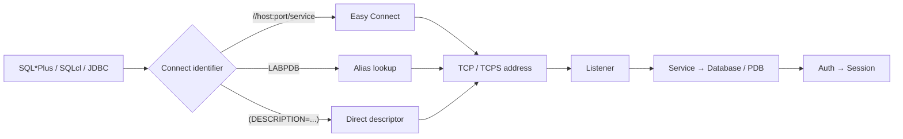
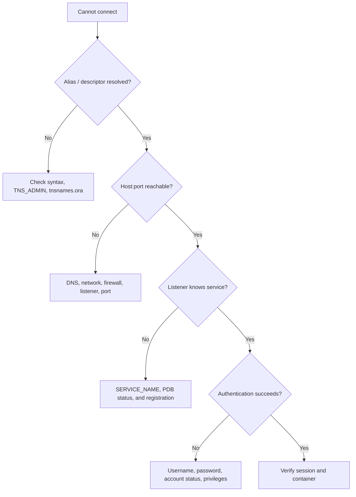

# Easy Connect Syntax and Connect Descriptors in Oracle Database

When a tool such as SQL*Plus, SQLcl, SQL Developer, or a Java application connects to Oracle Database, it must specify the **connection target**: which host, which port, which protocol, and which database service. Oracle Net allows representing that target either as a concise string called **Easy Connect** or as a complete structure called a **connect descriptor**. In addition, a **net service name** (alias) can point to a connect descriptor stored in `tnsnames.ora`.

Mastering these three representations helps learners write connection strings themselves, translate between SQL client configs and JDBC, diagnose connection-routing errors, and choose the right configuration for real environments.

## 1. What Components Does an Oracle Connection Pass Through?

A network session to Oracle typically passes through these steps:

1. **Client** receives a connect identifier from the user or application configuration.
2. **Oracle Net** resolves the identifier into a network address and service info. The resolution path can be Easy Connect, an alias via `tnsnames.ora`, or a connect descriptor written inline.
3. **Network address** specifies the protocol (`TCP` or `TCPS`), host, and listener port.
4. **Listener** accepts the request and uses service info to route the session to the appropriate database/instance.
5. **Database** authenticates the account and establishes the session; in a multitenant architecture, the service typically routes the user to a specific PDB.



Easily confused components:

| Component | Meaning | Example |
|---|---|---|
| **Hostname / IP** | Address of the host running the listener, or configured connection endpoint | `db.example.test`, `127.0.0.1` |
| **Port** | Port the listener listens on; commonly 1521 for TCP, though it can certainly differ | `1521` |
| **Protocol** | Oracle Net protocol used to establish the connection | `TCP`, `TCPS` |
| **Service name** | Logical service name advertised by the listener/database; can point to a PDB, instance group, or app service | `FREEPDB1`, `sales.example.test` |
| **SID / instance** | Oracle instance identifier; not a service name | `ORCL` as a legacy SID example |
| **Schema / username** | Account used for authentication and object ownership; does **not** determine host/port/service | `LAB_APP` |
| **Connect identifier** | Entire expression the client accepts to locate the connection target | `//db:1521/appsvc` or `LABPDB` |

**Key point:** the token after `/` in standard Easy Connect syntax is a **service name**. With Oracle CDB/PDB, prefer connecting through the PDB's service; do not replace the service with an instance SID unless specifically required.

## 2. Easy Connect: Concisely Specifying Host, Port, and Service

### 2.1. Basic Syntax

Common practical form:

```text
//host[:port]/service_name
```

Where:

- `host`: hostname or IP address reachable by the client;
- `port`: listener port, commonly defaulting to 1521 in standard TCP configs; **write it explicitly** to avoid environment mix-ups;
- `service_name`: Oracle service configured and registered with the listener;
- `//`: prefix indicating the Easy Connect syntax widely used across Oracle Net/JDBC.

Some clients accept shorthand forms like `host/service_name` or `host:port/service_name`; when learning and handing off configs, prefer the full form with `//` and explicit port for readability and verification.

Examples:

```text
//127.0.0.1:1521/FREEPDB1
//db-dev.example.test:1521/SALES_DEV
//db-test.example.test:1522/SALES_TEST
```

`SALES_DEV`, `SALES_TEST`, and the hostnames above are illustrative placeholders, not live services available everywhere. In common Oracle Database Free setups, the PDB often has service `FREEPDB1`, but always confirm the real service name from your database provider.

### 2.2. Using in SQL*Plus and SQLcl

To avoid typing passwords on the command line or saving them in shell history, start SQL*Plus first and then log in:

```console
sqlplus /nolog

SQL> CONNECT lab_app@//127.0.0.1:1521/FREEPDB1
Enter password:
Connected.
```

In SQLcl, you can launch with `sql /nolog` and run `CONNECT` with the same connect identifier. If using SQL Developer, pick the appropriate Connection Type and enter host, port, and **Service name** in their dedicated fields; those fields correspond to the expression above.

Here `lab_app` is the login username; `//127.0.0.1:1521/FREEPDB1` strictly describes the **connection target**. Never mix passwords or schema names into the service name.

After connecting, verify in practice:

```sql
SELECT
    SYS_CONTEXT('USERENV', 'SESSION_USER') AS session_user,
    SYS_CONTEXT('USERENV', 'SERVICE_NAME') AS service_name,
    SYS_CONTEXT('USERENV', 'CON_NAME') AS container_name
FROM dual;
```

`SESSION_USER` shows the authenticated user, `SERVICE_NAME` shows the session's service, and `CON_NAME` confirms the PDB. Actual values returned by the server are the source of truth; do not rely solely on the display label given to a connection in a GUI.

### 2.3. Using in Oracle JDBC Thin

JDBC Thin has its own URL prefix:

```text
jdbc:oracle:thin:@//host:port/service_name
```

Example:

```java
String url = "jdbc:oracle:thin:@//127.0.0.1:1521/FREEPDB1";
String username = System.getenv("DB_USERNAME");
String password = System.getenv("DB_PASSWORD");

try (java.sql.Connection connection =
         java.sql.DriverManager.getConnection(url, username, password)) {
    System.out.println("Connected: " + !connection.isClosed());
}
```

This snippet requires the Oracle JDBC driver on the classpath and environment variables holding valid credentials. `ojdbc` drivers should be chosen to match the Java, Oracle Database, and application versions.

Spring Boot configuration example:

```yaml
spring:
  datasource:
    url: jdbc:oracle:thin:@//db-dev.example.test:1521/SALES_DEV
    username: ${DB_USERNAME}
    password: ${DB_PASSWORD}
```

Spring Boot pulls sensitive values from environment variables. If the application runs inside a container, `localhost` in the URL refers to **the application's own container**, not the Oracle container by default. Use the hostname or network service name that the application can actually reach.

**Distinguish these three strings:**

```text
//db-dev.example.test:1521/SALES_DEV
    ↑ Oracle Net Easy Connect identifier

jdbc:oracle:thin:@//db-dev.example.test:1521/SALES_DEV
    ↑ Complete Oracle JDBC Thin URL

lab_app@//db-dev.example.test:1521/SALES_DEV
    ↑ Username + identifier in a SQL*Plus login command
```

Do not paste the entire `jdbc:oracle:thin:@...` string into a GUI client's "Hostname" field, and do not prepend `jdbc:oracle:thin:@` to a SQL*Plus connect identifier.

## 3. Easy Connect Plus: Multiple Hosts and Connection Parameters

**Easy Connect Plus** is an extended syntax supported in appropriate Oracle client/driver versions (especially modern client releases). It lets you specify protocols, multiple addresses, and connection parameters without writing a full descriptor.

General pattern for reading the syntax:

```text
[protocol:]//host1[:port1][,host2[:port2],...]/service_name[?name=value[&name=value...]]
```

This is a common illustrative form and does not list every optional element across every specification version. Advanced variants such as server mode, instance, or certain parameters only take effect when supported by the client in use.

### 3.1. Two Listener Addresses

```text
//db-a.example.test:1521,db-b.example.test:1521/SALES_APP
```

The client has multiple addresses to try when connecting. However, **listing two hosts does not by itself create high availability**. The `SALES_APP` service must be properly configured and registered on real infrastructure; DB clusters, Oracle RAC, and Data Guard each have their own mechanisms for service management and role transitions.

### 3.2. Timeout and Retry Parameters

```text
//db-a.example.test:1521,db-b.example.test:1521/SALES_APP?connect_timeout=5&retry_count=2&retry_delay=1
```

Meaning of the illustrative parameter names:

| Parameter | Purpose |
|---|---|
| `connect_timeout` | Sets a wait limit during connection establishment as supported by the client/driver |
| `retry_count` | Requests connection retries on failure within Oracle Net mechanisms |
| `retry_delay` | Wait interval between retries per configuration |

Exact rules on timeout scope, retry counts, units, and accepted parameters depend on the Oracle Net/JDBC version. Check the documentation for the **client actually running**, and distinguish connect timeout from **SQL statement/query timeout**. Retries occur only during connection establishment as supported by the transport mechanism; never assume the application will automatically replay a half-executed business transaction.

The `&` character in query-parameter strings has special meaning in some shells, URLs, XML files, or config formats. When invoking directly from a shell, apply that shell's quoting rules; in XML, escape as `&amp;`; in Java code, place the string inside a string literal.

### 3.3. Selecting the TCPS Protocol

Conceptual example using TLS connections:

```text
tcps://db-secure.example.test:2484/SALES_APP
```

`TCPS` is Oracle Net over TLS. Port `2484` commonly appears in TCPS examples but is not a mandatory default; always use the actual listener port. Changing `tcp` to `tcps` is **not enough** if the server has not configured a TCPS listener or the client lacks the right certificate trust/wallet configuration. On TLS-mandated infrastructure, configure server identity verification, trust stores/wallets, and certificate policies per administrative guidelines; avoid disabling certificate checks just to make a connection "succeed."

## 4. Connect Descriptor: Complete Key–Value Description

When you need to explicitly express addresses, multiple listeners, server types, services, timeouts, or connection behavior, Oracle uses a **connect descriptor**. This is a parenthesized structure of nested `(KEY=VALUE)` pairs:

```text
(DESCRIPTION=
  (ADDRESS=
    (PROTOCOL=TCP)
    (HOST=db-dev.example.test)
    (PORT=1521)
  )
  (CONNECT_DATA=
    (SERVICE_NAME=SALES_DEV)
  )
)
```

Reading from outside in:

- `DESCRIPTION` encloses a connection target specification.
- `ADDRESS` holds a single listener network endpoint.
- `PROTOCOL` is `TCP` or another supported, configured protocol.
- `HOST` is the hostname/IP; `PORT` is the listener port.
- `CONNECT_DATA` specifies how to select the service/instance/server.
- `SERVICE_NAME` instructs the listener to route to a specific service.

**Equivalent connection targets in a simple example:**

```text
Easy Connect:
//db-dev.example.test:1521/SALES_DEV

Descriptor:
(DESCRIPTION=(ADDRESS=(PROTOCOL=TCP)(HOST=db-dev.example.test)(PORT=1521))(CONNECT_DATA=(SERVICE_NAME=SALES_DEV)))
```

Line breaks and indentation exist only for readability; they do not represent database hierarchy levels. When copying into a URL or config file, preserve all parentheses and nested key-value structures.

### 4.1. Key Fields in a Descriptor

| Field | Common Location | Role |
|---|---|---|
| `DESCRIPTION` | Root of a connection option | Groups addresses, connect data, and options |
| `ADDRESS` | Inside `DESCRIPTION` or `ADDRESS_LIST` | A single listener address |
| `ADDRESS_LIST` | Inside `DESCRIPTION` | Groups multiple `ADDRESS` entries; can specify address selection/retry rules |
| `DESCRIPTION_LIST` | Wraps multiple `DESCRIPTION` blocks | Collection of connection descriptions for complex setups |
| `CONNECT_DATA` | Inside `DESCRIPTION` | Selects the logical target inside Oracle |
| `SERVICE_NAME` | Inside `CONNECT_DATA` | Service name requested by the client |
| `SERVER` | Inside `CONNECT_DATA` | Can request a server mode such as `DEDICATED` if supported |
| `SID` | Inside `CONNECT_DATA` in legacy configs | Targets an instance by SID; not equivalent to service name |
| `CONNECT_TIMEOUT` | Inside `DESCRIPTION` | Connection establishment timeout in Oracle Net |
| `RETRY_COUNT` / `RETRY_DELAY` | Inside `DESCRIPTION` | Tunes connection retry behavior |

Example requesting a dedicated server for a service:

```text
(DESCRIPTION=
  (ADDRESS=(PROTOCOL=TCP)(HOST=db-dev.example.test)(PORT=1521))
  (CONNECT_DATA=
    (SERVER=DEDICATED)
    (SERVICE_NAME=SALES_DEV)
  )
)
```

Do not add `SERVER=DEDICATED` to every configuration out of habit. Its effect depends on the database architecture and server mode provided.

### 4.2. Multiple Listeners in One Descriptor

```text
(DESCRIPTION=
  (CONNECT_TIMEOUT=5)
  (RETRY_COUNT=2)
  (RETRY_DELAY=1)
  (ADDRESS_LIST=
    (LOAD_BALANCE=ON)
    (FAILOVER=ON)
    (ADDRESS=(PROTOCOL=TCP)(HOST=db-a.example.test)(PORT=1521))
    (ADDRESS=(PROTOCOL=TCP)(HOST=db-b.example.test)(PORT=1521))
  )
  (CONNECT_DATA=
    (SERVICE_NAME=SALES_APP)
  )
)
```

Explanation:

- `ADDRESS_LIST` lists the listeners that may be tried.
- `LOAD_BALANCE=ON` relates to choosing/distributing addresses at connect time; it does not automatically balance all SQL transactions.
- `FAILOVER=ON` allows trying alternate addresses during **connect-time failover**. That is different from automatically recovering an already-dropped session or resuming an in-flight transaction.
- `RETRY_COUNT` and `RETRY_DELAY` control connection retry attempts per Oracle Net capabilities.
- `SERVICE_NAME=SALES_APP` must be a service genuinely deployed on the target system.

You cannot prove failover merely by writing a descriptor. You need properly working listeners/services across multiple endpoints, error evaluation, and controlled failover testing. For service continuity after a session is established, capabilities such as Application Continuity, TAC, or application-level retries may be needed depending on platform and business requirements.

### 4.3. Legacy SID Identifiers

Some older systems use:

```text
(DESCRIPTION=
  (ADDRESS=(PROTOCOL=TCP)(HOST=legacy-db.example.test)(PORT=1521))
  (CONNECT_DATA=(SID=ORCL))
)
```

Corresponding to the legacy JDBC Thin URL:

```text
jdbc:oracle:thin:@legacy-db.example.test:1521:ORCL
```

The trailing `:ORCL` represents a **SID**, whereas `/SALES_DEV` in the service URL form represents a **service name**. These are two **different target-specification mechanisms**, not interchangeable punctuation characters. Prefer service names for modern applications, especially with PDBs, RAC, or managed services.

## 5. `tnsnames.ora`: Naming Connect Descriptors

Descriptors can be long and easily miscopied across applications. The `tnsnames.ora` file maps an **alias** to a descriptor so clients only need a short name.

Example `tnsnames.ora` contents:

```text
LABPDB =
  (DESCRIPTION =
    (ADDRESS = (PROTOCOL = TCP)(HOST = 127.0.0.1)(PORT = 1521))
    (CONNECT_DATA =
      (SERVER = DEDICATED)
      (SERVICE_NAME = FREEPDB1)
    )
  )

SALES_APP =
  (DESCRIPTION =
    (ADDRESS = (PROTOCOL = TCP)(HOST = db-dev.example.test)(PORT = 1521))
    (CONNECT_DATA = (SERVICE_NAME = SALES_DEV))
  )
```

Once the client is configured to locate this file, you can use:

```text
SQL*Plus / SQLcl:
CONNECT lab_app@LABPDB

JDBC Thin:
jdbc:oracle:thin:@LABPDB
```

`LABPDB` is simply a **client-side name chosen by the administrator**, and does not have to match `SERVICE_NAME=FREEPDB1`. An alias can point to one or more listener addresses, and its underlying definition can be updated without changing the alias name in application config.

### 5.1. Where Does the Client Find `tnsnames.ora`?

The location depends on the Oracle client, environment, and installation method. When you need explicit control, place the file in a network config directory and point `TNS_ADMIN` to **the directory containing** the file:

```bash
# Example on Linux/macOS:
export TNS_ADMIN=/opt/oracle/network/admin
sqlplus /nolog
```

```powershell
# Example in PowerShell:
$env:TNS_ADMIN = 'C:\oracle\network\admin'
sqlplus /nolog
```

The same directory may also contain `sqlnet.ora`. Depending on configuration, connect-name lookup ordering is controlled by:

```text
NAMES.DIRECTORY_PATH = (TNSNAMES, EZCONNECT)
```

Meaning: the client can look up aliases via local naming (`TNSNAMES`) and recognize Easy Connect strings (`EZCONNECT`). Exact ordering, enabled naming methods, and file-reading behavior depend on the client environment.

For JDBC Thin, the `TNS_ADMIN` path or corresponding Oracle JDBC driver property must be supplied to the Java process before using an alias; never assume Java automatically reads the same file as another SQL*Plus installation on the same host.

### 5.2. Distinguishing Three Things Commonly Lumped Together as "TNS"

| Term | Example | Nature |
|---|---|---|
| **Net service name/alias** | `LABPDB` | Short config lookup name |
| **Connect descriptor** | `(DESCRIPTION=...)` | Structure describing the connection endpoint |
| **`tnsnames.ora`** | File containing `LABPDB = (...)` | Source mapping aliases to descriptors |

Not every Oracle connection needs `tnsnames.ora`. Easy Connect and inline descriptors work without an alias file.

## 6. Using Inline Descriptors in JDBC and Tools

A descriptor can appear directly after `@` in an Oracle JDBC Thin URL:

```properties
spring.datasource.url=jdbc:oracle:thin:@(DESCRIPTION=(ADDRESS=(PROTOCOL=TCP)(HOST=db-dev.example.test)(PORT=1521))(CONNECT_DATA=(SERVICE_NAME=SALES_DEV)))
```

This is a complete URL requiring no `SALES_APP` alias. Inline descriptors fit well when configuration is managed centrally alongside the application and connection requirements cannot be easily expressed with Easy Connect. When placing one in YAML, quote the string if it contains characters a YAML parser might interpret specially:

```yaml
spring:
  datasource:
    url: "jdbc:oracle:thin:@(DESCRIPTION=(ADDRESS=(PROTOCOL=TCP)(HOST=db-dev.example.test)(PORT=1521))(CONNECT_DATA=(SERVICE_NAME=SALES_DEV)))"
    username: ${DB_USERNAME}
    password: ${DB_PASSWORD}
```

In Java:

```java
String descriptor =
    "(DESCRIPTION=" +
      "(ADDRESS=(PROTOCOL=TCP)(HOST=db-dev.example.test)(PORT=1521))" +
      "(CONNECT_DATA=(SERVICE_NAME=SALES_DEV))" +
    ")";
String jdbcUrl = "jdbc:oracle:thin:@" + descriptor;
```

In other clients, how you enter an inline descriptor varies by tool: some have a "Custom JDBC URL" field, some support "TNS", and some accept a connection descriptor directly. Not every `Service name` input box accepts a raw `(DESCRIPTION=...)` expression.

## 7. Choosing Easy Connect, Alias, or Descriptor?

| Scenario | Suitable Approach | Reason |
|---|---|---|
| Practicing on a personal machine with a single PDB | Easy Connect `//host:port/service` | Short, components clearly visible |
| Connecting a SQL client to a few test systems | Easy Connect or environment-named alias | Convenient, reduces dev/test mix-ups |
| Java app using a single straightforward service | JDBC Thin URL with Easy Connect | Easy to configure via environment variables |
| Multiple apps sharing organizational Oracle Net config | Alias in `tnsnames.ora` | Manages endpoints outside application code |
| Multiple listeners, timeouts, custom routing rules | Connect descriptor | Explicitly expresses structure and options |
| TLS policies, wallets, server verification | Client- and infra-aligned TCPS config | Requires address, certificates, trust, and security policy |

Whichever syntax you choose, it must carry the same core ingredients: **a valid listener address + the right service + an authorized authentication method**.

## 8. Layer-by-Layer Connection Troubleshooting Flow

Instead of trying random connection strings, check layer by layer:



### 8.1. Common Errors

| Error Code / Symptom | Common Meaning | First Place to Check |
|---|---|---|
| `ORA-12154` | Could not resolve connect identifier | Alias, `TNS_ADMIN`, `tnsnames.ora` file, naming method, and syntax errors |
| `ORA-12541` | No listener responding at target endpoint | Host, port, listener status, and network reachability |
| `ORA-12514` | Listener does not yet know requested service name | Service name, PDB status, and service registration with listener |
| `ORA-12505` | Listener does not know requested SID | SID/service mix-up or legacy listener config |
| `ORA-12545` | Could not connect to target host/address | Hostname, DNS, IP, network path |
| `ORA-01017` | Invalid or rejected username/password | Credentials, target database/PDB, and authentication method |
| `ORA-28000` | Account is locked | Account status; coordinate with DBA |
| TLS/certificate verification error | Could not establish trust or server identity | TCPS endpoint, trust store/wallet, and certificates |
| JDBC reports I/O or timeout error | Transport or connection failure with multiple possible causes | Nested cause messages, network, TLS, listener, and timeouts |

An error code is only a symptom, not a final diagnosis. The same code can stem from configuration, permissions, networking, or service state.

### 8.2. Verification Tools

1. **Check names and addresses:** inspect the exact connection string, hostname, port, service, `TNS_ADMIN` location, and active client version.
2. **Check network reachability:** test DNS and TCP from **the exact machine/container running the application**; succeeding from a laptop does not prove a server container can reach it.
3. **`tnsping LABPDB`:** helps confirm the alias resolves and tests Oracle Net responsiveness at the target; a successful `tnsping` **does not prove** the account can log in or SQL will run.
4. **Test an actual login with SQL*Plus/SQLcl:** this tests authentication and session creation; then query `SYS_CONTEXT` to verify the right service/PDB.
5. **Server-side checks when authorized:** administrators can check `lsnrctl status`/`lsnrctl services`, PDB state, and registered services. Application users do not need listener admin privileges just to debug.

Non-GUI example to verify an alias:

```console
tnsping LABPDB
sqlplus /nolog

SQL> CONNECT lab_app@LABPDB
Enter password:
Connected.

SQL> SELECT SYS_CONTEXT('USERENV', 'CON_NAME') FROM dual;
```

When `tnsping` succeeds yet `CONNECT` fails, narrow the scope to service/authentication/server session based on the exact error code. When Easy Connect works yet an alias fails, check alias resolution first rather than altering database permissions.

### 8.3. Dangerous Mistakes When Copying Connection Strings

**Confusing SID with service:**

```text
Valid service form:  jdbc:oracle:thin:@//db:1521/SALES_DEV
Legacy SID form:     jdbc:oracle:thin:@db:1521:ORCL
```

Never simply replace `/SALES_DEV` with `:SALES_DEV`.

**Confusing hostnames with addresses inside a container:**

```text
App running on host:       localhost:1521 may work if the listener is published to the host.
App running in container:  localhost:1521 points back to the app container itself.
```

**Confusing alias with service:** alias `LABPDB` in `tnsnames.ora` might contain `SERVICE_NAME=FREEPDB1`. Entering `LABPDB` into the Service name field of a tool using direct host/port connection will send the wrong service name.

**Putting passwords in URLs:** avoid `username/password@...` on command lines or committing URLs with passwords. Use environment variables, a secrets manager, or an appropriate credential provider, and keep connection info separate across dev/test/prod.

## 9. Guided Practice: Converting Between Three Connection Forms

Suppose an administrator gives you lab details:

```text
Host:         192.0.2.10
Port:         1521
Service name: TRAINING_PDB
Username:     STUDENT_APP
Desired alias: TRAINING
```

`192.0.2.10` belongs to a documentation-only IP range, not a reachable server. When practicing, substitute the real database address provided to you.

### Exercise 1 — Write Easy Connect

Result:

```text
//192.0.2.10:1521/TRAINING_PDB
```

With SQL*Plus:

```text
CONNECT student_app@//192.0.2.10:1521/TRAINING_PDB
```

With JDBC Thin:

```text
jdbc:oracle:thin:@//192.0.2.10:1521/TRAINING_PDB
```

### Exercise 2 — Write the Equivalent Descriptor

```text
(DESCRIPTION=
  (ADDRESS=
    (PROTOCOL=TCP)
    (HOST=192.0.2.10)
    (PORT=1521)
  )
  (CONNECT_DATA=
    (SERVICE_NAME=TRAINING_PDB)
  )
)
```

Verify: both describe the same host, port, TCP protocol, and service `TRAINING_PDB`. The descriptor contains no username/password because authentication credentials are separate from network routing.

### Exercise 3 — Create an Alias

In your `TNS_ADMIN` directory, declare:

```text
TRAINING =
  (DESCRIPTION=
    (ADDRESS=(PROTOCOL=TCP)(HOST=192.0.2.10)(PORT=1521))
    (CONNECT_DATA=(SERVICE_NAME=TRAINING_PDB))
  )
```

Then connect with `CONNECT student_app@TRAINING`. For comparison, test connecting directly via Easy Connect to the same service and run a `SYS_CONTEXT` query to inspect the session.

### Exercise 4 — Add a Backup Address

Suppose an additional listener exists at `192.0.2.11:1521` and **both genuinely serve `TRAINING_PDB`**. Rewrite the descriptor with `ADDRESS_LIST` and test connecting when one address is unresponsive. Record:

- which client version and retry/timeout config are active;
- actual status of each listener/service;
- connection establishment time and any error on failure;
- whether the application is **opening a new session** or handling an already-dropped session.

Do not conclude "we have transaction failover" merely because a new connection succeeded via the second address.

### Exercise 5 — Controlled Error Tracing

In an isolated lab environment, test each case in turn:

1. Wrong service name with valid host/port: observe the listener/service error category.
2. Wrong alias name or client unable to find `tnsnames.ora`: observe the naming/resolution error.
3. Wrong password with valid service: observe the authentication error.
4. Wrong port: observe the difference between network/listener errors and database errors.

Do not perform repeated wrong-password attempts on shared accounts because account-lockout policies may trigger. In DBA-managed environments, test strictly within your granted privileges and scope.

## 10. Syntax Quick-Reference Conversion Table

| Configuration Type | Exact Structural Example |
|---|---|
| Easy Connect | `//db-host:1521/APP_PDB` |
| Easy Connect Plus with two hosts | `//db-a:1521,db-b:1521/APP_PDB` |
| SQL*Plus connect | `CONNECT app_user@//db-host:1521/APP_PDB` |
| JDBC Thin by service | `jdbc:oracle:thin:@//db-host:1521/APP_PDB` |
| Inline descriptor | `(DESCRIPTION=(ADDRESS=(PROTOCOL=TCP)(HOST=db-host)(PORT=1521))(CONNECT_DATA=(SERVICE_NAME=APP_PDB)))` |
| Alias in `tnsnames.ora` | `APPDB = (DESCRIPTION=...)` |
| SQL*Plus via alias | `CONNECT app_user@APPDB` |
| JDBC Thin via alias | `jdbc:oracle:thin:@APPDB` (when client finds alias config) |
| Legacy JDBC Thin by SID | `jdbc:oracle:thin:@db-host:1521:ORCL` |

What you need to retain is not a single string, but **the method for reading and converting**: identify the listener address, identify the service, identify how Oracle Net resolves the connect identifier, and separate network routing from user authentication. Mastering these layers lets you read both simple lab configs and long enterprise descriptors, and know immediately where to begin troubleshooting.
