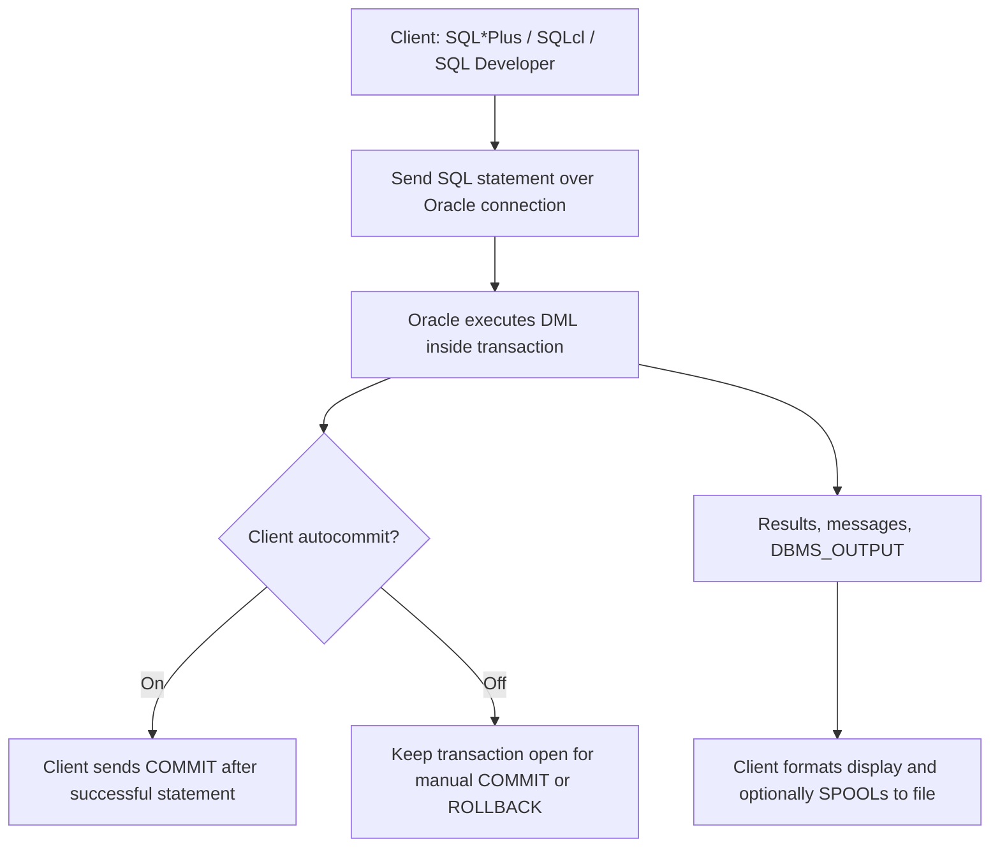

# Controlling Autocommit, Result Formatting, and Logging with SPOOL in Oracle

When practicing Oracle SQL, two sessions running the exact same `UPDATE` can behave very differently: one session modifies data yet can still `ROLLBACK`, while the other commits the change immediately after the statement. Likewise, the same `SELECT` can display neatly on screen or wrap awkwardly and truncate long values; and the output you just inspected can vanish as soon as you close the terminal. These three behaviors correspond to three configuration groups in **Oracle connection tools**:

1. **Autocommit**: determines whether the tool automatically executes `COMMIT` after successful statements or leaves transaction boundaries under your explicit control.
2. **Result display**: controls lines per page, column widths, row-count feedback, `NULL` representation, PL/SQL output, and export formats.
3. **`SPOOL`**: writes session output to a file on the machine running the client so you can review or submit lab results.

This lesson focuses on **SQL\*Plus** and **Oracle SQLcl**, two command-line tools supporting many of the same configuration commands. **Oracle SQL Developer** adds a GUI worksheet and *Run Script* mode; the final section highlights key differences to watch for. In particular, the `SET`, `SHOW`, and `SPOOL` commands in this lesson are **client-side commands**, not standard SQL statements executed directly on the database over JDBC.

## 1. Separating Session, Transaction, and Display Tooling

Suppose a practice table `LAB_BALANCES` stores test balances. When an application sends:

```sql
UPDATE lab_balances
   SET balance = balance + 100
 WHERE account_id = 1;
```

Oracle performs the DML inside **the session's transaction**. While uncommitted, that session sees the modified value, whereas other sessions typically read the committed version according to Oracle's read-consistency model. `COMMIT` makes the changes permanent; `ROLLBACK` undoes uncommitted changes.



Three layers to keep separate:

| Layer | What It Controls | Examples |
| --- | --- | --- |
| **Oracle Database** | Transactions, locks, read consistency, storage, and committed data | `UPDATE`, `COMMIT`, `ROLLBACK` |
| **SQL client** | When to auto-commit and how results are presented in the tool session | `SET AUTOCOMMIT OFF`, `SET LINESIZE 120` |
| **Output log file** | Text/formatted copy of client output created on the machine running the client | `SPOOL report.log REPLACE` |

Changing display settings or turning on `SPOOL` **does not alter Oracle data**. Conversely, writing results to a file **does not mean** data in the transaction was committed. A log file can still contain `SELECT` output read from a transaction that was later rolled back.

## 2. Controlling Autocommit in SQL\*Plus and SQLcl

Open a SQL\*Plus or SQLcl session using your practice account and assigned **PDB service**:

```bash
# SQL*Plus: enter password when prompted by the tool.
sqlplus lab_user@//db-host.example:1521/LABPDB

# SQLcl: similar connection syntax if SQLcl is installed.
sql lab_user@//db-host.example:1521/LABPDB
```

`lab_user`, `db-host.example`, `LABPDB`, and port `1521` are illustrative only; use your actual connection details. `AUTOCOMMIT` defaults can vary by tool or login profile, so **check immediately inside your session**:

```sql
SHOW AUTOCOMMIT
```

Key settings in SQL\*Plus:

```sql
SET AUTOCOMMIT OFF
-- Manually COMMIT or ROLLBACK DML statements.

SET AUTOCOMMIT ON
-- Automatically commit after each successful SQL DML statement or PL/SQL block.

SET AUTOCOMMIT OFF
SHOW AUTOCOMMIT
```

SQL\*Plus also supports `SET AUTOCOMMIT IMMEDIATE` (equivalent to enabling immediately) and `SET AUTOCOMMIT n` for a positive integer `n` to commit after every `n` successful statements/blocks counted by the tool. Statement-counting mode is poorly suited for multi-step business transactions because commit boundaries depend on statement count; prefer `OFF` with explicit `COMMIT` while learning transactions.

**Scope:** `SET AUTOCOMMIT` changes the behavior of **the current client session**. It does not alter a global Oracle Database parameter, nor does it guarantee that a connection in SQL Developer, JDBC, or another terminal window shares the same setting. Many connection libraries (such as JDBC) have their own autocommit toggle; SQL\*Plus's `SET AUTOCOMMIT OFF` cannot be sent verbatim as ordinary JDBC SQL.

### Experiment 1: Disabling Autocommit and Rolling Back

Prepare a dedicated test table using an account with `CREATE TABLE`. **Run the table setup once, before testing transactions**:

```sql
CREATE TABLE lab_balances (
    account_id NUMBER PRIMARY KEY,
    balance    NUMBER(12, 2) NOT NULL,
    CONSTRAINT ck_lab_balances_nonnegative CHECK (balance >= 0)
);

INSERT INTO lab_balances (account_id, balance) VALUES (1, 1000);
COMMIT;
```

DDL statements like `CREATE TABLE` trigger an **implicit commit** in Oracle. Therefore, keep schema setup separate from rollback tests so you never mistakenly assume a newly created table can be rolled back.

In the same session:

```sql
SET AUTOCOMMIT OFF

SELECT account_id, balance
FROM lab_balances
WHERE account_id = 1;
-- Initially: 1000.

UPDATE lab_balances
   SET balance = balance + 200
 WHERE account_id = 1;

SELECT account_id, balance
FROM lab_balances
WHERE account_id = 1;
-- Immediately inside updating session: 1200 (uncommitted).

ROLLBACK;

SELECT account_id, balance
FROM lab_balances
WHERE account_id = 1;
-- Back to: 1000.
```

While uncommitted, **another session** at the default `READ COMMITTED` isolation level will not read the unconfirmed 1200 value. To verify this, open a **second connection** to the same PDB and run `SELECT` before the first session rolls back. Never use two worksheets sharing the same underlying database session to simulate two independent users.

### Experiment 2: Enabling Autocommit and Observing the Effect

Once the sample table is back to a balance of 1000:

```sql
SET AUTOCOMMIT ON

UPDATE lab_balances
   SET balance = balance + 200
 WHERE account_id = 1;
-- SQL*Plus/SQLcl auto-commits the successful UPDATE.

ROLLBACK;

SELECT account_id, balance
FROM lab_balances
WHERE account_id = 1;
-- Still 1200: ROLLBACK cannot undo a COMMIT that already happened.

SET AUTOCOMMIT OFF
```

In multi-step workflows like **create order → insert line items → deduct inventory**, auto-committing after each `INSERT`/`UPDATE` breaks atomicity if a later step fails. Manage a single transaction spanning the full operation at the right ownership layer, committing only when all required steps succeed.

```sql
SET AUTOCOMMIT OFF

SAVEPOINT before_adjustment;

UPDATE lab_balances
   SET balance = balance + 50
 WHERE account_id = 1;

ROLLBACK TO SAVEPOINT before_adjustment;
-- Cancels the +50 update while keeping earlier changes before SAVEPOINT (if any).

COMMIT;
```

`ROLLBACK TO SAVEPOINT` undoes part of the current transaction; `ROLLBACK` undoes all uncommitted changes. Neither is a historical "undo" for already-committed data.

### Commit Boundaries Often Overlooked

- **DDL** (`CREATE`, `ALTER`, `DROP`, `TRUNCATE`, ...) performs Oracle implicit commits even when `SET AUTOCOMMIT OFF`; certain transaction-control statements also carry specific semantics. Never mix DDL into the middle of a DML sequence that may need a full rollback.
- **A failing SQL statement** typically rolls back only that single statement's changes; earlier successful DML statements in the same transaction are not automatically rolled back. Establish an explicit error-handling strategy.
- **Closing a connection** is not an intentional way to conclude business work. For instance, SQL\*Plus `EXIT` may default to committing pending changes; in scripts, issue `COMMIT` or `ROLLBACK` explicitly and use an appropriate exit clause such as `EXIT SUCCESS ROLLBACK` when ending a read-only session.
- **GUI/driver autocommit** can differ from SQL\*Plus; two connections to the same PDB can still exhibit different transaction behavior if each client configures autocommit differently.

## 3. Controlling `SELECT` Result Formatting

SQL\*Plus and SQLcl render results according to tool-session settings. Even a query returning accurate data becomes hard to read when columns wrap, page breaks repeat, or large/negative numbers overflow column widths.

Foundational commands:

```sql
SET HEADING ON
SET FEEDBACK ON
SET LINESIZE 120
SET PAGESIZE 60
SET WRAP ON
SET NULL '<NULL>'
SET TRIMSPOOL ON
```

| SQL\*Plus Command | Effect | Notes |
| --- | --- | --- |
| `SET HEADING ON/OFF` | Shows/hides column headers in SQL output | Usually on for human-readable reports. |
| `SET FEEDBACK ON/OFF` | Shows/hides row-count notices (selected/updated) | Turn off when exporting clean data files with minimal extra lines. |
| `SET LINESIZE 120` | Sets output line width in characters | Lines exceeding width wrap or truncate depending on `WRAP`. |
| `SET PAGESIZE 60` | Number of lines per report page before repeating headers/page breaks | `PAGESIZE 0` is often used to suppress headers/page breaks in raw exports. |
| `SET WRAP ON/OFF` | Controls how lines exceeding width are handled on display | `OFF` can truncate long trailing text on screen. |
| `SET NULL '<NULL>'` | Prints a visible marker for SQL `NULL` values | Does not change actual stored table data. |
| `SET TRIMSPOOL ON` | Strips trailing spaces from each line written to spool | Keeps text files compact; separate from terminal display. |
| `SET ECHO ON/OFF` | Prints/hides commands when executing from a script (`@file.sql`) | Helpful when logs need both commands and results. |
| `SET SERVEROUTPUT ON` | Prints messages generated by `DBMS_OUTPUT.PUT_LINE` | `DBMS_OUTPUT` does not appear automatically unless enabled by client. |

In SQL\*Plus, check current settings with `SHOW`, such as `SHOW LINESIZE`, `SHOW PAGESIZE`, `SHOW FEEDBACK`, and `SHOW SERVEROUTPUT`. These settings affect **how the client renders output**; they do not cause `SELECT` to return extra rows or alter column types in Oracle.

### Formatting Individual Columns with `COLUMN`

Assuming `LAB_BALANCES` was created in the earlier section:

```sql
COLUMN account_id HEADING 'ACCOUNT_ID' FORMAT 999999
COLUMN balance    HEADING 'BALANCE'    FORMAT 999,999,990.00

SELECT account_id, balance
FROM lab_balances
ORDER BY account_id;

-- Clear COLUMN settings when no longer needed.
CLEAR COLUMNS
```

`FORMAT` is a **SQL\*Plus display rule**, unlike `TO_CHAR` inside a SQL query. For numeric columns, a format mask that is too narrow causes SQL\*Plus to print `#` characters instead of digits; widen the format or `LINESIZE`. Long strings can be formatted with `COLUMN col_name FORMAT A30`, where `A30` sets text width. `COLUMN` rules apply by displayed column name/alias for the session and should be cleared before starting a report with different formatting needs.

Example displaying user data with fixed column formatting:

```sql
COLUMN table_name HEADING 'TABLE_NAME' FORMAT A35

SELECT table_name
FROM user_tables
ORDER BY table_name
FETCH FIRST 10 ROWS ONLY;

CLEAR COLUMNS
```

`USER_TABLES` lists tables owned by the connected schema; this query requires no cross-schema privileges. `FETCH FIRST 10 ROWS ONLY` is Oracle's row-limiting syntax supported in modern versions.

### Displaying Long Data and PL/SQL Output

For `CLOB` or `LONG` columns, SQL\*Plus provides `SET LONG` and `SET LONGCHUNKSIZE` to control how much content the client fetches and prints. For example:

```sql
SET LONG 5000
SET LONGCHUNKSIZE 2000
```

`SET LONG` limits how much text is displayed without altering the actual CLOB size stored in the table. Long documents may require higher limits, though for logging you must weigh file size and sensitive data exposure.

To display messages pushed into `DBMS_OUTPUT` by PL/SQL:

```sql
SET SERVEROUTPUT ON SIZE UNLIMITED

BEGIN
    DBMS_OUTPUT.PUT_LINE('Starting connection check');
    DBMS_OUTPUT.PUT_LINE('Session user: ' || SYS_CONTEXT('USERENV', 'SESSION_USER'));
END;
/
```

In SQL\*Plus/SQLcl, `/` on its own line tells the client to execute the PL/SQL block just entered. `SET SERVEROUTPUT ON` makes the client retrieve and print lines from the `DBMS_OUTPUT` buffer; it is **not** Oracle's centralized logging facility. If `SPOOL` is active, these printed lines are also captured in the client's spool file.

## 4. Recording Session Output with `SPOOL`

`SPOOL` is a SQL\*Plus and SQLcl command that writes session output to a **file on the system running the client**. For instance, if SQL\*Plus runs on your laptop, the file is saved on your laptop; if running inside a VM/container or server over SSH, the file is saved in that client execution environment. `SPOOL` does not write files to the Oracle server's datafile directories unless client and server happen to be on the same host with matching permissions.

Common syntax:

```sql
SPOOL path/to/report.log REPLACE
-- Commands whose output you want to save.
SPOOL OFF
```

In SQL\*Plus, semicolons after **SQL\*Plus commands** are optional, so examples are conventionally written concisely:

```sql
SPOOL "C:/oracle-lab/logs/session.log" REPLACE
SELECT SYSDATE AS executed_at FROM dual;
SPOOL OFF
```

The path above is a Windows example; `C:/oracle-lab/logs` must exist and the client account must have write permission. On Linux/macOS you might use `SPOOL /home/student/oracle-lab/session.log REPLACE`. Quote paths containing spaces; for paths with special characters, test a simple path first. If you omit a file extension, SQL\*Plus may automatically append `.lst` according to tool defaults.

| Command | Behavior | When to Use |
| --- | --- | --- |
| `SPOOL report.log` or `SPOOL report.log REPLACE` | Creates or overwrites the file in replace mode | Fresh report for each run. |
| `SPOOL report.log APPEND` | Appends to the end of an existing file | Multi-run consecutive logs. |
| `SPOOL report.log CREATE` | Creates a new file; errors if file already exists | Prevents accidentally overwriting an existing log. |
| `SPOOL OFF` | Stops spooling and closes the file | Required in normal scripts to flush and finalize the file. |
| `SPOOL` | Displays current spool status in SQL\*Plus | Confirms whether output is actively spooling to a file. |

`CREATE`, `REPLACE`, and `APPEND` are `SPOOL` options in modern SQL\*Plus/SQLcl versions. Older releases or compatible tools may not support every variant; if an error occurs, check the help/syntax for your exact client.

### Complete Practice Session Logging Example

Ensure the log directory exists on the client machine. In your `LAB_USER` session, run:

```sql
SET AUTOCOMMIT OFF
SET ECHO ON
SET FEEDBACK ON
SET HEADING ON
SET PAGESIZE 60
SET LINESIZE 120
SET TRIMSPOOL ON
SET SERVEROUTPUT ON

SPOOL "C:/oracle-lab/logs/lab-session.log" REPLACE

SELECT SYS_CONTEXT('USERENV', 'SESSION_USER') AS session_user,
       SYS_CONTEXT('USERENV', 'CON_NAME') AS pdb_name
FROM dual;

SELECT account_id, balance
FROM lab_balances
ORDER BY account_id;

BEGIN
    DBMS_OUTPUT.PUT_LINE('Completed querying LAB_BALANCES table');
END;
/

SPOOL OFF
```

`lab-session.log` saves query results and PL/SQL messages printed while spooling is active. `SET ECHO ON` mainly displays **commands read from a script file**; when typing statements interactively at the prompt, do not expect it to echo every command identically. When you need a record showing both the executed SQL and its results, put the commands in a `.sql` file and run it via `@` as shown below.

### Running a Script and Auto-Saving Results

Create a script file, e.g., `lab_report.sql`, with this content (the spool path is illustrative; adjust before running):

```sql
-- lab_report.sql: read-only report, modifies no data.
WHENEVER OSERROR EXIT FAILURE ROLLBACK
WHENEVER SQLERROR EXIT SQL.SQLCODE ROLLBACK

SET AUTOCOMMIT OFF
SET ECHO ON
SET HEADING ON
SET FEEDBACK ON
SET PAGESIZE 100
SET LINESIZE 120
SET TRIMSPOOL ON
SET SERVEROUTPUT ON

SPOOL "C:/oracle-lab/logs/lab-report.log" REPLACE

SELECT SYS_CONTEXT('USERENV', 'SESSION_USER') AS current_user,
       SYS_CONTEXT('USERENV', 'CON_NAME') AS current_pdb,
       SYSTIMESTAMP AS executed_at
FROM dual;

COLUMN table_name FORMAT A40
SELECT table_name
FROM user_tables
ORDER BY table_name
FETCH FIRST 10 ROWS ONLY;

BEGIN
    DBMS_OUTPUT.PUT_LINE('Exported schema table list');
END;
/

CLEAR COLUMNS
SPOOL OFF

EXIT SUCCESS ROLLBACK
```

Run the script from SQL\*Plus or SQLcl connected to the PDB:

```sql
@C:/oracle-lab/scripts/lab_report.sql
```

The `@...` path must point to an **actual script file**, distinct from the log file path created by `SPOOL`. `@` tells the client to execute lines from the script in order; `SET ECHO ON` makes it easier to trace which SQL ran in the log.

In the script:

- `WHENEVER SQLERROR EXIT SQL.SQLCODE ROLLBACK` tells SQL\*Plus to exit and roll back on SQL/PLSQL errors; this prevents reporting success if a key query fails.
- `WHENEVER OSERROR EXIT FAILURE ROLLBACK` handles OS-level errors recognized by SQL\*Plus, such as file or I/O errors.
- Neither `WHENEVER` directive **catches every SQL\*Plus client-command error** such as `SP2-...`; automated jobs must check both the log file and process exit code.
- `EXIT SUCCESS ROLLBACK` terminates the client session with success status while rolling back any pending changes. Here the script is read-only, so this gives a clean exit without affecting previously committed transactions.

If a script fails before `SPOOL OFF`, exiting the client usually closes the open spool file; nevertheless, always inspect the contents and tail of the file to verify whether the run completed or aborted early. In automated jobs, verify the **process exit code** and completion markers rather than merely checking that `lab-report.log` exists.

## 5. Exporting CSV vs. Text Session Logs

A human-readable log file may include repeated column headers, padding spaces, `N rows selected` messages, and echoed SQL statements. Those extras break programmatic data ingestion. Therefore, distinguish:

- **Session logs (`.log`/`.lst`)**: meant for reproducing statements, messages, and output; suited for `SET ECHO ON` and `FEEDBACK ON`.
- **Data files (`.csv`)**: meant for spreadsheets and analytics pipelines; should have clean headers with non-data lines suppressed; prefer the client's native CSV export mode.

In SQL\*Plus versions supporting `SET MARKUP CSV` (SQL\*Plus 12.2+), you can run:

```sql
SET AUTOCOMMIT OFF
SET ECHO OFF
SET FEEDBACK OFF
SET MARKUP CSV ON DELIMITER , QUOTE ON

SPOOL "C:/oracle-lab/logs/balances.csv" REPLACE
SELECT account_id, balance
FROM lab_balances
ORDER BY account_id;
SPOOL OFF

SET MARKUP CSV OFF
```

In SQLcl, the common CSV export approach is:

```sql
SET SQLFORMAT csv
SPOOL "C:/oracle-lab/logs/balances-sqlcl.csv" REPLACE
SELECT account_id, balance
FROM lab_balances
ORDER BY account_id;
SPOOL OFF
SET SQLFORMAT default
```

`SET SQLFORMAT csv` is a **SQLcl** formatting feature; do not assume SQL\*Plus supports the same command. Likewise, `SET MARKUP CSV` belongs to SQL\*Plus and may behave differently in other compatible tools. When high portability across versions is needed, standardize on one client and document how to run it. For numeric and date/time columns, session formatting and `NLS` settings can change output formatting; standardize export formatting for downstream pipelines.

**Security note:** `SPOOL` records every query value printed to output. With `SET ECHO ON`, SQL statements from the script also appear in the file. Never put passwords, tokens, personal data, or secret-bearing connection strings into statements/logs that might be pushed to Git or shared broadly.

## 6. Differences Between SQL\*Plus, SQLcl, and SQL Developer

| Operation | SQL\*Plus | SQLcl | SQL Developer (GUI) |
| --- | --- | --- | --- |
| Set autocommit | `SET AUTOCOMMIT OFF/ON` | Supports SQL\*Plus-style commands | Autocommit option in Preferences/worksheet; verify actual connection state. |
| Manual commit/rollback | `COMMIT`, `ROLLBACK` | `COMMIT`, `ROLLBACK` | Commit/Rollback toolbar buttons or corresponding SQL statements. |
| Text formatting | `SET LINESIZE`, `PAGESIZE`, `COLUMN` | Similar commands plus extra SQL formats | *Run Script* displays **Script Output**; *Run Statement* usually displays grid **Query Result**. |
| Writing text files | `SPOOL` from client | `SPOOL` from client | May support `SPOOL` in script execution context; grid export is a separate GUI action. |
| CSV export | `SET MARKUP CSV ON` in supporting versions | `SET SQLFORMAT csv` | Export from grid or run script using tool-supported formatting. |

In **SQL Developer**, common shortcuts are `Ctrl+Enter` for *Run Statement* and `F5` for *Run Script*. The two modes produce different output experiences: *Query Result* is a sortable/exportable grid, whereas *Script Output* mirrors script-runner output. Because `SPOOL` is a script-style tool command, never assume running a `SPOOL` line with *Run Statement* behaves identically. UI options vary across SQL Developer releases; confirm your transaction setting and active output panel before evaluating results.

For Java/JDBC, applications control transactions through the `Connection` object or transaction framework—e.g., `connection.setAutoCommit(false)`, `connection.commit()`, and `connection.rollback()`. Those are Java driver APIs, **not** SQL\*Plus's `SET AUTOCOMMIT`. Never infer a Java app's autocommit state from terminal SQL\*Plus settings.

## 7. Common Failure Scenarios and Root-Cause Diagnosis

| Symptom | Common Cause | How to Resolve |
| --- | --- | --- |
| `ROLLBACK` fails to revert data | Client had autocommit on, or changes were committed explicitly/via DDL | Check `SHOW AUTOCOMMIT`, transaction boundaries, and DDL statements. |
| Session A sees new value, Session B does not | A has uncommitted transaction; B reads committed snapshot | Verify two independent sessions; `COMMIT` in A once operations are valid. |
| A `SELECT` prints repeated headers or wrapped lines | Unsuitable `PAGESIZE`, `LINESIZE`, or `COLUMN FORMAT` | Adjust `SET` and column formats before spooling. |
| `DBMS_OUTPUT.PUT_LINE` messages are missing | Client has not enabled fetching/displaying `DBMS_OUTPUT` | Run `SET SERVEROUTPUT ON` in SQL\*Plus/SQLcl; enable DBMS Output panel in GUI. |
| `SPOOL` fails to create/open file | Target directory missing, wrong path, or no write permission | Check **which machine runs the client**, directory, permissions, and `CREATE/REPLACE`. |
| Log file has results only, no SQL commands | `SET ECHO` off, or commands typed interactively at prompt | Put SQL in a `.sql` file and run via `@script.sql` with `SET ECHO ON`. |
| CSV file contains extra notice lines | Spooling plain text output or `ECHO/FEEDBACK` enabled | Enable the client's CSV mode, turn off notices, and separate logs from data exports. |
| Running `SPOOL` over JDBC throws invalid SQL | `SPOOL` is a client command, not Oracle server SQL | Run via SQL\*Plus/SQLcl or use application file I/O. |

To avoid mixing outputs across runs, name files descriptively by purpose/run and choose `CREATE` or `REPLACE` intentionally. When comparing consecutive runs, `APPEND` creates a combined history, though you should separate each run with clear headers or timestamps. A `SELECT SYSTIMESTAMP FROM dual` at the top of a report helps record **query execution time**; `SPOOL` does not provide formal database auditing.

## 8. Integrated Practice Scenario

Goal: control transactions manually on `LAB_BALANCES`, format output cleanly, and save a self-contained log file for review.

**Part A — Working with Transactions**

1. Prepare the table and initial 1000 balance from Section 2 in your practice schema.
2. Run `SHOW AUTOCOMMIT`, then `SET AUTOCOMMIT OFF`.
3. Increase the balance by 200, observe 1200 in the current session, then `ROLLBACK` and verify 1000 is restored.
4. Enable `SET AUTOCOMMIT ON`, apply the +200 update, try `ROLLBACK`, and explain why the balance stays 1200.
5. Reset the client back to `SET AUTOCOMMIT OFF` before practicing multi-step transactions.

**Part B — Formatting and Saving Output**

1. Set `LINESIZE 120`, `PAGESIZE 60`, `HEADING ON`, `FEEDBACK ON`, and format `COLUMN balance` cleanly.
2. Enable `SET SERVEROUTPUT ON`, run a `DBMS_OUTPUT.PUT_LINE` block, and verify the message prints.
3. Start `SPOOL ... REPLACE`, run `SELECT` on the sample table, then `SPOOL OFF`; open the log file in a text editor to verify it matches screen output.
4. Move the read queries into a `.sql` file, run via `@script.sql` with `SET ECHO ON`, and inspect how the log file differs.
5. If your client supports CSV mode, export a separate `balances.csv`; distinguish which lines are actual data vs. presentation metadata.

**Self-Check Questions**

1. **Does disabling autocommit allow `CREATE TABLE` to be rolled back?** No. Oracle DDL performs implicit commits and must be treated as a separate transaction boundary.
2. **Why can't `ROLLBACK` after `SET AUTOCOMMIT ON` undo a successful `UPDATE`?** Because the client already auto-committed the change before `ROLLBACK` was issued.
3. **Does `SPOOL report.log` save the file on the Oracle server or the client machine?** On the system where SQL\*Plus/SQLcl is running, using that process's path and file permissions.
4. **What is needed for a log to include both the SQL commands from a script and their output?** Enable `SET ECHO ON`, start `SPOOL`, and execute the file via `@script.sql`.
5. **Can `SPOOL` serve as proof that a transaction committed or as a security audit log?** No. SPOOL captures client-side display output and may include uncommitted data; it does not replace Oracle transaction controls or auditing.

When using Oracle for study or operations, always check **autocommit before modifying data**, configure **display formatting before running reports**, and scope **`SPOOL` to the client's execution host**. These three habits keep your SQL transactionally sound, readable, and fully traceable after every session.
