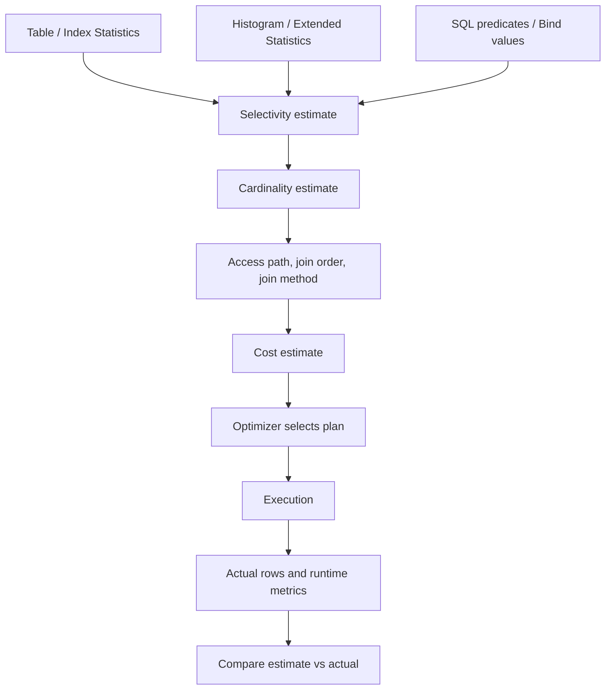

# Cardinality, Selectivity, Cost, and Estimation Limits in the Oracle Optimizer

Oracle Database uses the Cost-Based Optimizer (CBO) to choose how to execute SQL. The optimizer does not just look at the SQL statement; it predicts the number of rows at each step, estimates data access costs, and compares candidate execution plans. Three concepts essential for reading and diagnosing those decisions are **cardinality**, **selectivity**, and **cost**.

- **Cardinality** is the number of rows a row source or a step in an execution plan is estimated to return.
- **Selectivity** is the fraction of rows that satisfy a predicate or a set of conditions.
- **Cost** is a relative internal metric used by the optimizer to compare plans based on its model of I/O, CPU, and related factors.

These three quantities are closely linked. A predicate predicted to have low selectivity generally reduces cardinality; cardinality influences the choice of access path, join order, and join method; and those choices determine the estimated cost. If cardinality is significantly wrong, the optimizer may select a plan that has a low cost in the model but runs slowly on actual data.

Crucially, **the optimizer's estimate is a model based on statistics and SQL information, not an exact count before execution**. Statistics, histograms, extended statistics, bind peeking, dynamic statistics, and feedback can improve estimates, but cannot perfectly capture every data distribution and correlation.

## 1. Cost-Based Optimizer and Execution Plans

### 1.1. What Does the Optimizer Do?

When Oracle receives a SQL statement, it performs parsing, semantic checking, transformation, and optimization before execution. The optimizer considers alternatives such as:

- Full table scan or index access.
- Table join order.
- Nested loops, hash join, or sort merge join.
- Filtering, aggregation, sorting, and query transformations.
- Partition pruning and other available access paths.

The optimizer relies on schema metadata, constraints, object statistics, system statistics, SQL text, bind information, optimizer parameters, and applicable transformations.

### 1.2. A Plan Is a Tree of Row Sources

An execution plan describes operations and their parent/child relationships. A simple example:

```text
SELECT *
FROM employees e
JOIN departments d
  ON d.department_id = e.department_id
WHERE d.location_id = 1700;

HASH JOIN
  TABLE ACCESS FULL DEPARTMENTS
  TABLE ACCESS FULL EMPLOYEES
```

In this plan, Oracle reads DEPARTMENTS rows matching LOCATION_ID, reads EMPLOYEES, and combines the two sets on DEPARTMENT_ID. Each operation has an estimated cardinality and an associated cost.

### 1.3. The Optimizer Does Not Choose Only Access Paths

A good plan is not simply a plan with an index. The optimizer must weigh the whole picture:

- An index lookup can be efficient when retrieving very few rows.
- A full table scan can be better when retrieving a large percentage of rows or when the table is small.
- Nested loops are often suitable when the outer row source is small and inner access is inexpensive.
- Hash join is often suitable for larger data sets and equijoin conditions.
- Sort merge join can suit already-sorted data or certain join conditions.

Cardinality estimates are a critical input to these decisions.

### 1.4. Relationship Diagram



## 2. What Is Cardinality?

### 2.1. Table and Row Source Cardinality

In the optimizer context, cardinality usually refers to the number of rows an operation is predicted to return. It can represent:

- The number of rows in a table according to statistics.
- The number of rows after filtering.
- The number of rows after a join.
- The number of groups after GROUP BY.
- The number of rows after UNION, DISTINCT, or another transformation.

For example, the EMPLOYEES table has 100,000 rows. If a predicate is expected to retain 1% of the data, the post-filter cardinality is approximately 1,000 rows.

### 2.2. Cardinality Is Not the Same as Block Count

Row count and block count are two distinct pieces of information. A table with 100,000 rows can occupy different numbers of blocks depending on row length, PCTFREE, fragmentation, compression, and data organization.

The optimizer needs both row counts and block/leaf block counts to estimate cost. Cardinality answers "how many rows?", while access cost also depends on "how many blocks must be read and how many operations must be performed?".

### 2.3. Cardinality at Different Steps

Example:

```sql
SELECT e.employee_id, e.last_name, d.department_name
FROM employees e
JOIN departments d
  ON d.department_id = e.department_id
WHERE e.salary >= 10000
  AND d.location_id = 1700;
```

The optimizer might estimate:

1. DEPARTMENTS after LOCATION_ID = 1700 leaves 4 rows.
2. EMPLOYEES after SALARY >= 10000 leaves 300 rows.
3. Joining the two row sources produces 25 rows.

This is only an illustrative example. Actual cardinality depends on the data and statistics of the running schema.

### 2.4. Cardinality in the Plan

When displaying a plan with DBMS_XPLAN, the E-Rows column typically shows estimated rows—the number of rows the optimizer predicts for the operation. The A-Rows column, when runtime row-source statistics have been collected, shows the actual number of rows observed.

Not every stored plan has A-Rows. To compare estimates with actuals, you must execute the SQL with appropriate runtime statistics collection.

## 3. What Is Selectivity?

### 3.1. Definition

Selectivity of a predicate is the fraction of rows satisfying that predicate out of the input row set:

```text
Selectivity = rows satisfying condition / total input rows
Estimated cardinality = input cardinality × selectivity
```

If a table has 100,000 rows and a predicate has selectivity 0.02, the estimated cardinality is:

```text
100,000 × 0.02 = 2,000 rows
```

Selectivity generally lies between 0 and 1. The more selective a predicate is, the lower its selectivity value.

### 3.2. Equality Predicates

For a column with NDV (Number of Distinct Values) = 100 and a uniform distribution, an equality condition:

```sql
WHERE department_id = 10
```

can be estimated near:

```text
Selectivity ≈ 1 / NDV = 1 / 100 = 0.01
```

If the table has 100,000 rows, the estimated cardinality is about 1,000 rows. This formula assumes uniform distribution and that the searched value exists; skewed data can invalidate the assumption.

### 3.3. Range Predicates

For a condition:

```sql
WHERE salary BETWEEN 5000 AND 8000
```

the optimizer must estimate the fraction of values falling inside the range. It can use min/max, histograms, density, and related statistics. If the distribution is uneven or values cluster in one sub-range, a uniform assumption can be wrong.

### 3.4. IS NULL

A condition:

```sql
WHERE commission_pct IS NULL
```

depends on the number of NULLs in the column. Statistics containing NUM_NULLS help the optimizer estimate the NULL fraction. If statistics are missing or stale, the estimate can be off.

### 3.5. LIKE Predicates

```sql
WHERE last_name LIKE 'SM%'
```

and:

```sql
WHERE last_name LIKE '%SM'
```

have different access and selectivity characteristics. A prefix pattern can leverage an index under appropriate conditions; a leading wildcard generally prevents a standard B-tree range scan. Selectivity estimation depends on the pattern, statistics, and histograms.

### 3.6. Multiple Predicates

With:

```sql
WHERE department_id = 10
  AND status_code = 'ACTIVE'
```

the optimizer must estimate the fraction satisfying both conditions. A simple model assumes independence:

```text
Selectivity(A AND B) ≈ Selectivity(A) × Selectivity(B)
```

This assumption can fail when the two columns are correlated. For example, all rows in department 10 might be ACTIVE, whereas in other departments only 10% are ACTIVE. Multiplying selectivities independently can underestimate or overestimate cardinality.

## 4. NDV, Density, and Column Statistics

### 4.1. NDV

NDV (Number of Distinct Values) is the number of distinct values recorded in statistics for a column. For example, if STATUS_CODE only contains NEW, READY, and CLOSED, NDV can be 3.

NDV is used in many equality, group by, and join estimates. However, NDV does not tell how often each value appears. Two columns with the same NDV can have very different distributions.

### 4.2. NUM_NULLS

NUM_NULLS records the number of rows with a NULL value in the column. It helps estimate IS NULL/IS NOT NULL predicates and several other calculations.

### 4.3. Density

Density is a statistic used by the optimizer in selectivity estimation, especially when no histogram exists or when a general model is required. Density should not be equated with the selectivity of every specific value. With skewed data, a rare value and a common value have different selectivities.

### 4.4. Low Value and High Value

Statistics can store the lowest and highest values of a column. This helps estimate range predicates, but min/max do not describe gaps or the internal distribution across the domain.

For example, a date column with MIN_DATE = 2020-01-01 and MAX_DATE = 2026-12-31 does not mean rows are evenly spread across that range. Most data might reside in the last 3 months.

### 4.5. Column Statistics Do Not Describe All Correlations

Statistics for individual columns are often insufficient to describe relationships between two columns. If REGION and COUNTRY have a nearly deterministic relationship, combined predicate estimates can be wrong if the optimizer treats them as independent. Extended statistics can provide additional information for certain types of correlation.

## 5. Histograms and Skewed Data

### 5.1. What Is Skew?

Skewed data is unevenly distributed data. For example:

| STATUS_CODE | Rows | Percentage |
|---|---:|---:|
| ACTIVE | 900,000 | 90% |
| PENDING | 90,000 | 9% |
| BLOCKED | 10,000 | 1% |

If only NDV = 3 is known and uniformity is assumed, the optimizer may estimate each value at roughly 1/3. That is far off for ACTIVE or BLOCKED.

### 5.2. How Do Histograms Help?

A histogram stores distribution information for values in a column, helping the optimizer estimate different selectivities for popular/rare values or value ranges.

For example, the condition:

```sql
WHERE status_code = 'ACTIVE'
```

may return most of the table, whereas:

```sql
WHERE status_code = 'BLOCKED'
```

returns only 1%. An appropriate histogram helps the optimizer distinguish the two cases.

### 5.3. Histogram Types

Oracle has several histogram types depending on version, number of distinct values, sampling method, and method_opt:

- **Frequency histogram:** stores frequency per value when the number of distinct values fits within the bucket limit.
- **Top-frequency histogram:** focuses on the most frequent values in qualifying cases.
- **Hybrid histogram:** combines bucket and endpoint frequency information to improve estimates on skewed data.
- **Height-balanced histogram:** a historical type found in older databases/versions or legacy configurations.

Do not infer histogram type solely from bucket count; inspect the data dictionary and Oracle version.

### 5.4. Gathering Histograms

Example using DBMS_STATS:

```sql
BEGIN
    DBMS_STATS.GATHER_TABLE_STATS(
        ownname    => USER,
        tabname    => 'ORDERS',
        method_opt => 'FOR COLUMNS STATUS_CODE SIZE 254',
        cascade    => TRUE,
        estimate_percent => DBMS_STATS.AUTO_SAMPLE_SIZE
    );
END;
/
```

SIZE 254 requests a histogram with the maximum supported bucket count in Oracle's implementation. Whether and what kind of histogram is actually created also depends on NDV, distribution, and release algorithms.

### 5.5. Do Not Create Histograms on Every Column

Histograms help with skewed columns, but are not always beneficial:

- They can make plans sensitive to bind values and generate multiple child cursors.
- Changing statistics can cause plan changes.
- Histograms on unimportant columns bring no benefit.
- For applications with many bind values, a plan optimal for one value may be poor for another.

Create histograms only when there is evidence of cardinality misestimation due to column skew, and test the workload impact.

## 6. Join Cardinality

### 6.1. Basic Equijoin

For two sets R and S joined on column X, an illustrative model assuming uniform distribution and no complex correlation is:

```text
Join cardinality ≈ rows(R) × rows(S)
                   / max(NDV(R.X), NDV(S.X))
```

Example:

- R has 10,000 rows and NDV(R.X) = 100.
- S has 20,000 rows and NDV(S.X) = 200.

Illustrative estimate:

```text
10,000 × 20,000 / 200 = 1,000,000 rows
```

This is a simplified model to understand NDV's role, not Oracle's complete formula for all joins. NULLs, uniqueness, constraints, histograms, partitioning, skew, join predicates, and transformations can all alter the estimate.

### 6.2. Primary Keys and Foreign Keys

If DEPARTMENTS.DEPARTMENT_ID is a primary key and EMPLOYEES.DEPARTMENT_ID is a foreign key, the uniqueness relationship helps the optimizer understand the upper bound on the dimension side. One employee matches at most one department by unique key.

Valid constraints trusted by the optimizer can assist transformations and cardinality estimation. If a constraint does not exist or its state/validation prevents use, the optimizer may not leverage that information as expected.

### 6.3. Join Order

Suppose a query joins three tables A, B, C. If the optimizer estimates A after filtering has only 10 rows, it may start with A, join B, and then C. If A actually has 500,000 rows, the chosen join order/method may turn out poorly.

An error in an input row source can propagate to join steps above it. Thus, when a plan is slow, look for the first operation with a large E-Rows/A-Rows discrepancy rather than looking only at the final operation.

### 6.4. Join Methods Depend on Cardinality

| Join Method | Typically Suited Scenario | Sensitive to Which Error |
|---|---|---|
| Nested loops | Small outer row source, efficient inner access | Outer rows larger than predicted |
| Hash join | Two large data sets, suitable equijoin | Input cardinality/row width larger than predicted, insufficient work area memory |
| Sort merge join | Ordered data or suitable join condition | Misestimated sort volume and row count |

These are tendencies, not absolute rules. The optimizer costs each alternative across the entire query.

### 6.5. Join Fanout

One row in the left table can match many rows in the right table. That multiplication ratio is informally called fanout. If the optimizer predicts each customer has 2 orders when in reality they have 100 orders, post-join cardinality will be heavily off. Skew on the join key is a common cause.

## 7. GROUP BY, DISTINCT, and Cardinality

### 7.1. Number of Groups

For:

```sql
SELECT department_id, COUNT(*)
FROM employees
GROUP BY department_id;
```

the result cardinality is near the number of distinct department_id values present in the data, not the total number of employees. Column NDV and related statistics help the optimizer estimate the number of groups.

### 7.2. DISTINCT

```sql
SELECT DISTINCT status_code
FROM orders;
```

Result cardinality is near the number of distinct values. If NDV statistics are stale, the estimated row count after DISTINCT can be wrong.

### 7.3. Multi-Column GROUP BY

```sql
SELECT country_code, city_code, COUNT(*)
FROM customers
GROUP BY country_code, city_code;
```

The number of groups depends on the combination of values across both columns. Multiplying individual NDVs can overpredict if city_code depends on country_code. Column group extended statistics can improve estimates in appropriate cases.

## 8. What Is Cost?

### 8.1. Cost Is an Internal Metric

Cost is a number the optimizer uses to compare candidate plans. It reflects a model of expected resources such as I/O and CPU, with other factors depending on operation type and version.

Cost is not:

- Runtime in seconds.
- Actual number of block reads.
- A monetary unit or fixed physical unit.
- A promise that a plan with cost 10 will run twice as fast as a plan with cost 20.

### 8.2. Cost Is Relative

The optimizer compares alternatives for the same SQL statement and environment. Costs of two different SQL statements are not necessarily directly comparable. Estimated cost can change after statistics, system stats, optimizer settings, or database versions change.

### 8.3. I/O and CPU

One access path may read many blocks with low CPU; another may read fewer blocks but require many random lookups or expression evaluations. The cost model weighs these factors according to system statistics and the optimizer model.

### 8.4. System Statistics

System statistics help the optimizer model the system's I/O and CPU capabilities. Common metrics include:

- CPU speed.
- I/O seek time.
- I/O transfer rate.
- Multiblock read count.

Exact statistic names and collection methods depend on release/platform. System stats influence costing, particularly the trade-off between full scans and index access.

### 8.5. Indexes Do Not Always Have Lower Cost

An index range scan may read leaf blocks and then visit table blocks by ROWID. If many rows are retrieved and the clustering factor is poor, table block visits can be large. A full table scan can be more efficient due to multiblock I/O and sequential reads.

Therefore, you cannot conclude "if an index exists, the optimizer must use it." Cardinality and overall plan cost decide.

### 8.6. Optimizer Goal

OPTIMIZER_MODE can direct optimization toward full-statement throughput (ALL_ROWS) or response time for the first few rows (FIRST_ROWS_n). Different goals can make the optimizer favor different plans even when the query and statistics are unchanged.

Do not change OPTIMIZER_MODE just to force a plan without understanding the impact across the entire workload.

## 9. Statistics Used by the Optimizer

### 9.1. Table Statistics

Table statistics typically include:

- NUM_ROWS: row count at collection time.
- BLOCKS: number of blocks recorded in statistics.
- AVG_ROW_LEN: average row length.
- SAMPLE_SIZE: number of rows sampled during gathering.
- LAST_ANALYZED: collection timestamp.

Statistics can become stale when data changes substantially after gathering. NUM_ROWS is not a real-time count at all times.

### 9.2. Column Statistics

Column information may include:

- NUM_DISTINCT.
- NUM_NULLS.
- DENSITY.
- LOW_VALUE and HIGH_VALUE.
- HISTOGRAM and bucket count.
- LENGTH and other attributes depending on the view.

This information supports predicate, group by, and join estimation.

### 9.3. Index Statistics

Index statistics typically include:

- BLEVL: B-tree height.
- LEAF_BLOCKS.
- DISTINCT_KEYS.
- CLUSTERING_FACTOR.
- NUM_ROWS.

Clustering factor reflects the correlation between key order in the index and row placement in the table. A high clustering factor can cause an index range scan to visit more table blocks.

### 9.4. System Statistics

System statistics help model I/O and CPU costs. If system stats do not represent the current workload or storage, cost comparisons may fail to reflect actual hardware characteristics.

### 9.5. Partition Statistics

For partitioned tables, partition-level and global statistics serve different roles. Queries with partition pruning may rely on partition stats; queries spanning multiple partitions need accurate global information. Missing or out-of-sync stats can skew estimates.

## 10. Gathering and Managing Statistics with DBMS_STATS

### 10.1. Gather Table Statistics

Example:

```sql
BEGIN
    DBMS_STATS.GATHER_TABLE_STATS(
        ownname          => USER,
        tabname          => 'ORDERS',
        estimate_percent => DBMS_STATS.AUTO_SAMPLE_SIZE,
        method_opt       => 'FOR ALL COLUMNS SIZE AUTO',
        cascade          => TRUE
    );
END;
/
```

AUTO_SAMPLE_SIZE allows Oracle to select an appropriate sampling method/size. SIZE AUTO lets Oracle decide on histograms based on column usage information and release criteria.

### 10.2. Gather Schema Statistics

```sql
BEGIN
    DBMS_STATS.GATHER_SCHEMA_STATS(
        ownname          => USER,
        estimate_percent => DBMS_STATS.AUTO_SAMPLE_SIZE,
        method_opt       => 'FOR ALL COLUMNS SIZE AUTO',
        cascade          => TRUE
    );
END;
/
```

Do not run schema-wide gathering arbitrarily in production without evaluating duration, related locking/invalidations, stats preferences, and deployment plans. Prefer a controlled statistics workflow.

### 10.3. Viewing Statistics

```sql
SELECT table_name,
       num_rows,
       blocks,
       avg_row_len,
       sample_size,
       last_analyzed,
       stale_stats
FROM user_tab_statistics
WHERE table_name = 'ORDERS';
```

View columns:

```sql
SELECT column_name,
       num_distinct,
       num_nulls,
       density,
       histogram,
       num_buckets,
       last_analyzed
FROM user_tab_col_statistics
WHERE table_name = 'ORDERS'
ORDER BY column_name;
```

View indexes:

```sql
SELECT index_name,
       blevel,
       leaf_blocks,
       distinct_keys,
       clustering_factor,
       num_rows,
       last_analyzed
FROM user_ind_statistics
WHERE table_name = 'ORDERS';
```

### 10.4. Statistics Preferences

DBMS_STATS.SET_TABLE_PREFS and SET_SCHEMA_PREFS allow setting preferences for gathering stats, such as method_opt, stale_percent, or incremental. Preferences standardize gather behavior per table/schema without repeating every parameter.

### 10.5. Stale Statistics

Stale stats mean data has changed enough by Oracle's criteria for statistics to be considered due for refresh. It does not guarantee the current plan is wrong. Conversely, non-stale stats can still fail to describe needed distributions or correlations.

Check stale status alongside the execution plan and actual data; do not gather solely because you see an old timestamp.

### 10.6. Pending Statistics

Oracle supports pending statistics to test impact before publishing them as active stats, using appropriate preferences and DBMS_STATS APIs. This lets you test new plans in a test session before changing statistics system-wide. Publish and use_pending_stats must be managed deliberately.

### 10.7. Export/Import Statistics

DBMS_STATS can export/import statistics into a statistics table. This is useful for saving baselines, transferring stats between environments with equivalent data, or rolling back stats. Do not import stats from another environment without confirming that data distribution, schema, and workload are comparable.

## 11. Extended Statistics and Data Correlation

### 11.1. The Independence Assumption Problem

Suppose the ORDERS table has:

- COUNTRY_CODE.
- REGION_CODE.

If each region belongs to only one country, the two columns are correlated. The predicate:

```sql
WHERE country_code = 'VN'
  AND region_code = 'HCM'
```

has a selectivity that cannot always be computed accurately as the product of two independent selectivities. Column group statistics can help the optimizer understand the combined distribution.

### 11.2. Creating Column Group Statistics

```sql
SELECT DBMS_STATS.CREATE_EXTENDED_STATS(
    ownname   => USER,
    tabname   => 'ORDERS',
    extension => '(COUNTRY_CODE, REGION_CODE)'
)
FROM dual;
```

Then gather table stats:

```sql
BEGIN
    DBMS_STATS.GATHER_TABLE_STATS(
        ownname    => USER,
        tabname    => 'ORDERS',
        method_opt => 'FOR ALL COLUMNS SIZE AUTO',
        cascade    => TRUE
    );
END;
/
```

Oracle can use extended stats for certain multi-column predicates. Not every query shape or expression can leverage them.

### 11.3. Viewing Extended Statistics

```sql
SELECT extension_name,
       extension
FROM user_stat_extensions
WHERE table_name = 'ORDERS';
```

View/column names and access privileges should be checked per release. You can inspect hidden columns created by extensions in the appropriate dictionary view.

### 11.4. Expression Statistics

If queries often filter by an expression:

```sql
WHERE UPPER(email_address) = 'AN@example.test'
```

statistics on plain EMAIL_ADDRESS do not fully describe the distribution of UPPER(EMAIL_ADDRESS). Extended expression statistics or a function-based index may help depending on the case.

Create expression statistics:

```sql
SELECT DBMS_STATS.CREATE_EXTENDED_STATS(
    ownname   => USER,
    tabname   => 'CUSTOMERS',
    extension => '(UPPER(EMAIL_ADDRESS))'
)
FROM dual;
```

Then gather stats and check the plan. If an index access path is needed for the expression, a function-based index is a separate option; expression statistics and indexes solve two different problems.

### 11.5. Extended Stats Do Not Fix Every Correlation

Extended statistics have limits. Cross-table correlations, complex join conditions, correlated subqueries, or volatile data can still be difficult to estimate. Do not create every column combination; add them only when actual queries have explainable errors.

## 12. Dynamic Statistics and Dynamic Sampling

### 12.1. When Are They Used?

Dynamic statistics allow the optimizer to gather extra information from data during parse/optimization when existing statistics are insufficient or the query is complex. This mechanism was called dynamic sampling in many documents and versions.

It can be helpful when:

- A table lacks adequate statistics.
- Predicates are complex.
- Joins involve row sources with limited statistical information.
- Temporary tables or objects have hard-to-predict data characteristics.

### 12.2. Optimizer Dynamic Sampling Level

The OPTIMIZER_DYNAMIC_SAMPLING parameter controls the sampling level depending on release and optimizer behavior. You may see the hint:

```sql
SELECT /*+ DYNAMIC_SAMPLING(o 4) */
       COUNT(*)
FROM orders o
WHERE status_code = 'READY';
```

The hint can request sampling for a query block/table alias under appropriate conditions. Do not use levels arbitrarily; dynamic sampling increases parse work and does not guarantee a perfect estimate.

### 12.3. Sampling Has Limits

Sampling reads a subset of data and extrapolates to the whole set. If data is heavily skewed and the sample is unrepresentative, the estimate will still be wrong. Results can also vary across parses or as data changes.

### 12.4. Dynamic Statistics Do Not Replace Managed Statistics

For important tables, maintain proper table/column/index stats. Dynamic statistics are a supplemental tool during optimization, not a reason to skip DBMS_STATS.

## 13. Bind Variables, Bind Peeking, and Adaptive Cursor Sharing

### 13.1. Bind Variables

Bind variables enable SQL text reuse:

```sql
SELECT *
FROM orders
WHERE customer_id = :customer_id;
```

This reduces hard parses and supports cursor sharing. However, if customer_id has a skewed distribution, one bind value may return 1 row while another returns thousands of rows.

### 13.2. Bind Peeking

During a hard parse, the optimizer can peek at the first bind value to estimate selectivity and select a plan. If the first value is rare while subsequent values are common, the plan may suit few executions—or vice versa.

Bind peeking is part of optimizer behavior; do not assume every execution re-optimizes with the current bind value.

### 13.3. Adaptive Cursor Sharing

Adaptive Cursor Sharing (ACS) allows Oracle to recognize that a cursor does not fit all bind selectivities and create child cursors/plans tailored to groups of bind values. This mechanism depends on release, execution history, and optimizer conditions.

ACS does not guarantee every bind value gets an optimal plan and does not replace checking skew/histograms.

### 13.4. Viewing Bind/Child Cursor Information

Dynamic performance views such as V$SQL, V$SQL_SHARED_CURSOR, V$SQL_CS_SELECTIVITY, and V$SQL_CS_STATISTICS can help investigate child cursors, bind sensitivity, and bind awareness when privileges allow. Columns and interpretation depend on release.

### 13.5. Do Not Literalize to Fix Every Bind Issue

Converting all binds to literals can increase hard parses, shared pool usage, and cursor counts. If a query needs multiple plans based on selectivity, evaluate ACS, histograms, SQL profiles/baselines, and query design before removing binds.

## 14. Cardinality Feedback, Statistics Feedback, and Adaptive Plans

### 14.1. Estimates and Actuals After Execution

Oracle can use information from an execution to recognize inaccurate cardinality estimates and adjust optimization on subsequent runs. Naming and mechanism details vary by release; common terms are cardinality feedback or statistics feedback.

### 14.2. Feedback Is Not a Permanent Fix

Feedback can be affected by:

- Child cursors and hard parses.
- Changes to SQL text or bind behavior.
- Statistics changes.
- Different sessions/environments.
- Non-reproducible query conditions.

Do not assume the second run is guaranteed to be better than the first.

### 14.3. Adaptive Plans

In certain versions/configurations, the optimizer can produce an adaptive plan with a runtime choice based on information observed during execution, such as switching a join method branch. This helps some plans cope with estimation errors, but does not eliminate the need for good statistics.

### 14.4. SQL Plan Management

A SQL Plan Baseline can control the set of accepted plans for a statement, reducing the risk of plan regression. It does not fix cardinality statistics itself and does not guarantee a locked plan under every circumstance. A SQL Profile can supply auxiliary statistics to improve estimates without necessarily forcing a single specific plan.

Distinguish them:

| Mechanism | Primary Purpose |
|---|---|
| Table/column/index statistics | Describe data and structure |
| Histogram/extended statistics | Describe skew/correlation/expressions |
| Dynamic statistics | Gather additional info during optimization |
| Cardinality/statistics feedback | Learn from prior executions under conditions |
| SQL Profile | Supplement info to aid estimation/costing |
| SQL Plan Baseline | Manage accepted plans |

## 15. Reading Execution Plans to Find Cardinality Misestimates

### 15.1. Viewing a Basic Plan

```sql
EXPLAIN PLAN FOR
SELECT e.employee_id, e.last_name, d.department_name
FROM employees e
JOIN departments d
  ON d.department_id = e.department_id
WHERE d.location_id = 1700;

SELECT *
FROM TABLE(DBMS_XPLAN.DISPLAY);
```

EXPLAIN PLAN shows the plan generated in the explain environment. It does not provide A-Rows from an actual execution and can differ from the actual cursor plan due to binds, session settings, or environment.

### 15.2. Collecting Runtime Row-Source Statistics

Execute the SQL with the hint:

```sql
SELECT /*+ GATHER_PLAN_STATISTICS */
       e.employee_id, e.last_name, d.department_name
FROM employees e
JOIN departments d
  ON d.department_id = e.department_id
WHERE d.location_id = 1700;
```

Then view the most recent cursor:

```sql
SELECT *
FROM TABLE(
    DBMS_XPLAN.DISPLAY_CURSOR(
        NULL,
        NULL,
        'ALLSTATS LAST +PREDICATE +PEEKED_BINDS'
    )
);
```

You can enable STATISTICS_LEVEL=ALL in a session to collect runtime statistics for eligible statements, though the GATHER_PLAN_STATISTICS hint is often convenient when measuring a single statement.

### 15.3. E-Rows and A-Rows

Key columns:

| Column | Meaning |
|---|---|
| Id / Operation | Row source and operation |
| Name | Related object |
| Starts | Number of times the operation was started |
| E-Rows | Estimated rows per operation start according to the plan |
| A-Rows | Actual rows processed/returned per runtime statistics |
| A-Time | Actual elapsed time recorded |
| Buffers | Logical I/O |
| Reads | Physical reads |
| OMem / 1Mem / Used-Mem | Work area memory info when available |

Column details depend on DBMS_XPLAN format and version.

### 15.4. Comparing Properly

If an operation has STARTS greater than 1, A-Rows may represent the cumulative total across multiple starts. When comparing against E-Rows, account for Starts; a naive comparison of the two numbers can mislead. With nested loops, the inner row source often runs many times.

Identify the first operation with a large discrepancy in execution order. An error at a lower operation can multiply through parent operations.

### 15.5. Predicate Information

DBMS_XPLAN can display predicate information showing whether a condition was used as an access predicate or a filter predicate. If a predicate is applied only after reading many rows, intermediate data volumes may be larger than desired.

### 15.6. Peeked Binds

The +PEEKED_BINDS format can display bind values peeked during the associated parse, if present and supported. These are not necessarily the bind values of every execution. Use them to investigate plan selection, not to conclude every run used the same values.

## 16. Estimate vs. Actual Discrepancies

### 16.1. Small Errors

Estimates do not need to match actuals identically for the optimizer to choose a good plan. Small errors may not alter access paths or join methods and may not noticeably affect performance.

### 16.2. Multi-Order-of-Magnitude Errors

If E-Rows is 10 while A-Rows is 100,000, the optimizer underestimated by roughly 10,000x. Large errors can lead to:

- Nested loops when the outer row source is actually huge.
- Suboptimal join order.
- Undersized hash area or spills to TEMP.
- Misestimated sort/aggregation cardinality.
- Unexpected memory/workarea usage and execution time.

### 16.3. Find the First Misestimated Operation

Do not inspect only the plan root. Walk upward from lower row sources and find the first point of divergence. If a filter on table A is misestimated, every join above it can be wrong as well. Fixing the root estimate may not address the underlying cause.

### 16.4. Compare Under Identical Conditions

Comparing estimates and actuals requires matching:

- SQL text and child cursor.
- Bind values or selectivity class.
- Roughly equivalent schema/data snapshot.
- Session optimizer parameters.
- Statistics and database release.

If these factors differ, the discrepancy may come from the environment rather than the cardinality model.

## 17. Common Causes of Estimation Errors

### 17.1. Stale or Non-Representative Statistics

Heavy data changes after gathering, bulk loads, purges, or partition exchanges can leave stats out of sync with current data. Check last_analyzed, stale_stats, sample_size, and partition/global stats.

### 17.2. Skew Without Histograms

The optimizer applies a near-uniform model while a few values dominate the data. Inspect NUM_DISTINCT, histograms, and actual value frequencies.

### 17.3. Correlation Between Multiple Columns

Predicates on two related columns are estimated as independent. Consider column group extended statistics when justified by the workload.

### 17.4. Predicates on Expressions

```sql
WHERE TRUNC(order_date) = DATE '2026-05-01'
```

or UPPER(column), SUBSTR(column), or arithmetic expressions can prevent base column statistics from describing selectivity accurately. Consider range rewrites, expression stats, or function-based indexes where appropriate.

Rewrite example:

```sql
WHERE order_date >= DATE '2026-05-01'
  AND order_date <  DATE '2026-05-02'
```

This rewrite can enable index range access while preserving date semantics when ORDER_DATE is DATE. Check timezone/datatype if the column is TIMESTAMP.

### 17.5. Implicit Conversion

If a bind data type differs from the column data type, Oracle may convert the column or value depending on the expression. This affects access paths and estimates. Bind the correct data type and inspect Predicate Information/plan.

### 17.6. Bind Values with Different Selectivities

A very rare bind value and a very common bind value may require different plans. Check bind peeking, child cursors, and ACS.

### 17.7. Join Correlation and Key Skew

Per-table NDVs do not fully describe how many rows match per key. A few customers may have millions of orders while most have only a few. Uneven join fanout can cause estimation errors.

### 17.8. Subqueries and OR Predicates

OR, NOT, correlated subqueries, EXISTS/NOT EXISTS, UNION, and complex views can make estimation harder. The optimizer may transform the query; read the post-transformation plan to identify the actual row sources.

### 17.9. Temporary Tables and Session-Specific Data

Global temporary tables can hold different data across sessions. Shared statistics do not always represent the current session's data set. Session-specific stats/dynamic sampling mechanisms depending on release may need review.

### 17.10. Remote Tables and External Data

Estimates for remote/external data may depend on available statistical information, database links, and how the optimizer pushes predicates. Inspect remote SQL and plans on both sides when needed.

## 18. Workflow for Diagnosing Cardinality Misestimates

### Step 1 — Retrieve the Actual Cursor Plan

Collect the SQL_ID, child number, and plan of the slow execution. Use DISPLAY_CURSOR rather than only EXPLAIN PLAN when runtime evidence is needed.

### Step 2 — Collect E-Rows/A-Rows

Enable GATHER_PLAN_STATISTICS for a reproducible run or use appropriate instrumentation. Record Starts, E-Rows, A-Rows, buffers, reads, and A-Time.

### Step 3 — Locate the First Discrepancy

Walk upward from lower row sources. Find the first filter/join operation with a large estimate/actual gap, accounting for Starts.

### Step 4 — Inspect Predicates

Check access/filter predicates, bind data types, implicit conversions, functions, expressions, NULL semantics, and combined conditions.

### Step 5 — Inspect Statistics

Check table/column/index stats, histograms, NDV, NUM_NULLS, stale stats, partition/global stats, and system stats.

### Step 6 — Identify Skew/Correlation

Run queries to inspect actual data statistics on the relevant columns. Check frequencies of common values, correlations between columns, and join fanout.

### Step 7 — Test Statistics Improvements

Consider gathering stats, histograms, extended statistics, expression statistics, or dynamic statistics. Test in a test environment or with pending stats when appropriate.

### Step 8 — Compare Plan and Runtime

Run the same SQL, bind values, and equivalent data. Compare E-Rows/A-Rows, plan hash, elapsed time, buffers, reads, and PGA/workarea.

### Step 9 — Manage Plan Regression

Once a good plan is confirmed, evaluate SQL Plan Management or an appropriate plan management solution. Do not use hints to force plans before understanding why the estimate was wrong.

### Step 10 — Document Changes

Record statistics, compiler/optimizer parameters, SQL text, bind profile, plan, and benchmark results so the outcome is reproducible.

## 19. Hints and the Limits of Forcing the Optimizer

### 19.1. Cardinality Hint

Oracle provides a CARDINALITY hint in certain contexts to supply an estimated cardinality for a row source/query block. This is a specialized tool, not a long-term substitute for good statistics. Syntax and effectiveness must be checked by version and alias/query block.

### 19.2. Access/Join Hints

Hints such as INDEX, FULL, USE_NL, USE_HASH, and LEADING can influence plan selection. If base cardinality is wrong, forcing a join method may improve one specific query while hurting others when data or bind values change.

### 19.3. Hints Are Not Absolute Guarantees

Hints can be ignored due to wrong aliases, conflicts, transformations, unsupported contexts, or inability of the optimizer to apply them. Check the plan and hint report if the release supports it.

### 19.4. Order of Priority

A sensible sequence of actions is usually:

1. Fix SQL, data types, and predicates.
2. Fix statistics and model skew/correlation.
3. Check bind behavior and optimizer environment.
4. Test dynamic/extended statistics or a SQL Profile when justified.
5. Use a SQL Plan Baseline or controlled hints if plan protection is needed.

## 20. Lab: Observing Skew and Cardinality

Perform this in a dedicated lab schema. Do not run test DDL or experimental statistics gathering on production tables.

### 20.1. Create Skewed Data

```sql
CREATE TABLE ce_lab (
    id NUMBER NOT NULL,
    category VARCHAR2(20),
    region VARCHAR2(20)
);

INSERT INTO ce_lab(id, category, region)
SELECT level,
       CASE
           WHEN MOD(level, 10) = 0 THEN 'RARE'
           ELSE 'COMMON'
       END,
       CASE
           WHEN MOD(level, 10) = 0 THEN 'SPECIAL'
           ELSE 'NORMAL'
       END
FROM dual
CONNECT BY level <= 100000;

COMMIT;
```

In this data, COMMON accounts for about 90% and RARE about 10%. CATEGORY and REGION are completely correlated by construction.

### 20.2. Gather Stats Without Requesting Histograms

```sql
BEGIN
    DBMS_STATS.GATHER_TABLE_STATS(
        ownname => USER,
        tabname => 'CE_LAB',
        method_opt => 'FOR ALL COLUMNS SIZE 1',
        cascade => TRUE
    );
END;
/
```

SIZE 1 avoids creating standard histograms on columns. Inspect column stats:

```sql
SELECT column_name,
       num_distinct,
       num_nulls,
       density,
       histogram,
       num_buckets
FROM user_tab_col_statistics
WHERE table_name = 'CE_LAB';
```

### 20.3. Compare Predicates

```sql
SELECT /*+ GATHER_PLAN_STATISTICS */ COUNT(*)
FROM ce_lab
WHERE category = 'COMMON';

SELECT *
FROM TABLE(
    DBMS_XPLAN.DISPLAY_CURSOR(
        NULL, NULL, 'ALLSTATS LAST +PREDICATE'
    )
);
```

Repeat with CATEGORY = 'RARE'. Compare E-Rows/A-Rows and plans. Estimates may depend on release, sampling, and cursor; record actual observations.

### 20.4. Gather a Histogram

```sql
BEGIN
    DBMS_STATS.GATHER_TABLE_STATS(
        ownname => USER,
        tabname => 'CE_LAB',
        method_opt => 'FOR COLUMNS CATEGORY SIZE 254',
        cascade => TRUE
    );
END;
/
```

Re-run both queries with binds/literals under the same test conditions. Check how the histogram and estimates change.

### 20.5. Test Column Group Statistics

```sql
SELECT DBMS_STATS.CREATE_EXTENDED_STATS(
    ownname => USER,
    tabname => 'CE_LAB',
    extension => '(CATEGORY, REGION)'
)
FROM dual;

BEGIN
    DBMS_STATS.GATHER_TABLE_STATS(
        ownname => USER,
        tabname => 'CE_LAB',
        method_opt => 'FOR ALL COLUMNS SIZE AUTO',
        cascade => TRUE
    );
END;
/
```

Test:

```sql
SELECT /*+ GATHER_PLAN_STATISTICS */ COUNT(*)
FROM ce_lab
WHERE category = 'RARE'
  AND region = 'SPECIAL';
```

Compare estimates before and after extended stats. Because the lab data creates a very strong correlation, this is a helpful case to observe column groups.

### 20.6. Test Join Fanout

Create a child table with uneven row counts per key, then join with CE_LAB. Compare cardinality estimates against A-Rows. Test a key with many child rows and a key with few child rows.

### 20.7. Record Results

| Experiment | E-Rows | A-Rows | Plan hash | Buffers | Notes |
|---|---:|---:|---|---:|---|
| COMMON, no histogram |  |  |  |  |  |
| RARE, no histogram |  |  |  |  |  |
| COMMON, with histogram |  |  |  |  |  |
| RARE, with histogram |  |  |  |  |  |
| Two-column predicate, extended stats |  |  |  |  |  |

Fill in results from a running database. Do not treat expected numbers in the text as experimental results.

## 21. Checklist for Reading Cardinality and Cost

- [ ] Are you looking at the actual cursor plan rather than only EXPLAIN PLAN?
- [ ] Do you have runtime statistics to read A-Rows?
- [ ] Did you account for Starts when comparing E-Rows/A-Rows?
- [ ] Did you locate the first operation with a large estimate discrepancy?
- [ ] Do predicates have implicit conversions or functions on columns?
- [ ] Are bind data types and bind selectivity handled appropriately?
- [ ] Are table/column/index stats stale or non-representative?
- [ ] Is a column skewed without a histogram?
- [ ] Are multiple columns correlated and in need of extended statistics?
- [ ] Does a join key have uneven fanout?
- [ ] Are group by/distinct group counts reasonably estimated?
- [ ] Are index clustering factor and table blocks impacting cost?
- [ ] Are system stats and optimizer settings consistent?
- [ ] Are dynamic statistics/feedback/ACS affecting child cursors?
- [ ] Have you benchmarked with representative bind values and concurrency?
- [ ] Are hints or baselines being used without understanding the root cause?

## 22. Self-Check Questions

1. What does cardinality in an execution plan represent?
2. How is selectivity defined?
3. Under what conditions does the formula cardinality = input rows × selectivity apply?
4. How do NDV and NUM_NULLS help the optimizer?
5. Is density the selectivity of every individual value?
6. Why are histograms useful for skewed data?
7. At a high level, how do frequency, top-frequency, hybrid, and height-balanced histograms differ?
8. Why should you avoid creating histograms on every column?
9. When can the independence assumption between two predicates fail?
10. What problem do extended column group statistics solve?
11. How do NDV, uniqueness, and fanout influence join cardinality?
12. Why can a misestimate in a lower row source cause upper plan steps to be wrong?
13. How are nested loops and hash joins sensitive to cardinality?
14. Is cost runtime in seconds?
15. Why is index access not always cheaper than a full table scan?
16. How do system statistics affect costing?
17. What key information do table, column, and index statistics contain?
18. What roles do DBMS_STATS.AUTO_SAMPLE_SIZE and SIZE AUTO play?
19. Does stale statistics mean the plan is definitely wrong?
20. How do dynamic statistics differ from persistent object statistics?
21. How does bind peeking affect plans?
22. How does adaptive cursor sharing help handle varying bind selectivities?
23. What are the limitations of statistics feedback and adaptive plans?
24. Why must A-Rows, E-Rows, and Starts be viewed together?
25. What is the workflow to find the first operation with a cardinality misestimate?
26. How does a SQL Profile differ from a SQL Plan Baseline in primary purpose?
27. When should you consider expression statistics or a function-based index?
28. Why can EXPLAIN PLAN differ from the actual cursor plan?
29. What conditions should be kept identical when benchmarking two plans?
30. Why does a lower cost not automatically prove a query will run faster on every execution?

**Key principle to remember:** selectivity estimates the fraction of rows matching a predicate; cardinality translates that fraction into row counts at each row source; cost helps the optimizer compare plans under a resource model. Statistics and histograms describe distributions, extended statistics describe certain correlations, and bind peeking/feedback/dynamic statistics supplement information under specific conditions. When investigating slow queries, inspect the cursor plan with runtime statistics, compare E-Rows with A-Rows while accounting for Starts, locate the first misestimate, and then check predicates, binds, skew, correlation, and statistics. Cost is a relative estimate, not actual wall-clock time or a performance guarantee.
