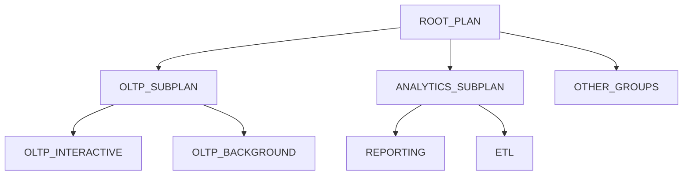

# Resource Manager, Consumer Groups, and Resource Allocation

Oracle Database Resource Manager is a database-level workload governance mechanism. It helps DBAs decide which workloads receive priority when multiple sessions compete for CPU, cap concurrently active sessions, throttle parallel execution, set resource thresholds, and handle SQL statements running too long or consuming excessive resources.

Resource Manager operates through three core components:

- **Resource plan:** defines the resource allocation policy for a workload or environment.
- **Plan directive:** binds specific policy rules to a consumer group or subplan, such as CPU shares, active session pools, parallel degree limits, and group-switching thresholds.
- **Consumer group:** categorizes sessions by workload so Resource Manager applies the appropriate directives.

For example, an application can divide sessions into OLTP, reporting, and batch groups. When the database is busy, the OLTP group receives CPU priority with short queue timeouts; the batch group receives smaller CPU shares, capped active sessions, and heavy jobs can be switched to a lower-priority group.

Resource Manager does not create extra CPU, memory, or I/O. It allocates existing resources according to configured policies. Thus, a sound plan makes workload contention fairer and more predictable, but does not replace SQL tuning, proper sizing, connection pool management, or fixing storage bottlenecks.

## 1. What Problems Does Resource Manager Solve?

### 1.1. Workloads Competing for Resources

A database often serves multiple workload types concurrently:

- Short, latency-sensitive transactions.
- Data-intensive reporting queries.
- Bulk ETL or batch updates.
- Maintenance, statistics gathering, and administrative jobs.
- Ad hoc user-submitted tasks.

If all sessions are treated identically, a group running large queries can monopolize CPU or active execution slots, forcing short transactions to wait. Resource Manager isolates workloads to limit mutual interference.

### 1.2. Example of Contention

Suppose an instance has 16 available CPU cores. Running simultaneously are:

| Workload | Sessions | Characteristics |
|---|---:|---|
| OLTP | 80 | Many short transactions requiring consistent response times |
| Reporting | 12 | Queries reading many rows with joins and sorts |
| Batch | 20 | Batch processing, high CPU demand |
| Ad hoc | 8 | Unpredictable SQL |

Without Resource Manager, a handful of reporting or batch queries can saturate CPU for extended periods. Resource Manager prioritizes OLTP under contention while capping concurrent reporting and batch sessions.

### 1.3. What Resource Manager Can Control

Depending on release, edition, configuration, and workload type, Resource Manager can govern:

- CPU allocation across consumer groups via priorities/shares.
- Maximum CPU utilization caps for groups in supported plans.
- Active session limits and queuing of excess sessions.
- Parallel degree limits per consumer group.
- Switching sessions to another consumer group upon breaching CPU/time/I/O thresholds.
- Canceling SQL or terminating sessions per supported directives.
- Limiting undo generation per consumer group.
- Throttling workloads across pluggable databases in multitenant setups.

Resource Manager is not a direct hard quota tool for every per-SQL memory type. PGA work areas, SGA, TEMP, storage IOPS, and other resources have separate management mechanisms. Verify exact resource types and capabilities supported in your running release.

## 2. Foundational Concepts

### 2.1. Resource Plan

A resource plan is a set of directives defining how resources are divided. A plan can contain:

- Consumer groups directly.
- Subplans—plans nested inside a parent plan.
- The default `OTHER_GROUPS` group to catch sessions not mapped elsewhere.

Plans form a hierarchy. A subplan further divides its allocated share among child consumer groups.

### 2.2. Plan Directive

A directive is a rule for a consumer group or subplan within a plan. A directive can specify:

- CPU shares across management levels.
- CPU utilization limits.
- Active session pool and queue wait timeout.
- Parallel degree limits.
- Undo pool limits.
- Group-switching policies and runaway query thresholds.
- Additional limits depending on Oracle release.

A plan without matching directives for a workload will not enforce desired rules. Ensure every session has a valid mapping path to an appropriate consumer group.

### 2.3. Consumer Group

A consumer group is a workload label attached to a session. Resource Manager uses the session's current group to determine which directive applies.

Examples:

- `OLTP_GROUP`: online transactions.
- `REPORTING_GROUP`: reporting.
- `BATCH_GROUP`: batch processing.
- `ETL_GROUP`: data loading and transformation.
- `OTHER_GROUPS`: fallback group for uncategorized sessions.

A consumer group is not a schema, database user, role, or service. One user can open sessions belonging to different consumer groups depending on mappings, module/action, or permitted group switches.

### 2.4. Sessions and Consumer Groups

Consumer groups apply at the session level. At session creation, Oracle assigns the initial group via configuration/mapping rules. During the session's lifetime, its group can change via mappings, authorized switches, or Resource Manager policies.

This matters for connection pools: a single physical database session may be reused across many requests. Applications must set module, action, client identifier, and consumer group accurately at request boundaries when using those attributes to classify workloads.

### 2.5. Active Resource Plan

Creating a plan and directives does not mean it is actively governing workloads. You must activate the plan via Resource Manager configuration, typically via the `RESOURCE_MANAGER_PLAN` instance parameter or the equivalent multitenant mechanism.

## 3. CPU Allocation and Priorities

### 3.1. CPU Shares

Resource Manager allocates CPU among consumer groups using management levels such as `MGMT_P1` through `MGMT_P8`. These values express relative shares at their respective level in the plan structure.

Illustrative example at one level:

| Consumer group | MGMT_P1 | Policy Meaning |
|---|---:|---|
| `OLTP_GROUP` | 70 | Prioritized under contention |
| `REPORTING_GROUP` | 20 | Receives smaller share than OLTP |
| `BATCH_GROUP` | 10 | Runs at lower priority |

These numbers illustrate policy configuration, not fixed CPU percentages reserved exclusively for each group at all times.

### 3.2. Shares Are Not Hard Reservations

When CPU is idle, a lower-share group can still consume CPU unused by other groups. When contention occurs, Resource Manager distributes CPU according to shares and hierarchy levels.

Thus, if OLTP uses only 10% CPU, batch jobs can utilize remaining spare CPU rather than being artificially capped at 10%. As OLTP load rises, batch CPU shrinks per policy.

### 3.3. Hierarchical Resource Allocation

Plans can distribute resources across multiple levels:



The parent plan allocates shares to subplans, which then divide their allotted resources among child consumer groups. This lets DBAs organize many applications or workloads cleanly rather than managing a flat, sprawling list.

### 3.4. CPU Utilization Limit

Directives can specify `UTILIZATION_LIMIT` to cap maximum CPU usage for a group/subplan per release capabilities and scope. This is a hard ceiling, distinct from shares:

- Shares govern relative allocation under contention.
- Utilization limits set an absolute ceiling within the applicable scope.

Setting a cap too low prevents a group from using idle CPU and stretches job runtimes. Use hard caps only when strictly required or to shield other workloads.

### 3.5. MGMT_P1 Through MGMT_P8

Levels `MGMT_P1`...`MGMT_P8` allocate CPU across tiered priority levels. Exact semantics and inheritance depend on plan structure and release. When designing:

1. Identify the parent plan and peer groups/subplans.
2. Select appropriate allocation levels.
3. Assign shares reflecting relative priority.
4. Configure the `OTHER_GROUPS` directive.
5. Validate the plan before submitting.
6. Observe metrics under real CPU contention.

Never treat `MGMT_P1=70` as a guarantee a group always gets 70% of CPU regardless of load, core count, or plan hierarchy.

## 4. Active Session Pools and Queuing

### 4.1. Why Cap Active Sessions?

A consumer group may hold many open connections, yet not all need to execute concurrently. Heavy queries consume CPU, PGA, TEMP, and I/O. An active session pool limits how many sessions in the group may execute concurrently per the directive.

Example:

- `REPORTING_GROUP` allows at most 5 active sessions.
- Once 5 are active, the 6th session is queued.
- A queue timeout ensures requests do not wait forever.

### 4.2. ACTIVE_SESS_POOL_P1

`ACTIVE_SESS_POOL_P1` sets the active session limit at the corresponding directive level. When active sessions reach this threshold, new requests wait in the queue per policy.

This limits active database calls, not total connections in a connection pool. A group can maintain hundreds of connected idle sessions while allowing only a small subset to execute simultaneously.

### 4.3. QUEUEING_P1

`QUEUEING_P1` sets the maximum wait duration in the queue per Oracle release units and semantics. Upon expiration, Resource Manager handles the timeout and the client receives the corresponding result/error.

Set queue timeouts with SLAs in mind:

- Too long piles up requests and inflates latency.
- Too short rejects requests prematurely that could otherwise wait briefly.
- If applications retry aggressively, short queue timeouts can spark retry storms.

### 4.4. Active Session Pools Do Not Replace Connection Pools

Application-side connection pools govern physical connections. Resource Manager active session pools govern active executing sessions within a consumer group. They complement each other:

| Connection Pool | Resource Manager Active Session Pool |
|---|---|
| Limits/reuses connections from the application | Limits active executing sessions in a group |
| Cuts connect/disconnect overhead | Controls workload concurrency inside DB |
| Can queue when connections are exhausted | Can queue when group active slots are full |
| Managed at the client/application tier | Managed inside Oracle Database |

If both layers queue, wait times stack up. Measure end-to-end latency and size both layers deliberately.

### 4.5. Example of Choosing Active Session Pool Limits

Suppose reports consume heavy PGA and TEMP. A DBA might start in a test environment with 4 active sessions and a 60-second queue timeout, then measure:

- Report throughput.
- P95/P99 latency.
- Queued or timed-out session counts.
- Peak PGA/TEMP.
- Instance CPU and I/O.
- Impact on OLTP.

Never adopt 4 and 60 seconds as universal defaults across every system.

## 5. Parallel Execution Controls

### 5.1. Why Cap Parallelism?

A single parallel SQL statement spawns multiple PX server processes. If many sessions run high DOP concurrently, total processes and CPU/memory/I/O demand surge rapidly.

Resource Manager sets `PARALLEL_DEGREE_LIMIT_P1` to cap parallel degree for a consumer group via plan directives.

### 5.2. DOP Is Not Session Count

Degree of Parallelism (DOP) is a statement's parallelism level. One session running at DOP 8 requests multiple PX server processes, whereas active session pools count active sessions per group policy. The two limits address different dimensions.

### 5.3. Examples

- `OLTP_GROUP`: low parallel degree limit or 1, preventing transactional calls from unexpectedly grabbing PX workers.
- `REPORTING_GROUP`: allows higher DOP while capping active sessions.
- `BATCH_GROUP`: moderate DOP and lower CPU share during business peak hours.

Choose concrete values based on CPU cores, `PARALLEL_SERVERS_TARGET`, available PX servers, workload mix, and latency SLAs.

### 5.4. Parallel Statement Queuing

Oracle can queue parallel statements when PX servers are scarce per configuration. This mechanism interacts with Resource Manager and parallel parameters. When diagnosing slow queries, distinguish PX queue wait time from actual plan execution time.

### 5.5. Verifying Actual DOP

The plan may request a different DOP than actually granted at runtime. The system can downgrade DOP due to resource availability, policy, or queuing. Inspect execution plans, SQL Monitor, `V$PX_SESSION`, and parallel views to confirm runtime DOP.

## 6. Undo Pools and Limiting DML Workloads

### 6.1. Undo Pool

`UNDO_POOL` sets a threshold on how much undo a consumer group may generate per Oracle release units and semantics. Once exceeded, further DML in that group is rejected until active undo drops below the threshold.

This protects the database from runaway DML workloads monopolizing undo space. It does not replace proper undo tablespace sizing or transaction management.

### 6.2. When to Use It?

Consider undo pool limits for:

- Large batch updates/deletes.
- Ad hoc tasks risking bulk modifications.
- ETL groups needing isolation from transactional workloads.
- Workloads prohibited from exceeding an undo budget.

### 6.3. Trade-Offs

Too low a limit causes legitimate jobs to fail mid-run. Before enforcing, measure job undo generation on representative datasets, design restartability, and ensure applications handle errors cleanly.

### 6.4. Undo Pool Is Not an Undo Tablespace Quota

An undo pool is a consumer-group policy. The undo tablespace is database-wide undo storage. A workload can be blocked by an undo pool even when the tablespace has free space; conversely, tablespace exhaustion is a database-level storage issue not solved by raising an undo pool.

## 7. Runaway Queries and Consumer Group Switching

### 7.1. Objective

A SQL statement can far exceed expected CPU time, elapsed time, or I/O. Resource Manager can enforce thresholds to switch the session to a lower-priority group, cancel the SQL, or terminate the session depending on directives and version.

### 7.2. SWITCH_GROUP

`SWITCH_GROUP` specifies the target consumer group when a switch condition triggers. The target can be another consumer group or a special Oracle-supported action in that release, such as canceling SQL.

Example policies:

- Reports exceeding a CPU threshold switch to `LONG_RUNNING_GROUP`.
- Ad hoc queries exceeding limits switch to `LOW_PRIORITY_GROUP`.
- Workloads disallowed from running overly long are canceled per policy.

### 7.3. SWITCH_TIME

`SWITCH_TIME` typically sets the CPU time threshold for a session in a consumer group before triggering the switch action. This is not necessarily wall-clock elapsed time: a query stuck waiting on I/O can have high elapsed time yet low CPU time.

Distinguish CPU time from elapsed time when choosing thresholds.

### 7.4. SWITCH_ESTIMATE and MAX_EST_EXEC_TIME

Estimate-based attributes let Resource Manager evaluate estimated execution time before execution begins and apply policy if thresholds are exceeded. `MAX_EST_EXEC_TIME` caps estimated execution time under supported mechanisms; `SWITCH_ESTIMATE` controls switching based on estimates.

Optimizer estimates can be inaccurate. Never treat estimate-based controls as strict guarantees on runtime duration.

### 7.5. SWITCH_IO_MEGABYTES and SWITCH_IO_REQS

Certain releases support I/O thresholds measured in megabytes or I/O request counts. These attributes can trigger group switches upon crossing thresholds. Confirm exact units, measurement scope, and release support before configuring.

### 7.6. MAX_IDLE_TIME and MAX_IDLE_BLOCKER_TIME

Resource Manager can enforce limits on sessions sitting idle too long or sitting idle while holding locks blocking other sessions. Use these thresholds carefully:

- An idle session may hold uncommitted transactions.
- Terminating the session forces rollbacks and application errors.
- Connection pools deliberately keep sessions idle between calls.

Apply idle timeouts only when aligned with application behavior and transaction patterns.

### 7.7. SWITCH_TIME_IN_CALL and Call-Level Policies

Some configurations evaluate thresholds per call rather than cumulatively over the session's stay in the group. This helps when a long-lived session executes many distinct requests/calls. Exact syntax and semantics vary by Oracle release; check package specifications and data dictionary views.

### 7.8. Do Not Confuse Resource Manager Switches with Application Retries

When Resource Manager cancels SQL or switches groups, the application may receive an error or continue in the new group depending on policy. Blindly retrying without inspecting error codes amplifies load. Applications should classify errors, bound retries, and log consumer group at request start/end.

## 8. Consumer Group Mapping

### 8.1. Why Is Mapping Needed?

A plan only classifies workloads effectively when sessions land in the right consumer group. Mapping rules assign consumer groups based on session attributes.

An application user may share the same schema for both transactions and reports. Mapping solely by `ORACLE_USER` puts both workloads into the same group. Mapping by service, module/action, or client identifier separates them cleanly.

### 8.2. Common Mapping Attributes

Oracle supports various mapping attributes depending on release:

- `ORACLE_USER`: database username.
- `SERVICE_NAME`: database service the session connected to.
- `CLIENT_ID`: client identifier set by the application.
- `MODULE_NAME`: module set by the application.
- `MODULE_NAME_ACTION`: combination of module and action.
- `CLIENT_PROGRAM`: client program name.
- `PDB_NAME`: pluggable database in multitenant environments.
- Other attributes such as client OS user, machine, terminal, or Oracle functions depending on version.

Not every attribute exists in every release or fits every system.

### 8.3. Setting MODULE and ACTION

Applications set module/action via `DBMS_APPLICATION_INFO`:

```sql
BEGIN
    DBMS_APPLICATION_INFO.SET_MODULE(
        module_name => 'ORDER_API',
        action_name => 'CREATE_ORDER'
    );
END;
/
```

When starting a different operation, update module/action accordingly. When returning a connection to a pool, reset module/action so the next request does not inherit stale labels.

### 8.4. Setting CLIENT_IDENTIFIER

```sql
BEGIN
    DBMS_SESSION.SET_IDENTIFIER('APP_USER_1001');
END;
/
```

Client identifier typically tracks end users at the application tier, tracing, and mapping. Never treat it as independent authentication proof: the application must control who sets it and never trust raw user-supplied strings for authorization.

### 8.5. Example Mapping by Service

Within a pending area, declare mappings:

```sql
BEGIN
    DBMS_RESOURCE_MANAGER.CREATE_PENDING_AREA;

    DBMS_RESOURCE_MANAGER.SET_CONSUMER_GROUP_MAPPING(
        attribute      => DBMS_RESOURCE_MANAGER.SERVICE_NAME,
        value          => 'OLTP_SERVICE',
        consumer_group => 'OLTP_GROUP'
    );

    DBMS_RESOURCE_MANAGER.SET_CONSUMER_GROUP_MAPPING(
        attribute      => DBMS_RESOURCE_MANAGER.SERVICE_NAME,
        value          => 'REPORT_SERVICE',
        consumer_group => 'REPORTING_GROUP'
    );

    DBMS_RESOURCE_MANAGER.VALIDATE_PENDING_AREA;
    DBMS_RESOURCE_MANAGER.SUBMIT_PENDING_AREA;
END;
/
```

This illustrates the API structure. Consumer groups must exist before submitting mappings. Verify attribute constants, privileges, and mapping priorities against your deployed Oracle release.

### 8.6. Mapping by Module/Action

```sql
BEGIN
    DBMS_RESOURCE_MANAGER.CREATE_PENDING_AREA;

    DBMS_RESOURCE_MANAGER.SET_CONSUMER_GROUP_MAPPING(
        attribute      => DBMS_RESOURCE_MANAGER.MODULE_NAME_ACTION,
        value          => 'ORDER_API.CREATE_ORDER',
        consumer_group => 'OLTP_GROUP'
    );

    DBMS_RESOURCE_MANAGER.SET_CONSUMER_GROUP_MAPPING(
        attribute      => DBMS_RESOURCE_MANAGER.MODULE_NAME_ACTION,
        value          => 'REPORT_API.MONTH_END',
        consumer_group => 'REPORTING_GROUP'
    );

    DBMS_RESOURCE_MANAGER.VALIDATE_PENDING_AREA;
    DBMS_RESOURCE_MANAGER.SUBMIT_PENDING_AREA;
END;
/
```

The application must set module/action before executing the SQL to be classified. If a connection pool reuses sessions without clearing module/action, mapping may act on stale values.

### 8.7. Mapping Priority

A session can match multiple mapping attributes. `DBMS_RESOURCE_MANAGER.SET_CONSUMER_GROUP_MAPPING_PRI` defines mapping precedence. Design an explicit hierarchy:

1. High-specificity attributes, such as module/action or client identifier where appropriate.
2. Workload-dedicated service name.
3. Database user as a default rule.
4. `OTHER_GROUPS` as the fallback.

Declare and verify exact precedence in the data dictionary; never rely on assumptions about default order.

### 8.8. Mapping Does Not Replace Authorization

Consumer groups govern resource policy only. They do not grant table read privileges, authenticate users, or replace roles/privileges/VPD. A user gains zero data access privileges merely by mapping into a high-priority group.

## 9. Switching Consumer Groups from a Session

### 9.1. Application-Driven Switching

Some applications switch groups temporarily when starting a batch or report. `DBMS_SESSION` provides an API to switch the current consumer group when authorized:

```sql
DECLARE
    l_old_group VARCHAR2(128);
BEGIN
    DBMS_SESSION.SWITCH_CURRENT_CONSUMER_GROUP(
        new_consumer_group      => 'BATCH_GROUP',
        old_consumer_group      => l_old_group,
        initial_group_on_error  => FALSE
    );

    -- Perform batch work.

    DBMS_SESSION.SWITCH_CURRENT_CONSUMER_GROUP(
        new_consumer_group      => l_old_group,
        old_consumer_group      => l_old_group,
        initial_group_on_error  => FALSE
    );
END;
/
```

This snippet illustrates saving and restoring the previous group. Check exact parameter signatures, privileges, and `OUT` variable semantics in your release's package specification; in production, wrap restoration in exception-safe cleanup blocks.

### 9.2. Granting Switch Privileges

DBAs grant permission to switch into a consumer group using `DBMS_RESOURCE_MANAGER_PRIVS` per policy:

```sql
BEGIN
    DBMS_RESOURCE_MANAGER_PRIVS.GRANT_SWITCH_CONSUMER_GROUP(
        grantee_name   => 'APP_USER',
        consumer_group => 'BATCH_GROUP',
        grant_option   => FALSE
    );
END;
/
```

Grant switch privileges strictly to users/roles that need them. Never grant switch rights to every group unnecessarily.

### 9.3. Initial Consumer Group

DBAs can assign a user's initial consumer group using administrative APIs such as `SET_INITIAL_CONSUMER_GROUP`. Initial group and dynamic mappings are distinct configuration layers. Check mapping priorities and session state to determine the final effective group at logon.

### 9.4. Switches Require Cleanup

If an application switches to `BATCH_GROUP` and hits an exception, the session may return to the pool still stuck in `BATCH_GROUP`. Run cleanup in a `finally` block or ensure pool checkout callbacks reset the group on every request.

### 9.5. DBA Session Management

DBAs have APIs to switch consumer groups for other live sessions by `SID`/`SERIAL#`. This requires administrative privileges and careful session verification. Never use `SID` alone, as `SID` can be reused after session termination.

## 10. Creating Resource Plans with DBMS_RESOURCE_MANAGER

### 10.1. Pending Area

Changes to plans, directives, consumer groups, and mappings are normally staged inside a pending area:

1. `CREATE_PENDING_AREA`.
2. Create/modify consumer groups, plans, and directives.
3. Configure mappings if needed.
4. `VALIDATE_PENDING_AREA`.
5. `SUBMIT_PENDING_AREA`.

The pending area lets Oracle validate the consistency of the changeset before publishing. If validation fails, read the error and fix the configuration; never submit an invalid plan.

### 10.2. Example Creating Groups and a Plan

The example below creates two consumer groups and a simple plan. Names and values are illustrative; verify supported parameters in your database release.

```sql
BEGIN
    DBMS_RESOURCE_MANAGER.CREATE_PENDING_AREA;

    DBMS_RESOURCE_MANAGER.CREATE_CONSUMER_GROUP(
        consumer_group => 'OLTP_GROUP',
        comment        => 'Interactive application transactions'
    );

    DBMS_RESOURCE_MANAGER.CREATE_CONSUMER_GROUP(
        consumer_group => 'BATCH_GROUP',
        comment        => 'Background batch workload'
    );

    DBMS_RESOURCE_MANAGER.CREATE_PLAN(
        plan    => 'APP_WORKLOAD_PLAN',
        comment => 'Workload allocation for application services'
    );

    DBMS_RESOURCE_MANAGER.CREATE_PLAN_DIRECTIVE(
        plan             => 'APP_WORKLOAD_PLAN',
        group_or_subplan => 'OLTP_GROUP',
        comment          => 'Prioritize interactive transactions',
        mgmt_p1          => 70,
        active_sess_pool_p1 => 40,
        queueing_p1      => 30,
        parallel_degree_limit_p1 => 2
    );

    DBMS_RESOURCE_MANAGER.CREATE_PLAN_DIRECTIVE(
        plan             => 'APP_WORKLOAD_PLAN',
        group_or_subplan => 'BATCH_GROUP',
        comment          => 'Constrain batch concurrency',
        mgmt_p1          => 20,
        active_sess_pool_p1 => 4,
        queueing_p1      => 120,
        parallel_degree_limit_p1 => 4
    );

    DBMS_RESOURCE_MANAGER.CREATE_PLAN_DIRECTIVE(
        plan             => 'APP_WORKLOAD_PLAN',
        group_or_subplan => 'OTHER_GROUPS',
        comment          => 'Fallback for unmapped sessions',
        mgmt_p1          => 10
    );

    DBMS_RESOURCE_MANAGER.VALIDATE_PENDING_AREA;
    DBMS_RESOURCE_MANAGER.SUBMIT_PENDING_AREA;
END;
/
```

This uses common parameters. Exact parameter names, bounds, valid values, and summation rules vary by release. In real environments, consult the package specification and `DBA_RSRC_PLAN_DIRECTIVES` before applying.

### 10.3. Why Is OTHER_GROUPS Important?

`OTHER_GROUPS` is the fallback group for sessions not mapped to an explicit group. Standard Resource Manager plans require a directive for `OTHER_GROUPS`. If missing or misconfigured, the plan may fail validation or leave unexpected workloads without clear governance.

Do not assign overly high priority to `OTHER_GROUPS` if protecting critical workloads. At the same time, do not starve the fallback group so severely that administrative sessions or background tasks cannot operate.

### 10.4. Validate Before Submitting

`VALIDATE_PENDING_AREA` verifies the integrity of the pending configuration. Only call `SUBMIT_PENDING_AREA` after validation succeeds. If errors occur, fix the offending directive/group/mapping and re-validate.

### 10.5. Updating Directives

When adjusting policy, use `UPDATE_PLAN_DIRECTIVE` inside a pending area rather than dropping and recreating the entire plan unnecessarily:

```sql
BEGIN
    DBMS_RESOURCE_MANAGER.CREATE_PENDING_AREA;

    DBMS_RESOURCE_MANAGER.UPDATE_PLAN_DIRECTIVE(
        plan             => 'APP_WORKLOAD_PLAN',
        group_or_subplan => 'BATCH_GROUP',
        mgmt_p1          => 15,
        active_sess_pool_p1 => 3,
        queueing_p1      => 180
    );

    DBMS_RESOURCE_MANAGER.VALIDATE_PENDING_AREA;
    DBMS_RESOURCE_MANAGER.SUBMIT_PENDING_AREA;
END;
/
```

Verify parameter names and partial-update behavior for your release. Save existing configuration before modifying so you can roll back.

### 10.6. Deleting Plans/Groups

Before deleting a consumer group or plan, verify whether it is referenced by directives, mappings, active sessions, or scheduler job classes. Delete in dependency order inside a pending area using supported APIs. Never drop a group currently used by production workloads without remapping first.

## 11. Activating and Switching Resource Plans

### 11.1. RESOURCE_MANAGER_PLAN

Once a plan is created and validated, activate it using `RESOURCE_MANAGER_PLAN` per database configuration:

```sql
ALTER SYSTEM SET RESOURCE_MANAGER_PLAN =
    'APP_WORKLOAD_PLAN' SCOPE=BOTH;
```

This requires appropriate privileges. `SCOPE` and dynamic modifiability depend on parameter rules, instance/RAC configuration, and release. Verify the active plan after changing it.

### 11.2. Checking the Current Plan

```sql
SHOW PARAMETER resource_manager_plan;
```

Or:

```sql
SELECT name, value
FROM v$parameter
WHERE name = 'resource_manager_plan';
```

`V$RSRC_PLAN` and related Resource Manager views show the currently active plan and runtime status.

### 11.3. Disabling a Plan

Disable Resource Manager at the instance level by setting `RESOURCE_MANAGER_PLAN` to empty/null per your release's syntax and policy. Before disabling, evaluate the impact, as all workloads will immediately lose the plan's directives.

### 11.4. Controlled Plan Switching

You can maintain multiple plans:

- `DAY_PLAN` for business hours.
- `NIGHT_BATCH_PLAN` for overnight batch windows.
- `MAINTENANCE_PLAN` for maintenance windows.

Plan switches can be driven by DBAs or tested Scheduler jobs. Ensure no competing automation overwrites `RESOURCE_MANAGER_PLAN` unexpectedly.

### 11.5. RAC

In RAC, Resource Manager can enforce plans per instance alongside cluster workload mechanisms depending on release. Verify instance-level settings, service placement, plan activation, and workload distribution cluster-wide. A plan enabled on one instance does not automatically mean all other instances share the same active policy.

## 12. Resource Manager in Multitenant Environments

### 12.1. CDB and PDB

In Oracle Multitenant, Resource Manager governs resources across two tiers:

- A CDB-level plan allocates resources across PDBs.
- A PDB-level plan allocates that PDB's allotted share among consumer groups inside the PDB.

This creates a two-tier hierarchy: the CDB determines how much each PDB receives; each PDB divides its allotment among OLTP, reporting, or batch groups within its boundary.

### 12.2. CDB Resource Plan

A CDB resource plan defines directives per PDB, using attributes such as shares, utilization limits, and parallel server limits depending on version. The goal is preventing one noisy PDB from starving other PDBs.

### 12.3. PDB Resource Plan

Inside a PDB, DBAs use consumer groups and directives to classify workloads. For instance, one application PDB can separate OLTP and reporting, while another PDB enforces a distinct batch policy.

### 12.4. Hierarchical Limits

A PDB cannot consume beyond the ceiling imposed by the CDB plan, even if its internal PDB-level plan grants child groups more room. Always evaluate both tiers together.

### 12.5. Do Not Confuse CDB/PDB Plans with Simple Instance Plans

APIs, dictionary views, parameters, and directive attributes for PDBs differ from consumer-group-only plans in a non-CDB. Follow the multitenant documentation for your release and execute operations inside the exact target container.

## 13. Resource Manager and Oracle Scheduler

### 13.1. Job Classes

Oracle Scheduler can bind a job class to a consumer group so jobs automatically inherit resource governance when running. This lets DBAs throttle batch workloads by group without modifying every stored procedure to switch groups manually.

### 13.2. Separating Scheduling from Resource Governance

Scheduler controls when jobs execute and job metadata. Resource Manager controls resource allocation for running sessions/groups. They complement each other:

| Scheduler | Resource Manager |
|---|---|
| Schedules, jobs, job classes, windows | Consumer groups, plans, directives |
| Decides when work runs | Throttles resources while work runs |
| Can cap job counts via scheduler settings | Can cap active sessions/CPU/parallelism |

### 13.3. Binding Job Classes to Consumer Groups

When creating a job class, specify the target consumer group via supported Scheduler APIs for your release. Confirm job sessions actually run inside the expected group using `V$RSRC_SESSION_INFO` and Scheduler metadata.

### 13.4. Maintenance Windows

Automated maintenance windows and tasks may activate dedicated or special resource plans. Check window/plan configurations before altering `RESOURCE_MANAGER_PLAN` manually to avoid conflicting with automated maintenance policies.

## 14. Monitoring Resource Manager

### 14.1. Views for Plans and Directives

Common data dictionary views:

- `DBA_RSRC_PLANS`: resource plans.
- `DBA_RSRC_PLAN_DIRECTIVES`: plan directives.
- `DBA_RSRC_CONSUMER_GROUPS`: consumer groups.
- `DBA_RSRC_GROUP_MAPPINGS`: mapping rules.
- `DBA_RSRC_MAPPING_PRIORITY`: mapping precedence order.

Exact view names and columns vary by release; `USER_`/`ALL_`/`DBA_` visibility depends on privileges.

Example inspecting plan directives:

```sql
SELECT plan,
       group_or_subplan,
       mgmt_p1,
       active_sess_pool_p1,
       queueing_p1,
       parallel_degree_limit_p1,
       undo_pool,
       switch_group,
       switch_time
FROM dba_rsrc_plan_directives
WHERE plan = 'APP_WORKLOAD_PLAN'
ORDER BY group_or_subplan;
```

### 14.2. Viewing Consumer Group Mappings

```sql
SELECT attribute,
       value,
       consumer_group
FROM dba_rsrc_group_mappings
ORDER BY attribute, value;
```

Mapping priority:

```sql
SELECT attribute, priority
FROM dba_rsrc_mapping_priority
ORDER BY priority;
```

Verify actual mappings against the service/module/client identifiers set by applications. A mapping rule existing in the dictionary does nothing if session attributes are never populated.

### 14.3. V$RSRC_PLAN

`V$RSRC_PLAN` displays the currently active Resource Manager plan at runtime. It is the starting point to confirm a plan is active on the instance.

### 14.4. V$RSRC_SESSION_INFO

`V$RSRC_SESSION_INFO` reports per-session Resource Manager details, including current consumer group and state depending on release:

```sql
SELECT sid,
       current_consumer_group,
       state,
       active,
       consumer_group_id
FROM v$rsrc_session_info
ORDER BY sid;
```

Exact columns vary by release. Join with `V$SESSION` on `SID` and verify `SERIAL#` when identifying specific sessions, as `SID` can be reused.

### 14.5. V$RSRC_CONSUMER_GROUP

Runtime consumer-group views report CPU consumption, active sessions, queued sessions, waits, and resource governance metrics. Use them to verify the policy is behaving as intended.

### 14.6. V$RSRCMGRMETRIC and History

Resource Manager metric views report interval metrics such as CPU utilization, CPU waits, active sessions, and queued sessions depending on release. Use history to analyze peak hours rather than relying on one snapshot.

### 14.7. Joining with V$SESSION

```sql
SELECT s.sid,
       s.serial#,
       s.username,
       s.service_name,
       s.module,
       s.action,
       s.client_identifier,
       r.current_consumer_group,
       r.state
FROM v$session s
LEFT JOIN v$rsrc_session_info r
  ON r.sid = s.sid
WHERE s.type = 'USER'
ORDER BY s.username, s.sid;
```

This is an illustrative query; verify column names and join keys for your release. For reliable session identification, combine `SID` with `SERIAL#` and session attributes.

### 14.8. Checking Queues

When a group queues, inspect active sessions, queued counts, and wait durations. Cross-check with application pool queues to determine at which tier requests are waiting.

### 14.9. Checking Switches and Runaways

Track how many sessions switched groups, had SQL canceled, or were terminated by directives. Record before/after groups and triggered thresholds to see whether policies are too strict or too lenient.

## 15. Resource Plan Design Process

### Step 1 — Classify Workloads

Inventory services, schemas, modules/actions, client identifiers, job classes, and request types. Separate short latency-sensitive workloads from long throughput-oriented workloads.

### Step 2 — Define SLA Targets

Document response times, throughput, batch completion windows, max sessions, parallelism caps, and which workloads must be protected under contention.

### Step 3 — Define Consumer Groups

Create groups aligned with workload types and resource profiles. Avoid creating one group per user unless operationally justified; excessive groups complicate mapping and monitoring.

### Step 4 — Assign CPU Shares

Design hierarchy levels and priorities. Shares must express relative priority under contention, not fixed CPU percentages across all conditions.

### Step 5 — Set Concurrency Controls

Configure active session pools and queue timeouts for resource-heavy workloads, accounting for application-tier pool queuing.

### Step 6 — Cap Parallelism

Choose parallel degree limits based on workload type, core counts, PX server pools, and aggregate load.

### Step 7 — Consider Runaway/Undo Policies

Configure switch thresholds or undo pools when clearly justified and measured against representative workloads. Plan application error handling when SQL is switched or canceled.

### Step 8 — Build Mappings

Prefer specific attributes such as services and module/action or client identifiers. Configure mapping priorities, initial groups, and `OTHER_GROUPS`.

### Step 9 — Create and Validate the Plan

Use a pending area to build groups/plans/directives, validate, and submit. Archive scripts and before/after configurations.

### Step 10 — Activate in a Controlled Window

Enable `RESOURCE_MANAGER_PLAN` in test/staging first. Production rollouts require monitoring session classification, queuing, and CPU waits.

### Step 11 — Measure and Tune

Compare latency, throughput, CPU utilization, queue times, active sessions, PX usage, undo, and cross-workload impact.

### Step 12 — Maintain a Rollback Plan

Keep the prior plan, prior mappings, and rollback commands ready. If critical workloads suffer, revert to the known-good plan under change control.

## 16. Workload Policy Design Example

### 16.1. Goal

A system serves three workloads:

- OLTP requires low response times.
- Reporting can wait briefly, but must not monopolize CPU.
- Batch jobs must finish overnight and can consume idle resources.

### 16.2. Illustrative Policy

| Group | Illustrative CPU Share | Active Session Pool | Queue Timeout | Parallel Limit |
|---|---:|---:|---:|---:|
| `OLTP_GROUP` | 70 | 40 | 30 seconds | 2 |
| `REPORTING_GROUP` | 20 | 5 | 60 seconds | 4 |
| `BATCH_GROUP` | 10 | 3 | 180 seconds | 4 |
| `OTHER_GROUPS` | 10 or suitable fallback | As needed | Per policy | 1 |

These figures illustrate the design approach only. In a real plan, CPU shares must adhere to Oracle's hierarchy and validation rules; never add or subtract figures from this table as standalone CPU quotas.

### 16.3. Mapping

- Service `OLTP_SERVICE` maps to `OLTP_GROUP`.
- Service `REPORT_SERVICE` maps to `REPORTING_GROUP`.
- Job class `NIGHT_BATCH` maps to `BATCH_GROUP`.
- Unmatched sessions fall into `OTHER_GROUPS`.

If one service carries both transactions and reports, use module/action or client identifier to separate them further.

### 16.4. Behavior Under Contention

When CPU is busy:

1. OLTP receives higher priority per its share.
2. Reporting is throttled and capped by its active session pool.
3. Batch receives remaining CPU share and slows down gracefully.
4. Excess sessions beyond the active pool wait up to the queue timeout.
5. Parallel statements respect per-group DOP caps.

When OLTP load is light, reporting and batch can use idle CPU unless restricted by utilization caps.

### 16.5. How to Evaluate

Do not measure total CPU alone. Track:

- OLTP P95/P99 response times.
- Transaction throughput.
- Report completion times.
- Batch completion windows.
- Session queue times and timeouts.
- PX server utilization.
- PGA/TEMP/undo pressure.
- CPU wait time per consumer group.

## 17. Resource Manager and Connection Pools

### 17.1. Reused Sessions

Connection pools keep physical database sessions open across many requests. Consumer groups, modules/actions, client identifiers, and session attributes persist if the application fails to reset them.

### 17.2. Setting Context on Checkout

Upon borrowing a connection, the application should:

1. Set client identifier for the authenticated user.
2. Set module/action for the request type.
3. Ensure the right consumer group via mappings or authorized switching.
4. Execute SQL.
5. Clear/restore attributes before returning the connection.

### 17.3. Cleanup on Exceptions

If a request switches to `BATCH_GROUP` and throws an exception, the session must not return to the pool in the wrong group. Run cleanup in a `finally` block and discard the connection from the pool if clean state cannot be guaranteed.

### 17.4. Mapping and Module/Action

When mapping by `MODULE_NAME_ACTION`, every request must update module/action before executing governed SQL. Stale module/action values can route a new request into the wrong consumer group.

### 17.5. Avoiding Unintended Two-Tier Queuing

The application pool can queue when connections run out; Resource Manager can queue when the active session pool fills up. If both queue simultaneously, users see high latency while app logs show only connection-borrow delays. Measure wait times at each tier separately.

## 18. Limitations and Operational Notes

### 18.1. Resource Manager Does Not Fix Bad SQL

A query with a bad plan still burns heavy resources inside its assigned group. Resource Manager merely bounds blast radius; you still must optimize SQL, statistics, indexes, partitioning, and data models.

### 18.2. Not Every Resource Has a Direct Quota

CPU, active sessions, parallelism, and undo have corresponding directives. PGA/SGA memory and storage I/O have separate controls; never interpret CPU shares as memory quotas.

### 18.3. CPU Shares Only Matter Under Contention

Without CPU contention, a low-share group can still consume plenty of CPU. If you need a hard ceiling, use utilization limits or appropriate caps.

### 18.4. Active Session Pools Can Add Latency

Queuing protects the database at the cost of request wait time. Setting active pools too low turns database overload into application-tier backlogs. Align timeouts, backpressure, and retry policies.

### 18.5. Switch Policies Can Impact Transactions

Canceling SQL or killing sessions forces transaction rollbacks and application errors. Design idempotency, retries, and cleanup accordingly.

### 18.6. Mapping Priority Needs Verification

A session matching multiple rules may land in an unexpected group if priorities are unclear. Verify dictionary configuration and live runtime groups rather than merely reading setup scripts.

### 18.7. SYS and Administrative Tasks

Administrative and Oracle background sessions follow special rules and should not be dumped arbitrarily into application workload groups. Preserve administrative access and recovery paths per Oracle guidelines.

### 18.8. Releases and Editions

Certain directives, views, multitenant features, or SQL Monitoring capabilities depend on release, edition, options, and licensing. Confirm package specifications, data dictionary views, and Oracle licensing before using them.

## 19. Common Anti-Patterns

### 19.1. Creating a Plan Without Activating It

The plan and directives exist, yet `RESOURCE_MANAGER_PLAN` does not point to it. DBAs assume policies are enforced while sessions run under another configuration.

### 19.2. Forgetting OTHER_GROUPS

Unmapped sessions lack an explicit fallback policy. Always configure the `OTHER_GROUPS` directive and fallback mappings.

### 19.3. Mapping Everything by Database User

One database user often runs mixed workloads. Mapping solely by user lumps OLTP, reports, and batches into one group. Add service/module/action/client ID mappings where needed.

### 19.4. Mistaking CPU Shares for CPU Caps

Shares control relative distribution under contention, not fixed ceilings. Use `UTILIZATION_LIMIT` or other controls when a hard cap is required.

### 19.5. Setting Active Session Pool Too Low

Too few active slots stretch queues and cause job timeouts. Measure real concurrency and latency across both application and database tiers.

### 19.6. Setting Parallel Degree Limit Too High

A handful of sessions can exhaust PX servers and trigger contention. Size DOP caps to workload and instance resources.

### 19.7. Setting Switch Thresholds Too Low

Legitimate queries get repeatedly switched or canceled. Derive thresholds from runtime distributions and SLAs, and validate in staging.

### 19.8. Failing to Reset Session Attributes in Pools

Stale module/action/client identifiers or consumer groups leak from previous requests. Ensure cleanup runs on both success and exception paths.

### 19.9. Changing Plans Without Saving a Baseline

Without saved prior plans/mappings, rolling back after a regression becomes painful. Archive scripts, versions, and before/after metrics.

### 19.10. Monitoring Only Total CPU

Total CPU may look normal while one group suffers severe queuing or starvation. Monitor metrics per consumer group and session.

## 20. Resource Manager Practice Lab

Perform in a lab database or staging environment with appropriate privileges. Never alter production resource plans for experimentation.

### Step 1 — Inspect Current Configuration

```sql
SHOW PARAMETER resource_manager_plan;

SELECT * FROM v$rsrc_plan;
```

Record the active plan and activation method.

### Step 2 — Inspect Consumer Groups

```sql
SELECT consumer_group,
       comments
FROM dba_rsrc_consumer_groups
ORDER BY consumer_group;
```

### Step 3 — Inspect Plan Directives

```sql
SELECT plan,
       group_or_subplan,
       mgmt_p1,
       active_sess_pool_p1,
       queueing_p1,
       parallel_degree_limit_p1
FROM dba_rsrc_plan_directives
ORDER BY plan, group_or_subplan;
```

### Step 4 — Create Two Consumer Groups

Create `OLTP_GROUP` and `BATCH_GROUP` in a pending area, add descriptive comments, and validate.

### Step 5 — Create a Test Plan

Create `APP_TEST_PLAN` with directives for `OLTP_GROUP`, `BATCH_GROUP`, and `OTHER_GROUPS`. Set small CPU shares, active session pools, queue timeouts, and parallel degree limits suitable for the lab.

### Step 6 — Validate and Submit

Run `VALIDATE_PENDING_AREA`. If errors appear, read the messages, fix the configuration, and re-validate. Submit only after validation passes.

### Step 7 — Create Mappings

Map lab services or modules/actions to their corresponding consumer groups. Configure explicit mapping priorities.

### Step 8 — Activate the Plan

Activate `APP_TEST_PLAN` in the lab instance. Confirm via `RESOURCE_MANAGER_PLAN` and `V$RSRC_PLAN`.

### Step 9 — Run Concurrent Workloads

Run a lightweight OLTP workload alongside a controlled batch workload. Observe current consumer groups, active sessions, queues, and CPU metrics.

### Step 10 — Test Active Session Pool

Set a low active pool for `BATCH_GROUP`. Open more batch sessions than the limit and observe which sessions become active vs. queued. Record queue wait times and timeouts.

### Step 11 — Test Parallel Degree Limits

Run queries with parallel hints in different groups. Observe requested DOP vs. actual granted DOP.

### Step 12 — Test Switch Policy

In the lab, configure an appropriate switch threshold and run a bounded CPU-intensive query. Observe the resulting consumer group after switching or the triggered action.

### Step 13 — Restore

Revert to the prior plan or disable the test plan per procedure. Restore mappings, session attributes, and modified settings.

### Step 14 — Document Results

Save plan directives, mapping priorities, consumer group runtime stats, CPU/queue metrics, DOPs, and before/after latencies.

## 21. Design and Operations Checklist

- [ ] Classified workloads by service/module/action/client ID.
- [ ] Consumer groups reflect workload types and SLA goals.
- [ ] Resource plan includes directives for all managed groups.
- [ ] `OTHER_GROUPS` has an explicit fallback policy.
- [ ] CPU shares are treated as relative allocation under contention.
- [ ] `UTILIZATION_LIMIT` is used only where a hard CPU cap is needed.
- [ ] Active session pools and queue timeouts align with connection pools.
- [ ] Parallel degree limits fit PX server pools and CPU capacity.
- [ ] Undo pool limits are grounded in DML measurements.
- [ ] Switch/runaway thresholds reflect real workload metrics.
- [ ] Mapping priorities are explicitly defined and verified.
- [ ] Applications set/reset module, action, and client identifier cleanly.
- [ ] Consumer group switch privileges follow least privilege.
- [ ] Pending areas are validated before submitting.
- [ ] `RESOURCE_MANAGER_PLAN` points to the intended plan.
- [ ] Both CDB and PDB plans are verified in multitenant setups.
- [ ] Scheduler job classes map to appropriate consumer groups if used.
- [ ] `V$RSRC_PLAN` and runtime views confirm policies are active.
- [ ] Queues, CPU waits, active sessions, DOP, and undo are monitored.
- [ ] Baseline, rollback plan, and change control procedures are in place.

## 22. Self-Check Questions

1. How does Oracle Resource Manager address workload contention?
2. How do resource plans, plan directives, and consumer groups differ?
3. Are consumer groups attached to sessions or schemas?
4. Why must `OTHER_GROUPS` be configured?
5. Which resource do `MGMT_P1` through `MGMT_P8` govern?
6. How do CPU shares differ from CPU utilization limits?
7. Why can a low-share group still use idle CPU?
8. What does an active session pool limit?
9. How does `QUEUEING_P1` affect requests exceeding the active session pool?
10. How does a connection pool differ from a Resource Manager active session pool?
11. How does a parallel degree limit differ from an active session pool?
12. Why can parallel queries generate heavy resource pressure?
13. Which resource does `UNDO_POOL` govern?
14. How does an undo pool differ from an undo tablespace?
15. What are `SWITCH_GROUP` and `SWITCH_TIME` used for?
16. How does CPU time differ from elapsed time when setting runaway thresholds?
17. What limitations do `SWITCH_ESTIMATE` and `MAX_EST_EXEC_TIME` carry?
18. Why can inaccurate optimizer estimates affect estimate-based policies?
19. Which session attributes can consumer group mappings use?
20. Which packages set `MODULE`/`ACTION` and `CLIENT_IDENTIFIER`?
21. What scenario does mapping priority resolve?
22. Why is a consumer group not an authorization mechanism?
23. What privilege requirements apply to `DBMS_SESSION.SWITCH_CURRENT_CONSUMER_GROUP`?
24. What roles do the pending area, `VALIDATE_PENDING_AREA`, and `SUBMIT_PENDING_AREA` play?
25. What is `RESOURCE_MANAGER_PLAN` used for?
26. How do CDB resource plans and PDB resource plans interact?
27. How can Scheduler job classes integrate with Resource Manager?
28. What do `V$RSRC_PLAN`, `V$RSRC_SESSION_INFO`, and `V$RSRCMGRMETRIC` let you observe?
29. Why should you monitor queuing at both the application pool and the database?
30. Which metrics should be compared before and after changing a resource plan?

**Key principle:** Resource Manager classifies sessions into consumer groups and applies plan directives to govern resources when workloads contend. CPU shares express relative priority, while active session pools, queue timeouts, parallel degree limits, undo pools, and switch policies enforce distinct controls. Mappings rely on accurately maintained session attributes, `OTHER_GROUPS` requires a fallback directive, and plans take effect only when activated. Validate pending areas, test in representative environments, monitor per-consumer-group metrics, and keep a rollback plan ready before modifying production.
