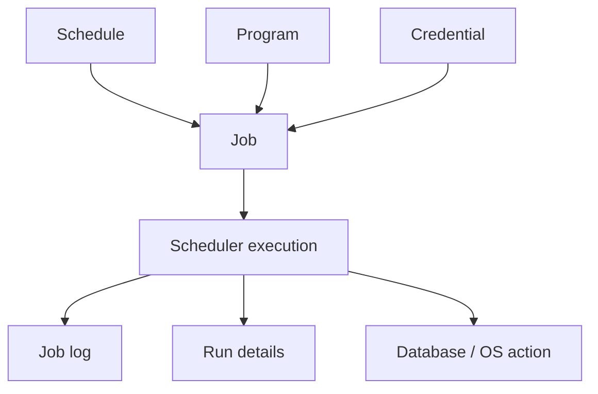

# DBMS_SCHEDULER: Jobs, Programs, Schedules, Credentials, and Execution History

Oracle Scheduler is the built-in job scheduling and orchestration framework inside Oracle Database. Using the DBMS_SCHEDULER package, DBAs and applications can create jobs, define reusable programs, specify execution schedules, manage credentials for authenticated tasks, and track success or failure history.

Each primary object serves a distinct role:

- **Job:** defines the work to execute, including action, timing/schedule, state, and execution policies.
- **Program:** describes a program or action type that can be reused across multiple jobs.
- **Schedule:** specifies start time, end time, and recurrence rules.
- **Credential:** stores authentication credentials used by Scheduler for external jobs or remote destinations in supported scenarios.
- **Job log and run details:** record job events, run timestamps, duration, status, error codes, and additional details.

For example, a system can define a program calling a revenue aggregation procedure, a schedule running daily at 02:00, and then create a job combining those two objects. When the job executes, Scheduler records the outcome so DBAs can verify execution, investigate errors, or generate operational reports.

Scheduler is well-suited for batch processing, maintenance tasks, data synchronization, periodic reporting, and operational automation. It does not replace application transaction processing; jobs still require proper idempotency, transaction boundaries, retry handling, and monitoring.

## 1. Oracle Scheduler Architecture and Components

### 1.1. What Does Scheduler Do?

Scheduler manages the job lifecycle:

1. A DBA or application creates the job and related objects.
2. The job is enabled and waits for its scheduled time or triggering event.
3. Scheduler identifies due jobs and execution resources.
4. The job coordinator orchestrates launching an appropriate worker.
5. The job executes the defined action.
6. Scheduler logs status, timestamps, duration, and errors if any.
7. The job can run again per schedule, retry policy, or manual invocation.

### 1.2. Job Coordinator and Job Slaves

Inside the database instance, Scheduler uses background processes to coordinate and execute jobs. The job coordinator manages due jobs; job slaves execute the work using Oracle-supported mechanisms.

Do not assume every job spawns a new OS process. For PL/SQL jobs inside the database, Scheduler can use database worker/background processes. External jobs use OS-level execution mechanisms and require separate security configuration.

### 1.3. Relationships Between Objects



A simple job can embed job_type and job_action directly. Another job can reference separately created program and schedule objects. Credentials are only needed when the job type or destination requires corresponding authentication.

### 1.4. Common Job Types

Oracle Scheduler supports several job types, depending on version:

- PLSQL_BLOCK: executes an anonymous PL/SQL block.
- STORED_PROCEDURE: invokes a stored procedure or eligible PL/SQL program.
- EXECUTABLE: executes a program outside the database per external job configuration.
- CHAIN: executes a sequence of steps with dependencies.
- Other job types related to external or remote destinations depending on release and configuration.

For standard database workloads, prefer a controlled stored procedure over embedding an overly long PL/SQL block in job_action. This provides clearer testing, version control, logging, and privilege management.

## 2. Job: Defining Work to Run

### 2.1. What Is a Job?

A job is the executable Scheduler object. A job contains or references:

- Action type and action body.
- Start time and repeat interval, or a schedule.
- Program and argument values if using a program.
- Job class and scheduling attributes.
- Credential/destination if external or remote execution is needed.
- Enabled/disabled state.
- Logging, retry, failure, and auto-drop policies.

### 2.2. Creating a Job Running a PL/SQL Block

Example creating a one-time job:

```sql
BEGIN
    DBMS_SCHEDULER.CREATE_JOB(
        job_name   => 'DAILY_SUMMARY_ONCE',
        job_type   => 'PLSQL_BLOCK',
        job_action => q'[
            BEGIN
                DBMS_OUTPUT.PUT_LINE('Scheduler job started');
                NULL; -- Replace with actual business logic.
            END;
        ]',
        start_date => SYSTIMESTAMP,
        enabled    => FALSE,
        auto_drop  => FALSE,
        comments   => 'One-time summary task for lab'
    );
END;
/
```

The job is created in a disabled state because enabled=FALSE. You can inspect its metadata and enable it when ready.

### 2.3. Creating a Job Calling a Stored Procedure

```sql
CREATE OR REPLACE PROCEDURE refresh_daily_summary AS
BEGIN
    -- Implement data aggregation logic.
    NULL;
END;
/

BEGIN
    DBMS_SCHEDULER.CREATE_JOB(
        job_name        => 'REFRESH_DAILY_SUMMARY',
        job_type        => 'STORED_PROCEDURE',
        job_action      => 'REFRESH_DAILY_SUMMARY',
        start_date      => SYSTIMESTAMP,
        repeat_interval => 'FREQ=DAILY;BYHOUR=2;BYMINUTE=0;BYSECOND=0',
        enabled         => TRUE,
        auto_drop       => FALSE,
        comments        => 'Refresh daily summary at 02:00'
    );
END;
/
```

Procedure names in job_action are resolved by Scheduler in the schema/job context. For packaged procedures, use an appropriately qualified name, such as REPORT_PKG.REFRESH_SUMMARY. Verify EXECUTE privileges and object validity before enabling the job.

### 2.4. Creating a Job with a Schedule Object

When multiple jobs share a schedule, create a separate schedule object and reference it:

```sql
BEGIN
    DBMS_SCHEDULER.CREATE_JOB(
        job_name      => 'REFRESH_SUMMARY_JOB',
        program_name  => 'REFRESH_SUMMARY_PROGRAM',
        schedule_name => 'DAILY_0200_SCHEDULE',
        enabled       => TRUE,
        auto_drop     => FALSE,
        comments      => 'Daily summary job'
    );
END;
/
```

A job can combine a program and a schedule; there is no need to repeat job_type, job_action, or repeat_interval when those attributes are defined on the referenced objects.

### 2.5. Creating a Disabled Job and Enabling Later

Creating a job in a disabled state lets the DBA verify objects before allowing Scheduler to run it:

```sql
BEGIN
    DBMS_SCHEDULER.CREATE_JOB(
        job_name        => 'NIGHTLY_LOAD_JOB',
        job_type        => 'STORED_PROCEDURE',
        job_action      => 'ETL_PKG.RUN_NIGHTLY_LOAD',
        start_date      => SYSTIMESTAMP,
        repeat_interval => 'FREQ=DAILY;BYHOUR=1;BYMINUTE=30;BYSECOND=0',
        enabled         => FALSE,
        auto_drop       => FALSE
    );

    -- Verify metadata, privileges, and logic first.
    DBMS_SCHEDULER.ENABLE('NIGHTLY_LOAD_JOB');
END;
/
```

In real deployments, separate the enable step from creation if approval or a change window is required.

### 2.6. Key Job Attributes

| Attribute | Meaning |
|---|---|
| JOB_NAME | Job name |
| JOB_TYPE | Action type |
| JOB_ACTION | Body or name of the program invoked |
| PROGRAM_NAME | Referenced program |
| SCHEDULE_NAME | Referenced schedule |
| START_DATE | Start timestamp |
| REPEAT_INTERVAL | Recurrence rule |
| END_DATE | Schedule end timestamp |
| ENABLED | Whether the job is permitted to run |
| AUTO_DROP | Whether to drop the job automatically upon completion per conditions |
| JOB_CLASS | Resource/priority class of the job |
| CREDENTIAL_NAME | Credential used for applicable job types/destinations |
| MAX_FAILURES | Failure threshold before the job is disabled per policy |
| MAX_RUNS | Maximum number of executions |
| RESTARTABLE | Policy for restarting the job after failures as supported |
| LOGGING_LEVEL | Logging verbosity level |
| STORE_OUTPUT | Whether to store output per release capabilities |

Not all attributes exist or share identical semantics across every Oracle release. Check DBA_SCHEDULER_JOBS and the package specification before using advanced attributes.

## 3. Program: Separating Action from Schedule

### 3.1. What Is a Program?

A program describes the action to execute independently of when it runs. Multiple jobs can share a single program while running on different schedules, job classes, or argument values.

For example:

- A program generates a revenue report.
- Job A runs daily.
- Job B runs at month-end.
- Job C runs manually when a rebuild is needed.

All three can invoke the same program, reducing duplicate definitions and standardizing business execution.

### 3.2. Creating a Program

```sql
BEGIN
    DBMS_SCHEDULER.CREATE_PROGRAM(
        program_name        => 'REFRESH_SUMMARY_PROGRAM',
        program_type        => 'STORED_PROCEDURE',
        program_action      => 'REPORT_PKG.REFRESH_SUMMARY',
        number_of_arguments => 1,
        enabled             => FALSE,
        comments            => 'Refresh a summary for a business date'
    );
END;
/
```

The program above declares one argument. Because it is not yet enabled, define the argument and verify the signature before enabling.

### 3.3. Defining Program Arguments

```sql
BEGIN
    DBMS_SCHEDULER.DEFINE_PROGRAM_ARGUMENT(
        program_name      => 'REFRESH_SUMMARY_PROGRAM',
        argument_position => 1,
        argument_name     => 'P_BUSINESS_DATE',
        argument_type     => 'DATE'
    );

    DBMS_SCHEDULER.ENABLE('REFRESH_SUMMARY_PROGRAM');
END;
/
```

Argument positions start at 1. Argument types must match the signature of the stored procedure or program type used.

### 3.4. Assigning Arguments to a Job

```sql
BEGIN
    DBMS_SCHEDULER.CREATE_JOB(
        job_name      => 'REFRESH_TODAY_JOB',
        program_name  => 'REFRESH_SUMMARY_PROGRAM',
        start_date    => SYSTIMESTAMP,
        enabled       => FALSE,
        auto_drop     => FALSE
    );

    DBMS_SCHEDULER.SET_JOB_ANYDATA_VALUE(
        job_name          => 'REFRESH_TODAY_JOB',
        argument_position => 1,
        argument_value    => SYS.ANYDATA.ConvertDate(TRUNC(SYSDATE))
    );

    DBMS_SCHEDULER.ENABLE('REFRESH_TODAY_JOB');
END;
/
```

SET_JOB_ANYDATA_VALUE preserves the exact DATE type of the argument. For simple types, SET_JOB_ARGUMENT_VALUE provides a string overload, though you should not rely on implicit NLS conversions for dates/times. Verify actual types in ALL_SCHEDULER_PROGRAM_ARGS and ALL_SCHEDULER_JOB_ARGS.

### 3.5. Program Arguments and Defaults

Program arguments can have default values. Jobs can rely on defaults or override them with SET_JOB_ARGUMENT_VALUE/SET_JOB_ANYDATA_VALUE. If a required argument is missing, the job may fail at runtime or during enable/validation depending on program type.

Give arguments meaningful names and document units and timezones for date/time inputs. Avoid undocumented positional numbers in deployment code.

### 3.6. Program Types

| PROGRAM_TYPE | Meaning |
|---|---|
| PLSQL_BLOCK | Anonymous PL/SQL block |
| STORED_PROCEDURE | Eligible stored procedure |
| EXECUTABLE | External program |
| CHAIN | Scheduler chain |

Specific capabilities depend on the Oracle release and external job configuration.

### 3.7. Modifying a Program

Programs can be updated via SET_ATTRIBUTE or appropriate APIs. Modifying a shared program can affect every job referencing it. Before altering, list all jobs using the program and test compatibility.

## 4. Schedule: Defining When to Run

### 4.1. What Is a Schedule?

A schedule describes start time, recurrence rules, and end time. Separating schedules from jobs enables reusing the same timing across many tasks and managing calendars independently of business logic.

### 4.2. Creating a One-Time Schedule

```sql
BEGIN
    DBMS_SCHEDULER.CREATE_SCHEDULE(
        schedule_name   => 'RUN_ONCE_AT_NOON',
        start_date      => TO_TIMESTAMP_TZ(
            '2026-11-15 12:00:00 Asia/Ho_Chi_Minh',
            'YYYY-MM-DD HH24:MI:SS TZR'
        ),
        repeat_interval => NULL,
        end_date        => NULL,
        comments        => 'One-time execution schedule'
    );
END;
/
```

This illustrates a timestamp example. In production, use TIMESTAMP WITH TIME ZONE and explicitly specify the region when timing must align with a business timezone.

### 4.3. Creating a Daily Schedule

```sql
BEGIN
    DBMS_SCHEDULER.CREATE_SCHEDULE(
        schedule_name   => 'DAILY_0200_SCHEDULE',
        start_date      => TO_TIMESTAMP_TZ(
            '2026-11-15 02:00:00 Asia/Ho_Chi_Minh',
            'YYYY-MM-DD HH24:MI:SS TZR'
        ),
        repeat_interval => 'FREQ=DAILY;BYHOUR=2;BYMINUTE=0;BYSECOND=0',
        comments        => 'Every day at 02:00 Ho Chi Minh time'
    );
END;
/
```

The timezone region name must be supported by the database's Oracle timezone files. Using a named region such as Asia/Ho_Chi_Minh expresses business timezone intent more clearly than a fixed offset.

### 4.4. Creating a Weekday Schedule

```sql
BEGIN
    DBMS_SCHEDULER.CREATE_SCHEDULE(
        schedule_name   => 'WEEKDAYS_0730',
        start_date      => SYSTIMESTAMP,
        repeat_interval => 'FREQ=DAILY;BYDAY=MON,TUE,WED,THU,FRI;BYHOUR=7;BYMINUTE=30;BYSECOND=0',
        comments        => 'Weekdays at 07:30'
    );
END;
/
```

### 4.5. First and Last Day of the Month

First day of the month:

```sql
FREQ=MONTHLY;BYMONTHDAY=1;BYHOUR=1;BYMINUTE=0;BYSECOND=0
```

The last day of the month can use BYMONTHDAY=-1 in calendaring syntax on supported releases:

```sql
FREQ=MONTHLY;BYMONTHDAY=-1;BYHOUR=23;BYMINUTE=0;BYSECOND=0
```

Verify behavior in your target Oracle release and test months with 28, 29, 30, and 31 days.

### 4.6. Repeat Interval Examples

| Purpose | Repeat interval |
|---|---|
| Daily at 02:00 | FREQ=DAILY;BYHOUR=2;BYMINUTE=0;BYSECOND=0 |
| Every 15 minutes | FREQ=MINUTELY;INTERVAL=15 |
| Hourly at minute 10 | FREQ=HOURLY;BYMINUTE=10;BYSECOND=0 |
| Monday to Friday at 07:30 | FREQ=DAILY;BYDAY=MON,TUE,WED,THU,FRI;BYHOUR=7;BYMINUTE=30 |
| First day of month at 01:00 | FREQ=MONTHLY;BYMONTHDAY=1;BYHOUR=1 |
| Last day of month at 23:00 | FREQ=MONTHLY;BYMONTHDAY=-1;BYHOUR=23 |
| Quarterly, start of quarter | FREQ=YEARLY;BYMONTH=1,4,7,10;BYMONTHDAY=1;BYHOUR=0 |

Examples must be tested in the target environment; interval calculations, timezones, and start_date can affect next runs.

## 5. Calendaring Syntax and Timezones

### 5.1. Main Components

Oracle Scheduler uses calendaring syntax for repeat_interval. Common clauses include:

- FREQ: YEARLY, MONTHLY, WEEKLY, DAILY, HOURLY, MINUTELY, or SECONDLY.
- INTERVAL: step interval between cycles.
- BYDAY: days of the week.
- BYMONTH: months of the year.
- BYMONTHDAY: days of the month.
- BYHOUR, BYMINUTE, BYSECOND: time-of-day components.
- BYSETPOS: positional selection within the evaluated date/frequency set per supported syntax.
- BYYEARDAY, BYWEEKNO: day of year or calendar week number.

Not every combination has the same meaning. Follow Scheduler documentation for calendaring syntax rather than treating it as native cron syntax.

### 5.2. INTERVAL

INTERVAL sets the step between FREQ cycles. For example, FREQ=DAILY;INTERVAL=2 runs every second day per calendar rules. INTERVAL=15 with FREQ=MINUTELY produces an every-15-minutes schedule.

### 5.3. BYDAY and BYMONTHDAY

BYDAY selects days of the week, such as MON,WED,FRI. BYMONTHDAY selects days of the month. Certain advanced expressions allow selecting the first Monday or last Friday of a month by combining ordinals and weekdays per supported calendaring syntax. Test complex expressions with EVALUATE_CALENDAR_STRING.

### 5.4. START_DATE and Timezone

START_DATE is a TIMESTAMP WITH TIME ZONE. The timezone of start_date influences how Scheduler evaluates the schedule. For business schedules tied to local wall-clock time, use a named timezone region such as Asia/Ho_Chi_Minh or the appropriate region instead of only storing a fixed UTC offset.

### 5.5. Daylight Saving Time

In regions observing DST, local wall-clock times may be skipped or repeated when clocks shift. Scheduler handles transitions according to timezone rules and related schedule/job attributes. Define policy for nonexistent or ambiguous hours and test using the appropriate timezone region.

Vietnam does not observe DST, but jobs may run on databases/servers located in other regions or follow business calendars in other countries. Never assume OS, database session, and start_date timezones are identical.

### 5.6. Evaluating Occurrences with EVALUATE_CALENDAR_STRING

DBMS_SCHEDULER.EVALUATE_CALENDAR_STRING lets you preview upcoming run times for a calendaring expression:

```sql
DECLARE
    l_next_run TIMESTAMP WITH TIME ZONE;
    l_start TIMESTAMP WITH TIME ZONE :=
        TO_TIMESTAMP_TZ(
            '2026-11-14 00:00:00 Asia/Ho_Chi_Minh',
            'YYYY-MM-DD HH24:MI:SS TZR'
        );
BEGIN
    DBMS_SCHEDULER.EVALUATE_CALENDAR_STRING(
        calendar_string   => 'FREQ=DAILY;BYHOUR=2;BYMINUTE=0;BYSECOND=0',
        start_date        => l_start,
        return_date_after => l_start,
        next_run_date     => l_next_run
    );

    DBMS_OUTPUT.PUT_LINE(
        TO_CHAR(l_next_run, 'YYYY-MM-DD HH24:MI:SS TZH:TZM')
    );
END;
/
```

Verify the signature and parameter passing for your package version. You can invoke the API repeatedly to inspect subsequent occurrences. Do not just read a repeat_interval string and guess the schedule.

## 6. Credentials and Security

### 6.1. What Is a Credential?

A credential is an object storing authentication details used by Scheduler when running tasks outside the database or accessing destinations that require authentication. For example:

- External executable jobs running under an OS account.
- Remote external jobs on a configured host/destination.
- Certain Scheduler tasks requiring credentials depending on job type and version.

For PLSQL_BLOCK or STORED_PROCEDURE jobs running inside the database, Scheduler normally runs in the security context of the job owner; there is no need to create an OS credential just to invoke a stored procedure.

### 6.2. Creating a Credential

Illustrative example creating a credential for an external job:

```sql
BEGIN
    DBMS_SCHEDULER.CREATE_CREDENTIAL(
        credential_name => 'BATCH_OS_CREDENTIAL',
        username        => 'batch_runner',
        password        => '<retrieve-from-approved-secret-process>'
    );
END;
/
```

Never place real passwords in source code, version-controlled scripts, tickets, or logs. The placeholder above merely marks the parameter position; in operations, retrieve secrets through an approved secrets process and restrict credential access.

### 6.3. Using a Credential for an External Job

```sql
BEGIN
    DBMS_SCHEDULER.CREATE_JOB(
        job_name        => 'GENERATE_EXPORT_FILE',
        job_type        => 'EXECUTABLE',
        job_action      => '/opt/app/bin/export_orders.sh',
        credential_name => 'BATCH_OS_CREDENTIAL',
        start_date      => SYSTIMESTAMP,
        enabled         => FALSE,
        auto_drop       => FALSE,
        comments        => 'Generate an export file'
    );
END;
/
```

External jobs require appropriate external job agent/credential configuration and platform security policies. Executable paths must be controlled, scripts must have proper execute permissions, and the OS user running the job should hold least privilege.

### 6.4. Database Jobs vs. External Jobs

| Aspect | Database PL/SQL job | External executable job |
|---|---|---|
| Job type | PLSQL_BLOCK/STORED_PROCEDURE | EXECUTABLE |
| Execution location | Inside Oracle Database | Operating system/external agent |
| Security context | Job owner and database privileges | OS credential/external job configuration |
| OS credential | Usually not needed | Usually required per configuration |
| Error visibility | Scheduler logs and database errors | Scheduler logs, stdout/stderr, and OS logs |
| Risks | DML, locks, undo, resource usage | Additional OS command, file, process, and secret risks |

### 6.5. A Credential Is Not the Job Owner's Database Password

Credentials are used for external/remote execution per configuration. They do not alter the database privileges of the job owner and do not turn a stored procedure into an OS program.

### 6.6. External Job Security

External jobs can execute operating system commands. Follow these principles:

- Use absolute executable paths.
- Never construct commands from untrusted input.
- Restrict OS account privileges.
- Do not run as a privileged OS user unless strictly required.
- Protect script files and output directories.
- Audit external job agent and credential configuration.
- Capture stdout/stderr logs per policy.
- Manage secrets outside source code.

## 7. Job Classes and Resource Manager

### 7.1. What Is a Job Class?

A job class groups jobs that share similar resource and logging policies. A job class can map to a consumer group so Scheduler jobs execute inside that consumer group under Resource Manager rules.

### 7.2. Creating a Job Class

```sql
BEGIN
    DBMS_SCHEDULER.CREATE_JOB_CLASS(
        job_class_name          => 'NIGHT_BATCH_CLASS',
        resource_consumer_group => 'BATCH_GROUP',
        logging_level           => DBMS_SCHEDULER.LOGGING_RUNS,
        log_history             => 30,
        comments                => 'Nightly batch workload'
    );
END;
/
```

The BATCH_GROUP consumer group must exist and a Resource Manager plan must be active for directives to take effect. Job class parameters may vary by release.

### 7.3. Assigning a Job to a Class

```sql
BEGIN
    DBMS_SCHEDULER.SET_ATTRIBUTE(
        name      => 'NIGHTLY_LOAD_JOB',
        attribute => 'job_class',
        value     => 'NIGHT_BATCH_CLASS'
    );
END;
/
```

You can also specify job_class directly in CREATE_JOB. Job classes centralize management instead of configuring individual policies on every job.

### 7.4. Logging Level

A job class can define a default logging level such as LOGGING_OFF, LOGGING_FAILED_RUNS, LOGGING_RUNS, or LOGGING_FULL. Verify exact constants and semantics in your running release's package. Full logging increases metadata storage; pick a level matching audit and operational needs.

## 8. Enabling, Disabling, Running, Stopping, and Dropping Jobs

### 8.1. Enabling a Job

```sql
BEGIN
    DBMS_SCHEDULER.ENABLE('REFRESH_DAILY_SUMMARY');
END;
/
```

A job must be enabled for Scheduler to trigger it automatically on schedule. Any referenced program or schedule must also be in an appropriate state.

### 8.2. Disabling a Job

```sql
BEGIN
    DBMS_SCHEDULER.DISABLE(
        name  => 'REFRESH_DAILY_SUMMARY',
        force => FALSE
    );
END;
/
```

Disabling prevents future scheduled runs. If the job is currently running, behavior depends on state and the force parameter; disabling does not necessarily terminate an in-flight execution.

### 8.3. Running Immediately with RUN_JOB

```sql
BEGIN
    DBMS_SCHEDULER.RUN_JOB(
        job_name            => 'REFRESH_DAILY_SUMMARY',
        use_current_session => FALSE
    );
END;
/
```

With use_current_session=FALSE, Scheduler executes the job via a job slave and returns without waiting for completion. You can inspect status/logs afterward.

If TRUE, the job executes in the current session and blocks until finished; this is helpful for debugging, though the execution environment may differ from background job slave execution.

### 8.4. Stopping a Job

```sql
BEGIN
    DBMS_SCHEDULER.STOP_JOB(
        job_name => 'REFRESH_DAILY_SUMMARY',
        force    => FALSE
    );
END;
/
```

STOP_JOB requests Scheduler to halt a running job. If force=TRUE, Oracle may terminate the session/process more aggressively; weigh transaction rollback, partial output files, and application impact.

### 8.5. Dropping a Job

```sql
BEGIN
    DBMS_SCHEDULER.DROP_JOB(
        job_name => 'OLD_REPORT_JOB',
        force    => FALSE
    );
END;
/
```

DROP_JOB deletes job metadata. If the job is running, force and execution state determine whether the drop succeeds. Before dropping, confirm no automation or downstream system depends on the job.

### 8.6. RUN_JOB Does Not Alter the Schedule

RUN_JOB triggers an ad-hoc execution. It does not change the job's repeat_interval or schedule. Manual runs may appear in logs with details differing from scheduled runs.

## 9. Job Arguments and Modifying Attributes

### 9.1. SET_ATTRIBUTE

You can modify job attributes:

```sql
BEGIN
    DBMS_SCHEDULER.SET_ATTRIBUTE(
        name      => 'REFRESH_DAILY_SUMMARY',
        attribute => 'repeat_interval',
        value     => 'FREQ=DAILY;BYHOUR=3;BYMINUTE=0;BYSECOND=0'
    );
END;
/
```

Attribute name and value type must match the target object. When changing an active schedule, check next_run_date and job state afterward.

### 9.2. SET_ATTRIBUTE_NULL

To clear a nullable attribute, use DBMS_SCHEDULER.SET_ATTRIBUTE_NULL per supported API. Do not pass an empty string assuming it equals NULL for every attribute.

### 9.3. SET_JOB_ARGUMENT_VALUE and SET_JOB_ANYDATA_VALUE

For string arguments:

```sql
BEGIN
    DBMS_SCHEDULER.SET_JOB_ARGUMENT_VALUE(
        job_name          => 'EXPORT_JOB',
        argument_position => 1,
        argument_value    => 'REGION_NORTH'
    );
END;
/
```

For typed arguments, use SET_JOB_ANYDATA_VALUE with the appropriate SYS.ANYDATA conversion. Avoid implicit NLS conversions for DATE/TIMESTAMP values.

### 9.4. Modifying a Schedule

You can edit a schedule object referenced by multiple jobs. That change can affect every job sharing the schedule. Before updating a schedule, list all dependent jobs and communicate the change scope.

## 10. Job States, Retries, and Failure Policies

### 10.1. Common States

Depending on status and release, jobs may show states such as:

- DISABLED: not automatically executed by Scheduler.
- SCHEDULED: enabled and waiting for its next run time.
- RUNNING: currently executing.
- COMPLETED: finished according to Scheduler-recorded status.
- FAILED: execution failed.
- BROKEN: marked unable to continue per policy.
- STOPPED: explicitly stopped.
- RETRY SCHEDULED: awaiting a retry under supported retry mechanisms.

Exact states and semantics can vary across job types, releases, and runtime status. Check DBA_SCHEDULER_JOBS and logs rather than guessing from state names alone.

### 10.2. MAX_FAILURES and MAX_RUNS

MAX_FAILURES sets the failure threshold before Scheduler marks a job broken/disabled per policy. MAX_RUNS caps total executions of the job. Appropriate values depend on recoverability and the job's lifecycle.

### 10.3. RESTARTABLE

RESTARTABLE allows Scheduler to attempt restarting a job after certain failures using supported mechanisms. Not every job type or failure can safely resume mid-flight.

### 10.4. Retries and Idempotency

Scheduler retries do not guarantee that business actions executed before a failure caused no side effects. For example, a job might insert partial data and then fail; a retry could insert duplicate rows. Job design should:

- Use business keys or batch IDs to prevent duplicate processing.
- Commit along clear business boundaries.
- Persist checkpoints.
- Support safe re-execution.
- Distinguish transient errors from non-recoverable data errors.

### 10.5. SCHEDULE_LIMIT and Duration

SCHEDULE_LIMIT can cap how late a job is allowed to start relative to its scheduled time before skipping the run per policy. Some releases support runtime limit attributes such as MAX_RUN_DURATION or related events/notifications. Check your version's package and dictionary before using; do not confuse elapsed runtime limits with CPU time or queue wait time.

## 11. Job Logging and Execution History

### 11.1. Job Log and Run Details

Scheduler records metadata on job events and individual runs:

- Job creation, enable, disable, or drop events.
- Job start and completion.
- Success/failure status.
- Start/end timestamps and duration.
- Error number/message.
- Output or additional info when enabled.

The job log tracks lifecycle events; run details focus on each individual execution.

### 11.2. USER_SCHEDULER_JOB_LOG

```sql
SELECT log_id,
       log_date,
       owner,
       job_name,
       operation,
       status,
       user_name,
       client_id,
       additional_info
FROM user_scheduler_job_log
ORDER BY log_date DESC;
```

ALL_SCHEDULER_JOB_LOG and DBA_SCHEDULER_JOB_LOG provide broader visibility depending on privileges.

### 11.3. USER_SCHEDULER_JOB_RUN_DETAILS

```sql
SELECT log_id,
       log_date,
       owner,
       job_name,
       status,
       actual_start_date,
       run_duration,
       instance_id,
       error#,
       additional_info,
       output
FROM user_scheduler_job_run_details
ORDER BY log_date DESC;
```

The OUTPUT column and certain attributes exist only in releases supporting store_output. Not every run generates output text.

### 11.4. Filtering Failed Jobs

```sql
SELECT log_date,
       job_name,
       status,
       actual_start_date,
       run_duration,
       error#,
       additional_info
FROM user_scheduler_job_run_details
WHERE status = 'FAILED'
ORDER BY log_date DESC;
```

Error number/message is only a starting point. For full root-cause analysis, inspect the alert log, application logs, session traces, and relevant business data.

### 11.5. Viewing History for a Specific Job

```sql
SELECT log_date,
       status,
       actual_start_date,
       run_duration,
       error#,
       additional_info
FROM user_scheduler_job_run_details
WHERE job_name = 'REFRESH_DAILY_SUMMARY'
ORDER BY log_date DESC;
```

### 11.6. History Has Retention

Scheduler does not keep logs indefinitely. The log_history attribute and logging level govern retention days or log storage policies per configuration. DBAs must balance audit/troubleshooting needs against metadata space.

### 11.7. Setting Log History

DBMS_SCHEDULER.SET_SCHEDULER_ATTRIBUTE can configure global Scheduler attributes subject to privileges and release:

```sql
BEGIN
    DBMS_SCHEDULER.SET_SCHEDULER_ATTRIBUTE(
        attribute => 'log_history',
        value     => '30'
    );
END;
/
```

Verify exact parameter names and valid values in your release. Do not reduce retention while an audit or active investigation is underway.

## 12. Viewing Running Jobs and Next Schedules

### 12.1. USER_SCHEDULER_JOBS

```sql
SELECT job_name,
       enabled,
       state,
       job_type,
       job_action,
       program_name,
       schedule_name,
       repeat_interval,
       next_run_date,
       last_start_date,
       last_run_duration,
       failure_count,
       run_count
FROM user_scheduler_jobs
ORDER BY job_name;
```

Use ALL_SCHEDULER_JOBS/DBA_SCHEDULER_JOBS for broader scope.

### 12.2. USER_SCHEDULER_RUNNING_JOBS

```sql
SELECT job_name,
       session_id,
       running_instance,
       elapsed_time,
       cpu_used
FROM user_scheduler_running_jobs
ORDER BY job_name;
```

Exact columns may vary by release. This view helps identify currently executing jobs and their associated session/instance.

### 12.3. Next Run Date

NEXT_RUN_DATE in Scheduler job views displays the next projected run time according to the job's calendar and timezone. After altering repeat_interval or a schedule, verify NEXT_RUN_DATE to confirm the result.

### 12.4. Jobs Running on RAC

In RAC, check running_instance and the appropriate global views to see which instance is executing the job. A job may execute on an instance selected by Scheduler based on service/destination configuration and cluster state.

### 12.5. Job Not Running Even Though Enabled

Check:

- Is NEXT_RUN_DATE in the future?
- Has END_DATE already passed?
- Is the job BROKEN/FAILED, or has it reached MAX_FAILURES/MAX_RUNS?
- Is RESOURCE_MANAGER_PLAN/consumer group queuing the session?
- Does JOB_QUEUE_PROCESSES allow job slaves to run?
- Is a Scheduler window or job class affecting execution?
- Are credentials/destinations valid?
- Is the database/PDB open and is Scheduler enabled?

## 13. JOB_QUEUE_PROCESSES and Execution Capacity

### 13.1. JOB_QUEUE_PROCESSES

JOB_QUEUE_PROCESSES controls the maximum number of job slave processes an instance can allocate for Scheduler and related job queue mechanisms. If set too low or to 0, jobs may not execute as expected.

### 13.2. Not an Absolute Concurrent Job Limit

Actual concurrent job capacity also depends on job slave availability, system resources, Resource Manager, parallelism, service/instance availability, and job types. JOB_QUEUE_PROCESSES is a background process cap, not the sole setting governing concurrency.

### 13.3. Checking the Parameter

```sql
SHOW PARAMETER job_queue_processes;

SELECT name, value, issys_modifiable
FROM v$parameter
WHERE name = 'job_queue_processes';
```

### 13.4. Pausing Scheduler Jobs

Setting JOB_QUEUE_PROCESSES=0 can prevent job slaves from executing under supported mechanisms. This has a broad database/instance-wide effect; never use it just to pause a single job. Use DBMS_SCHEDULER.DISABLE for individual jobs.

## 14. Job Classes, Windows, and Maintenance

### 14.1. Job Class

Job classes group jobs by resource policy, service affinity, and logging. You can use a job class to place batch jobs into a lower-priority consumer group during peak hours.

### 14.2. Scheduler Window

A window defines a time interval with a dedicated resource plan or priority level. For example, a maintenance window may open overnight to run optimizer statistics gathering or maintenance tasks.

### 14.3. Window Group

A window group aggregates multiple windows so maintenance schedules or jobs can reference a combined set of time periods. Enabling or altering a window group can affect automated maintenance tasks.

### 14.4. Default Maintenance Windows

Oracle ships default maintenance windows depending on release. Before modifying or disabling them, assess the impact on automated tasks such as optimizer statistics gathering, segment advisor, and other maintenance jobs.

### 14.5. Inspecting Windows

Views such as DBA_SCHEDULER_WINDOWS, DBA_SCHEDULER_WINDOW_GROUPS, and DBA_SCHEDULER_WINDOW_LOG expose window configuration and history. Exact columns vary by release.

## 15. Scheduler Chains

### 15.1. When to Use a Chain?

When a workflow consists of multiple dependent steps, a chain can model the steps and transition rules:

1. Extract data.
2. Validate data.
3. Transform.
4. Load.
5. Send completion notification.

Each step runs only when preceding rules are satisfied. Chains manage complex workflows far more cleanly than a single monolithic PL/SQL block job.

### 15.2. Creating a Chain

DBMS_SCHEDULER provides CREATE_CHAIN, DEFINE_CHAIN_STEP, DEFINE_CHAIN_RULE, and ENABLE to build workflows. Each step can reference an appropriate program or job. Chain state, rule conditions, exceptions, and restarts must all be managed carefully.

### 15.3. Chains Do Not Replace All Workflow Engines

Chains suit database-centric workflows. If a process must coordinate multiple external services, distributed compensation, or human approvals, consider a dedicated orchestration platform.

## 16. Privileges and Ownership

### 16.1. CREATE JOB

Users need the CREATE JOB privilege to create jobs in their own schema per policy. Creating jobs in other schemas or administering Scheduler database-wide requires stronger privileges such as CREATE ANY JOB or corresponding Scheduler admin privileges.

### 16.2. MANAGE SCHEDULER

The MANAGE SCHEDULER privilege grants broad administrative control over Scheduler objects as defined by Oracle. Do not grant this privilege to application users that only need to run a single job.

### 16.3. EXECUTE Privileges on Stored Procedures

Jobs invoking procedures require appropriate execution privileges. For definer-rights procedures, privileges inside stored PL/SQL follow the PL/SQL security model; for invoker-rights procedures, understand the privileges of the invoker/job owner. Avoid relying on roles to supply privileges needed directly inside stored PL/SQL.

### 16.4. Credential Privileges

Credentials have their own access grants and can be shared selectively. Grant least privilege on credentials, avoiding letting many schemas share a single over-privileged OS account.

### 16.5. Job Owner and Execution Identity

Database jobs typically run under the identity of the job owner, not the user querying the job log. For external jobs, OS identity depends on the credential and external job configuration. Record both identity layers when investigating.

### 16.6. Cross-Schema Jobs

DBAs can create jobs in another schema using appropriate APIs and privileges. Explicitly track owner, parsing schema, privileges, credentials, and where logs are recorded. Never treat CREATE ANY JOB as the default pattern for routine deployments.

## 17. Common Scheduler Errors

| Symptom/Error | Possible Cause | Investigation Path |
|---|---|---|
| Job does not run | Disabled, next run not reached, insufficient job queue processes | USER_SCHEDULER_JOBS, JOB_QUEUE_PROCESSES |
| ORA-27475 | Job/program/schedule does not exist or wrong name | Verify owner, name, and privileges |
| ORA-27486 | Insufficient privileges for Scheduler operation | Check CREATE JOB/MANAGE SCHEDULER and object grants |
| ORA-27492 | Scheduler unavailable or job queue disabled in some configurations | Check JOB_QUEUE_PROCESSES, database state |
| ORA-06550/PLS errors | PL/SQL block or stored procedure fails to compile | Check USER_ERRORS and procedure signature |
| Job FAILED | Exception inside job_action or external process error | RUN_DETAILS, application log, alert log |
| Credential invalid | Wrong username/password/credential or external agent error | Credential metadata, OS/agent logs |
| External job fails to launch | Executable path, permissions, credential, or agent issue | OS logs, external job configuration |
| Job marked BROKEN | Too many failures or policy threshold | FAILURE_COUNT, MAX_FAILURES, run details |
| Job runs late | Queuing, resource contention, job slave capacity | Running jobs, Resource Manager metrics, JOB_QUEUE_PROCESSES |
| Job runs at wrong time | Timezone/start_date/calendar expression | NEXT_RUN_DATE, schedule definition, timezone region |
| Overlapping runs | Duration exceeds interval or concurrency design gap | Running jobs, locking/idempotency |
| Empty output | STORE_OUTPUT/logging disabled or job writes no stdout | Job attributes, run details, application logging |

Do not draw conclusions solely from a generic error code. Inspect ADDITIONAL_INFO, ERROR#, application logs, and job state.

## 18. Designing Safe, Re-Runnable Jobs

### 18.1. Idempotency

A job may be re-run by Scheduler after timeouts, process failures, or manual intervention. Business actions should tolerate re-execution without producing duplicate data or invalid side effects.

For instance, instead of blindly INSERTing all rows every run, use batch keys, MERGE on business keys, or a checkpoint table.

### 18.2. Transaction Boundaries

Decide whether to commit per entire job or per batch. Batch commits shrink transaction size but create partial completion if a job fails midway. Store checkpoints and ensure retries resume accurately.

### 18.3. Avoid Holding Locks Too Long

Long-running batch jobs can hold locks that disrupt OLTP traffic. Chunk batches logically, limit concurrency, schedule appropriately, and use Resource Manager to protect other workloads.

### 18.4. Prevent Unintended Overlaps

If a job takes 90 minutes on an hourly schedule, a new run may overlap the previous run depending on configuration and job type. Implement coordination locks, running-state checks, or singleton guards to prevent concurrent duplicates.

### 18.5. Business-Level Logging

Scheduler logs record technical run status. Applications should still log:

- Job execution/business run ID.
- Batch date or watermark.
- Rows read/written/skipped.
- Step start/end timestamps.
- Error codes/messages and relevant business keys.
- Checkpoints and retry states.

### 18.6. Exception Handling

If a stored procedure catches WHEN OTHERS and neither re-raises nor records a clear failure state, Scheduler may mark the job SUCCEEDED even though business logic failed. Swallow exceptions only when intentionally designed and failures are explicitly surfaced.

### 18.7. Time and Timezones

Define schedules in the business timezone. Avoid unthinkingly relying on SYSDATE/SYSTIMESTAMP in logic dependent on local business dates. Store timezone-aware timestamps or adhere to a clear UTC convention for checkpoints.

## 19. End-to-End Example: Program, Schedule, and Job

### 19.1. Create the Procedure

```sql
CREATE OR REPLACE PROCEDURE report_pkg_refresh (
    p_run_date IN DATE
) AS
BEGIN
    -- Replace with actual aggregation logic.
    INSERT INTO report_run_log(run_date, started_at, status)
    VALUES (p_run_date, SYSTIMESTAMP, 'STARTED');

    -- Business processing goes here.

    UPDATE report_run_log
    SET status = 'COMPLETED'
    WHERE run_date = p_run_date
      AND status = 'STARTED';

    COMMIT;
EXCEPTION
    WHEN OTHERS THEN
        ROLLBACK;
        RAISE;
END;
/
```

This skeleton illustrates transaction handling; log tables, unique keys, and execution tracking must be designed for the real application.

### 19.2. Create the Program

```sql
BEGIN
    DBMS_SCHEDULER.CREATE_PROGRAM(
        program_name        => 'REPORT_REFRESH_PROGRAM',
        program_type        => 'STORED_PROCEDURE',
        program_action      => 'REPORT_PKG_REFRESH',
        number_of_arguments => 1,
        enabled             => FALSE,
        comments            => 'Refresh report data for a date'
    );

    DBMS_SCHEDULER.DEFINE_PROGRAM_ARGUMENT(
        program_name      => 'REPORT_REFRESH_PROGRAM',
        argument_position => 1,
        argument_name     => 'P_RUN_DATE',
        argument_type     => 'DATE'
    );

    DBMS_SCHEDULER.ENABLE('REPORT_REFRESH_PROGRAM');
END;
/
```

If the procedure resides in a package, specify package.procedure matching the signature and verify privileges.

### 19.3. Create the Schedule

```sql
BEGIN
    DBMS_SCHEDULER.CREATE_SCHEDULE(
        schedule_name   => 'REPORT_DAILY_0230',
        start_date      => TO_TIMESTAMP_TZ(
            '2026-11-15 02:30:00 Asia/Ho_Chi_Minh',
            'YYYY-MM-DD HH24:MI:SS TZR'
        ),
        repeat_interval => 'FREQ=DAILY;BYHOUR=2;BYMINUTE=30;BYSECOND=0',
        comments        => 'Daily report schedule'
    );
END;
/
```

### 19.4. Create the Job and Assign Arguments

```sql
BEGIN
    DBMS_SCHEDULER.CREATE_JOB(
        job_name      => 'REPORT_REFRESH_DAILY',
        program_name  => 'REPORT_REFRESH_PROGRAM',
        schedule_name => 'REPORT_DAILY_0230',
        enabled       => FALSE,
        auto_drop     => FALSE,
        comments      => 'Daily report refresh'
    );

    DBMS_SCHEDULER.SET_JOB_ANYDATA_VALUE(
        job_name          => 'REPORT_REFRESH_DAILY',
        argument_position => 1,
        argument_value    => SYS.ANYDATA.ConvertDate(DATE '2026-11-15')
    );
END;
/
```

### 19.5. Enable and Check Next Run

```sql
BEGIN
    DBMS_SCHEDULER.ENABLE('REPORT_REFRESH_DAILY');
END;
/

SELECT job_name, enabled, state, next_run_date
FROM user_scheduler_jobs
WHERE job_name = 'REPORT_REFRESH_DAILY';
```

### 19.6. Manual Test Run

```sql
BEGIN
    DBMS_SCHEDULER.RUN_JOB(
        job_name            => 'REPORT_REFRESH_DAILY',
        use_current_session => TRUE
    );
END;
/
```

Running in the current session lets you observe exceptions immediately while debugging. Afterward, inspect job run details and application logs.

### 19.7. Inspect History

```sql
SELECT log_date,
       status,
       actual_start_date,
       run_duration,
       error#,
       additional_info
FROM user_scheduler_job_run_details
WHERE job_name = 'REPORT_REFRESH_DAILY'
ORDER BY log_date DESC;
```

## 20. Lifecycle Management and Cleanup

### 20.1. AUTO_DROP

AUTO_DROP=TRUE lets Scheduler automatically drop a job after completion under applicable conditions, typically suitable for one-time jobs that do not need long-term metadata retention. For recurring jobs or those requiring long-term auditing, set FALSE.

### 20.2. Shared Programs and Schedules

If multiple jobs reference the same program/schedule, do not drop that object while dependencies remain. Before deleting, list job references and update them per plan.

### 20.3. Drop Program

```sql
BEGIN
    DBMS_SCHEDULER.DROP_PROGRAM(
        program_name => 'OLD_PROGRAM',
        force        => FALSE
    );
END;
/
```

### 20.4. Drop Schedule

```sql
BEGIN
    DBMS_SCHEDULER.DROP_SCHEDULE(
        schedule_name => 'OLD_SCHEDULE',
        force         => FALSE
    );
END;
/
```

### 20.5. Drop Credential

```sql
BEGIN
    DBMS_SCHEDULER.DROP_CREDENTIAL(
        credential_name => 'OLD_CREDENTIAL'
    );
END;
/
```

Drop credentials only when no jobs/destinations still use them and you have confirmed no other tasks are affected.

### 20.6. Purging Logs

Scheduler manages retention automatically per logging policy. DBAs can use supported log purge APIs if selective history cleanup is required. Before purging, confirm audit and retention requirements. Never delete logs to hide failures or erase incident evidence.

## 21. DBMS_SCHEDULER Operations Checklist

- [ ] Job has a descriptive name and clear comments.
- [ ] Correct job_type and job_action selected.
- [ ] Stored procedure is valid and has appropriate EXECUTE privileges.
- [ ] Program arguments have defined names, types, and defaults.
- [ ] Schedule calendaring syntax has been tested.
- [ ] START_DATE uses a timezone aligned with business requirements.
- [ ] NEXT_RUN_DATE and END_DATE verified.
- [ ] AUTO_DROP matches metadata retention requirements.
- [ ] Job class and consumer group fit the workload.
- [ ] Credentials used only when jobs/destinations require authentication.
- [ ] No passwords stored in source code, logs, or unprotected scripts.
- [ ] External executables use absolute paths and least-privilege OS accounts.
- [ ] Jobs created disabled for review if required by process.
- [ ] ENABLE/DISABLE/RUN/STOP used appropriately.
- [ ] Retries incorporate idempotency, checkpoints, and transaction boundaries.
- [ ] MAX_FAILURES/MAX_RUNS/SCHEDULE_LIMIT configured appropriately.
- [ ] Logging level and log retention satisfy investigation/audit needs.
- [ ] USER_SCHEDULER_JOBS and RUNNING_JOBS checked.
- [ ] JOB_LOG and JOB_RUN_DETAILS checked.
- [ ] JOB_QUEUE_PROCESSES and Resource Manager do not starve jobs.
- [ ] Alerts configured for job failures, excessive duration, or missed runs.
- [ ] Rollback and dependency cleanup procedures documented.

## 22. Self-Check Questions

1. What kinds of operational tasks is Oracle Scheduler designed to handle?
2. How does a job differ from a program and a schedule?
3. In what scenarios are credentials used?
4. Why do PLSQL_BLOCK jobs generally not require OS credentials?
5. How do PLSQL_BLOCK and STORED_PROCEDURE differ in defining actions?
6. How do programs enable action reuse across multiple jobs?
7. Which API defines program arguments?
8. How do you assign argument values to a job?
9. What benefits does a schedule object offer over setting repeat_interval directly on a job?
10. What roles do FREQ and INTERVAL play in calendaring syntax?
11. What are BYDAY, BYMONTHDAY, and BYHOUR used for?
12. Why is a named timezone region better than a fixed offset for business schedules?
13. What does EVALUATE_CALENDAR_STRING help verify?
14. How do job classes connect to Resource Manager?
15. How does LOGGING_LEVEL affect history data?
16. How do ENABLE and DISABLE differ from RUN_JOB?
17. How does RUN_JOB with use_current_session TRUE differ from FALSE?
18. What risks come with STOP_JOB force?
19. How does AUTO_DROP affect a job's lifecycle?
20. What do MAX_FAILURES and MAX_RUNS control?
21. Why do retries require idempotency and checkpoints?
22. How does USER_SCHEDULER_JOB_LOG differ from USER_SCHEDULER_JOB_RUN_DETAILS?
23. How do you query failed job executions?
24. What does USER_SCHEDULER_RUNNING_JOBS show?
25. How does JOB_QUEUE_PROCESSES affect execution capacity?
26. Why can connection pools leave stale module/action or consumer group settings?
27. What security controls are needed for external jobs?
28. Why should passwords never be stored inside job scripts?
29. How do a Scheduler window and a job class differ in purpose?
30. What steps comprise the troubleshooting workflow when a job fails to run or reports FAILED?

**Principle to remember:** Jobs define tasks, programs define reusable actions, schedules define timing, and credentials supply authentication for execution types that require it. Use clear calendaring syntax and timezones, enable jobs after verification, design retries with idempotency, and monitor both job logs and run details. For external jobs, protect OS identities, executables, and secrets. When a job does not run, inspect enabled/state/next_run_date, privileges, job_queue_processes, credentials, Resource Manager, and error history rather than simply re-running it manually.
