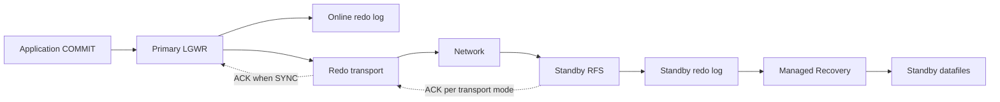

# Synchronous/Asynchronous Transport and Latency vs. Protection Trade-Offs

In Oracle Data Guard, the primary database generates redo when transactions modify data. Redo transport services ship redo from the primary to one or more standby databases so standbys can apply changes and support role transitions or disaster recovery.

Two critical transport modes are **synchronous transport (SYNC)** and **asynchronous transport (ASYNC)**:

- With **SYNC**, the primary waits for acknowledgment from the standby per configured conditions before completing a commit. This reduces or eliminates unprotected redo windows on the standby, at the cost of commit latency being influenced by network and standby redo write latency.
- With **ASYNC**, the primary does not wait for standby acknowledgment on each commit. Applications typically experience lower commit latency, but an abrupt primary failure can lose redo that has not yet reached the standby.

SYNC and ASYNC are transport attributes. AFFIRM and NOAFFIRM specify whether acknowledgment is sent after redo is written to the standby redo log or as soon as redo is received in the receiving process's memory. Together with protection modes, these attributes define the level of data protection and behavior when a standby becomes unavailable.

No single choice fits every system. Financial transactions requiring near-zero RPO over a low-latency network may prioritize synchronous transport. Analytics or distant DR systems may choose asynchronous transport to keep WAN round-trips off the commit path. DBAs must jointly evaluate RPO, commit latency, network bandwidth, standby I/O, fault tolerance, and recovery time.

## 1. Redo Transport in Data Guard

### 1.1. Where Is Redo Generated?

When a transaction modifies blocks, Oracle generates redo records describing the changes required for recovery. Redo is written to the redo log buffer in the SGA, and LGWR writes redo to online redo logs per commit conditions and log writing mechanisms.

The primary database can ship redo to standbys over Oracle Net. On the standby, the redo receiver process (RFS) receives the data and writes it to standby redo logs (SRL) when appropriately configured. The managed recovery process then applies redo to advance the standby toward the primary's state.

### 1.2. Core Components

| Component | Role |
|---|---|
| Primary database | The database processing transactions and generating redo |
| LGWR | Writes redo from the log buffer to online redo logs; participates in synchronous transport |
| LNS | Process shipping redo from primary to standby in corresponding transport architectures |
| Oracle Net | Network connection carrying redo and acknowledgments |
| RFS | Standby process receiving redo from the primary |
| Standby redo log | Destination where received redo is written prior to apply |
| MRP | Managed Recovery Process applying redo on a physical standby |
| ARCn | Archive process creating and shipping archived redo logs in applicable flows |

Process names and coordination details can vary by release, transport mode, and configuration. When investigating, rely on Data Guard and process views for the exact running release.

### 1.3. Conceptual Data Flow



The diagram shows the logical flow. Exact ordering among local redo write, redo shipping, and acknowledgment depends on the release's LGWR/transport mechanisms; the key point is that SYNC places standby acknowledgment inside commit completion, whereas ASYNC does not wait for that acknowledgment.

### 1.4. Transport Differs from Apply

Redo transport delivers redo to the standby. Redo apply reads received redo and applies it to standby datafiles. The two activities are related but distinct:

- **Transport lag:** redo generated on the primary that the standby has not yet fully received.
- **Apply lag:** redo received by the standby that has not yet been applied.

Transport lag relates directly to redo at risk of loss if the primary fails in asynchronous mode. Apply lag typically impacts the freshness of data read on the standby and the catch-up time needed before or after a role transition.

## 2. SYNC and ASYNC

### 2.1. Synchronous Transport (SYNC)

SYNC requires the primary to receive acknowledgment from the standby before completing a commit per transport mode semantics. Because the acknowledgment traverses the network and may wait for SRL writes, commit duration can increase.

In return, committed transaction redo is transferred to the standby according to the configured protection level. With SYNC AFFIRM, acknowledgment is sent only after redo is durably written to the standby redo log. This forms the basis for zero-data-loss protection when Maximum Protection or Maximum Availability requirements are met.

### 2.2. Asynchronous Transport (ASYNC)

ASYNC ships redo to the standby without forcing the primary to wait for standby acknowledgment on every commit. The primary can acknowledge commits once redo is written locally per database rules, while redo transport proceeds asynchronously in the background.

Advantages:

- Keeps network round-trips out of every commit.
- Suited for distant standbys or high-latency WANs.
- Reduces direct impact of slow standby I/O on OLTP response times.
- Supports greater geographic separation for DR.

Trade-offs:

- The standby can trail the primary by some amount of redo.
- Sudden primary loss can lose redo that has not reached the standby.
- Insufficient network bandwidth can cause transport lag to grow.
- Network interruptions leave redo gaps that must be resolved before the standby catches up.

### 2.3. Quick Comparison

| Criterion | SYNC | ASYNC |
|---|---|---|
| Primary waits for standby ACK on commit | Yes | No |
| Commit latency depends on network RTT | Yes | Not per commit |
| Standby I/O impacts commits | Yes with AFFIRM | Does not wait on standby I/O per commit |
| Protection of committed redo | Can achieve zero data loss under suitable mode/conditions | Unshipped redo may remain at risk |
| Best suited for | Very low RPO, low-latency networks | Distant DR, prioritizing primary throughput and latency |
| Primary risk | Slower commits or impact when standby/network fails | Loss of untransported redo if primary fails |

SYNC does not automatically mean zero data loss in every setup. AFFIRM/NOAFFIRM, protection mode, synchronized standby state, and failure conditions must all be considered. Likewise, ASYNC does not imply the standby is always far behind; with sufficient network and apply capacity, a standby can stay nearly caught up with the primary.

## 3. AFFIRM and NOAFFIRM

### 3.1. AFFIRM

AFFIRM requires the standby to acknowledge after redo has been written to the standby redo log. The primary waits for this acknowledgment during synchronous transport. Waiting for a durable write increases acknowledgment reliability, while adding standby I/O latency to the commit path.

### 3.2. NOAFFIRM

NOAFFIRM lets the standby send acknowledgment once redo has been received into the receiving process's memory, before the SRL write completes. This eliminates waiting for remote disk writes, but the acknowledgment does not prove redo is durable on standby storage at that instant.

If the standby or its infrastructure fails after sending the acknowledgment but before redo is durably written, the acknowledged redo may not survive on the standby. If the primary fails within that same vulnerability window, data loss can occur.

### 3.3. FASTSYNC

In supported releases, FASTSYNC is a synchronous transport mode that does not wait for redo to be written to the standby redo log; fundamentally, it corresponds to SYNC NOAFFIRM. FASTSYNC can reduce commit latency compared to SYNC AFFIRM, while introducing exposure if both primary and standby fail before redo is durably persisted.

FASTSYNC availability and protection mode eligibility depend on the Oracle release. Verify release documentation and Data Guard Broker configuration before deploying.

### 3.4. Acknowledgment Comparison

| Transport | When Standby Sends ACK | What the Primary Knows |
|---|---|---|
| SYNC AFFIRM | After redo is written to SRL | Redo was received and durably persisted per standby mechanics |
| SYNC NOAFFIRM / FASTSYNC | After redo is received in memory, before SRL write completes | Redo reached the receiving process; remote disk write durability is not yet guaranteed |
| ASYNC | ACK is not on each commit's completion path | Primary does not wait for standby confirmation for that commit |

### 3.5. When to Choose AFFIRM?

Choose SYNC AFFIRM when stricter data protection outweighs the added commit latency. This is the classic configuration for zero-data-loss synchronous transport.

### 3.6. When to Consider NOAFFIRM/FASTSYNC?

Consider it when:

- Very low RPO is required and reducing remote disk write latency is important.
- The standby sits close to the primary with low network RTT.
- The organization explicitly accepts the simultaneous primary/standby failure risk.
- The protection mode and release support this configuration.

Do not adopt FASTSYNC merely because benchmarks show faster commits; explicitly document the failure model and acceptable data loss exposure.

## 4. Data Guard Protection Modes

Protection modes specify the data-protection guarantee the primary strives to maintain and its behavior when standbys cannot receive redo as required.

### 4.1. Maximum Protection

Designed to guarantee zero loss of committed data within supported failure models. The primary requires synchronous transport with appropriate protective acknowledgments; if no synchronized standby remains to satisfy the requirement, the primary halts/shuts down rather than continuing to process transactions without the mandated protection.

Characteristics:

- Highest data protection among the three protection modes.
- Requires at least one standby meeting the mode's synchronous and durable acknowledgment rules.
- Primary may shut down if it cannot maintain the required protection.
- Demands high standby and network availability.
- Unsuitable if keeping the primary available outweighs halting writes to guarantee zero data loss.

### 4.2. Maximum Availability

Strives to deliver protection close to Maximum Protection while keeping the primary operational if the standby becomes temporarily unavailable.

When the synchronous standby fails or disconnects, the primary can continue operating in a degraded protection behavior—typically equivalent to Maximum Performance—until the synchronous destination reconnects and resynchronizes. During that window, if the primary also fails, unprotected redo can be lost.

Characteristics:

- Uses synchronous transport.
- While a standby is synchronized and conditions hold, commits are protected per mode rules.
- Primary does not immediately shut down when the synchronous standby is temporarily unreachable.
- Protection level may drop during disconnection periods.
- Can use FASTSYNC in supported releases, with durable-acknowledgment trade-offs.

### 4.3. Maximum Performance

Prioritizes primary performance and availability. Typically uses asynchronous redo transport so the primary does not wait for a standby on each commit.

Characteristics:

- Primary commit latency is largely independent of network round-trips to the standby.
- Well suited for distant standbys or high-latency networks.
- Standby may exhibit transport lag.
- If the primary fails, redo not yet shipped to the standby can be lost.
- RPO depends on untransported redo at failure time and recoverability.

### 4.4. Protection Mode Comparison Table

| Attribute | Maximum Protection | Maximum Availability | Maximum Performance |
|---|---|---|---|
| Objective | Zero data loss per failure model | Strong protection while prioritizing primary continuity on standby outage | Primary performance and availability |
| Typical transport | SYNC AFFIRM | SYNC AFFIRM or FASTSYNC if supported | ASYNC |
| Primary waits for standby | Yes | Yes when synchronous destination is available | Does not wait per commit |
| When standby disconnects | Primary halts if no eligible standby remains | Primary continues at reduced protection level | Primary continues |
| Commit latency | Higher due to network and remote write | Higher when sync; lower with FASTSYNC | Lower, no per-commit ACK wait |
| Data loss exposure | Zero committed redo loss while mode holds | Zero loss when synchronized mode holds; risk if primary fails while protection is degraded or in FASTSYNC failure window | Untransported redo may be lost |

Modes are not promises independent of infrastructure. Ensure standbys, SRLs, networks, storage, and role transitions are properly configured and tested.

### 4.5. Protection Mode vs. Protection Level

Distinguish:

- PROTECTION_MODE: the configured mode for the database.
- PROTECTION_LEVEL: the current actual protection level given destination and transport states.

These two values can diverge while a synchronous destination is unresponsive. For instance, a database configured for Maximum Availability may currently report a reduced protection level due to a disconnected standby.

Inspection:

```sql
SELECT protection_mode,
       protection_level,
       database_role,
       switchover_status
FROM v$database;
```

This is one of the first checks to confirm Data Guard protection is operating at the expected level.

## 5. Commit Latency and the Acknowledgment Path

### 5.1. Latency Components in SYNC AFFIRM

Commit latency in synchronous transport can be affected by:

- Local redo write on the primary.
- Time for LGWR/LNS to hand redo to transport.
- Network round-trip time and jitter.
- Time for RFS to receive redo.
- Remote write latency to flush the standby redo log under AFFIRM.
- Scheduling/CPU contention on primary and standby.
- Queueing caused by network congestion or I/O saturation.

Consequently, SYNC AFFIRM generally has higher commit latency than ASYNC. The magnitude depends on network distance, network quality, storage speed, and workload.

### 5.2. Network Round-Trip

Under SYNC, the acknowledgment must return to the primary before commit completes. Outbound and return transmission delays add a component close to the network RTT into the commit path. Increasing geographic distance or traversing a WAN can increase RTT substantially.

Bandwidth and latency are separate quantities:

- Bandwidth governs how much redo can be shipped per second.
- Latency governs how fast a single send/acknowledgment cycle completes.

A high-bandwidth link with large RTT can still make synchronous commits slow.

### 5.3. Remote I/O

With AFFIRM, the standby must write redo to the SRL before acknowledging. Standby storage latency, write queues, controller cache behavior, and contention enter the commit path.

With NOAFFIRM/FASTSYNC, acknowledgment does not wait for SRL write completion, reducing the remote I/O latency component. In exchange, acknowledgment indicates redo reached memory rather than confirming durability on standby storage.

### 5.4. ASYNC and Indirect Effects

ASYNC does not wait for per-commit acknowledgments, yet transport still consumes CPU, network bandwidth, and process resources. If the network saturates or redo generation exceeds available bandwidth, transport lag increases. Thus, ASYNC removes direct wait from commit latency without making transport resource-free.

### 5.5. Variance Matters as Much as the Mean

When evaluating synchronous transport, do not look only at average latency. P95/P99 commit latency, jitter, and peak-hour spikes can degrade user experience far more than the average suggests.

Measure under representative workloads and timeframes:

- Median, P95, and P99 commit response time.
- Log file sync and transport-related waits.
- Network RTT, retransmits, and packet loss.
- Standby SRL write latency.
- CPU/network queues on both sides.

## 6. RPO, RTO, and Data Loss Exposure

### 6.1. RPO

Recovery Point Objective (RPO) is the maximum amount of data an organization accepts losing when recovering from an incident. In Data Guard:

- Synchronous durable transport can achieve zero RPO for committed transactions while the protection mode and conditions hold.
- ASYNC RPO depends on redo that has not reached the standby when the primary fails.
- FASTSYNC reduces commit latency but requires understanding simultaneous primary/standby failure risk before redo is durably persisted.

### 6.2. RTO

Recovery Time Objective (RTO) is the target time to restore service. SYNC/ASYNC alone does not determine overall RTO. RTO also depends on:

- Time to detect primary failure.
- Failover procedures and role-transition decisions.
- How far the standby has applied redo.
- Time to open the standby as primary.
- DNS/service/client reconnection.
- Post-failover application and data validation.

### 6.3. Transport Lag and Apply Lag

Transport lag reflects primary redo not yet received by the standby. Apply lag reflects received redo not yet applied. Both must be monitored independently.

Examples:

- Transport lag 0 seconds, apply lag 15 minutes: redo has arrived at the standby, but apply has fallen behind; standby reads may be stale and failover may need extra apply time.
- Transport lag 2 minutes, apply lag 0 seconds: the standby has applied everything it received, yet still lacks the newest redo; unshipped redo may be lost if the primary fails.

### 6.4. ASYNC RPO Is Not a Fixed Constant

You cannot claim ASYNC always loses at most one second or one minute without operational bounds and lag measurements. Actual RPO depends on redo generation rate, network throughput, queueing, disconnect duration, and failure point.

Setting lag alert thresholds does not convert ASYNC into zero-data-loss. It merely alerts operators when exposure exceeds acceptable limits so they can intervene.

## 7. Configuring LOG_ARCHIVE_DEST_n

### 7.1. Declaring Standby Destinations

A Data Guard destination is typically configured via LOG_ARCHIVE_DEST_n. Illustrative SYNC AFFIRM example:

```sql
ALTER SYSTEM SET LOG_ARCHIVE_DEST_2 =
  'SERVICE=STBY1
   SYNC AFFIRM
   NET_TIMEOUT=10
   REOPEN=60
   VALID_FOR=(ONLINE_LOGFILES,PRIMARY_ROLE)
   DB_UNIQUE_NAME=STBY1'
  SCOPE=BOTH;
```

Illustrative ASYNC example:

```sql
ALTER SYSTEM SET LOG_ARCHIVE_DEST_3 =
  'SERVICE=STBY_DR
   ASYNC NOAFFIRM
   VALID_FOR=(ONLINE_LOGFILES,PRIMARY_ROLE)
   DB_UNIQUE_NAME=STBY_DR'
  SCOPE=BOTH;
```

Service names, DB_UNIQUE_NAME values, destination numbers, timeouts, and attributes must match your actual setup. Statements can be entered on a single line in SQL clients.

### 7.2. Key Attributes

| Attribute | Meaning |
|---|---|
| SERVICE | Standby Oracle Net service |
| SYNC | Synchronous redo transport |
| ASYNC | Asynchronous redo transport |
| AFFIRM | Wait for redo write to standby redo log before ACK |
| NOAFFIRM | ACK before standby redo log write completes |
| FASTSYNC | Synchronous transport without waiting for remote SRL write in supported releases |
| NET_TIMEOUT | Wait duration for transport response before erroring, applicable to synchronous transport |
| REOPEN | Wait interval before retrying a failed destination |
| MAX_FAILURE | Configured limit on consecutive retry failures |
| VALID_FOR | Specifies which log types and database roles make the destination valid |
| DB_UNIQUE_NAME | Target database unique identifier |
| MANDATORY/OPTIONAL | Policy controlling archive requirements for the destination; not synonymous with AFFIRM |

### 7.3. LOG_ARCHIVE_DEST_STATE_n

Destinations can be enabled or disabled via LOG_ARCHIVE_DEST_STATE_n:

```sql
ALTER SYSTEM SET LOG_ARCHIVE_DEST_STATE_2 = ENABLE SCOPE=BOTH;
```

DISABLE/DEFER values may be used during planned maintenance or troubleshooting. Do not arbitrarily disable a synchronous destination under Maximum Protection/Availability, as doing so can lower protection level or shut down the primary depending on mode.

### 7.4. VALID_FOR

VALID_FOR specifies which log types and database roles activate the destination. Common setting for shipping redo from online redo logs while in primary role:

```text
VALID_FOR=(ONLINE_LOGFILES,PRIMARY_ROLE)
```

For role transitions, configure destinations across databases so redo continues shipping cleanly after a switchover or failover per design.

### 7.5. NET_TIMEOUT

NET_TIMEOUT sets how long LGWR waits for a response from a synchronous destination before treating the connection as timed out. Too low a value can trigger false errors during network jitter; too high a value delays fault detection and stalls commits when a standby hangs.

Select timeouts based on baseline RTT, jitter, remote write times, and failure detection goals. Avoid setting extremely low values just for fast detection without testing for false timeouts.

### 7.6. REOPEN and MAX_FAILURE

REOPEN controls how long Oracle waits before retrying a failed destination. MAX_FAILURE caps consecutive retry attempts before handling the destination according to policy. These settings do not replace monitoring and transport recovery runbooks.

### 7.7. LOG_ARCHIVE_DEST_n Need Not Be Identical for All Standbys

A primary can send redo to multiple standbys using different modes. For example, a local standby using SYNC AFFIRM for commit protection and a remote DR standby using ASYNC. Each destination has its own SERVICE, mode, VALID_FOR, and DB_UNIQUE_NAME.

## 8. Standby Redo Logs and Real-Time Apply

### 8.1. Role of SRLs

Standby redo logs hold redo received from the primary before it is archived and applied. SRLs enable continuous redo reception and real-time apply, reducing delay compared to waiting for full archived logs.

### 8.2. Count and Size

SRL design should account for:

- Number of redo log groups per thread on the primary.
- Size of the largest online redo log.
- Number of threads in RAC.
- Number of standby redo log groups required per thread.

A common guideline is at least one more SRL group than online redo log groups per thread, sized at least as large as the largest online redo log for that thread. Verify Oracle release documentation and specific RAC configurations before deployment.

### 8.3. Inspecting SRLs

```sql
SELECT group#,
       thread#,
       sequence#,
       bytes,
       status
FROM v$standby_log
ORDER BY thread#, group#;
```

Compare against online redo logs:

```sql
SELECT thread#,
       group#,
       bytes,
       status
FROM v$log
ORDER BY thread#, group#;
```

### 8.4. Real-Time Apply

When SRLs are configured and managed recovery is running appropriately, a physical standby can apply redo while it is still being written to the standby redo log. This cuts apply lag compared to waiting for completed archive logs.

Example starting managed recovery on a physical standby:

```sql
ALTER DATABASE RECOVER MANAGED STANDBY DATABASE DISCONNECT FROM SESSION;
```

Exact syntax and options vary by release. Never run recovery commands casually on a database not in the proper role/state.

### 8.5. Successful Transport with Slow Apply

If redo reaches the standby but MRP cannot apply fast enough, transport lag stays low while apply lag climbs. Check MRP, standby I/O, recovery waits, archive gaps, and standby read workloads.

## 9. Choosing Modes by Topology and Network Distance

### 9.1. Same-Data-Center Standby

If primary and standby reside in the same data center with low network RTT and low-latency standby storage, SYNC AFFIRM can provide zero-data-loss protection. Benchmark under production-like load rather than relying solely on ping tests.

### 9.2. Nearby-Data-Center Standby

With moderate RTT, Maximum Availability with SYNC AFFIRM offers a balanced choice. Measure P95/P99 commit latency and verify behavior during link interruptions.

### 9.3. Remote Standby Over WAN

High WAN RTT typically inflates synchronous commit latency substantially. ASYNC is usually better suited for distant DR without injecting WAN RTT into the commit path. In return, establish RPO targets and transport lag alerts.

### 9.4. Far Sync

A Far Sync instance is a Data Guard component that receives redo synchronously near the primary and forwards it asynchronously to remote standbys. This places synchronous acknowledgment close to the primary while remote standbys continue receiving redo via ASYNC.


Far Sync is not a full standby database with datafiles that can be opened for reads like a physical standby. It is a redo reception and forwarding component. Design must also consider Far Sync availability, the second network leg, and failover topology.

### 9.5. Multiple Standbys

A topology may combine:

- A local standby using SYNC AFFIRM for commit protection.
- A remote DR standby using ASYNC.
- A reporting/read-only standby with its own apply policy.

Avoid setting every destination to SYNC purely in pursuit of maximum protection; each synchronous destination can impact the commit path and availability. Clearly design mandatory vs. optional destinations and role transitions.

## 10. Performance vs. Protection Trade-Offs

### 10.1. Trade-Off Table

| Factor | SYNC AFFIRM | SYNC NOAFFIRM / FASTSYNC | ASYNC |
|---|---|---|---|
| Commit latency | Typically highest of the three | Lower than AFFIRM | Largely independent of standby RTT |
| Durable ACK on standby | Yes | Does not wait for SRL write | Does not wait for per-commit ACK |
| Data loss risk on simultaneous failure | Lowest while mode holds | Risk window if standby loses unwritten redo and primary also fails | Unshipped redo at risk |
| Network dependency | High on commit path | High on commit path, but avoids remote write wait | Does not block individual commits |
| Best suited for | Zero data loss with strong network/storage | Lower latency with accepted failure trade-off | Distant DR and primary performance |

### 10.2. OLTP Workloads

OLTP involves many short transactions and frequent commits. Every added millisecond per commit affects throughput and tail latency. With SYNC, measure commits/sec, log file sync waits, and network RTT.

### 10.3. Batch Workloads

Batch workloads involve longer transactions or grouped commits. Synchronous transport still affects commit points, though commit frequency may be lower than OLTP. Tuning batch size can reduce commit frequency, balanced against undo, locks, recovery time, and transaction duration.

### 10.4. Standby Reporting

If a standby serves reporting queries, apply lag matters because queried data may be stale. Base ASYNC/SYNC decisions on both RPO and data freshness, not commit latency alone.

### 10.5. Storage and Network Bottlenecks

SYNC AFFIRM can be bottlenecked by standby SRL write latency. ASYNC can be bottlenecked by network throughput or transport processes. Identify the actual bottleneck before blindly switching SYNC to ASYNC when commits slow down.

## 11. Monitoring Transport and Apply

### 11.1. V$ARCHIVE_DEST

This view shows archive destination configurations and status:

```sql
SELECT dest_id,
       status,
       target,
       destination,
       binding,
       error,
       transmit_mode,
       affirm,
       net_timeout
FROM v$archive_dest
WHERE dest_id BETWEEN 1 AND 10
ORDER BY dest_id;
```

Columns can vary by release. Run `DESC V$ARCHIVE_DEST` to confirm the schema.

### 11.2. V$ARCHIVE_DEST_STATUS

```sql
SELECT dest_id,
       status,
       type,
       database_mode,
       recovery_mode,
       synchronization_status,
       gap_status,
       error
FROM v$archive_dest_status
WHERE dest_id > 0
ORDER BY dest_id;
```

This view helps inspect destination state, synchronization status, and gaps. Not every column exists in all releases.

### 11.3. V$DATAGUARD_STATS

On the standby, inspect lag:

```sql
SELECT name,
       value,
       unit,
       time_computed,
       datum_time
FROM v$dataguard_stats
WHERE name IN ('transport lag', 'apply lag', 'apply finish time');
```

Transport lag and apply lag are typically formatted as intervals. Check `time_computed` and `datum_time` to confirm freshness; stale values can cause monitoring to report outdated health status.

### 11.4. V$DATABASE

```sql
SELECT database_role,
       protection_mode,
       protection_level,
       switchover_status,
       open_mode
FROM v$database;
```

This is a key check to confirm the current database role and active protection level.

### 11.5. V$DATAGUARD_PROCESS

This view displays active Data Guard processes:

```sql
SELECT name,
       role,
       action,
       thread#,
       sequence#,
       block#
FROM v$dataguard_process
ORDER BY name;
```

Exact columns vary by release. Use it to inspect RFS, MRP, and transport-related processes.

### 11.6. V$STANDBY_LOG

Check SRL groups, threads, sequences, and status. If SRLs are missing, undersized, or too few in number, real-time transport/apply may not operate as expected.

### 11.7. Broker

If using Data Guard Broker, common commands include:

```text
DGMGRL> SHOW CONFIGURATION;
DGMGRL> SHOW DATABASE VERBOSE 'STBY1';
DGMGRL> VALIDATE DATABASE 'STBY1';
```

Broker displays transport lag, apply lag, protection mode/level, and warnings. Exact validate syntax varies by release.

## 12. Wait Events and Latency Diagnostics

### 12.1. Log File Sync

Applications typically wait on LGWR to complete commits via the `log file sync` wait event. With synchronous Data Guard, transport latency can contribute to commit duration. However, elevated `log file sync` can also stem from local redo I/O, commit rates, CPU scheduling, or other contention.

Do not blame Data Guard for every high `log file sync` wait. Correlate transport waits, destination status, network metrics, and standby I/O.

### 12.2. Data Guard-Related Waits

Specific wait events and names vary by release. Relevant categories include:

- LGWR waiting on redo transport send/receive.
- Network send/receive waits.
- Redo transport destination waits.
- Standby redo log I/O.
- Archive gap or recovery waits.

Use V$SYSTEM_EVENT, V$SESSION_EVENT, ASH/AWR (if licensed), and Data Guard views to isolate bottlenecks.

### 12.3. Inspecting Events by Session

```sql
SELECT sid,
       event,
       total_waits,
       time_waited
FROM v$session_event
WHERE event LIKE '%redo%'
   OR event LIKE '%Data Guard%'
ORDER BY time_waited DESC;
```

Exact event names depend on version; `LIKE` queries are exploratory starting points, not exhaustive lists.

### 12.4. Network Measurements

Measure RTT between primary and standby along the actual database network path, checking packet loss, retransmits, throughput, and congestion. A standalone ICMP ping cannot prove the transport path is healthy because Oracle Net uses TCP sessions and potentially distinct routing.

### 12.5. Standby I/O

With AFFIRM, examine SRL write latency and the storage path. Inspect disk groups/filesystems, ASM latency, controller queues, multipathing, and I/O saturation. If standby storage is slow, upgrading network bandwidth will not resolve commit latency.

## 13. Transport Lag, Apply Lag, and Redo Gaps

### 13.1. Rising Transport Lag

Possible causes:

- Insufficient network bandwidth relative to redo generation.
- Network interruptions or packet loss.
- LNS/transport processes starved of CPU.
- Standby RFS unable to keep pace.
- Destination in error or deferred state.
- Sudden spikes in primary redo generation.

### 13.2. Rising Apply Lag

Possible causes:

- MRP starved of CPU/I/O.
- Competing reporting workloads on the standby.
- Recovery apply paused or stopped.
- SRL/archive gaps.
- Specific recovery/DDL operations or special workloads.

### 13.3. Redo Gaps

A redo gap occurs when the standby is missing one or more archived redo log sequences. Data Guard can perform automatic gap resolution if required archive logs remain available on the primary or archive locations. If logs were deleted from all sources, DBAs may need to restore/copy logs or rebuild the standby per procedures.

### 13.4. Do Not Confuse Lag with Data Loss

Apply lag is not necessarily data loss; redo may already be safe on the standby without being applied yet. Transport lag under ASYNC represents unreceived redo and poses data loss exposure if the primary fails. Under SYNC, check protection level and destination synchronization rather than relying on a single lag number.

## 14. Failure Scenarios

### 14.1. Network Loss Under SYNC AFFIRM

If the primary does not receive acknowledgment within NET_TIMEOUT:

- The destination can enter an error state.
- Commits may stall during the timeout wait.
- Maximum Availability can continue with a reduced protection level per policy.
- Maximum Protection can shut down the primary if no synchronized standby remains.

Check alert logs, destination errors, protection level, and networking before altering modes.

### 14.2. Network Loss Under ASYNC

The primary continues committing while transport lag grows and redo accumulates on the primary/transport side. Once connectivity returns, Data Guard resumes shipping redo if the required logs remain available. If the primary fails before catching up, unreceived redo can be lost on failover.

### 14.3. Slow Standby Storage Under AFFIRM

Slow RFS writes to SRL delay acknowledgments. Synchronous commit latency on the primary increases accordingly. Inspect SRL I/O, storage queues, and related waits.

### 14.4. Standby Apply Stops While Transport Continues

Redo continues arriving in SRLs while MRP is idle. Transport lag stays low while apply lag grows. Check MRP state, recovery errors, and SRL/archive capacity.

### 14.5. Primary Failure

Redo loss exposure depends on protection mode, transport mode, acknowledgment semantics, and synchronization state at failure time. Before failing over, determine which sequences the standby received, whether gaps exist, and whether remaining archived logs can still be applied.

### 14.6. Standby Failure

The primary behaves according to its protection mode. After the standby recovers, verify destination status, transport resumption, gap resolution, and synchronization before assuming the protection level has returned to normal.

### 14.7. Simultaneous Primary and Standby Failure

This is a critical failure scenario when evaluating FASTSYNC/NOAFFIRM and ASYNC. Under NOAFFIRM, redo may sit in memory without being flushed to SRL; if the standby loses power before writing and the primary fails too, that redo may be lost. Under ASYNC, unshipped redo can be lost. Failure models must cover power, host, storage, network, and site outages.

## 15. Configuring Protection Modes

### 15.1. Verifying Prerequisites Before Changing Mode

Before raising protection levels:

1. Confirm the standby has the right role and is receiving redo.
2. Create sufficient standby redo logs for every thread.
3. Verify transport destinations and synchronization status.
4. Measure network RTT/bandwidth and standby I/O.
5. Verify Broker configuration if using Broker.
6. Ensure runbooks exist for standby disconnect scenarios.

### 15.2. Statements to Change Mode

Oracle provides the syntax:

```sql
ALTER DATABASE SET STANDBY DATABASE TO MAXIMIZE PROTECTION;
ALTER DATABASE SET STANDBY DATABASE TO MAXIMIZE AVAILABILITY;
ALTER DATABASE SET STANDBY DATABASE TO MAXIMIZE PERFORMANCE;
```

Execute only the statement matching your target mode after meeting release and topology preconditions. Certain transitions require specific database roles/states; if using Data Guard Broker, perform changes through Broker for consistent management.

### 15.3. Transitioning to Maximum Protection

Confirm at least one synchronized standby satisfies synchronous durable transport. Otherwise, the mode change may fail or the primary may risk shutting down if protection cannot be sustained. Plan the change within a controlled window.

### 15.4. Downgrading Mode

Downgrading from Maximum Protection/Availability to Maximum Performance can change RPO. Obtain change approval, log the start time of increased data-loss exposure, and adjust monitoring alerts accordingly.

### 15.5. Post-Change Verification

Inspect V$DATABASE.PROTECTION_MODE/PROTECTION_LEVEL, V$ARCHIVE_DEST_STATUS, and Data Guard Broker. Confirm transport destinations are synchronized and lag metrics update properly.

## 16. Data Guard Broker

### 16.1. Role

Data Guard Broker centralizes Data Guard configuration management, supporting monitoring, switchover, failover, and property adjustments. Broker helps reduce errors from managing scattered parameters manually, though understanding redo transport and protection semantics remains essential.

### 16.2. Inspecting Configuration

```text
DGMGRL> SHOW CONFIGURATION;
DGMGRL> SHOW DATABASE VERBOSE 'PRIMARY_DB';
DGMGRL> SHOW DATABASE VERBOSE 'STBY1';
```

### 16.3. Viewing Transport/Apply Lag

Broker displays transport lag, apply lag, warnings, and database states. Cross-check with V$DATAGUARD_STATS and destination views for deeper diagnostics.

### 16.4. Configuring Transport Mode

Broker properties such as LogXptMode and protection mode can be managed via DGMGRL. Value names, FASTSYNC support, and modification syntax vary by release. Never modify Broker properties and LOG_ARCHIVE_DEST_n concurrently through uncoordinated processes.

### 16.5. Validate

Use appropriate validate commands to check database, network, and role-transition readiness. Validate catches many configuration issues, though it does not replace live failover/switchover drills.

## 17. Process for Choosing SYNC vs. ASYNC

### Step 1 — Define RPO

Ask the business how much data loss is tolerable if the primary is completely lost. If zero RPO is mandatory, synchronous durable transport and a corresponding protection mode are required.

### Step 2 — Define RTO

Establish the maximum time allowed for the standby to take over. Account for apply lag, failover automation, service relocation, and client reconnection.

### Step 3 — Measure the Network

Measure RTT, jitter, packet loss, and throughput over the real network path between primary and standby using peak-hour data.

### Step 4 — Measure Redo Generation

Estimate redo bytes/second at peak workload. Network capacity must suffice for transport to keep lag within target bounds.

### Step 5 — Measure Standby I/O

If using AFFIRM, measure SRL write latency and storage saturation. Check CPU, RFS, and MRP performance.

### Step 6 — Benchmark Commits

Run a representative workload and measure P50/P95/P99 commit latency, transaction throughput, `log file sync`, and transport waits.

### Step 7 — Select Transport and Protection Mode

Choose SYNC AFFIRM, SYNC NOAFFIRM/FASTSYNC (if supported and risk is accepted), or ASYNC. Choose protection mode based on desired primary behavior when the standby becomes unavailable.

### Step 8 — Document Failure Behavior

Document explicitly whether the primary continues, degrades protection, or shuts down in each scenario. Capture this in runbooks and train operations teams.

### Step 9 — Set Up Monitoring

Configure alerts for transport lag, apply lag, destination errors, protection level, SRL status, and disk/network capacity.

### Step 10 — Rehearse

Execute switchover/failover tests, network interruption tests, and standby recovery tests in an appropriate environment. Verify actual RPO/RTO with measured metrics.

## 18. Scenario-Based Selection Examples

| Scenario | Commonly Evaluated Choice | Rationale and Conditions |
|---|---|---|
| Core banking, same-site standby, zero data loss required | Maximum Protection or Maximum Availability with SYNC AFFIRM | Requires low network/storage latency and acceptance of standby-outage behavior |
| Mission-critical OLTP, primary must stay up if standby drops briefly | Maximum Availability with SYNC AFFIRM | Strong protection when synchronized; primary continues with degraded protection if standby disconnects |
| Commit-latency sensitive, nearby site, FASTSYNC failure trade-off accepted | Maximum Availability with SYNC NOAFFIRM/FASTSYNC if release supports | Cuts remote write wait, but failure model must be accepted |
| Remote DR site across WAN | Maximum Performance with ASYNC | Avoids WAN RTT on commit path; monitor RPO exposure |
| One local standby and one remote standby | Local SYNC, remote ASYNC | Balances local zero-data-loss protection with geographic DR |
| Reporting-only standby | ASYNC or mode aligned with data SLA | Must manage apply lag to guarantee data freshness |

These are architectural guidelines, not default configurations. Final decisions must be grounded in business-approved RPO/RTO, release capabilities, topology, and empirical measurements.

## 19. Lab: Observing Transport and Protection

Execute on two lab databases preconfigured with Data Guard. Never alter production protection modes for experimentation.

### Step 1 — Identify Role and Protection

Run on the primary:

```sql
SELECT database_role,
       protection_mode,
       protection_level,
       open_mode
FROM v$database;
```

Record baseline output before testing.

### Step 2 — Inspect Destinations

```sql
SELECT dest_id,
       status,
       destination,
       transmit_mode,
       affirm,
       net_timeout,
       error
FROM v$archive_dest
WHERE dest_id > 0
ORDER BY dest_id;
```

Confirm the standby destination and transport attributes.

### Step 3 — Inspect Standby Redo Logs

On the standby:

```sql
SELECT group#, thread#, sequence#, bytes, status
FROM v$standby_log
ORDER BY thread#, group#;
```

Compare group count and size against online redo log groups.

### Step 4 — Measure Transport/Apply Lag

On the standby:

```sql
SELECT name, value, unit, time_computed, datum_time
FROM v$dataguard_stats
WHERE name IN ('transport lag', 'apply lag');
```

Collect multiple samples over time rather than concluding from a single snapshot.

### Step 5 — Run a Commit Workload

In a lab schema, run a transactional workload with frequent commits. Record P50/P95/P99 response time, transaction throughput, and wait events. Never run heavy test DML against real application schemas.

### Step 6 — Compare SYNC AFFIRM and ASYNC

In an authorized lab environment, switch transport modes per runbook. Keep the workload and measurement duration constant. Compare commit latency, network traffic, transport lag, and standby apply lag.

### Step 7 — Controlled Network Interruption Test

In the lab only, simulate transport link loss. Observe destination status, alert logs, protection level, and primary behavior. Restore connectivity and verify gap resolution and resynchronization.

### Step 8 — Apply Pause Test

In the lab, pause and resume managed recovery per procedure to observe how transport lag and apply lag diverge. Do not leave the standby out of sync beyond the test window.

### Step 9 — Record Results

| Mode | Commit P95 | Commit P99 | Transport Lag | Apply Lag | Protection Level | Notes |
|---|---:|---:|---:|---:|---|---|
| SYNC AFFIRM | | | | | | |
| SYNC NOAFFIRM/FASTSYNC | | | | | | |
| ASYNC | | | | | | |

Populate with real measurements from your lab. Never cite illustrative or assumed numbers as performance claims.

## 20. Common Misconceptions

### 20.1. SYNC Always Means Zero Data Loss

SYNC must be paired with appropriate acknowledgment semantics and protection modes. SYNC NOAFFIRM can ACK before SRL writes finish. Examine AFFIRM/NOAFFIRM, FASTSYNC, and protection level.

### 20.2. ASYNC Always Has High Lag

If the network is fast enough and MRP keeps pace, ASYNC can maintain very low lag. The risk is unshipped redo at the instant the primary fails, not that the standby is perpetually slow.

### 20.3. Transport Lag Equals Apply Lag

These metrics reflect two distinct stages. Transport lag measures unreceived redo; apply lag measures received but unapplied redo.

### 20.4. Maximum Availability Is Always Zero Data Loss

While a synchronous standby is synchronized and protection rules hold, committed transactions are protected. When the standby disconnects, the primary can continue with reduced protection; failing during that window creates data loss exposure. FASTSYNC carries its own failure trade-off as well.

### 20.5. Maximum Protection Keeps the Standby Healthy Automatically

The mode can shut down the primary if no eligible standby remains, but it does not repair networks, storage, or standby misconfigurations. Monitoring and recovery plans remain essential.

### 20.6. AFFIRM Is Just a Performance Option

AFFIRM alters acknowledgment timing and durability guarantees. It is a data-protection decision, not merely a tuning switch.

### 20.7. Low Ping Means Low Commit Latency

Ping does not measure remote SRL writes, Oracle Net scheduling, LGWR/LNS contention, or disk I/O. Only end-to-end commit benchmarks reveal real impact.

### 20.8. Standby Receiving Redo Means It Is Applied

Redo can sit in SRLs while MRP has not applied it yet. Verify transport and apply separately.

### 20.9. Downgrading Protection Mode Has No Business Impact

Downgrading modes can alter RPO. It is a data-protection architectural change requiring change approval and updated monitoring.

## 21. Design and Operations Checklist

- [ ] Business-approved RPO and RTO defined.
- [ ] Appropriate Data Guard protection mode selected.
- [ ] SYNC/ASYNC distinguished from AFFIRM/NOAFFIRM.
- [ ] FASTSYNC and its failure trade-offs understood if used.
- [ ] Transport destinations and DB_UNIQUE_NAME verified.
- [ ] VALID_FOR configured properly for role transitions.
- [ ] NET_TIMEOUT, REOPEN, and destination states checked.
- [ ] Sufficient standby redo logs created for every thread.
- [ ] SRL size at least as large as corresponding online redo logs.
- [ ] Real-time apply configured and MRP running when required.
- [ ] RTT, jitter, packet loss, and network throughput measured.
- [ ] Standby SRL write latency measured when using AFFIRM.
- [ ] P95/P99 commit latency measured under representative load.
- [ ] Transport lag and apply lag monitored independently.
- [ ] PROTECTION_MODE and PROTECTION_LEVEL monitored.
- [ ] Alerts configured for destination errors or protection level drops.
- [ ] Redo gaps and gap resolution procedures verified.
- [ ] Broker configuration verified if used.
- [ ] Standby failures, network outages, and role transitions rehearsed.
- [ ] Primary continue vs. shutdown behavior documented.
- [ ] Runbooks exist for transport recovery and resynchronization.

## 22. Self-Check Questions

1. How does redo transport differ from redo apply?
2. What are the roles of LGWR, LNS, RFS, SRL, and MRP?
3. How does SYNC alter commit completion conditions?
4. Which impact on primary commits does ASYNC reduce?
5. Why can ASYNC still experience rising transport lag?
6. What does AFFIRM confirm before sending an acknowledgment?
7. At what point does NOAFFIRM send an acknowledgment?
8. How does FASTSYNC relate to SYNC NOAFFIRM?
9. Why does SYNC not automatically guarantee zero data loss?
10. How does Maximum Protection behave when no synchronized standby remains?
11. How does Maximum Availability differ from Maximum Protection when a standby fails?
12. What does Maximum Performance prioritize?
13. How does PROTECTION_MODE differ from PROTECTION_LEVEL?
14. Which components make up commit latency under SYNC AFFIRM?
15. Why does network RTT matter more than bandwidth for individual synchronous commits?
16. How does standby I/O affect AFFIRM?
17. How do RPO and RTO differ?
18. What do transport lag and apply lag represent?
19. Why does high apply lag not necessarily mean redo is lost?
20. What are the key attributes of LOG_ARCHIVE_DEST_n?
21. What do NET_TIMEOUT and REOPEN control?
22. How does VALID_FOR support destination configuration across role changes?
23. What role do standby redo logs play in real-time apply?
24. Which factors must be considered when sizing and counting SRLs?
25. Why is Far Sync useful for distant standbys?
26. When should you choose SYNC AFFIRM, FASTSYNC, or ASYNC?
27. How do you monitor transport and apply lag?
28. Why can ping alone not predict commit latency?
29. When the network drops under Maximum Availability, how can the primary operate?
30. Which failure scenarios must be rehearsed before taking Data Guard to production?

**Key Principle:** SYNC places standby acknowledgment inside the commit path; ASYNC allows the primary to commit without waiting for per-transaction ACKs. AFFIRM waits for redo to be written to the SRL, whereas NOAFFIRM/FASTSYNC acknowledges earlier with an associated failure trade-off. Maximum Protection prioritizes zero data loss and can halt the primary if synchronized standbys are lost; Maximum Availability prioritizes primary continuity during transient standby outages; Maximum Performance prioritizes primary performance with asynchronous redo transport. Select modes per RPO/RTO, measure RTT and SRL I/O, monitor transport lag separately from apply lag, and rehearse failures before deployment.
