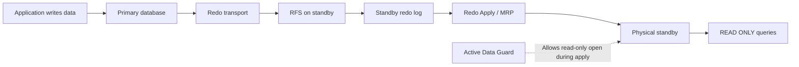

# Active Data Guard vs. Basic Data Guard Capabilities

Oracle Data Guard maintains one or more standby databases synchronized with a primary database by shipping and applying redo. The core goal is protecting data and preserving the ability to transition roles when the primary fails or requires maintenance.

Active Data Guard (ADG) extends the Data Guard model by allowing a physical standby to open in read-only mode while continuing to apply redo from the primary. As a result, organizations can run reporting, queries, and certain read workloads on the standby while continuously updating standby data. This is the most important distinction between Active Data Guard and basic Data Guard capabilities.

Basic Data Guard already ships redo, applies redo, switches primary/standby roles, and keeps a standby in MOUNT state. A physical standby can also be opened READ ONLY in certain releases and configurations, but once Redo Apply stops, data on the standby ceases advancing toward the primary. Active Data Guard allows combining read-only queries with active Redo Apply.

## 1. Data Guard Architecture

### Primary, Standby, and Redo

A Data Guard configuration consists of a primary database and at least one standby database. The primary processes application transactions and generates redo describing data changes. Redo travels across the network to the standby, where it is applied to reproduce changes on the standby database.

Key components in the redo stream:

- **Primary database:** the database holding the primary role and typically receiving write transactions.
- **Redo transport:** ships redo from primary to standby over Oracle Net. Synchronous or asynchronous transport can be used depending on data protection and latency needs.
- **Standby redo log (SRL):** receives redo from the primary on the standby. SRLs enable real-time apply, allowing the standby to apply redo as soon as it is written to the standby redo log instead of waiting for an archived log to complete.
- **Remote File Server (RFS):** the standby process receiving redo and writing it to standby redo logs or archived logs.
- **Redo Apply:** applies redo to a physical standby so data blocks match the primary.
- **SQL Apply:** transforms redo information into SQL statements and applies them to a logical standby.

General processing flow:



In a basic Data Guard setup, a physical standby is typically kept in MOUNT state while Redo Apply runs. With Active Data Guard, a physical standby can remain in `READ ONLY WITH APPLY` state: users execute read-only queries while the apply process continues updating blocks from incoming redo.

### Standby Database Types

| Standby Type | How Data Is Maintained | Open Mode and Usage |
|---|---|---|
| Physical standby | Applies redo at the block level via Redo Apply | Typically MOUNT during apply; can open READ ONLY when apply stops. Active Data Guard enables READ ONLY WITH APPLY |
| Logical standby | Converts redo to SQL and applies via SQL Apply | Can open READ WRITE for certain supported queries and operations; requires understanding objects maintained by SQL Apply |
| Snapshot standby | Temporarily converted from physical standby to writable state for testing | Opens READ WRITE during testing; redo from primary is retained to apply after converting back to physical standby |

**Physical standby** preserves a near-identical physical layout to the primary and is the type commonly used for Active Data Guard real-time query. Redo Apply updates the standby from changes occurring on the primary.

**Logical standby** uses SQL Apply and thus supports certain read/write operations and structural differences permitted by Oracle documentation. However, not all data types, tables, or DDL operations are supported by SQL Apply. Check version-specific restriction lists before choosing a logical standby.

**Snapshot standby** is a physical standby temporarily opened READ WRITE for testing applications, upgrades, or changes. While in snapshot mode, Redo Apply does not run; redo from the primary continues arriving and is archived/retained. When converting back to physical standby, local changes on the snapshot standby are discarded via flashback and accumulated redo is applied to catch up with the primary. Therefore, a snapshot standby is not a substitute for Active Data Guard for continuous reporting.

## 2. What Does Basic Data Guard Provide?

Basic Data Guard delivers core protection and high-availability capabilities:

1. Creating and maintaining standby databases from a primary.
2. Shipping redo over the network via redo transport.
3. Applying redo on physical or logical standbys.
4. Detecting and resolving archived redo log gaps (archive gaps).
5. Role transitions via switchover or failover.
6. Selecting data protection modes aligned with data-loss and latency requirements.
7. Managing configurations via Data Guard Broker if used.
8. Using snapshot standbys for temporary testing under feature conditions.

### Switchover and Failover

**Switchover** is a planned role transition. The current primary becomes a standby, and a chosen standby becomes primary. It is commonly used during maintenance, upgrades, or DR drills. The goal is a controlled transition with zero loss of synchronized data under configuration conditions.

**Failover** promotes a standby to primary when the current primary can no longer serve. Failover may result in losing some untransmitted or unapplied redo depending on redo transport, protection mode, and standby state at failure time.

Both operations belong to foundational Data Guard, not exclusively Active Data Guard. Active Data Guard adds the ability to query a physical standby while applying redo; it does not replace switchover/failover design or DR procedures.

### Data Protection Modes

Data Guard provides three primary protection modes:

| Protection Mode | Characteristics | Trade-Off |
|---|---|---|
| Maximum Protection | Guarantees zero committed data loss within configuration scope; primary may halt if unable to write redo safely to required standby | Highest protection, strongly impacts write continuity if standby or network fails |
| Maximum Availability | Prioritizes zero data loss when synchronous standby is available; if unavailable, primary continues after transitioning per mode behavior | Balances data protection and availability |
| Maximum Performance | Prioritizes primary performance; redo is typically shipped asynchronously | Most recent transactions may be lost if primary fails before redo is transported and applied |

Protection mode and transport mode are related yet distinct concepts. Maximum Availability typically uses synchronous redo transport while standbys can respond; Maximum Performance typically uses asynchronous transport. Mode selection must weigh network distance, latency, bandwidth, write load, RPO requirements, and desired behavior when a standby disconnects.

## 3. What Does Active Data Guard Add?

### Real-Time Query: Reading While Redo Apply Continues Running

Active Data Guard's hallmark feature is **real-time query** on a physical standby. The standby opens READ ONLY while Redo Apply remains active. Reporting applications can query standby data while MRP (Managed Recovery Process) continues applying redo.

Database states typically show:

- Primary: `DATABASE_ROLE = PRIMARY`.
- Standby: `DATABASE_ROLE = PHYSICAL STANDBY`.
- Physical standby with Active Data Guard real-time query: `OPEN_MODE = READ ONLY WITH APPLY`.

Commands to open a physical standby read-only and start apply can follow syntax and sequence matching your Oracle release:

```sql
-- On the physical standby, bring the database to the appropriate state
-- per the operational procedure for your running release.
ALTER DATABASE OPEN READ ONLY;

-- Start Redo Apply while the standby is open READ ONLY.
ALTER DATABASE RECOVER MANAGED STANDBY DATABASE
  DISCONNECT FROM SESSION;
```

Then verify:

```sql
SELECT database_role,
       open_mode,
       protection_mode,
       switchover_status
FROM v$database;
```

When properly configured and licensed for Active Data Guard, `OPEN_MODE` can display `READ ONLY WITH APPLY`. Syntax, state-transition order, and open prerequisites may vary by release, Broker configuration, and RAC environment. Follow the runbook for your actual release.

If apply must be stopped:

```sql
ALTER DATABASE RECOVER MANAGED STANDBY DATABASE CANCEL;
```

When Redo Apply stops, queries on the standby can still execute if the database remains open READ ONLY, but data stops updating with new redo. Data staleness grows over time.

### Comparing Three Physical Standby Usage States

| State | How Database Is Opened | Redo Apply | Can Be Queried? |
|---|---|---|---|
| Basic physical standby applying redo | MOUNTED | Yes | Cannot run application queries directly on a MOUNTED database |
| Physical standby open read-only, apply stopped | READ ONLY | No | Yes, but data freezes at the point apply stopped |
| Active Data Guard real-time query | READ ONLY WITH APPLY | Yes | Yes, read-only queries while data continues updating |

Key point: a standby receiving or applying redo does not automatically mean Active Data Guard. Basic Data Guard already transports and applies redo on a MOUNTED standby. Active Data Guard refers to additional capabilities, notably opening a physical standby for queries concurrently with Redo Apply.

### Other Extended Capabilities

Depending on Oracle release, configuration, and licensing, Active Data Guard can also offer capabilities such as:

- **Automatic Block Media Recovery:** automatically repairs certain corrupted blocks by fetching healthy copies from a peer database in the Data Guard configuration when prerequisites are satisfied.
- **Far Sync:** uses an intermediate instance to receive and forward redo, extending geographic reach in data-protection architectures without deploying a full standby database at the intermediate location.
- **Additional standby workload and operational enhancements:** exact scope varies by release and licensed feature set.

Never infer licensing entitlement merely because a command or view exists in the database. Features, deployment conditions, and licensing requirements vary by Oracle Database release, platform, and contract. Before enabling or utilizing any Active Data Guard feature, check the exact version's Oracle Licensing Guide and your organization's license agreements.

## 4. Distinguishing Basic Data Guard from Active Data Guard

The following table summarizes architectural and operational differences:

| Criterion | Basic Data Guard | Active Data Guard |
|---|---|---|
| Primary objective | DR, HA, and maintaining a standby | DR/HA while simultaneously offloading read workloads to standby |
| Redo transport | Yes | Yes |
| Redo Apply on physical standby | Yes, typically while MOUNTED | Yes |
| SQL Apply on logical standby | Yes, within support limits | Not the primary differentiator of ADG |
| Physical standby READ ONLY while apply runs | Lacks this real-time query capability | Yes |
| Physical standby READ ONLY while apply stopped | Possible, depending on release and config | Yes |
| Switchover and failover | Yes | Yes |
| Snapshot standby | Yes, under supported conditions | Remains a Data Guard feature; not synonymous with real-time query |
| Automatic Block Media Recovery | Depends on licensing and release; typically part of ADG option | Yes when supported and properly configured |
| Running reports on physical standby with continuously applied data | Not supported in real-time query fashion | Primary use case |

Think of it in two layers:

- Basic Data Guard maintains a standby copy to restore service when the primary fails.
- Active Data Guard adds the ability to serve read-only queries from a physical standby while it continues tracking the primary via Redo Apply.

Active Data Guard still builds on Data Guard architecture. When deploying ADG, DBAs must still design redo transport, standby redo logs, protection modes, lag monitoring, role-transition procedures, backups, and DR drills.

## 5. Data Lag and Query Consistency

### Transport Lag and Apply Lag

When using a standby for reporting, distinguish two types of lag:

- **Transport lag:** delay between when redo is generated on the primary and when it is transmitted/received on the standby.
- **Apply lag:** delay between received redo state and applied redo state on the standby.

A standby can receive redo quickly yet apply slowly if MRP cannot keep up with load. Conversely, low apply lag does not mean transport lag is always zero. Monitor both metrics and define thresholds aligned with business requirements.

For instance, a per-minute revenue report might tolerate tens of seconds of lag, whereas a transaction reconciliation app may demand tighter freshness or primary-routed read-after-write consistency. Never advertise Active Data Guard as an unconditionally zero-lag synchronous mirror under all conditions.

### Balancing Query Load and Apply Load

Active Data Guard enables offloading read workloads to the standby, yet the standby still consumes CPU, memory, and I/O to apply redo. Heavy reporting queries can compete for resources with Redo Apply, driving up apply lag. Conversely, heavy write load on the primary increases redo volume to ship and apply.

When designing, ensure you:

- Evaluate real read workloads, query durations, PGA/SGA consumption, and I/O.
- Ensure the standby has ample CPU, memory, and storage throughput for both queries and apply.
- Monitor transport lag and apply lag during peak hours.
- Use Resource Manager or appropriate workload governance if reporting queries need throttling.
- Set alert thresholds and fallback plans to route queries back to the primary or another source when standby lag exceeds limits.
- Test long-running query behavior while apply runs continuously, especially for reports requiring a consistent point-in-time snapshot.

Queries on an Active Data Guard physical standby are read-only. Application write statements cannot execute directly against a physical standby serving real-time queries. Certain version-specific features support redirecting DML to the primary, which is a distinct mechanism requiring verification of prerequisites and licensing—do not confuse it with direct write capability on a physical standby.

## 6. High-Level Configuration and Operations

### Foundational Prerequisites

Before deploying Data Guard or Active Data Guard, DBAs should verify:

1. Release, edition, platform, and patch level of primary/standby.
2. Primary and standby settings, including `DB_NAME`, `DB_UNIQUE_NAME`, roles, and Oracle Net connectivity.
3. `ARCHIVELOG`, `FORCE LOGGING`, and standby creation prerequisites.
4. Redo transport mode, protection mode, and RPO/RTO requirements.
5. Sufficient standby redo log count, size, and thread alignment with online redo logs, especially in RAC.
6. FRA and storage capacity for archived redo logs, plus flashback logs if using Flashback Database or snapshot standby.
7. Time synchronization, DNS/networking, and certificates or connection encryption per security policy.
8. Backup, monitoring, switchover, failover, and DR drill procedures.
9. Active Data Guard licensing entitlement if using real-time query or option-specific features.

### Enabling Redo Apply on a Physical Standby

On a physical standby in MOUNT state, start managed recovery:

```sql
ALTER DATABASE RECOVER MANAGED STANDBY DATABASE
  DISCONNECT FROM SESSION;
```

Oracle starts or uses appropriate recovery processes to apply redo. With properly configured SRLs, real-time apply can apply redo as it is written to standby redo logs. How real-time apply is enabled and exact syntax options depend on release; modern releases generally use SRLs automatically when eligible, whereas older syntax used `USING CURRENT LOGFILE`.

On a basic physical standby, the database stays MOUNTED during apply. To open READ ONLY for queries, Redo Apply must be stopped first, freezing data updates during queries. With Active Data Guard, procedures permit opening READ ONLY while Redo Apply continues concurrently.

### Using Data Guard Broker

Data Guard Broker manages Data Guard configurations and simplifies monitoring and role transitions. Broker is not synonymous with Active Data Guard; it manages Data Guard setups and works in environments with or without ADG.

Common DGMGRL commands:

```text
DGMGRL> SHOW CONFIGURATION;
DGMGRL> SHOW DATABASE VERBOSE 'standby_db';
DGMGRL> EDIT DATABASE 'standby_db' SET STATE='APPLY-ON';
DGMGRL> EDIT DATABASE 'standby_db' SET STATE='APPLY-OFF';
```

Replace the example database name with the actual database name in your Broker configuration. Before changing apply state or roles, inspect overall configuration status and transport/apply errors.

## 7. Monitoring Data Guard and Active Data Guard

### Checking Role and Open Mode

Run on each database:

```sql
SELECT name,
       database_role,
       open_mode,
       protection_mode,
       switchover_status
FROM v$database;
```

Fields to check:

- `DATABASE_ROLE`: shows whether the database is `PRIMARY`, `PHYSICAL STANDBY`, or `LOGICAL STANDBY`.
- `OPEN_MODE`: shows whether the database is `MOUNTED`, `READ ONLY`, `READ WRITE`, or `READ ONLY WITH APPLY`.
- `PROTECTION_MODE`: active data protection mode.
- `SWITCHOVER_STATUS`: readiness status for role transitions.

### Checking Transport Lag and Apply Lag

```sql
SELECT name,
       value,
       unit,
       time_computed,
       datum_time
FROM v$dataguard_stats
WHERE name IN ('transport lag', 'apply lag');
```

Inspect both `TIME_COMPUTED` and `DATUM_TIME` to gauge metric freshness. A small lag reading whose statistics have not updated recently may not reflect current reality.

### Checking Data Guard Processes

```sql
SELECT name,
       role,
       thread#,
       sequence#,
       action
FROM v$dataguard_process
ORDER BY name;
```

`V$DATAGUARD_PROCESS` exposes Data Guard process status in supported releases. In older releases, DBAs may encounter different views or columns such as `V$MANAGED_STANDBY`; use the view appropriate for your running release.

### Checking Archive Destination Status

```sql
SELECT dest_id,
       status,
       type,
       database_mode,
       recovery_mode,
       error
FROM v$archive_dest_status
WHERE status <> 'INACTIVE'
ORDER BY dest_id;
```

If a destination reports errors, inspect Oracle Net, service state, write permissions, storage space, and redo transport parameters. Never rely solely on a lag metric to declare a configuration healthy.

### Checking Archive Gaps

```sql
SELECT thread#,
       low_sequence#,
       high_sequence#
FROM v$archive_gap;
```

This view displays archived redo log gaps detected on the standby. If a gap exists, check whether logs remain on the primary or backups and allow Data Guard/FAL to resolve it per configuration. If manual log registration is needed, verify the exact file and release recovery procedure; never arbitrarily delete or skip missing sequences.

## 8. Use Cases and Architectural Selection

### When to Use Basic Data Guard

Basic Data Guard fits when core requirements are:

- Maintaining a standby ready to take over if the primary fails.
- Keeping a data copy at a DR site.
- Meeting RPO/RTO targets per protection mode and network infrastructure.
- Running the standby in MOUNT state to prioritize apply and recoverability.
- Rehearsing periodic switchover/failover without needing continuous reporting queries on the physical standby.

For example, a business system needing only a standby at a secondary data center keeps the standby MOUNTED with continuous Redo Apply; operations teams monitor lag and test transitions periodically. Without standby query requirements, basic Data Guard fulfills the objective.

### When to Use Active Data Guard

Active Data Guard fits when, beyond DR/HA, you need to serve read workloads from the physical standby:

- Offloading reporting and read-only queries to the standby.
- Reducing query load on the primary.
- Serving near-real-time queries for BI or read-focused applications.
- Leveraging automated block repair features per release and configuration.
- Building a distributed read architecture while keeping Redo Apply active on the standby.

For example, a sales system processes transactions on the primary while a BI system runs analytical aggregations on the physical standby. Redo Apply keeps updating the standby; BI queries data as fresh as transport/apply lag permits. Operations teams monitor lag and constrain workloads so BI queries do not starve apply.

### Questions Before Deciding

| Question | Implication for Selection |
|---|---|
| Must reports run on the standby while apply is active? | If yes, evaluate Active Data Guard real-time query |
| How much data staleness is tolerable? | Dictates transport mode, apply capacity, and lag thresholds |
| How heavy is the read workload? | Determines standby CPU, memory, I/O, and resource management |
| Is the standby strictly for DR or regularly queried? | Distinguishes investment between basic Data Guard and ADG |
| Are automatic block repair or Far Sync needed? | Verify features, release support, and corresponding licensing |
| Can the application work with read-only queries? | Physical standby real-time query does not permit direct writes |
| Are switchover/failover and backup procedures in place? | ADG does not replace foundational DR processes |

## 9. Common Misconceptions

**"Basic Data Guard cannot apply redo continuously."**  
Incorrect. Redo transport and Redo Apply are core Data Guard features. Active Data Guard's differentiator is opening a physical standby READ ONLY while apply continues running.

**"Opening a standby READ ONLY means you already have Active Data Guard."**  
Incorrect. `READ ONLY` can simply be the standby state when Redo Apply is stopped. Distinguish `READ ONLY` from `READ ONLY WITH APPLY` and verify Active Data Guard licensing entitlement.

**"Active Data Guard replaces Data Guard."**  
Incorrect. ADG extends Data Guard architecture. Redo transport, apply, protection modes, switchover, failover, backups, and monitoring remain essential foundations.

**"Using Active Data Guard eliminates apply lag."**  
Incorrect. Transport lag and apply lag can still occur due to networking, write bursts, I/O, or competing query workloads. ADG enables querying concurrently with apply; it does not guarantee every query immediately sees transactions just committed on the primary.

**"Data Guard Broker is Active Data Guard."**  
Incorrect. Broker is a configuration and role-transition management tool. Active Data Guard is an option/feature set expanding how standbys can be utilized.

**"A standby can act as a second writable primary."**  
Incorrect for physical standby real-time query. The database opens READ ONLY. Logical standbys or DML redirection mechanisms follow distinct rules and do not turn a physical standby into an independent writable primary.

## 10. Deployment and Operations Checklist

- [ ] Clearly define RPO, RTO, and standby query requirements.
- [ ] Verify release, edition, platform, patches, and licensing for all databases.
- [ ] Design primary/standby layout, redo transport, protection mode, and networking.
- [ ] Configure standby redo logs matching threads and sizes.
- [ ] Enable required settings such as `ARCHIVELOG` and `FORCE LOGGING` per design.
- [ ] Verify redo transport and Redo Apply before onboarding applications.
- [ ] If using Active Data Guard, confirm the physical standby reaches `READ ONLY WITH APPLY`.
- [ ] Confirm standby queries are read-only and applications handle data lag gracefully.
- [ ] Monitor transport lag, apply lag, archive destinations, archive gaps, and storage capacity.
- [ ] Assess the impact of heavy reporting on standby resources and apply speed.
- [ ] Establish alerts, error-handling runbooks, and workload fallback plans when standby lags.
- [ ] Rehearse switchover, failover, recovery, and application consistency checks.
- [ ] Maintain independent backups and test restores; standbys do not replace backups.

Basic Data Guard satisfies the need to maintain a standby and transition roles to protect services. Active Data Guard adds the capability to offload read-only queries onto a physical standby while Redo Apply keeps running, combining data protection with primary read offloading. Choosing ADG should depend on workload profile, acceptable lag, infrastructure capacity, Oracle release, and licensing entitlement.
