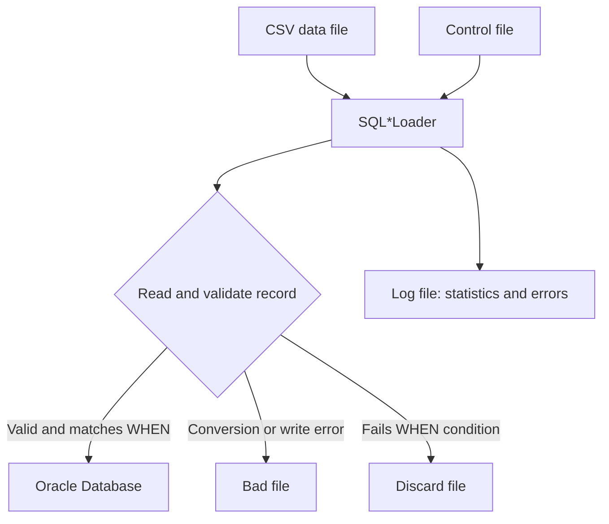

# SQL*Loader: Control Files, Bad Files, Discard Files, and Loading CSV

SQL*Loader is Oracle Database's command-line utility for loading data from external files into tables. It is commonly used when importing CSV files, extracts from external systems, or fixed-format record files. SQL*Loader reads instructions from a control file, parses each record, converts fields to Oracle data types, and writes the data into target tables.

A load run typically involves four distinct file types:

- **Data file:** contains the source data, such as a CSV file.
- **Control file:** describes how to read the data file, how to split fields, data types, the target table, and loading conditions.
- **Bad file:** stores records rejected due to errors while reading/converting data or errors while writing to the table.
- **Discard file:** stores records that were read but did not satisfy selection conditions, typically a `WHEN` clause in the control file.

SQL*Loader also generates a **log file** recording run details, counts of records read, loaded, rejected, and discarded, errors, and Oracle messages. The log file is the primary source for verifying the actual outcome of an import run.

## 1. How Does SQL*Loader Work?

SQL*Loader runs on the client side. The operator invokes `sqlldr` with connection details and a control file. The control file instructs SQL*Loader to open the data file, read records, map source fields to table columns, and perform the load.

General flow:



For example, `employees.csv` has columns for employee ID, full name, hire date, and salary. The control file specifies a comma delimiter, double quotes enclosing strings, dates formatted as `YYYY-MM-DD`, and `EMPLOYEES` as the target table.

SQL*Loader has two primary load methods:

- **Conventional path load:** SQL*Loader converts data into standard insert operations. This suits many data loading scenarios, uses standard SQL mechanisms, and integrates easily with existing processing.
- **Direct path load:** SQL*Loader formats data blocks and writes via a direct load path, reducing certain processing overhead compared to conventional inserts. This is often suitable for high volumes, but carries different limitations and behaviors regarding triggers, constraints, indexes, logging, transactions, and concurrency.

You can choose the method via command-line parameters, such as `direct=true`. Do not enable direct path merely because a file is large: first inspect target table objects and features, data integrity requirements, rollback needs, lock duration, and operational procedures. Exact behavior depends on Oracle version and table configuration.

## 2. Components of a Load Run

| Component | Role | Example filename |
|---|---|---|
| Data file | Source data to import | `employees.csv` |
| Control file | Configuration for reading and mapping data | `employees.ctl` |
| Log file | Run log and statistics | `employees.log` |
| Bad file | Records rejected due to errors | `employees.bad` |
| Discard file | Records failing load selection conditions | `employees.dsc` |

Each file has a distinct purpose. Do not use the bad file or discard file in place of the log file: the first two hold rejected source records, whereas the log file explains the processing and summarizes counts.

### Data file

The data file contains the records to load. SQL*Loader can read multiple data formats depending on control file declarations, for example:

- Delimited data: fields separated by commas, tabs, or other characters.
- Fixed-position data: each field occupies a fixed position or length.
- Stream or other structured records in supported formats.

In this lesson, examples focus on CSV. Determine encoding, delimiter, string enclosure character, date format, decimal notation, null representation, and line ending conventions beforehand.

### Control file

The control file is a text file containing instructions for SQL*Loader. It describes the data file, target table, mode for inserting or replacing data, record-parsing rules, and the list of mapped fields.

A typical control file has the structure:

```text
LOAD DATA
INFILE 'employees.csv'
BADFILE 'employees.bad'
DISCARDFILE 'employees.dsc'
APPEND
INTO TABLE employees
FIELDS TERMINATED BY ',' OPTIONALLY ENCLOSED BY '"'
TRAILING NULLCOLS
(
  employee_id INTEGER EXTERNAL,
  first_name  CHAR(50),
  last_name   CHAR(50),
  hire_date   DATE "YYYY-MM-DD",
  salary      DECIMAL EXTERNAL
)
```

Meaning of each part:

- `LOAD DATA`: begins the declaration of a data load task.
- `INFILE`: specifies the data file to read.
- `BADFILE`: names the file storing rejected records.
- `DISCARDFILE`: names the file storing records failing selection conditions.
- `APPEND`: appends records to an existing table.
- `INTO TABLE employees`: specifies the target table.
- `FIELDS TERMINATED BY ','`: fields are separated by commas.
- `OPTIONALLY ENCLOSED BY '"'`: fields may be enclosed in double quotes.
- `TRAILING NULLCOLS`: allows trailing fields missing from a record to be treated as NULL.
- The parenthesized section lists columns and how to interpret input data.

Filenames in the control file must resolve to the right locations when the SQL*Loader process runs. In operational environments, use explicit paths or run from a defined working directory to avoid reading the wrong file with a matching name.

### Log file

The log file records:

- SQL*Loader version and run details.
- Names of the control file and data file used.
- Loaded tables and key configuration settings.
- Counts of records read, successfully loaded, rejected, and discarded.
- SQL*Loader or Oracle error messages.
- Final outcome of the run.

Always retain the log file along with run ID, execution timestamp, and data filename. During reconciliation, record counts in the log are the primary basis for verifying how far the file was processed.

## 3. Distinguishing the Bad File and Discard File

Both files contain records that were not loaded into the table, but the reasons for exclusion are completely different.

### Bad file: records rejected due to errors

The bad file holds records that SQL*Loader could not load successfully. Common causes include:

- A value cannot be converted to the target data type, such as string `abc` supplied for a numeric column.
- A date value does not match the declared format mask.
- A record does not match the field structure or contains malformed data.
- Oracle rejects the insert due to constraint violations, such as duplicate primary keys, invalid foreign keys, or NULL values in a NOT NULL column.
- An error occurred while writing the record to the table.

For example, column `employee_id` expects a number yet a record has `A102`. Or `hire_date` is declared as `YYYY-MM-DD` yet the source supplies `31/12/2025`. The record may be rejected and written to the bad file; the log file explains the exact cause.

The bad file preserves source records so DBAs or data teams can inspect and resolve them. Do not mechanically edit data in the bad file and reload without understanding the root cause. Determine whether the error stems from source data, mapping, format masks, or table structure.

### Discard file: records failing load selection criteria

The discard file holds records that were read yet did not satisfy selection conditions in the control file. The most common case is a `WHEN` clause.

For example, load only employees in department 10:

```text
LOAD DATA
INFILE 'employees.csv'
BADFILE 'employees.bad'
DISCARDFILE 'employees.dsc'
APPEND
INTO TABLE employees
WHEN (department_id = '10')
FIELDS TERMINATED BY ',' OPTIONALLY ENCLOSED BY '"'
TRAILING NULLCOLS
(
  employee_id   INTEGER EXTERNAL,
  first_name    CHAR(50),
  last_name     CHAR(50),
  department_id INTEGER EXTERNAL
)
```

A record with `department_id = 20` is read but not selected for loading. If a discard file is configured, that record is written to `employees.dsc`. This is not a data error; the record simply does not belong to the subset targeted by that run.

The `WHEN` condition is evaluated against input data according to how SQL*Loader parses records and fields. Use exact field names or field positions matching the control file, and test on a small sample before running on large files.

### Comparison table

| Criterion | Bad file | Discard file |
|---|---|---|
| Reason for appearing | Record rejected due to read, conversion, or write error | Record failed load selection condition |
| Example | Malformed date, invalid number, constraint violation | Loading only department 10 while record belongs to department 20 |
| Is it erroneous data? | Usually requires investigation and correction/handling | Not necessarily; may be completely valid |
| Must check log? | Yes, to find the rejection reason | Yes, to reconcile discarded counts and filter rules |
| Next step | Fix data or mapping, then reload eligible records | Confirm excluding the records aligns with business rules |

A record failing `WHEN` is not treated as an error record merely because it was not inserted. Conversely, a record passing selection criteria that fails conversion or is rejected by Oracle belongs in the bad file.

## 4. Loading a Simple CSV File

Suppose the target table is created as follows:

```sql
CREATE TABLE employees (
    employee_id   NUMBER(10)    NOT NULL,
    first_name    VARCHAR2(50),
    last_name     VARCHAR2(50),
    hire_date     DATE,
    salary        NUMBER(12,2),
    department_id NUMBER(6)
);
```

File `employees.csv`:

```csv
employee_id,first_name,last_name,hire_date,salary,department_id
1001,An,Nguyen,2024-01-15,1800.50,10
1002,Binh,Tran,2023-11-02,2200.00,20
1003,"Chi, Thi",Le,2025-03-18,1950.75,10
1004,Dung,Pham,2022-08-09,1750.00,30
```

Create file `employees.ctl`:

```text
OPTIONS (SKIP=1)
LOAD DATA
CHARACTERSET AL32UTF8
INFILE 'employees.csv'
BADFILE 'employees.bad'
DISCARDFILE 'employees.dsc'
APPEND
INTO TABLE employees
FIELDS TERMINATED BY ',' OPTIONALLY ENCLOSED BY '"'
TRAILING NULLCOLS
(
  employee_id   INTEGER EXTERNAL,
  first_name    CHAR(50),
  last_name     CHAR(50),
  hire_date     DATE "YYYY-MM-DD",
  salary        DECIMAL EXTERNAL,
  department_id INTEGER EXTERNAL
)
```

Explanation:

- `OPTIONS (SKIP=1)` skips the first record, which here is the CSV header row.
- `CHARACTERSET AL32UTF8` declares the source data encoding as AL32UTF8. Choose the exact actual encoding of the file.
- `FIELDS TERMINATED BY ','` splits fields by commas.
- `OPTIONALLY ENCLOSED BY '"'` allows string fields to be enclosed in double quotes; for example, `"Chi, Thi"` is still read as a single field.
- `INTEGER EXTERNAL` reads an integer from its external character representation.
- `DECIMAL EXTERNAL` reads a decimal number from a character string.
- `DATE "YYYY-MM-DD"` converts the date string to DATE using the specified format mask.
- `APPEND` adds data to an existing table.
- `TRAILING NULLCOLS` handles cases where trailing columns are missing from a record.

In this example, employee 1003's record contains a comma inside the name, but because it is enclosed in double quotes, that comma does not act as a column separator.

Run SQL*Loader:

```bash
sqlldr userid=app_user@orclpdb \
  control=employees.ctl \
  log=employees.log
```

SQL*Loader prompts for a password if password authentication is required and no password is supplied in parameters. Never put passwords directly on the command line or in shared scripts, as they can appear in command history or process listings. Use authentication and secret management mechanisms suited to your environment.

You can also specify bad and discard filenames directly on the command line using corresponding parameters, though choosing one clear configuration location ensures operators know the exact output files for every run.

## 5. Mapping and Converting CSV Fields

### Declaring data types

SQL*Loader needs to know how to interpret each field before inserting into target columns. Common declarations include:

| Control file declaration | Meaning |
|---|---|
| `CHAR(n)` | Character field with declared length limit |
| `INTEGER EXTERNAL` | Integer represented as characters in the file |
| `DECIMAL EXTERNAL` | Decimal number represented as characters |
| `DATE "format"` | Date string converted using format mask |
| `FILLER` | Reads an input field without loading it into a table column |

Field names and types in the control file must match the order or position of source data. If the file gains a new column while the control file is not updated, subsequent fields may map incorrectly or raise errors.

### Date formats

Do not rely on default session or NLS date formats. Specify the format mask explicitly:

```text
hire_date DATE "YYYY-MM-DD"
```

If the source has dates like `18/03/2025`, the corresponding format mask must be `DD/MM/YYYY`. The format mask describes the order of day, month, and year in the source string; it does not alter file contents.

### Decimal numbers and NLS

Standardize decimal points and thousands separators. For example, `1950.75` and `1.950,75` are two different representations. If the source uses conventions differing from Oracle's environment defaults, declare appropriate conversion rules and test with real data.

Never strip dots or commas from monetary data via text replacement without verifying source conventions, as doing so can alter numeric values.

### Empty values and missing trailing fields

CSV can represent empty values with two consecutive delimiters, for example:

```csv
1005,Ha,Do,,1800.00,10
```

Here, `hire_date` is empty. Confirm whether that column allows NULL and how SQL*Loader treats empty values under the declared field type.

`TRAILING NULLCOLS` is particularly useful when records omit trailing fields. For instance, if a record contains only five fields while the control file declares six, depending on structure and record rules, the last field can be treated as NULL rather than rejecting the record for missing data. This option does not automatically turn arbitrary malformed data into NULL.

You can use conditions like `NULLIF` or `DEFAULTIF` in field clauses to control how certain input values are handled. Conceptual example:

```text
salary DECIMAL EXTERNAL NULLIF salary=BLANKS
```

Verify exact syntax for field positions and your SQL*Loader version. If the target column has a NOT NULL constraint, converting blank values to NULL can still cause the record to be rejected.

### Source fields that do not need to be stored

You can use `FILLER` for a field that must be read to parse the record yet does not belong in the table. For example, the source file includes a notes column that the target table lacks:

```text
(
  employee_id INTEGER EXTERNAL,
  first_name  CHAR(50),
  last_name   CHAR(50),
  source_note FILLER CHAR(200)
)
```

FILLER allows the control file to consume the field properly without requiring a `source_note` column on the target table.

## 6. Filtering Data with WHEN and Writing a Discard File

The `WHEN` clause lets SQL*Loader select which records to load. Records failing the condition are treated as discarded. This is useful when a single file holds data for multiple groups while the current load targets only one group.

Example loading only employees with department ID 10:

```text
LOAD DATA
INFILE 'employees.csv'
BADFILE 'employees.bad'
DISCARDFILE 'employees.dsc'
APPEND
INTO TABLE employees
WHEN (department_id = '10')
FIELDS TERMINATED BY ',' OPTIONALLY ENCLOSED BY '"'
TRAILING NULLCOLS
(
  employee_id   INTEGER EXTERNAL,
  first_name    CHAR(50),
  last_name     CHAR(50),
  hire_date     DATE "YYYY-MM-DD",
  salary        DECIMAL EXTERNAL,
  department_id INTEGER EXTERNAL
)
```

In this example, SQL*Loader loads only records meeting the condition. Records from other departments are written to the discard file. If no discard file is specified, excluded records are still skipped, but no separate file captures them.

Before running `WHEN` on large datasets, test on a small sample and verify selected record counts against expectations. Filtering does not replace data quality checks: a record matching `WHEN` can still be rejected for data type or constraint errors.

You can limit discarded records with `DISCARDMAX` to abort the job if excluded records exceed a threshold. Similarly, `ERRORS` limits how many errors may occur before SQL*Loader stops loading. Pick limits according to operational procedures; too low a threshold can abort runs prematurely, while too high a threshold lets poor-quality files run excessively long.

## 7. Target Table Data Handling Modes

The control file specifies how existing data in the target table is handled using one of the following options:

| Option | Behavior |
|---|---|
| `INSERT` | Loads only when the table is currently empty |
| `APPEND` | Adds new records to existing data |
| `REPLACE` | Deletes existing data in the table and then loads new data |
| `TRUNCATE` | Truncates the table and then loads new data |

Example:

```text
LOAD DATA
INFILE 'employees.csv'
APPEND
INTO TABLE employees
...
```

`APPEND` typically fits daily or batch incremental loads. However, rerunning the same file without batch tracking or duplicate-key checks can create duplicate rows.

`REPLACE` and `TRUNCATE` have major impact because they remove existing data before loading. Before using them, verify the exact table, data scope, and recoverability. Never use these two options as a quick fix for import errors without confirming whether existing data must be kept.

## 8. Running SQL*Loader and Common Parameters

General syntax:

```text
sqlldr userid=<connection> control=<control_file> [parameter=value ...]
```

Common parameters:

| Parameter | Purpose |
|---|---|
| `userid` | Database connection details |
| `control` | Path to control file |
| `data` | Specifies or overrides the data file used |
| `log` | Sets the log filename |
| `bad` | Sets the bad filename |
| `discard` | Sets the discard filename |
| `discardmax` | Maximum discarded records before stopping |
| `errors` | Maximum allowed errors |
| `skip` | Skips the specified number of initial input records |
| `rows` | Controls records per batch/commit unit depending on load method |
| `direct` | Selects direct path load when set to `true` |

Conventional path example with explicitly named output files:

```bash
sqlldr userid=app_user@orclpdb \
  control=employees.ctl \
  log=employees_20261114.log \
  bad=employees_20261114.bad \
  discard=employees_20261114.dsc \
  errors=100
```

Direct path example:

```bash
sqlldr userid=app_user@orclpdb \
  control=employees.ctl \
  log=employees_direct.log \
  direct=true
```

Examples use Unix shell syntax; on Windows, adjust line continuations and quoting for PowerShell or Command Prompt. Parameter names and value formatting must match the installed SQL*Loader version.

You can view program help with:

```bash
sqlldr help=true
```

Before running, confirm:

- The SQL*Loader client is installed and reachable on PATH.
- The client is compatible with the database and connection configuration.
- The account has insert privileges on the target table and privileges required for the load method.
- The data file and control file are readable.
- The directory for log, bad, and discard files is writable.
- The target table and column structure match the mapping.
- The right mode (`INSERT`, `APPEND`, `REPLACE`, or `TRUNCATE`) is chosen.

## 9. Reading Logs and Handling Errors

After running, read the log file before declaring success. The log typically includes a record summary:

- Records read: number of records SQL*Loader read.
- Records loaded: number of records loaded.
- Records rejected: number of records rejected and potentially written to the bad file.
- Records discarded: number of records excluded by selection criteria.

Reconcile these numbers against total source records, accounting for headers or skipped records. Do not rely solely on exit codes or final messages while ignoring statistics.

### Common errors

| Symptom | Possible cause | Resolution |
|---|---|---|
| Control file or data file not found | Wrong path, unexpected working directory, or missing read permission | Use explicit paths and check access permissions |
| Date conversion error | Format mask does not match source data | Verify actual format and fix the DATE declaration |
| Number conversion error | Unexpected characters, different decimal mark, or whitespace | Check source data and numeric conventions |
| ORA-00001 | Unique constraint or duplicate primary key violation | Check duplicate data and reload strategy |
| ORA-01400 | NOT NULL column received NULL | Supply data or adjust mapping/conditions |
| More records in discard file than expected | Wrong WHEN condition or fields misaligned | Check field order, condition, and a CSV sample |
| More records in bad file than expected | Mismatched mapping, data type, length, or constraint | Cross-check log against source records and table structure |
| Cannot write log/bad/discard | Output folder missing or lacks write permission | Check folder and permissions of the OS account running SQL*Loader |

### Bad file handling workflow

1. Save the log file and bad file from that exact run.
2. Count rejected records and reconcile against log statistics.
3. Read SQL*Loader or ORA error messages to classify root causes.
4. Take a few representative records from the bad file to reproduce the error in a test environment.
5. Determine whether the bug lies in source data, the control file, or the target table.
6. Fix the source or mapping per business rules, then reload only the affected record set.
7. Reconcile keys, counts, and critical values after reloading.

Do not reload the entire data file with `APPEND` if some records already loaded in the previous run. Doing so can create duplicate data. Identify exactly which batches loaded, choose a replacement strategy or load only the remainder, and build idempotency if the workflow must be rerunnable.

### Discard file handling workflow

1. Confirm whether the `WHEN` condition matches business requirements.
2. Reconcile discarded record counts against the expected out-of-scope count.
3. Inspect a few records in the discard file to confirm they were excluded for the right reason.
4. If the condition is wrong, fix the control file and rerun on a controlled dataset.
5. If the condition is right, retain the discard file as reconciliation evidence or pass it to another workflow.

Discarding does not mean deleting data from the source. It only indicates the record was not selected for loading in the current run.

## 10. Practical Considerations When Loading CSVs

### Encoding and Vietnamese characters

File encoding must be declared or handled to match source data. If a file is UTF-8 yet SQL*Loader interprets it under another character set, accented names can break or become corrupted. Determine encoding from the exporting system and declare `CHARACTERSET` accordingly.

Beyond encoding, check column lengths in bytes vs. characters and target data type limits. Accented Vietnamese names can occupy more bytes in UTF-8 than visible character counts.

### Delimiters and enclosure characters

CSVs may use commas, semicolons, or tabs. The control file must match the actual delimiter exactly. If data values contain the delimiter character, the source must wrap fields with an enclosure character and SQL*Loader must be configured accordingly.

Complex CSV files may contain escaped double quotes, embedded newlines inside a field, or varied quoting rules. Do not assume `FIELDS TERMINATED BY ',' OPTIONALLY ENCLOSED BY '"'` handles every CSV variant. Test against your exact SQL*Loader version and the format produced by the source system. For CSVs with newlines inside quoted fields or complex escaping, use version-supported CSV syntax if available or normalize the data before loading.

### Headers and blank lines

If the file has a header, use `SKIP` or `OPTIONS (SKIP=...)` appropriately to bypass header records. Check how many header lines or leading metadata records exist. Blank lines, delimiter-only lines, or short records should be tested beforehand to verify how SQL*Loader interprets them.

### Batch loading and safe reruns

For large datasets, splitting into batches by date, key range, or batch ID simplifies error control and reconciliation. Each batch should record:

- Unique batch ID.
- Data filename and control filename used.
- Dedicated log, bad file, and discard file.
- Start/end timestamps and executing account.
- Counts of source records, loaded, rejected, and discarded.
- Post-load reconciliation results.

If reruns are required, know exactly how far a batch wrote data. Depending on architecture, use staging tables, batch ID columns, unique keys, or merge/deduplication procedures. Never assume SQL*Loader automatically makes a load idempotent without creating duplicate rows.

### Privileges and security

SQL*Loader runs under the database account supplied in the connection. Grant only required privileges on the target table and related objects. Avoid storing passwords inside control files, scripts, or logged command lines. Source, bad, and discard files may contain personal or sensitive data; restrict read permissions, retention periods, and transfer methods.

## 11. When to Use SQL*Loader vs. Alternatives?

SQL*Loader is appropriate when loading file data into Oracle using a control-file mapping, when tracking bad/discard records is needed, and when automating file imports.

Consider alternatives in certain scenarios:

- **External tables:** appropriate when querying external files like an Oracle table, combining SQL for validation or loading into permanent tables. Helpful for staging pipelines and SQL-based data processing.
- **INSERT or MERGE:** appropriate when data is already inside the database and update logic, deduplication, or synchronization must be controlled.
- **Data Pump:** appropriate for moving schemas, objects, and data between Oracle databases; not a direct replacement for reading arbitrary CSVs.
- **ETL/ELT platforms:** appropriate when integrating many sources, complex transformations, scheduling, lineage, and centralized monitoring.

Choose based on source format, volume, transformation needs, rerun capability, error control, and operational architecture. SQL*Loader handles structured file loading well, but does not replace the broader data cleansing and governance pipeline.

## 12. Operational Checklist for a CSV Load

Before running:

- [ ] Confirm the CSV file version, delimiter, enclosure, and encoding.
- [ ] Check headers, column count, field order, data types, and date/number formats.
- [ ] Verify the control file against target table structure.
- [ ] Confirm explicitly whether to use INSERT, APPEND, REPLACE, or TRUNCATE.
- [ ] Declare dedicated log, bad, and discard file paths for the run.
- [ ] Verify read permissions on data/control files and write permissions on the output directory.
- [ ] Test with a small sample containing valid records, bad records, and filtered records.
- [ ] Verify the WHEN condition and expected discard count.
- [ ] Define how to handle hitting ERRORS or DISCARDMAX thresholds.

After running:

- [ ] Read the log and verify the final result.
- [ ] Reconcile records read, loaded, rejected, and discarded against source data.
- [ ] Inspect the bad file and classify root causes for each error group.
- [ ] Inspect the discard file to confirm filtering worked as intended.
- [ ] Reconcile row counts, keys, dates, and critical totals in the target table.
- [ ] Retain logs and error files per retention policy.
- [ ] Reload only the required subset of data after verifying which batches succeeded.

SQL*Loader loads CSVs and structured files into Oracle according to rules defined in a control file. The control file governs how data is read and mapped; the bad file captures records rejected due to errors; the discard file captures records failing selection criteria; the log file provides execution evidence. By understanding each file's role, controlling source formatting, and reconciling post-load metrics, DBAs can build import workflows that are observable, diagnosable, and safe to rerun.
