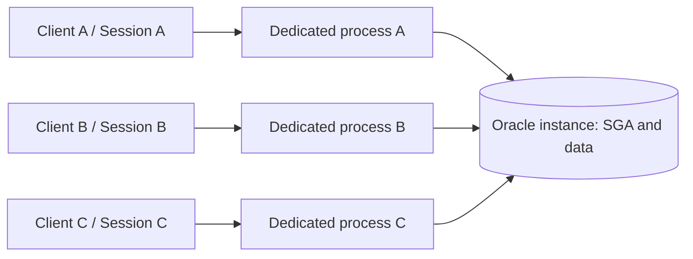
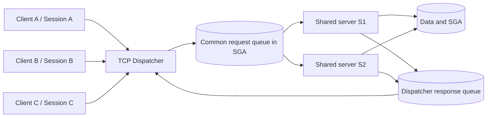

# Dedicated Server, Shared Server, and Session Serving Models in Oracle Database

An application can open dozens, hundreds, or thousands of connections to Oracle Database. A key architectural question is: **does each connection require its own dedicated server process, or can multiple sessions share a pool of server processes?** Oracle primarily addresses this with two models: **dedicated server** and **shared server**. They differ in how processes are allocated to execute SQL requests, how session state is maintained, and how resources are consumed as the number of clients grows.

Understanding both models helps analyze scenarios accurately, such as: many idle connections causing the database to still run low on resources; a slow query causing other requests to wait; `(SERVER=SHARED)` configuration failing even though the database is running; or a Java application already using a connection pool while a DBA still suggests shared server.

## 1. Putting the Concepts in the Right Place

A user logging in from SQL Developer or an HTTP request running through Java can both cause the database to create or use a **session**. However, a session, a network connection, and a server process are three distinct entities.

| Concept | Meaning | Key Takeaway |
|---|---|---|
| **Client/user process** | Process or application on the user side sending SQL requests | Can be SQL*Plus, a Java application, or an ETL tool |
| **Connection** | Client–Oracle Net communication channel, typically over TCP/TCPS | Has a network connection lifecycle; not synonymous with a transaction itself |
| **Session** | Login context inside Oracle containing session state and security identity | Holds user info, session attributes, transaction, and related state |
| **Server process** | Oracle process executing requests on behalf of a session | Dedicated is bound to one connection; shared is distributed across multiple sessions |
| **Listener** | Oracle Net component accepting initial connections and routing by service | The listener is **not** the process executing all application SQL |
| **Dispatcher** | Network communication process in shared server architecture | Receives requests and sends responses between clients and shared servers |
| **SGA** | Shared memory area of the Oracle instance | Contains shared pool, buffer cache, and other required areas |
| **PGA** | Private memory area of a server/background process | Holds private working data of the process |
| **UGA** | Memory storing the state of a session | Typically in PGA for dedicated; in SGA for shared |
| **Request** | A unit of work from a session, such as executing an SQL statement or a PL/SQL call | In shared server, requests from multiple sessions pass through queues |

In the examples below, we assume a simple client connection maintains one database session. Libraries and pooling mechanisms may reuse physical connections or create and manage sessions in more complex ways. **The number of application users, connections, sessions, and server processes are not automatically equal.**

### 1.1. What Does a Session Exist to Preserve?

A session is the context Oracle uses to know who is working and how to continue when the client sends the next statement. Important state can include:

- Authenticated user, active privileges, and session attributes.
- Session settings such as NLS, current schema, or optimizer environment modified via `ALTER SESSION`.
- Transaction context, uncommitted changes, savepoints, and lock-related state.
- Cursor state, PL/SQL package variables, and session-private memory areas when needed.

A client might send `SELECT`, pause for a few seconds, and then send `UPDATE`. Oracle must preserve session state across the two requests. The difference between dedicated and shared lies in **which server process serves those requests**, not whether a session exists.

## 2. Dedicated Server: A Private Process Serving a Connection

In the **dedicated server** model, an ordinary client connection is served by its own dedicated server process for the lifetime of the connection. When the client sends SQL, that process executes the work on behalf of the session; when the client is not sending SQL, the process remains reserved for that connection until the connection ends or is closed.



### 2.1. Connection Setup and Usage Flow

1. The client sends an Oracle Net request to the listener specifying the target service.
2. The listener transfers/hands off the connection to the dedicated serving mechanism appropriate for the platform and configuration.
3. The dedicated server process serves requests for that connection.
4. The client sends SQL/PLSQL over the connection; the dedicated process parses, executes, and returns results.
5. When the client pauses, the process does not switch to serve another session as in shared server.
6. When the connection/session ends, the database releases the corresponding resources according to the actual lifecycle.

Do not mistake the listener for an SQL executor, or assume a new server process must be spawned for every SQL execution. In normal dedicated mode, an established connection keeps using its process.

### 2.2. Benefits and Costs

**Benefits:**

- Simple connection-to-process flow, easy to reason about and trace when diagnosing a running session.
- A session has its own service path without waiting for a shared server to pick up its request from a common queue.
- Suitable for many applications using bounded connection pools, long-running queries, batch jobs, analytical processing, or administrative operations requiring a dedicated connection.

**Costs:**

- As the number of **physical connections** grows large, the number of dedicated server processes also grows, even if many clients are idle.
- Each process requires OS resources and PGA; process/OS thread count, memory, and instance limits can become bottlenecks.
- Increasing connection count does not give Oracle more CPU, I/O, or SQL execution capacity. Too many processes competing for the same resources can degrade performance.

For example: an application service opens 300 physical connections and holds all of them in a pool. In dedicated mode, Oracle normally has to maintain a corresponding number of dedicated processes for those connections, even when only a small fraction are actively running SQL. The first solution is not necessarily switching to shared server; sometimes **reducing and properly sizing the application-side pool** already resolves the issue.

## 3. Shared Server: Multiple Sessions Sharing a Pool of Server Processes

In the **shared server** model, Oracle creates a pool of **shared server processes** to handle requests from many sessions instead of reserving one fixed process per connection. The **dispatcher** handles network communication with clients; requests are placed into a queue so a shared server can pick them up and execute them.



The actual data path includes routing metadata via virtual circuits; the diagram only shows the main components to explain the request/response flow.

### 3.1. How Is a Request Served?

1. The client connects to the listener, requesting a service that permits shared server.
2. The listener routes/hands off the client to an appropriate dispatcher.
3. The dispatcher maintains network communication with the client. When the client sends a request, the dispatcher places the request in the **common request queue**.
4. An available shared server process picks up the request from the queue, uses session/circuit information, and executes the SQL or PL/SQL.
5. Results are placed into the **response queue** associated with the appropriate dispatcher.
6. The dispatcher sends the response data back to the client.
7. The shared server that just finished can now serve a request from **another session**; the original session's next request may be executed by a different shared server.

In shared server, each server process still executes one request at a time under the normal execution model, yet the total process count does not have to equal the total session count. **Multiple sessions share processing capacity over time**—a single SQL request is not automatically split across all shared servers to run in parallel. Parallel Query is a separate mechanism.

### 3.2. How Do Dispatchers, Queues, and Virtual Circuits Differ?

| Component | Responsibility |
|---|---|
| **Dispatcher** | Manages Oracle Net channels to multiple clients, receives requests, and forwards responses |
| **Common request queue** | Where requests wait for a shared server process to pick them up for execution |
| **Shared server process** | Actual worker executing SQL/PLSQL on behalf of a session |
| **Response queue** | Where responses wait for the dispatcher to send back to the client |
| **Virtual circuit** | Routing context binding a client/session to a dispatcher and its corresponding requests/responses |
| **UGA in SGA** | Holds session state so different shared servers can still serve the same session |

An intuitive example: 800 sessions are connected, yet at any given instant only a few dozen sessions issue short requests. A pool of shared server processes can process those requests sequentially. Idle sessions do not need a dedicated process just to wait, even though each session still uses memory and other resources.

Do not treat "800 sessions only need 10 shared servers" as a fixed formula: concurrent request rate, how long each request occupies a process, CPU, I/O, queue wait, and dispatcher connection limits all determine serving capacity.

### 3.3. Session State Is Still Preserved

Shared server can rotate execution processes between requests, yet **the session is not recreated after every SQL statement**. If a client changes a session parameter or opens an uncommitted transaction, Oracle must still maintain that session's context across executions.

For example, a connection sends:

```sql
ALTER SESSION SET NLS_DATE_FORMAT = 'YYYY-MM-DD';

SELECT SYSDATE FROM dual;

SELECT SYS_CONTEXT('USERENV', 'SESSION_USER') AS login_user,
       SYS_CONTEXT('USERENV', 'SESSIONID') AS audit_session_id
FROM dual;
```

The NLS state and session information belong to the same session; they do not vanish just because the second request may be processed by a different shared server process. A query succeeding does not reveal whether the process ID that handled it was the same as the process that handled the previous query.

**Transactions do not become stateless just because shared server is used.** If a client opens a transaction and leaves the connection idle for a long time, associated locks and resources can remain held. Shared server reduces reserving processes for idle connections, but does not automatically solve "idle in transaction" issues.

### 3.4. Important Limitations of Shared Server

Shared server works well when many clients generate relatively short requests with pauses between calls. It can be **poorly suited** when most requests run for a long time, heavy queries occupy processes for extended periods, or administrative tasks require a dedicated connection.

If a request runs for a long time, the shared server process handling it cannot pick up a new request from the queue. When requests arrive faster than they are processed, queue wait grows. Adding dispatchers does not by itself resolve a shortage of shared servers/CPU, and increasing shared servers excessively does not expand CPU or I/O capacity.

## 4. SGA, PGA, and UGA: Why Memory Usage Differs

Understanding where memory lives explains why Oracle can serve many sessions with fewer processes, and why shared server still consumes significant resources.

### 4.1. Dedicated Server

In normal dedicated mode, **the session's UGA resides inside the dedicated server process's PGA**. The PGA also holds process info and appropriate work areas. The SGA still holds the instance's shared memory.

```text
Client A ── Dedicated process A
             └─ PGA A
                ├─ UGA / session A state
                └─ process private work area

Client B ── Dedicated process B
             └─ PGA B
                ├─ UGA / session B state
                └─ process private work area

Oracle instance ── SGA (shared pool, buffer cache, ...)
```

### 4.2. Shared Server

Because requests from the same session can run on different shared servers, **the UGA must reside in memory accessible to all of those processes**, namely in the **SGA**. Oracle prefers using the **large pool** for UGA when appropriately configured; if no suitable large pool area is available, the corresponding structures can use the shared pool depending on instance architecture and configuration.

```text
Client A ─┐
Client B ─┤── Dispatcher ── Request queue ─┬─ Shared process 1 / PGA 1
Client C ─┘                                └─ Shared process 2 / PGA 2

Oracle instance ── SGA
                   ├─ UGA / session A state
                   ├─ UGA / session B state
                   ├─ UGA / session C state
                   ├─ queues and virtual circuits
                   ├─ shared pool / large pool
                   └─ buffer cache and other areas
```

Shared processes still have their **own PGA** to perform work, yet session UGA must be shared via the SGA. Moving UGA into the SGA changes the memory planning problem: reducing dedicated processes can save process/PGA resources, but total UGA for existing sessions must still be allocated. If the large pool/shared pool lacks capacity or the shared server request queue is overloaded, the system can still hit performance issues.

### 4.3. Quick Comparison Table

| Question | Dedicated Server | Shared Server |
|---|---|---|
| Client–process relationship | Usually one private process per connection | Multiple sessions share a pool of processes |
| Who handles network exchange with client? | Dedicated process after appropriate handoff | Dispatcher |
| Is the process reserved while client is idle? | Yes, over the normal connection lifetime | No; the shared process can serve other sessions |
| Where is the UGA? | Usually in the dedicated process's PGA | In the SGA, usually preferring the large pool |
| Is there a shared server request queue? | Not via the dispatcher/shared server flow | Yes |
| Is session state preserved? | Yes | Yes |
| How does long-running SQL affect things? | Occupies that connection's dedicated process and shared resources | Occupies a shared process for the duration of execution, potentially increasing wait times for other sessions |
| Can both coexist in one instance? | Yes | Yes |
| Does an uncommitted transaction end when an SQL request finishes? | No | No |

## 5. When Is the Mode Decided?

Oracle chooses how to serve a connection based on **database configuration, services, listener/dispatchers, and the client's connect descriptor**. The same instance can serve dedicated and shared connections concurrently. A client requesting shared does not cause Oracle to automatically create dispatcher infrastructure if the database has not configured shared server.

### 5.1. Dedicated Connection via Connect Descriptor

Example of a `LAB_DEDICATED` alias in `tnsnames.ora`:

```text
LAB_DEDICATED =
  (DESCRIPTION =
    (ADDRESS = (PROTOCOL = TCP)
               (HOST = db-lab.example.test)
               (PORT = 1521))
    (CONNECT_DATA =
      (SERVICE_NAME = LABPDB)
      (SERVER = DEDICATED)
    )
  )
```

`SERVER=DEDICATED` requests a dedicated serving path for that connection. If `SERVER` is omitted, the mode is chosen according to the service and related configuration; do not infer behavior solely from leaving this field blank.

### 5.2. Requesting a Shared Server Connection

```text
LAB_SHARED =
  (DESCRIPTION =
    (ADDRESS = (PROTOCOL = TCP)
               (HOST = db-lab.example.test)
               (PORT = 1521))
    (CONNECT_DATA =
      (SERVICE_NAME = LABPDB)
      (SERVER = SHARED)
    )
  )
```

Both aliases point to the same host/port/service yet **request different modes**. For `LAB_SHARED` to work, the instance must have appropriate dispatchers/shared servers and the listener must have received the corresponding handler registration. `LABPDB` and the hostname here are illustrative data and must be replaced with the actual system service.

SQL*Plus or SQLcl can use:

```text
sqlplus /nolog

SQL> CONNECT lab_app@LAB_DEDICATED
SQL> DISCONNECT
SQL> CONNECT lab_app@LAB_SHARED
```

Each `CONNECT` command prompts for a password as configured; never put passwords directly on the command line. The client machine must be configured to resolve aliases from `tnsnames.ora`.

In Oracle JDBC Thin, the descriptor can be passed directly:

```java
String jdbcUrl =
    "jdbc:oracle:thin:@(DESCRIPTION=" +
    "(ADDRESS=(PROTOCOL=TCP)(HOST=db-lab.example.test)(PORT=1521))" +
    "(CONNECT_DATA=(SERVICE_NAME=LABPDB)(SERVER=SHARED)))";
```

This is a connection structure example; the Java application also requires the Oracle JDBC driver, authentication credentials, network connectivity, and database-side shared server support.

### 5.3. How Does the Listener Participate?

The listener receives **service/handler** information registered by the instance and dispatchers, then chooses the serving path matching the connection request. For dedicated, the client is served by a dedicated process; for shared, a dispatcher maintains network communication and passes requests to the shared server pool.

An error like `ORA-12520` can appear when the listener cannot find an available handler for the requested **server type**. If a client requests `SERVER=SHARED` yet the database has no suitable shared handler, check dispatcher registration and instance configuration before changing passwords or SQL.

## 6. Shared Server Configuration Components to Know

Configuring shared server falls under **DBA / database architecture**, not something a typical application account should modify on its own. Key parameters include:

| Parameter | Role | Notes |
|---|---|---|
| `SHARED_SERVERS` | Target/initial number of shared server processes per instance config | Value greater than 0 enables shared server capability in a suitable configuration |
| `MAX_SHARED_SERVERS` | Limit on how many shared server processes can scale up | Must be sized for real workload and resources |
| `DISPATCHERS` | Defines dispatchers, protocols, counts, or network attributes | Must match listener/service and client protocol |
| `MAX_DISPATCHERS` | Limit on number of dispatcher processes | Does not directly increase concurrent SQL execution count |
| `LARGE_POOL_SIZE` | Size of large pool used by the instance for purposes including shared server UGA | Does not replace overall SGA planning |
| `CIRCUITS` | Limit on number of virtual circuits per config if needed | Adjust only with concrete metrics and justification |
| `PROCESSES` / `SESSIONS` | Instance process and session resource limits | Still relevant even when using shared server |

Example **solely to illustrate a DBA operation on an isolated lab**, assuming the system/version allows dynamic instance-level changes:

```sql
-- Execute using an administrative account under approved procedures;
-- do not run directly on shared or production databases.
ALTER SYSTEM SET SHARED_SERVERS = 4 SCOPE=MEMORY;

ALTER SYSTEM SET DISPATCHERS = '(PROTOCOL=TCP)(DISPATCHERS=2)'
  SCOPE=MEMORY;
```

`SCOPE=MEMORY` illustrates changing runtime state without persisting the configuration to SPFILE. Modifiability, CDB/PDB scope, min/max bounds, and restart behavior depend on version and deployment architecture; DBAs should apply approved values, include verification steps, and have a plan to return the lab to its initial state. There is no universal `SHARED_SERVERS=4` value suitable for every system.

After configuring, verify that the service/dispatchers are registered with the listener. On the database host, an administrator can run:

```text
lsnrctl services
```

This command inspects handlers known to the listener; it does not replace actually connecting and executing SQL with a client.

## 7. Observing Sessions and Serving Processes

Understanding the active model requires evidence from **actual sessions** and Oracle's dynamic views. These `V$` views typically require appropriate monitoring privileges; application accounts should not be granted administrative privileges merely for practice.

### 7.1. Checking Which Server Mode a Session Uses

A DBA or authorized account can run:

```sql
SELECT sid,
       serial#,
       username,
       status,
       server,
       service_name
FROM v$session
WHERE username = 'LAB_APP'
ORDER BY sid;
```

The `SERVER` column relates to the session's serving mode/type, with values such as `DEDICATED`, `SHARED`, `PSEUDO`, or others depending on state and connection method. **Do not force conclusions from a single snapshot**: an idle shared session can appear differently from when it is actively processing a request. Combine `V$SESSION` observations with dispatchers, shared servers, and the client's connection settings.

To self-check service and container from within a session without reading `V$SESSION`:

```sql
SELECT SYS_CONTEXT('USERENV', 'SESSION_USER') AS session_user,
       SYS_CONTEXT('USERENV', 'SERVICE_NAME') AS service_name,
       SYS_CONTEXT('USERENV', 'CON_NAME') AS container_name
FROM dual;
```

This query **does not confirm dedicated/shared mode**; it confirms the session landed on the intended user/service/PDB.

### 7.2. Viewing Dispatchers, Shared Servers, and Queues

Illustrative observation queries for authorized users:

```sql
-- Active dispatchers.
SELECT name, status, messages
FROM v$dispatcher
ORDER BY name;

-- Active shared server processes.
SELECT name, status, requests
FROM v$shared_server
ORDER BY name;

-- Statistics on queues serving dispatchers/shared servers.
SELECT type, queued, totalq
FROM v$queue
ORDER BY type;
```

Counters and statuses must be interpreted across **multiple samples over time**; deltas between measurements show whether load is rising or falling. Available columns and access privileges may vary by Oracle version, grants, and CDB/PDB architecture; if you lack privileges, coordinate with a DBA rather than guessing.

Useful indicators when locating bottlenecks:

- **High connected session count** yet low concurrent SQL execution: examine client pool sizing, dispatcher count, and potential benefits of shared server.
- **Request queue waiting long** or continuously growing under load: inspect busy shared servers, long-running SQL, CPU/I/O, and serving capacity.
- **Overloaded dispatchers**: inspect connection/network traffic, dispatcher configuration, and network waits.
- **Insufficient UGA/SGA resources**: check large pool, shared pool, and total sessions; reducing processes does not eliminate the need to store session state.
- **Process/session limit errors**: check `PROCESSES`, `SESSIONS`, actual processes, and application connection leaks.

Do not rush to raise `SHARED_SERVERS` merely because session counts are high. If SQL statements are slow due to disk access, locks, or poor plans, adding more shared servers may simply increase resource contention.

## 8. Shared Server vs. Connection Pool and Database Resident Connection Pooling

These three mechanisms are often mentioned together yet operate at **different layers**:

| Mechanism | Where Does It Live? | Resource Reused | When Is It Appropriate? |
|---|---|---|---|
| **Application connection pool** (e.g., HikariCP) | Inside the application process | Already-opened physical connections to the database | Avoiding connection setup cost on every HTTP request |
| **Oracle shared server** | Inside the database's session-serving architecture | Pool of server processes across multiple sessions | Many connected sessions with mostly short/idle requests |
| **Oracle DRCP** (Database Resident Connection Pooling) | Database-side pool | Pooled server/session resources managed by DRCP | Many clients/processes needing short connections, or application tiers unable to pool effectively |

DRCP is a separate mechanism, typically requested via `SERVER=POOLED` in the connect descriptor when the platform, service, and client are configured to support it. **Do not treat `SERVER=POOLED` as an alias for `SERVER=SHARED`.** DRCP has its own checkout/checkin behavior, connection classes, and state management rules.

### 8.1. Java Web Application Example

Suppose 1,000 users are logged into a website. A Spring Boot application may maintain a pool of only 30 physical connections. When an HTTP request needs SQL, a thread borrows a connection from the pool, executes, and returns it to the pool. The database **does not need to create 1,000 sessions just because 1,000 user accounts are logged into the website**.

With a 30-connection pool:

- Running dedicated: there are typically around 30 dedicated server processes bound to the open pooled connections (depending on active/actual pool connections).
- Running shared: 30 sessions can send requests through dispatchers and the shared server pool.
- If SQL statements take a long time, the pool can still run out of connections to hand out to new threads, regardless of whether the database chooses dedicated or shared.

Therefore, distinguish **application-side pool wait** from **database-side shared server request queue wait**. They sit in different places and require different observability data.

### 8.2. Do Not Confuse "Fewer Processes" with "Higher Throughput"

Throughput depends on CPU, memory, I/O, lock contention, SQL quality, network latency, connection pooling, and how the application manages transactions. Shared server uses server processes efficiently for suitable workloads, yet adds dispatchers, queues, and UGA in the SGA. For workloads with many long-running SQLs, dedicated can be simpler and more effective.

There is no universal rule that "shared is always faster" or "dedicated always wastes too many resources". Choose the mode using metrics from the actual running system.

## 9. How to Choose a Model per Workload

| Workload | Initial Consideration | Explanation |
|---|---|---|
| Application service with a small, stable connection pool | Dedicated is usually the simplest choice | Connection count is controlled and behavior is easy to trace |
| Many direct client connections that are mostly idle | Consider shared server | Avoids reserving a dedicated process for every idle session |
| Long analytical queries, high-volume batch jobs | Usually consider dedicated | Avoids tying up the shared server pool for long durations |
| Environments running DBA tools, backup/recovery | Use dedicated as required by tasks | Certain administrative operations are unsuitable for or require dedicated |
| Many applications/processes making short connections | Evaluate client pooling and DRCP | DRCP solves DB-side connection resource reuse with its own mechanism |
| Application reports too many connections | Measure the application pool first | Actual session count may drop without changing server mode |
| CPU/I/O/locks are the bottleneck | Optimize workload and SQL first | Changing server mode will not fix the root problem |

For critical business applications, test with a representative workload at the same resource level, measuring latency (p50/p95/p99), throughput, memory, connection count, queue wait, and errors. A configuration that works well at 100 concurrent sessions is not guaranteed to work well at 5,000 sessions.

## 10. Real-World Scenario: Many Idle Sessions, Few Active Requests

Suppose an internal data-entry system has 1,500 users keeping screens open all day. Clients hold sessions while staff read or fill out forms; each person only sends a few short SQL statements when clicking search or save.

**With dedicated server**, the large number of physical connections can bring along a huge number of idle dedicated processes. The OS and PGA must allocate resources for those processes while CPU is not continuously executing corresponding SQL.

**With shared server**, the listener can route connections to dispatchers; a pool of shared servers processes the short requests as they arrive. During pauses, sessions remain preserved without exclusively holding a shared server process. This can reduce process-count pressure.

However, suppose a report suddenly runs a 40-second query and many users trigger it together. The shared server processes handling those queries stay busy for a long time, forcing simple lookups to queue. You must evaluate pool suitability, isolate workloads, or tune architecture/SQL rather than just increasing shared server count.

For typical web applications already using a well-sized connection pool, most website users do not continuously hold their own database session. In that case, dedicated server with a small pool can still be a great fit.

## 11. Hands-On Practice in an Oracle Lab Environment

The objective is to prove that **sessions and processes have different relationships** between dedicated and shared, not merely changing an alias name.

### Step 1 — Prepare Privileges and Environment

You need a practice Oracle instance/PDB, Oracle Net listener, SQL*Plus or SQLcl client, an application user, and read privileges on administrative views if you want to observe them. Commands that alter shared server parameters are strictly for DBAs in an **isolated lab environment**.

Record the actual service name (for example `FREEPDB1`), hostname, and port. Do not use the illustrative alias `LABPDB` if the listener does not provide that service.

### Step 2 — Intentionally Connect via Dedicated

Create the `LAB_DEDICATED` alias as shown in section 5 and run:

```sql
SELECT SYS_CONTEXT('USERENV', 'SESSION_USER') AS login_user,
       SYS_CONTEXT('USERENV', 'SERVICE_NAME') AS service_name
FROM dual;
```

While the session remains open, ask the DBA to observe:

```sql
SELECT sid, serial#, username, status, server
FROM v$session
WHERE username = 'LAB_APP'
ORDER BY sid;
```

Open several separate dedicated connections and observe the session count alongside the corresponding server process resources. If multiple users share the lab, filter by specific service/session to avoid confusing someone else's session with yours.

### Step 3 — Enable Shared Server in the Lab

The DBA configures shared servers and dispatchers appropriately, checks registration status on the listener, and then provides the `LAB_SHARED` alias. Next, open multiple client sessions using this alias and run a few short queries.

Observe from the DBA side:

```sql
SELECT name, status, messages
FROM v$dispatcher
ORDER BY name;

SELECT name, status, requests
FROM v$shared_server
ORDER BY name;
```

Compare the session count with the shared server process count. Do not expect the two numbers to be equal. Observe across multiple timestamps to see requests being processed as activity occurs.

### Step 4 — Demonstrate That Session State Is Preserved

On a shared session:

```sql
ALTER SESSION SET NLS_DATE_FORMAT = 'YYYY-MM-DD';

SELECT SYSDATE FROM dual;

SELECT SYS_CONTEXT('USERENV', 'SESSIONID') AS session_id
FROM dual;
```

Repeat the `SELECT` statements and note: session state does not disappear between SQL requests. These queries **do not prove that two requests ran on two different processes**; analyzing the exact serving path requires additional views and tracing performed by a DBA.

### Step 5 — Compare Under Reasonable Load

Generate a request mix of two types:

1. Many idle sessions interspersed with short `SELECT` statements.
2. Some requests long enough to keep shared server processes busy.

With the same session count, record response time, dispatcher/shared server status, queues, and resource usage in each scenario. If the lab does not allow load configuration/observation, model the flow with diagrams and analyze expected outcomes rather than running load tests on a shared system.

### Step 6 — Restore Configuration to Initial State

The DBA restores parameters from the pre-test configuration record and confirms the service operates normally. Because `ALTER SYSTEM` changes can affect currently connected clients, never test enabling/disabling shared server on production.

## 12. Common Errors and Misconceptions

### 12.1. Connection Error Categories

| Symptom | What to Check |
|---|---|
| `ORA-12520` when client requests `SERVER=SHARED` | Does the listener have a compatible shared handler; are dispatchers registered; is the service right |
| `ORA-12516` or `ORA-12519` related to handlers | Handler availability, resource limits, service status, and listener logs |
| `ORA-12514` | Does the listener know the service requested by the client |
| `ORA-12154` | Can the client resolve the alias/descriptor |
| `ORA-00018` or `ORA-00020` | Session/process limits, current utilization, and connection leaks |
| Slow SQL when shared server is enabled | Queue waits, busy shared servers, SQL/locks/I/O/CPU, SGA memory, and application |

Each error code must be verified against the actual situation; for example, `ORA-12520` can also occur when handlers are temporarily unavailable, not only when dispatchers are unconfigured.

### 12.2. Statements to Avoid

- **"Shared server = one single connection for all clients."** False. Clients still have connections/sessions; what is shared is primarily the pool of server processes executing requests.
- **"Shared server makes sessions stateless."** False. Oracle must preserve session context between requests.
- **"One SQL statement will be executed in parallel across all shared servers."** False. Shared server distributes requests across processes, unlike Parallel Query.
- **"Enabling shared server eliminates all PGA."** False. Each process still has a PGA; session UGA moves to shared memory in the SGA under this model.
- **"With shared server, you do not need a connection pool."** There is no direct replacement relationship. Application pools solve connection creation and reuse at the client layer.
- **"If you already have a connection pool, you must not use shared server."** Also inaccurate. Both layers can work together, though workload evidence is needed to decide.
- **"With dispatchers, you will never hit locks."** False. Locks and transactions belong to database semantics and continue to exist.
- **"Every request has to go back through the listener."** No. The listener primarily participates in connection establishment; subsequent SQL processing follows the connection and its corresponding mode.

## 13. Self-Check Knowledge Questions

1. Distinguish **session**, **connection**, **dedicated server process**, and **dispatcher** using a Java application example.
2. A shared session runs two consecutive SQL statements. Why can Oracle use two different shared server processes while still preserving `ALTER SESSION` settings?
3. In shared mode, where do requests wait, and does the dispatcher execute SQL itself?
4. Where is the UGA placed in dedicated vs. shared mode? Does moving the UGA mean Oracle no longer needs memory per session?
5. Why do 2,000 website users not necessarily correspond to 2,000 database sessions?
6. Why can many long-running queries cause the shared server request queue to grow?
7. How do `(SERVER=DEDICATED)`, `(SERVER=SHARED)`, and `(SERVER=POOLED)` differ?
8. If an alias with `SERVER=SHARED` throws a handler error, which components on the client, listener, and database need checking?
9. Why must you measure workload, pool wait, queue wait, and memory before increasing `SHARED_SERVERS`?
10. Which SQL query helps observe a session's serving mode? Why is a single snapshot insufficient to evaluate overall session-serving behavior?

Once you understand the answers, you can clearly explain that **dedicated server reserves a process per connection**, whereas **shared server uses dispatchers and queues to distribute requests from many sessions across a pool of processes**, while session state remains intact. This forms the foundation for reading Oracle Net configurations, handling connection limits, designing Java connection pools, and discussing system resources with DBAs.
