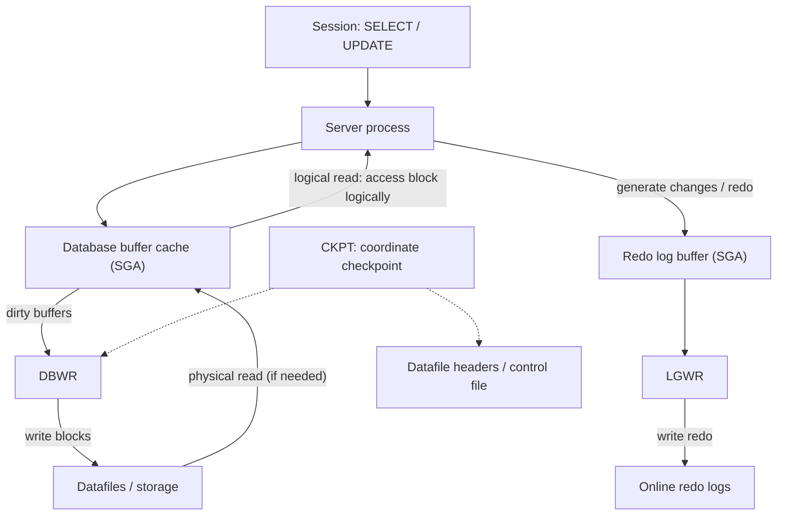
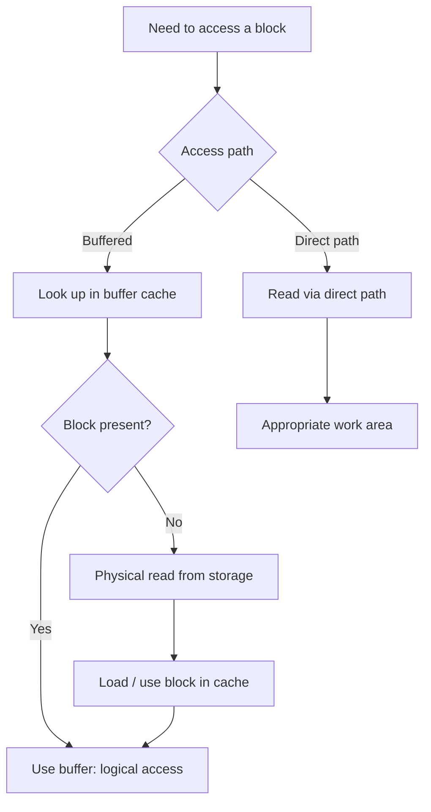
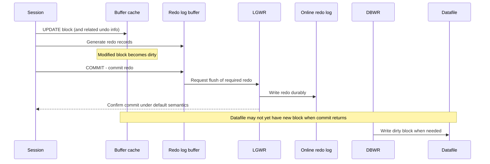

# Logical Reads, Physical Reads, Dirty Buffers, and Data Write Mechanisms in Oracle

When executing an SQL statement on Oracle Database, an application can receive results very quickly even though the data resides in a large datafile on disk. Other times, a `SELECT` reading a single row must wait on I/O, or a `COMMIT` completes before Oracle writes the modified data blocks down to a datafile. To understand these behaviors, you must distinguish **logical block reads**, **physical block reads**, **modified buffers (dirty buffers)**, and **the redo/datafile write pipeline**.

This lesson belongs to the **Architecture** section of *Database Engine Relational Oracle*. Its goal is to trace data movement between SQL, memory, and storage; explain why `COMMIT` is not synonymous with immediately writing every data block; and show how to use Oracle metrics to diagnose a slow query.

## 1. Big Picture: From Query to Memory and Datafile

Oracle stores table contents, indexes, and many other objects as **database blocks** inside **datafiles**. When processing SQL, Oracle typically works with blocks in the **database buffer cache** inside the System Global Area (SGA). Key components include:

| Component | Role |
| --- | --- |
| **Database block** | Logical storage unit inside a datafile holding row data, block management info, index entries, etc. |
| **Database buffer cache** | SGA region holding block copies for reading/writing without requesting storage on every access. |
| **Server process** | Executes SQL; locates, reads, modifies buffers, and coordinates locking and read consistency. |
| **Datafile** | File storing persistent database blocks of a tablespace. |
| **Redo log buffer** | Memory area holding redo records describing changes needed for recovery. |
| **Online redo log** | File storing redo written by LGWR. |
| **Undo** | Information used to roll back transactions and reconstruct data versions for read consistency. |
| **DBWR** (*Database Writer*) | Background process writing dirty buffers from the buffer cache down to datafiles when needed. |
| **LGWR** (*Log Writer*) | Background process writing redo from the redo log buffer out to online redo logs. |
| **CKPT** (*Checkpoint*) | Coordinates checkpoints, signals DBWR, and updates checkpoint information; not the process writing data blocks itself. |



This diagram is a conceptual model. Real Oracle systems involve many buffers, multiple datafiles, I/O operations, and *direct path* read variants. Some read operations pass through PGA memory or separate mechanisms instead of loading every block into the buffer cache.

**Most important takeaway:** `SELECT` cares about the version of data the transaction is permitted to see. It does not require Oracle to always read directly from disk. `UPDATE` typically modifies block copies in cache and generates redo/undo before changes are written to datafiles.

## 2. What Is a Logical Read?

A **logical read** (often called a *buffer get*) is an instance where Oracle requests/accesses a database block to perform SQL work at the logical level. That block may already sit in the cache; if not, Oracle may need to read it from storage. Therefore:

> **A logical read is not synonymous with disk I/O.** A logical read can be satisfied by a block already sitting in the buffer cache.

In Oracle statistics, two common logical get categories are:

- **Consistent gets:** Accessing data in **consistent-read (CR)** mode—the block version matching the point in time Oracle must present to the SQL statement/transaction. If current data holds changes newer than the required snapshot, Oracle can use undo information to construct a consistent block version.
- **DB block gets:** Accessing a block in **current mode**, when the operation needs the up-to-the-minute block image, common during data modification steps and internal processing.

In many performance statistic interpretations, total *logical reads* corresponds roughly to **`consistent gets + db block gets`**; both counters measure how many times Oracle interacted with blocks, not how many rows were returned.

For example, table `ORDERS` has 100,000 orders indexed by `order_id`. SQL:

```sql
SELECT order_id, status
FROM orders
WHERE order_id = 1001;
```

If using an index, Oracle may access index blocks plus one table block. The query returns **one row**, yet logical reads can exceed one because work occurs at the **block** level, not the row level. If a full table scan is chosen, Oracle may access many more blocks while still returning a single row.

### Consistent Read and Undo

Under the default `READ COMMITTED` isolation level, Oracle generally provides a committed data image consistent as of the start of **each statement**. Suppose:

1. Session A runs `SELECT balance FROM accounts WHERE account_id = 1`.
2. Session B updates the same row without **yet issuing `COMMIT`**.
3. Session A must not see B's uncommitted value.

Oracle can use undo to construct a **CR copy** of the block matching the snapshot A is reading. Reading this older version still counts toward logical reads; retrieving the undo block itself may also incur additional logical/physical I/O.

Do not think of "consistent read" as Oracle copying the entire database for every `SELECT`. Oracle manages block versions and uses **SCNs** (*System Change Numbers*) together with undo to present the right view when needed.

### Are High Logical Reads Always Bad?

No. Aggregating millions of rows naturally requires reading many blocks; an index lookup executed thousands of times in a loop also accumulates high total logical reads. Logical reads become meaningful in context of **data volume processed, execution count, rows returned, and elapsed time**.

Example comparing two queries each returning 10 rows:

| Query | Logical Reads | Initial Interpretation |
| --- | ---: | --- |
| A | 15 | Likely accessing via a selective index. |
| B | 25,000 | Possibly scanning many blocks or using an unselective execution plan. |

This is only a hypothetical example. Logical reads alone are insufficient to declare query B wrong; query B might simultaneously perform more complex checks or aggregations.

## 3. What Is a Physical Read?

A **physical read** occurs when Oracle must retrieve a data block from the storage layer rather than simply using a copy already present in the relevant memory area. It typically happens when a needed block is absent from the buffer cache, though **not every physical read passes through the buffer cache**.

Two common paths:

1. **Buffered read:** The server process looks for the block in the buffer cache. If missing, Oracle reads the block from the datafile/storage layer into a buffer and then uses it.
2. **Direct path read:** For operations such as large scans or parallel operations, Oracle may read blocks directly into an appropriate work area, bypassing the standard buffer cache.



**One physical read is not necessarily one access to a spinning physical platter.** The OS, storage controller, SAN/ASM, or cloud storage layer may have its own caches. In Oracle views, "physical reads" refers to blocks read at the database's I/O interface; actual latency depends on multiple underlying layers.

The physical reads count also **does not necessarily equal the number of I/O requests**. Oracle can read multiple blocks in one I/O call (*multiblock read*), and separate statistics count I/O requests. To assess the system, inspect bytes, request counts, latency, and wait events as well.

### Two-`SELECT` Example

Suppose blocks of table `PRODUCTS` are not yet in the buffer cache:

```text
Run 1: SELECT -> check cache -> block miss -> physical read -> process block
Run 2: SELECT -> check cache -> block hit                  -> process block
```

Run 2 may incur fewer physical reads than Run 1 while **still generating logical reads**. However, there is no guarantee Run 2 always has 0 physical reads: buffers may have been evicted, the SQL may have switched execution plans, concurrent workloads may have churned the cache, or Oracle may pick direct path.

Good cache hits help reduce storage accesses, yet a high hit ratio does not automatically mean a query is fast. An SQL statement can read 1,000,000 cached blocks quickly relative to disk while still burning CPU and driving up system load.

## 4. Database Buffer Cache: Clean, Dirty, Free, and Pinned Buffers

Each buffer holds one database block copy along with metadata for Oracle to manage usage. In operation, distinguish:

| State / Attribute | Meaning |
| --- | --- |
| **Clean buffer** | Block content in cache has no unwritten changes relative to the corresponding state on disk. Eligible for reuse under cache replacement policy. |
| **Dirty buffer** | Block content in cache has been modified and those changes must be written by DBWR to a datafile. |
| **Free/reusable buffer** | Buffer available to load another block when Oracle needs space; not strictly identical to clean status. |
| **Pinned buffer** | Buffer currently being actively used/protected by an operation for a brief duration; it can be clean or dirty. "Pinned" does not mean "dirty". |

When a session updates a row:

1. Oracle brings the needed blocks into memory via the appropriate mechanism, checking access privileges and locks.
2. Oracle generates **undo** needed for rollback/read consistency and generates **redo** protecting the relevant changes.
3. The modified block copy in the buffer cache becomes **dirty**.
4. Oracle does not have to immediately write this entire block to a datafile just because `UPDATE` ran.
5. DBWR will flush dirty buffers as needed—due to free buffer demand, checkpoints, or other cache/background write conditions.

A single block can contain many rows. If multiple `UPDATE`s modify rows in the same block before DBWR writes it, Oracle can coalesce those changes in a single later block write. Hence there is no equivalence "one UPDATE = one datafile write".

**Dirty does not mean uncommitted.** A block can remain dirty **after** a transaction commits, because commit redo was durably written while DBWR has not yet flushed the block. Conversely, DBWR can write a block holding **uncommitted** changes before the transaction finishes; Oracle relies on undo/redo and recovery mechanisms to maintain correctness. Never infer "written to datafile" means the transaction committed.

Oracle does not pick cache victims using a simple FIFO/LRU rule; buffer management also accounts for touch counts, queues, and workload patterns. For SQL developers, the practical takeaway is that frequently reused blocks tend to stay cached, while large scans, memory pressure, and competing workloads alter reuse rates.

## 5. Data Write Path: UPDATE, REDO, COMMIT, and DBWR

Separate two write paths with distinct purposes:

- **Redo path:** modifications generate **redo records** in the redo log buffer; **LGWR** writes required redo records to **online redo logs** for durability and recovery.
- **Datafile path:** data blocks are modified in the **buffer cache**; **DBWR** writes dirty block images down to datafiles on the database's write schedule.



In standard durable commit mode, when an application receives `COMMIT` confirmation, Oracle has ensured required redo (including commit info) was written under the system's durability mechanism. **Oracle does not wait for DBWR to flush every modified data block down to datafiles before acknowledging commit.**

Why does this design make sense? Writing **sequential redo** is generally far more efficient than forcing immediate scattered writes across many datafiles for every transaction. Oracle can batch multiple commits in redo writes (*group commit*) while DBWR optimizes dirty block writes independently.

### Write-Ahead Logging and Crash Recovery

Oracle relies on a principle equivalent to **write-ahead logging**: redo required to recover a change must be written to the redo log before the block containing that change is durably written to a datafile. Consequently:

- If the system crashes after a transaction commits yet **before DBWR writes the new block**, recovery can apply redo to reconstruct the confirmed change.
- If **uncommitted** transactions were active at crash time, recovery combines redo and undo to restore the database to a valid state, removing final effects of incomplete transactions.

Recovery details depend on operating mode and failure type. Never think of redo as a full verbatim copy of each datafile; redo describes change records serving recovery. **Undo and redo complement each other:** undo supports rollback and read consistency, while redo supports reapplying changes during recovery.

A timeline example:

| Milestone | Event | Consequence |
| --- | --- | --- |
| T0 | Datafile holds old value; buffer cache holds the corresponding block | Initial state. |
| T1 | `UPDATE` changes value; buffer becomes dirty, undo/redo generated | Transaction not necessarily committed yet. |
| T2 | `COMMIT`; LGWR writes redo per commit mechanism | Transaction is confirmed even though datafile may still hold old value. |
| T3 | DBWR writes dirty block to datafile | Block contents inside datafile are updated. |
| T4 | If a crash occurs between T2 and T3 | Oracle uses redo during instance recovery so the committed transaction is not lost. |

When an application requires durability, avoid switching commit modes to asynchronous solely to shave latency. Specialized commit options trade off when redo is written; understand the risks thoroughly before using them.

## 6. Checkpoints and Why DBWR Writes Before or After Commit

**Checkpoints** keep dirty-buffer write progress and recovery metadata updated to bound the recovery work needed after a crash. In this mechanism:

1. Oracle determines checkpoint requirements at the appropriate scope.
2. **CKPT** coordinates with DBWR and updates relevant checkpoint info (such as in the control file and datafile headers).
3. **DBWR** writes required buffers per checkpoint progress; CKPT itself does not directly execute all data-block write I/O.

Checkpoints can relate to log switches, pacing recovery targets, or administrative commands. **Do not equate `COMMIT` with a checkpoint**: thousands of transactions can commit while many dirty buffers still await flushing. Similarly, do not assume every checkpoint immediately forces every dirty block across the entire system clean under all checkpoint types.

When **ARCHIVELOG** is configured, filled online redo logs can be copied by the archiver process into archived redo logs for recovery per operational goals. **ARCn does not sit in the per-`COMMIT` write path like LGWR**.

## 7. Understanding Related Performance Metrics

When analyzing SQL, distinguish **block gets**, **I/O blocks**, **I/O requests**, **bytes**, and **wait time**. Common metrics:

| Statistic or Group | Practical Interpretation |
| --- | --- |
| `consistent gets` | Block accesses performed via consistent-read mechanism. |
| `db block gets` | Block accesses performed in current mode. |
| `physical reads` | Blocks read via Oracle's physical read path, spanning multiple I/O modes. |
| `physical reads direct` | Portion of physical reads via direct path (when reported). |
| `physical writes` | Physical block writes recorded by Oracle; can include activity beyond a single user DML statement. |
| `redo size` | Bytes of redo generated over the observation window. |
| `db block changes` | Count of block modifications recorded at Oracle's statistic level. |

These metric names commonly appear in Oracle dynamic views. They reflect database-level activity, **not directly answering "how many milliseconds did this query take"**. Moreover, instance-wide stats include noise from other sessions.

### Viewing Current Session Statistics

The example below requires an account granted `SELECT` on `V$SESSTAT` and `V$STATNAME`, typically provided by a DBA in a controlled learning environment. **Do not grant DBA or full-database privileges to an ordinary application** merely to run business SQL.

```sql
SELECT n.name AS statistic_name,
       s.value AS statistic_value
FROM v$sesstat s
JOIN v$statname n
  ON n.statistic# = s.statistic#
WHERE s.sid = TO_NUMBER(SYS_CONTEXT('USERENV', 'SID'))
  AND n.name IN (
      'consistent gets',
      'db block gets',
      'physical reads',
      'physical reads direct',
      'physical writes',
      'redo size',
      'db block changes'
  )
ORDER BY n.name;
```

Because these are **cumulative session counters**, follow these steps:

1. Capture values **before** running the SQL under study.
2. Execute the SQL with known data volume and predicates.
3. Capture values **after**, computing `delta = value_after - value_before` for each statistic.

The query fetching statistics itself adds a tiny amount of work/gets, and any session activity between snapshots also adds to the counters. Therefore do not treat deltas as exact absolute measurements of one SQL statement when other operations interleave; for deep analysis, use appropriate SQL tracing/monitoring tools.

If granted access to instance-wide stats, you can inspect `V$SYSSTAT`:

```sql
SELECT name, value
FROM v$sysstat
WHERE name IN (
    'consistent gets',
    'db block gets',
    'physical reads',
    'physical writes',
    'redo size'
)
ORDER BY name;
```

Instance-wide counters rise from **all sessions**, including background processes and other workloads. They suit assessing load over a time window better than isolating one button click in an application.

### Observing with AUTOTRACE

In SQL*Plus or SQLcl, when the environment has configured privileges and AUTOTRACE support, you can use:

```sql
SET AUTOTRACE TRACEONLY STATISTICS

SELECT COUNT(*)
FROM user_objects;

SET AUTOTRACE OFF
```

`TRACEONLY STATISTICS` tells the client tool to display execution statistics—such as consistent gets, db block gets, physical reads, and redo size—instead of printing all query rows. `SET AUTOTRACE` is a **client command**, not SQL sent over JDBC. If the tool reports missing privileges or missing AUTOTRACE setup, ask an administrator to configure it per system policy; do not grant broad privileges just to view stats.

To determine **where time is spent waiting**, inspect the actual execution plan, actual rows, elapsed time, and wait events. For example:

- `db file sequential read` commonly corresponds to single-block I/O (often associated with index lookups), though **seeing this event never proves an index is wrong**.
- `db file scattered read` commonly corresponds to multiblock buffered reads, such as certain full scans.
- `direct path read` or related variants indicate a direct read path.
- `log file sync` typically relates to committing sessions waiting on redo confirmation; it can also be impacted by commit frequency and redo I/O latency.

Wait event names offer clues, not a complete diagnosis. Oracle version, I/O configuration, and execution plans all shape how an SQL statement performs reads and writes.

## 8. Hands-On Lab: Observing Reads, Dirty Buffers, and Commits

Run in a **private practice schema** with `CREATE TABLE` privilege and appropriate tablespace quota. This lab uses plain SQL; system-statistic queries should be run only if your account has privileges.

### Step 1: Prepare Data

```sql
CREATE TABLE lab_io_blocks AS
SELECT LEVEL AS id,
       RPAD('X', 180, 'X') AS payload
FROM dual
CONNECT BY LEVEL <= 2000;

ALTER TABLE lab_io_blocks
ADD CONSTRAINT pk_lab_io_blocks PRIMARY KEY (id);

COMMIT;
```

`CREATE TABLE` and `ALTER TABLE` are DDL, triggering **implicit commits** under Oracle semantics. Execute them before starting transaction experiments so they do not alter the rollback boundary of later steps.

### Step 2: Read Twice

If using SQL*Plus/SQLcl with AUTOTRACE available:

```sql
SET AUTOTRACE TRACEONLY STATISTICS

SELECT id, payload
FROM lab_io_blocks
WHERE id = 100;

SELECT id, payload
FROM lab_io_blocks
WHERE id = 100;

SET AUTOTRACE OFF
```

During execution, observe **consistent gets** and **physical reads**. The two runs may show identical logical gets yet different physical reads if the block became cached; or both may show 0 physical reads if the block was already cached beforehand. **Never run `ALTER SYSTEM FLUSH BUFFER_CACHE` on a shared environment** just to force a demo result.

### Step 3: Modify a Block and Roll Back

In SQL*Plus/SQLcl, explicitly disable autocommit:

```sql
SET AUTOCOMMIT OFF

UPDATE lab_io_blocks
SET payload = RPAD('Y', 180, 'Y')
WHERE id = 100;

SELECT id, SUBSTR(payload, 1, 8) AS sample_text
FROM lab_io_blocks
WHERE id = 100;

ROLLBACK;

SELECT id, SUBSTR(payload, 1, 8) AS sample_text
FROM lab_io_blocks
WHERE id = 100;
```

Inside the uncommitted transaction, the current session sees values starting with `Y`. After `ROLLBACK`, the value reverts to `X`. The `UPDATE` likely dirtied buffers and generated redo/undo even though the transaction ultimately rolled back. That is why `redo size` can increase even when users never commit their changes.

### Step 4: Commit and Verify from Another Session

```sql
SET AUTOCOMMIT OFF

UPDATE lab_io_blocks
SET payload = RPAD('Z', 180, 'Z')
WHERE id = 100;

COMMIT;

SELECT id, SUBSTR(payload, 1, 8) AS sample_text
FROM lab_io_blocks
WHERE id = 100;
```

Open **another session** in the same schema/PDB and `SELECT` row `id = 100`: the second session sees `Z` after the commit. However, seeing `Z` from another session **does not prove** DBWR has already written this block down to a datafile; Oracle can serve the committed version straight from the buffer cache.

No simple business SQL command reliably observes the exact instant a specific dirty buffer becomes clean, because DBWR operates asynchronously. DBA tools like dynamic performance views and traces offer deeper visibility, though system-wide operations should not be used in a foundational lab.

### Step 5: Clean Up the Sample Table When Done

```sql
DROP TABLE lab_io_blocks PURGE;
```

This is DDL dropping the test table and cannot be rolled back like an uncommitted `DELETE`. Run it only when you no longer need the exercise data; `PURGE` bypasses the Recycle Bin for the dropped object.

## 9. How Reads and Writes Affect SQL Tuning

A slow query can stem from multiple factors at once: accessing too many blocks, buffer cache too small for the working set, high storage I/O latency, or contention/CPU bottlenecks. Never optimize around a single metric.

| Observation | Useful Questions to Ask |
| --- | --- |
| Very high logical reads per execution | Is the query reading too many blocks due to predicates, JOINs, execution plan, or repeated execution? |
| Physical reads spike during peak hours | Has the working set outgrown the cache? Are there large full scans, direct path reads, or memory pressure? |
| High physical read latency | Are storage, I/O queues, file/ASM layout, and access patterns hitting issues? |
| Heavy `log file sync` | Are commits happening too frequently (e.g., row-by-row) or is redo I/O slow? |
| Redo size surges during imports/updates | Is there huge change volume, index/undo overhead, or inefficient repeated DML? |
| Many dirty buffers being written | Is this normal background flushing or buffer/DBWR pressure hitting throughput limits? |

Remediation usually starts with **the execution plan, rows examined vs. rows returned, predicates/selectivity, appropriate indexes, and how the application batches transactions**. Example:

```sql
-- When frequently looking up exact rows by key:
SELECT product_id, product_name
FROM products
WHERE product_id = :id;

-- When a query genuinely needs the entire dataset:
SELECT SUM(amount)
FROM sales;
```

The first query can leverage a unique index / primary key to minimize visited blocks. The second query may legitimately need to scan many blocks; full scans and direct path reads **are not inherently wrong**, especially for large aggregations.

### Why Not Use Cache Hit Ratio as the Sole Target?

A commonly cited formula is `1 - physical_reads / logical_reads`. However, this rough ratio has clear limitations:

- Direct path reads and other counters do not always map 1:1 to buffer cache misses.
- A very high hit ratio can still accompany massive logical reads burning CPU.
- Queries reading fresh data naturally incur physical reads; infinitely growing cache is not the solution.
- Short measurement windows or aggregating across mixed workloads can mask specific SQL issues.

Instead of chasing "99% cache hit", identify slow SQLs, measure resources **per execution**, inspect execution plans and wait times, and validate changes against a representative workload.

## 10. Misconceptions to Avoid

**"Logical read means reading RAM; physical read means reading an HDD."** Logical read is logically accessing a block; physical read is Oracle's recorded storage-layer read path, which may hit OS/storage caches or use direct path. Distinguishing them purely as "RAM vs. spinning disk" is overly simplistic.

**"A SELECT returning one row must perform one logical read."** Oracle operates on blocks: index traversal, table access, undo, and internal work can generate multiple gets.

**"An UPDATE writes directly to a datafile."** Normally Oracle modifies a buffer cache block to dirty and generates redo/undo; DBWR writes data to datafiles later in the background.

**"Successful COMMIT means zero dirty buffers remain."** False. The core of default durable commit is that required redo is properly written; blocks can still sit dirty in cache.

**"DBWR only writes committed data."** False. DBWR can write blocks containing uncommitted changes; recovery uses redo and undo to resolve transaction outcomes.

**"Redo logs and datafiles are two identical copies."** False. Redo holds change records for recovery; datafiles hold database block structures.

**"Checkpoints write every block via CKPT itself."** False. CKPT coordinates and updates checkpoint metadata; DBWR handles writing dirty data blocks.

**"High physical reads prove you need another index."** Not necessarily. A full scan can be optimal for a query returning most of a table; evaluate the plan, row count, latency, and business goals.

## 11. Self-Check Questions

1. **Difference between logical read and physical read?** Logical read counts logical block accesses, whereas physical read counts retrieving blocks through Oracle's I/O path; a logical access can use an already-cached block.
2. **Why can two runs of the same SELECT have different physical reads?** Because blocks may be cached after the first run, or cache contents, read paths, or execution plans changed. Logical reads do not necessarily drop correspondingly.
3. **How do consistent gets relate to undo?** Oracle can use undo to build a block version consistent with the query's read snapshot, preventing the query from seeing uncommitted changes.
4. **Does a dirty buffer mean an uncommitted transaction?** No. Dirty only means the buffer was modified and needs to be written to a datafile; the transaction may or may not have committed.
5. **How does LGWR differ from DBWR?** LGWR writes redo to online redo logs; DBWR writes dirty data blocks down to datafiles.
6. **Why can a commit succeed before datafiles contain the latest blocks?** Oracle protects the transaction with durable redo; if recovery is needed, redo can be reapplied, while DBWR writes datafiles asynchronously.
7. **If DBWR wrote a block with uncommitted changes and the database crashes, is it treated as committed?** No. Transaction state is determined by redo/undo and recovery mechanisms, not merely by whether a block was written to a datafile.
8. **What should you do when the buffer cache hit ratio is very high yet queries are still slow?** Examine logical reads per execution, execution plans, CPU, row counts, and wait events instead of blindly adding memory.

When analyzing Oracle, trace the chain: **SQL accesses block → buffer cache → physical I/O if needed → modifications create dirty buffers and redo → LGWR secures redo on commit → DBWn writes blocks to datafiles in the background**. Understanding each boundary explains transaction behavior, durability, and many relational database performance scenarios accurately.
