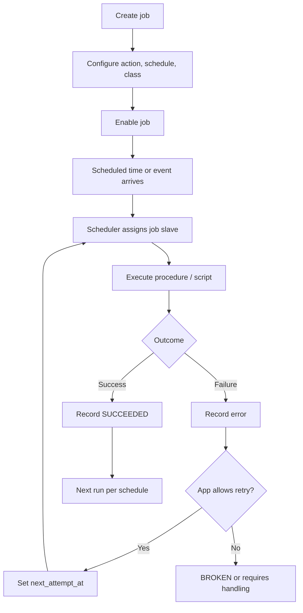
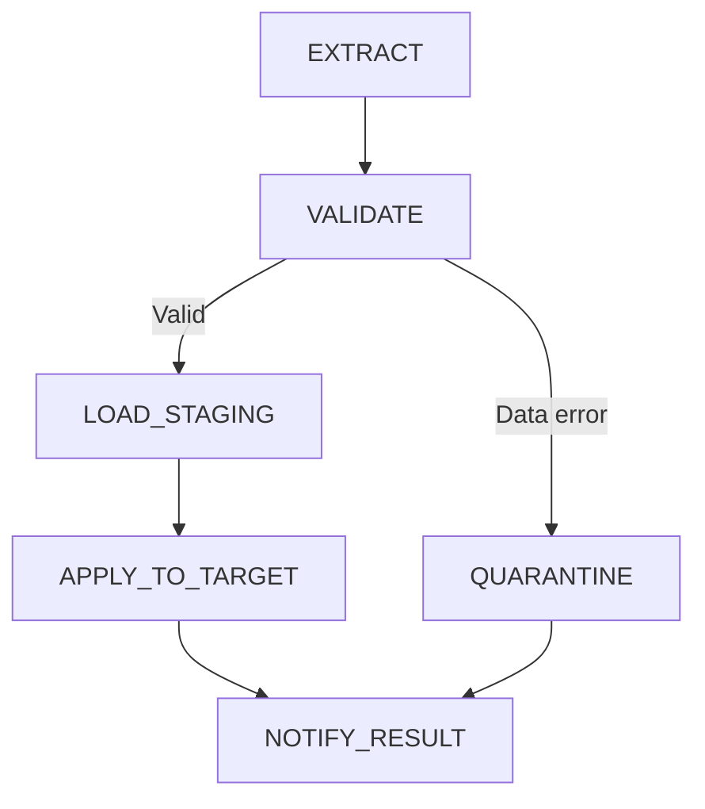
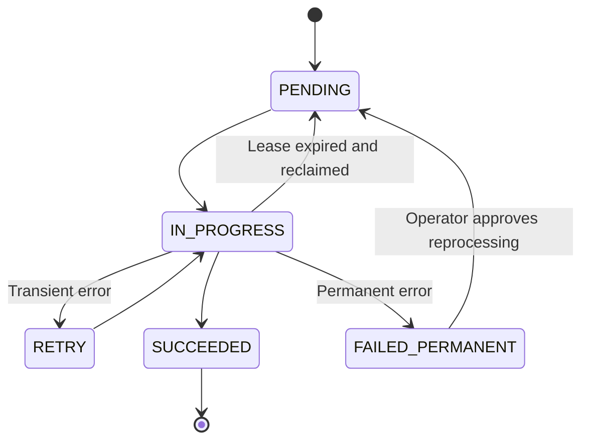

# DBMS_SCHEDULER for Background Integration Jobs and Retry Control

Oracle Scheduler is the scheduling and orchestration engine built into Oracle Database. The `DBMS_SCHEDULER` package lets you define background jobs, schedule by time, trigger by events, coordinate multiple steps, and track execution results.

In distributed integration systems, Scheduler is commonly used for periodic data synchronization, reading and processing batches, invoking integration packages, generating reports, checking external system status, or orchestrating data exchange steps. Background execution frees applications from keeping user sessions open waiting for tasks to finish.

An integration design must address three problems simultaneously:

- **Scheduling and orchestration:** when work runs, in what order, and using which resources.
- **Error and retry control:** which errors are retried, how many times, how failed data is quarantined, and when intervention is needed.
- **Correctness assurance:** if a job reruns after partially completing work, the system must not create duplicate transactions or drop data.

`DBMS_SCHEDULER` provides scheduling, history logging, failure threshold management, and restart capabilities in supported scenarios. The correctness of an integration flow also depends on transaction design, business locks, checkpoints, and safe repeatable execution in the implementing package.

## 1. Components and Operating Model

### Job

A job is the unit of work executed by Scheduler. A job defines the job type, action to run, start time, repeat schedule, resource class, and operational attributes.

A job can run:

- A PL/SQL block.
- A stored procedure or package procedure.
- An external OS program if the environment has external jobs configured appropriately.
- A script or other task type supported by your Oracle version.

For example, job `JOB_SYNC_ORDERS` can call procedure `INTEGRATION_PKG.SYNC_ORDERS` every 15 minutes. The procedure reads unsynchronized orders, sends data to the target system, and records the status of each batch.

### Program

A program describes a reusable action decoupled from a schedule. Multiple jobs can reference the same program while using different schedules, job classes, or arguments.

A program specifies `program_type`, `program_action`, and optional arguments. For instance, one program calls `INTEGRATION_PKG.SYNC_CUSTOMERS`; separate jobs can run it for different business units or time windows.

### Schedule

A schedule describes execution timing. A schedule can be a one-time timestamp or a repeating expression using Oracle's calendaring syntax. Decoupling schedules from jobs lets multiple jobs share one schedule and centralizes schedule updates.

### Chain

A chain is a workflow composed of multiple steps and transition rules. Chains fit integration flows with interdependent stages, such as:

1. Extract data from source.
2. Validate structure and business rules.
3. Load into staging.
4. Sync to target tables.
5. Send notifications or record results.

A step runs only when its corresponding rule is satisfied. You can define branches for when a preceding step succeeds or fails.

### Job Class, Window, and Destination

- **Job class:** groups jobs to apply administrative attributes, services, and resource policies.
- **Window:** defines a time interval during which a Resource Manager plan or resource allocation is prioritized. Windows can affect job classes associated with them.
- **Destination:** specifies execution target for job types supporting remote destinations. Remote database jobs and external jobs have different configuration requirements.
- **Credential:** stores authentication credentials used by Scheduler for tasks needing OS or remote system logins.

These objects separate task configuration from resource allocation and execution location. Support and exact syntax depend on version, job type, and Oracle Scheduler Agent configuration.

## 2. Lifecycle of a Job

A job typically goes through these stages:

1. The DBA or application creates the job using `DBMS_SCHEDULER.CREATE_JOB`.
2. Configure job action, schedule, job class, credential, or control attributes.
3. Enable the job using `DBMS_SCHEDULER.ENABLE`.
4. Scheduler determines the next run time and queues the job.
5. A job slave executes the work when resources are available.
6. Scheduler records status, timestamps, errors, and outcome.
7. If the job fails, Scheduler records the outcome and failure count; restart can apply if interrupted in supported scenarios. Business retries are usually controlled by the integration package.
8. The job continues running on schedule, or is disabled, stopped, or dropped as needed for administration.

Overview diagram:



Actual state also depends on job type, schedule, version, and system events. Never assume every error is automatically retried by Scheduler or every failed job is immediately marked `BROKEN`.

## 3. Creating a Scheduled Job Running a Procedure

Suppose a package procedure synchronizes orders:

```sql
CREATE OR REPLACE PROCEDURE integration_pkg.sync_orders AS
BEGIN
    -- Read batch of orders pending synchronization.
    -- Send or transfer data per integration design.
    -- Record status and processing outcome of each batch.
    NULL;
END;
/
```

Create a job running every 15 minutes:

```sql
BEGIN
    DBMS_SCHEDULER.CREATE_JOB(
        job_name        => 'JOB_SYNC_ORDERS',
        job_type        => 'STORED_PROCEDURE',
        job_action      => 'INTEGRATION_PKG.SYNC_ORDERS',
        start_date      => SYSTIMESTAMP,
        repeat_interval => 'FREQ=MINUTELY;INTERVAL=15',
        enabled         => FALSE,
        auto_drop       => FALSE,
        comments        => 'Sync orders in batches'
    );

    DBMS_SCHEDULER.ENABLE('JOB_SYNC_ORDERS');
END;
/
```

Notable parameters:

- `job_name`: name of the job in the schema.
- `job_type`: action type; e.g., `STORED_PROCEDURE`.
- `job_action`: name of the procedure invoked.
- `start_date`: effective start timestamp.
- `repeat_interval`: recurrence expression.
- `enabled`: allows the job to be scheduled immediately upon creation.
- `auto_drop`: controls whether Scheduler automatically drops the job upon completion per applicable conditions. For long-running integration jobs, keeping the object for management and tracking is usually desired.

Creating a job in disabled state lets the DBA finish configuration before Scheduler can run it. Only call `ENABLE` after checking the schedule, privileges, credentials, and parameters.

If a procedure accepts parameters, declare job or program arguments and assign values via `SET_JOB_ARGUMENT_VALUE` or `SET_JOB_ANYDATA_VALUE` matching the data types. Use arguments to pass configuration parameters such as source code, business unit code, or batch scope; never pass plaintext passwords that could appear in command history.

### Running Once for Testing

You can instruct Scheduler to run a job immediately:

```sql
BEGIN
    DBMS_SCHEDULER.RUN_JOB(
        job_name            => 'JOB_SYNC_ORDERS',
        use_current_session => FALSE
    );
END;
/
```

With `use_current_session => FALSE`, Scheduler runs the job as a background job. Setting `TRUE` runs the work in the current session and blocks until completion; this is helpful during testing when you want errors surfaced directly in the session.

Manual runs do not replace testing the actual schedule, job owner privileges, job slave environment, and concurrency with other batches. After testing, inspect logs and job status.

## 4. Scheduling Expressions

Scheduler supports calendaring syntax to describe repeating schedules. Examples:

| Requirement | `repeat_interval` |
|---|---|
| Every 15 minutes | `FREQ=MINUTELY;INTERVAL=15` |
| Hourly | `FREQ=HOURLY;INTERVAL=1` |
| Daily at 02:00 | `FREQ=DAILY;BYHOUR=2;BYMINUTE=0;BYSECOND=0` |
| Every Monday at 06:30 | `FREQ=WEEKLY;BYDAY=MON;BYHOUR=6;BYMINUTE=30;BYSECOND=0` |
| First day of each month at 01:00 | `FREQ=MONTHLY;BYMONTHDAY=1;BYHOUR=1;BYMINUTE=0;BYSECOND=0` |

Schedules are part of operational logic. Account for timezones, daylight saving time (DST), holidays, batch cutoff times, and the possibility that a previous run has not finished before the next scheduled run.

Create a shared schedule:

```sql
BEGIN
    DBMS_SCHEDULER.CREATE_SCHEDULE(
        schedule_name   => 'SCH_EVERY_15_MIN',
        start_date      => SYSTIMESTAMP,
        repeat_interval => 'FREQ=MINUTELY;INTERVAL=15',
        comments        => 'Sync schedule every 15 minutes'
    );
END;
/
```

Then create a job referencing the schedule:

```sql
BEGIN
    DBMS_SCHEDULER.CREATE_JOB(
        job_name      => 'JOB_SYNC_CUSTOMERS',
        program_name  => 'PRG_SYNC_CUSTOMERS',
        schedule_name => 'SCH_EVERY_15_MIN',
        enabled       => TRUE,
        auto_drop     => FALSE
    );
END;
/
```

In this example, program `PRG_SYNC_CUSTOMERS` must be created and enabled before the job uses it. You can substitute `repeat_interval` directly instead of `schedule_name` if the schedule is used by only one job.

For local-time schedules, explicitly specify the timezone in `start_date` and test clock-transition moments if DST applies in your deployment region. Never assume a 02:00 schedule fires exactly once on DST transition days.

## 5. Decoupling Programs from Jobs for Reuse

Create a program for the customer sync procedure:

```sql
BEGIN
    DBMS_SCHEDULER.CREATE_PROGRAM(
        program_name        => 'PRG_SYNC_CUSTOMERS',
        program_type        => 'STORED_PROCEDURE',
        program_action      => 'INTEGRATION_PKG.SYNC_CUSTOMERS',
        number_of_arguments => 0,
        enabled             => TRUE,
        comments            => 'Customer sync program'
    );
END;
/
```

Once the program is created, multiple jobs can share it:

- A job running on an overnight schedule.
- A job running on a shorter interval for a specific data subset.
- An event-driven job triggered after a batch is prepared.

Reusing a program keeps business logic in one place while each job retains its own operational settings. If the procedure changes, evaluate the impact on every job referencing that program.

## 6. Chains for Multi-Step Integration Workflows

When integration has multiple interdependent stages, a single monolithic procedure can be hard to monitor and difficult to rerun for an individual step. Scheduler Chains let you split the workflow into steps and rules.

Example sync flow:



Create the chain:

```sql
BEGIN
    DBMS_SCHEDULER.CREATE_CHAIN(
        chain_name => 'CHAIN_ORDER_SYNC',
        rule_set_name => NULL,
        evaluation_interval => NULL,
        comments => 'Order sync workflow'
    );
END;
/
```

Steps reference already-created programs:

```sql
BEGIN
    DBMS_SCHEDULER.DEFINE_CHAIN_STEP(
        chain_name   => 'CHAIN_ORDER_SYNC',
        step_name    => 'EXTRACT',
        program_name => 'PRG_EXTRACT_ORDERS'
    );

    DBMS_SCHEDULER.DEFINE_CHAIN_STEP(
        chain_name   => 'CHAIN_ORDER_SYNC',
        step_name    => 'VALIDATE',
        program_name => 'PRG_VALIDATE_ORDERS'
    );

    DBMS_SCHEDULER.DEFINE_CHAIN_STEP(
        chain_name   => 'CHAIN_ORDER_SYNC',
        step_name    => 'LOAD_STAGING',
        program_name => 'PRG_LOAD_ORDER_STAGE'
    );

    DBMS_SCHEDULER.DEFINE_CHAIN_STEP(
        chain_name   => 'CHAIN_ORDER_SYNC',
        step_name    => 'APPLY_TO_TARGET',
        program_name => 'PRG_APPLY_ORDERS'
    );

    DBMS_SCHEDULER.DEFINE_CHAIN_STEP(
        chain_name   => 'CHAIN_ORDER_SYNC',
        step_name    => 'NOTIFY_RESULT',
        program_name => 'PRG_NOTIFY_ORDER_SYNC'
    );
END;
/
```

Define the start rule and transitions. Step names must match declared steps exactly:

```sql
BEGIN
    DBMS_SCHEDULER.DEFINE_CHAIN_RULE(
        chain_name => 'CHAIN_ORDER_SYNC',
        condition  => 'TRUE',
        action     => 'START "EXTRACT"',
        rule_name  => 'RULE_START'
    );

    DBMS_SCHEDULER.DEFINE_CHAIN_RULE(
        chain_name => 'CHAIN_ORDER_SYNC',
        condition  => '"EXTRACT" COMPLETED',
        action     => 'START "VALIDATE"',
        rule_name  => 'RULE_EXTRACT_DONE'
    );

    DBMS_SCHEDULER.DEFINE_CHAIN_RULE(
        chain_name => 'CHAIN_ORDER_SYNC',
        condition  => '"VALIDATE" COMPLETED',
        action     => 'START "LOAD_STAGING"',
        rule_name  => 'RULE_VALIDATE_DONE'
    );

    DBMS_SCHEDULER.DEFINE_CHAIN_RULE(
        chain_name => 'CHAIN_ORDER_SYNC',
        condition  => '"LOAD_STAGING" COMPLETED',
        action     => 'START "APPLY_TO_TARGET"',
        rule_name  => 'RULE_LOAD_DONE'
    );

    DBMS_SCHEDULER.DEFINE_CHAIN_RULE(
        chain_name => 'CHAIN_ORDER_SYNC',
        condition  => '"APPLY_TO_TARGET" COMPLETED',
        action     => 'START "NOTIFY_RESULT"',
        rule_name  => 'RULE_APPLY_DONE'
    );

    DBMS_SCHEDULER.DEFINE_CHAIN_RULE(
        chain_name => 'CHAIN_ORDER_SYNC',
        condition  => '"NOTIFY_RESULT" COMPLETED',
        action     => 'END',
        rule_name  => 'RULE_END'
    );

    DBMS_SCHEDULER.ENABLE('CHAIN_ORDER_SYNC');
END;
/
```

After defining the chain, create a job with `job_type => 'CHAIN'` and `job_action => 'CHAIN_ORDER_SYNC'` to schedule the chain. Depending on the version, the chain may need additional error-handling rules and specific step start conditions. Verify Chain Rules syntax for your release before deploying to operations.

Chains help track which step completed or failed, but do not automatically guarantee that data written in earlier steps rolls back when a later step fails. Each step must define its own transaction boundaries, checkpoints, and independent rerunnability.

## 7. Controlling Retries and Restarts

In background integration, failures can stem from many causes:

- Target system temporarily unreachable.
- Timeouts or network errors.
- Remote service rate limiting.
- Deadlocks or lock contention in the database.
- Invalid data or business rule violations.
- Sudden termination of a job slave or instance.

Not every error should be retried. Transient network errors often recover after a wait; malformed data or unique key violations rarely fix themselves when re-running the same data.

### Max Failures and Failure Thresholds

Scheduler has a `max_failures` attribute to cap consecutive job failures before Scheduler marks the job `BROKEN`. Example:

```sql
BEGIN
    DBMS_SCHEDULER.SET_ATTRIBUTE(
        name      => 'JOB_SYNC_ORDERS',
        attribute => 'max_failures',
        value     => 5
    );
END;
/
```

`max_failures` is a job-status safety guard, not a per-record backoff policy. For scheduled repeating jobs, Scheduler keeps recording runs and failure counts; upon hitting the configured threshold, the job may transition to `BROKEN` and require DBA attention. Exact behavior must be confirmed per version and job type. Never assume Scheduler provides customizable business retry delays for every failure.

When deciding when to retry after a timeout or remote service failure, manage `next_attempt_at`, `attempt_count`, and `last_error` in an application coordination table. The Scheduler job periodically picks records that are due. This lets you configure per-batch backoff, distinguish transient from permanent errors, and control call volume to the target system.

Scheduler records the outcome of the job execution, but cannot detect business errors inside a batch if the package catches errors and exits normally. If the package catches an exception and does not re-raise it, Scheduler may mark the run successful even though some records failed. Therefore, the package must track per-record status and exit cleanly only when outcomes meet the integration flow's criteria.

### Restartable

The `restartable` attribute controls whether Scheduler automatically restarts a job in certain situations where the job was interrupted by a system or instance failure. This is an execution recovery mechanism for infrastructure outages, distinct from business retry logic after a procedure returns an error.

Example:

```sql
BEGIN
    DBMS_SCHEDULER.SET_ATTRIBUTE(
        name      => 'JOB_SYNC_ORDERS',
        attribute => 'restartable',
        value     => TRUE
    );
END;
/
```

Do not treat `restartable = TRUE` as a guarantee the job resumes from the exact last SQL statement. A restarted job may rerun from the beginning or per supported recovery behavior, so the task must tolerate repeated execution. For integration jobs, design checkpoints and business locks before enabling restart.

### Distinguishing Retry and Restart

| Mechanism | Scenario | Goal |
|---|---|---|
| Next scheduled run | Repeating job remains enabled and not marked `BROKEN` | Scheduler starts a fresh run per the configured repeat interval |
| Restartable | Job interrupted by instance or system failure in supported scenarios | Allows Scheduler to restart the job after recovery |
| Application retry | Package encounters transient error calling a service or processing a record | Retries an operation or record per business policy and `next_attempt_at` |
| Manual rerun | DBA or operator reruns after investigation | Controlled recovery when automatic retry is no longer appropriate |

These mechanisms can coexist. The next scheduled run is a new execution; it does not automatically mean Scheduler resumes the exact failed batch. Cap total attempts at each layer to avoid multiplying calls unexpectedly. For example, a package retrying multiple times inside one run while the job also fires repeatedly on schedule can generate far more service calls than intended.

## 8. Designing Backoff and Error Classification

A fixed one-minute retry policy at the application layer suits some tasks, but is not always healthy in distributed systems. If the target service is overloaded, many workers retrying simultaneously at fixed intervals can trigger a retry storm.

A common application policy is exponential backoff:

\[
delay_n = \min(delay_{max}, delay_{base} \times 2^{n-1})
\]

Random jitter can be added so workers do not retry in lockstep at the exact same instant. For instance, wait intervals grow 30s, 60s, 120s, 240s, capping at 15 minutes.

`repeat_interval` governs the job's next periodic run, not per-record backoff. When per-record or per-batch backoff is needed, track `next_attempt_at`, `attempt_count`, and `last_error` in the integration coordination table. A periodic job simply picks records due for retry.

Error classification:

| Error Category | Examples | Recommended Handling |
|---|---|---|
| Transient | Timeout, HTTP 503, temporary database connection error | Retry with backoff and cap |
| Throttling | HTTP 429 or service requesting rate reduction | Honor `Retry-After` if present, reduce concurrency |
| Permanent data error | Invalid date, non-existent customer ID, missing required fields | Move to quarantine, do not retry endlessly |
| Business conflict | Order already processed, state disallows transition | Read current state and resolve idempotently or handle manually |
| Configuration/security | Expired credentials, revoked privileges, wrong endpoint | Halt aggressive retries, alert, and fix configuration |
| Infrastructure interruption | Instance restart, job slave terminated | Rely on restart/recovery, then check checkpoints |

Never write `WHEN OTHERS THEN NULL` in an integration procedure. It hides errors and causes Scheduler to mark the job successful. If catching exceptions to log them, record sufficient details and re-raise the exception whenever the entire job must be marked failed.

Example:

```sql
CREATE OR REPLACE PROCEDURE integration_pkg.sync_orders AS
BEGIN
    -- Perform batch synchronization.
    -- Mark batch complete only after confirming results.
    NULL;
EXCEPTION
    WHEN OTHERS THEN
        -- Log error with batch ID and SQLCODE/SQLERRM.
        -- Ensure logging does not mask the original error.
        RAISE;
END;
/
```

If an error affects only a single record and the workflow allows continuing remaining records, write that record to an error/quarantine table, increment an error counter, and evaluate job exit criteria. Do not turn a permanent single-record data error into a full-batch retry.

## 9. Ensuring Safe Repeatable Execution in Distributed Integration

A job may execute again on its next scheduled run or restart after a failure if configured. Thus, a critical requirement is **idempotency**: executing the same request multiple times must not produce duplicate business effects.

For instance, if a job sends order `ORD-1001` to the target system, the first attempt might succeed while the connection drops before the response arrives. The job does not know for sure whether the target system processed it. If resending causes the target system to create a second order, data is duplicated.

Design techniques:

- Use stable business keys such as `order_id`, `event_id`, or `batch_id`.
- Enforce unique constraints on integration keys in the receiving system or inbox table.
- Send an idempotency key in API requests if the target service supports it.
- Track per-batch/record states: `PENDING`, `IN_PROGRESS`, `SUCCEEDED`, `RETRY`, `FAILED_PERMANENT`.
- Record attempt count, last attempt time, next attempt time, and error code.
- When receiving an ambiguous response, query status by idempotency key before submitting a new request.
- Mark complete only after receiving confirmation per the integration contract.

### Batch Coordination Table

An illustrative structure for a coordination table:

```sql
CREATE TABLE integration_batch (
    batch_id          NUMBER GENERATED BY DEFAULT AS IDENTITY PRIMARY KEY,
    source_system     VARCHAR2(50) NOT NULL,
    business_key      VARCHAR2(100) NOT NULL,
    status            VARCHAR2(30) NOT NULL,
    attempt_count     NUMBER DEFAULT 0 NOT NULL,
    next_attempt_at   TIMESTAMP WITH TIME ZONE,
    started_at        TIMESTAMP WITH TIME ZONE,
    completed_at      TIMESTAMP WITH TIME ZONE,
    last_error_code   VARCHAR2(100),
    last_error_text   VARCHAR2(2000),
    CONSTRAINT uq_integration_batch
        UNIQUE (source_system, business_key)
);
```

This is a minimal example. Real-world systems may also need lease owner, lease expiry, correlation ID, payload reference, checksum, and data version fields.

When claiming work, workers must acquire processing ownership atomically. A common pattern is `SELECT ... FOR UPDATE SKIP LOCKED` so multiple workers claim different batches without blocking each other. Updating status to `IN_PROGRESS` and committing must be designed to avoid holding locks during long network calls.

Never keep a database transaction open across an HTTP call or remote service invocation. Claim the batch and record a lease/checkpoint in a short transaction, commit, perform the network exchange, then open another short transaction to record the outcome. If a worker dies mid-way, lease expiration allows another worker to take over under idempotency rules.

### Example Claiming Due Batches

Illustrative query selecting unfinished records due for processing:

```sql
SELECT batch_id, business_key
FROM integration_batch
WHERE status IN ('PENDING', 'RETRY')
  AND (next_attempt_at IS NULL OR next_attempt_at <= SYSTIMESTAMP)
ORDER BY batch_id
FOR UPDATE SKIP LOCKED;
```

In production packages, limit rows per batch, update status, and commit according to your designed strategy. Never hold a cursor lock open while calling an external API.

### Transactional Outbox and Inbox

If an application must guarantee business data changes and integration events are recorded together, use a transactional outbox:

1. The business transaction updates order tables and inserts an outbox event in the same transaction.
2. Scheduler runs a job reading unsent outbox events.
3. The worker sends the event to the target system with a stable event ID.
4. Upon receiving acknowledgment, the worker marks the event sent.
5. If the job reruns, the receiving system uses an inbox or idempotency key to deduplicate events.

This eliminates the risk of an order update committing while the integration event is lost between two separate calls. It does not turn HTTP and Oracle into a distributed transaction; instead, it makes delivery retryable and reconcilable.

## 10. Running Jobs in Remote Environments

In distributed integration architectures, a job may need to run on another host or database. Oracle Scheduler supports remote job models depending on destination type and configuration.

Distinguish between:

- **In-database job:** runs PL/SQL or a stored procedure inside the database owning the job.
- **Remote database job:** runs a job on a target database via a database destination and proper authentication configuration.
- **External job:** executes an OS program; typically requires a Scheduler Agent, credentials, and configured execution permissions.
- **Remote external job:** executes a program on another host via a registered agent/destination.

Simply putting a hostname in `job_action` does not make Scheduler run on that host automatically. You must configure destinations, agents, credentials, privileges, and connectivity per Oracle documentation for your release.

### Credentials and Privileges

Credentials hold authentication details required by Scheduler. Key points:

- Use least-privilege service accounts.
- Never put passwords in source code, control files, or command-line arguments.
- Restrict who can create and use credentials.
- Rotate credentials per security policy.
- Verify OS execution permissions and file access rights for external jobs on the host.
- Document which destination and credential each job uses.

External jobs can carry greater risk than database jobs because programs execute at the OS level. Permit only controlled executables and paths, restrict OS account privileges, and log output appropriately.

### Handling Timeouts and Remote Service Failures

Scheduler can monitor overall job duration, but timeouts for an API or remote connection must be configured at the client/package layer. Never let a job hang indefinitely just because a network call lacks a timeout.

Design should include:

- Appropriate connect timeouts and read timeouts.
- A cap on total processing time per batch.
- A mechanism to cancel or expire leases.
- Correlation IDs spanning database, job, and target service.
- A reconciliation procedure when request outcomes are ambiguous.
- Alerts when jobs run too long or backlogs grow.

The `max_run_duration` attribute lets Scheduler raise an event when a job exceeds its expected duration, but should not be treated as an automatic rollback for all operations or a substitute for application-level timeouts. Build an appropriate event subscriber/handler or monitoring to act on alerts.

## 11. Job Classes, Resource Management, and Concurrency

When multiple jobs run concurrently, they compete for CPU, I/O, sessions, network connections, and target system capacity. Job classes group jobs by priority and administrative policy.

Example creating a job class:

```sql
BEGIN
    DBMS_SCHEDULER.CREATE_JOB_CLASS(
        job_class_name => 'INTEGRATION_BATCH_CLASS',
        resource_consumer_group => 'BATCH_GROUP',
        comments => 'Batch integration jobs'
    );
END;
/
```

Assign jobs to the class upon creation or by altering the job class attribute per privileges and your environment's Resource Manager setup.

Control concurrency on both sides:

- Inside Oracle: job slave count, CPU, I/O, sessions, resource consumer groups, and run schedules.
- At the target system: concurrent request limits, rate limits, quotas, connection counts, and batch capacity.
- In the application: worker count, batch size, leases, and business locks.

The `JOB_QUEUE_PROCESSES` parameter controls how many job slaves an instance can allocate to Scheduler and related background jobs. If set to 0, Scheduler jobs will not execute. Choose a value suited to actual resources and load; setting it excessively high does not automatically make integration faster.

In Oracle RAC, Scheduler can distribute work according to configuration and services. If a job must run on a specific instance or service, configure the corresponding attributes and test failover behavior. Do not pin hard to a single instance if high availability requires the job to fail over to another instance.

## 12. Logging and Monitoring Jobs

`DBMS_SCHEDULER` provides views to track configuration, history, and running jobs.

| View | Contents |
|---|---|
| `USER_SCHEDULER_JOBS` | Jobs in the current schema, schedules, states, and key attributes |
| `USER_SCHEDULER_JOB_LOG` | Job event log |
| `USER_SCHEDULER_JOB_RUN_DETAILS` | Per-run details, timing, status, and error information |
| `USER_SCHEDULER_RUNNING_JOBS` | Currently running jobs |
| `USER_SCHEDULER_PROGRAMS` | Defined programs |
| `USER_SCHEDULER_SCHEDULES` | Defined schedules |
| `USER_SCHEDULER_CHAIN_STEPS` | Steps in chains |
| `USER_SCHEDULER_CHAIN_RULES` | Rules governing chains |

DBAs can query corresponding `DBA_` or `ALL_` views if privileged. Column names and visibility may vary by version and permissions.

### Checking Job Status

```sql
SELECT job_name,
       enabled,
       state,
       job_type,
       job_action,
       repeat_interval,
       failure_count,
       run_count,
       last_start_date,
       last_run_duration,
       next_run_date
FROM user_scheduler_jobs
ORDER BY job_name;
```

Columns show whether the job is enabled, its current state, run count, failure count, most recent run, and next scheduled run. Watch for disabled or `BROKEN` jobs, as they can silently halt batch processing with no new data arriving.

### Viewing Run History

```sql
SELECT log_id,
       job_name,
       status,
       actual_start_date,
       run_duration,
       error#,
       additional_info
FROM user_scheduler_job_run_details
WHERE job_name = 'JOB_SYNC_ORDERS'
ORDER BY log_id DESC
FETCH FIRST 20 ROWS ONLY;
```

If your database version does not support `FETCH FIRST`, use an equivalent query with `ROWNUM`. `ERROR#` and `ADDITIONAL_INFO` assist in root-cause analysis; never look only at `STATUS` while ignoring additional details.

### Viewing Currently Running Jobs

```sql
SELECT job_name,
       session_id,
       running_instance,
       elapsed_time,
       cpu_used
FROM user_scheduler_running_jobs
ORDER BY job_name;
```

This view is useful when a job runs long or appears hung. Combine it with `V$SESSION`, SQL monitoring, or application logs to pinpoint which step is waiting.

### Enabling Logging

Set the logging level for a job:

```sql
BEGIN
    DBMS_SCHEDULER.SET_ATTRIBUTE(
        name      => 'JOB_SYNC_ORDERS',
        attribute => 'logging_level',
        value     => DBMS_SCHEDULER.LOGGING_FULL
    );
END;
/
```

Common logging levels include `LOGGING_OFF`, `LOGGING_FAILED_RUNS`, `LOGGING_RUNS`, and `LOGGING_FULL`. Higher levels aid detailed investigation at the cost of more historical log rows. Choose the level based on job criticality and log retention policies.

Scheduler logging does not replace application logging. Integration packages should still log correlation ID, batch ID, business key, endpoint, response code, processing duration, and business outcome in accordance with security policies.

## 13. Job Administration: Enable, Disable, Stop, and Drop

Enable a job:

```sql
BEGIN
    DBMS_SCHEDULER.ENABLE('JOB_SYNC_ORDERS');
END;
/
```

Pause scheduling:

```sql
BEGIN
    DBMS_SCHEDULER.DISABLE(
        name  => 'JOB_SYNC_ORDERS',
        force => FALSE
    );
END;
/
```

`DISABLE` prevents the job from being scheduled for future runs. Understand the `force` parameter and behavior on currently running jobs per your release documentation; disabling does not always equate to immediately halting an in-flight execution.

Stop a running job:

```sql
BEGIN
    DBMS_SCHEDULER.STOP_JOB(
        job_name => 'JOB_SYNC_ORDERS',
        force    => FALSE
    );
END;
/
```

Use `force => TRUE` only after assessing impact and when procedures allow forced termination. Stopping a job can leave a batch mid-flight; the application needs recovery and idempotency mechanisms.

Drop a job:

```sql
BEGIN
    DBMS_SCHEDULER.DROP_JOB(
        job_name => 'JOB_SYNC_ORDERS',
        force    => FALSE
    );
END;
/
```

Before dropping, confirm the job is no longer referenced by chains, monitoring systems, or runbooks. For critical jobs, disable and archive needed configurations/logs before dropping.

## 14. Building a Safe Retry Workflow

An operational workflow can be structured into these steps:

1. **Detect batch:** identify new data using watermarks, sequences, or business keys.
2. **Register batch:** record batch ID and `PENDING` status in the database.
3. **Claim batch:** worker updates status and lease via a short transaction.
4. **Execute:** call the target service or process data, sending an idempotency key.
5. **Confirm:** record response ID and `SUCCEEDED` status upon confirmation.
6. **Retry:** on transient error, increment `attempt_count`, compute `next_attempt_at`, and transition to `RETRY`.
7. **Quarantine:** on permanent error or exhausted retries, transition to `FAILED_PERMANENT` and store the reason.
8. **Reconcile:** compare source record count, sent count, confirmed count, and failed count.
9. **Alert:** notify when backlog, lag, retry count, or error rate exceeds thresholds.

A state table needs valid transitions. Example:



State transitions must be atomic and conditional. For instance, only update from `PENDING` to `IN_PROGRESS` while the record is still `PENDING` to prevent two workers claiming the same batch. When using leases, define expiry durations and renewal mechanics for long tasks.

Never automatically reset all `FAILED_PERMANENT` rows back to `PENDING`. Only an operator or a data-remediation process should requeue a permanently failed batch.

## 15. Troubleshooting Common Issues

| Symptom | Possible Cause | Investigation Direction |
|---|---|---|
| Job does not run on time | Job disabled, wrong timezone in schedule, Scheduler restricted, or `JOB_QUEUE_PROCESSES` is 0 | Check `USER_SCHEDULER_JOBS`, schedule, and `JOB_QUEUE_PROCESSES` |
| Job in `BROKEN` state | Exceeded failure threshold or prolonged repeated errors | Inspect run details, classify errors, fix root cause, then re-enable per procedure |
| Job runs but finds no new data | Package filters wrong watermark, business error swallowed, or source has no data | Check application logs, batch table, and checkpoints |
| Job executes duplicate work | Multiple workers claim same batch or retry after target already processed | Check idempotency keys, unique constraints, leases, and inbox/outbox states |
| Job runs too long | Network call lacks timeout, batch too large, or slow query | Inspect running jobs, sessions, wait events, and client-side timeouts |
| Job fails on remote call | Wrong credentials, destination, agent, network, or privileges | Check remote configuration, agent logs, and privileges |
| Continuous retries cause high load | Backoff too short or many workers retrying simultaneously | Apply backoff, jitter, rate limits, and concurrency caps |
| Job stops after instance restart | Restart configuration unsuitable or package not safe for rerun | Check `restartable`, logs, and checkpoints |
| Job disabled unexpectedly | Operator or governance policy disabled it | Inspect job log, audit trail, and change records |

### Runbook When a Job Fails

- Identify the exact job, batch ID, and run in `USER_SCHEDULER_JOB_RUN_DETAILS`.
- Preserve Scheduler logs and application logs before changing state.
- Check whether the batch already produced effects in the target system.
- Classify the failure as transient, permanent, configuration, or infrastructure.
- If partial processing may have occurred, query by idempotency key or business key to reconcile.
- Retry only after confirming the task can rerun safely.
- If data correction is required, quarantine the batch and record approval.
- After remediation, rerun the target batch and verify outcomes.
- Monitor subsequent runs to confirm backlog shrinks without creating duplicates.

## 16. Privileges and Security

Some Scheduler administrative privileges have broad scope. Separate roles across:

- Schema owning integration packages and coordination tables.
- Schema owning jobs, if distinct from business schemas.
- Monitoring account with read-only access to necessary views.
- Operations account allowed to enable/disable/run assigned jobs.
- Scheduler admin account privileged to create jobs, credentials, programs, schedules, or destinations per responsibility.

Privileges such as `CREATE JOB`, `CREATE ANY JOB`, `MANAGE SCHEDULER`, and credential management privileges differ in scope. Grant least privileges and avoid granting `ANY` privileges or system-wide admin rights to application accounts.

For external or remote jobs, restrict OS accounts, working directories, permitted executables, and credentials. Never place tokens, passwords, or sensitive data in `comments`, job arguments, logs, or `additional_info`.

## 17. Design and Operations Checklist

Before deployment:

- [ ] Define job goal, owner, frequency, and SLA.
- [ ] Choose appropriate job type: PL/SQL block, stored procedure, or external job.
- [ ] Separate programs/schedules if reuse is needed.
- [ ] Define timezones and test schedules across holidays, month boundaries, and DST transitions.
- [ ] Design batch IDs, watermarks, business keys, and checkpoints.
- [ ] Classify transient vs. permanent errors.
- [ ] Set `max_failures` and `restartable` appropriately for your release; design application-layer backoff.
- [ ] Design idempotency so jobs can rerun safely.
- [ ] Configure timeouts on remote connections and APIs.
- [ ] Configure least-privilege credentials, destinations, and permissions.
- [ ] Define job classes, Resource Manager policies, and concurrency limits.
- [ ] Enable appropriate logging alongside separate application logs.

After deployment:

- [ ] Verify the job is enabled and next run date is accurate.
- [ ] Run controlled tests and inspect logs.
- [ ] Simulate network errors, timeouts, and data errors.
- [ ] Confirm retries do not create duplicate transactions.
- [ ] Test behavior when an instance or job slave is interrupted.
- [ ] Monitor run count, failure count, run duration, and backlog.
- [ ] Alert on `BROKEN` jobs, long-running jobs, and overdue batches.
- [ ] Reconcile source, sent, confirmed, and failed record counts.
- [ ] Maintain runbooks for disabling, stopping, retrying, and handling failed batches.
- [ ] Periodically review credentials, privileges, log retention, and obsolete jobs.

`DBMS_SCHEDULER` is a solid foundation for orchestrating background integration tasks in Oracle. Jobs, programs, schedules, and chains express workflows from simple tasks to multi-step pipelines; retries, `restartable`, and logging aid recovery and visibility. To ensure distributed systems neither duplicate data nor drop records on reruns, integration packages must still explicitly manage batches, checkpoints, idempotency, timeouts, and business states.
