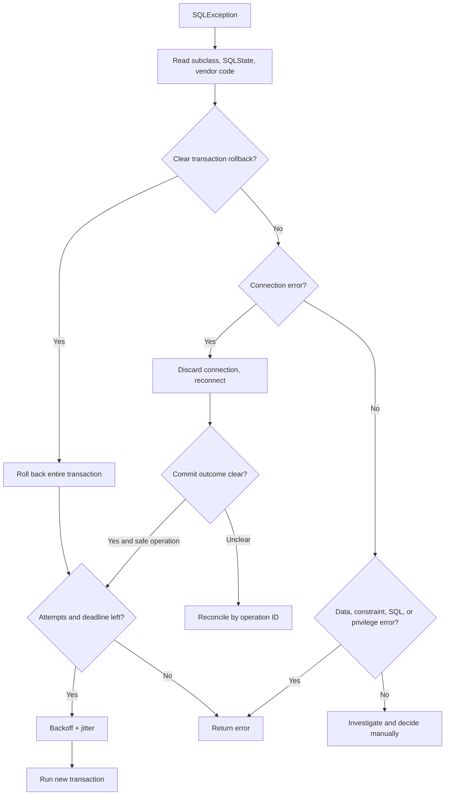

# SQLState, Vendor Error Codes, and Classifying Retryable Errors

When a Java application connects to Oracle Database via JDBC, errors are typically returned as a `SQLException`. To decide whether an operation should be retried, the application needs to read at least three pieces of information: SQLState, vendor error code, and the specific exception subclass. With Oracle JDBC, the vendor error code usually identifies Oracle errors such as deadlocks, constraint violations, or connection failures; SQLState provides a general error group according to JDBC/SQL conventions.

Do not treat every SQL error as retryable. Timeouts or lost connections may be transient, whereas bad data, missing privileges, invalid SQL, or unique key violations will not disappear on their own upon retry. Even when an error appears transient, retries must occur at the proper transaction boundary and guarantee no duplicate data is created.

This lesson focuses on reading error details from JDBC, understanding SQLState groups, using Oracle error codes, classifying transient vs. permanent errors, and designing safe retries for transactions and integration flows.

## 1. SQLException and diagnostic details

Key methods of `SQLException` include:

| Method | Return value | Meaning |
|---|---|---|
| `getMessage()` | String | Human-readable error message; may contain Oracle text such as ORA-00060 |
| `getSQLState()` | String or `null` | SQL/JDBC-standard status code, typically 5 characters |
| `getErrorCode()` | int | JDBC vendor-specific error code; for Oracle, typically the numeric Oracle error code, or 0 if the driver provides no specific code |
| `getNextException()` | `SQLException` or `null` | Next exception in the JDBC error chain |
| `getCause()` | `Throwable` or `null` | Nested Java exception cause |

Example catching errors and printing basic details:

```java
try (Connection connection = dataSource.getConnection();
     PreparedStatement statement =
         connection.prepareStatement(
             "INSERT INTO employees(employee_id, last_name) VALUES (?, ?)")) {

    statement.setLong(1, 1001L);
    statement.setString(2, "Nguyen");
    statement.executeUpdate();

} catch (SQLException e) {
    System.err.println("Message: " + e.getMessage());
    System.err.println("SQLState: " + e.getSQLState());
    System.err.println("Vendor code: " + e.getErrorCode());
    throw new RuntimeException("Database operation failed", e);
}
```

With Oracle JDBC, `getErrorCode()` typically returns the numeric portion of the ORA code. For example, ORA-00060 normally has vendor code `60`, and ORA-00001 has code `1`. When logging, you may format it with an ORA prefix and zero-padding for readability, but in code compare integers or centrally managed constants.

Do not rely solely on parsing `getMessage()` text to identify errors. Message wording can vary by language, version, driver, or context. SQLState and vendor code are more structured data; still combine them with exception type, transaction state, and business context.

### A single SQLException can contain multiple errors

JDBC lets drivers chain multiple exceptions together. Thus, checking only the first exception can miss important errors inside `getNextException()`.

Example traversing the exception chain:

```java
static void logSqlExceptionChain(SQLException exception) {
    int index = 0;

    for (SQLException current = exception;
         current != null;
         current = current.getNextException()) {

        System.err.println("SQL exception #" + index);
        System.err.println("  message = " + current.getMessage());
        System.err.println("  SQLState = " + current.getSQLState());
        System.err.println("  vendorCode = " + current.getErrorCode());

        index++;
    }
}
```

Some drivers also attach the underlying cause in `getCause()`. When investigating connection failures, inspect both the SQLException chain and the cause chain to locate the initial I/O or network failure. Never log full payloads, passwords, tokens, or personal data purely for diagnostics.

## 2. What is SQLState?

SQLState is a structured status code used by JDBC to categorize errors by SQL convention. Codes normally consist of five characters:

- The first two characters are the **class**, indicating the general error category.
- The next three characters are the **subclass**, describing a more specific error within that category.

For instance, a SQLState starting with `23` typically indicates an integrity constraint violation. A SQLState starting with `08` belongs to the connection exception class. A SQLState starting with `40` belongs to the transaction rollback class.

SQLState is helpful when writing logic intended to work across multiple databases or JDBC drivers. However, drivers may map database-specific errors to SQLState differently; some vendor errors lack a standard mapping or return `null`. Therefore, never assume every ORA code maps to a single identical SQLState across every driver version.

### Common SQLState classes

| Class | Error group | How to interpret when handling |
|---|---|---|
| `00` | Success | Not an error; normally does not appear as a SQLException |
| `01` | Warning | Inspect SQLWarning if needed; not necessarily an operation failure |
| `02` | No data | Depends on operation and business logic; do not retry by default |
| `08` | Connection exception | May need to discard current connection and reconnect; verify transaction outcome |
| `0A` | Feature not supported | Usually configuration or driver/database capability issue; do not retry immediately |
| `22` | Data exception | Usually caused by bad values or conversion; fix data source or mapping |
| `23` | Integrity constraint violation | Usually does not resolve on retry; check keys and data rules |
| `24` | Invalid cursor state | Check ResultSet/cursor lifecycle and statement usage |
| `25` | Invalid transaction state | Check transaction boundaries and connection state |
| `28` | Invalid authorization specification | Check credentials, account, and privileges; do not hammer retries |
| `40` | Transaction rollback | May need to re-run the entire transaction if determined transient |
| `42` | Syntax error or access rule violation | Fix SQL, objects, or privileges; usually do not retry |
| `HY` | General driver-defined error class | Inspect subclass, vendor code, and driver-specific details |

These classes provide a general grouping. A production application should verify against the documentation of the JDBC driver in use and actual Oracle Database error logs. Do not take a subclass code from another DBMS and apply it verbatim to Oracle.

### Example checking SQLState by class

```java
static String sqlStateClass(SQLException exception) {
    String state = exception.getSQLState();

    if (state == null || state.length() < 2) {
        return "UNKNOWN";
    }

    return state.substring(0, 2);
}

static boolean isConnectionClass(SQLException exception) {
    return "08".equals(sqlStateClass(exception));
}

static boolean isTransactionRollbackClass(SQLException exception) {
    return "40".equals(sqlStateClass(exception));
}
```

Checking class helps establish general policy, yet is insufficient on its own to decide on retries. For example, a connection error occurring before sending a command differs from a connection error occurring right while `COMMIT` is in flight. The latter leaves the application unsure whether the transaction committed.

## 3. Oracle vendor error codes

A vendor error code is a database- or driver-specific error code. With Oracle JDBC, `getErrorCode()` typically returns the numeric Oracle code matching the ORA error. This code lets applications identify specific errors that generic SQLState values cannot fully distinguish.

Examples:

| Oracle message | Common vendor code | Meaning |
|---|---:|---|
| ORA-00001 | 1 | Unique constraint violated |
| ORA-00054 | 54 | Resource busy and acquire with NOWAIT/timeout expired |
| ORA-00060 | 60 | Deadlock detected while waiting for resource |
| ORA-01013 | 1013 | User or client requested cancel of current operation |
| ORA-01017 | 1017 | Invalid username/password |
| ORA-01400 | 1400 | Cannot insert NULL into NOT NULL column |
| ORA-01722 | 1722 | Invalid number |
| ORA-00942 | 942 | Table or view does not exist, or insufficient privileges |
| ORA-08177 | 8177 | Cannot serialize access for this transaction |
| ORA-12541 | 12541 | No listener at specified endpoint |
| ORA-12170 | 12170 | Connect timeout occurred |
| ORA-03113 | 3113 | End-of-file on communication channel |
| ORA-03114 | 3114 | Not connected to Oracle |
| ORA-01555 | 1555 | Snapshot too old due to insufficient undo |

This table guides investigation. Exact meaning and behavior can depend on Oracle version, driver, configuration, and timing of the error. An error code alone does not dictate whether to retry; determine which phase failed and what effects the transaction already produced.

### SQLState and vendor code complement each other

Suppose an application hits ORA-00060:

- Vendor code `60` identifies the specific Oracle deadlock error.
- SQLState, if mapped by the driver, provides the general transaction rollback group.
- Exception class may be `SQLTransactionRollbackException` or a plain `SQLException` depending on the driver.
- Business logic decides whether the transaction can be re-executed and from which boundary it must restart.

Relying solely on SQLState can lose Oracle-specific diagnostic detail. Relying solely on vendor codes couples logic tightly to Oracle and makes reuse across other databases harder. Combining both is usually best: SQLState and exception subclasses for general classification, and vendor codes for Oracle-specific cases.

## 4. SQLException subclasses in JDBC

JDBC defines several exception subclasses to describe the nature of an error. Drivers may use these classes to give applications clearer signals.

| Exception class | Meaning | Common handling approach |
|---|---|---|
| `SQLTransientException` | Transient error; operation may succeed if retried without changing input | Review transaction and retry within bounds |
| `SQLTransientConnectionException` | Transient connection failure | Acquire new connection, then retry only when safe |
| `SQLNonTransientException` | Error not expected to clear on retry | Fix data, SQL, or configuration |
| `SQLNonTransientConnectionException` | Connection failure considered non-transient by driver | Discard broken connection, investigate root cause; do not retry blindly |
| `SQLRecoverableException` | Error recoverable by closing current connection, obtaining a new one, and retrying appropriate transaction | Open new connection and re-run transaction safely |
| `SQLTransactionRollbackException` | Transaction rolled back due to transaction processing failure | Whole transaction may be retried |
| `SQLTimeoutException` | Operation exceeded time limit | Verify outcome and safety before retrying |
| `SQLIntegrityConstraintViolationException` | Constraint violation | Check data and business state |
| `SQLDataException` | Data conversion or value error | Fix data or mapping |
| `SQLSyntaxErrorException` | SQL syntax or access error | Fix SQL, objects, or privileges |
| `SQLInvalidAuthorizationSpecException` | Authentication error | Fix credentials or security configuration |

These classes serve as JDBC classification signals. Not every Oracle JDBC version maps every ORA error to a specific subclass. Applications should keep fallback branches based on SQLState and vendor codes, while logging the actual exception.

### Example checking exception types

```java
if (exception instanceof SQLTransactionRollbackException) {
    // Transaction was rolled back; consider retrying the whole transaction.
} else if (exception instanceof SQLRecoverableException) {
    // Close current connection, acquire a new connection,
    // then retry only if the operation can run safely.
} else if (exception instanceof SQLIntegrityConstraintViolationException) {
    // Investigate data or business state.
} else {
    // Fall back to SQLState, vendor code, and context.
}
```

Checking order matters because some classes extend others. For instance, `SQLTransientConnectionException` is a subclass of `SQLTransientException`; if connection failures need distinct handling, check the more specific subclass before the general superclass.

## 5. Classifying retryable errors

In practice, group errors into actionable categories rather than just binary retry vs. no-retry.

### Errors where the transaction can be retried

These are errors where the database rejected or rolled back the transaction, and re-running the entire transaction may succeed once temporary contention clears.

Examples:

- ORA-00060: deadlock detected.
- ORA-08177: cannot serialize access for this transaction.
- Certain lock or resource-busy errors such as ORA-00054, if business rules permit waiting and retrying.

For these errors, the application normally must roll back the current transaction, wait with backoff, and re-run the entire unit of work. Never re-run only the final SQL statement if earlier steps in the transaction read or updated related tables.

### Errors requiring reconnection

Connection errors occur when the database listener is unavailable, the network drops, sockets close, or sessions terminate.

Examples:

- ORA-12541: no listener at endpoint.
- ORA-12170: connect timeout.
- ORA-03113 or ORA-03114: communication channel or session lost.
- Driver-level Oracle JDBC I/O errors.

Typical required actions:

1. Mark the current connection untrusted.
2. Close the connection so the connection pool discards or re-validates it per pool mechanics.
3. Obtain a fresh connection once the database service is reachable.
4. Check whether the previous transaction took effect if the failure happened mid-command or during commit.
5. Re-run the operation only after confirming safety.

Not all connection errors are transient. A stopped listener, wrong hostname, wrong port, or firewall block persists until configuration is fixed. Retrying relentlessly only adds load and log noise.

### Errors that should not be retried automatically

These errors generally require fixing inputs, SQL, privileges, or business state:

- ORA-00001: unique key violation.
- ORA-01400: NOT NULL column received NULL.
- ORA-01722: string could not convert to number.
- ORA-00942: object does not exist or insufficient privileges.
- ORA-01017: invalid login credentials.
- SQL syntax errors or wrong object names.
- Business rule violations, such as moving a cancelled order to shipped status.

One special case is duplicate keys. If a request uses an idempotency key and the existing record is the result of a prior submission, the application can verify it and treat the operation as completed. If the duplicate key belongs to another business operation, it is a conflict requiring handling. Never catch ORA-00001 and ignore it without inspecting the existing record.

### Errors requiring investigation before retrying

Some errors may recover under certain conditions yet should not be retried mechanically:

- ORA-01555: a query may succeed if undo conditions change, but query duration and undo retention causes must be addressed.
- ORA-01013: may stem from user cancellation, query timeout, or application cancel; never auto-retry if the operation was intentionally cancelled.
- ORA-00028: session killed by DBA or system; open a new session and investigate why.
- Timeout during commit: commit outcome may be unclear; reconcile state before resubmitting.

## 6. Retry decision table for common Oracle errors

| Error | Suggested category | Should retry? | Conditions |
|---|---|---|---|
| ORA-00060 | Deadlock | Yes, at transaction level | Roll back and re-run entire transaction with backoff |
| ORA-08177 | Serialization conflict | Yes, at transaction level | Start a new transaction and re-read data |
| ORA-00054 | Resource busy | Conditional | Retry only when lock can clear and with bounded attempts |
| ORA-00001 | Unique constraint | Usually no | Treat as success only after verifying idempotency key and existing result |
| ORA-01400 | NOT NULL violation | No | Supply or fix data |
| ORA-01722 | Invalid number | No | Fix data or conversion |
| ORA-00942 | Table/view not found or missing privilege | No | Check schema, objects, and grants |
| ORA-01017 | Invalid credentials | No | Fix credentials; do not loop login attempts |
| ORA-12541 | Listener unavailable | Conditional | Bounded retry after confirming right endpoint and recoverable service |
| ORA-12170 | Connect timeout | Conditional | Check network, listener, and timeout; use backoff |
| ORA-03113/03114 | Session/channel lost | Conditional | Acquire new connection and reconcile transaction state |
| ORA-01013 | Operation cancelled | Usually no | Identify who requested cancel and why |
| ORA-01555 | Snapshot too old | Do not retry blindly | Investigate undo, query duration, and re-run feasibility |

This table is an operational guide, not an absolute rulebook. A connection error can happen before sending a request or after the database committed. Those two cases require different retry decisions despite identical vendor codes.

## 7. Key rule: retry at transaction boundaries

Suppose a transaction performs:

1. Read account balance.
2. Validate transfer eligibility.
3. Debit source account.
4. Credit target account.
5. Insert transfer history.
6. Commit.

If step 4 hits a deadlock, re-running only the credit SQL risks corrupting balances. You must roll back the transaction and re-run the entire workflow from the beginning so conditions are re-evaluated against fresh state.

Transaction structure example:

```java
try (Connection connection = dataSource.getConnection()) {
    connection.setAutoCommit(false);

    try {
        debitSourceAccount(connection, sourceAccount, amount);
        creditTargetAccount(connection, targetAccount, amount);
        insertTransferHistory(connection, transferId, amount);

        connection.commit();
    } catch (SQLException e) {
        try {
            connection.rollback();
        } catch (SQLException rollbackError) {
            e.addSuppressed(rollbackError);
        }
        throw e;
    }
}
```

This example shows transaction boundaries. In real retry code, each attempt needs a fresh transaction and must distinguish errors where rollback is certain from connection drops where commit outcome is unknown.

### Deadlocks and serialization conflicts

When encountering ORA-00060 or ORA-08177, applications should generally:

- Roll back the entire transaction.
- Wait briefly with jitter.
- Open a new transaction.
- Re-read data and re-validate business conditions.
- Re-execute operations from the start.
- Stop after max attempts or deadline.

Do not reuse values read during the prior failed transaction if business conditions depend on mutable data. The fresh transaction must re-evaluate current state.

### Connection failures and unknown commit outcomes

This is the most dangerous retry scenario. The application sends `COMMIT`, but the network drops before receiving the response. Two possibilities exist:

- The database did not commit; the transaction will roll back when the session terminates.
- The database did commit, yet the commit acknowledgment never reached the application.

The application cannot conclude from a socket error alone that the transaction rolled back. Resending an order creation or money transfer command risks executing it twice.

The solution is a unique operation ID or idempotency key. Before executing, record the request under this key; after reconnecting, query status by that key. If already committed, return the existing result; only proceed if not yet executed. For financial workflows, maintain a ledger table or corresponding reconciliation mechanism.

## 8. Exponential backoff, jitter, and retry limits

Retrying too quickly can worsen overload on the database or target service. When many applications retry on identical schedules, they can trigger a retry storm.

Exponential backoff increases wait time across attempts:

\[
delay_n = \min(delay_{max}, delay_{base} \times 2^{n-1})
\]

Example with a 200 ms base interval and a 5-second cap:

| Next attempt | Base wait |
|---:|---:|
| 1 | 200 ms |
| 2 | 400 ms |
| 3 | 800 ms |
| 4 | 1,600 ms |
| 5 | 3,200 ms |
| 6 onward | Max 5,000 ms |

Jitter adds randomness so clients do not retry in lockstep. Full jitter can be used:

\[
delay = random(0, calculatedBackoff)
\]

A retry policy should define:

- Maximum attempt count.
- Maximum total duration (deadline).
- Minimum and maximum backoff delays.
- Jitter.
- Error classes eligible for retry.
- Stop logic or circuit breaker during prolonged unavailability.
- Logging of attempt count and retry reason.

Never retry infinitely. Never retry data or authentication errors simply because a wait interval elapsed. When services return `Retry-After`, respect that hint if compatible with the application's deadline.

## 9. Java error classification example

You can define an enum describing application-level actions:

```java
enum RetryDecision {
    RETRY_TRANSACTION,
    RECONNECT_AND_CHECK,
    DO_NOT_RETRY,
    REVIEW
}
```

The function below demonstrates combining exception subclasses, SQLState classes, and common Oracle vendor codes:

```java
import java.sql.SQLException;
import java.sql.SQLDataException;
import java.sql.SQLIntegrityConstraintViolationException;
import java.sql.SQLRecoverableException;
import java.sql.SQLSyntaxErrorException;
import java.sql.SQLTransactionRollbackException;
import java.sql.SQLTimeoutException;
import java.sql.SQLTransientConnectionException;
import java.sql.SQLTransientException;

static RetryDecision classify(SQLException exception) {
    for (SQLException current = exception;
         current != null;
         current = current.getNextException()) {

        int code = current.getErrorCode();
        String state = current.getSQLState();

        // Deadlock and serialization conflict:
        // roll back then retry the entire transaction.
        if (current instanceof SQLTransactionRollbackException
                || code == 60
                || code == 8177
                || (state != null && state.startsWith("40"))) {
            return RetryDecision.RETRY_TRANSACTION;
        }

        // Errors requiring replacing the connection before further work.
        if (current instanceof SQLRecoverableException
                || current instanceof SQLTransientConnectionException
                || (state != null && state.startsWith("08"))) {
            return RetryDecision.RECONNECT_AND_CHECK;
        }

        // Timeouts do not confirm whether the database executed the operation,
        // especially when occurring during commit.
        if (current instanceof SQLTimeoutException) {
            return RetryDecision.REVIEW;
        }

        // Data, constraint, or syntax errors usually do not clear on retry.
        if (current instanceof SQLIntegrityConstraintViolationException
                || current instanceof SQLDataException
                || current instanceof SQLSyntaxErrorException
                || code == 1
                || code == 1400
                || code == 1722
                || code == 942
                || (state != null && (
                    state.startsWith("22")
                    || state.startsWith("23")
                    || state.startsWith("42")))) {
            return RetryDecision.DO_NOT_RETRY;
        }

        // Other transient errors may retry if transaction
        // and business state permit.
        if (current instanceof SQLTransientException) {
            return RetryDecision.RETRY_TRANSACTION;
        }
    }

    return RetryDecision.REVIEW;
}
```

This is an illustrative skeleton, not an exhaustive classifier for every Oracle release. Before production use, add error codes specific to your system, test on your exact Oracle JDBC driver, and isolate timeout/connection errors occurring during commit. Never place every `08` error into automatic retry without checking transaction outcome.

The classifier should not execute retries itself. Separating classification from retry execution keeps code testable, logging clear, and prevents multiple layers from retrying the same exception.

## 10. Bounded transaction retry loop example

For confirmed transaction rollback errors, the whole transaction can be retried. The example below illustrates the structure; `TransferWork` is an application-defined interface:

```java
@FunctionalInterface
interface TransferWork<T> {
    T execute(Connection connection) throws SQLException;
}

static <T> T executeWithTransactionRetry(
        DataSource dataSource,
        TransferWork<T> work,
        int maxAttempts) throws SQLException {

    SQLException lastError = null;

    for (int attempt = 1; attempt <= maxAttempts; attempt++) {
        try (Connection connection = dataSource.getConnection()) {
            connection.setAutoCommit(false);

            try {
                T result = work.execute(connection);
                connection.commit();
                return result;

            } catch (SQLException e) {
                try {
                    connection.rollback();
                } catch (SQLException rollbackError) {
                    e.addSuppressed(rollbackError);
                }
                throw e;
            }

        } catch (SQLException e) {
            lastError = e;
            RetryDecision decision = classify(e);

            if (decision != RetryDecision.RETRY_TRANSACTION
                    || attempt == maxAttempts) {
                throw e;
            }

            sleepWithBackoff(attempt);
        }
    }

    throw lastError;
}
```

`sleepWithBackoff` must handle interrupts properly and include jitter. Example:

```java
static void sleepWithBackoff(int attempt) throws SQLException {
    long baseMillis = 200L;
    long maxMillis = 5000L;

    int exponent = Math.min(attempt - 1, 10);
    long calculated = Math.min(
        maxMillis,
        baseMillis * (1L << exponent)
    );

    long delay = java.util.concurrent.ThreadLocalRandom
        .current()
        .nextLong(calculated + 1);

    try {
        Thread.sleep(delay);
    } catch (InterruptedException e) {
        Thread.currentThread().interrupt();
        throw new SQLException("Retry interrupted", e);
    }
}
```

This example only retries `RETRY_TRANSACTION`. If `commit()` throws a connection error, never treat it by default as a transaction rollback error. Commit outcome may be uncertain; return `RECONNECT_AND_CHECK`, obtain a fresh connection, and reconcile by operation ID before re-running.

Production code also needs an overall deadline, bounded pool acquisition wait time, telemetry per retry attempt, and clean thread-interruption handling.

## 11. BatchUpdateException and JDBC batch handling

When using JDBC batching, an error can occur after part of the batch has already executed. `BatchUpdateException` exposes `getUpdateCounts()` so applications can inspect driver-reported update counts.

Common values:

- Non-negative integer: number of rows updated by the corresponding statement.
- `Statement.SUCCESS_NO_INFO` (`-2`): statement succeeded, but driver did not provide an exact row count.
- `Statement.EXECUTE_FAILED` (`-3`): statement failed in a batch where the driver continued processing subsequent items after an error.

Example:

```java
try {
    int[] counts = statement.executeBatch();

    for (int i = 0; i < counts.length; i++) {
        System.out.println("Item " + i + ": " + counts[i]);
    }

} catch (BatchUpdateException e) {
    int[] counts = e.getUpdateCounts();

    for (int i = 0; i < counts.length; i++) {
        System.err.println("Item " + i + ": " + counts[i]);
    }

    SQLException next = e.getNextException();
    while (next != null) {
        System.err.println(
            next.getErrorCode() + " / " + next.getSQLState()
            + " / " + next.getMessage()
        );
        next = next.getNextException();
    }

    throw e;
}
```

Drivers may stop a batch at the first error or continue depending on behavior and configuration. Therefore, never assume the update counts array always has one element for every command added via addBatch. With auto-commit off, the application can roll back the entire batch to preserve atomicity. If partial commits are acceptable by design, track per-record status and re-run only failed items.

Never blindly retry an entire batch if some items already committed. Identify which transaction the batch ran in, check update counts, and enforce per-record idempotency.

## 12. Connection pools and connection failures

Java applications normally borrow connections from a connection pool such as UCP or another standard pool. When an I/O error renders a connection unusable, the application must let the pool evict or re-validate that connection via pool mechanics.

Principles:

- Stop using a connection after serious connection errors.
- Close connections in `finally` or try-with-resources to return them to the pool.
- Configure appropriate validation, without treating validation as a guarantee the connection won't drop immediately afterward.
- Configure connect timeout, socket/read timeout, and pool acquisition timeout.
- Monitor active connections, idle connections, waiters, and connection-creation failures.
- Avoid creating a new pool per retry; use an application-managed pool.
- During database maintenance or failover, use bounded retries and circuit breakers to prevent request pile-ups.

`SQLRecoverableException` is a useful signal: JDBC specifies closing the current connection, obtaining a new connection, and retrying an appropriate transaction. However, if the failure occurs at commit, still handle the possibility that commit succeeded before connection loss.

## 13. Logging and observability

A useful JDBC error log entry should include:

- Application name, service, module, and driver version.
- Timestamp and correlation ID.
- Operation or repository method name.
- SQLState, vendor error code, and exception class.
- ORA code or message scrubbed of sensitive data.
- Retry attempt count, backoff delay, and classification decision.
- Transaction phase: before execute, during execute, before commit, or during commit.
- Masked/hashed business key or batch ID per data policy.
- Database service and connection pool state if available.

Never log passwords, access tokens, connection URLs containing secrets, sensitive bind values, or personal data.

Structured log example:

```text
event=jdbc_failure
operation=transfer
correlation_id=9d5...
sql_state=40001
vendor_code=8177
exception=SQLTransactionRollbackException
phase=EXECUTE
attempt=2
decision=RETRY_TRANSACTION
delay_ms=430
```

Monitor error rates by vendor code and SQLState, retry success rate, average retry count, retry wait time, threshold-exceeding errors, and operations with indeterminate commit outcomes. A system whose retries succeed only after many attempts still suffers from contention or infrastructure issues.

## 14. Common mistakes

**Retrying every SQLException.**  
Syntax, data, privilege, and constraint errors do not resolve on their own. Blind retries add load, prolong incidents, and create duplicate data.

**Checking only getMessage().**  
Messages can change. Use SQLState, vendor codes, exception subclasses, and exception chains.

**Checking only the first exception.**  
Drivers can chain multiple exceptions via `getNextException()`. Traverse the whole chain when investigating.

**Retrying only the failed statement.**  
For deadlocks or serialization conflicts, the transaction may need to roll back and restart from the beginning to re-read data and re-check conditions.

**Retrying connection errors right after commit without reconciling.**  
The database may have committed without the client receiving the reply. Use operation IDs or idempotency keys to verify outcomes.

**Catching errors and swallowing them.**  
If SQLException is caught without rethrowing or recording failure state, callers may assume the task succeeded.

**Unbounded retry counts.**  
Infinite retries can exhaust connection pools, overload the database, and delay detection of misconfigurations.

**Using vendor codes as a universal standard across databases.**  
Vendor codes are driver-specific. When supporting multiple DBMSs, use SQLState and application abstractions while keeping adapters for each vendor's error codes.

## 15. Decision workflow for retrying

When catching a SQLException, follow this sequence:

1. Traverse the exception chain and causes to gather full context.
2. Read exception subclass, SQLState, and vendor code.
3. Identify the failure phase: acquiring connection, execute, fetch, commit, or rollback.
4. Classify the error as transaction rollback, connection failure, data/constraint, syntax/privilege, or unknown.
5. For confirmed transaction rollbacks, roll back and retry the entire transaction within bounds.
6. For broken connections, discard the connection and acquire a new one; if commit outcome is unclear, reconcile first.
7. For data, constraint, syntax, or authentication errors, halt automatic retries and fix root causes.
8. Apply backoff, jitter, max attempts, and deadline to retryable errors.
9. Log the decision, attempt count, and final outcome.
10. Enforce idempotency so re-executed operations never create duplicate side effects.

Illustrated as a flowchart:



## 16. Retry implementation checklist in Oracle JDBC

- [ ] Log SQLState, vendor error code, exception class, and scrubbed error messages.
- [ ] Traverse `getNextException()` and cause chains when investigating.
- [ ] Do not assume Oracle JDBC always maps every ORA code to the same SQLState or exception subclass.
- [ ] Build a vendor code classification table aligned with your actual Oracle and driver versions.
- [ ] Distinguish transaction rollback errors from connection failures.
- [ ] Retry the entire transaction for deadlocks or serialization conflicts when business rules permit.
- [ ] Discard broken connections and acquire fresh ones after connection failures.
- [ ] Reconcile outcomes when errors occur during or right after commit.
- [ ] Never auto-retry data, constraint, syntax, or authentication errors.
- [ ] Use idempotency keys, business keys, or operation IDs for retryable operations.
- [ ] Bound retry attempts, total duration, backoff, and jitter.
- [ ] Monitor retry success rates, recurring errors, and connection pool health.
- [ ] Test deadlocks, timeouts, connection drops, duplicate keys, and indeterminate commit outcomes in test environments.
- [ ] Maintain runbooks for threshold-breaching errors and operations requiring manual reconciliation.

SQLState identifies the error group under SQL/JDBC conventions, vendor error codes pinpoint Oracle-specific errors, and exception subclasses add signals regarding transience or recoverability. All three sources of information must be evaluated alongside the transaction phase and business state. Safe retries mean more than re-running on error: the application must roll back at proper boundaries, open fresh connections when needed, verify indeterminate commit outcomes, enforce idempotency, and bound retry attempts to protect both data and systems.
