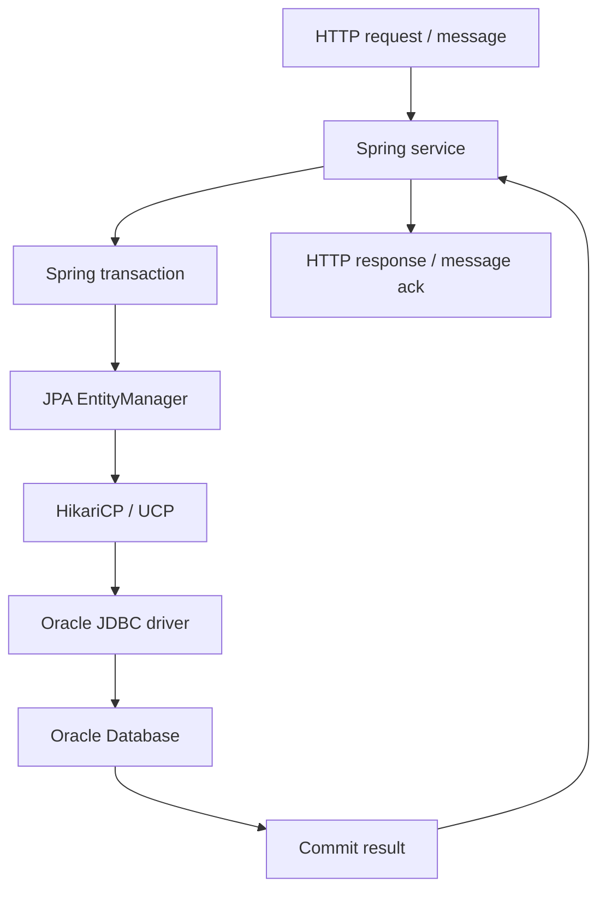
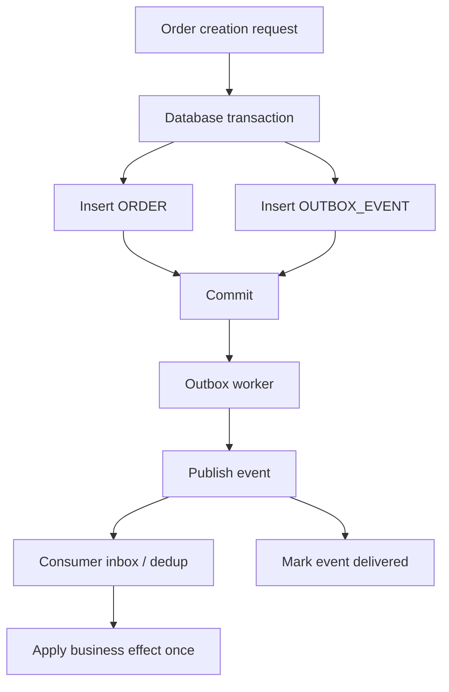

# Recovering Connections After Failures and Preventing Duplicate Business Transactions

In a Spring Boot application using JPA with Oracle Database, connection failures can happen during database restarts or failovers, temporary listener outages, network interruptions, expired pooled connections, or query timeouts. When that happens, the application must restore database connectivity while guaranteeing that business transactions are never executed twice.

These two goals are closely linked yet distinct:

- **Connection recovery:** evicting broken connections, obtaining fresh connections once the database is ready, and handling interrupted transactions properly.
- **Duplicate prevention:** recognizing whether a request has already been processed so retries never create duplicate orders, duplicate payments, double inventory deductions, or duplicate events.

A connection pool can open new connections and Spring can classify exceptions and retry transactions, but those mechanisms do not automatically ensure business correctness. The application must design transaction boundaries, idempotency keys, processing states, and reconciliation workflows for ambiguous commit outcomes.

## 1. Failure Points Along a Request Path

A request from the application to Oracle typically traverses multiple layers:

1. Controller or message listener receives the business request.
2. Service validates rules and calls repositories.
3. Spring transaction manager starts or joins a transaction.
4. JPA/Hibernate obtains a JDBC connection from the DataSource.
5. Connection pool issues a connection.
6. JDBC driver sends SQL to Oracle over Oracle Net.
7. Oracle executes statements and persists the transaction.
8. Application commits, receives the outcome, and returns a response.

General flow:



Failures can occur at any segment. A connection can drop during a `SELECT`, an `UPDATE`, or right when sending `COMMIT`. Each point in time carries different implications:

| Failure Timing | What the Application Can Know | Action to Consider |
|---|---|---|
| Before obtaining a connection | No SQL was sent in that transaction yet | Retry acquiring a connection within limits |
| While reading data | Current query failed; transaction may be unusable | Discard bad connection and retry read unit if appropriate |
| While writing data before commit | Transaction outcome is likely incomplete | Roll back if still connected; if session lost, check state before retrying |
| During commit | Application may not know whether the DB committed | Reconcile via operation ID or idempotency key |
| After commit but before sending response | Database succeeded, yet client may assume failure | Retried requests must return the stored outcome, not create new work |

The hardest case is an error occurring during commit or after commit before the client receives the response. That is the ambiguity window where the application loses certainty about the actual outcome.

## 2. Connection Pools and Connection Recovery

### What Does a Connection Pool Do?

Spring Boot normally configures a pooled DataSource. HikariCP is the common default in Spring Boot applications unless replaced with another pool. With Oracle, applications can also use Oracle Universal Connection Pool (UCP) when Oracle-specific integrations are required.

The pool keeps JDBC connections ready for reuse. When a service starts a transaction, Hibernate/JPA requests a connection from the DataSource; the pool supplies a free connection or waits/creates one within configured bounds.

A pool helps:

- Avoid opening a new physical connection for every SQL statement.
- Cap concurrent database sessions.
- Detect certain invalid connections.
- Bound wait times when acquiring connections.
- Reclaim connections when the application shuts down or transactions end.

A pool cannot guarantee a connection stays alive after being handed out. The network can drop right after validation, or the database can restart mid-query. Therefore, applications still need error handling when using connections.

### Configuring HikariCP in Spring Boot

Basic configuration example in `application.yml`:

```yaml
spring:
  datasource:
    url: jdbc:oracle:thin:@//dbhost.example.com:1521/ORCLPDB1
    username: app_user
    password: SECRET_INJECTED_AT_RUNTIME
    hikari:
      pool-name: OracleAppPool
      maximum-pool-size: 20
      minimum-idle: 5
      connection-timeout: 30000
      validation-timeout: 5000
      idle-timeout: 600000
      max-lifetime: 1700000
      keepalive-time: 300000
```

Key parameters to understand:

| Property | Meaning | Operational Notes |
|---|---|---|
| `maximum-pool-size` | Maximum connections in the pool | Must fit Oracle session limits and app instance count |
| `minimum-idle` | Minimum idle connections the pool tries to maintain | Setting too high holds unnecessary idle sessions |
| `connection-timeout` | Max wait to borrow a connection from the pool | Exceeding throws borrow timeout; not a SQL timeout |
| `validation-timeout` | Max time allowed for connection validation | Must be smaller than `connection-timeout` |
| `idle-timeout` | Time excess connections sit idle before eviction | Does not act as a query timeout |
| `max-lifetime` | Maximum lifetime of a connection in the pool | Should be lower than limits enforced by DB, proxy, or network |
| `keepalive-time` | Interval to probe/keep idle connections alive | Applies only to idle connections; must be below `max-lifetime` |

Values above are illustrative only. Tune them according to session limits, firewall/load balancer timeouts, Oracle Net settings, failover times, and real load.

HikariCP uses JDBC4 `Connection.isValid()` when supported. Do not set `connectionTestQuery` if the driver works properly with JDBC4; only use it for explicit compatibility needs.

`max-lifetime` does not guarantee connections survive forever. If a firewall kills connections after 30 minutes of inactivity, configure the pool to retire them earlier. `keepalive-time` helps catch dead idle connections, though it cannot protect an in-flight connection during an outage.

### Validating a Connection Does Not Guarantee Delivery

A connection can pass validation and break milliseconds later. Thus:

- Validation lowers the probability of issuing a dead connection.
- Pool timeouts cap wait time for a connection.
- JDBC exceptions signal that an operation failed.
- Application-layer retries decide whether to re-attempt.
- Idempotency protects business effects when prior outcomes are unknown.

Never treat a passing health check query as proof that the next request is guaranteed to succeed.

## 3. What Happens to a JPA Transaction on Connection Loss?

### EntityManager and Persistence Context

JPA's `EntityManager` manages the persistence context—the set of entities tracked during a unit of work. In Spring, the `EntityManager` is usually transaction-scoped and bound to the current thread by the transaction manager.

Never:

- Store an `EntityManager` in a static field or singleton to reuse across requests.
- Use the same `EntityManager` concurrently from multiple threads.
- Keep using a persistence context after a transaction has rolled back or been marked rollback-only.
- Retain entities loaded in a failed transaction and assume their state matches the database after reconnecting.

After a serious database error, the current transaction usually cannot continue as though nothing happened. Hibernate marks the transaction rollback-only or the persistence context becomes unreliable. Let the transaction end, release resources, and start a brand-new transaction with a fresh persistence context.

### Rollback-Only Transactions

When a persistence error occurs, the transaction manager or provider may mark the transaction rollback-only. Even if the application catches the exception inside the method and keeps running, commit will throw `UnexpectedRollbackException` or another persistence error.

Anti-pattern to avoid:

```java
@Transactional
public void processOrder(Long orderId) {
    try {
        orderRepository.updateStatus(orderId, "PAID");
    } catch (DataAccessException ex) {
        // Swallows error and keeps using the same transaction.
        log.warn("Update failed", ex);
    }

    // Transaction may already be marked rollback-only.
    invoiceRepository.createFor(orderId);
}
```

If the update is mandatory, let the error exit the transaction and handle retries in an outer layer. If the error affects only one record and business rules allow continuing, isolate each record in its own transaction, record failure states, and define batch completion criteria.

### Do Not Just Replay a Single Repository Method

A business transaction typically spans multiple interrelated steps. Retrying only the single failed SQL statement can produce inconsistent state.

For example, paying an order may include:

1. Checking that the order is still awaiting payment.
2. Recording the payment.
3. Updating order status.
4. Writing a ledger or transaction history entry.
5. Committing.

If step 3 hits a serialization error, roll back and re-run the entire transaction per business rules. Replaying only the status update skips initial checks and earlier state changes.

## 4. Distinguishing Connection Errors, Transaction Errors, and Business Errors

Spring translates many JDBC/JPA errors into the `DataAccessException` hierarchy, letting services handle errors at a cleaner abstraction than raw `SQLException`. Still, exact exception classes depend on Hibernate, the Oracle JDBC driver, and propagation paths.

| Category | Common Examples | Action |
|---|---|---|
| Cannot acquire connection | `CannotGetJdbcConnectionException`, `DataAccessResourceFailureException` | Check DB/pool; bounded retry if service is recoverable |
| Connection lost mid-operation | `DataAccessResourceFailureException`, `RecoverableDataAccessException`, or provider exceptions | Evict bad connection; verify transaction outcome before retrying |
| Concurrency rollback | `PessimisticLockingFailureException`, `CannotAcquireLockException`, `CannotSerializeTransactionException` per provider | Roll back and consider retrying entire transaction |
| Data integrity violation | `DataIntegrityViolationException` | Fix data or handle conflict; do not retry blindly |
| Bad syntax or mapping | `InvalidDataAccessResourceUsageException`, Hibernate mapping errors | Fix SQL, JPQL, schema, or mappings |
| Timeouts | `QueryTimeoutException`, `TransactionTimedOutException`, or driver errors | Determine how far execution got; do not retry blindly |
| Programming or state errors | `IllegalArgumentException`, `EntityNotFoundException` per context | Fix code or data; do not auto-retry |

Some errors arrive wrapped inside `JpaSystemException` or `DataAccessException`. Inspect the full cause chain along with root `SQLException` `SQLState` and vendor error codes when classifying.

### Errors Typically Safe to Retry

Consider retrying once you confirm the transaction rolled back or had no effect:

- Deadlocks, such as Oracle `ORA-00060`.
- Serialization conflicts, such as `ORA-08177` under matching isolation levels.
- Certain lock timeouts/resource busy errors, if business rules permit waiting and retrying.
- Connection acquisition failures before transaction work starts, while the database is recovering and the endpoint is valid.

### Errors That Should Never Auto-Retry

- Unique constraint violations from duplicate data.
- `NULL` inserted into `NOT NULL` columns.
- Invalid data types, dates, or numbers.
- Missing tables, views, sequences, or privileges.
- Wrong username/password.
- Business state violations.
- Request validation errors.

A duplicate key sometimes means an earlier attempt already succeeded. Query the existing record by idempotency key to verify and return the stored result. Never blindly catch `DataIntegrityViolationException` and treat every case as success.

### Errors with Indeterminate Outcomes

Losing connectivity during commit is special. The application may miss the response even though Oracle committed successfully. Never inspect `DataAccessResourceFailureException` alone and immediately resubmit a new order creation.

Use an operation ID or idempotency key to reconcile. Without a stable identifier, the application cannot reliably distinguish a brand-new request from a retry of an already-committed request.

## 5. Placing Retries Outside the Transaction

A core rule is that every retry attempt must run in a brand-new transaction. Once an old transaction fails or becomes rollback-only, never reuse it.

Use a non-transactional service facade calling a separate `@Transactional` bean. Each call to the transactional bean crosses the Spring proxy and opens a fresh transaction.

Example:

```java
@Service
public class OrderRetryFacade {

    private final OrderTransactionService transactionService;

    public OrderRetryFacade(OrderTransactionService transactionService) {
        this.transactionService = transactionService;
    }

    public OrderResult payOrder(PayOrderCommand command) {
        int maxAttempts = 3;

        for (int attempt = 1; attempt <= maxAttempts; attempt++) {
            try {
                return transactionService.payOrder(command);
            } catch (TransientDataAccessException ex) {
                if (attempt == maxAttempts) {
                    throw ex;
                }

                sleepWithBackoff(attempt);
            }
        }

        throw new IllegalStateException("Unreachable");
    }

    private void sleepWithBackoff(int attempt) {
        // Illustration: add jitter and a deadline in production code.
    }
}
```

Transactional worker bean:

```java
@Service
public class OrderTransactionService {

    private final OrderRepository orderRepository;
    private final PaymentRepository paymentRepository;

    public OrderTransactionService(
            OrderRepository orderRepository,
            PaymentRepository paymentRepository) {
        this.orderRepository = orderRepository;
        this.paymentRepository = paymentRepository;
    }

    @Transactional
    public OrderResult payOrder(PayOrderCommand command) {
        Order order = orderRepository.findById(command.orderId())
            .orElseThrow(() -> new OrderNotFoundException(command.orderId()));

        // Check state and apply changes within the transaction.
        // Payment must have a unique business key/idempotency key.
        Payment payment = paymentRepository.createIfAbsent(
            command.idempotencyKey(),
            order,
            command.amount()
        );

        order.markPaid(payment.getId());
        return OrderResult.from(order, payment);
    }
}
```

Here, the facade and transaction service are separate beans. The facade should be invoked without an enclosing outer transaction; each call through the Spring proxy then opens a new transaction for `payOrder`. If a caller already has an open transaction, default `REQUIRED` propagation joins that transaction instead. When an independent transaction is mandatory, consider `REQUIRES_NEW` per business semantics. Putting a retry loop inside the same `@Transactional` method shares one rollback-only transaction across attempts—an unsafe structure.

`TransientDataAccessException` is only one classification example. Not every connection error is wrapped in it by Spring, and not every transient error is safe to retry. Production systems need an explicit classifier checking the cause chain, `SQLState`, vendor codes, and transaction phase.

### Self-Invocation and Proxies

Spring typically enforces `@Transactional` via proxies. When one method in a class calls another method on the same object (`this`), the internal call (self-invocation) bypasses the proxy, so the inner annotation is ignored.

Therefore:

- Place the transactional worker in a separate bean.
- Or use `TransactionTemplate` for explicit transaction control.
- Never rely on a `private` method annotated with `@Transactional` to open a new transaction.
- Specify propagation and transaction managers explicitly when multiple DataSources exist.

## 6. Combining RetryTemplate with TransactionTemplate

When you need explicit guarantees that every retry runs in a new transaction, combine Spring Retry with `TransactionTemplate`. `RetryTemplate` wraps the outside; each callback run opens a fresh transaction.

Configuration example:

```java
@Configuration
public class RetryConfiguration {

    @Bean
    RetryTemplate databaseRetryTemplate() {
        return RetryTemplate.builder()
            .maxAttempts(3)
            .exponentialBackoff(200, 2.0, 2000)
            .retryOn(TransientDataAccessException.class)
            .build();
    }
}
```

Service using both templates:

```java
import org.springframework.transaction.TransactionDefinition;

@Service
public class RetryingOrderService {

    private final RetryTemplate retryTemplate;
    private final TransactionTemplate transactionTemplate;
    private final OrderRepository orderRepository;

    public RetryingOrderService(
            RetryTemplate retryTemplate,
            PlatformTransactionManager transactionManager,
            OrderRepository orderRepository) {
        this.retryTemplate = retryTemplate;
        this.transactionTemplate =
            new TransactionTemplate(transactionManager);
        this.transactionTemplate.setPropagationBehavior(
            TransactionDefinition.PROPAGATION_REQUIRES_NEW
        );
        this.orderRepository = orderRepository;
    }

    public OrderResult updateOrder(UpdateOrderCommand command) {
        return retryTemplate.execute(context ->
            transactionTemplate.execute(status -> {
                Order order = orderRepository.findById(command.orderId())
                    .orElseThrow();

                order.apply(command);
                return OrderResult.from(order);
            })
        );
    }
}
```

In this structure, `RetryTemplate.execute` wraps `TransactionTemplate.execute`. When the transaction callback throws, `TransactionTemplate` rolls back and propagates the error outward. `RetryTemplate` then decides whether to retry. `PROPAGATION_REQUIRES_NEW` ensures each callback runs in an independent transaction even if the caller already holds one, suspending the outer transaction while the callback executes. Use this only when independent commits match business requirements.

This illustrates the structure; align dependencies and builder APIs with your Spring Retry version. If using Spring Retry annotations, configure `@EnableRetry` and check advisor ordering between retry and transaction interceptors. Separate beans or templates make transaction boundaries easier to reason about.

Never retry every `RuntimeException`. Validation errors, bad input, and programming bugs will not heal by waiting.

## 7. Idempotency Keys to Prevent Duplicate Business Transactions

### Concept

Idempotency means sending the same request multiple times produces no duplicate business effects. For a payment request, the client generates a unique idempotency key and includes it on every retry.

Example:

- First request: key `pay-2026-000123`.
- Server records the key alongside the transaction result in the database.
- Connection drops before the client receives the response.
- Client resends with the exact same key.
- Server finds the completed record and returns the stored response.

If the client sends a new key, the server treats it as a new payment request. Clients must reuse the same key for the same logical operation.

### Idempotency Table

A simple table:

```sql
CREATE TABLE idempotency_record (
    idempotency_key VARCHAR2(100) PRIMARY KEY,
    request_hash    VARCHAR2(128) NOT NULL,
    status          VARCHAR2(20) NOT NULL,
    response_code   NUMBER,
    response_body   CLOB,
    created_at      TIMESTAMP WITH TIME ZONE DEFAULT SYSTIMESTAMP,
    completed_at    TIMESTAMP WITH TIME ZONE
);
```

`request_hash` detects when the same key arrives with a different payload. If payloads mismatch, the server returns a conflict instead of erroneously returning another request's response.

Within the same business transaction:

1. Register the idempotency key.
2. Check if the key already exists.
3. If completed with matching request hash, return the stored response.
4. If still processing, wait per policy or return an in-progress status.
5. If new, execute the business mutation.
6. Persist response payload and mark completed.
7. Commit business changes and the idempotency record together.

A unique constraint on the key guards against two concurrent requests creating duplicate records. Under race conditions, one request hits a unique violation; catch it outside the failed transaction, open a fresh transaction/connection, read the persisted record, and return the appropriate response or conflict.

### Never Generate a New Key on Retry

Idempotency only works when retries reuse the exact same key. Generating a fresh key on each retry prevents the server from recognizing duplicates.

Generate keys at the initial request boundary or on the client per API contract. For message consumers, use a stable message ID or event ID.

## 8. Idempotency Example in Spring Data JPA

Illustrative entity:

```java
@Entity
@Table(name = "IDEMPOTENCY_RECORD")
public class IdempotencyRecord {

    @Id
    @Column(name = "IDEMPOTENCY_KEY", length = 100)
    private String key;

    @Column(name = "REQUEST_HASH", nullable = false, length = 128)
    private String requestHash;

    @Column(name = "STATUS", nullable = false, length = 20)
    private String status;

    @Lob
    @Column(name = "RESPONSE_BODY")
    private String responseBody;

    protected IdempotencyRecord() {
    }

    public static IdempotencyRecord processing(
            String key, String requestHash) {
        IdempotencyRecord record = new IdempotencyRecord();
        record.key = key;
        record.requestHash = requestHash;
        record.status = "PROCESSING";
        return record;
    }

    public void complete(String responseBody) {
        this.responseBody = responseBody;
        this.status = "COMPLETED";
    }

    public boolean hasSameRequest(String hash) {
        return requestHash.equals(hash);
    }

    public boolean isCompleted() {
        return "COMPLETED".equals(status);
    }

    public String getResponseBody() {
        return responseBody;
    }
}
```

The service records the key and business mutation in the same transaction:

```java
@Service
public class PaymentTransactionService {

    private final IdempotencyRepository idempotencyRepository;
    private final PaymentRepository paymentRepository;

    public PaymentTransactionService(
            IdempotencyRepository idempotencyRepository,
            PaymentRepository paymentRepository) {
        this.idempotencyRepository = idempotencyRepository;
        this.paymentRepository = paymentRepository;
    }

    @Transactional
    public PaymentResponse pay(PaymentCommand command) {
        var existing = idempotencyRepository.findById(
            command.idempotencyKey()
        );

        if (existing.isPresent()) {
            IdempotencyRecord record = existing.get();

            if (!record.hasSameRequest(command.requestHash())) {
                throw new IdempotencyConflictException();
            }

            if (record.isCompleted()) {
                return PaymentResponse.fromJson(record.getResponseBody());
            }

            throw new RequestAlreadyProcessingException();
        }

        IdempotencyRecord record = IdempotencyRecord.processing(
            command.idempotencyKey(),
            command.requestHash()
        );
        idempotencyRepository.saveAndFlush(record);

        Payment payment = paymentRepository.createPayment(command);
        PaymentResponse response = PaymentResponse.from(payment);

        record.complete(response.toJson());
        return response;
    }
}
```

This snippet shows the core flow, while production code must also handle race conditions when two requests with the same key arrive concurrently. A separate `findById` followed by `save` cannot prevent both transactions from seeing an absent key. The database unique primary key blocks duplicates; catch the conflict at the outer transaction boundary, open a new transaction, read the saved outcome, and return the response or conflict.

Never catch a unique constraint violation inside a rollback-only transaction and continue using that `EntityManager`. Let the transaction finish, then query in a fresh transaction.

If a `PROCESSING` status is committed separately before business execution, add leases/expiries and takeover logic in case a worker crashes. When the key, business mutation, and response all commit in one transaction, `PROCESSING` is never exposed externally before completion—a simpler design for short, purely database-backed operations.

## 9. Avoiding External Side Effects Inside Database Transactions

An Oracle transaction only governs changes on its database connection. It cannot roll back a sent email, an HTTP request to a payment gateway, or a message published to a broker.

Unsafe example:

```java
@Transactional
public void placeOrder(OrderCommand command) {
    Order order = orderRepository.save(new Order(command));

    paymentClient.charge(command.paymentDetails());

    notificationClient.sendOrderConfirmation(order.getId());
}
```

If the payment gateway charges the card and the Oracle transaction rolls back, the database and payment system diverge. Retrying the entire method could charge the customer twice.

Move external side effects out of the database transaction or use integration protocols with idempotency.

### Transactional Outbox

A transactional outbox writes outgoing events into an outbox table in the same transaction as business mutations:

1. Transaction creates the order and inserts an outbox event.
2. Both commit atomically.
3. A background worker polls unpublished outbox events.
4. The worker publishes each event to the target system using a stable event ID.
5. Upon acknowledgment, the worker marks the event delivered.
6. If the worker retries after a timeout, the receiver uses an inbox/deduplication table to ignore duplicates.

Diagram:



Outbox does not magically provide exactly-once network delivery. It typically provides at-least-once delivery; consumers must be idempotent so business effects apply once.

### Consumer Inbox

Consumers can store processed event IDs in an inbox table with a unique constraint. Within the consumer's processing transaction:

1. Insert the event ID into the inbox.
2. If the key already exists, treat the event as a redelivery and skip business effects.
3. If new, apply the business changes.
4. Commit the inbox record and business changes together.

If the consumer crashes before commit, both roll back and the event can be reprocessed. If commit succeeds but the ACK is lost, redelivery hits the duplicate event ID and is safely skipped.

## 10. Optimistic Locking and Pessimistic Locking

Retries do not replace concurrency control. When multiple requests update the same entity, enforce conflict detection or locking.

### Optimistic Locking with @Version

JPA supports optimistic locking via a version field:

```java
@Entity
@Table(name = "ORDERS")
public class Order {

    @Id
    private Long id;

    @Version
    private Long version;

    @Column(name = "STATUS")
    private String status;

    public void markPaid() {
        this.status = "PAID";
    }
}
```

On update, the provider uses the version to detect concurrent modifications. On version mismatch, JPA throws `OptimisticLockException` or Spring's translated equivalent.

Retry only if business rules allow re-reading fresh state and recomputing changes. Never replay an `UPDATE` using the stale version. The new transaction must load the fresh entity, re-verify conditions, and decide whether the update is still valid.

### Pessimistic Locking

Use `@Lock` to acquire row locks during a transaction:

```java
public interface OrderRepository extends JpaRepository<Order, Long> {

    @Lock(LockModeType.PESSIMISTIC_WRITE)
    @Query("select o from Order o where o.id = :id")
    Optional<Order> findByIdForUpdate(@Param("id") Long id);
}
```

Pessimistic locking avoids certain write conflicts at the cost of longer lock hold times and timeout/deadlock risks. Keep transactions short; avoid HTTP calls or waiting on users while holding row locks.

## 11. Recovering After Database Restarts or Failovers

When Oracle restarts, fails over, or relocates services, pooled connections can be severed. Applications should:

- Let the pool detect and evict broken connections through its mechanisms.
- Use sensible timeouts for acquiring connections and executing SQL.
- Retry bounded operations classified as safe.
- Monitor connection errors, pool exhaustion, and recovery duration.
- Avoid spawning extra pools or opening unbounded connections while the database recovers.
- Ensure health/readiness reflects current serving ability without substituting health checks for runtime error handling.

In Oracle RAC or Data Guard deployments, service relocation may take time for clients to detect and reconnect. Oracle UCP with Fast Connection Failover/ONS can aid event detection and connection cleanup when configured properly. With HikariCP, verify timeouts, validation, and how the driver detects closed sockets; do not assume every UCP capability exists in HikariCP.

### Readiness and Liveness

- **Liveness:** whether the process is alive and can continue running; an app does not necessarily need restarting merely because the database temporarily dropped connectivity.
- **Readiness:** whether the instance can accept new traffic. If business endpoints require the database, readiness can reflect database dependency health.
- **Health checks:** point-in-time probes. A passing health check does not guarantee a connection stays alive for the next request.

Avoid configuring liveness probes to fail on database outages in ways that trigger Kubernetes to restart all pods continuously. Pod restart storms spike connection churn and prolong outages.

## 12. Timeouts Across Layers

Timeouts apply at multiple layers and do not replace one another:

| Layer | Example | What It Bounds |
|---|---|---|
| Connection pool | Hikari `connection-timeout` | Waiting to borrow a connection from the pool |
| JDBC connection | Connect timeout | Establishing the physical connection |
| JDBC statement | Query timeout | Waiting for SQL execution |
| JPA query | `jakarta.persistence.query.timeout` hint | Query duration per provider support |
| Transaction | Spring transaction timeout | Allowed transaction duration per manager/provider |
| HTTP client | Connect/read/call timeout | Communicating with external services |
| Request | Gateway/client deadline | Total time allowed for the request |

Too-short timeouts cancel valid work. Too-long timeouts hold threads and connections unnecessarily. Measure real durations, define SLAs, and align deadlines consistently across layers.

A timeout does not prove the database rolled back. When a timeout occurs during commit or after the server processed a request, reconcile before retrying.

## 13. Circuit Breakers and Load Shedding During Database Outages

When the database is unavailable, retrying every request immediately overwhelms thread pools, connection pools, and the recovering database. A circuit breaker temporarily halts calls to a failing dependency once error rates cross a threshold.

Typical states:

- **Closed:** requests pass through while tracking successes and failures.
- **Open:** temporarily blocks requests for a cooldown window.
- **Half-open:** lets a limited number of probe requests through to test recovery.

Circuit breakers do not replace retries. Retries handle transient errors within a single request; circuit breakers stop floods of requests from hammering a broken dependency. Combine with bulkheads to cap concurrency and appropriate business fallbacks.

Never use a fake-success fallback for write operations. For instance, never return "payment succeeded" when the database or payment service did not confirm it. If the outcome cannot be persisted, return a pending status or retryable error per API contract.

## 14. Designing Retryable Processing Flows

A resilient business write flow should include:

- Stable request ID or idempotency key.
- Request/batch status tracking table.
- Unique constraints preventing concurrent duplicate creation.
- Transactions wrapping atomic database mutations.
- An outbox for external side effects.
- Retry policies restricted to classified transient errors.
- Reconciliation workflows for ambiguous commit outcomes.
- Structured logs and metrics for diagnostics.

Sample state model:

| State | Meaning | Typical Transitions |
|---|---|---|
| `RECEIVED` | Request accepted | `PROCESSING` |
| `PROCESSING` | Executing within lease/transaction | `SUCCEEDED`, `RETRY_PENDING`, `FAILED` |
| `RETRY_PENDING` | Transient error awaiting retry window | `PROCESSING` |
| `SUCCEEDED` | Completed and result stored | Terminal state |
| `FAILED` | Permanent error or requires intervention | Operator may reopen after fix |
| `UNKNOWN` | Outcome indeterminate after connection/commit error | Reconcile before retrying |

`UNKNOWN` is valuable in integration flows with external side effects. Instead of guessing whether commit succeeded or failed, keep the request flagged for reconciliation by idempotency key or downstream status query.

## 15. Deliberate Error Handling in the Spring Layer

Spring exception translation decouples business code from raw `SQLException` everywhere, yet high-level exception names alone are often insufficient.

Practical implementation steps:

1. Catch `DataAccessException` at the service boundary or retry facade.
2. Walk the cause chain to extract `SQLException`, `SQLState`, and vendor error code.
3. Classify into transaction rollback, connection loss, data error, config error, or unknown.
4. For deadlocks/serialization conflicts, roll back and retry in a fresh transaction if idempotent.
5. For connection errors, discard broken connections; if commit outcome is ambiguous, reconcile by key.
6. For data, privilege, or syntax errors, stop retrying and return an appropriate error.
7. Record attempt count, deadline, correlation ID, and handling decision.

Never catch `Exception` and retry everything. Never catch `DataAccessException` inside a repository and keep using the failed transaction's `EntityManager`. Place retry orchestration in a higher layer that understands the full business operation.

## 16. Testing Failure Scenarios

Testing with a single mocked `SQLException` is insufficient. Test scenarios involving connection pools, transactions, and business outcomes:

| Scenario | What to Verify |
|---|---|
| DB temporarily down before borrowing connection | Requests fail cleanly; pool does not open unbounded connections |
| Connection severed mid-query | Bad connection evicted; old transaction does not continue |
| Deadlock inside transaction | Full rollback and bounded retry in a fresh transaction |
| Serialization conflict | Fresh transaction reloads latest state |
| Connection lost right at commit | No duplicate business transaction; reconciled via idempotency key |
| Client times out and resends request | Server returns stored response or in-progress status |
| Two requests with same idempotency key arrive together | Unique constraint and race handling yield exactly one business effect |
| Worker dies after sending event, before marking outbox | Event redelivers safely; consumer applies effect only once |
| Database failover | Pool and driver recover within timeouts; requests respect deadlines |
| Connection pool exhausted | System sheds/limits load and alerts instead of hanging forever |

Use integration tests against an Oracle test instance/container or staging environment to verify real vendor error codes and driver behavior. Never assume H2 or stand-in databases emulate Oracle JDBC, Oracle Net, failovers, or vendor error codes faithfully.

## 17. Runbook When the Application Loses Oracle Connectivity

When an incident occurs:

1. Determine blast radius: one pod, one app instance, the whole service, or the database.
2. Check the Oracle listener, database role/open mode, service name, and network connectivity.
3. Inspect application logs for `SQLState`, vendor code, exception class, timestamp, and transaction phase.
4. Inspect Hikari/UCP metrics: active, idle, pending, timeouts, and connection creation failures.
5. Identify whether in-flight transactions rolled back, timed out, or have indeterminate commit outcomes.
6. Pause or throttle write workloads if needed to prevent retry storms.
7. As the database recovers, let the pool evict broken connections and establish fresh ones.
8. Reconcile `UNKNOWN` requests using idempotency keys or business keys.
9. Retry only eligible operations still within their deadlines.
10. Monitor error rates, retry counts, pool waiters, and backlogs until stable.

Never delete or recreate records solely because a client timed out waiting for a response. Query transaction status by stable identifier or reconcile with downstream systems.

## 18. Implementation Checklist

- [ ] Sized connection pools to match database session limits and infrastructure timeouts.
- [ ] Set `max-lifetime` below firewall, proxy, and database connection lifetime limits.
- [ ] Used driver-supported validation without treating validation as an absolute guarantee.
- [ ] Never shared `EntityManager` across threads or reused persistence contexts after failed transactions.
- [ ] Placed retries outside transactions so each attempt gets a fresh transaction and persistence context.
- [ ] Retried only classified transient errors; never retried arbitrary `RuntimeException` or `SQLException`.
- [ ] Retried the entire business unit on deadlock/serialization rollbacks.
- [ ] Implemented reconciliation when connectivity drops during commit.
- [ ] Enforced stable idempotency keys for any retryable request.
- [ ] Committed idempotency records atomically with business mutations.
- [ ] Used outbox/inbox patterns for external side effects and messaging.
- [ ] Avoided calling external services or sending emails inside long database transactions.
- [ ] Configured deadlines, backoff, jitter, max attempts, and circuit breakers.
- [ ] Monitored connection pools, transaction failures, retry counts, and request states.
- [ ] Tested failovers, dropped connections, deadlocks, commit ambiguity, and concurrent duplicate requests.
- [ ] Maintained a runbook for reconciling `UNKNOWN` requests and failed batches.

Connection recovery alone only lets the application resume talking to Oracle. Protecting business correctness requires knowing whether the previous transaction finished, opening a fresh transaction for every retry, and using idempotency keys to recognize identical requests across retries. Combining properly configured connection pools, clean transaction boundaries, outbox/inbox patterns, and commit reconciliation allows Spring Boot/JPA applications to recover from failures without creating duplicate transactions or losing data.
