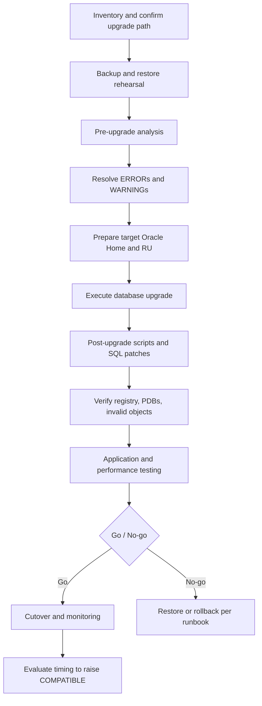

# Database Upgrades, COMPATIBLE, and Deprecated/Desupported Feature Checks

Upgrading Oracle Database affects the data dictionary, binaries, storage structures, SQL/PLSQL behavior, the optimizer, and application connectivity layers. A solid upgrade plan must answer three questions:

1. **To which version and by what method will the database be upgraded?** Confirm supported upgrade paths, platform, edition, CDB/PDB architecture, patch level, and downtime window.
2. **When can the `COMPATIBLE` parameter be raised?** This parameter governs on-disk structural compatibility and can permanently eliminate downgrade capability if raised too early.
3. **Which features are deprecated or desupported?** Identify features currently used by applications and operations before upgrading, then replace or remove unsupported dependencies.

Technical upgrade completion alone is not enough to return a system to production. You must verify the component registry, SQL patches, invalid objects, PDBs, timezone files, backups, applications, and performance post-upgrade. Exact commands and tools must always be cross-checked against the Oracle Database Upgrade Guide for the target release; no single upgrade path or list of removed features applies uniformly across all releases.

## 1. Distinguishing Upgrades, Patches, and Migrations

Oracle changes generally fall into several categories. Distinguishing them properly determines tool choice, downtime planning, and fallback options.

| Change Type | Scope | Example |
|---|---|---|
| Release upgrade | Moving a database from a supported major release or release update to a newer release | Upgrading from one Oracle Database release to the next supported release |
| Release Update (RU) / Release Update Revision (RUR) if applicable | Applying binaries and SQL changes per release update cycle | Applying an RU to an Oracle Home |
| One-off patch | Fixing a specific bug or support requirement | Bug-specific patch supplied by Oracle Support |
| Database migration | Moving data and workloads to another database or platform | Moving to a new host, Exadata, cloud service, or different architecture |
| Architecture upgrade | Changing the database model or deployment layout | Non-CDB to PDB, supported character set conversion, platform change |

An **upgrade** updates database software and the data dictionary so the database runs on a newer release. A **patch** updates software within the same release family per release policy. A **migration** moves data or workloads to a different environment; migration can be combined with an upgrade, yet remains a distinct problem.

For instance, swapping the Oracle Home on the same server does not mean the database is fully upgraded—the data dictionary must be upgraded via upgrade procedures. Conversely, Data Pump into a new database is a migration rather than an in-place upgrade of the source database.

### In-Place Upgrade vs. Migration to a New Database

| Criterion | In-Place Upgrade | Migration to a New Database |
|---|---|---|
| Target database | Upgrades the existing database in place | Provisions target database then moves data/workloads |
| Common tools | AutoUpgrade, DBUA, or supported manual workflow | Data Pump, Transportable Tablespaces, replication, or suitable migration tools |
| Downtime | Depends on upgrade method and dictionary/database size | Can be minimized via pre-sync followed by cutover |
| Fallback capability | Depends on backups, flashback, downgrade support, and `COMPATIBLE` | Can retain old source during cutover if architecture permits |
| Primary risk | Mutating the live database directly | Data synchronization, cutover, privileges, objects, and environment drift |

Never choose migration solely to dodge an upgrade step. Account for data, objects, database links, external tables, directories, jobs, credentials, network ACLs, encryption, backups, and external dependencies. Migrations often require recreating configurations that live outside data files.

## 2. Planning the Upgrade Path

### Identifying Source and Target Releases

Before running tools, gather:

- Current Oracle Database release and patch level.
- Target release, target RU, and mandatory one-off patches.
- Operating system, architecture, endian format, and platform support.
- Editions, options, and packs in use.
- Database character set and national character set.
- Database role: primary, physical standby, logical standby, or snapshot standby.
- Architecture: non-CDB, CDB/PDB, RAC, single instance, ASM, or filesystem.
- Database size, PDB count, object counts, invalid objects, and expected runtime.
- Permitted downtime window, RTO/RPO, and rollback strategy.

Check upgrade paths in the target release's *Oracle Database Upgrade Guide*. Some releases allow direct upgrades only from a specific set of source releases; older releases may require stepping through an intermediate release. These rules change by version and platform.

Never infer upgrade paths purely from adjacent version numbers. Also verify edition restrictions, platforms, endianness conversions, character sets, timezone files, and enabled options.

### Determining Source Database State

Queries to collect baseline state:

```sql
SELECT banner_full
FROM v$version
WHERE banner_full LIKE 'Oracle Database%';

SELECT name,
       dbid,
       open_mode,
       database_role,
       log_mode,
       cdb
FROM v$database;

SELECT comp_id,
       comp_name,
       version,
       status
FROM dba_registry
ORDER BY comp_id;

SELECT patch_id,
       patch_type,
       action,
       status,
       action_time,
       description
FROM dba_registry_sqlpatch
ORDER BY action_time;
```

`V$VERSION` shows the running database software version. `V$DATABASE` shows state and role. `DBA_REGISTRY` lists data dictionary components; `DBA_REGISTRY_SQLPATCH` records SQL patches applied to the database. Views may vary by release or access privileges.

Archive these results in pre-upgrade records for post-upgrade comparison. If any component shows `INVALID`, `LOADING`, `UPGRADING`, or another abnormal state, diagnose and resolve per documentation before starting.

### Defining Downtime and Cutover Strategy

A plan must specify:

- When to stop write connections and batch jobs.
- How to drain connection pools and stop schedulers/jobs/application workers.
- When to take backups or create restore points.
- Time budgets for pre-upgrade checks, upgrade execution, and post-upgrade steps.
- How to test applications before opening user traffic.
- Go/no-go criteria and decision authority.
- Recovery steps if the upgrade or post-upgrade validation fails.

For high-availability systems, evaluate downtime-reduction methods such as standby-based upgrades, logical replication, or parallel migration if supported by release, licensing, and architecture. Such approaches require dedicated runbooks and thorough failover/cutover testing.

## 3. Oracle Upgrade Tools

### AutoUpgrade

AutoUpgrade is Oracle's tool for automating upgrade phases, including pre-upgrade analysis, supported fixups, database upgrades, and selected post-upgrade tasks. It can manage multiple databases in one configuration.

General workflow:

1. Create an AutoUpgrade configuration file.
2. Run `analyze` mode to inspect and generate reports.
3. Resolve errors and warnings flagged in the pre-upgrade report.
4. Run appropriate fixups after reviewing script contents.
5. Prepare the target Oracle Home and patch level.
6. Run `deploy` following a tested runbook.
7. Monitor logs and status for each job/database.
8. Complete post-upgrade steps and verify applications.

General command examples:

```bash
java -jar autoupgrade.jar -config upgrade.cfg -mode analyze

java -jar autoupgrade.jar -config upgrade.cfg -mode deploy
```

Filenames, AutoUpgrade locations, configs, and options depend on release. Download the recommended AutoUpgrade build for the target release from Oracle and follow its matching documentation. Never reuse a sample config file without verifying database names, Oracle Homes, services, PDBs, and deployment modes.

AutoUpgrade can generate fixup scripts such as pre-upgrade and post-upgrade fixups. DBAs must read logs and verify impact and execution conditions; never blindly run scripts modifying a database simply because a tool generated them.

### Preupgrade Information Tool

The Preupgrade Information Tool analyzes the source database for conditions requiring action before upgrading. Depending on release, it can be invoked via `preupgrade.jar` from the target Oracle Home.

Common Java invocation example:

```bash
java -jar $ORACLE_HOME/rdbms/admin/preupgrade.jar FILE TEXT
```

Verify exact paths and syntax against the Upgrade Guide for your target release. Do not point to the source Oracle Home if the tool requires files from the target Oracle Home.

Reports typically group findings into:

- **ERROR:** conditions that can block the upgrade or cause failures if unresolved.
- **WARNING:** conditions requiring DBA review; do not necessarily block upgrading.
- **INFORMATIONAL:** details for planning or awareness.
- **Fixup:** scripts or actions suggested by the tool to remediate specific findings.

The Preupgrade tool does not replace application testing. It inspects the database and configurations visible to it; dependencies in source code, operational scripts, or external systems still require separate inventorying.

### Database Upgrade Assistant (DBUA)

DBUA is a GUI tool guiding database upgrades interactively. It checks prerequisites, executes upgrade steps, and displays progress.

DBUA suits environments where the version and architecture support it. Before selecting it, check target release, database type, RAC, CDB/PDB, and documented restrictions. For automation or multi-database fleets, AutoUpgrade is usually better for centralized config and log management.

### Manual Upgrade

Manual upgrades execute commands and scripts step-by-step per the Upgrade Guide. DBAs directly manage startup modes, `catctl`, upgrade scripts, runtimes, logs, and post-upgrade actions.

Manual upgrades suit special technical constraints or standardized internal automation. However, never mix commands across different releases. Script names, parameters, and execution orders change across versions.

### Choosing a Tool

| Tool | Best Fit | Key Caveats |
|---|---|---|
| AutoUpgrade | Automation, multi-database fleets, analysis, and job tracking | Must match tool/config version to target release |
| Preupgrade tool | Pre-upgrade prerequisite analysis | Does not execute the full upgrade workflow |
| DBUA | Guided interactive upgrades | Subject to supported releases and configurations |
| Manual upgrade | Granular runbook control | DBA owns sequencing and verification at every step |

Whichever tool you choose, rehearse the workflow on a clone with production-like data and configuration. Actual upgrade duration, application errors, and workload behavior can only be confirmed through testing.

## 4. Pre-Upgrade Checks

### Reviewing the Pre-Upgrade Report

Read the entire report and triage findings by severity:

- Upgrade-blocking conditions must be fixed beforehand.
- Warnings on components, objects, or parameters require DBA decisions.
- Items eligible for automatic fixups must have their fixup scripts reviewed.
- Items requiring application changes must be assigned to dev teams and tested.

Do not read only the summary lines. Archive reports, logs, and fixup outputs as deployment evidence.

### Checking Components and Registry

Components such as Catalog, Packages, JVM, XML DB, Spatial, Text, OLAP, or optional packs can affect upgrades. Exact names and statuses depend on installed versions and options.

Query:

```sql
SELECT comp_id,
       comp_name,
       version,
       status
FROM dba_registry
ORDER BY comp_id;
```

Check for `INVALID` components before upgrading. Never remove a component merely because it looks unused by apps; confirm Oracle-supported removal steps and check remaining dependencies.

### Checking Invalid Objects

```sql
SELECT owner,
       object_type,
       COUNT(*) AS invalid_count
FROM dba_objects
WHERE status = 'INVALID'
GROUP BY owner, object_type
ORDER BY owner, object_type;
```

Invalid objects may pre-exist from schema changes, dependencies, or patches. Save a baseline list to distinguish pre-existing issues from post-upgrade regressions. Do not demand zero invalid objects blindly if the database includes components or objects Oracle intentionally marks invalid under specific conditions; understand each case.

### Checking Tablespaces, Space, and Filesystems

Upgrades often require extra space in `SYSTEM`, `SYSAUX`, `TEMP`, `UNDO`, redo, archive logs, and the Oracle Home directory. Autoextending datafiles without checking underlying filesystem or ASM free space can stall an upgrade midway.

Sample queries:

```sql
SELECT tablespace_name,
       ROUND(SUM(bytes) / 1024 / 1024) AS allocated_mb
FROM dba_data_files
GROUP BY tablespace_name
ORDER BY tablespace_name;

SELECT tablespace_name,
       ROUND(SUM(bytes) / 1024 / 1024) AS free_mb
FROM dba_free_space
GROUP BY tablespace_name
ORDER BY tablespace_name;
```

These queries show allocated and free space inside datafiles; they do not show free capacity on filesystems or ASM disk groups. Inspect both layers.

### Verifying Backups and Restore Readiness

Before upgrading:

- Take backups per your approved RMAN strategy.
- Verify backups completed and are readable.
- Confirm backups cover control files, SPFILE, datafiles, and archived logs per recovery requirements.
- Record DBID, incarnation, FRA configuration, and backup locations.
- If using restore points, check Flashback Database prerequisites, FRA space, and retention.
- Perform a restore/recovery test in an appropriate environment.

A backup marked "completed" is not guaranteed to meet RTO. Have recent restore drills or verified recovery evidence.

### Checking Applications and Integrations

Inventory:

- JDBC drivers and connection pools.
- Application servers, frameworks, ORMs, and client libraries.
- Database links, external procedures, Java stored procedures, and external tables.
- Scheduler jobs, chains, credentials, external jobs, and OS callouts.
- SQL/PLSQL packages, triggers, views, materialized views, and types.
- Database Vault, TDE, wallets, network ACLs, TLS, and authentication.
- BI/reporting, ETL, backup agents, monitoring agents, and admin tools.
- Scripts relying on old init parameters, data dictionary views, or legacy SQL syntax.

Check compatibility matrices and certifications for your applications against the target Oracle release. A clean database upgrade with an uncertified JDBC driver or framework can still break once traffic opens.

## 5. What Is COMPATIBLE?

`COMPATIBLE` is an initialization parameter defining the compatibility level Oracle Database uses when writing and interpreting certain on-disk data structures. It lets an upgraded database operate temporarily with older structural compatibility, enabling upgrade validation and supported downgrades.

Values take release form:

```sql
SHOW PARAMETER compatible;

SELECT name, value
FROM v$parameter
WHERE name = 'compatible';
```

`COMPATIBLE` is distinct from the Oracle Home binary version. A database can run binaries of a newer release while retaining `COMPATIBLE` at an older level during post-upgrade verification.

### What Does COMPATIBLE NOT Mean?

Do not mistake `COMPATIBLE` for:

- Which JDBC driver version applications must use.
- Client/server SQL syntax compatibility level.
- A mechanism preserving all optimizer behaviors from the old release.
- A single switch turning on every new release feature.
- A parameter you can raise and lower freely across restarts.

It primarily governs on-disk storage formats and features that alter storage structures or release-level metadata. Changes in SQL behavior, optimizer plans, authentication, network protocols, and APIs are governed by other mechanisms.

### COMPATIBLE and Downgrade Capability

Raising `COMPATIBLE` allows Oracle to write new on-disk structures unreadable by older releases. Once the database writes those structures, lowering `COMPATIBLE` cannot revert new structures back into old formats.

Therefore:

- Keep `COMPATIBLE` at its current setting during the upgrade and initial verification window per target release guidance.
- Raise it only after confirming applications, backups, restores, standbys, and integrations operate properly.
- Before raising it, explicitly acknowledge the end of the supported downgrade window.
- Once raised, never assume you can lower it to return to the prior release.
- If fallback is needed after crossing the compatibility threshold, you normally must restore from backup or execute a dedicated migration/rollback plan.

Downgrade feasibility also depends on source/target releases, enabled features, data dictionary state, platform, and Oracle support rules. Keeping an older `COMPATIBLE` setting does not guarantee every downgrade scenario is supported.

### When to Raise COMPATIBLE

Standard practice is leaving `COMPATIBLE` unchanged before starting the upgrade unless the Upgrade Guide mandates otherwise. Once the upgrade succeeds, the database stabilizes, and validation passes, DBAs evaluate raising it to the target release's recommended value.

Example SPFILE update:

```sql
ALTER SYSTEM SET compatible = '19.0.0'
  SCOPE = SPFILE;
```

The value here only illustrates format. Substitute the supported value for your target release confirmed in the Upgrade Guide. Updating `SCOPE=SPFILE` requires a database restart to take effect; in RAC, manage the shared SPFILE and instances appropriately.

Before changing it:

1. Confirm the database upgrade finished completely.
2. Verify all PDBs and components are healthy.
3. Complete all SQL patches and post-upgrade actions.
4. Confirm application and workload testing passed.
5. Confirm backups/restores and DR meet target release requirements.
6. Confirm whether the downgrade window has formally closed.
7. Record old value, new value, timestamp, and operator.

Never raise `COMPATIBLE` merely to silence warnings or unlock a feature without assessing storage impact. Feature and release documentation define exact minimum values.

### Checking Values Across All Instances

In RAC, inspect the parameter across instances:

```sql
SELECT inst_id,
       name,
       value,
       isdefault,
       issys_modifiable,
       ispdb_modifiable
FROM gv$parameter
WHERE name = 'compatible'
ORDER BY inst_id;
```

Verify SPFILE settings and running values remain consistent per design. In CDB/PDB architectures, check parameter scope carefully; `COMPATIBLE` is a database/CDB-level parameter per Oracle rules, not an arbitrary per-PDB setting.

## 6. Deprecated vs. Desupported: Two Distinct States

Oracle may announce that a feature, parameter, package, view, API, or behavior will change in upcoming releases.

### Deprecated

A **deprecated** feature still works in the current release, yet Oracle recommends retiring it and moving to a replacement. It may be removed in a future release.

General examples:

- An old initialization parameter superseded by a newer parameter.
- An API or package recommended for replacement by a newer API.
- Legacy syntax or admin utilities replaced by modern equivalents.
- An authentication or network configuration mechanism being phased out.

Deprecated does not mean the feature stops working immediately after upgrade. However, continuing to rely on it raises risk for the next upgrade and may limit support options in certain cases.

### Desupported

A **desupported** feature has been removed from that release or is no longer supported. Depending on the feature, old commands may error out, parameters may be ignored, packages may vanish, or prior behaviors are no longer guaranteed.

You cannot deal with a desupported feature merely by noting a warning. Replace it, convert data, or reconfigure before applications depend on the new release.

### Comparison

| Status | State in Current Release | Required Action |
|---|---|---|
| Supported | Supported per documentation | Continue using within documented bounds |
| Deprecated | Still present, replacement recommended | Plan transition and remove dependency |
| Desupported | Removed or no longer supported | Replace before upgrade or update apps/config immediately |
| Obsolete/unused | Unused in a specific environment | Verify via inventory; do not assume from name alone |

Exact labels and announcement scopes depend on release documentation. A feature can be deprecated in one release and desupported in a later one. Always read the Deprecated Features and Desupported Features sections for the target release and any required intermediate releases.

## 7. How to Find Deprecated or Desupported Features

No single view lists every feature slated for removal. Combine Oracle documentation, database metadata, source code scans, and testing.

### Read Target Release Documentation

Key references:

- Oracle Database Upgrade Guide.
- Oracle Database New Features Guide.
- Oracle Database Reference.
- Oracle Database Administrator's Guide.
- Oracle Database Security Guide.
- Oracle Database Net Services Administrator's Guide.
- Oracle Database Licensing Information User Manual.
- Release Notes and READMEs for target RUs/patches.

Focus on sections covering:

- Deprecated Features.
- Desupported Features.
- Behavior Changes.
- Initialization Parameters.
- Deprecated/Desupported Initialization Parameters.
- Deprecated/Desupported SQL Features.
- Deprecated/Desupported PL/SQL Packages and Types.
- Changes to Data Dictionary Views.
- Security and Authentication Changes.
- Upgrade and Downgrade Restrictions.

Read documentation for the exact target release and every intermediate release in your upgrade path. Never rely on documentation for a different release just because feature names look similar.

### Inspect Initialization Parameters

List non-default parameters or potentially deprecated settings:

```sql
SELECT name,
       value,
       isdefault,
       issys_modifiable,
       ispdb_modifiable
FROM v$parameter
WHERE isdefault = 'FALSE'
ORDER BY name;
```

Cross-check with the SPFILE:

```sql
SELECT sid,
       name,
       value,
       isspecified
FROM v$spparameter
WHERE isspecified = 'TRUE'
ORDER BY name, sid;
```

This list only inventories active settings; it does not automatically flag which parameters are deprecated or desupported. Cross-check each parameter against the target Database Reference and Upgrade Guide. Pay special attention to replaced parameters, changed defaults, and unrecognized parameters.

### Inspect Feature Usage

`DBA_FEATURE_USAGE_STATISTICS` records database-detected usage of various features:

```sql
SELECT name,
       detected_usages,
       total_samples,
       currently_used,
       first_usage_date,
       last_usage_date
FROM dba_feature_usage_statistics
ORDER BY name;
```

This view helps spot detected features, but absence from the view does not prove a feature is unused. Detection depends on sampling intervals, uptime, version, and how features are invoked.

Combine:

- Feature usage statistics.
- AWR/ASH or SQL monitoring if properly licensed.
- Audits and application logs.
- Java source code, PL/SQL, SQL scripts, and jobs.
- Operational, backup, monitoring, and integration configs.
- Reviews with each application owner.

If using Diagnostics Pack or Tuning Pack features, verify licensing entitlements before querying corresponding views/tools.

### Search Dependencies in Source Code and Scripts

Search for objects and syntax tied to legacy features:

- Packages, procedures, functions, types, and views.
- Initialization parameters hard-coded in scripts.
- Legacy SQL hints or syntax.
- JDBC URLs, driver classes, authentication modes, and protocols.
- Backup/restore, import/export, monitoring, and scheduler scripts.
- External jobs, shell scripts, and OS callouts from the database.
- Database links, network ACLs, wallets, and certificates.

Use `DBA_DEPENDENCIES` to trace database object dependencies:

```sql
SELECT owner,
       name,
       type,
       referenced_owner,
       referenced_name,
       referenced_type
FROM dba_dependencies
WHERE referenced_owner = 'SYS'
ORDER BY owner, name;
```

This query is only a starting point. Not every dependency on `SYS` objects is a problem, and dynamic SQL or runtime-assembled object names will not appear in `DBA_DEPENDENCIES`. Filter for specific objects and cross-check documentation.

## 8. Feature Areas to Audit Before Upgrading

### Initialization Parameters

Parameters may be deprecated, desupported, given new defaults, or interpreted differently. Check:

- Optimizer-related parameters.
- Memory management parameters.
- Process/session and parallel execution parameters.
- Audit, security, and authentication parameters.
- Archive, recovery, and Data Guard parameters.
- RAC, ASM, and service-related parameters.
- Legacy parameters lingering in SPFILE despite having no effect.

Never copy an entire old PFILE/SPFILE blindly to a new release. Old configs may retain unsupported parameters or values mismatched to current memory/CPU.

### SQL and PL/SQL

Review:

- Deprecated SQL syntax and functions.
- Deprecated/desupported packages or types.
- Implicit conversion and NLS behaviors.
- Triggers, stored procedures, Java stored procedures, and external procedures.
- Dynamic SQL, optimizer hints, and query plans.
- Changed data dictionary views/columns.
- Statements relying on undocumented behaviors.

SQL statements that ran cleanly on an old release may still parse while picking a different plan due to optimizer changes. Therefore, test both results and performance, not just compilation.

### Security and Authentication

Newer releases may change password verifier policies, authentication protocols, TLS, wallets, ciphers, certificates, or network rules. Check:

- Whether JDBC drivers support the new authentication mechanisms.
- Client/server TLS and cipher compatibility.
- Whether user password versions meet new policies.
- Whether wallets, TDE keystores, and certificates open cleanly post-upgrade.
- Whether database links and external integrations re-authenticate cleanly.
- Whether network ACLs and `UTL_HTTP`/`SMTP` privileges remain valid.

Never weaken system-wide security settings just to let outdated clients connect. Upgrade drivers/clients or adjust configurations within supported security policies.

### Components and Options

Components or options may change installation methods, states, licensing, or compatibility. Inspect `DBA_REGISTRY`, Oracle Home inventory, `V$OPTION`, and licensing docs. Never infer that an installed component grants usage rights to associated options.

### Data Types, Character Sets, and Timezones

Review:

- Character sets and national character sets.
- Timestamp/time zone data.
- Changed data types or storage formats.
- XML, JSON, Spatial, LOBs, and specialized types.
- Applications sensitive to `NLS_DATE_FORMAT`, `NLS_NUMERIC_CHARACTERS`, or session timezones.

Timezone file upgrades can be a distinct step, especially when the target release ships a newer timezone version and applications store `TIMESTAMP WITH TIME ZONE` data. Never upgrade timezone files automatically just because the database upgrade finished; assess impact and follow proper `DBMS_DST` workflows.

## 9. Executing the Upgrade in Phases

A general runbook can be divided into phases:



### Phase 1: Inventory and Scope Confirmation

Record source/target releases, Oracle Homes, patch levels, database roles, CDB/PDB layout, components, options, parameters, and application dependencies. Assign owners for database, OS, network, security, application, and business validation.

### Phase 2: Backups and Restore Rehearsal

Create recoverable backups, archive RMAN logs, and verify archive logs and control files. Rehearse restores in an isolated environment if feasible. Record actual recovery times and required steps.

### Phase 3: Pre-Upgrade Analysis

Run AutoUpgrade `analyze` or the Preupgrade Information Tool per release documentation. Save reports, fix blocking errors, and triage warnings. Never start a production upgrade with unresolved errors or unapproved risk exceptions.

### Phase 4: Prepare Target Oracle Home

Install the new Oracle Home and apply planned RUs/one-off patches. Verify inventory, OPatch version, filesystems, owner/group permissions, environment variables, listeners, and network configuration.

Never delete the source Oracle Home before the approved rollback window closes. Keep binaries and config files intact to support the chosen fallback plan.

### Phase 5: Stop Workloads and Execute Upgrade

Per runbook:

- Announce downtime and stop write applications.
- Stop batch jobs, Scheduler jobs, ETL, and integration workers.
- Drain connection pools or shut down application instances in order.
- Confirm no lingering business sessions block work.
- Execute the upgrade with the selected tool.
- Monitor logs, progress, and step statuses.
- Never kill the upgrade process just because log output pauses briefly; verify actual state before intervening.

For CDBs, upgrade root, seed, and PDBs per the release tool/guide. Confirm every PDB opened and upgraded cleanly. Never verify only `CDB$ROOT` and assume the entire CDB is ready.

### Phase 6: Post-Upgrade Actions

Post-upgrade tasks may include:

- Running tool-suggested fixup scripts after reviewing them.
- Recompiling invalid objects with Oracle-provided scripts.
- Updating SQL patch metadata with `datapatch` when required by the patch plan.
- Verifying component registries and PDBs.
- Reviewing timezone files and running `DBMS_DST` steps if planned.
- Updating optimizer statistics per release recommendations.
- Verifying backups, archiving, FRA, listeners, services, and jobs.
- Confirming Data Guard/RAC/ASM health.

Do not run arbitrary scripts in `rdbms/admin`. Run only scripts prescribed by the Upgrade Guide, AutoUpgrade, or patch README.

## 10. Recompiling Objects and Verifying Components Post-Upgrade

### Recompiling Invalid Objects

After upgrading, some objects become invalid due to dependency or dictionary changes. Oracle provides `utlrp.sql` to recompile invalid PL/SQL objects using release mechanisms.

Example:

```sql
@?/rdbms/admin/utlrp.sql
```

Run from the upgraded Oracle Home using the connection privileges required by the script. In a CDB, follow instructions for root and PDBs; never assume running once in root handles all PDBs in every configuration.

Re-check:

```sql
SELECT owner,
       object_type,
       COUNT(*) AS invalid_count
FROM dba_objects
WHERE status = 'INVALID'
GROUP BY owner, object_type
ORDER BY owner, object_type;
```

For any remaining invalid objects, inspect compile errors:

```sql
SELECT owner,
       name,
       type,
       line,
       position,
       text
FROM dba_errors
ORDER BY owner, name, sequence;
```

Do not repeatedly re-run `utlrp.sql` when the root cause is a missing dependency, privilege, or removed feature. Fix the underlying cause, then recompile per procedure.

### Checking the Component Registry

```sql
SELECT comp_id,
       comp_name,
       version,
       status
FROM dba_registry
ORDER BY comp_id;
```

Components must reflect valid statuses matching the target release and installed options. An `INVALID` component can break features even while the database is `OPEN`.

### Checking SQL Patches

```sql
SELECT patch_id,
       patch_uid,
       patch_type,
       action,
       status,
       action_time,
       description
FROM dba_registry_sqlpatch
ORDER BY action_time DESC;
```

`datapatch` applies the SQL portion of patches after binary patching per the patch plan. Example command:

```bash
$ORACLE_HOME/OPatch/datapatch -verbose
```

Exact paths and requirements depend on the patch README and release. Verify statuses in `DBA_REGISTRY_SQLPATCH`; never treat OPatch success as proof that SQL patches were completely applied to the database.

## 11. Verifying CDBs and PDBs

In multitenant environments, verify upgrades across root, seed, and every PDB.

Check PDBs:

```sql
SELECT con_id,
       name,
       open_mode,
       restricted
FROM v$pdbs
ORDER BY con_id;
```

Check container registries:

```sql
SELECT con_id,
       comp_id,
       comp_name,
       version,
       status
FROM cdb_registry
ORDER BY con_id, comp_id;
```

Check plug-in violations:

```sql
SELECT time,
       name,
       cause,
       type,
       status,
       message
FROM pdb_plug_in_violations
ORDER BY time;
```

PDBs may require upgrading, sit in restricted mode, or show violations from component/option mismatches. Resolve specific messages per the Upgrade Guide. Never open user traffic to a PDB merely because `CDB$ROOT` opened `READ WRITE`.

For application containers, refreshable PDBs, or specialized multitenant layouts, follow corresponding workflows. Certain actions must run from root or specific containers with appropriate privileges.

## 12. Timezone Files and Temporal Data

Oracle stores timezone data on both database and client sides. Newer releases may bundle newer timezone file versions. Upgrading the database release does not automatically convert existing timezone data to the new version.

If applications use `TIMESTAMP WITH TIME ZONE`, timezone-aware schedules, or geographically bound historical timestamps:

1. Check the current timezone file version and target release supported version.
2. Assess DST (daylight saving time) rule changes that could affect existing data.
3. Verify application and client drivers.
4. Plan a separate timezone file upgrade if needed.
5. Follow Oracle's `DBMS_DST` workflow, including prepare, upgrade, and verification.
6. Test temporal queries, reports, schedules, and timezone conversions.

Check version:

```sql
SELECT filename, version
FROM v$timezone_file;

SELECT property_name, property_value
FROM database_properties
WHERE property_name LIKE 'DST_%'
ORDER BY property_name;
```

Never swap timezone files or run `DBMS_DST` blindly just to bump version numbers. Upgrading timezones can alter how specific timestamps are interpreted under revised rules.

## 13. Checking Optimizer and Performance Post-Upgrade

The optimizer may alter execution plans due to new release features, statistics, parameter defaults, cardinality estimation, adaptive behaviors, or patches. A query returning correct results can still become dramatically slower.

### Saving Pre-Upgrade Baselines

Collect:

- Critical SQL statements by business flow.
- Execution plans and elapsed times.
- Logical reads, physical reads, CPU, and wait events.
- Batch and report runtimes.
- Parse rates, hard parses, and connection pool usage.
- Schema and key table statistics.
- SQL Plan Baselines or SQL Tuning Sets where procedures and licenses permit.

If using AWR, ASH, SQL Tuning Advisor, or SQL Performance Analyzer, confirm Diagnostics/Tuning Pack licensing entitlements for your version. Never enable or query licensed features simply because the views exist.

### Post-Upgrade Comparison

Replay representative workloads with comparable data and bind values. Compare:

- Business correctness.
- Execution plans.
- Median and high-percentile latencies.
- Logical/physical I/O.
- CPU, memory, and temp usage.
- Lock contention and wait events.
- Batch completion times and backlogs.

Never compare averages alone. Some queries may speed up while critical transactions regress sharply. Test with equivalent concurrency and workload profiles.

### SQL Plan Management

SQL Plan Management helps stabilize and evolve execution plans. SQL Plan Baselines do not guarantee every query keeps an identical plan in all scenarios; evaluate accepted plans, evolution, and release-specific behavior.

Never capture or force all legacy plans blindly. Old plans may no longer be optimal for current data, statistics, or hardware.

## 14. Verifying Applications and Connectivity Services

Once the database is ready, test from the client side:

- JDBC drivers and connection URLs.
- Service names, PDB services, and listeners.
- TLS, wallets, certificates, and authentication.
- Schemas, roles, grants, and synonyms.
- Sequences, triggers, stored procedures, and packages.
- Database links and external services.
- Hibernate/JPA dialects, schema validation, and generated SQL.
- Batches, Schedulers, job chains, and background tasks.
- Transaction commits/rollbacks and connection pool recovery.

Include smoke tests covering reads, writes, rollbacks, sequence generation, LOBs, date/time handling, stored procedures, transaction isolation, and integration flows. Also test queries using hints, analytic functions, JSON/XML, or Oracle-specific features.

If applications run startup schema validation, a minor metadata mismatch can prevent startup. Never disable validation to hide errors; fix the mapping or schema discrepancy.

## 15. Rollback Strategy and Downgrade Limits

### Downgrade Is Not Restore

Downgrading reverts a database to a prior release using an Oracle-supported procedure under strict conditions. Restoring recovers a database from a pre-upgrade backup or clone.

Downgrades are constrained by releases, features, components, platforms, and database state. Not every release upgrade supports downgrading, and post-upgrade features or changes can forfeit downgrade eligibility.

Restoring from backup is usually the clearer path when:

- The target release does not support downgrading for that source/target pair.
- The database enabled features incompatible with the old release.
- `COMPATIBLE` was raised past the allowed threshold.
- Upgrades or patches made irreversible structural changes.
- Applications already wrote new data while fallback requires reverting to an older point in time.

### Questions to Answer Before Starting

- Is an Oracle-supported downgrade path available for this exact release pair?
- Are all active components and features within downgrade limits?
- What is the current `COMPATIBLE` value and planned post-upgrade value?
- Are new features guarded until `COMPATIBLE` is finalized?
- On restore, does RPO allow losing transactions committed after the backup?
- Can the source database or a standby be kept to reconcile post-cutover data?
- Are control files, SPFILEs, password files, wallets, and external configs backed up?
- Have restore and application checks been rehearsed?

### Restore Points and Flashback Database

Restore points or guaranteed restore points can aid reverting to a point in time in Oracle-supported scenarios. However, understand Flashback Database prerequisites, FRA capacity, retention windows, and limitations across database changes.

Restore points do not replace independent backups. If storage or database corruption occurs beyond flashback logs, DR backups/restores are still required. Before upgrading, verify the restore point was created on the right database at the right moment with ample FRA space.

## 16. Special Upgrade Scenarios

### Oracle RAC

For RAC, evaluate:

- Clusterware and Grid Infrastructure compatibility.
- Per-node Oracle Homes.
- ASM and disk groups.
- Service placement and preferred/available instances.
- Listeners, SCAN, and networking.
- Uniform patch levels across nodes.
- Job placement and instance affinity.
- Rolling upgrade procedures if supported by release and method.

Never assume rolling upgrades work for every database. Rolling capability depends on release, patches, architecture, enabled features, and upgrade method.

### Data Guard

For Data Guard:

- Identify primary/standby roles and protection modes.
- Check redo transport, apply lag, and archive gaps.
- Verify version and patch compatibility between primary and standby.
- Determine upgrade sequence per Oracle-supported approaches.
- Test switchover/failover post-upgrade.
- Verify broker configuration, database services, and backups.
- Evaluate standby-first or rolling upgrades if supported for your release and features.

Never upgrade primary and standby in an arbitrary order. Some approaches let the standby upgrade first to cut downtime, but require specific releases, Data Guard configurations, and strict procedures.

### Non-CDB to PDB

Converting non-CDB to PDB is an architectural change, not a parameter tweak. Check:

- Conversion support in the target release.
- Character sets and national character sets.
- Components and options.
- Database links, directories, and external objects.
- Services and application connection strings.
- PDB plug-in violations.
- Backup/restore and conversion plans.
- Privileges, common/local users, and CDB configuration.

You can use plug/unplug workflows or supported conversion tools. Verify target release docs and test on a clone before production execution.

## 17. Example Pre- and Post-Upgrade Verification Runbook

### Pre-Upgrade

Record version and role:

```sql
SELECT banner_full
FROM v$version
WHERE banner_full LIKE 'Oracle Database%';

SELECT name, dbid, open_mode, database_role, cdb
FROM v$database;
```

Record components:

```sql
SELECT comp_id, comp_name, version, status
FROM dba_registry
ORDER BY comp_id;
```

Record invalid objects:

```sql
SELECT owner, object_type, COUNT(*) AS invalid_count
FROM dba_objects
WHERE status = 'INVALID'
GROUP BY owner, object_type
ORDER BY owner, object_type;
```

Record `COMPATIBLE`:

```sql
SELECT name, value
FROM v$parameter
WHERE name = 'compatible';
```

Record timezone file:

```sql
SELECT filename, version
FROM v$timezone_file;
```

### Post-Upgrade

Confirm version, role, and open mode:

```sql
SELECT banner_full
FROM v$version
WHERE banner_full LIKE 'Oracle Database%';

SELECT name, open_mode, database_role, cdb
FROM v$database;
```

Confirm components and SQL patches:

```sql
SELECT comp_id, comp_name, version, status
FROM dba_registry
ORDER BY comp_id;

SELECT patch_id, patch_type, action, status, action_time, description
FROM dba_registry_sqlpatch
ORDER BY action_time DESC;
```

Confirm PDBs and violations if CDB:

```sql
SELECT con_id, name, open_mode, restricted
FROM v$pdbs
ORDER BY con_id;

SELECT time, name, cause, type, status, message
FROM pdb_plug_in_violations
ORDER BY time;
```

Confirm invalid objects:

```sql
SELECT owner, object_type, COUNT(*) AS invalid_count
FROM dba_objects
WHERE status = 'INVALID'
GROUP BY owner, object_type
ORDER BY owner, object_type;
```

Compare before/after outputs. Investigate every component whose status changed, any failed patch, any PDB not opened in the right mode, and all newly invalid objects.

## 18. Common Mistakes

**Raising COMPATIBLE before finishing testing.**  
This can destroy downgrade paths or force a full restore on rollback. Raise it in phases under conditions specified by release docs.

**Assuming keeping an old COMPATIBLE guarantees downgrade works.**  
Downgrades also depend on features, components, release paths, and post-upgrade changes. `COMPATIBLE` is just one crucial prerequisite.

**Running the pre-upgrade report once and forgetting it.**  
After fixing configs or objects, re-run analysis to confirm all conditions are resolved.

**Checking only CDB$ROOT.**  
Individual PDBs may remain un-upgraded or hold plug-in violations. Inspect every PDB per workflow.

**Checking only OPatch success.**  
Binary patches and SQL patches are distinct layers. Check `DBA_REGISTRY_SQLPATCH` and datapatch logs.

**Running utlrp.sql without reading compile errors.**  
Objects may remain invalid due to missing dependencies, privileges, or removed features. Read `DBA_ERRORS`.

**Assuming a feature absent from DBA_FEATURE_USAGE_STATISTICS is unused.**  
That view does not cover all dependencies. Combine source scans, logs, scripts, and owner confirmations.

**Copying the entire old SPFILE to the new Oracle Home.**  
It may carry over deprecated/desupported parameters or poorly sized values. Inventory and review every parameter.

**Opening applications immediately once the database is OPEN.**  
Verify components, PDBs, SQL patches, invalid objects, backups, networking, smoke tests, and performance before cutover.

## 19. Database Upgrade Checklist

### Pre-Upgrade

- [ ] Verified source release, target release, and supported upgrade path.
- [ ] Checked edition, platform, architecture, RU, and one-off patches.
- [ ] Recorded database role, CDB/PDB, RAC, ASM, and Data Guard state.
- [ ] Saved `COMPATIBLE`, SPFILE, component registry, SQL patches, and timezone version.
- [ ] Checked invalid objects, tablespaces, FRA, archives, and filesystem/ASM capacity.
- [ ] Ran AutoUpgrade `analyze` or Preupgrade Information Tool.
- [ ] Resolved blocking errors and triaged all warnings.
- [ ] Inventoried deprecated/desupported parameters, SQL, PL/SQL, packages, and security settings.
- [ ] Verified JDBC drivers, application frameworks, and integration clients.
- [ ] Created backups and rehearsed restore.
- [ ] Tested upgrade on a production clone and measured runtimes.
- [ ] Finalized downtime, RTO/RPO, go/no-go criteria, and rollback plan.

### During Upgrade

- [ ] Stopped write apps, batches, ETL, and Scheduler jobs per runbook.
- [ ] Drained connection pools and checked active sessions.
- [ ] Used the release-matching Oracle Home and upgrade tools.
- [ ] Monitored logs and handled errors per documentation.
- [ ] Verified CDB root, seed, and all PDBs per workflow.
- [ ] Left `COMPATIBLE` unchanged unless explicitly approved in the plan.
- [ ] Preserved source Oracle Home and backups through the rollback window.

### Post-Upgrade

- [ ] Confirmed version, role, open mode, and database status.
- [ ] Checked `DBA_REGISTRY` and `DBA_REGISTRY_SQLPATCH`.
- [ ] Executed required post-upgrade fixups and `datapatch`.
- [ ] Recompiled invalid objects and inspected `DBA_ERRORS`.
- [ ] Checked every PDB and `PDB_PLUG_IN_VIOLATIONS`.
- [ ] Checked timezone files and ran `DBMS_DST` if planned.
- [ ] Verified listeners, services, database links, wallets, TLS, and authentication.
- [ ] Ran read/write/rollback smoke tests and transaction checks.
- [ ] Compared execution plans, workloads, and batch durations.
- [ ] Verified fresh post-upgrade backups and restore capability.
- [ ] Raised `COMPATIBLE` only after meeting all criteria and accepting closure of the downgrade window.
- [ ] Monitored alert logs, application logs, wait events, and backlogs post-cutover.

Upgrading Oracle Database must be managed as a full-lifecycle change: verify the upgrade path, run pre-upgrade analysis, resolve unsupported features, execute the upgrade, verify components and applications, and only then finalize `COMPATIBLE`. `COMPATIBLE` controls on-disk data structure readability and downgrade eligibility; deprecated warns you to migrate, while desupported means removal. Combining release-accurate documentation, real inventories, restorable backups, and production-like testing enables DBAs to upgrade smoothly without letting a legacy dependency trigger a post-cutover incident.
