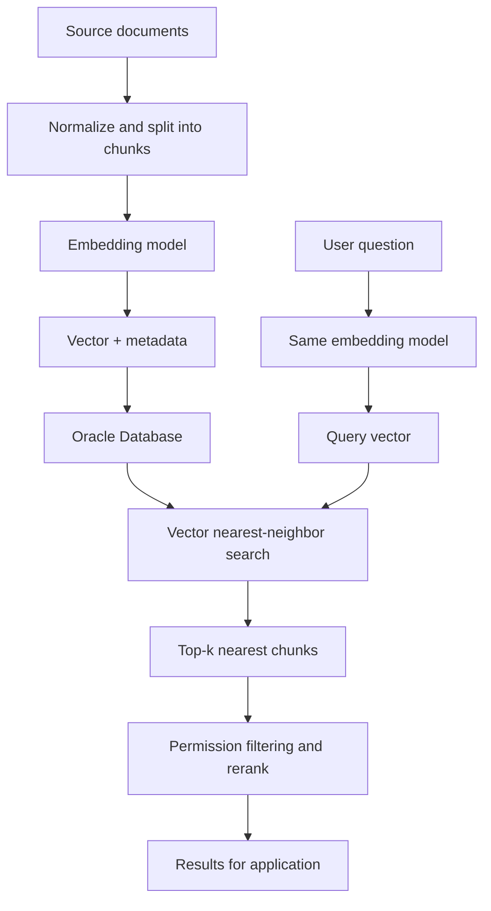
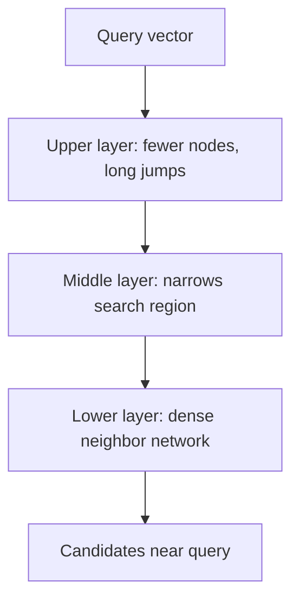
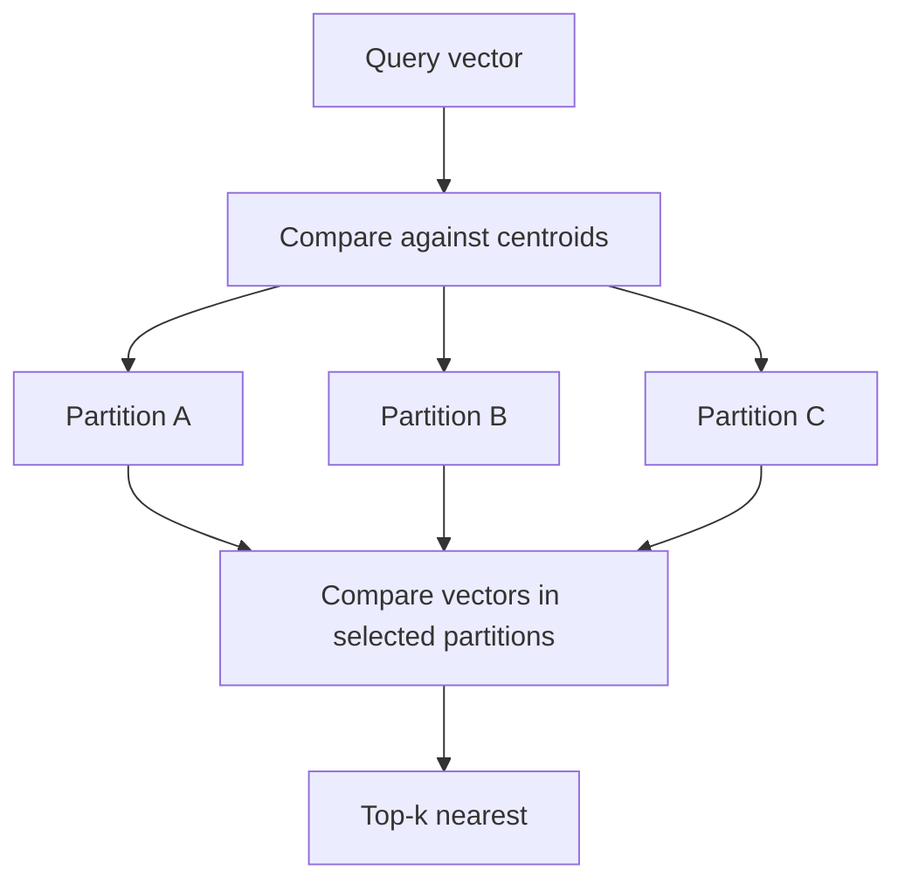

# AI Vector Search: VECTOR Type, Similarity Metrics, and Index Types

AI Vector Search in Oracle Database enables storing vectors that represent data, comparing proximity between vectors, and finding nearest records directly with SQL. Vectors are typically generated from embedding models for text, images, audio, or other data. When a query arrives, the application converts the query content into a vector and finds the closest vectors in the database.

Three components must be understood together:

- **VECTOR data type:** stores an ordered sequence of numbers with a defined number of dimensions and element format.
- **Similarity/distance:** the mathematical rule used to rank how close vectors are.
- **Vector index:** a structure that accelerates nearest-neighbor search when the dataset is large.

Vector Search complements relational SQL. The database still stores primary keys, metadata, access permissions, business statuses, and filter conditions as usual. Vectors enable semantic or feature-based search, and SQL then combines those results with relational data.

Examples in this lesson illustrate Oracle Database 23ai AI Vector Search and subsequent releases. Syntax, metrics, and index options depend on release/RU; before deploying, consult the Oracle Database SQL Language Reference and Vector Search User's Guide for the exact running release.

## 1. Vectors and Embeddings

### What Is a Vector?

A vector is an ordered sequence of numbers. For example:

\[
v = [0.12,\ -0.45,\ 0.81,\ 0.07]
\]

The vector above has four dimensions. Each element is a coordinate in multi-dimensional space.

In AI, an embedding model transforms input data into vectors such that items with similar features or meanings tend to lie close together in vector space. For example, a text embedding model might generate vectors for the sentences:

- "How to reset an account password"
- "I forgot my password, how do I log in?"
- "Store opening hours"

The first two sentences may have vectors close to each other because both are about account access; the third sentence is usually farther away. This is a tendency learned by the model, not a mathematical rule guaranteed for every sentence.

### How Are Embeddings Generated?

A semantic search pipeline typically has these steps:

1. Collect source documents or records.
2. Normalize content and split long documents into chunks.
3. Use an embedding model to generate a vector for each chunk.
4. Store the vector along with ID, content, source, access permissions, and metadata.
5. When a query arrives, use a compatible model to generate the query embedding.
6. Find vectors closest to the query vector.
7. Apply business conditions, additional ranking, or reranking if needed.
8. Return suitable content to the application.

Diagram:



Search quality depends heavily on the embedding model, chunking strategy, language, content, and preprocessing. A fast index cannot fix an embedding model that produces vectors ill-suited to the business domain.

### Why Store Vectors in the Database?

Storing vectors directly in Oracle enables combining semantic search with relational data:

- Filter by tenant, status, document type, or creation date.
- Enforce access control by user/role.
- Join vector results with business tables.
- Manage transactions and data lifecycle inside the same database.
- Use existing Oracle SQL, backups, security, and administration tools.

For example, a customer support system can find guide chunks close to a question and then join to the documents table to retrieve title, language, publication status, and viewing permissions.

## 2. The VECTOR Data Type in Oracle

Oracle Database 23ai introduces the SQL `VECTOR` data type for vector data. This type stores ordered numeric elements and supports vector search operations without turning vectors into JSON strings or child tables with hundreds of numeric columns.

### Declaring a VECTOR Column

A column can declare its dimension count and element format:

```sql
CREATE TABLE document_embeddings (
    document_id NUMBER PRIMARY KEY,
    title        VARCHAR2(500),
    embedding    VECTOR(768, FLOAT32)
);
```

In the example:

- `768` is the number of vector dimensions.
- `FLOAT32` is the 32-bit floating-point element format.
- Each vector is stored in the `embedding` column.
- `document_id` and `title` are accompanying relational metadata.

The dimension count must match the embedding model's output. If the model produces 768-dimensional vectors, you cannot write 384-dimensional vectors into a column declared with 768 dimensions. Nor should you take vectors from a different model just because they share the same dimension count; the same dimension does not mean the same embedding space.

You can declare a vector with flexible dimensions using `*` in the dimension position per supported release syntax, for example `VECTOR(*, FLOAT32)`. Flexible declaration is useful when a schema must store vectors of varying dimensions, though the application must still ensure compared vectors share the same dimension and embedding convention. For a dataset using a single fixed model, declaring a specific dimension usually helps catch bad data earlier.

### Element Formats

Common element formats in Oracle Vector include:

| Format | Characteristics | When to Consider |
|---|---|---|
| `FLOAT32` | 32-bit floating-point numbers | Common choice for embeddings; balances storage and accuracy |
| `FLOAT64` | 64-bit floating-point numbers | When higher numerical precision is needed and larger storage is acceptable |
| `INT8` | 8-bit signed integers | Vectors quantized through an appropriate process |
| `BINARY` | Packed bits | Binary vector representations or binary encodings supported by the model |

Raw element storage depends on format: FLOAT32 uses about 4 bytes per dimension, FLOAT64 about 8 bytes, INT8 about 1 byte, and BINARY uses one bit per dimension. This is a payload estimate, excluding metadata, alignment, indexes, and storage overhead.

Do not arbitrarily force FLOAT32 to INT8 just to save space. Quantization must suit the model and embedding generation pipeline; improper conversion can degrade search quality. For BINARY, you must use metrics and representations supported by the binary model.

### Creating a Table and Inserting Illustrative Vectors

Small example with 3-dimensional vectors:

```sql
CREATE TABLE demo_vectors (
    item_id   NUMBER PRIMARY KEY,
    item_name VARCHAR2(100),
    embedding VECTOR(3, FLOAT32)
);

INSERT INTO demo_vectors(item_id, item_name, embedding)
VALUES (1, 'A', TO_VECTOR('[1, 0, 0]', 3, FLOAT32));

INSERT INTO demo_vectors(item_id, item_name, embedding)
VALUES (2, 'B', TO_VECTOR('[0.9, 0.1, 0]', 3, FLOAT32));

INSERT INTO demo_vectors(item_id, item_name, embedding)
VALUES (3, 'C', TO_VECTOR('[0, 1, 0]', 3, FLOAT32));

INSERT INTO demo_vectors(item_id, item_name, embedding)
VALUES (4, 'D', TO_VECTOR('[0, 0, 1]', 3, FLOAT32));

COMMIT;
```

`TO_VECTOR` converts a vector representation into a VECTOR value. The syntax can accept dimension and format to validate/convert data. Vector literals can be used per syntax supported in the current release. In applications, bind vector values or use vector-aware driver APIs instead of concatenating SQL strings directly.

Example inspecting vectors:

```sql
SELECT item_id,
       item_name,
       VECTOR_SERIALIZE(embedding) AS embedding_text
FROM demo_vectors
ORDER BY item_id;
```

`VECTOR_SERIALIZE` can help display a text representation of vectors during inspection. Do not use string serialization as the default internal exchange format if your driver already supports the vector type; converting via strings consumes CPU and space.

### Dimensions and Formats Must Be Consistent

Common design mistakes include:

- Declaring a dimension different from the model output.
- Mixing vectors from two different models even with the same dimension count.
- Using a query vector with a format mismatched to stored data/indexes without understanding conversion rules.
- Mixing text vectors and image vectors from two incompatible embedding spaces.
- Updating the model without regenerating old embeddings.
- Storing zero vectors or placeholder data as if they were valid embeddings.

Store metadata about model name, model version, dimension, preprocessing version, and embedding generation timestamp. When changing models, plan to regenerate vectors or separate old and new embedding spaces.

## 3. Distance and Similarity Metrics

Vector search needs a distance function to rank results. Two vectors closer together under the chosen metric are considered more similar. However, different metrics can produce different result rankings.

Oracle provides the `VECTOR_DISTANCE` function to compute the distance between two vectors using a specified metric or the system/column/index default. When writing queries, explicitly specify the metric so logic is readable and consistent with the vector index.

### Cosine Distance

Cosine measures the angle between two vectors, focusing on direction rather than magnitude.

\[
\operatorname{cosine\_similarity}(A,B)
= \frac{A \cdot B}{\|A\|\|B\|}
\]

Cosine distance is commonly defined as:

\[
\operatorname{cosine\_distance}(A,B)
= 1-\operatorname{cosine\_similarity}(A,B)
\]

Under this definition, a smaller distance means the two vectors are closer in direction. Cosine generally suits text embeddings where vector direction carries semantic meaning and magnitude is not the primary factor.

Two vectors pointing in the same direction with different magnitudes have the same cosine similarity. Therefore, cosine does not reflect differences in magnitude.

### Euclidean Distance

Euclidean distance is straight-line distance in multi-dimensional space:

\[
d(A,B)=\sqrt{\sum_{i=1}^{n}(A_i-B_i)^2}
\]

Smaller distance means closer vectors. This metric is sensitive to both direction and magnitude. If magnitude carries meaning in your embedding model or measurement problem, Euclidean may be appropriate.

### Dot Product

Dot product (inner product) is the sum of products of corresponding components:

\[
A \cdot B = \sum_{i=1}^{n} A_iB_i
\]

Dot product is often used to rank embeddings. When vectors are length-normalized, dot-product ordering closely corresponds to cosine similarity. If vectors are unnormalized, magnitude can strongly influence ranking.

In Oracle, the `DOT` metric is used as a vector distance measure following Oracle's convention. Use the same metric in queries and vector indexes; do not assume the returned value is cosine similarity.

### Comparing Metrics

| Metric | Characteristics | When Commonly Considered |
|---|---|---|
| `COSINE` | Compares vector direction, less sensitive to magnitude | Text embeddings and many semantic search models |
| `EUCLIDEAN` | Measures geometric distance, including magnitude | When absolute distance is meaningful in the embedding space |
| `DOT` | Based on inner product per Oracle's distance convention | Models trained to rank by dot product |
| `MANHATTAN` | Sum of absolute differences per dimension | Problems where L1 distance is the desired metric |
| `HAMMING` | Counts differing bits | Binary vectors |
| `JACCARD` | Measures dissimilarity between sets/bitsets via intersection and union | Set-like binary representations when appropriate |

Not every metric applies to every vector format or every index type. Supported metrics and usage conditions depend on release. Check Oracle documentation for your deployed version, especially for BINARY, INT8 vectors, and approximate indexes.

### Do Not Confuse Distance with Similarity Score

`VECTOR_DISTANCE` returns distance according to the metric. With common distance metrics, smaller values indicate closer matches. If the application wants to display a similarity score on its own scale, define a clear conversion formula matching the metric and model.

Do not name a result column `similarity` when the actual value is an unconverted distance. That easily leads the application layer to sort backward or set thresholds incorrectly.

## 4. Computing Distance with SQL

### Exact Nearest Neighbors Query

Using the demo table:

```sql
SELECT item_id,
       item_name,
       VECTOR_DISTANCE(
           embedding,
           TO_VECTOR('[0.95, 0.05, 0]', 3, FLOAT32),
           COSINE
       ) AS distance
FROM demo_vectors
ORDER BY distance
FETCH FIRST 3 ROWS ONLY;
```

This query computes cosine distance from each vector to the query vector, sorts from closest to farthest, and returns the top three rows. This is exact nearest-neighbor search (exact search) where the database evaluates the entire required candidate set.

Exact search fits when:

- The table is still small.
- Reference results are needed to evaluate an approximate index.
- High exact recall is required.
- Relational filters already narrow the dataset substantially.
- The workload does not require latency optimization at large scale.

### Query Vectors Should Be Bound

In applications, never concatenate user-supplied vectors directly into SQL. Use bind parameters and appropriate driver vector APIs. Illustrative example when representing a query vector as a string:

```sql
SELECT item_id,
       item_name,
       VECTOR_DISTANCE(
           embedding,
           TO_VECTOR(:query_vector, 3, FLOAT32),
           COSINE
       ) AS distance
FROM demo_vectors
ORDER BY distance
FETCH FIRST :top_k ROWS ONLY;
```

`:query_vector` and `:top_k` are bind variables. Verify how row limits and vectors are bound with your actual JDBC driver/version; some APIs require specific bind types or vector-passing mechanisms. Cap `top_k` at the application layer to prevent arbitrary requests for excessive rows.

### Filtering by Metadata

Vector search is commonly combined with SQL conditions:

```sql
SELECT document_id,
       title,
       VECTOR_DISTANCE(embedding, :query_vector, COSINE) AS distance
FROM document_embeddings
WHERE tenant_id = :tenant_id
  AND status = 'PUBLISHED'
  AND language_code = :language_code
ORDER BY distance
FETCH FIRST 10 ROWS ONLY;
```

Tenant, status, and language predicates narrow the dataset according to business rules. In particular, access control conditions must be enforced in the database or a trusted layer before returning content; never fetch system-wide top-k and let the client filter by tenant.

Inspect the execution plan to understand how the optimizer applies filters and vector search. WHERE clause selectivity can affect vector index usage as well as search quality and cost.

## 5. Exact Search vs. Approximate Search

### Exact Nearest-Neighbor Search

Exact search finds the rows with the smallest distance under the chosen metric across the entire candidate set. The result is the ground truth for that query, but cost can grow with vector count and dimensions.

With one million vectors, the database must do sufficient work to determine the exact top-k; regular relational indexes cannot replace vector indexes for arbitrary distance calculations.

### Approximate Nearest-Neighbor Search

Approximate search uses an index structure to explore a portion of the vector space and return estimated nearest neighbors. The goal is to reduce latency and cost compared to exact search, at the trade-off of potentially missing some true nearest neighbors.

In Oracle, a query can request approximate top-k using syntax such as:

```sql
SELECT item_id,
       item_name,
       VECTOR_DISTANCE(embedding, :query_vector, COSINE) AS distance
FROM demo_vectors
ORDER BY distance
FETCH APPROXIMATE FIRST 3 ROWS ONLY;
```

This illustrates approximate row limiting syntax. Index usage and accuracy options depend on release, index type, and query shape. Inspect the execution plan rather than inferring behavior solely from the presence of vector distance in SQL.

### Recall and Accuracy

An important metric for evaluating approximate search is recall@k:

\[
\operatorname{recall@k}
= \frac{|\operatorname{ApproxTopK}\cap\operatorname{ExactTopK}|}{k}
\]

If exact search returns 10 reference results and approximate search finds 9 of them, recall@10 is 0.9 (90%).

Recall measures how well approximate search recovers true neighbors per exact search. It does not measure whether the embedding model understands semantics properly. An index with 99% recall can still return poor semantic results if the embedding model or source data is poor.

### Choosing Exact vs. Approximate

| Scenario | Recommended Direction |
|---|---|
| Small dataset, acceptable latency | Start with exact search |
| Need to benchmark index quality | Use exact search as ground truth |
| Large dataset, frequent top-k queries | Evaluate an approximate index |
| Must not miss true nearest neighbors | Exact search or recall verified per requirement |
| Highly selective WHERE filter | Compare exact after filtering vs. approximate index |
| System needs low latency and accepts <100% recall | Approximate search with tested target accuracy |

Do not choose approximate search merely because a table has many rows. Measure latency, throughput, recall, memory, index build time, and DML overhead with a production-like workload.

## 6. Vector Indexes in Oracle

Vector indexes accelerate nearest-neighbor search over large vector collections. Oracle AI Vector Search provides common approximate index organizations:

- **In-Memory Neighbor Graph:** a neighbor graph structure corresponding to the HNSW algorithm family.
- **Neighbor Partitions:** divides vector space into partitions/clusters to search within selected regions, corresponding to the IVF algorithm family.

Exact syntax names and parameters can vary by release. Check the SQL Language Reference for your exact version before creating an index.

### When Is a Vector Index Needed?

An index may not be needed yet when:

- The table has only a few thousand vectors.
- Queries are infrequent and full-scan time is acceptable.
- SQL conditions filter down to very few rows.
- You are testing embedding quality and want exact results.

A vector index pays off when workloads frequently run top-k searches over large vector sets and exact search cost exceeds SLAs.

Indexes also carry costs:

- Storage or memory footprint.
- Build time.
- Update overhead when adding/deleting/modifying vectors.
- Rebuild or optimization work after large data changes.
- Dedicated operational parameters and monitoring.

Do not create a vector index on every VECTOR column by default. Identify primary queries, metrics, vector counts, DML rates, recall requirements, and memory budgets first.

## 7. In-Memory Neighbor Graph (HNSW)

### How It Works

HNSW (Hierarchical Navigable Small World) builds a multi-layer graph. Each vector is a node; nodes link to several neighbors. Upper layers have fewer nodes and enable fast coarse navigation; lower layers contain denser networks to refine results.

During search:

1. Start from an entry point in an upper layer.
2. Traverse through nodes with decreasing distance.
3. Descend to lower layers for fine-grained search.
4. Return the closest neighbors discovered.

Conceptual diagram:



This diagram illustrates the hierarchical idea; actual graphs have more links and more complex construction rules.

### Characteristics

HNSW generally fits when low latency and high recall are needed and the system has enough memory to hold the graph structure. Key trade-offs:

- Graph structure requires memory.
- Index builds can consume significant time and resources.
- Adding/deleting vectors incurs graph maintenance overhead.
- Tuning parameters affects search time, memory, and recall.
- Well suited for frequent nearest-neighbor query workloads.

In Oracle, this organization is declared with `ORGANIZATION INMEMORY NEIGHBOR GRAPH`.

Example:

```sql
CREATE VECTOR INDEX demo_hnsw_idx
ON demo_vectors (embedding)
ORGANIZATION INMEMORY NEIGHBOR GRAPH
DISTANCE COSINE
WITH TARGET ACCURACY 95;
```

The example uses cosine distance and target accuracy 95. Target accuracy is an approximate search quality goal, not a guarantee that embeddings have 95% semantic correctness. Parameter support and defaults depend on release.

HNSW uses memory allocated for vector indexes per Oracle's mechanism. DBAs must review related parameters and memory areas, including `VECTOR_MEMORY_SIZE` in supported releases, before building the index. Do not size parameters solely from raw vector size; account for vector count, dimensions, graph structure, and concurrent workloads sharing memory.

## 8. Neighbor Partitions (IVF)

### How It Works

IVF (Inverted File Index) divides vectors into regions/partitions based on centroids or cluster representatives. At query time, the system identifies several regions close to the query vector and searches within those regions rather than scanning the entire dataset.

General workflow:

1. Cluster vectors into multiple partitions.
2. Store centroid information and vector-to-partition mappings.
3. Given a query vector, identify the closest partitions.
4. Inspect only a selected number of partitions.
5. Rank candidates by metric and return top-k.

Diagram:



### Characteristics

IVF is often considered when:

- The vector dataset is large.
- Lower memory usage is desired compared to a large HNSW graph.
- The workload can tolerate probing a subset of partitions.
- You need to tune how many regions are probed to balance latency and recall.

If a query probes too few partitions, latency may be low at the risk of missing vectors in other regions. Probing more partitions typically improves recall at higher cost.

In Oracle, this organization is declared with `ORGANIZATION NEIGHBOR PARTITIONS`.

Example:

```sql
CREATE VECTOR INDEX demo_ivf_idx
ON demo_vectors (embedding)
ORGANIZATION NEIGHBOR PARTITIONS
DISTANCE COSINE
WITH TARGET ACCURACY 95;
```

The example illustrates the DDL shape. Partitioning parameters, build behavior, data prerequisites, and accuracy options must be verified per release. Do not copy HNSW parameter syntax directly to IVF; the two organizations have different mechanisms and tuning parameters.

## 9. Comparing HNSW and IVF

| Criterion | In-Memory Neighbor Graph (HNSW) | Neighbor Partitions (IVF) |
|---|---|---|
| Structure | Multi-layer neighbor graph | Vector partitions/regions |
| Search method | Traverse graph toward query | Select partitions near query, then search within regions |
| Memory | Usually requires more memory for the graph | Can fit better under tighter memory budgets |
| Build | Can be resource-intensive to build graph | Needs clustering/partition creation |
| Latency | Usually low for suitable workloads | Depends on number of partitions probed |
| Recall | Can be high with proper configuration/tuning | Depends on regions searched and vector distribution |
| DML | Must maintain graph structure | Must maintain mappings/partitions |
| When to consider | High query volume, latency priority, memory available | Large datasets, need control over search scope and resources |

There is no single best index type for all workloads. Benchmark on real data because vector distribution, dimensions, metrics, row counts, SQL filters, and write rates all affect outcomes.

### Initial Selection Approach

- Start with exact search for a baseline.
- Build HNSW if latency is the priority and memory budget permits.
- Test IVF if reducing memory or partition-based search suits the workload.
- Compare recall@k, p50/p95/p99 latency, throughput, build time, and DML overhead.
- Inspect execution plans to confirm Oracle uses the index as intended.
- Keep an index only when measured benefits outweigh operational costs.

## 10. Creating and Using a Vector Index on a Document Table

Suppose a table stores documents with metadata and embeddings:

```sql
CREATE TABLE knowledge_chunks (
    chunk_id       NUMBER GENERATED BY DEFAULT AS IDENTITY PRIMARY KEY,
    document_id    NUMBER NOT NULL,
    tenant_id      NUMBER NOT NULL,
    language_code  VARCHAR2(10),
    chunk_text     CLOB,
    model_version  VARCHAR2(100) NOT NULL,
    embedding      VECTOR(768, FLOAT32) NOT NULL,
    created_at     TIMESTAMP DEFAULT SYSTIMESTAMP
);
```

Create an HNSW index with cosine distance:

```sql
CREATE VECTOR INDEX knowledge_chunks_vec_hnsw
ON knowledge_chunks (embedding)
ORGANIZATION INMEMORY NEIGHBOR GRAPH
DISTANCE COSINE
WITH TARGET ACCURACY 95;
```

Top-k query:

```sql
SELECT chunk_id,
       document_id,
       chunk_text,
       VECTOR_DISTANCE(embedding, :query_vector, COSINE) AS distance
FROM knowledge_chunks
WHERE tenant_id = :tenant_id
  AND language_code = :language_code
ORDER BY distance
FETCH APPROXIMATE FIRST 10 ROWS ONLY;
```

Here, the vector index speeds up the nearest-neighbor search step. The `tenant_id` and `language_code` conditions restrict the business scope. Check execution plans and results when filters are present; do not assume every filter is applied before vector search in the same way.

### Verifying the Execution Plan

Use `EXPLAIN PLAN` or cursor plan tools appropriate for your privileges and environment:

```sql
EXPLAIN PLAN FOR
SELECT chunk_id,
       VECTOR_DISTANCE(
           embedding,
           TO_VECTOR('[0.1, 0.2, 0.3]', 768, FLOAT32),
           COSINE
       ) AS distance
FROM knowledge_chunks
ORDER BY distance
FETCH APPROXIMATE FIRST 10 ROWS ONLY;

SELECT *
FROM TABLE(DBMS_XPLAN.DISPLAY);
```

The vector literal in the example is illustrative only and has three values whereas the example column declares 768 dimensions; in actual execution, bind a full 768-dimensional vector generated by the right embedding model. Use `DBMS_XPLAN` to inspect plans, but inspect the actual cursor plan once the query has run with real bind values to confirm true production behavior.

Do not conclude an index is used merely because its DDL succeeded. Query structure, metric, vector type, row limiting, and release can all influence optimizer choice.

## 11. Target Accuracy and Tuning

An approximate vector index typically lets you set an accuracy/recall target or tune search effort. Oracle may provide `WITH TARGET ACCURACY` in vector index DDL; some releases also support query-level options. Exact syntax and scope must be checked per release.

Example:

```sql
CREATE VECTOR INDEX knowledge_chunks_vec_idx
ON knowledge_chunks (embedding)
ORGANIZATION INMEMORY NEIGHBOR GRAPH
DISTANCE COSINE
WITH TARGET ACCURACY 95;
```

Target accuracy is a goal for approximate search quality relative to exact search as defined by Oracle. It is not:

- Reliability of the embedding model.
- Percentage of factually accurate content.
- Correct-answer rate of an AI application.
- A guarantee that every query returns the exact same top-k.

Raising target accuracy can increase search work or memory/CPU depending on index and release. The optimal setting must be measured on real data.

### Designing a Benchmark

A useful benchmark should:

1. Select a representative query set for the language and business domain.
2. Run exact search to save reference top-k results.
3. Run approximate search across each index type and configuration.
4. Compute recall@k.
5. Measure p50, p95, p99 latency and throughput.
6. Measure build/rebuild time and index size.
7. Measure the impact of inserts/updates/deletes.
8. Test filters for tenant, status, date, and language.
9. Repeat under production-like concurrency.
10. Record configurations and model versions so results are reproducible.

Do not benchmark only a single isolated query. Production vector search typically involves diverse query distributions, filters, and concurrent load.

## 12. Combining Vector Search with Relational Filtering and Access Control

Vector search returns mathematically close candidates. It does not inherently understand tenants, document viewing permissions, publication status, or data policies.

For example, a table has columns:

- `tenant_id`: customer owning the data.
- `visibility`: visibility level.
- `status`: document status.
- `language_code`: language.
- `embedding`: vector.

Queries must restrict data by user/tenant and policy:

```sql
SELECT chunk_id,
       document_id,
       chunk_text,
       VECTOR_DISTANCE(embedding, :query_vector, COSINE) AS distance
FROM knowledge_chunks
WHERE tenant_id = :tenant_id
  AND status = 'PUBLISHED'
  AND visibility IN ('PUBLIC', 'TENANT')
ORDER BY distance
FETCH APPROXIMATE FIRST 10 ROWS ONLY;
```

The conditions above are illustrative. In real systems, permissions may need checking by user, group, document ACL, or row-level security. Never include unauthorized content in results simply because its vector is close to the query.

If filters are highly selective, exact search over the small post-filter set can be faster and more accurate than approximate search. Benchmark both approaches.

### Hybrid Search

Vector search finds semantic similarity, while full-text search finds keywords or phrases appearing in content. Both approaches complement each other:

- Vector search can match phrasings different from keywords in the query.
- Full-text search can match exact product codes, contract numbers, proper names, or phrases.
- SQL filters enforce tenant, status, and permissions.
- Reranking can combine vector scores, lexical scores, and business signals.

Do not rely on vector search alone for queries requiring exact identifiers such as order codes, account numbers, or error codes. For that kind of data, use relational indexes or full-text search as needed; vectors can be combined to find context.

## 13. Data and Index Lifecycle

Vector indexes must be managed alongside embedding data.

### Inserts and Updates

When adding a new chunk, store the embedding generated from the chosen model/version. If content changes, the old embedding may no longer represent the new content. Update the chunk and vector within the same transaction or a clearly tracked pipeline.

### Deletes and Permission Changes

When a document is deleted, revoked, or has permissions changed, vectors and metadata must be updated consistently. Never let a vector index continue returning a deleted or unauthorized chunk. If using soft deletes, queries must always filter on the appropriate status.

### Changing Embedding Models

Two models can produce vectors in different spaces even if their dimensions match. When changing models:

- Record model/version in metadata.
- Never mix old and new vectors in the same query if they are incompatible.
- Regenerate embeddings for existing data according to plan.
- Consider using separate columns/tables or partitions during the transition.
- Build the corresponding index and test recall.
- Switch queries to the new model once data is ready.

### Rebuilds and Maintenance

Rebuild frequency depends on DML volume, index type, and release characteristics. Monitor:

- Vector counts in tables and indexes.
- Query latency and recall.
- Memory used by graphs/indexes.
- DML throughput.
- Index status and build errors.
- Index size and maintenance duration.

Do not schedule periodic rebuilds merely out of habit. Set thresholds based on metrics and test before applying in production.

## 14. Common Errors When Using VECTOR and Vector Indexes

| Symptom | Possible Cause | Resolution |
|---|---|---|
| Vector insert fails | Wrong dimension or format | Check model output and column declaration |
| Query vector cannot be compared | Query and stored vectors differ in dimension/format or incompatible metric | Align model, dimension, format, and metric |
| Poor semantic results | Unsuitable model or chunking | Evaluate embedding model, preprocessing, and data |
| Top-k changes when metric changes | Cosine, Euclidean, and dot product rank differently | Choose metric matching model and benchmark |
| Approximate search misses results | Recall too low or unsuitable index/config | Compare with exact top-k, tune accuracy and index |
| Vector index not used | Query shape, metric, datatype, or release does not meet criteria | Inspect SQL plan and release documentation |
| HNSW build runs out of memory | Insufficient vector memory pool or resource configuration | Estimate memory, adjust configuration per guidance |
| Search slows down after adding filters | Filter selectivity and execution strategy mismatch | Compare post-filter exact vs. approximate, inspect plan |
| Results contain unauthorized documents | Missing filter or query-layer policy | Enforce mandatory tenant/ACL/security predicates |
| New model produces strange results | Mixing vectors from two embedding spaces | Version and regenerate vectors consistently |

Some errors may appear as specific SQL/DDL errors depending on release. When investigating, capture error codes, SQL statements, vector types, dimensions, metrics, index organizations, and the Oracle version.

## 15. Security and Operations

Vectors can encode characteristic information from source data. Do not assume vectors are harmless simply because they are not human-readable text.

Apply these principles:

- Preserve access control by tenant and document owner.
- Protect both source content and embeddings.
- Apply encryption, backups, and retention per data policies.
- Do not write vectors or sensitive metadata into unprotected logs.
- Delete or update vectors when source data is deleted per policy.
- Restrict who can create indexes, query vectors, and alter model metadata.
- Verify licensing and usage rights for related Oracle features.

Track operational metrics:

- Stored vector count and growth rate.
- Vector queries per second.
- p50/p95/p99 latency.
- Dimension/format error rate.
- Recall@k on benchmark sets.
- Index memory and storage usage.
- Index build/rebuild duration.
- DML overhead.
- Rate of queries not using indexes when expected.
- Rate of results filtered out by permission predicates.

## 16. AI Vector Search Implementation Workflow

A practical workflow can be broken into steps:

1. **Define the problem:** semantic search, recommendation, duplicate detection, or retrieval for an AI application.
2. **Choose the embedding model:** determine language, dimension, format, and versioning policy.
3. **Design the schema:** store VECTOR alongside keys, tenant, source, metadata, and model version.
4. **Load data:** create chunks and embeddings, validating dimensions/formats before inserting.
5. **Choose the metric:** follow model guidance; cosine is a common starting point for semantic text search.
6. **Establish an exact baseline:** measure quality and latency before optimizing.
7. **Evaluate indexes:** compare HNSW and IVF across memory, recall, latency, and DML.
8. **Integrate filters:** tenant, ACL, status, date, and language.
9. **Test hybrid/reranking:** if queries require exact keywords or business signals.
10. **Deploy monitoring:** track indexes, queries, recall, and model versions.
11. **Plan model upgrades:** regenerate embeddings and switch indexes in a controlled manner.

## 17. Design Checklist

### Data and Model

- [ ] Embedding model and version identified.
- [ ] Dimension and element format defined.
- [ ] Model/version stored alongside data.
- [ ] Vectors from incompatible embedding spaces are not mixed.
- [ ] Dimension, format, and input values validated before insert.
- [ ] Process exists to update or delete embeddings when content changes.

### Metrics and Queries

- [ ] Cosine, Euclidean, dot product, or appropriate model-aligned metric selected.
- [ ] Understood that VECTOR_DISTANCE returns distance and how sorting works.
- [ ] Same metric used for queries and vector indexes.
- [ ] Top-k capped and bind variables used.
- [ ] Tenant, ACL, and status enforced in trusted queries.
- [ ] Exact search used as baseline.
- [ ] Hybrid search evaluated if exact keywords/identifiers are needed.

### Indexes and Operations

- [ ] Latency and recall measured before selecting an index.
- [ ] HNSW and IVF compared on real data.
- [ ] Memory, storage, and DML costs estimated.
- [ ] Target accuracy and execution plans verified.
- [ ] Index builds/rebuilds and index status monitored.
- [ ] Insert/update/delete tested after index creation.
- [ ] Benchmarks saved for comparison after model or RU changes.
- [ ] Syntax and feature support confirmed for the exact Oracle release.

AI Vector Search brings embeddings into the same SQL and governance environment as Oracle Database. The VECTOR type defines how vectors are stored; metrics define how proximity is measured; HNSW and IVF provide two approximate index organizations with different trade-offs. To choose properly, start from the embedding model and business requirements, establish an exact baseline, measure recall/latency on real data, and only then finalize metrics, indexes, and operational settings.
