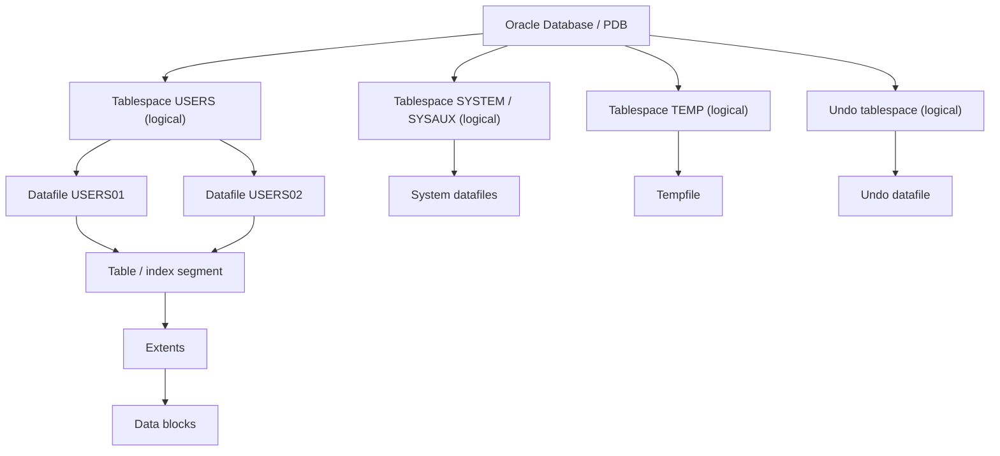
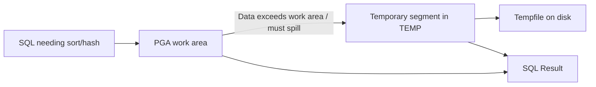
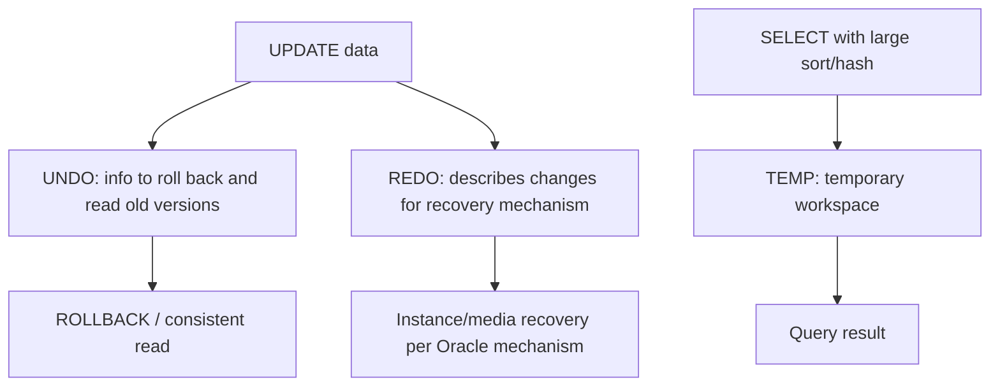
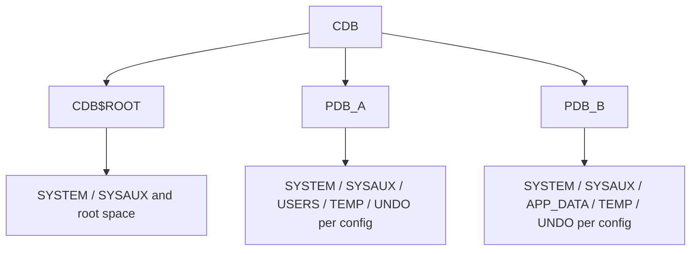

# SYSTEM, SYSAUX, USERS, TEMP, and UNDO Tablespaces in Oracle Database

When learning Oracle Database storage, one of the most common misconceptions is viewing the database like a directory containing table files: create a table, and a dedicated physical file appears for that table. Oracle organizes storage using a different model: a **tablespace** is the logical space management unit; a **datafile/tempfile** is where physical space is allocated; and table and index data are managed as **segments**, **extents**, and **blocks**.

In a typical Oracle Database, five frequently encountered tablespace names are **SYSTEM**, **SYSAUX**, **USERS**, **TEMP**, and **UNDO** (an actual undo tablespace may carry another name such as `UNDOTBS1`). They do not differ in name alone: each type has its own role, allocation mechanism, and operational requirements. Distinguishing them properly helps application developers know where to place tables, understand why an `ORDER BY` query might use disk space, explain rollback/read-consistency errors, and avoid accidentally interfering with system space.

This article focuses on how to **understand, observe, and practice safely**. The illustrative administrative commands should only be run by a DBA in a dedicated lab environment; regular learners can inspect objects belonging to their own schema without system privileges.

## 1. Storage Model: From Database to Block

### 1.1. Logical and Physical Layers



The diagram illustrates logical management relationships: a typical object's segment belongs to a tablespace and consists of extents, each consisting of blocks. Extents of one segment can reside in different datafiles of the same tablespace. Bigfile tablespaces differ in file count structure from smallfile tablespaces; the two-file diagram illustrates the smallfile form.

| Concept | Nature | Example / Meaning |
|---|---|---|
| **Database block** | Smallest logical storage/I/O unit of Oracle at the database layer | Commonly 8 KB in many installations, though actual config must be checked |
| **Extent** | A group of contiguous blocks allocated to a segment | A segment can expand by receiving new extents |
| **Segment** | Set of extents storing a specific object or part of an object | Table segment, index segment, LOB segment, partition |
| **Tablespace** | Logical unit containing and managing segments/space | `USERS`, `SYSTEM`, `TEMP`, a custom tablespace |
| **Datafile** | Physical file providing space for permanent/undo tablespaces | Can use Oracle Managed Files (OMF) |
| **Tempfile** | Physical file providing space for temporary tablespaces | Holds temporary SQL work areas |

A `CREATE TABLE` statement does not create a new datafile. When the table receives data, Oracle allocates segments/extents from the specified tablespace or the user's default tablespace. A **datafile** belongs to a tablespace, while a **table segment** is stored inside space managed by that tablespace.

### 1.2. A Tablespace Is Not a Schema

Two questions are often mixed up:

- **"Who owns this table?"** → Schema owner, e.g., `SALES_APP.ORDERS`.
- **"Where is this table's segment located?"** → Tablespace, e.g., `APP_DATA` or `USERS`.

One schema can own multiple objects across multiple tablespaces; one tablespace can hold segments belonging to multiple schemas. A schema named `USERS` has no mandatory relationship to the `USERS` tablespace. A user named `LAB_APP` can still use the `USERS` tablespace if granted an appropriate quota.

### 1.3. Files That Are Not Tablespaces

**Redo logs**, **control files**, **SPFILE/PFILE**, and **archived redo logs** serve different roles in Oracle's architecture. They are not datafiles of `USERS` or `UNDO` tablespaces. In particular, **undo does not replace redo**: undo enables rolling back and reconstructing consistent data images, whereas redo records changes needed for the database recovery mechanism.

## 2. The Five Tablespaces to Remember Immediately

| Tablespace | Common `CONTENTS` Type | Primary Purpose | Should Business Tables Be Placed Here? |
|---|---|---|---|
| **SYSTEM** | `PERMANENT` | Core data dictionary metadata and essential system objects | **No** |
| **SYSAUX** | `PERMANENT` | Auxiliary space for Oracle system components/mechanisms | **No** |
| **USERS** | `PERMANENT` | Common default space for user objects in simple environments | **Yes**, if policies and quotas allow |
| **TEMP** | `TEMPORARY` | Temporary work area for sorts, hashes, and certain SQL operations/temporary objects | **No**: not a place for persistent business tables |
| **UNDO** | `UNDO` | Undo info serving rollback, consistent reads, and related features | **No** |

The names **`SYSTEM`** and **`SYSAUX`** represent familiar system tablespaces. `USERS` and `TEMP` are common default names, though real environments may use custom names or add other tablespaces. Undo tablespaces often have names like `UNDOTBS1`, `UNDOTBS2`; do not assume a tablespace is literally named `UNDO`. Query the Oracle dictionary to learn the actual names and which undo tablespace an instance is using.

A functional way to remember them:

```text
SYSTEM  → Oracle's data dictionary core
SYSAUX  → Oracle's internal supporting components
USERS   → application data segments in simple setups
TEMP    → temporary SQL/session workspace
UNDO    → old versions / undo info protecting transactions and consistent reads
```

## 3. SYSTEM — The Core Tablespace of the Database

### 3.1. What Does SYSTEM Contain?

`SYSTEM` is an essential tablespace created alongside the database. It stores critical parts of the **data dictionary**: metadata telling Oracle which users, objects, columns, privileges, and structures exist in the database. Many internal structures managed by Oracle depend on this tablespace.

When you run:

```sql
SELECT table_name FROM user_tables ORDER BY table_name;
```

Oracle must look up object metadata. That does not mean the row data of all application tables sits in SYSTEM; metadata and segments storing table contents are two different kinds of information.

### 3.2. Why Not Place Application Tables in SYSTEM?

- SYSTEM is a foundational resource whose availability and integrity heavily impact database operation.
- Uncontrolled application data growth can create space pressure, complicate maintenance, and increase risk to metadata.
- Quota management, privileges, storage expansion, and application monitoring belong in dedicated or managed user tablespaces.
- Deleting/moving system segments or "cleaning files" with OS tools can cause severe consequences.

**Operational rule:** never set `SYSTEM` as the default tablespace for new application accounts; never manually add, delete, or modify internal objects in SYSTEM. If SYSTEM grows quickly or nears full, a DBA must diagnose the cause through Oracle metadata and tools rather than manually deleting datafiles.

### 3.3. Identification Example

A DBA can query tablespace type and status:

```sql
SELECT tablespace_name,
       contents,
       status,
       extent_management,
       segment_space_management
FROM dba_tablespaces
WHERE tablespace_name = 'SYSTEM';
```

Typically `CONTENTS` is `PERMANENT`. Even though it is a "permanent tablespace", that does not mean it is meant for business data. Its system role outweighs the `PERMANENT` classification label.

## 4. SYSAUX — Auxiliary Space for Oracle Components

### 4.1. Why Is SYSAUX Needed?

Oracle uses `SYSAUX` as an **auxiliary tablespace** to house data belonging to many system components instead of concentrating everything in `SYSTEM`. Specific occupants depend on the version, installed features, and database configuration. These can include objects for metadata, repositories, or internal statistics of Oracle components.

Some environments store Automatic Workload Repository (AWR) data and related utilities in SYSAUX; using advanced monitoring features must comply with applicable **licensing/usage rights** for the system. Do not assume every component is present or licensed on every edition.

### 4.2. How Does SYSAUX Differ from SYSTEM?

| Aspect | SYSTEM | SYSAUX |
|---|---|---|
| Role | Core of the data dictionary and essential objects | Supporting Oracle components |
| Necessity | Mandatory, highly sensitive | An important part of many modern Oracle installations |
| Application data | Should not be stored here | Should not be stored here |
| When growing | DBA investigates system objects and database health | DBA investigates which **occupant** is growing and that component's retention/policies |
| Action | Follow Oracle operational procedures | Follow each component's procedures; never arbitrarily delete internal objects |

### 4.3. Viewing Which Components Use SYSAUX

With appropriate dynamic view privileges, a DBA can query:

```sql
SELECT occupant_name,
       schema_name,
       ROUND(space_usage_kbytes / 1024, 2) AS space_mb
FROM v$sysaux_occupants
ORDER BY space_usage_kbytes DESC;
```

The output identifies which data groups consume space. This is an investigation starting point: **never delete tables, truncate, or drop segments in SYSAUX simply because an occupant is large**. Use the component-specific management/retention mechanisms supported by Oracle.

## 5. USERS — Where Application Data Lives in Basic Environments

### 5.1. How Is USERS Typically Used?

`USERS` is usually a pre-created **permanent tablespace** meant to hold user segments in practice systems. When creating a table without specifying `TABLESPACE`, Oracle generally uses the **user's default permanent tablespace**. If the user has appropriate quota and object creation privileges, the table's data can be allocated in `USERS`.

However, avoid two assumptions:

1. Not every database has `USERS` or sets `USERS` as the default permanent tablespace.
2. Not every user table resides in `USERS`; there may be dedicated tablespaces for applications, indexes, partitions, or LOBs.

In enterprise environments, DBAs often create tablespaces such as `APP_DATA`, `APP_INDEX`, or names organized by tenant/workload for capacity administration and separation of duties. This is a design/operational choice, not a requirement that every project split files per table.

### 5.2. Default Tablespace and Quota

Example executed by a DBA in a **lab PDB** containing `USERS` and `TEMP` tablespaces:

```sql
CREATE USER lab_store IDENTIFIED BY "UseOwnLabPassword123"
  DEFAULT TABLESPACE users
  TEMPORARY TABLESPACE temp
  QUOTA 50M ON users;

GRANT CREATE SESSION, CREATE TABLE TO lab_store;
```

The attributes have distinct meanings:

- `DEFAULT TABLESPACE users`: if no other location is specified, permanent segments go to the user's default tablespace.
- `TEMPORARY TABLESPACE temp`: specifies where temporary space is used when needed.
- `QUOTA 50M ON users`: limits the segment space the user can consume in `USERS` under the quota mechanism.
- `GRANT CREATE TABLE`: grants table creation privilege. **Table creation privilege and storage quota are two separate conditions.**

Never use `GRANT DBA`, `UNLIMITED TABLESPACE`, or the `SYS` account for applications just to avoid quota errors. Broad privileges can far exceed actual needs.

> **Multitenant characteristic:** in modern CDB/PDB architectures, application users are typically created in a **PDB**, not the CDB root. Creating a local user in the wrong container can hit common-user naming rules or use the wrong tablespace. Always verify your container before running DBA commands.

### 5.3. Creating and Observing a Table Segment

Connected as `LAB_STORE` created in the example above:

```sql
CREATE TABLE purchase_notes (
    note_id NUMBER(10) CONSTRAINT pk_purchase_notes PRIMARY KEY,
    note_text VARCHAR2(200 CHAR) NOT NULL
) TABLESPACE users;

INSERT INTO purchase_notes (note_id, note_text)
VALUES (1, 'First lab note');

COMMIT;
```

Check where the allocated segments are stored:

```sql
SELECT segment_name,
       segment_type,
       tablespace_name,
       ROUND(bytes / 1024 / 1024, 2) AS allocated_mb
FROM user_segments
WHERE segment_name LIKE 'PURCHASE_NOTES%'
   OR segment_name = 'PK_PURCHASE_NOTES'
ORDER BY segment_name;
```

For a table with a primary key, in addition to the table segment there may be an index segment supporting the constraint. The generated index name depends on how it is declared; in this example the constraint name `PK_PURCHASE_NOTES` is typically used as the supporting index name when the system creates the corresponding index.

**Deferred segment creation** can cause a newly created table with no data yet not to appear in `USER_SEGMENTS`. That is why the example inserts a row before checking. `BYTES` represents space **allocated to the segment**, not total useful data size or OS file size.

If the user wants to check quota:

```sql
SELECT tablespace_name,
       bytes,
       max_bytes
FROM user_ts_quotas
ORDER BY tablespace_name;
```

`BYTES` shows quota currently used per the view, while `MAX_BYTES` is the corresponding limit; special values or the `UNLIMITED TABLESPACE` privilege can make interpretation differ from "exactly 50 MB". Avoid treating a single quota number as an indicator of total tablespace capacity.

## 6. TEMP — Temporary Workspace When SQL Needs More Memory

### 6.1. What Does TEMP Contain?

A temporary tablespace like `TEMP` provides workspace for SQL operations and temporary objects, especially when work cannot finish entirely in memory:

- Sorts for certain `ORDER BY`, `GROUP BY`, `DISTINCT`, window functions, or other sorting operations.
- Certain hash joins/hash aggregations when spilling from PGA to disk.
- Intermediate steps in SQL execution plans, index creation, and other operations needing temporary segments.
- Data of global temporary tables and other temporary object types under Oracle's corresponding mechanisms.

**Having an `ORDER BY` does not guarantee TEMP usage increases.** If the optimizer uses an index returning rows in order, or data fits within PGA, the query may not allocate significant temp segments. To know how much TEMP a query truly uses, examine its plan/statistics and runtime metrics.

### 6.2. TEMP Uses Tempfiles, Unlike Regular Datafiles

Permanent tablespaces like `USERS` use **datafiles**, whereas temporary tablespaces use **tempfiles**. TEMP space is temporary in the sense of serving SQL sessions/requests—it **does not mean tempfiles disappear from disk once a query finishes**. Files are retained so space can be reused; allocated size, currently active usage, and OS disk footprint are distinct metrics.



A table storing long-term sales data **cannot be created in TEMP** the way a permanent table segment is created. TEMP provides temporary workspace, not persistent business storage backed up like regular tables.

### 6.3. TEMP Differs from UNDO

A large `ORDER BY` may need TEMP to hold intermediate data, whereas an `UPDATE` transaction needs UNDO to support rollback and consistent reads. Both support SQL processing, yet their contents, lifecycles, and protection mechanisms differ:

| Aspect | TEMP | UNDO |
|---|---|---|
| Serves | Work area/spill, temporary operations | Change history needed for rollback, consistent reads |
| Physical file | Tempfile | Undo tablespace datafile |
| Intended to store long-term application data? | No | No |
| Transaction coupling | Not where DML undo is stored | Directly tied to transactional changes |
| Running out of space typically causes | Failure to allocate additional temporary extents, SQL fails to complete | Undo allocation failure or read-consistency/rollback issues |
| Remediation | Inspect SQL, workarea, concurrent sessions, tempfile/capacity | Inspect transactions, undo generation/retention, undo growth capacity |

### 6.4. How to Observe TEMP

A DBA can inspect tempfiles:

```sql
SELECT tablespace_name,
       file_name,
       ROUND(bytes / 1024 / 1024, 2) AS size_mb,
       autoextensible,
       ROUND(maxbytes / 1024 / 1024, 2) AS max_mb
FROM dba_temp_files
ORDER BY tablespace_name, file_name;
```

With privileges to read dynamic performance views, you can inspect allocation state in TEMP by file:

```sql
SELECT tablespace_name,
       ROUND(SUM(bytes_used) / 1024 / 1024, 2) AS used_mb,
       ROUND(SUM(bytes_free) / 1024 / 1024, 2) AS free_mb
FROM v$temp_space_header
GROUP BY tablespace_name
ORDER BY tablespace_name;
```

To see sessions currently holding temp segments:

```sql
SELECT username,
       tablespace,
       segtype,
       sql_id,
       blocks
FROM v$tempseg_usage
ORDER BY blocks DESC;
```

`BLOCKS` must be multiplied by the appropriate block size if estimating bytes; never assume every environment uses 8 KB. Different TEMP views reflect allocated/reusable space differently; measure at multiple points in time and from consistent sources when diagnosing.

## 7. UNDO — The Foundation of Rollback and Consistent Read

### 7.1. What Is Undo Data?

When a transaction modifies data, Oracle generates **undo** info describing the state needed to reverse the change and reconstruct a consistent data version for eligible readers. Undo is stored in **undo segments** inside an undo tablespace, managed automatically by Oracle in the common Automatic Undo Management mode.

Suppose we have a table:

```sql
CREATE TABLE account_lab (
    account_id NUMBER(10) PRIMARY KEY,
    balance NUMBER(12, 2) NOT NULL
);

INSERT INTO account_lab (account_id, balance)
VALUES (1, 1000);

COMMIT;
```

Suppose Session A updates without committing yet:

```sql
UPDATE account_lab
SET balance = 700
WHERE account_id = 1;

-- Not yet COMMITted
```

Session B reading under the standard `READ COMMITTED` isolation level will not see Session A's uncommitted value. Oracle uses **multiversion read consistency** with undo to provide the data version matching the statement's snapshot. If Session A runs:

```sql
ROLLBACK;
```

The change to 700 is undone; the pre-update value is restored to 1000 per the example transaction.

Key point: **UNDO serves rollback and consistent reads**, not as a user-queryable business history table to "restore any arbitrary point in time".

### 7.2. Main Functions of Undo

1. **Transaction rollback:** restores data when an application executes `ROLLBACK` or a transaction fails.
2. **Read consistency:** provides a consistent data image for queries while other transactions modify data.
3. **Transaction recovery:** assists the database in handling uncommitted transactions during recovery scenarios per Oracle's mechanisms.
4. **Certain Flashback features:** uses still-available undo data to view/restore past states within the scope of corresponding features, privileges, and retention limits.

Do not infer that undo replaces backups. Undo does not guarantee retaining all history indefinitely; recovering from lost files, infrastructure failure, or disasters still requires a separate backup/recovery strategy.

### 7.3. Undo Extents by Status

A DBA can inspect extents in the undo tablespace:

```sql
SELECT tablespace_name,
       status,
       ROUND(SUM(bytes) / 1024 / 1024, 2) AS allocated_mb
FROM dba_undo_extents
GROUP BY tablespace_name, status
ORDER BY tablespace_name, status;
```

Commonly encountered statuses:

| Status | Meaning |
|---|---|
| `ACTIVE` | Undo still belongs to an unfinished transaction; cannot be treated as overwritable |
| `UNEXPIRED` | Undo of a completed transaction still within the window prioritized for consistency/retention needs |
| `EXPIRED` | Undo past its corresponding retention requirement and eligible for reuse under management rules |

Do not assume that `ACTIVE + UNEXPIRED` equals "stuck data". Undo is designed to be reused; undo volume depends on update load, transaction duration, query runtime, and retention policies.

### 7.4. UNDO_RETENTION and the "Snapshot Too Old" Error

The `UNDO_RETENTION` parameter expresses a target minimum duration for keeping committed undo under certain conditions. **Setting a parameter value does not by itself create an absolute guarantee** that every long query can read historical data: it depends on undo capacity, autoextend, query duration, undo generation rate, retention guarantee mode, and Oracle's automatic retention tuning.

For example:

- Session A runs a long report requiring a consistent view of data as of statement start time.
- Many other sessions continuously update data, generating heavy undo volume.
- If undo containing the data version the report still needs has been overwritten due to space/retention pressure, the query may encounter **`ORA-01555: snapshot too old`**.

Do not solve `ORA-01555` merely by raising a parameter at random. Examine query duration, commit frequency, update volume, execution plans, undo usage, tablespace size, and actual retention. Some causes stem from application processing/cursor patterns and must be investigated case by case.

Oracle offers a **retention guarantee** mode on undo tablespaces in appropriate configurations. This mode prioritizes keeping undo per the configured retention, but can cause DML to fail if no allocatable space remains; only a DBA should decide after weighing trade-offs, never using it as a default "fix-all button".

### 7.5. UNDO Differs from REDO and TEMP



Redo can also record changes related to undo to satisfy the recovery mechanism; the diagram separates only the **primary purpose** of the three mechanisms. A large transaction can consume significant undo even when queries use no TEMP.

### 7.6. Observing Undo and Retention

A DBA can view the undo tablespace currently configured for the instance:

```sql
SELECT name, value
FROM v$parameter
WHERE name IN ('undo_management', 'undo_tablespace', 'undo_retention')
ORDER BY name;
```

To inspect part of historical undo trends and signs of snapshot exhaustion:

```sql
SELECT begin_time,
       end_time,
       undoblks,
       txncount,
       maxquerylen,
       ssolderrcnt,
       nospaceerrcnt,
       tuned_undoretention
FROM v$undostat
ORDER BY begin_time DESC
FETCH FIRST 12 ROWS ONLY;
```

`SSOLDERRCNT` relates to "snapshot too old" error counts in the statistical interval, `NOSPACEERRCNT` reflects insufficient undo space issues per stats, and `MAXQUERYLEN` and `TUNED_UNDORETENTION` help inspect query duration and tracked retention. Values must be analyzed over their corresponding time windows and instance/PDB architecture; one row showing an error is not enough to prove a specific SQL statement caused it.

### 7.7. UNDO in CDB/PDB

In a multitenant architecture, distinguish **CDB root** and **PDBs**. Many modern Oracle releases use **local undo mode**, where each PDB has its own undo tablespace serving that PDB's transactions alongside root undo per the architecture. Some legacy configurations/versions include **shared undo mode**.

Therefore, do not assume the entire CDB has only one undo tablespace or that its name is always `UNDOTBS1`. When reading output from `DBA_*`, `CDB_*`, or `V$` views, confirm the connected container, associated instance, and granted privileges. Changing undo mode/tablespace is a DBA procedure with specific constraints.

## 8. Observing Actual Tablespace Configuration

The following examples should only be run when the account has appropriate data dictionary or dynamic view privileges. **Never grant `SELECT ANY DICTIONARY` or the DBA role to an application account just to run a lesson.**

### 8.1. Confirming You Are in the Right Container

```sql
SELECT USER AS connected_user,
       SYS_CONTEXT('USERENV', 'CON_NAME') AS container_name,
       SYS_CONTEXT('USERENV', 'SERVICE_NAME') AS service_name
FROM dual;
```

Connect to a PDB service and run this query before interpreting tablespace names. The same name `USERS` can appear in multiple PDBs without referring to the same storage object.

### 8.2. Viewing the List, Type, and Status of Tablespaces

```sql
SELECT tablespace_name,
       contents,
       status,
       extent_management,
       allocation_type,
       segment_space_management
FROM dba_tablespaces
ORDER BY tablespace_name;
```

Explanation:

- `CONTENTS` indicates type such as `PERMANENT`, `TEMPORARY`, or `UNDO`.
- `STATUS` reflects tablespace status.
- `EXTENT_MANAGEMENT` and `ALLOCATION_TYPE` relate to how Oracle manages extents.
- `SEGMENT_SPACE_MANAGEMENT` relates to the free-space management mechanism inside segments where applicable.

You do not need to memorize every column immediately; the first step is identifying each tablespace's **role, actual name, and current status**.

### 8.3. Viewing Datafiles and Tempfiles

For datafiles of permanent/undo tablespaces:

```sql
SELECT tablespace_name,
       file_name,
       ROUND(bytes / 1024 / 1024, 2) AS current_mb,
       autoextensible,
       ROUND(maxbytes / 1024 / 1024, 2) AS max_mb
FROM dba_data_files
ORDER BY tablespace_name, file_name;
```

For temporary tablespaces:

```sql
SELECT tablespace_name,
       file_name,
       ROUND(bytes / 1024 / 1024, 2) AS current_mb,
       autoextensible,
       ROUND(maxbytes / 1024 / 1024, 2) AS max_mb
FROM dba_temp_files
ORDER BY tablespace_name, file_name;
```

Having two different views is an important learning point. `AUTOEXTENSIBLE=YES` only tells you the file is configured to expand up to its corresponding limit—it **does not guarantee physical storage still has enough room** or that policies/quotas permit a given allocation to succeed.

### 8.4. Viewing Default Permanent/Temporary Tablespaces

With privileges to query database metadata:

```sql
SELECT property_name, property_value
FROM database_properties
WHERE property_name IN (
    'DEFAULT_PERMANENT_TABLESPACE',
    'DEFAULT_TEMP_TABLESPACE'
)
ORDER BY property_name;
```

Inspect users' default and temporary tablespaces per granted privileges:

```sql
SELECT username,
       default_tablespace,
       temporary_tablespace
FROM dba_users
WHERE username IN ('LAB_STORE', 'LAB_APP')
ORDER BY username;
```

If you lack privileges to read `DBA_USERS` or `DATABASE_PROPERTIES`, obtain the info from a DBA; applications do not need broad privileges granted to themselves.

### 8.5. Viewing Large Segments in a Tablespace

A DBA can inspect application segment distribution:

```sql
SELECT owner,
       segment_name,
       segment_type,
       tablespace_name,
       ROUND(bytes / 1024 / 1024, 2) AS allocated_mb
FROM dba_segments
WHERE tablespace_name = 'USERS'
ORDER BY bytes DESC
FETCH FIRST 20 ROWS ONLY;
```

`ALLOCATED_MB` is not the "logical data bytes" currently used by the application. Allocated extents can contain free space inside segments; indexes, LOBs, and partitions can occupy separate segments. Across different PDBs, observe the right container and avoid summing data mistakenly across container views.

## 9. Capacity Monitoring: Capacity Is More Than File Count

Oracle manages space across multiple layers:

```text
Allocated segments / extents
        ↓
Available space inside the tablespace
        ↓
Current datafile / tempfile size
        ↓
MAXSIZE / AUTOEXTEND of each file
        ↓
Actual capacity of ASM diskgroup / filesystem / storage
```

A tablespace may report nearly full at its current file size yet still have autoextend headroom; conversely, a file may permit autoextend while the OS/ASM is nearly out of disk space, causing file expansion to fail. Examine every layer rather than looking at a single percentage.

### 9.1. Viewing Usage by Tablespace

Example metric Oracle provides for DBA reference:

```sql
SELECT tablespace_name,
       used_percent
FROM dba_tablespace_usage_metrics
ORDER BY used_percent DESC;
```

`USED_PERCENT` from this view follows Oracle's specific calculation against data and tablespace limits; verify how autoextend limits or underlying storage are reflected in your running version. Do not interpret every such figure as OS disk utilization percentage.

If you only want to view free extent space in **permanent tablespaces**:

```sql
SELECT tablespace_name,
       ROUND(SUM(bytes) / 1024 / 1024, 2) AS free_extents_mb
FROM dba_free_space
GROUP BY tablespace_name
ORDER BY tablespace_name;
```

`DBA_FREE_SPACE` reflects free extents within the tablespace under its applicable mechanism; it is not the standard gauge for active **TEMP** usage or **UNDO** retention goals, nor does it assume "files will grow all the way to MAXSIZE". Accurate capacity analysis combines files, metrics, quotas, space management, and OS/ASM.

### 9.2. Autoextend Is a Tool, Not a Capacity Strategy

Suppose `USERS` currently has a 1 GB datafile with `AUTOEXTEND ON` capped at 8 GB. That does not mean storage has pre-reserved 8 GB. Operational design requires:

- Capacity alerts when files/tablespaces approach effective limits.
- Monitoring real filesystem/ASM capacity and expansion headroom.
- Accounting for data growth rates and write volume, especially for large LOB tables or indexes.
- Approved procedures to resize files, add datafiles, or migrate segments.
- Distinguishing **exhausted user quota** from **truly exhausted tablespace/file space**.

Never use `AUTOEXTEND UNLIMITED` as a substitute for capacity monitoring: it can shift an issue from one tablespace to filling shared underlying disks.

## 10. Symptoms and Troubleshooting Directions by Tablespace

| Error Code / Situation | Commonly Related Area | Diagnostic Direction |
|---|---|---|
| `ORA-01536: space quota exceeded` | User quota on permanent tablespace | Check `USER_TS_QUOTAS`/quota in `DBA_TS_QUOTAS` and growing tables/indexes |
| `ORA-01653: unable to extend table` | Table segment in permanent tablespace | Check extents, datafiles, autoextend, OS/ASM, and segment growth |
| `ORA-01654: unable to extend index` | Index in permanent tablespace | Check the index's tablespace, growth rate, and space strategy |
| `ORA-01652: unable to extend temp segment` | Often related to TEMP; exact message names the tablespace | Check SQL using sort/hash, session TEMP usage, tempfiles, and concurrent workload |
| `ORA-30036: unable to extend segment ... in undo tablespace` | UNDO | Check active undo, large/long-running transactions, undo size, and retention |
| `ORA-01555: snapshot too old` | Ability to provide older data versions from undo | Check long reports, undo generation rate, retention, SQL, and query duration |
| SYSAUX growing rapidly | SYSAUX occupants | Identify space-consuming component, retention, and Oracle-supported cleanup mechanisms |
| SYSTEM nearly full | SYSTEM/data dictionary | Analyze with administrative tools; avoid manually deleting system objects |

**Investigation note:** an error code or metric table is a starting point, not a conclusion. For instance, `ORA-01652` can occur during temporary segment creation in complex scenarios; read the full message and tablespace named in the error. Likewise, a slow query is not automatically caused by TEMP or UNDO being too small—it could stem from execution plans, locks, CPU, I/O, or network.

### 10.1. If an Application Reports "Out of USERS Space"

Reasonable sequence:

1. Identify the user/schema and object causing growth.
2. Distinguish **quota** errors from **tablespace/file** errors.
3. Check datafile size/autoextend and underlying storage capacity.
4. If growth is legitimate, the DBA decides to add space or adjust quotas per policy.
5. If growth is abnormal, investigate SQL, business retention, indexes/LOBs/partitions, and repetitive write jobs.

Never move tables into SYSTEM/SYSAUX just to "find extra room".

### 10.2. If a Report Fails with Out of TEMP

Reasonable sequence:

1. Identify the associated `SQL_ID`/session and report runtime.
2. Inspect the execution plan for sorts/hashes, large joins, or intermediate operations.
3. Check PGA workarea, concurrent similar queries, and tempfile usage/autoextend.
4. Tune queries, indexes, filter predicates, data limits, and concurrency where appropriate.
5. Only after understanding the workload should you resize/add tempfiles or adjust parameters per DBA procedure.

Do not treat adding TEMP as a fix for every slow report; a query missing filter predicates can continue escalating temporary data demand over time.

### 10.3. If a Transaction Reports Insufficient UNDO

Reasonable sequence:

1. Identify which transactions are generating heavy undo or staying open too long.
2. Check `V$UNDOSTAT` metrics and undo file/tablespace capacity.
3. Examine DML rate, rollback requirements, query lengths, and retention.
4. For legitimate workloads, adjust size/autoextend or DML/SQL plans per DBA assessment.
5. Verify the error disappears and consistent-read requirements remain satisfied.

Automatically committing very frequently just to "reduce undo" is not a safe default solution. Committing halfway through a business operation can break transaction atomicity and make business recovery harder.

## 11. Tablespaces in the CDB/PDB Model

Oracle multitenant introduces **containers**: CDB root and PDBs each have metadata/objects and space scoped appropriately. Tablespace names like `SYSTEM`, `SYSAUX`, `USERS`, or `TEMP` can appear across multiple containers.



This is a conceptual diagram, not an exact list of tablespaces present in every version. Some TEMP/UNDO modes are shared or local depending on multitenant configuration. When administering, distinguish:

- **Which PDB service are you connected to?** The same displayed username can belong to a different container.
- **Does the admin command apply at root or PDB?** Resource scope and privileges differ.
- **Is undo mode local or shared?** Especially important when interpreting undo usage per PDB.
- **Are you querying `DBA_*` or `CDB_*`?** Container-wide views can return multiple containers and include `CON_ID` where applicable.

Make one simple check a habit before any operation:

```sql
SELECT SYS_CONTEXT('USERENV', 'CON_NAME') AS current_container
FROM dual;
```

Never apply quota grants, undo changes, or tempfile changes directly in the CDB root merely because a default connection opened in root.

## 12. Hands-On Lab: Observing the Five Tablespaces in a Lab PDB

### Preparation

You need a practice Oracle Database/PDB with the corresponding tablespaces, SQL*Plus/SQLcl or SQL Developer, and an application user granted table-creation privileges and quota on an appropriate permanent tablespace. `DBA_*`/`V$*` views should only be run if the DBA grants observation access; otherwise, run the `USER_*` parts and note which info needs to be requested from the DBA.

### Exercise 1 — Classify Existing Tablespaces

In a DBA session on the **right PDB**:

```sql
SELECT tablespace_name, contents, status
FROM dba_tablespaces
ORDER BY tablespace_name;
```

Record:

- Names of SYSTEM and SYSAUX.
- Permanent tablespace for users, which may be USERS or a custom name.
- Existing temporary tablespaces and the default name.
- Undo tablespace and the undo mode corresponding to the PDB/instance.

Do not hardcode `UNDOTBS1` if the system uses a different name.

### Exercise 2 — Prove Schema Differs from Tablespace

The DBA creates a lab user as in Section 5 or uses an existing assigned user. Connect as that user, create a table, and insert one row:

```sql
CREATE TABLE lab_storage_notes (
    id NUMBER(10) PRIMARY KEY,
    message VARCHAR2(100 CHAR) NOT NULL
) TABLESPACE users;

INSERT INTO lab_storage_notes (id, message)
VALUES (1, 'Oracle tablespace lab');

COMMIT;

SELECT segment_name, segment_type, tablespace_name, bytes
FROM user_segments
WHERE segment_name LIKE 'LAB_STORAGE_NOTES%'
ORDER BY segment_name;
```

Replace `USERS` with the permanent tablespace where you have quota if your lab uses a different name. Note that `CREATE TABLE` is DDL and usually performs an implicit commit; `ROLLBACK` does not undo table creation the way it undoes `INSERT`.

### Exercise 3 — Compare Datafiles with Tempfiles

The DBA runs `DBA_DATA_FILES` and `DBA_TEMP_FILES` as in Section 8. Record tablespace name, file type, current size, and autoextend settings. Discuss why TEMP appears in `DBA_TEMP_FILES` while USERS and undo datafiles appear in `DBA_DATA_FILES`.

### Exercise 4 — Observe TEMP Changing Under SQL

On sufficiently large lab data or a prepared workload, run a query with significant sort/hash work and monitor `V$TEMPSEG_USAGE` or `V$TEMP_SPACE_HEADER` during the same window. Compare before, during, and after the query finishes.

There is no guarantee a small query will use tempfiles, and never run intentionally heavy load queries on a shared database. If there is not enough data to trigger a spill, explain why rather than concluding TEMP is "not working".

### Exercise 5 — Prove Rollback Needs Undo

Create a small table in the lab schema, insert data, and `COMMIT`. Open two sessions:

1. Session A updates a row without committing.
2. Session B reads the same row and records the visible value.
3. Session A runs `ROLLBACK`.
4. Session B reads again, compares, and explains read consistency.

This exercise illustrates the meaning of undo. There is no need to open heavy sessions or try to fill the undo tablespace to learn the mechanism.

### Exercise 6 — Build an Operational Map

Complete the table:

| Scenario | Tablespace/Mechanism to Check First | View or Evidence |
|---|---|---|
| Application cannot create table due to quota | Permanent tablespace + user quota | `USER_TS_QUOTAS`, `DBA_TS_QUOTAS` |
| Table grows rapidly over several days | Permanent segment/datafile | `DBA_SEGMENTS`, `DBA_DATA_FILES`, capacity metrics |
| Large sort report fails | TEMP | `V$TEMPSEG_USAGE`, `DBA_TEMP_FILES` |
| Long query reports snapshot too old | UNDO/retention | `V$UNDOSTAT`, undo extents, and SQL runtime |
| System repository grows rapidly | SYSAUX | `V$SYSAUX_OCCUPANTS` |
| Metadata/data dictionary faces space issues | SYSTEM | `DBA_TABLESPACES`, datafiles, and DBA assessment |

The lab output should be a record containing: **current container, actual tablespace names, file locations, application segments, quotas, TEMP/UNDO evidence, and administrative privilege boundaries**.

## 13. Self-Check Questions

1. How do tablespace, datafile, segment, extent, and block differ? Why does creating another table not necessarily create another physical file?
2. Must a table's metadata and the data inside the table always reside in the same tablespace?
3. Why should business tables not be placed in SYSTEM or SYSAUX?
4. Is `USERS` always every user's default permanent tablespace? How do quota and the `CREATE TABLE` privilege relate?
5. When does a SQL statement need TEMP, and why does `ORDER BY` not always use tempfiles?
6. What role does undo play when one session runs an uncommitted `UPDATE` while another session runs `SELECT`?
7. Does `UNDO_RETENTION` guarantee every long query avoids `ORA-01555`? What other factors must be considered?
8. Why can TEMP, UNDO, and REDO not substitute for one another's functions?
9. What is the difference between "tablespace has free extents", "datafile has autoextend enabled", and "filesystem/ASM has free capacity"?
10. When working with PDBs, why must you identify the container before reading tablespace names or changing configurations?

Once you have a solid grasp of these five tablespace groups, you have the foundation to continue with datafile/tempfile management, quotas, index/LOB segments, capacity planning, tuning queries using TEMP, monitoring undo, and Oracle Database operational procedures. **SYSTEM/SYSAUX** protect metadata infrastructure, **USERS** represents simple application space, **TEMP** supports intermediate work, and **UNDO** ensures rollback capability and consistent reads. Each group requires its own observation and troubleshooting approach.
